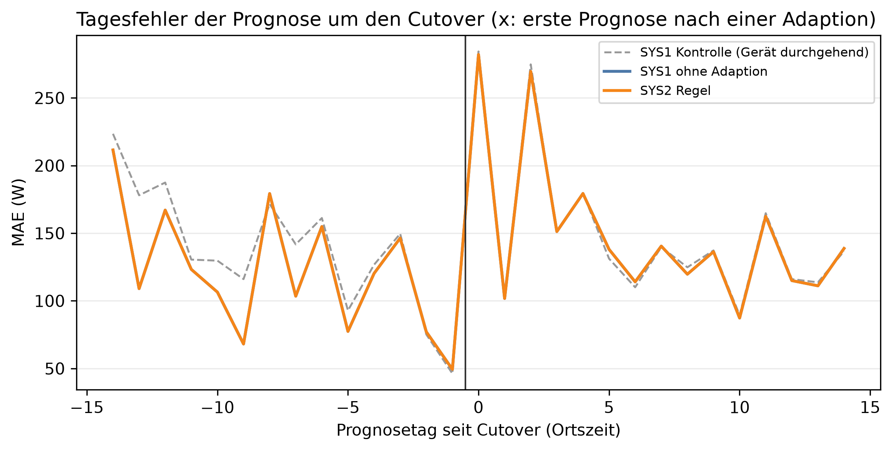

# E1 Neues Gerät, Lauf e1_001

## Setup

- Gerät: H1_M6
- Cutover: 2014-04-15, Tag 0 (alle Tage und Daten in Ortszeit)
- Analysierte Tage: 2014-03-31 bis 2014-04-28, 15 vor und 14 ab Cutover
- Prognosemodell: C3_30
- Kontrolllauf: e1_control_001
- Commit: a3ddf39 (mit lokalen Änderungen)

## Prognose

| System | MAE vor Cutover [W] | MAE ab Cutover [W] | Differenz zu SYS1 ab Cutover [W] | Tage besser als SYS1 [%] | Geräteeffekt auf MAE [W] |
|---|---:|---:|---:|---:|---:|
| SYS1 ohne Adaption | 121,0 | 149,8 | - | - | 16,4 |
| SYS2 Regel | 121,0 | 149,8 | 0,0 | 0,0 | 16,4 |

## Erkennung und Eingriffe

| System | erster new_pattern [Tag] | new_pattern ab Cutover [Tage] | new_pattern vor Cutover, Fehlalarm [Tage] | new_pattern ab Cutover, Kontrolle [Tage] | Adaptionen vor Cutover | Adaptionen ab Cutover |
|---|---:|---:|---:|---:|---:|---:|
| SYS2 Regel | - | 0 | 0 | 0 | 0 | 0 |

## Klassifikationen je Zeitraum [Tage]

| System | Zeitraum | Tage | low | normal | peak | ohne Ergebnis |
|---|---|---:|---:|---:|---:|---:|
| SYS2 Regel | vor Cutover | 15 | 1 | 14 | 0 | 0 |
| SYS2 Regel | ab Cutover | 14 | 0 | 13 | 1 | 0 |
| SYS2 Regel | ab Cutover, Kontrolle | 14 | 0 | 14 | 0 | 0 |

## Ereignisprotokoll

| Tag | Datum | System | Klassifikation | Adaption | Begründung |
|---:|---|---|---|---|---|

## Hinweise

- SYS2 Regel: Differenz zu SYS1 ab Cutover 0,0 W bei 2 Standardfehlern von 0,0 W (15 Tage), kein belastbarer Unterschied

