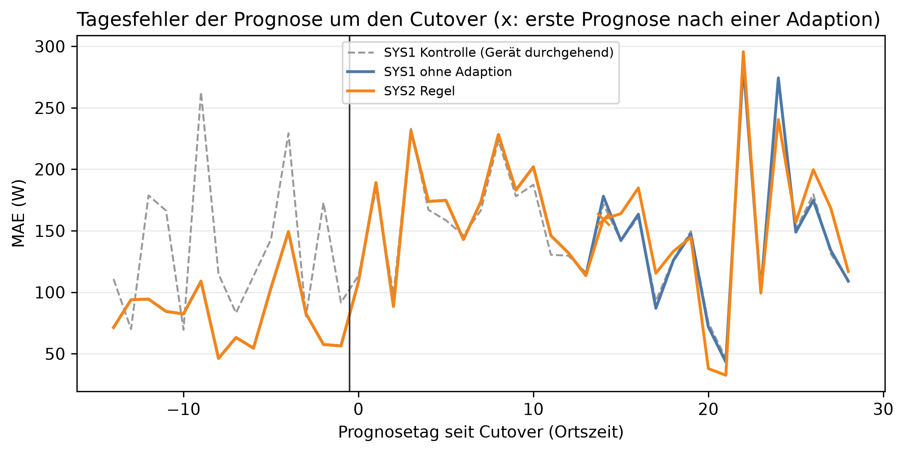

# E1 Neues Gerät, Lauf e1_003

## Setup

- Gerät(e): H1_M5, H1_M6
- Cutover: 2014-03-24, Tag 0 (alle Tage und Daten in Ortszeit)
- Analysierte Tage: 2014-03-09 bis 2014-04-20, 15 vor und 28 ab Cutover
- Prognosemodell: C3_30
- Kontrolllauf: e1_control_004
- Commit: a3ddf39 (mit lokalen Änderungen)

## Erkennung

| System | erster new_pattern [Tag] | new_pattern ab Cutover [Tage] | new_pattern vor Cutover, Fehlalarm [Tage] | new_pattern ab Cutover, Kontrolle [Tage] | Adaptionen vor Cutover | Adaptionen ab Cutover |
|---|---:|---:|---:|---:|---:|---:|
| SYS2 Regel | 13 | 1 | 0 | 0 | 0 | 1 |

## Prognose ab Adaption

| System | Adaption ab Prognosetag | MAE ab Adaption [W] | SYS1 im selben Zeitraum [W] | Differenz zu SYS1 [W] | Tage besser als SYS1 [%] |
|---|---:|---:|---:|---:|---:|
| SYS2 Regel | 14 | 150,0 | 145,7 | 4,2 | 40,0 |

## Ereignisprotokoll

| Tag | Datum | System | Klassifikation | Adaption | Begründung |
|---:|---|---|---|---|---|
| 13 | 2014-04-06 | SYS2 Regel | new_pattern | advance_history_start | sustained deviation across multiple scales at once (weekly, long_term), on a weekend. |

## Hinweise

- SYS2 Regel: Differenz zu SYS1 ab Adaption (Prognosetag 14) 4,2 W bei 2 Standardfehlern von 11,0 W (15 Tage), kein belastbarer Unterschied

## Anhang

### Prognose vor und ab Cutover

| System | MAE vor Cutover [W] | MAE ab Cutover [W] | MAE ab Cutover, Kontrolle [W] | Differenz zu SYS1 ab Cutover [W] | Tage besser als SYS1 [%] |
|---|---:|---:|---:|---:|---:|
| SYS1 ohne Adaption | 82,0 | 154,3 | 152,7 | - | - |
| SYS2 Regel | 82,0 | 156,4 | 152,7 | 2,2 | 20,7 |

### Klassifikationen je Zeitraum [Tage]

| System | Zeitraum | Tage | low | new_pattern | normal | peak | unknown | ohne Ergebnis |
|---|---|---:|---:|---:|---:|---:|---:|---:|
| SYS2 Regel | vor Cutover | 15 | 0 | 0 | 15 | 0 | 0 | 0 |
| SYS2 Regel | ab Cutover | 28 | 1 | 1 | 20 | 3 | 3 | 0 |
| SYS2 Regel | ab Cutover, Kontrolle | 28 | 1 | 0 | 27 | 0 | 0 | 0 |
