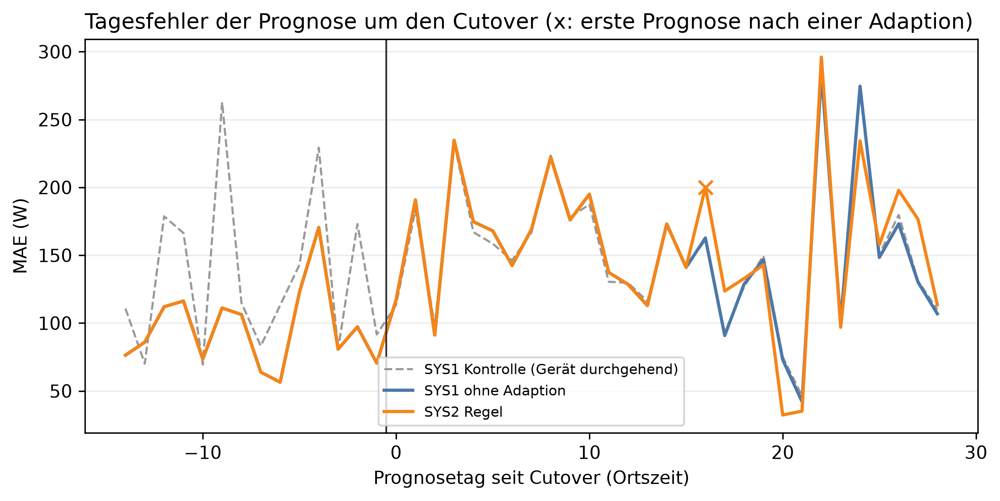

# E1 Neues Gerät, Lauf e1_005

## Setup

- Gerät(e): H1_M5
- Cutover: 2014-03-24, Tag 0 (alle Tage und Daten in Ortszeit)
- Analysierte Tage: 2014-03-09 bis 2014-04-20, 15 vor und 28 ab Cutover
- Prognosemodell: C3_30
- Kontrolllauf: e1_control_005
- Commit: a3ddf39 (mit lokalen Änderungen)

## Kennzahlen

| Kennzahl | Wert | Bezug |
|---|---|---|
| SYS2 Regel: erster new_pattern [Tag seit Cutover] | 15 | 0 Fehlalarme vor Cutover |
| SYS2 Regel: MAE-Differenz zu SYS1 ab Adaption [W] | 6,0 | ±14,7 W, 13 Tage, belastbar: nein |

## Erkennung

| System | erster new_pattern [Tag] | new_pattern ab Cutover [Tage] | new_pattern vor Cutover, Fehlalarm [Tage] | new_pattern ab Cutover, Kontrolle [Tage] | Adaptionen vor Cutover | Adaptionen ab Cutover |
|---|---:|---:|---:|---:|---:|---:|
| SYS2 Regel | 15 | 1 | 0 | 0 | 0 | 1 |

## Prognose ab Adaption, gepaart gegen SYS1

| System | Adaption ab Prognosetag | MAE ab Adaption [W] | SYS1 im selben Zeitraum [W] | Differenz [W] | 2 Standardfehler [W] | Tage | Tage besser [%] | belastbar |
|---|---:|---:|---:|---:|---:|---:|---:|---|
| SYS2 Regel | 16 | 149,2 | 143,2 | 6,0 | 14,7 | 13 | 38,5 | nein |

## Ereignisprotokoll

| Tag | Datum | System | Klassifikation | Adaption | Begründung |
|---:|---|---|---|---|---|
| 15 | 2014-04-08 | SYS2 Regel | new_pattern | advance_history_start | sustained deviation across multiple scales at once (weekly, long_term), on a weekday. |

## Hinweise

- belastbar: Betrag der Differenz größer als 2 Standardfehler der gepaarten Differenzen, grobe Faustregel

## Anhang

### Prognose vor und ab Cutover, gepaart gegen SYS1

| System | MAE vor Cutover [W] | MAE ab Cutover [W] | MAE ab Cutover, Kontrolle [W] | Differenz [W] | 2 Standardfehler [W] | Tage | Tage besser [%] | belastbar |
|---|---:|---:|---:|---:|---:|---:|---:|---|
| SYS1 ohne Adaption | 96,0 | 153,0 | 152,7 | - | - | - | - | - |
| SYS2 Regel | 96,0 | 155,6 | 152,7 | 2,7 | 6,5 | 29 | 17,2 | nein |

### Klassifikationen je Zeitraum [Tage]

| System | Zeitraum | Tage | low | new_pattern | normal | peak | unknown | ohne Ergebnis |
|---|---|---:|---:|---:|---:|---:|---:|---:|
| SYS2 Regel | vor Cutover | 15 | 0 | 0 | 14 | 1 | 0 | 0 |
| SYS2 Regel | ab Cutover | 28 | 1 | 1 | 20 | 3 | 3 | 0 |
| SYS2 Regel | ab Cutover, Kontrolle | 28 | 1 | 0 | 27 | 0 | 0 | 0 |
