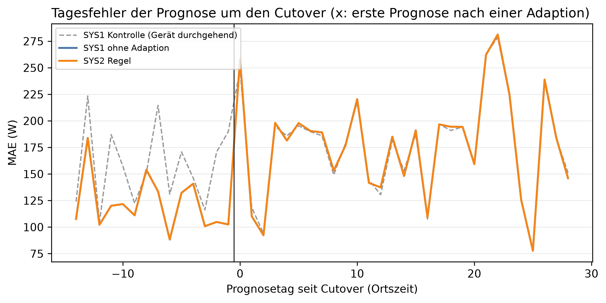

# E1 Neues Gerät, Lauf e1_006

## Setup

- Gerät(e): H1_M5
- Cutover: 2015-02-23, Tag 0 (alle Tage und Daten in Ortszeit)
- Analysierte Tage: 2015-02-08 bis 2015-03-22, 15 vor und 28 ab Cutover
- Prognosemodell: C3_30
- Kontrolllauf: e1_control_006
- Commit: a3ddf39 (mit lokalen Änderungen)

## Kennzahlen

| Kennzahl | Wert | Bezug |
|---|---|---|
| SYS2 Regel: erster new_pattern [Tag seit Cutover] | - | 0 Fehlalarme vor Cutover |

## Erkennung

| System | erster new_pattern [Tag] | new_pattern ab Cutover [Tage] | new_pattern vor Cutover, Fehlalarm [Tage] | new_pattern ab Cutover, Kontrolle [Tage] | Adaptionen vor Cutover | Adaptionen ab Cutover |
|---|---:|---:|---:|---:|---:|---:|
| SYS2 Regel | - | 0 | 0 | 0 | 0 | 0 |

## Prognose ab Adaption, gepaart gegen SYS1

| System | Adaption ab Prognosetag | MAE ab Adaption [W] | SYS1 im selben Zeitraum [W] | Differenz [W] | 2 Standardfehler [W] | Tage | Tage besser [%] | belastbar |
|---|---:|---|---|---|---|---:|---|---|

## Ereignisprotokoll

| Tag | Datum | System | Klassifikation | Adaption | Begründung |
|---:|---|---|---|---|---|

## Hinweise

- belastbar: Betrag der Differenz größer als 2 Standardfehler der gepaarten Differenzen, grobe Faustregel

## Anhang

### Prognose vor und ab Cutover, gepaart gegen SYS1

| System | MAE vor Cutover [W] | MAE ab Cutover [W] | MAE ab Cutover, Kontrolle [W] | Differenz [W] | 2 Standardfehler [W] | Tage | Tage besser [%] | belastbar |
|---|---:|---:|---:|---:|---:|---:|---:|---|
| SYS1 ohne Adaption | 121,7 | 178,1 | 177,4 | - | - | - | - | - |
| SYS2 Regel | 121,7 | 178,1 | 177,4 | 0,0 | 0,0 | 29 | 0,0 | nein |

### Klassifikationen je Zeitraum [Tage]

| System | Zeitraum | Tage | low | normal | peak | ohne Ergebnis |
|---|---|---:|---:|---:|---:|---:|
| SYS2 Regel | vor Cutover | 15 | 0 | 15 | 0 | 0 |
| SYS2 Regel | ab Cutover | 28 | 2 | 25 | 1 | 0 |
| SYS2 Regel | ab Cutover, Kontrolle | 28 | 2 | 26 | 0 | 0 |
