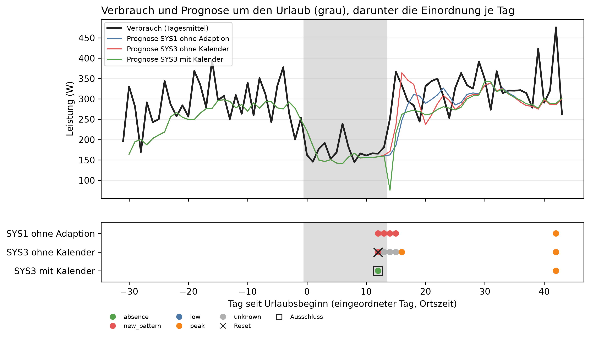

# E2 Abwesenheit, Lauf e2_001

## Setup

- Abwesenheit: vacation-2013-09, 2013-09-14 bis vor 2013-09-28, Beginn = Tag 0
- Analysierte Tage: 2013-08-14 bis 2013-10-27
- Kanäle: im Urlaubsfenster aus Mains herausgerechnet, Coverage ab 90 %
- Systeme ctx0: SYS1, SYS2, SYS3_CTX0
- Systeme ctx1: SYS3_CTX1
- Systeme ctx2: SYS3_CTX2
- Commit: b38474a (mit lokalen Änderungen)

## Kennzahlen

| Kennzahl | Wert | Bezug |
|---|---|---|
| SYS1: erster Treffer absence [Urlaubstag] | - | 0 von 2 Urlaubstagen mit offenem Gate, 0 × absence ohne Beleg |
| SYS2: erster Treffer absence [Urlaubstag] | - | 0 von 1 Urlaubstagen mit offenem Gate, 0 × absence ohne Beleg |
| SYS3_CTX0: erster Treffer absence [Urlaubstag] | - | 0 von 1 Urlaubstagen mit offenem Gate, 0 × absence ohne Beleg |
| SYS3_CTX1: erster Treffer absence [Urlaubstag] | 12 | 1 von 1 Urlaubstagen mit offenem Gate, 0 × absence ohne Beleg |
| SYS3_CTX2: erster Treffer absence [Urlaubstag] | - | 0 von 1 Urlaubstagen mit offenem Gate, 0 × absence ohne Beleg |
| Absenkung durch das Herausrechnen im Mittel [W] | 122,9 | je Tag im Urlaubsfenster |

## Einordnung je Phase

| System | Phase | Tage | Gate offen | davon Einzeltag | davon Drift | new_pattern | low | peak | absence | Resets | Meldungen | Ausfalltage | MAE [W] |
|---|---|---:|---:|---:|---:|---:|---:|---:|---:|---:|---:|---:|---:|
| SYS1 | vor dem Urlaub | 31 | 0 | 0 | 0 | 0 | 0 | 0 | 0 | 0 | 0 | 0 | 110,1 |
| SYS1 | Urlaub | 14 | 2 | 0 | 2 | 2 | 0 | 0 | 0 | 0 | 2 | 0 | 47,5 |
| SYS1 | nach der Rückkehr | 30 | 3 | 1 | 2 | 2 | 0 | 1 | 0 | 0 | 3 | 0 | 122,2 |
| SYS2 | vor dem Urlaub | 31 | 0 | 0 | 0 | 0 | 0 | 0 | 0 | 0 | 0 | 0 | 110,1 |
| SYS2 | Urlaub | 14 | 1 | 0 | 1 | 1 | 0 | 0 | 0 | 1 | 1 | 0 | 46,8 |
| SYS2 | nach der Rückkehr | 30 | 2 | 2 | 0 | 0 | 0 | 2 | 0 | 0 | 2 | 0 | 121,8 |
| SYS3_CTX0 | vor dem Urlaub | 31 | 0 | 0 | 0 | 0 | 0 | 0 | 0 | 0 | 0 | 0 | 110,1 |
| SYS3_CTX0 | Urlaub | 14 | 1 | 0 | 1 | 1 | 0 | 0 | 0 | 1 | 1 | 0 | 46,8 |
| SYS3_CTX0 | nach der Rückkehr | 30 | 2 | 2 | 0 | 0 | 0 | 2 | 0 | 0 | 2 | 0 | 121,8 |
| SYS3_CTX1 | vor dem Urlaub | 31 | 0 | 0 | 0 | 0 | 0 | 0 | 0 | 0 | 0 | 0 | 110,1 |
| SYS3_CTX1 | Urlaub | 14 | 1 | 0 | 1 | 0 | 0 | 0 | 1 | 0 | 1 | 0 | 52,8 |
| SYS3_CTX1 | nach der Rückkehr | 30 | 1 | 1 | 0 | 0 | 0 | 1 | 0 | 0 | 1 | 0 | 118,9 |
| SYS3_CTX2 | vor dem Urlaub | 31 | 0 | 0 | 0 | 0 | 0 | 0 | 0 | 0 | 0 | 0 | 110,1 |
| SYS3_CTX2 | Urlaub | 14 | 1 | 0 | 1 | 1 | 0 | 0 | 0 | 1 | 1 | 0 | 46,8 |
| SYS3_CTX2 | nach der Rückkehr | 30 | 2 | 2 | 0 | 0 | 0 | 2 | 0 | 0 | 2 | 0 | 121,8 |

## Einordnung im Urlaub

| System | Urlaubstage | Treffer | erster Treffer [Urlaubstag] | absence ohne Beleg |
|---|---:|---|---:|---:|
| SYS1 | 14 | 0 von 2 | - | 0 |
| SYS2 | 14 | 0 von 1 | - | 0 |
| SYS3_CTX0 | 14 | 0 von 1 | - | 0 |
| SYS3_CTX1 | 14 | 1 von 1 | 12 | 0 |
| SYS3_CTX2 | 14 | 0 von 1 | - | 0 |

## Kalender im State

| System | Phase | eingeordnete Tage | davon Kalender im State |
|---|---|---:|---:|
| SYS1 | Urlaub | 2 | 0 |
| SYS1 | nach der Rückkehr | 3 | 0 |
| SYS2 | Urlaub | 1 | 0 |
| SYS2 | nach der Rückkehr | 2 | 0 |
| SYS3_CTX0 | Urlaub | 1 | 0 |
| SYS3_CTX0 | nach der Rückkehr | 2 | 0 |
| SYS3_CTX1 | Urlaub | 1 | 1 |
| SYS3_CTX1 | nach der Rückkehr | 1 | 1 |
| SYS3_CTX2 | Urlaub | 1 | 0 |
| SYS3_CTX2 | nach der Rückkehr | 2 | 0 |

## Prognose je Phase

| System | Phase | MAE [W] | Differenz zu SYS1 [W] | Standardfehler [W] | Anteil Tage besser | gepaarte Tage |
|---|---|---:|---:|---:|---:|---:|
| SYS1 | vor dem Urlaub | 110,1 | - | - | - | - |
| SYS1 | Urlaub | 47,5 | - | - | - | - |
| SYS1 | nach der Rückkehr | 122,2 | - | - | - | - |
| SYS2 | vor dem Urlaub | 110,1 | 0,0 | 0,0 | 0,0 | 31,0 |
| SYS2 | Urlaub | 46,8 | -0,7 | 0,5 | 0,1 | 14,0 |
| SYS2 | nach der Rückkehr | 121,8 | -0,4 | 1,8 | 0,4 | 30,0 |
| SYS3_CTX0 | vor dem Urlaub | 110,1 | 0,0 | 0,0 | 0,0 | 31,0 |
| SYS3_CTX0 | Urlaub | 46,8 | -0,7 | 0,5 | 0,1 | 14,0 |
| SYS3_CTX0 | nach der Rückkehr | 121,8 | -0,4 | 1,8 | 0,4 | 30,0 |
| SYS3_CTX1 | vor dem Urlaub | 110,1 | 0,0 | 0,0 | 0,0 | 31,0 |
| SYS3_CTX1 | Urlaub | 52,8 | 5,3 | 5,3 | 0,0 | 14,0 |
| SYS3_CTX1 | nach der Rückkehr | 118,9 | -3,3 | 1,4 | 0,6 | 30,0 |
| SYS3_CTX2 | vor dem Urlaub | 110,1 | 0,0 | 0,0 | 0,0 | 31,0 |
| SYS3_CTX2 | Urlaub | 46,8 | -0,7 | 0,5 | 0,1 | 14,0 |
| SYS3_CTX2 | nach der Rückkehr | 121,8 | -0,4 | 1,8 | 0,4 | 30,0 |

## Hinweise

- Urlaubstag = analysierter Tag seit Beginn der Abwesenheit, 0 = erster Urlaubstag
- Treffer = absence mit passendem Kalendereintrag. absence ohne Beleg (ohne Kalender, Kalender nicht abgerufen oder nach der Rückkehr) zählt als Fehlklassifikation, über alle Phasen
- Treffer: von den Urlaubstagen mit offenem Gate, an den übrigen wird nicht eingeordnet. Wenige Tage, deshalb als Anzahl
- Einordnung je Phase: im Urlaub ist jede Meldung außer einem Treffer ein Fehlalarm, Ausfalltage = LLM ohne gültige Antwort
- Differenz zu SYS1: gepaart am selben Tag, negativ = besser
- ctx0 ohne, ctx1 mit Kalender im State, ctx2 Kalender per Tool. SYS1 und SYS2 lesen keinen Kalender und laufen nur in ctx0
- Kalender im State: bei ctx2 hat das LLM an diesen Tagen nachgeschaut, jeder ctx2-Tag mit LLM kostet einen zusätzlichen Aufruf für die Tool-Entscheidung

## Anhang

### Absenkung je Tag im Urlaubsfenster

| Datum | Mains [W] | ohne Kanäle [W] | Absenkung [W] |
|---|---:|---:|---:|
| 2013-09-14 | 304,1 | 162,5 | 141,6 |
| 2013-09-15 | 269,1 | 145,8 | 123,3 |
| 2013-09-16 | 259,4 | 177,4 | 81,9 |
| 2013-09-17 | 289,0 | 191,8 | 97,2 |
| 2013-09-18 | 251,1 | 152,4 | 98,6 |
| 2013-09-19 | 320,6 | 168,9 | 151,7 |
| 2013-09-20 | 309,1 | 239,3 | 69,8 |
| 2013-09-21 | 328,4 | 181,8 | 146,6 |
| 2013-09-22 | 253,4 | 144,9 | 108,5 |
| 2013-09-23 | 310,3 | 166,2 | 144,1 |
| 2013-09-24 | 216,9 | 160,9 | 56,0 |
| 2013-09-25 | 314,0 | 166,4 | 147,6 |
| 2013-09-26 | 368,1 | 165,6 | 202,6 |
| 2013-09-27 | 333,2 | 181,7 | 151,5 |
