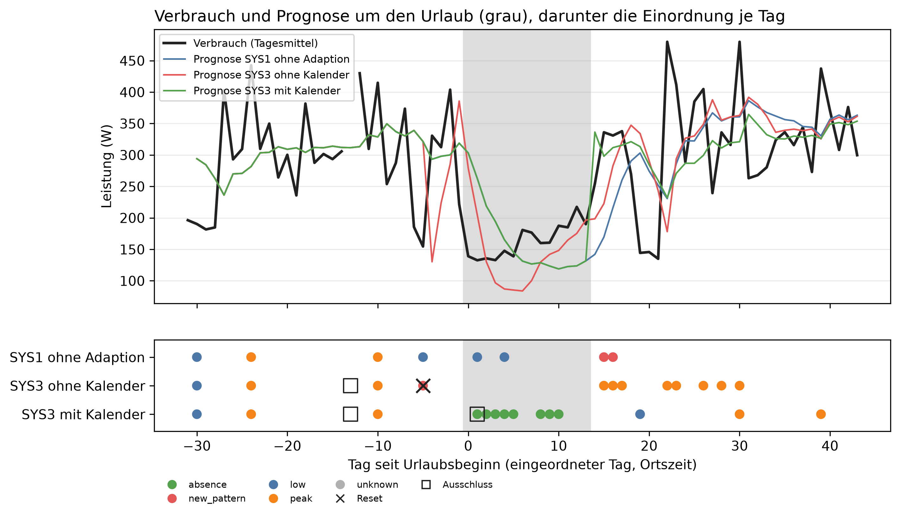
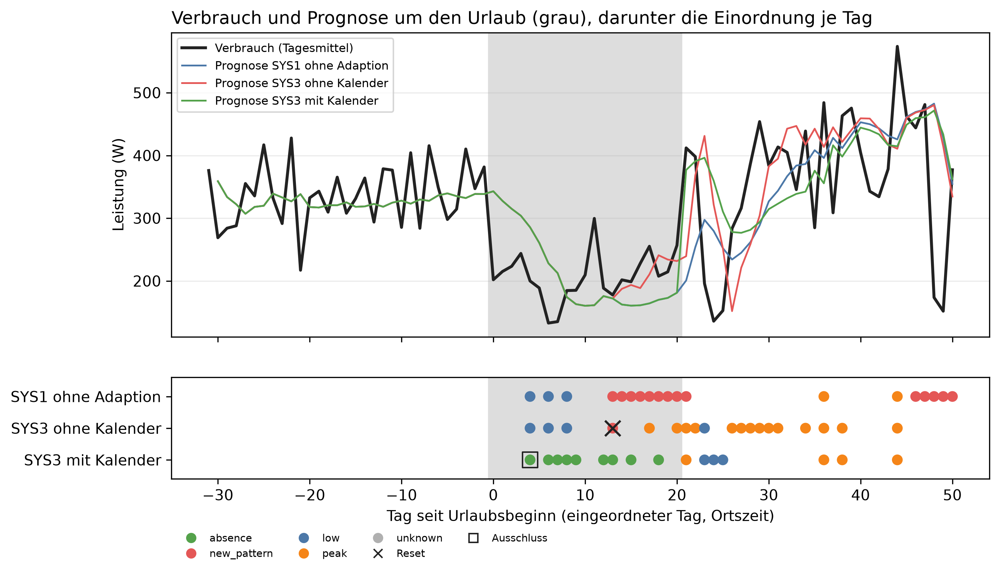

# E2 Abwesenheit, Lauf e2_002

## Setup

- Urlaub event-2014-08: 2014-08-03 bis vor 2014-08-17, Beginn = Tag 0, analysierte Tage 2014-07-03 bis 2014-09-15, Eintrag „Urlaub bei Oma“, Gegenfall „Oma kommt zu Besuch“
- Urlaub event-2015-10: 2015-10-04 bis vor 2015-10-25, Beginn = Tag 0, analysierte Tage 2015-09-03 bis 2015-11-23, Eintrag „Reise nach Tokio mit Moni“, ohne Gegenfall
- Kanäle: je Urlaub im Fenster aus Mains herausgerechnet, Coverage ab 90 %
- Systeme ctx0: SYS1, SYS2, SYS3_CTX0
- Systeme ctx1: SYS3_CTX1
- Systeme ctx1_visit: SYS3_CTX1_VISIT
- Systeme ctx2: SYS3_CTX2
- Ereignisreihen: CO3 (2015-05-24), ohne Kalender, Systeme SYS1, SYS2, SYS3: Spitzen (Tag 0: Spitze +1000 W über 6 h, Tag 10: Spitze +1000 W über 6 h, Tag 20: Spitze +1000 W über 6 h); Sprung (Tag 0: Sprung +30 %); Festhänger (Tag 0: Festhänger über 12 h, Tag 10: Festhänger über 12 h, Tag 17: Festhänger über 12 h)
- Commit: a46b8ad

## Einordnung auf den Ereignisreihen: richtige Klasse am Bewertungstag

| System | erwartet | Ereignisse | erkannt | richtig eingeordnet | richtig [%] |
|---|---|---:|---:|---|---:|
| SYS1 ohne Adaption | alle Ereignisse | 7 | 6 | 6/6 | 100,0 |
| SYS1 ohne Adaption | measurement_error | 3 | 3 | 3/3 | 100,0 |
| SYS1 ohne Adaption | new_pattern | 1 | 1 | 1/1 | 100,0 |
| SYS1 ohne Adaption | peak | 3 | 2 | 2/2 | 100,0 |
| SYS2 Regel | alle Ereignisse | 7 | 6 | 6/6 | 100,0 |
| SYS2 Regel | measurement_error | 3 | 3 | 3/3 | 100,0 |
| SYS2 Regel | new_pattern | 1 | 1 | 1/1 | 100,0 |
| SYS2 Regel | peak | 3 | 2 | 2/2 | 100,0 |
| SYS3 LLM | alle Ereignisse | 7 | 6 | 6/6 | 100,0 |
| SYS3 LLM | measurement_error | 3 | 3 | 3/3 | 100,0 |
| SYS3 LLM | new_pattern | 1 | 1 | 1/1 | 100,0 |
| SYS3 LLM | peak | 3 | 2 | 2/2 | 100,0 |

## Einordnung je Ereignis

| Reihe | Ereignis | System | erwartet | bewertet an Tag | Klasse | Skala | richtig |
|---|---|---|---|---:|---|---|---|
| Spitzen | 1: Spitze +1000 W über 6 h, Tag 0 | SYS1 ohne Adaption | peak | - | - | - | - |
| Spitzen | 1: Spitze +1000 W über 6 h, Tag 0 | SYS2 Regel | peak | - | - | - | - |
| Spitzen | 1: Spitze +1000 W über 6 h, Tag 0 | SYS3 LLM | peak | - | - | - | - |
| Spitzen | 2: Spitze +1000 W über 6 h, Tag 10 | SYS1 ohne Adaption | peak | 11,0 | peak | weekday | ja |
| Spitzen | 2: Spitze +1000 W über 6 h, Tag 10 | SYS2 Regel | peak | 11,0 | peak | weekday | ja |
| Spitzen | 2: Spitze +1000 W über 6 h, Tag 10 | SYS3 LLM | peak | 11,0 | peak | weekday | ja |
| Spitzen | 3: Spitze +1000 W über 6 h, Tag 20 | SYS1 ohne Adaption | peak | 21,0 | peak | weekday | ja |
| Spitzen | 3: Spitze +1000 W über 6 h, Tag 20 | SYS2 Regel | peak | 21,0 | peak | weekday | ja |
| Spitzen | 3: Spitze +1000 W über 6 h, Tag 20 | SYS3 LLM | peak | 21,0 | peak | weekday | ja |
| Sprung | 1: Sprung +30 %, Tag 0 | SYS1 ohne Adaption | new_pattern | 34,0 | new_pattern | daily+weekday | ja |
| Sprung | 1: Sprung +30 %, Tag 0 | SYS2 Regel | new_pattern | 34,0 | new_pattern | daily+weekday | ja |
| Sprung | 1: Sprung +30 %, Tag 0 | SYS3 LLM | new_pattern | 34,0 | new_pattern | daily+weekday | ja |
| Festhänger | 1: Festhänger über 12 h, Tag 0 | SYS1 ohne Adaption | measurement_error | 1,0 | measurement_error | weekday | ja |
| Festhänger | 1: Festhänger über 12 h, Tag 0 | SYS2 Regel | measurement_error | 1,0 | measurement_error | weekday | ja |
| Festhänger | 1: Festhänger über 12 h, Tag 0 | SYS3 LLM | measurement_error | 1,0 | measurement_error | weekday | ja |
| Festhänger | 2: Festhänger über 12 h, Tag 10 | SYS1 ohne Adaption | measurement_error | 11,0 | measurement_error | weekday | ja |
| Festhänger | 2: Festhänger über 12 h, Tag 10 | SYS2 Regel | measurement_error | 11,0 | measurement_error | weekday | ja |
| Festhänger | 2: Festhänger über 12 h, Tag 10 | SYS3 LLM | measurement_error | 11,0 | measurement_error | weekday | ja |
| Festhänger | 3: Festhänger über 12 h, Tag 17 | SYS1 ohne Adaption | measurement_error | 18,0 | measurement_error | weekday | ja |
| Festhänger | 3: Festhänger über 12 h, Tag 17 | SYS2 Regel | measurement_error | 18,0 | measurement_error | weekday | ja |
| Festhänger | 3: Festhänger über 12 h, Tag 17 | SYS3 LLM | measurement_error | 18,0 | measurement_error | weekday | ja |

## event-2014-08: Kennzahlen

| Kennzahl | Wert | Bezug |
|---|---|---|
| SYS1: erster Treffer absence [Urlaubstag] | - | 0 von 11 Urlaubstagen mit offenem Gate, 0 × absence ohne Beleg |
| SYS2: erster Treffer absence [Urlaubstag] | - | 0 von 11 Urlaubstagen mit offenem Gate, 0 × absence ohne Beleg |
| SYS3_CTX0: erster Treffer absence [Urlaubstag] | - | 0 von 6 Urlaubstagen mit offenem Gate, 0 × absence ohne Beleg |
| SYS3_CTX1: erster Treffer absence [Urlaubstag] | 1 | 8 von 8 Urlaubstagen mit offenem Gate, 0 × absence ohne Beleg |
| SYS3_CTX1_VISIT: erster Treffer absence [Urlaubstag] | - | 0 von 4 Urlaubstagen mit offenem Gate, 0 × absence ohne Beleg |
| SYS3_CTX2: erster Treffer absence [Urlaubstag] | 1 | 8 von 8 Urlaubstagen mit offenem Gate, 0 × absence ohne Beleg |
| Absenkung durch das Herausrechnen im Mittel [W] | 94,9 | je Tag im Urlaubsfenster |

## event-2014-08: Einordnung je Phase

| System | Phase | Tage | Gate offen | davon Einzeltag | davon Drift | davon nur eine Skala | new_pattern | low | peak | absence | Resets | Meldungen | Ausfalltage |
|---|---|---:|---:|---:|---:|---:|---:|---:|---:|---:|---:|---:|---:|
| SYS1 | vor dem Urlaub | 31 | 13 | 4 | 0 | 8 | 0 | 2 | 2 | 0 | 0 | 3 | 0 |
| SYS1 | Urlaub | 14 | 11 | 2 | 0 | 9 | 0 | 2 | 0 | 0 | 0 | 0 | 0 |
| SYS1 | nach der Rückkehr | 30 | 21 | 0 | 2 | 19 | 2 | 0 | 0 | 0 | 0 | 2 | 0 |
| SYS2 | vor dem Urlaub | 31 | 13 | 4 | 0 | 8 | 0 | 2 | 2 | 0 | 0 | 3 | 0 |
| SYS2 | Urlaub | 14 | 11 | 2 | 0 | 9 | 0 | 2 | 0 | 0 | 0 | 0 | 0 |
| SYS2 | nach der Rückkehr | 30 | 17 | 5 | 1 | 11 | 1 | 0 | 5 | 0 | 1 | 6 | 0 |
| SYS3_CTX0 | vor dem Urlaub | 31 | 13 | 4 | 0 | 8 | 1 | 1 | 2 | 0 | 1 | 4 | 0 |
| SYS3_CTX0 | Urlaub | 14 | 6 | 0 | 0 | 6 | 0 | 0 | 0 | 0 | 0 | 0 | 0 |
| SYS3_CTX0 | nach der Rückkehr | 30 | 23 | 8 | 0 | 15 | 0 | 0 | 8 | 0 | 0 | 8 | 0 |
| SYS3_CTX1 | vor dem Urlaub | 31 | 13 | 4 | 0 | 8 | 0 | 1 | 2 | 0 | 0 | 3 | 0 |
| SYS3_CTX1 | Urlaub | 14 | 8 | 8 | 0 | 0 | 0 | 0 | 0 | 8 | 0 | 0 | 0 |
| SYS3_CTX1 | nach der Rückkehr | 30 | 5 | 3 | 0 | 2 | 0 | 1 | 2 | 0 | 0 | 2 | 0 |
| SYS3_CTX1_VISIT | vor dem Urlaub | 31 | 13 | 4 | 0 | 8 | 0 | 1 | 2 | 0 | 0 | 3 | 0 |
| SYS3_CTX1_VISIT | Urlaub | 14 | 4 | 3 | 0 | 1 | 1 | 0 | 1 | 0 | 1 | 2 | 0 |
| SYS3_CTX1_VISIT | nach der Rückkehr | 30 | 20 | 14 | 0 | 6 | 1 | 0 | 14 | 0 | 1 | 15 | 0 |
| SYS3_CTX2 | vor dem Urlaub | 31 | 13 | 4 | 0 | 8 | 0 | 1 | 2 | 0 | 0 | 3 | 0 |
| SYS3_CTX2 | Urlaub | 14 | 8 | 8 | 0 | 0 | 0 | 0 | 0 | 8 | 0 | 0 | 0 |
| SYS3_CTX2 | nach der Rückkehr | 30 | 5 | 3 | 0 | 2 | 0 | 1 | 2 | 0 | 0 | 2 | 0 |

## event-2014-08: Einordnung im Urlaub

| System | Urlaubstage | Treffer | erster Treffer [Urlaubstag] | absence ohne Beleg |
|---|---:|---|---:|---:|
| SYS1 | 14 | 0 von 11 | - | 0 |
| SYS2 | 14 | 0 von 11 | - | 0 |
| SYS3_CTX0 | 14 | 0 von 6 | - | 0 |
| SYS3_CTX1 | 14 | 8 von 8 | 1 | 0 |
| SYS3_CTX1_VISIT | 14 | 0 von 4 | - | 0 |
| SYS3_CTX2 | 14 | 8 von 8 | 1 | 0 |

## event-2014-08: Kalender im State

| System | Phase | eingeordnete Tage | davon Kalender im State |
|---|---|---:|---:|
| SYS1 | vor dem Urlaub | 13 | 0 |
| SYS1 | Urlaub | 11 | 0 |
| SYS1 | nach der Rückkehr | 21 | 0 |
| SYS2 | vor dem Urlaub | 13 | 0 |
| SYS2 | Urlaub | 11 | 0 |
| SYS2 | nach der Rückkehr | 17 | 0 |
| SYS3_CTX0 | vor dem Urlaub | 13 | 0 |
| SYS3_CTX0 | Urlaub | 6 | 0 |
| SYS3_CTX0 | nach der Rückkehr | 23 | 0 |
| SYS3_CTX1 | vor dem Urlaub | 13 | 13 |
| SYS3_CTX1 | Urlaub | 8 | 8 |
| SYS3_CTX1 | nach der Rückkehr | 5 | 5 |
| SYS3_CTX1_VISIT | vor dem Urlaub | 13 | 13 |
| SYS3_CTX1_VISIT | Urlaub | 4 | 4 |
| SYS3_CTX1_VISIT | nach der Rückkehr | 20 | 20 |
| SYS3_CTX2 | vor dem Urlaub | 13 | 6 |
| SYS3_CTX2 | Urlaub | 8 | 8 |
| SYS3_CTX2 | nach der Rückkehr | 5 | 4 |

## event-2014-08: Kalenderabruf per Tool, an Tagen mit Einordnung

| System | nützlich | überflüssig | verpasst | zu Recht nicht abgerufen |
|---|---:|---:|---:|---:|
| SYS3_CTX2 | 8 | 10 | 0 | 8 |

## event-2014-08: Prognose je Phase

| System | Phase | Tagesfehler [W] | Bias [W] | MAE [W] | MAPE [%] | Differenz Tagesfehler [W] | Differenz MAE [W] | 2 Standardfehler [W] | Tage | Tage besser [%] | belastbar |
|---|---|---:|---:|---:|---:|---:|---:|---:|---:|---:|---|
| SYS1 | vor dem Urlaub | 68,4 | 4,9 | 130,8 | 49,1 | - | - | - | - | - | - |
| SYS1 | Urlaub | 65,3 | 0,9 | 81,6 | 55,3 | - | - | - | - | - | - |
| SYS1 | nach der Rückkehr | 80,2 | 0,9 | 151,3 | 55,8 | - | - | - | - | - | - |
| SYS2 | vor dem Urlaub | 68,4 | 4,9 | 130,8 | 49,1 | 0,0 | 0,0 | 0,0 | 29 | 0,0 | nein |
| SYS2 | Urlaub | 65,3 | 0,9 | 81,6 | 55,3 | 0,0 | 0,0 | 0,0 | 14 | 0,0 | nein |
| SYS2 | nach der Rückkehr | 79,6 | 3,6 | 155,4 | 57,5 | -0,5 | 4,1 | 17,6 | 31 | 48,4 | nein |
| SYS3_CTX0 | vor dem Urlaub | 79,4 | -1,5 | 136,7 | 51,2 | 11,0 | 5,8 | 12,8 | 29 | 0,0 | nein |
| SYS3_CTX0 | Urlaub | 49,9 | -18,6 | 65,8 | 43,1 | -15,4 | -15,8 | 22,3 | 14 | 71,4 | nein |
| SYS3_CTX0 | nach der Rückkehr | 76,0 | 9,0 | 154,1 | 58,0 | -4,2 | 2,8 | 9,9 | 31 | 54,8 | nein |
| SYS3_CTX1 | vor dem Urlaub | 68,4 | 4,9 | 130,8 | 49,1 | 0,0 | 0,0 | 0,0 | 29 | 0,0 | nein |
| SYS3_CTX1 | Urlaub | 65,3 | 0,9 | 81,6 | 55,3 | 0,0 | 0,0 | 0,0 | 14 | 0,0 | nein |
| SYS3_CTX1 | nach der Rückkehr | 67,9 | 0,3 | 145,0 | 53,1 | -12,2 | -6,3 | 13,3 | 31 | 54,8 | nein |
| SYS3_CTX1_VISIT | vor dem Urlaub | 68,4 | 4,9 | 130,8 | 49,1 | 0,0 | 0,0 | 0,0 | 29 | 0,0 | nein |
| SYS3_CTX1_VISIT | Urlaub | 43,8 | 33,2 | 67,5 | 46,0 | -21,5 | -14,1 | 14,2 | 14 | 57,1 | ja |
| SYS3_CTX1_VISIT | nach der Rückkehr | 74,7 | -5,4 | 148,2 | 52,5 | -5,5 | -3,1 | 17,5 | 31 | 51,6 | nein |
| SYS3_CTX2 | vor dem Urlaub | 68,4 | 4,9 | 130,8 | 49,1 | 0,0 | 0,0 | 0,0 | 29 | 0,0 | nein |
| SYS3_CTX2 | Urlaub | 65,3 | 0,9 | 81,6 | 55,3 | 0,0 | 0,0 | 0,0 | 14 | 0,0 | nein |
| SYS3_CTX2 | nach der Rückkehr | 67,9 | 0,3 | 145,0 | 53,1 | -12,2 | -6,3 | 13,3 | 31 | 54,8 | nein |

## event-2015-10: Kennzahlen

| Kennzahl | Wert | Bezug |
|---|---|---|
| SYS1: erster Treffer absence [Urlaubstag] | - | 0 von 15 Urlaubstagen mit offenem Gate, 0 × absence ohne Beleg |
| SYS2: erster Treffer absence [Urlaubstag] | - | 0 von 10 Urlaubstagen mit offenem Gate, 0 × absence ohne Beleg |
| SYS3_CTX0: erster Treffer absence [Urlaubstag] | - | 0 von 10 Urlaubstagen mit offenem Gate, 0 × absence ohne Beleg |
| SYS3_CTX1: erster Treffer absence [Urlaubstag] | 4 | 9 von 9 Urlaubstagen mit offenem Gate, 0 × absence ohne Beleg |
| SYS3_CTX2: erster Treffer absence [Urlaubstag] | 4 | 9 von 9 Urlaubstagen mit offenem Gate, 0 × absence ohne Beleg |
| Absenkung durch das Herausrechnen im Mittel [W] | 154,2 | je Tag im Urlaubsfenster |

## event-2015-10: Einordnung je Phase

| System | Phase | Tage | Gate offen | davon Einzeltag | davon Drift | davon nur eine Skala | new_pattern | low | peak | absence | Resets | Meldungen | Ausfalltage |
|---|---|---:|---:|---:|---:|---:|---:|---:|---:|---:|---:|---:|---:|
| SYS1 | vor dem Urlaub | 31 | 14 | 0 | 0 | 14 | 0 | 0 | 0 | 0 | 0 | 0 | 0 |
| SYS1 | Urlaub | 21 | 15 | 3 | 8 | 4 | 8 | 3 | 0 | 0 | 0 | 8 | 0 |
| SYS1 | nach der Rückkehr | 30 | 29 | 2 | 6 | 21 | 6 | 0 | 2 | 0 | 0 | 8 | 0 |
| SYS2 | vor dem Urlaub | 31 | 14 | 0 | 0 | 14 | 0 | 0 | 0 | 0 | 0 | 0 | 0 |
| SYS2 | Urlaub | 21 | 10 | 5 | 1 | 4 | 1 | 3 | 2 | 0 | 1 | 3 | 0 |
| SYS2 | nach der Rückkehr | 30 | 28 | 14 | 0 | 14 | 0 | 2 | 12 | 0 | 0 | 12 | 0 |
| SYS3_CTX0 | vor dem Urlaub | 31 | 14 | 0 | 0 | 14 | 0 | 0 | 0 | 0 | 0 | 0 | 0 |
| SYS3_CTX0 | Urlaub | 21 | 10 | 5 | 1 | 4 | 1 | 3 | 2 | 0 | 1 | 3 | 0 |
| SYS3_CTX0 | nach der Rückkehr | 30 | 28 | 14 | 0 | 14 | 0 | 1 | 12 | 0 | 0 | 12 | 0 |
| SYS3_CTX1 | vor dem Urlaub | 31 | 14 | 0 | 0 | 14 | 0 | 0 | 0 | 0 | 0 | 0 | 0 |
| SYS3_CTX1 | Urlaub | 21 | 9 | 9 | 0 | 0 | 0 | 0 | 0 | 9 | 0 | 0 | 0 |
| SYS3_CTX1 | nach der Rückkehr | 30 | 18 | 9 | 0 | 9 | 0 | 3 | 4 | 0 | 0 | 4 | 0 |
| SYS3_CTX2 | vor dem Urlaub | 31 | 14 | 0 | 0 | 14 | 0 | 0 | 0 | 0 | 0 | 0 | 0 |
| SYS3_CTX2 | Urlaub | 21 | 9 | 9 | 0 | 0 | 0 | 0 | 0 | 9 | 0 | 0 | 0 |
| SYS3_CTX2 | nach der Rückkehr | 30 | 18 | 9 | 0 | 9 | 0 | 3 | 4 | 0 | 0 | 4 | 0 |

## event-2015-10: Einordnung im Urlaub

| System | Urlaubstage | Treffer | erster Treffer [Urlaubstag] | absence ohne Beleg |
|---|---:|---|---:|---:|
| SYS1 | 21 | 0 von 15 | - | 0 |
| SYS2 | 21 | 0 von 10 | - | 0 |
| SYS3_CTX0 | 21 | 0 von 10 | - | 0 |
| SYS3_CTX1 | 21 | 9 von 9 | 4 | 0 |
| SYS3_CTX2 | 21 | 9 von 9 | 4 | 0 |

## event-2015-10: Kalender im State

| System | Phase | eingeordnete Tage | davon Kalender im State |
|---|---|---:|---:|
| SYS1 | vor dem Urlaub | 14 | 0 |
| SYS1 | Urlaub | 15 | 0 |
| SYS1 | nach der Rückkehr | 29 | 0 |
| SYS2 | vor dem Urlaub | 14 | 0 |
| SYS2 | Urlaub | 10 | 0 |
| SYS2 | nach der Rückkehr | 28 | 0 |
| SYS3_CTX0 | vor dem Urlaub | 14 | 0 |
| SYS3_CTX0 | Urlaub | 10 | 0 |
| SYS3_CTX0 | nach der Rückkehr | 28 | 0 |
| SYS3_CTX1 | vor dem Urlaub | 14 | 14 |
| SYS3_CTX1 | Urlaub | 9 | 9 |
| SYS3_CTX1 | nach der Rückkehr | 18 | 18 |
| SYS3_CTX2 | vor dem Urlaub | 14 | 0 |
| SYS3_CTX2 | Urlaub | 9 | 9 |
| SYS3_CTX2 | nach der Rückkehr | 18 | 11 |

## event-2015-10: Kalenderabruf per Tool, an Tagen mit Einordnung

| System | nützlich | überflüssig | verpasst | zu Recht nicht abgerufen |
|---|---:|---:|---:|---:|
| SYS3_CTX2 | 9 | 11 | 0 | 21 |

## event-2015-10: Prognose je Phase

| System | Phase | Tagesfehler [W] | Bias [W] | MAE [W] | MAPE [%] | Differenz Tagesfehler [W] | Differenz MAE [W] | 2 Standardfehler [W] | Tage | Tage besser [%] | belastbar |
|---|---|---:|---:|---:|---:|---:|---:|---:|---:|---:|---|
| SYS1 | vor dem Urlaub | 46,1 | -9,3 | 143,7 | 47,3 | - | - | - | - | - | - |
| SYS1 | Urlaub | 64,9 | 5,1 | 106,0 | 58,8 | - | - | - | - | - | - |
| SYS1 | nach der Rückkehr | 94,6 | 5,7 | 191,4 | 68,8 | - | - | - | - | - | - |
| SYS2 | vor dem Urlaub | 46,1 | -9,3 | 143,7 | 47,3 | 0,0 | 0,0 | 0,0 | 30 | 0,0 | nein |
| SYS2 | Urlaub | 55,0 | 20,1 | 95,7 | 52,8 | -9,9 | -10,3 | 7,3 | 21 | 33,3 | ja |
| SYS2 | nach der Rückkehr | 97,7 | 22,5 | 202,7 | 76,3 | 3,2 | 11,3 | 15,5 | 31 | 48,4 | nein |
| SYS3_CTX0 | vor dem Urlaub | 46,1 | -9,3 | 143,7 | 47,3 | 0,0 | 0,0 | 0,0 | 30 | 0,0 | nein |
| SYS3_CTX0 | Urlaub | 55,0 | 20,1 | 95,7 | 52,8 | -9,9 | -10,3 | 7,3 | 21 | 33,3 | ja |
| SYS3_CTX0 | nach der Rückkehr | 97,7 | 22,5 | 202,7 | 76,3 | 3,2 | 11,3 | 15,5 | 31 | 48,4 | nein |
| SYS3_CTX1 | vor dem Urlaub | 46,1 | -9,3 | 143,7 | 47,3 | 0,0 | 0,0 | 0,0 | 30 | 0,0 | nein |
| SYS3_CTX1 | Urlaub | 64,9 | 5,1 | 106,0 | 58,8 | 0,0 | 0,0 | 0,0 | 21 | 0,0 | nein |
| SYS3_CTX1 | nach der Rückkehr | 91,0 | 15,5 | 194,2 | 72,9 | -3,6 | 2,8 | 18,7 | 31 | 54,8 | nein |
| SYS3_CTX2 | vor dem Urlaub | 46,1 | -9,3 | 143,7 | 47,3 | 0,0 | 0,0 | 0,0 | 30 | 0,0 | nein |
| SYS3_CTX2 | Urlaub | 64,9 | 5,1 | 106,0 | 58,8 | 0,0 | 0,0 | 0,0 | 21 | 0,0 | nein |
| SYS3_CTX2 | nach der Rückkehr | 91,0 | 15,5 | 194,2 | 72,9 | -3,6 | 2,8 | 18,7 | 31 | 54,8 | nein |

## Hinweise

- Urlaubstag = analysierter Tag seit Beginn der Abwesenheit, 0 = erster Urlaubstag
- Ereignisreihen: richtig = die Klasse am Bewertungstag ist die erwartete (peak, new_pattern, measurement_error). Bewertet wird bei Spitze und Festhänger am Tag nach dem Ereignis, wenn das Gate offen ist, beim Sprung am ersten Tag mit anhaltender Abweichung oder new_pattern. Kein Bewertungstag = nicht erkannt
- richtig [%]: Anteil unter den erkannten Ereignissen. Die Regel (SYS2) und SYS1 sind der Maßstab für das LLM (SYS3), SYS1 handelt nie
- Nach dem ersten Festhänger schließen SYS2 und SYS3 den Tag aus der Referenz aus, SYS1 nicht. Festhänger 2 und 3 werden daher mit verschiedenem Zustand eingeordnet. Bei den Spitzen gibt es keine Handlung, dort laufen alle Systeme gleich
- Treffer = absence mit passendem Kalendereintrag. absence ohne Beleg (ohne Kalender, Kalender nicht abgerufen oder nach der Rückkehr) zählt als Fehlklassifikation, über alle Phasen
- Treffer: von den Urlaubstagen mit offenem Gate, an den übrigen wird nicht eingeordnet. Wenige Tage, deshalb als Anzahl
- Einordnung je Phase: absence ist keine Meldung, im Urlaub ist jede Meldung ein Fehlalarm. Ausfalltage = LLM ohne gültige Antwort
- Gate offen: Einzeltag, Drift (weekly und long_term halten an) oder nur eine anhaltende Skala
- Prognose je Phase: Phase und Fehler nach dem Prognosetag. Tagesfehler (Hauptmaß) = Betrag von Prognose-Tagesmittel minus Ist-Tagesmittel, gemittelt über die Tage. Bias = dasselbe mit Vorzeichen, negativ = Prognose zu niedrig. MAE = mittlerer Stundenfehler
- Differenzen zu SYS1: gepaart am selben Prognosetag, negativ = besser
- ctx0 ohne, ctx1 mit Kalender im State, ctx2 Kalender per Tool. SYS1 und SYS2 lesen keinen Kalender und laufen nur in ctx0
- Kalendereinträge als Freitext aus calendar_events.json, im Gegenfall ctx1_visit steht zu denselben Zeiten nur ein Eintrag, der keine Abwesenheit meint. Dort ist jedes absence falsch und zählt als absence ohne Beleg
- Kalender im State: bei ctx2 hat das LLM an diesen Tagen nachgeschaut, jeder ctx2-Tag mit LLM kostet einen zusätzlichen Aufruf für die Tool-Entscheidung
- Kalenderabruf: nützlich = abgerufen an einem Urlaubstag (ein Eintrag deckt den Tag), überflüssig = abgerufen ohne deckenden Eintrag, verpasst = nicht abgerufen an einem Urlaubstag. Vergleich: ctx1 schaut immer nach

## Anhang

### event-2014-08: Absenkung je Tag im Urlaubsfenster

| Datum | Mains [W] | ohne Kanäle [W] | Absenkung [W] |
|---|---:|---:|---:|
| 2014-08-03 | 160,9 | 139,0 | 21,9 |
| 2014-08-04 | 151,5 | 132,6 | 18,9 |
| 2014-08-05 | 156,3 | 135,7 | 20,7 |
| 2014-08-06 | 155,3 | 132,8 | 22,4 |
| 2014-08-07 | 169,7 | 147,7 | 22,1 |
| 2014-08-08 | 163,6 | 138,9 | 24,7 |
| 2014-08-09 | 362,2 | 180,8 | 181,4 |
| 2014-08-10 | 270,1 | 176,7 | 93,5 |
| 2014-08-11 | 306,0 | 159,9 | 146,1 |
| 2014-08-12 | 277,7 | 160,6 | 117,1 |
| 2014-08-13 | 303,7 | 187,5 | 116,2 |
| 2014-08-14 | 362,9 | 184,9 | 178,0 |
| 2014-08-15 | 386,2 | 217,5 | 168,7 |
| 2014-08-16 | 387,4 | 190,0 | 197,4 |

### event-2015-10: Absenkung je Tag im Urlaubsfenster

| Datum | Mains [W] | ohne Kanäle [W] | Absenkung [W] |
|---|---:|---:|---:|
| 2015-10-04 | 498,4 | 202,0 | 296,4 |
| 2015-10-05 | 374,1 | 215,1 | 159,0 |
| 2015-10-06 | 335,2 | 223,4 | 111,8 |
| 2015-10-07 | 416,2 | 243,9 | 172,4 |
| 2015-10-08 | 362,5 | 200,0 | 162,5 |
| 2015-10-09 | 331,9 | 188,9 | 143,0 |
| 2015-10-10 | 163,3 | 133,0 | 30,3 |
| 2015-10-11 | 170,8 | 135,2 | 35,6 |
| 2015-10-12 | 371,4 | 184,7 | 186,7 |
| 2015-10-13 | 272,3 | 185,1 | 87,2 |
| 2015-10-14 | 368,0 | 209,6 | 158,4 |
| 2015-10-15 | 510,5 | 299,6 | 210,9 |
| 2015-10-16 | 330,9 | 188,6 | 142,4 |
| 2015-10-17 | 364,2 | 177,7 | 186,5 |
| 2015-10-18 | 332,1 | 201,8 | 130,3 |
| 2015-10-19 | 363,0 | 198,7 | 164,3 |
| 2015-10-20 | 386,2 | 227,9 | 158,4 |
| 2015-10-21 | 466,8 | 255,3 | 211,5 |
| 2015-10-22 | 347,7 | 207,6 | 140,0 |
| 2015-10-23 | 492,6 | 214,5 | 278,1 |
| 2015-10-24 | 329,9 | 256,7 | 73,2 |
