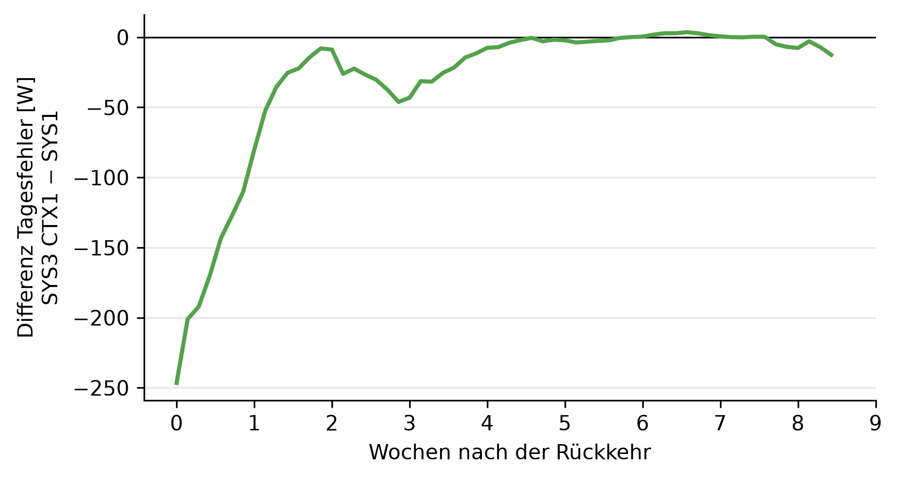

# E2: Einordnung durch das Sprachmodell

## Setup

- Lauf: e2_003
- Stichtage: SF6: 02.12.2016, SF7: 13.01.2017, SF8: 20.02.2017
- Szenarien: Ereignisreihen ohne Kalender: Kontrolllauf; peaks = peak_strong an Tag 0, 10, 20; ramp_28_strong an Tag 0; ramp_28_down_strong an Tag 0; scaled_strong an Tag 0; scaled_down_strong an Tag 0; stucks = stuck an Tag 0, 10, 17, dazu die Urlaube
- Systeme: Ereignisreihen SYS1, SYS2, SYS3; Urlaube SYS1, SYS2, SYS3 CTX0, SYS3 CTX1, Gegenfall CTX1, SYS3 CTX2
- Urlaub 1: 27.11.–10.12.2016, Eintrag „Trip nach Lissabon“, Absenkung im Mittel 156,8 W, Tagesfehler vor dem Urlaub 72,4 W
- Urlaub 2: 17.12.–30.12.2016, Eintrag „Weihnachten bei den Eltern in Hamburg“, Gegenfall „Eltern kommen zu Besuch“, Absenkung im Mittel 144,0 W, Tagesfehler vor dem Urlaub 89,0 W
- Urlaub 3: 01.02.–21.02.2017, Eintrag „Skiurlaub in Tirol“, Absenkung im Mittel 154,7 W, Tagesfehler vor dem Urlaub 83,1 W
- Prognosefenster: 30 Tage vor und 60 Tage nach jedem Urlaub
- Abgezogene Gerätekanäle: Abdeckung ab 90 %, dish washer; washer dryer; HTPC; food processor, kettle, toasted sandwich maker; television; food processor, kitchen aid, toaster; bouncy castle pump, light; microwave; active subwoofer; oven; audio amplifier; light; audio system, wireless phone charger; radio; baby monitor; coffee maker
- Commit: a18a001

## Kriterien der Teilfrage 2

| Kriterium | Ziel | Ergebnis | erfüllt |
|---|---|---|---|
| richtig eingeordnete Ereignisse | ≥ 80 % | 27 von 27 (100 %) | ja |
| Treffer je Abwesenheit | > 0 Urlaubstage | 14, 13, 20 Urlaubstage | ja |
| absence ohne passenden Eintrag | 0 Tage | 11 Tage | nein |
| fehlende Belege | 0 Antworten | 35 von 1498 (2,3 %) | nein |

## Kriterium der Teilfrage 3 aus E2: Tagesfehler nach der Rückkehr

| Kriterium | Ziel | Ergebnis | erfüllt |
|---|---|---|---|
| Tagesfehler SYS3 CTX1 minus SYS1 nach der Rückkehr, Urlaub 1 | < 0, belastbar | −18,3 W, 2 Standardfehler 14,4 W, belastbar | ja |
| Tagesfehler SYS3 CTX1 minus SYS1 nach der Rückkehr, Urlaub 2 | < 0, belastbar | −25,5 W, 2 Standardfehler 17,4 W, belastbar | ja |
| Tagesfehler SYS3 CTX1 minus SYS1 nach der Rückkehr, Urlaub 3 | < 0, belastbar | −20,5 W, 2 Standardfehler 14,9 W, belastbar | ja |

## Richtig eingeordnete Ereignisse je erwarteter Klasse, ohne Kalender

| erwartete Klasse | Ereignisse | SYS3 richtig | SYS2 richtig | new_pattern, eine Skala (SYS3) |
|---|---:|---|---|---:|
| alle | 30 | 27 von 27 | 27 von 27 | - |
| measurement_error | 9 | 9 von 9 | 9 von 9 | - |
| new_pattern | 12 | 11 von 11 | 10 von 10 | 5 |
| peak | 9 | 7 von 7 | 8 von 8 | - |

## Einordnung als absence je Variante

| Variante | absence | absence-Tage | absence ohne Eintrag | Zurücksetzen im Urlaub |
|---|---|---|---:|---:|
| SYS2 | 0 von 3 | 0 von 38 | 0 | 2 |
| SYS3 CTX0 | 0 von 3 | 0 von 33 | 0 | 3 |
| SYS3 CTX1 | 3 von 3 | 47 von 47 | 0 | 0 |
| SYS3 CTX2 | 3 von 3 | 47 von 47 | 0 | 0 |
| Gegenfall CTX1 | 1 von 3 | 11 von 13 | 11 | 0 |

## Tagesfehler nach der Rückkehr, SYS3 CTX1 gegen SYS1 und gegen SYS3 CTX0

| Urlaub | Differenz zu SYS1 [W] | belastbar zu SYS1 | Differenz zu SYS3 CTX0 [W] | belastbar zu SYS3 CTX0 |
|---|---|---|---|---|
| Urlaub 1 | −18,3 (± 14,4) | ja | −7,4 (± 14,5) | nein |
| Urlaub 2 | −25,5 (± 17,4) | ja | −3,6 (± 17,4) | nein |
| Urlaub 3 | −20,5 (± 14,9) | ja | −13,5 (± 12,7) | ja |

## Kalenderabruf bei SYS3 CTX2, an Tagen mit Einordnung

| Urlaub | abgerufen, Urlaubstag | abgerufen, anderer Tag | nicht abgerufen, Urlaubstag | nicht abgerufen, anderer Tag |
|---|---:|---:|---:|---:|
| Urlaub 1 | 14 | 18 | 0 | 3 |
| Urlaub 2 | 13 | 17 | 0 | 16 |
| Urlaub 3 | 20 | 14 | 0 | 25 |
| alle | 47 | 49 | 0 | 44 |

## Belegprüfung der Antworten

| Kennzahl | Wert |
|---|---|
| Antworten | 1498 |
| Beleg fehlt | 35 (Klasse low, fehlt anomaly.direction) |
| Verstoß im Text | 14 |
| davon Zahl, die nicht im Zustand steht | 12 |
| davon Wort zu Steuerung, Preis oder Tarif | 2 |
| absence-Antworten belegt | 105 von 105 |

## Tage, an denen SYS3 anders einordnet als SYS2

| Klasse SYS2 | Klasse SYS3 | Tage |
|---|---|---:|
| low | normal | 31 |
| peak | normal | 12 |
| normal | peak | 10 |
| low | new_pattern | 5 |
| new_pattern | normal | 5 |
| normal | new_pattern | 3 |
| normal | low | 2 |
| low | peak | 1 |

## Hinweise

- Ereignisreihen: richtig = die erwartete Klasse am Bewertungstag. Bewertet wird bei peak und stuck am Tag nach dem Ereignis (Vorfilter offen), bei Dauerlast und Rampe am ersten Tag mit anhaltender Veränderung oder new_pattern. Ohne Bewertungstag zählt das Ereignis nicht in die Quote
- new_pattern, eine Skala: new_pattern, obwohl laut Zustand nur weekly oder long_term anhält. Am Goldstandard zählt es als richtig
- absence = Urlaube, in denen absence eingeordnet wurde, absence-Tage von den Urlaubstagen mit offenem Vorfilter. Ein Treffer ist absence mit passendem Kalendereintrag. absence ohne passenden Eintrag (ohne Kalender, im Gegenfall, nach der Rückkehr) zählt als Fehlklassifikation, im Gegenfall meint der Eintrag keine Abwesenheit
- Urlaubstage mit offenem Vorfilter unterscheiden sich je Variante, nach einem Zurücksetzen im Urlaub fehlen Skalen und der Vorfilter bleibt zu
- Kalenderabruf (CTX2): nützlich = abgerufen an Urlaubstagen, überflüssig = an anderen Tagen. CTX1 hat den Kalender immer im Zustand
- Tagesfehler = mittlerer Betrag von Prognose- minus gemessenem Tagesmittel, Bias dasselbe mit Vorzeichen (negativ = Prognose zu niedrig). Differenzen gepaart am Prognosetag, negativ = besser. Nach der Rückkehr dauert, bis die Urlaubstage aus dem Trainingsfenster gerollt sind
- belastbar: Betrag der Differenz größer als 2 Standardfehler der gepaarten Differenzen, grobe Faustregel
- fehlende Belege: zur vergebenen Klasse fehlt ein Pfad im Zustand (peak und low die Richtung, new_pattern die anhaltenden Skalen, measurement_error die Plausibilität, absence ein Kalendereintrag). Verstoß im Text: eine Zahl oder ein Wort zu Steuerung, Preis oder Tarif, das nicht im Zustand steht. Die Prüfung sagt nichts darüber, ob der Text stimmt
- Ab der ersten abweichenden Aktion sehen die Varianten verschiedene Zustände, spätere Unterschiede können Folgen davon sein
- Ausfälle des Sprachmodells in den Urlaubsläufen: 0 Tage

## Anhang

### Ereignisreihen: Bewertungstag (auslösende Skala) je Ereignis

| Stichtag | Ereignis | erwartet | SYS1 | SYS2 | SYS3 |
|---|---|---|---|---|---|
| SF6 | peak_strong, Tag 0 | peak | - | - | - |
| SF6 | peak_strong, Tag 10 | peak | 11 (weekday) | 11 (weekday) | 11 (weekday) |
| SF6 | peak_strong, Tag 20 | peak | 21 (weekday) | 21 (weekday) | 21 (weekday) |
| SF6 | ramp_28_strong, Tag 0 | new_pattern | 40 (weekly+long_term) | 40 (weekly+long_term) | 17 (weekly) |
| SF6 | ramp_28_down_strong, Tag 0 | new_pattern | 28 (weekly+long_term) | 28 (weekly+long_term) | 28 (weekly+long_term) |
| SF6 | scaled_strong, Tag 0 | new_pattern | - | - | 58 (weekly) |
| SF6 | scaled_down_strong, Tag 0 | new_pattern | 18 (weekly+long_term) | 18 (weekly+long_term) | 18 (weekly+long_term) |
| SF6 | stuck, Tag 0 | measurement_error | 1 (weekday) | 1 (weekday) | 1 (weekday) |
| SF6 | stuck, Tag 10 | measurement_error | 11 (weekday) | 11 (weekday) | 11 (weekday) |
| SF6 | stuck, Tag 17 | measurement_error | 18 (daily) | 18 (daily) | 18 (daily) |
| SF7 | peak_strong, Tag 0 | peak | 1 (weekday) | 1 (weekday) | 1 (weekday) |
| SF7 | peak_strong, Tag 10 | peak | 11 (weekday) | 11 (weekday) | 11 (weekday) |
| SF7 | peak_strong, Tag 20 | peak | 21 (weekday) | 21 (daily) | - |
| SF7 | ramp_28_strong, Tag 0 | new_pattern | 17 (weekly+long_term) | 17 (weekly+long_term) | 16 (weekly) |
| SF7 | ramp_28_down_strong, Tag 0 | new_pattern | 38 (weekly+long_term) | 38 (weekly+long_term) | 38 (weekly+long_term) |
| SF7 | scaled_strong, Tag 0 | new_pattern | 14 (weekly+long_term) | 14 (weekly+long_term) | 14 (weekly+long_term) |
| SF7 | scaled_down_strong, Tag 0 | new_pattern | 35 (weekly+long_term) | 35 (weekly+long_term) | 33 (long_term) |
| SF7 | stuck, Tag 0 | measurement_error | 1 (weekday) | 1 (weekday) | 1 (weekday) |
| SF7 | stuck, Tag 10 | measurement_error | 11 (weekday) | 11 (weekday) | 11 (weekday) |
| SF7 | stuck, Tag 17 | measurement_error | 18 (weekday) | 18 (weekday) | 18 (weekday) |
| SF8 | peak_strong, Tag 0 | peak | 1 (weekday) | 1 (weekday) | 1 (weekday) |
| SF8 | peak_strong, Tag 10 | peak | 11 (weekday) | 11 (weekday) | 11 (weekday) |
| SF8 | peak_strong, Tag 20 | peak | 21 (weekday) | 21 (weekday) | 21 (weekday) |
| SF8 | ramp_28_strong, Tag 0 | new_pattern | 35 (weekly+long_term) | 35 (weekly+long_term) | 35 (weekly+long_term) |
| SF8 | ramp_28_down_strong, Tag 0 | new_pattern | 56 (weekly+long_term) | 56 (weekly+long_term) | 56 (weekly+long_term) |
| SF8 | scaled_strong, Tag 0 | new_pattern | - | - | - |
| SF8 | scaled_down_strong, Tag 0 | new_pattern | 12 (weekly+long_term) | 12 (weekly+long_term) | 11 (long_term) |
| SF8 | stuck, Tag 0 | measurement_error | 1 (daily) | 1 (daily) | 1 (daily) |
| SF8 | stuck, Tag 10 | measurement_error | 11 (weekday) | 11 (weekday) | 11 (weekday) |
| SF8 | stuck, Tag 17 | measurement_error | 18 (weekday) | 18 (weekday) | 18 (weekday) |

### Ereignisreihen: Übereinstimmung von SYS3 mit SYS2

| Reihe | Tage | Vorfilter offen | andere Klasse | Meldungstage SYS2 | Meldungstage SYS3 |
|---|---:|---:|---:|---:|---:|
| Kontrolllauf | 303 | 152 | 2 | 22 | 22 |
| peaks | 303 | 124 | 7 | 28 | 27 |
| ramp_28_strong | 303 | 134 | 25 | 34 | 32 |
| ramp_28_down_strong | 303 | 142 | 3 | 17 | 17 |
| scaled_strong | 303 | 183 | 13 | 33 | 38 |
| scaled_down_strong | 303 | 142 | 10 | 21 | 20 |
| stucks | 303 | 145 | 9 | 31 | 32 |
| alle | 2121 | 1022 | 69 | 186 | 188 |

### Antworten mit Verstoß im Text

| Lauf | System | Datum | Klasse | Verstoß |
|---|---|---|---|---|
| event-2016-11/ctx1 | SYS3 CTX1 | 2016-12-01 | absence | number: 45 |
| event-2016-11/ctx2 | SYS3 CTX2 | 2016-12-01 | absence | number: 45 |
| event-2016-12/ctx1 | SYS3 CTX1 | 2017-02-22 | new_pattern | number: 15 |
| event-2016-12/ctx1_visit | Gegenfall CTX1 | 2017-02-22 | new_pattern | number: 15 |
| event-2016-12/ctx2 | SYS3 CTX2 | 2017-02-22 | new_pattern | number: 15 |
| event-2017-02/ctx0 | SYS3 CTX0 | 2017-02-15 | normal | control: tarif |
| event-2017-02/ctx1 | SYS3 CTX1 | 2017-02-04 | absence | number: 57 |
| event-2017-02/ctx2 | SYS3 CTX2 | 2017-02-04 | absence | number: 57 |
| peaks_2016-12-02 | SYS3 | 2016-12-22 | peak | number: 17 |
| ramp_28_2017-01-13 | SYS3 | 2017-01-28 | new_pattern | number: 25 |
| ramp_28_2017-02-20 | SYS3 | 2017-03-25 | normal | control: abschalt |
| ramp_28_down_2017-02-20 | SYS3 | 2017-04-14 | normal | number: 25 |
| scaled_2016-12-02 | SYS3 | 2016-12-22 | peak | number: 65 |
| scaled_2017-02-20 | SYS3 | 2017-03-11 | normal | number: 25 |

### Urlaube: Einordnung, Zurücksetzen, Meldungen und Prognose (U = im Urlaub, R = nach der Rückkehr)

| Urlaub | Variante | Vorfilter offen | low | absence | Zurücksetzen U / R | Meldungstage U / R | Tagesfehler U [W] | Tagesfehler R [W] | Bias U [W] | Bias R [W] |
|---|---|---:|---:|---:|---|---|---:|---:|---:|---:|
| Urlaub 1 | SYS1 | 14 | 9 | 0 | 0 / 0 | 0 / 13 | 108,4 | 111,2 | 34,9 | −0,4 |
| Urlaub 1 | SYS2 | 14 | 9 | 0 | 0 / 1 | 0 / 3 | 108,4 | 106,6 | 34,9 | 6,8 |
| Urlaub 1 | SYS3 CTX0 | 10 | 9 | 0 | 1 / 1 | 1 / 8 | 97,4 | 100,3 | 72,1 | 13,2 |
| Urlaub 1 | SYS3 CTX1 | 14 | 0 | 14 | 0 / 0 | 0 / 5 | 108,4 | 92,9 | 34,9 | 6,0 |
| Urlaub 1 | SYS3 CTX2 | 14 | 0 | 14 | 0 / 1 | 0 / 6 | 108,4 | 89,4 | 34,9 | 27,8 |
| Urlaub 2 | SYS1 | 10 | 5 | 0 | 0 / 0 | 5 / 8 | 89,6 | 108,2 | 89,6 | −16,1 |
| Urlaub 2 | SYS2 | 9 | 8 | 0 | 1 / 0 | 1 / 7 | 90,8 | 93,8 | 83,7 | 6,0 |
| Urlaub 2 | SYS3 CTX0 | 8 | 5 | 0 | 1 / 1 | 1 / 8 | 91,4 | 86,3 | 84,7 | 12,8 |
| Urlaub 2 | SYS3 CTX1 | 13 | 0 | 13 | 0 / 1 | 0 / 10 | 89,6 | 82,7 | 89,6 | −5,7 |
| Urlaub 2 | SYS3 CTX2 | 13 | 0 | 13 | 0 / 1 | 0 / 10 | 89,6 | 82,7 | 89,6 | −5,7 |
| Urlaub 2 | Gegenfall CTX1 | 13 | 1 | 11 | 0 / 1 | 0 / 10 | 89,6 | 82,7 | 89,6 | −5,7 |
| Urlaub 3 | SYS1 | 17 | 8 | 0 | 0 / 0 | 3 / 2 | 70,4 | 95,2 | 12,6 | 5,6 |
| Urlaub 3 | SYS2 | 15 | 8 | 0 | 1 / 0 | 1 / 5 | 64,0 | 88,8 | 24,5 | 10,8 |
| Urlaub 3 | SYS3 CTX0 | 15 | 8 | 0 | 1 / 0 | 4 / 3 | 54,9 | 88,2 | 33,5 | 13,1 |
| Urlaub 3 | SYS3 CTX1 | 20 | 0 | 20 | 0 / 1 | 0 / 6 | 70,4 | 74,7 | 12,6 | 5,4 |
| Urlaub 3 | SYS3 CTX2 | 20 | 0 | 20 | 0 / 0 | 0 / 4 | 70,4 | 79,2 | 12,6 | −9,7 |

### Beispielantworten des Sprachmodells

**event-2016-11/ctx1, eingeordneter Tag 2016-12-02, Klasse absence**

- Erklärung: Gestern war der Stromverbrauch um etwa 74 % niedriger als an einem normalen Wochentag, was auf den geplanten Aufenthalt in Lissabon zurückzuführen ist.
- Empfehlung: Da der geplante Trip bereits bekannt war, gibt es nichts weiter zu überprüfen.
- Unsicherheit: Ob die Strommessung gestern korrekt war, kann nicht geprüft werden.
- Belege: anomaly.level, context.events.0.title

**event-2016-12/ctx1_visit, eingeordneter Tag 2016-12-18, Klasse absence**

- Erklärung: Gestern war der Stromverbrauch um etwa 62 % niedriger als an einem normalen Wochentag, was auf einen längeren Zeitraum mit geringerer Nutzung hindeutet. Dies passt zu dem geplanten Besuch Ihrer Eltern vom 17. bis 31. Dezember.
- Empfehlung: Da der Besuch Ihrer Eltern bereits geplant war, ist dies kein Grund zur Sorge. Sie können prüfen, ob die gemessene Verbrauchssenkung mit dem erwarteten Verhalten übereinstimmt.
- Unsicherheit: Ob der Stromverbrauch auch in den folgenden Tagen weiter niedrig bleibt, hängt davon ab, ob weitere Personen anwesend sind oder ungewöhnliche Geräte genutzt werden.
- Belege: anomaly.level, context.events.0.title

**event-2016-11/ctx0, eingeordneter Tag 2016-11-27, Klasse low**

- Erklärung: Gestern war der Stromverbrauch um etwa 41 % niedriger als an einem typischen Dienstag im November.
- Empfehlung: Überprüfen Sie, ob gestern niemand zu Hause war oder ob ein Gerät nicht wie üblich genutzt wurde.
- Unsicherheit: Ob der Stromverbrauch tatsächlich niedriger war, hängt davon ab, ob die Kalenderdaten verfügbar gewesen wären.
- Belege: anomaly.level, anomaly.direction

**peaks_2017-02-20, eingeordneter Tag 2017-02-20, Klasse peak**

- Erklärung: Gestern war der Stromverbrauch ungewöhnlich hoch, sowohl über den Tag verteilt als auch im Vergleich zu einem normalen Dienstag. Der Verbrauch lag etwa 66 % höher als sonst an einem Dienstag.
- Empfehlung: Überprüfen Sie, ob gestern ungewöhnlich viele Geräte gleichzeitig genutzt wurden oder ob ein neues Gerät in Betrieb genommen wurde.
- Unsicherheit: Da keine Kalenderdaten verfügbar sind, kann nicht ausgeschlossen werden, dass ein geplanter Ausflug oder eine Abwesenheit den Verbrauch beeinflusst hat.
- Belege: anomaly.level, anomaly.direction

**scaled_2017-01-13, eingeordneter Tag 2017-01-26, Klasse new_pattern**

- Erklärung: Der Stromverbrauch war gestern deutlich höher als sonst an einem Dienstag und hat sich seit dem 13. Januar auf dieser Ebene gehalten.
- Empfehlung: Überprüfen Sie, ob sich der Stromverbrauch in den letzten Wochen verändert hat oder ob neue Geräte oder Heizungsänderungen vorliegen könnten.
- Unsicherheit: Ob die Kalenderdaten verfügbar sind, könnte die Einschätzung beeinflussen.
- Belege: anomaly.sustained_drift, anomaly.scale_anomaly_streak_days.weekly, anomaly.scale_anomaly_streak_days.long_term

**stucks_2016-12-02, eingeordneter Tag 2016-12-02, Klasse measurement_error**

- Erklärung: Der gemessene Wert für gestern ist nicht vertrauenswürdig und kann keine Aussage über den tatsächlichen Verbrauch treffen.
- Empfehlung: Es gibt keinen zuverlässigen Wert, den Sie prüfen könnten. Die Messung muss korrigiert werden, bevor weitere Schlüsse gezogen werden können.
- Unsicherheit: Ob der Fehler auf einer technischen Störung oder einem anderen Problem beruht, kann ohne gültige Daten nicht bestimmt werden.
- Belege: observation.value_implausible

