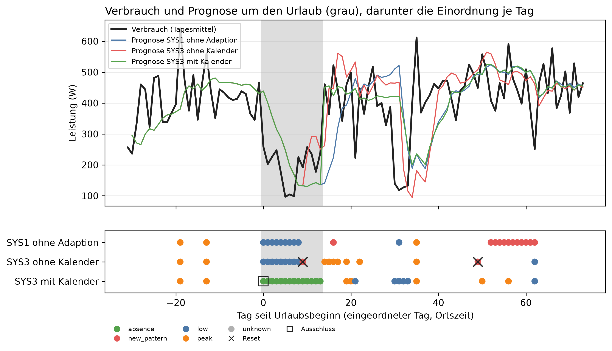
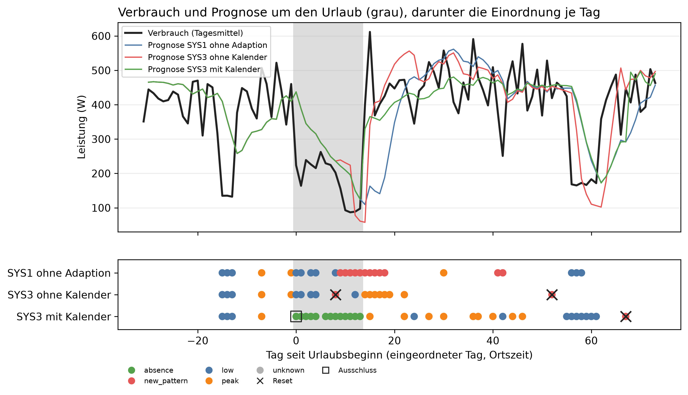
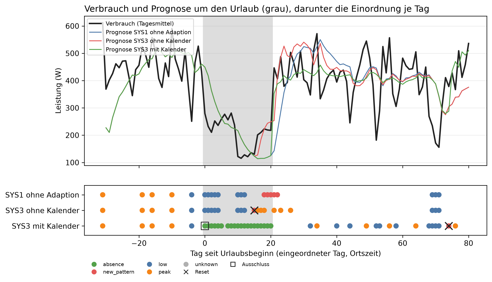

# E2 Abwesenheit, Lauf e2_003

## Setup

- Urlaub event-2016-11: 2016-11-27 bis vor 2016-12-11, Beginn = Tag 0, analysierte Tage 2016-10-27 bis 2017-02-08, Eintrag „Trip nach Lissabon“, ohne Gegenfall
- Urlaub event-2016-12: 2016-12-17 bis vor 2016-12-31, Beginn = Tag 0, analysierte Tage 2016-11-16 bis 2017-02-28, Eintrag „Weihnachten bei den Eltern in Hamburg“, Gegenfall „Eltern kommen zu Besuch“
- Urlaub event-2017-02: 2017-02-01 bis vor 2017-02-22, Beginn = Tag 0, analysierte Tage 2017-01-01 bis 2017-04-22, Eintrag „Skiurlaub in Tirol“, ohne Gegenfall
- Kanäle: je Urlaub im Fenster aus Mains herausgerechnet, Coverage ab 90 %
- Systeme ctx0: SYS1, SYS2, SYS3_CTX0
- Systeme ctx1: SYS3_CTX1
- Systeme ctx1_visit: SYS3_CTX1_VISIT
- Systeme ctx2: SYS3_CTX2
- Ereignisreihen: CO6 (2016-12-02), CO7 (2017-02-20), CO8 (2017-01-13), ohne Kalender, Systeme SYS1, SYS2, SYS3: Kontrolle (ohne Ereignis); Spitzen (Tag 0: Spitze +1000 W über 6 h, Tag 10: Spitze +1000 W über 6 h, Tag 20: Spitze +1000 W über 6 h); Rampe hoch (Tag 0: Rampe über 28 Tage +30 %); Rampe runter (Tag 0: Rampe über 28 Tage −30 %); Sprung hoch (Tag 0: Sprung +30 %); Sprung runter (Tag 0: Sprung −30 %); Festhänger (Tag 0: Festhänger über 12 h, Tag 10: Festhänger über 12 h, Tag 17: Festhänger über 12 h)
- Commit: a18a001

## Einordnung auf den Ereignisreihen: richtige Klasse am Bewertungstag

| System | erwartet | Ereignisse | erkannt | richtig eingeordnet | richtig [%] |
|---|---|---:|---:|---|---:|
| SYS1 ohne Adaption | alle Ereignisse | 30 | 27 | 27/27 | 100,0 |
| SYS1 ohne Adaption | measurement_error | 9 | 9 | 9/9 | 100,0 |
| SYS1 ohne Adaption | new_pattern | 12 | 10 | 10/10 | 100,0 |
| SYS1 ohne Adaption | peak | 9 | 8 | 8/8 | 100,0 |
| SYS2 Regel | alle Ereignisse | 30 | 27 | 27/27 | 100,0 |
| SYS2 Regel | measurement_error | 9 | 9 | 9/9 | 100,0 |
| SYS2 Regel | new_pattern | 12 | 10 | 10/10 | 100,0 |
| SYS2 Regel | peak | 9 | 8 | 8/8 | 100,0 |
| SYS3 LLM | alle Ereignisse | 30 | 27 | 27/27 | 100,0 |
| SYS3 LLM | measurement_error | 9 | 9 | 9/9 | 100,0 |
| SYS3 LLM | new_pattern | 12 | 11 | 11/11 | 100,0 |
| SYS3 LLM | peak | 9 | 7 | 7/7 | 100,0 |

## Falsche Resets von SYS3: Reset, den SYS2 am selben Tag nicht macht, in Reihen ohne Dauerlast

| Reihe | Tage | Resets SYS2 | Resets SYS3 | falsche Resets SYS3 |
|---|---:|---:|---:|---:|
| Kontrolle | 303 | 0 | 0 | 0 |
| Spitzen | 303 | 1 | 1 | 1 |
| Festhänger | 303 | 0 | 1 | 1 |
| alle Reihen | 909 | 1 | 2 | 2 |

## Einordnung je Ereignis

| Reihe | Ereignis | System | erwartet | bewertet an Tag | Klasse | Skala | richtig |
|---|---|---|---|---:|---|---|---|
| Spitzen | 1: Spitze +1000 W über 6 h, Tag 0 | SYS1 ohne Adaption | peak | - | - | - | - |
| Spitzen | 1: Spitze +1000 W über 6 h, Tag 0 | SYS1 ohne Adaption | peak | 1,0 | peak | weekday | ja |
| Spitzen | 1: Spitze +1000 W über 6 h, Tag 0 | SYS1 ohne Adaption | peak | 1,0 | peak | weekday | ja |
| Spitzen | 1: Spitze +1000 W über 6 h, Tag 0 | SYS2 Regel | peak | - | - | - | - |
| Spitzen | 1: Spitze +1000 W über 6 h, Tag 0 | SYS2 Regel | peak | 1,0 | peak | weekday | ja |
| Spitzen | 1: Spitze +1000 W über 6 h, Tag 0 | SYS2 Regel | peak | 1,0 | peak | weekday | ja |
| Spitzen | 1: Spitze +1000 W über 6 h, Tag 0 | SYS3 LLM | peak | - | - | - | - |
| Spitzen | 1: Spitze +1000 W über 6 h, Tag 0 | SYS3 LLM | peak | 1,0 | peak | weekday | ja |
| Spitzen | 1: Spitze +1000 W über 6 h, Tag 0 | SYS3 LLM | peak | 1,0 | peak | weekday | ja |
| Spitzen | 2: Spitze +1000 W über 6 h, Tag 10 | SYS1 ohne Adaption | peak | 11,0 | peak | weekday | ja |
| Spitzen | 2: Spitze +1000 W über 6 h, Tag 10 | SYS1 ohne Adaption | peak | 11,0 | peak | weekday | ja |
| Spitzen | 2: Spitze +1000 W über 6 h, Tag 10 | SYS1 ohne Adaption | peak | 11,0 | peak | weekday | ja |
| Spitzen | 2: Spitze +1000 W über 6 h, Tag 10 | SYS2 Regel | peak | 11,0 | peak | weekday | ja |
| Spitzen | 2: Spitze +1000 W über 6 h, Tag 10 | SYS2 Regel | peak | 11,0 | peak | weekday | ja |
| Spitzen | 2: Spitze +1000 W über 6 h, Tag 10 | SYS2 Regel | peak | 11,0 | peak | weekday | ja |
| Spitzen | 2: Spitze +1000 W über 6 h, Tag 10 | SYS3 LLM | peak | 11,0 | peak | weekday | ja |
| Spitzen | 2: Spitze +1000 W über 6 h, Tag 10 | SYS3 LLM | peak | 11,0 | peak | weekday | ja |
| Spitzen | 2: Spitze +1000 W über 6 h, Tag 10 | SYS3 LLM | peak | 11,0 | peak | weekday | ja |
| Spitzen | 3: Spitze +1000 W über 6 h, Tag 20 | SYS1 ohne Adaption | peak | 21,0 | peak | weekday | ja |
| Spitzen | 3: Spitze +1000 W über 6 h, Tag 20 | SYS1 ohne Adaption | peak | 21,0 | peak | weekday | ja |
| Spitzen | 3: Spitze +1000 W über 6 h, Tag 20 | SYS1 ohne Adaption | peak | 21,0 | peak | weekday | ja |
| Spitzen | 3: Spitze +1000 W über 6 h, Tag 20 | SYS2 Regel | peak | 21,0 | peak | weekday | ja |
| Spitzen | 3: Spitze +1000 W über 6 h, Tag 20 | SYS2 Regel | peak | 21,0 | peak | weekday | ja |
| Spitzen | 3: Spitze +1000 W über 6 h, Tag 20 | SYS2 Regel | peak | 21,0 | peak | daily | ja |
| Spitzen | 3: Spitze +1000 W über 6 h, Tag 20 | SYS3 LLM | peak | 21,0 | peak | weekday | ja |
| Spitzen | 3: Spitze +1000 W über 6 h, Tag 20 | SYS3 LLM | peak | 21,0 | peak | weekday | ja |
| Spitzen | 3: Spitze +1000 W über 6 h, Tag 20 | SYS3 LLM | peak | - | - | - | - |
| Rampe hoch | 1: Rampe über 28 Tage +30 %, Tag 0 | SYS1 ohne Adaption | new_pattern | 40,0 | new_pattern | weekly+long_term | ja |
| Rampe hoch | 1: Rampe über 28 Tage +30 %, Tag 0 | SYS1 ohne Adaption | new_pattern | 35,0 | new_pattern | weekly+long_term | ja |
| Rampe hoch | 1: Rampe über 28 Tage +30 %, Tag 0 | SYS1 ohne Adaption | new_pattern | 17,0 | new_pattern | weekly+long_term | ja |
| Rampe hoch | 1: Rampe über 28 Tage +30 %, Tag 0 | SYS2 Regel | new_pattern | 40,0 | new_pattern | weekly+long_term | ja |
| Rampe hoch | 1: Rampe über 28 Tage +30 %, Tag 0 | SYS2 Regel | new_pattern | 35,0 | new_pattern | weekly+long_term | ja |
| Rampe hoch | 1: Rampe über 28 Tage +30 %, Tag 0 | SYS2 Regel | new_pattern | 17,0 | new_pattern | weekly+long_term | ja |
| Rampe hoch | 1: Rampe über 28 Tage +30 %, Tag 0 | SYS3 LLM | new_pattern | 17,0 | new_pattern | weekly | ja |
| Rampe hoch | 1: Rampe über 28 Tage +30 %, Tag 0 | SYS3 LLM | new_pattern | 35,0 | new_pattern | weekly+long_term | ja |
| Rampe hoch | 1: Rampe über 28 Tage +30 %, Tag 0 | SYS3 LLM | new_pattern | 16,0 | new_pattern | weekly | ja |
| Rampe runter | 1: Rampe über 28 Tage −30 %, Tag 0 | SYS1 ohne Adaption | new_pattern | 28,0 | new_pattern | weekly+long_term | ja |
| Rampe runter | 1: Rampe über 28 Tage −30 %, Tag 0 | SYS1 ohne Adaption | new_pattern | 56,0 | new_pattern | weekly+long_term | ja |
| Rampe runter | 1: Rampe über 28 Tage −30 %, Tag 0 | SYS1 ohne Adaption | new_pattern | 38,0 | new_pattern | weekly+long_term | ja |
| Rampe runter | 1: Rampe über 28 Tage −30 %, Tag 0 | SYS2 Regel | new_pattern | 28,0 | new_pattern | weekly+long_term | ja |
| Rampe runter | 1: Rampe über 28 Tage −30 %, Tag 0 | SYS2 Regel | new_pattern | 56,0 | new_pattern | weekly+long_term | ja |
| Rampe runter | 1: Rampe über 28 Tage −30 %, Tag 0 | SYS2 Regel | new_pattern | 38,0 | new_pattern | weekly+long_term | ja |
| Rampe runter | 1: Rampe über 28 Tage −30 %, Tag 0 | SYS3 LLM | new_pattern | 28,0 | new_pattern | weekly+long_term | ja |
| Rampe runter | 1: Rampe über 28 Tage −30 %, Tag 0 | SYS3 LLM | new_pattern | 56,0 | new_pattern | weekly+long_term | ja |
| Rampe runter | 1: Rampe über 28 Tage −30 %, Tag 0 | SYS3 LLM | new_pattern | 38,0 | new_pattern | weekly+long_term | ja |
| Sprung hoch | 1: Sprung +30 %, Tag 0 | SYS1 ohne Adaption | new_pattern | - | - | - | - |
| Sprung hoch | 1: Sprung +30 %, Tag 0 | SYS1 ohne Adaption | new_pattern | - | - | - | - |
| Sprung hoch | 1: Sprung +30 %, Tag 0 | SYS1 ohne Adaption | new_pattern | 14,0 | new_pattern | weekly+long_term | ja |
| Sprung hoch | 1: Sprung +30 %, Tag 0 | SYS2 Regel | new_pattern | - | - | - | - |
| Sprung hoch | 1: Sprung +30 %, Tag 0 | SYS2 Regel | new_pattern | - | - | - | - |
| Sprung hoch | 1: Sprung +30 %, Tag 0 | SYS2 Regel | new_pattern | 14,0 | new_pattern | weekly+long_term | ja |
| Sprung hoch | 1: Sprung +30 %, Tag 0 | SYS3 LLM | new_pattern | 58,0 | new_pattern | weekly | ja |
| Sprung hoch | 1: Sprung +30 %, Tag 0 | SYS3 LLM | new_pattern | - | - | - | - |
| Sprung hoch | 1: Sprung +30 %, Tag 0 | SYS3 LLM | new_pattern | 14,0 | new_pattern | weekly+long_term | ja |
| Sprung runter | 1: Sprung −30 %, Tag 0 | SYS1 ohne Adaption | new_pattern | 18,0 | new_pattern | weekly+long_term | ja |
| Sprung runter | 1: Sprung −30 %, Tag 0 | SYS1 ohne Adaption | new_pattern | 12,0 | new_pattern | weekly+long_term | ja |
| Sprung runter | 1: Sprung −30 %, Tag 0 | SYS1 ohne Adaption | new_pattern | 35,0 | new_pattern | weekly+long_term | ja |
| Sprung runter | 1: Sprung −30 %, Tag 0 | SYS2 Regel | new_pattern | 18,0 | new_pattern | weekly+long_term | ja |
| Sprung runter | 1: Sprung −30 %, Tag 0 | SYS2 Regel | new_pattern | 12,0 | new_pattern | weekly+long_term | ja |
| Sprung runter | 1: Sprung −30 %, Tag 0 | SYS2 Regel | new_pattern | 35,0 | new_pattern | weekly+long_term | ja |
| Sprung runter | 1: Sprung −30 %, Tag 0 | SYS3 LLM | new_pattern | 18,0 | new_pattern | weekly+long_term | ja |
| Sprung runter | 1: Sprung −30 %, Tag 0 | SYS3 LLM | new_pattern | 11,0 | new_pattern | long_term | ja |
| Sprung runter | 1: Sprung −30 %, Tag 0 | SYS3 LLM | new_pattern | 33,0 | new_pattern | long_term | ja |
| Festhänger | 1: Festhänger über 12 h, Tag 0 | SYS1 ohne Adaption | measurement_error | 1,0 | measurement_error | weekday | ja |
| Festhänger | 1: Festhänger über 12 h, Tag 0 | SYS1 ohne Adaption | measurement_error | 1,0 | measurement_error | daily | ja |
| Festhänger | 1: Festhänger über 12 h, Tag 0 | SYS1 ohne Adaption | measurement_error | 1,0 | measurement_error | weekday | ja |
| Festhänger | 1: Festhänger über 12 h, Tag 0 | SYS2 Regel | measurement_error | 1,0 | measurement_error | weekday | ja |
| Festhänger | 1: Festhänger über 12 h, Tag 0 | SYS2 Regel | measurement_error | 1,0 | measurement_error | daily | ja |
| Festhänger | 1: Festhänger über 12 h, Tag 0 | SYS2 Regel | measurement_error | 1,0 | measurement_error | weekday | ja |
| Festhänger | 1: Festhänger über 12 h, Tag 0 | SYS3 LLM | measurement_error | 1,0 | measurement_error | weekday | ja |
| Festhänger | 1: Festhänger über 12 h, Tag 0 | SYS3 LLM | measurement_error | 1,0 | measurement_error | daily | ja |
| Festhänger | 1: Festhänger über 12 h, Tag 0 | SYS3 LLM | measurement_error | 1,0 | measurement_error | weekday | ja |
| Festhänger | 2: Festhänger über 12 h, Tag 10 | SYS1 ohne Adaption | measurement_error | 11,0 | measurement_error | weekday | ja |
| Festhänger | 2: Festhänger über 12 h, Tag 10 | SYS1 ohne Adaption | measurement_error | 11,0 | measurement_error | weekday | ja |
| Festhänger | 2: Festhänger über 12 h, Tag 10 | SYS1 ohne Adaption | measurement_error | 11,0 | measurement_error | weekday | ja |
| Festhänger | 2: Festhänger über 12 h, Tag 10 | SYS2 Regel | measurement_error | 11,0 | measurement_error | weekday | ja |
| Festhänger | 2: Festhänger über 12 h, Tag 10 | SYS2 Regel | measurement_error | 11,0 | measurement_error | weekday | ja |
| Festhänger | 2: Festhänger über 12 h, Tag 10 | SYS2 Regel | measurement_error | 11,0 | measurement_error | weekday | ja |
| Festhänger | 2: Festhänger über 12 h, Tag 10 | SYS3 LLM | measurement_error | 11,0 | measurement_error | weekday | ja |
| Festhänger | 2: Festhänger über 12 h, Tag 10 | SYS3 LLM | measurement_error | 11,0 | measurement_error | weekday | ja |
| Festhänger | 2: Festhänger über 12 h, Tag 10 | SYS3 LLM | measurement_error | 11,0 | measurement_error | weekday | ja |
| Festhänger | 3: Festhänger über 12 h, Tag 17 | SYS1 ohne Adaption | measurement_error | 18,0 | measurement_error | daily | ja |
| Festhänger | 3: Festhänger über 12 h, Tag 17 | SYS1 ohne Adaption | measurement_error | 18,0 | measurement_error | weekday | ja |
| Festhänger | 3: Festhänger über 12 h, Tag 17 | SYS1 ohne Adaption | measurement_error | 18,0 | measurement_error | weekday | ja |
| Festhänger | 3: Festhänger über 12 h, Tag 17 | SYS2 Regel | measurement_error | 18,0 | measurement_error | daily | ja |
| Festhänger | 3: Festhänger über 12 h, Tag 17 | SYS2 Regel | measurement_error | 18,0 | measurement_error | weekday | ja |
| Festhänger | 3: Festhänger über 12 h, Tag 17 | SYS2 Regel | measurement_error | 18,0 | measurement_error | weekday | ja |
| Festhänger | 3: Festhänger über 12 h, Tag 17 | SYS3 LLM | measurement_error | 18,0 | measurement_error | daily | ja |
| Festhänger | 3: Festhänger über 12 h, Tag 17 | SYS3 LLM | measurement_error | 18,0 | measurement_error | weekday | ja |
| Festhänger | 3: Festhänger über 12 h, Tag 17 | SYS3 LLM | measurement_error | 18,0 | measurement_error | weekday | ja |

## Ereignisreihen: Übereinstimmung von SYS3 mit der Regel SYS2, auch ohne Ereignis

| Cutover | Reihe | Tage | Gate offen | Tage mit anderer Klasse als SYS2 | Meldungen SYS2 | Meldungen SYS3 |
|---|---|---:|---:|---:|---:|---:|
| 2016-12-02 | Kontrolle | 101 | 36 | 2 | 9 | 9 |
| 2016-12-02 | Spitzen | 101 | 29 | 2 | 10 | 10 |
| 2016-12-02 | Rampe hoch | 101 | 41 | 19 | 14 | 12 |
| 2016-12-02 | Rampe runter | 101 | 32 | 3 | 4 | 4 |
| 2016-12-02 | Sprung hoch | 101 | 55 | 4 | 11 | 11 |
| 2016-12-02 | Sprung runter | 101 | 46 | 3 | 7 | 6 |
| 2016-12-02 | Festhänger | 101 | 34 | 9 | 11 | 12 |
| 2017-01-13 | Kontrolle | 101 | 61 | 0 | 8 | 8 |
| 2017-01-13 | Spitzen | 101 | 47 | 5 | 11 | 10 |
| 2017-01-13 | Rampe hoch | 101 | 40 | 4 | 13 | 13 |
| 2017-01-13 | Rampe runter | 101 | 35 | 0 | 8 | 8 |
| 2017-01-13 | Sprung hoch | 101 | 49 | 9 | 13 | 18 |
| 2017-01-13 | Sprung runter | 101 | 37 | 4 | 9 | 9 |
| 2017-01-13 | Festhänger | 101 | 54 | 0 | 12 | 12 |
| 2017-02-20 | Kontrolle | 101 | 55 | 0 | 5 | 5 |
| 2017-02-20 | Spitzen | 101 | 48 | 0 | 7 | 7 |
| 2017-02-20 | Rampe hoch | 101 | 53 | 2 | 7 | 7 |
| 2017-02-20 | Rampe runter | 101 | 75 | 0 | 5 | 5 |
| 2017-02-20 | Sprung hoch | 101 | 79 | 0 | 9 | 9 |
| 2017-02-20 | Sprung runter | 101 | 59 | 3 | 5 | 5 |
| 2017-02-20 | Festhänger | 101 | 57 | 0 | 8 | 8 |

## Ereignisreihen: Meldungen außerhalb der Ereignisse

| System | Reihe | Tage außerhalb der Ereignisse | Meldungen |
|---|---|---:|---:|
| SYS1 ohne Adaption | Kontrolle | 303 | 22 |
| SYS1 ohne Adaption | Spitzen | 294 | 19 |
| SYS1 ohne Adaption | Rampe hoch | 123 | 9 |
| SYS1 ohne Adaption | Rampe runter | 123 | 9 |
| SYS1 ohne Adaption | Sprung hoch | 123 | 9 |
| SYS1 ohne Adaption | Sprung runter | 123 | 9 |
| SYS1 ohne Adaption | Festhänger | 294 | 24 |
| SYS1 ohne Adaption | alle Reihen | 1383 | 101 |
| SYS2 Regel | Kontrolle | 303 | 22 |
| SYS2 Regel | Spitzen | 294 | 20 |
| SYS2 Regel | Rampe hoch | 123 | 9 |
| SYS2 Regel | Rampe runter | 123 | 9 |
| SYS2 Regel | Sprung hoch | 123 | 9 |
| SYS2 Regel | Sprung runter | 123 | 9 |
| SYS2 Regel | Festhänger | 294 | 22 |
| SYS2 Regel | alle Reihen | 1383 | 100 |
| SYS3 LLM | Kontrolle | 303 | 22 |
| SYS3 LLM | Spitzen | 294 | 20 |
| SYS3 LLM | Rampe hoch | 123 | 9 |
| SYS3 LLM | Rampe runter | 123 | 9 |
| SYS3 LLM | Sprung hoch | 123 | 9 |
| SYS3 LLM | Sprung runter | 123 | 9 |
| SYS3 LLM | Festhänger | 294 | 23 |
| SYS3 LLM | alle Reihen | 1383 | 101 |

## Belege und Text der LLM-Antworten

| Lauf | System | Antworten | Beleg fehlt | Verstoß im Text | absence-Antworten | davon belegt |
|---|---|---:|---:|---:|---:|---|
| control_2016-12-02 | SYS3 | 36 | 0 | 0 | 0 | 0/0 |
| control_2017-01-13 | SYS3 | 61 | 1 | 0 | 0 | 0/0 |
| control_2017-02-20 | SYS3 | 55 | 1 | 0 | 0 | 0/0 |
| event-2016-11/ctx0 | SYS3_CTX0 | 38 | 2 | 0 | 0 | 0/0 |
| event-2016-11/ctx1 | SYS3_CTX1 | 41 | 0 | 1 | 14 | 14/14 |
| event-2016-11/ctx2 | SYS3_CTX2 | 35 | 0 | 1 | 14 | 14/14 |
| event-2016-12/ctx0 | SYS3_CTX0 | 49 | 1 | 0 | 0 | 0/0 |
| event-2016-12/ctx1 | SYS3_CTX1 | 46 | 1 | 9 | 13 | 13/13 |
| event-2016-12/ctx1_visit | SYS3_CTX1_VISIT | 46 | 2 | 1 | 11 | 11/11 |
| event-2016-12/ctx2 | SYS3_CTX2 | 46 | 2 | 9 | 13 | 13/13 |
| event-2017-02/ctx0 | SYS3_CTX0 | 60 | 1 | 1 | 0 | 0/0 |
| event-2017-02/ctx1 | SYS3_CTX1 | 56 | 0 | 1 | 20 | 20/20 |
| event-2017-02/ctx2 | SYS3_CTX2 | 59 | 0 | 1 | 20 | 20/20 |
| peaks_2016-12-02 | SYS3 | 29 | 0 | 1 | 0 | 0/0 |
| peaks_2017-01-13 | SYS3 | 47 | 4 | 0 | 0 | 0/0 |
| peaks_2017-02-20 | SYS3 | 48 | 1 | 0 | 0 | 0/0 |
| ramp_28_2016-12-02 | SYS3 | 41 | 0 | 0 | 0 | 0/0 |
| ramp_28_2017-01-13 | SYS3 | 40 | 2 | 1 | 0 | 0/0 |
| ramp_28_2017-02-20 | SYS3 | 53 | 3 | 1 | 0 | 0/0 |
| ramp_28_down_2016-12-02 | SYS3 | 32 | 0 | 0 | 0 | 0/0 |
| ramp_28_down_2017-01-13 | SYS3 | 35 | 2 | 0 | 0 | 0/0 |
| ramp_28_down_2017-02-20 | SYS3 | 75 | 2 | 1 | 0 | 0/0 |
| scaled_2016-12-02 | SYS3 | 55 | 0 | 1 | 0 | 0/0 |
| scaled_2017-01-13 | SYS3 | 49 | 4 | 0 | 0 | 0/0 |
| scaled_2017-02-20 | SYS3 | 79 | 1 | 1 | 0 | 0/0 |
| scaled_down_2016-12-02 | SYS3 | 46 | 1 | 0 | 0 | 0/0 |
| scaled_down_2017-01-13 | SYS3 | 37 | 0 | 0 | 0 | 0/0 |
| scaled_down_2017-02-20 | SYS3 | 59 | 2 | 0 | 0 | 0/0 |
| stucks_2016-12-02 | SYS3 | 34 | 1 | 0 | 0 | 0/0 |
| stucks_2017-01-13 | SYS3 | 54 | 0 | 0 | 0 | 0/0 |
| stucks_2017-02-20 | SYS3 | 57 | 1 | 0 | 0 | 0/0 |

## event-2016-11: Kennzahlen

| Kennzahl | Wert | Bezug |
|---|---|---|
| SYS1: erster Treffer absence [Urlaubstag] | - | 0 von 14 Urlaubstagen mit offenem Gate, 0 × absence ohne Beleg |
| SYS2: erster Treffer absence [Urlaubstag] | - | 0 von 14 Urlaubstagen mit offenem Gate, 0 × absence ohne Beleg |
| SYS3_CTX0: erster Treffer absence [Urlaubstag] | - | 0 von 10 Urlaubstagen mit offenem Gate, 0 × absence ohne Beleg |
| SYS3_CTX1: erster Treffer absence [Urlaubstag] | 0 | 14 von 14 Urlaubstagen mit offenem Gate, 0 × absence ohne Beleg |
| SYS3_CTX2: erster Treffer absence [Urlaubstag] | 0 | 14 von 14 Urlaubstagen mit offenem Gate, 0 × absence ohne Beleg |
| Absenkung durch das Herausrechnen im Mittel [W] | 156,8 | je Tag im Urlaubsfenster |

## event-2016-11: Einordnung je Phase

| System | Phase | Tage | Gate offen | davon Einzeltag | davon Drift | davon nur eine Skala | new_pattern | low | peak | absence | Resets | Meldungen | Ausfalltage |
|---|---|---:|---:|---:|---:|---:|---:|---:|---:|---:|---:|---:|---:|
| SYS1 | vor dem Urlaub | 31 | 2 | 2 | 0 | 0 | 0 | 0 | 2 | 0 | 0 | 2 | 0 |
| SYS1 | Urlaub | 14 | 14 | 9 | 0 | 5 | 0 | 9 | 0 | 0 | 0 | 0 | 0 |
| SYS1 | nach der Rückkehr | 60 | 51 | 2 | 12 | 37 | 12 | 1 | 1 | 0 | 0 | 13 | 0 |
| SYS2 | vor dem Urlaub | 31 | 2 | 2 | 0 | 0 | 0 | 0 | 2 | 0 | 0 | 2 | 0 |
| SYS2 | Urlaub | 14 | 14 | 9 | 0 | 5 | 0 | 9 | 0 | 0 | 0 | 0 | 0 |
| SYS2 | nach der Rückkehr | 60 | 34 | 3 | 1 | 30 | 1 | 1 | 2 | 0 | 1 | 3 | 0 |
| SYS3_CTX0 | vor dem Urlaub | 31 | 2 | 2 | 0 | 0 | 0 | 0 | 2 | 0 | 0 | 2 | 0 |
| SYS3_CTX0 | Urlaub | 14 | 10 | 9 | 0 | 1 | 1 | 9 | 0 | 0 | 1 | 1 | 0 |
| SYS3_CTX0 | nach der Rückkehr | 60 | 26 | 10 | 1 | 15 | 1 | 1 | 7 | 0 | 1 | 8 | 0 |
| SYS3_CTX1 | vor dem Urlaub | 31 | 2 | 2 | 0 | 0 | 0 | 0 | 2 | 0 | 0 | 2 | 0 |
| SYS3_CTX1 | Urlaub | 14 | 14 | 14 | 0 | 0 | 0 | 0 | 0 | 14 | 0 | 0 | 0 |
| SYS3_CTX1 | nach der Rückkehr | 60 | 25 | 11 | 0 | 14 | 0 | 6 | 5 | 0 | 0 | 5 | 0 |
| SYS3_CTX2 | vor dem Urlaub | 31 | 2 | 2 | 0 | 0 | 0 | 0 | 2 | 0 | 0 | 2 | 0 |
| SYS3_CTX2 | Urlaub | 14 | 14 | 14 | 0 | 0 | 0 | 0 | 0 | 14 | 0 | 0 | 0 |
| SYS3_CTX2 | nach der Rückkehr | 60 | 19 | 14 | 0 | 5 | 1 | 7 | 5 | 0 | 1 | 6 | 0 |

## event-2016-11: Einordnung im Urlaub

| System | Urlaubstage | Treffer | erster Treffer [Urlaubstag] | absence ohne Beleg |
|---|---:|---|---:|---:|
| SYS1 | 14 | 0 von 14 | - | 0 |
| SYS2 | 14 | 0 von 14 | - | 0 |
| SYS3_CTX0 | 14 | 0 von 10 | - | 0 |
| SYS3_CTX1 | 14 | 14 von 14 | 0 | 0 |
| SYS3_CTX2 | 14 | 14 von 14 | 0 | 0 |

## event-2016-11: Kalender im State

| System | Phase | eingeordnete Tage | davon Kalender im State |
|---|---|---:|---:|
| SYS1 | vor dem Urlaub | 2 | 0 |
| SYS1 | Urlaub | 14 | 0 |
| SYS1 | nach der Rückkehr | 51 | 0 |
| SYS2 | vor dem Urlaub | 2 | 0 |
| SYS2 | Urlaub | 14 | 0 |
| SYS2 | nach der Rückkehr | 34 | 0 |
| SYS3_CTX0 | vor dem Urlaub | 2 | 0 |
| SYS3_CTX0 | Urlaub | 10 | 0 |
| SYS3_CTX0 | nach der Rückkehr | 26 | 0 |
| SYS3_CTX1 | vor dem Urlaub | 2 | 2 |
| SYS3_CTX1 | Urlaub | 14 | 14 |
| SYS3_CTX1 | nach der Rückkehr | 25 | 25 |
| SYS3_CTX2 | vor dem Urlaub | 2 | 2 |
| SYS3_CTX2 | Urlaub | 14 | 14 |
| SYS3_CTX2 | nach der Rückkehr | 19 | 16 |

## event-2016-11: Kalenderabruf per Tool, an Tagen mit Einordnung

| System | nützlich | überflüssig | verpasst | zu Recht nicht abgerufen |
|---|---:|---:|---:|---:|
| SYS3_CTX2 | 14 | 18 | 0 | 3 |

## event-2016-11: Prognose je Phase, gepaart gegen SYS1

| System | Phase | Tagesfehler [W] | Bias [W] | MAE [W] | MAPE [%] | Differenz Tagesfehler gegen SYS1 [W] | Differenz MAE gegen SYS1 [W] | 2 Standardfehler [W] | Tage | Tage besser [%] | belastbar |
|---|---|---:|---:|---:|---:|---:|---:|---:|---:|---:|---|
| SYS1 | vor dem Urlaub | 72,4 | -11,9 | 188,8 | 53,4 | - | - | - | - | - | - |
| SYS1 | Urlaub | 108,4 | 34,9 | 126,5 | 85,2 | - | - | - | - | - | - |
| SYS1 | nach der Rückkehr | 111,2 | -0,4 | 212,8 | 71,7 | - | - | - | - | - | - |
| SYS2 | vor dem Urlaub | 72,4 | -11,9 | 188,8 | 53,4 | 0,0 | 0,0 | 0,0 | 30 | 0,0 | nein |
| SYS2 | Urlaub | 108,4 | 34,9 | 126,5 | 85,2 | 0,0 | 0,0 | 0,0 | 14 | 0,0 | nein |
| SYS2 | nach der Rückkehr | 106,6 | 6,8 | 213,8 | 70,2 | -4,6 | 1,1 | 13,0 | 61 | 41,0 | nein |
| SYS3_CTX0 | vor dem Urlaub | 72,4 | -11,9 | 188,8 | 53,4 | 0,0 | 0,0 | 0,0 | 30 | 0,0 | nein |
| SYS3_CTX0 | Urlaub | 97,4 | 72,1 | 122,5 | 85,9 | -11,1 | -4,0 | 23,5 | 14 | 21,4 | nein |
| SYS3_CTX0 | nach der Rückkehr | 100,3 | 13,2 | 213,7 | 71,6 | -10,9 | 0,9 | 15,3 | 61 | 59,0 | nein |
| SYS3_CTX1 | vor dem Urlaub | 72,4 | -11,9 | 188,8 | 53,4 | 0,0 | 0,0 | 0,0 | 30 | 0,0 | nein |
| SYS3_CTX1 | Urlaub | 108,4 | 34,9 | 126,5 | 85,2 | 0,0 | 0,0 | 0,0 | 14 | 0,0 | nein |
| SYS3_CTX1 | nach der Rückkehr | 92,9 | 6,0 | 201,6 | 67,2 | -18,3 | -11,2 | 14,4 | 61 | 59,0 | ja |
| SYS3_CTX2 | vor dem Urlaub | 72,4 | -11,9 | 188,8 | 53,4 | 0,0 | 0,0 | 0,0 | 30 | 0,0 | nein |
| SYS3_CTX2 | Urlaub | 108,4 | 34,9 | 126,5 | 85,2 | 0,0 | 0,0 | 0,0 | 14 | 0,0 | nein |
| SYS3_CTX2 | nach der Rückkehr | 89,4 | 27,8 | 206,7 | 71,1 | -21,8 | -6,1 | 16,6 | 61 | 65,6 | ja |

## event-2016-11: Prognose je Phase der Varianten mit Kalender, gepaart gegen SYS3_CTX0

| System | Phase | Tagesfehler [W] | Bias [W] | MAE [W] | MAPE [%] | Differenz Tagesfehler gegen SYS3_CTX0 [W] | Differenz MAE gegen SYS3_CTX0 [W] | 2 Standardfehler [W] | Tage | Tage besser [%] | belastbar |
|---|---|---:|---:|---:|---:|---:|---:|---:|---:|---:|---|
| SYS3_CTX1 | vor dem Urlaub | 72,4 | -11,9 | 188,8 | 53,4 | 0,0 | 0,0 | 0,0 | 30 | 0,0 | nein |
| SYS3_CTX1 | Urlaub | 108,4 | 34,9 | 126,5 | 85,2 | 11,1 | 4,0 | 23,5 | 14 | 7,1 | nein |
| SYS3_CTX1 | nach der Rückkehr | 92,9 | 6,0 | 201,6 | 67,2 | -7,4 | -12,1 | 14,5 | 61 | 54,1 | nein |
| SYS3_CTX2 | vor dem Urlaub | 72,4 | -11,9 | 188,8 | 53,4 | 0,0 | 0,0 | 0,0 | 30 | 0,0 | nein |
| SYS3_CTX2 | Urlaub | 108,4 | 34,9 | 126,5 | 85,2 | 11,1 | 4,0 | 23,5 | 14 | 7,1 | nein |
| SYS3_CTX2 | nach der Rückkehr | 89,4 | 27,8 | 206,7 | 71,1 | -10,9 | -7,0 | 14,7 | 61 | 57,4 | nein |

## event-2016-11: Tage mit anderer Klasse als SYS2

| System | Urlaubstag | Datum | Klasse SYS2 | Klasse System | Aktion SYS2 | Aktion System | LLM-Ausfall |
|---|---:|---|---|---|---|---|---|
| SYS3_CTX0 | 9 | 2016-12-06 | normal | new_pattern | none | advance_history_start | nein |
| SYS3_CTX0 | 14 | 2016-12-11 | normal | peak | none | none | nein |
| SYS3_CTX0 | 15 | 2016-12-12 | normal | peak | none | none | nein |
| SYS3_CTX0 | 16 | 2016-12-13 | new_pattern | peak | advance_history_start | none | nein |
| SYS3_CTX0 | 17 | 2016-12-14 | normal | peak | none | none | nein |
| SYS3_CTX0 | 19 | 2016-12-16 | normal | peak | none | none | nein |
| SYS3_CTX0 | 22 | 2016-12-19 | normal | peak | none | none | nein |
| SYS3_CTX0 | 49 | 2017-01-15 | normal | new_pattern | none | advance_history_start | nein |
| SYS3_CTX0 | 50 | 2017-01-16 | peak | normal | none | none | nein |
| SYS3_CTX1 | 0 | 2016-11-27 | low | absence | none | exclude_window | nein |
| SYS3_CTX1 | 1 | 2016-11-28 | low | absence | none | none | nein |
| SYS3_CTX1 | 2 | 2016-11-29 | low | absence | none | none | nein |
| SYS3_CTX1 | 3 | 2016-11-30 | low | absence | none | none | nein |
| SYS3_CTX1 | 4 | 2016-12-01 | low | absence | none | none | nein |
| SYS3_CTX1 | 5 | 2016-12-02 | low | absence | none | none | nein |
| SYS3_CTX1 | 6 | 2016-12-03 | low | absence | none | none | nein |
| SYS3_CTX1 | 7 | 2016-12-04 | low | absence | none | none | nein |
| SYS3_CTX1 | 8 | 2016-12-05 | low | absence | none | none | nein |
| SYS3_CTX1 | 9 | 2016-12-06 | normal | absence | none | none | nein |
| SYS3_CTX1 | 10 | 2016-12-07 | normal | absence | none | none | nein |
| SYS3_CTX1 | 11 | 2016-12-08 | normal | absence | none | none | nein |
| SYS3_CTX1 | 12 | 2016-12-09 | normal | absence | none | none | nein |
| SYS3_CTX1 | 13 | 2016-12-10 | normal | absence | none | none | nein |
| SYS3_CTX1 | 16 | 2016-12-13 | new_pattern | normal | advance_history_start | none | nein |
| SYS3_CTX1 | 19 | 2016-12-16 | normal | peak | none | none | nein |
| SYS3_CTX1 | 20 | 2016-12-17 | normal | peak | none | none | nein |
| SYS3_CTX1 | 21 | 2016-12-18 | normal | low | none | none | nein |
| SYS3_CTX1 | 30 | 2016-12-27 | normal | low | none | none | nein |
| SYS3_CTX1 | 31 | 2016-12-28 | normal | low | none | none | nein |
| SYS3_CTX1 | 32 | 2016-12-29 | normal | low | none | none | nein |
| SYS3_CTX1 | 33 | 2016-12-30 | normal | low | none | none | nein |
| SYS3_CTX1 | 56 | 2017-01-22 | normal | peak | none | none | nein |
| SYS3_CTX2 | 0 | 2016-11-27 | low | absence | none | exclude_window | nein |
| SYS3_CTX2 | 1 | 2016-11-28 | low | absence | none | none | nein |
| SYS3_CTX2 | 2 | 2016-11-29 | low | absence | none | none | nein |
| SYS3_CTX2 | 3 | 2016-11-30 | low | absence | none | none | nein |
| SYS3_CTX2 | 4 | 2016-12-01 | low | absence | none | none | nein |
| SYS3_CTX2 | 5 | 2016-12-02 | low | absence | none | none | nein |
| SYS3_CTX2 | 6 | 2016-12-03 | low | absence | none | none | nein |
| SYS3_CTX2 | 7 | 2016-12-04 | low | absence | none | none | nein |
| SYS3_CTX2 | 8 | 2016-12-05 | low | absence | none | none | nein |
| SYS3_CTX2 | 9 | 2016-12-06 | normal | absence | none | none | nein |
| SYS3_CTX2 | 10 | 2016-12-07 | normal | absence | none | none | nein |
| SYS3_CTX2 | 11 | 2016-12-08 | normal | absence | none | none | nein |
| SYS3_CTX2 | 12 | 2016-12-09 | normal | absence | none | none | nein |
| SYS3_CTX2 | 13 | 2016-12-10 | normal | absence | none | none | nein |
| SYS3_CTX2 | 16 | 2016-12-13 | new_pattern | normal | advance_history_start | none | nein |
| SYS3_CTX2 | 19 | 2016-12-16 | normal | peak | none | none | nein |
| SYS3_CTX2 | 20 | 2016-12-17 | normal | peak | none | none | nein |
| SYS3_CTX2 | 21 | 2016-12-18 | normal | low | none | none | nein |
| SYS3_CTX2 | 30 | 2016-12-27 | normal | low | none | none | nein |
| SYS3_CTX2 | 31 | 2016-12-28 | normal | low | none | none | nein |
| SYS3_CTX2 | 32 | 2016-12-29 | normal | low | none | none | nein |
| SYS3_CTX2 | 33 | 2016-12-30 | normal | low | none | none | nein |
| SYS3_CTX2 | 36 | 2017-01-02 | normal | new_pattern | none | advance_history_start | nein |
| SYS3_CTX2 | 37 | 2017-01-03 | normal | peak | none | none | nein |
| SYS3_CTX2 | 42 | 2017-01-08 | normal | peak | none | none | nein |
| SYS3_CTX2 | 50 | 2017-01-16 | peak | normal | none | none | nein |
| SYS3_CTX2 | 61 | 2017-01-27 | normal | low | none | none | nein |

## event-2016-12: Kennzahlen

| Kennzahl | Wert | Bezug |
|---|---|---|
| SYS1: erster Treffer absence [Urlaubstag] | - | 0 von 10 Urlaubstagen mit offenem Gate, 0 × absence ohne Beleg |
| SYS2: erster Treffer absence [Urlaubstag] | - | 0 von 9 Urlaubstagen mit offenem Gate, 0 × absence ohne Beleg |
| SYS3_CTX0: erster Treffer absence [Urlaubstag] | - | 0 von 8 Urlaubstagen mit offenem Gate, 0 × absence ohne Beleg |
| SYS3_CTX1: erster Treffer absence [Urlaubstag] | 0 | 13 von 13 Urlaubstagen mit offenem Gate, 0 × absence ohne Beleg |
| SYS3_CTX1_VISIT: erster Treffer absence [Urlaubstag] | - | 0 von 13 Urlaubstagen mit offenem Gate, 11 × absence ohne Beleg |
| SYS3_CTX2: erster Treffer absence [Urlaubstag] | 0 | 13 von 13 Urlaubstagen mit offenem Gate, 0 × absence ohne Beleg |
| Absenkung durch das Herausrechnen im Mittel [W] | 144,0 | je Tag im Urlaubsfenster |

## event-2016-12: Einordnung je Phase

| System | Phase | Tage | Gate offen | davon Einzeltag | davon Drift | davon nur eine Skala | new_pattern | low | peak | absence | Resets | Meldungen | Ausfalltage |
|---|---|---:|---:|---:|---:|---:|---:|---:|---:|---:|---:|---:|---:|
| SYS1 | vor dem Urlaub | 31 | 7 | 5 | 0 | 2 | 0 | 3 | 2 | 0 | 0 | 2 | 0 |
| SYS1 | Urlaub | 14 | 10 | 9 | 5 | 0 | 5 | 5 | 0 | 0 | 0 | 5 | 0 |
| SYS1 | nach der Rückkehr | 60 | 46 | 5 | 7 | 35 | 7 | 3 | 1 | 0 | 0 | 8 | 0 |
| SYS2 | vor dem Urlaub | 31 | 7 | 5 | 0 | 2 | 0 | 3 | 2 | 0 | 0 | 2 | 0 |
| SYS2 | Urlaub | 14 | 9 | 9 | 1 | 0 | 1 | 8 | 0 | 0 | 1 | 1 | 0 |
| SYS2 | nach der Rückkehr | 60 | 36 | 12 | 0 | 24 | 0 | 5 | 7 | 0 | 0 | 7 | 0 |
| SYS3_CTX0 | vor dem Urlaub | 31 | 7 | 5 | 0 | 2 | 0 | 3 | 2 | 0 | 0 | 2 | 0 |
| SYS3_CTX0 | Urlaub | 14 | 8 | 8 | 0 | 0 | 1 | 5 | 0 | 0 | 1 | 1 | 0 |
| SYS3_CTX0 | nach der Rückkehr | 60 | 34 | 10 | 0 | 24 | 1 | 0 | 7 | 0 | 1 | 8 | 0 |
| SYS3_CTX1 | vor dem Urlaub | 31 | 7 | 5 | 0 | 2 | 0 | 3 | 1 | 0 | 0 | 1 | 0 |
| SYS3_CTX1 | Urlaub | 14 | 13 | 13 | 0 | 0 | 0 | 0 | 0 | 13 | 0 | 0 | 0 |
| SYS3_CTX1 | nach der Rückkehr | 60 | 26 | 19 | 1 | 6 | 1 | 9 | 9 | 0 | 1 | 10 | 0 |
| SYS3_CTX1_VISIT | vor dem Urlaub | 31 | 7 | 5 | 0 | 2 | 0 | 3 | 2 | 0 | 0 | 2 | 0 |
| SYS3_CTX1_VISIT | Urlaub | 14 | 13 | 13 | 0 | 0 | 0 | 1 | 0 | 11 | 0 | 0 | 0 |
| SYS3_CTX1_VISIT | nach der Rückkehr | 60 | 26 | 19 | 1 | 6 | 1 | 9 | 9 | 0 | 1 | 10 | 0 |
| SYS3_CTX2 | vor dem Urlaub | 31 | 7 | 5 | 0 | 2 | 0 | 3 | 1 | 0 | 0 | 1 | 0 |
| SYS3_CTX2 | Urlaub | 14 | 13 | 13 | 0 | 0 | 0 | 0 | 0 | 13 | 0 | 0 | 0 |
| SYS3_CTX2 | nach der Rückkehr | 60 | 26 | 19 | 1 | 6 | 1 | 9 | 9 | 0 | 1 | 10 | 0 |

## event-2016-12: Einordnung im Urlaub

| System | Urlaubstage | Treffer | erster Treffer [Urlaubstag] | absence ohne Beleg |
|---|---:|---|---:|---:|
| SYS1 | 14 | 0 von 10 | - | 0 |
| SYS2 | 14 | 0 von 9 | - | 0 |
| SYS3_CTX0 | 14 | 0 von 8 | - | 0 |
| SYS3_CTX1 | 14 | 13 von 13 | 0 | 0 |
| SYS3_CTX1_VISIT | 14 | 0 von 13 | - | 11 |
| SYS3_CTX2 | 14 | 13 von 13 | 0 | 0 |

## event-2016-12: Kalender im State

| System | Phase | eingeordnete Tage | davon Kalender im State |
|---|---|---:|---:|
| SYS1 | vor dem Urlaub | 7 | 0 |
| SYS1 | Urlaub | 10 | 0 |
| SYS1 | nach der Rückkehr | 46 | 0 |
| SYS2 | vor dem Urlaub | 7 | 0 |
| SYS2 | Urlaub | 9 | 0 |
| SYS2 | nach der Rückkehr | 36 | 0 |
| SYS3_CTX0 | vor dem Urlaub | 7 | 0 |
| SYS3_CTX0 | Urlaub | 8 | 0 |
| SYS3_CTX0 | nach der Rückkehr | 34 | 0 |
| SYS3_CTX1 | vor dem Urlaub | 7 | 7 |
| SYS3_CTX1 | Urlaub | 13 | 13 |
| SYS3_CTX1 | nach der Rückkehr | 26 | 26 |
| SYS3_CTX1_VISIT | vor dem Urlaub | 7 | 7 |
| SYS3_CTX1_VISIT | Urlaub | 13 | 13 |
| SYS3_CTX1_VISIT | nach der Rückkehr | 26 | 26 |
| SYS3_CTX2 | vor dem Urlaub | 7 | 3 |
| SYS3_CTX2 | Urlaub | 13 | 13 |
| SYS3_CTX2 | nach der Rückkehr | 26 | 14 |

## event-2016-12: Kalenderabruf per Tool, an Tagen mit Einordnung

| System | nützlich | überflüssig | verpasst | zu Recht nicht abgerufen |
|---|---:|---:|---:|---:|
| SYS3_CTX2 | 13 | 17 | 0 | 16 |

## event-2016-12: Prognose je Phase, gepaart gegen SYS1

| System | Phase | Tagesfehler [W] | Bias [W] | MAE [W] | MAPE [%] | Differenz Tagesfehler gegen SYS1 [W] | Differenz MAE gegen SYS1 [W] | 2 Standardfehler [W] | Tage | Tage besser [%] | belastbar |
|---|---|---:|---:|---:|---:|---:|---:|---:|---:|---:|---|
| SYS1 | vor dem Urlaub | 89,0 | 7,8 | 192,4 | 67,9 | - | - | - | - | - | - |
| SYS1 | Urlaub | 89,6 | 89,6 | 128,8 | 103,9 | - | - | - | - | - | - |
| SYS1 | nach der Rückkehr | 108,2 | -16,1 | 207,0 | 61,2 | - | - | - | - | - | - |
| SYS2 | vor dem Urlaub | 89,0 | 7,8 | 192,4 | 67,9 | 0,0 | 0,0 | 0,0 | 30 | 0,0 | nein |
| SYS2 | Urlaub | 90,8 | 83,7 | 123,9 | 96,6 | 1,2 | -4,9 | 9,4 | 14 | 7,1 | nein |
| SYS2 | nach der Rückkehr | 93,8 | 6,0 | 207,1 | 64,5 | -14,5 | 0,1 | 14,9 | 61 | 54,1 | nein |
| SYS3_CTX0 | vor dem Urlaub | 89,0 | 7,8 | 192,4 | 67,9 | 0,0 | 0,0 | 0,0 | 30 | 0,0 | nein |
| SYS3_CTX0 | Urlaub | 91,4 | 84,7 | 122,4 | 94,9 | 1,8 | -6,4 | 9,5 | 14 | 7,1 | nein |
| SYS3_CTX0 | nach der Rückkehr | 86,3 | 12,8 | 208,6 | 65,5 | -22,0 | 1,6 | 20,0 | 61 | 62,3 | ja |
| SYS3_CTX1 | vor dem Urlaub | 89,0 | 7,8 | 192,4 | 67,9 | 0,0 | 0,0 | 0,0 | 30 | 0,0 | nein |
| SYS3_CTX1 | Urlaub | 89,6 | 89,6 | 128,8 | 103,9 | 0,0 | 0,0 | 0,0 | 14 | 0,0 | nein |
| SYS3_CTX1 | nach der Rückkehr | 82,7 | -5,7 | 196,0 | 59,0 | -25,5 | -11,0 | 17,4 | 61 | 55,7 | ja |
| SYS3_CTX1_VISIT | vor dem Urlaub | 89,0 | 7,8 | 192,4 | 67,9 | 0,0 | 0,0 | 0,0 | 30 | 0,0 | nein |
| SYS3_CTX1_VISIT | Urlaub | 89,6 | 89,6 | 128,8 | 103,9 | 0,0 | 0,0 | 0,0 | 14 | 0,0 | nein |
| SYS3_CTX1_VISIT | nach der Rückkehr | 82,7 | -5,7 | 196,0 | 59,0 | -25,5 | -11,0 | 17,4 | 61 | 55,7 | ja |
| SYS3_CTX2 | vor dem Urlaub | 89,0 | 7,8 | 192,4 | 67,9 | 0,0 | 0,0 | 0,0 | 30 | 0,0 | nein |
| SYS3_CTX2 | Urlaub | 89,6 | 89,6 | 128,8 | 103,9 | 0,0 | 0,0 | 0,0 | 14 | 0,0 | nein |
| SYS3_CTX2 | nach der Rückkehr | 82,7 | -5,7 | 196,0 | 59,0 | -25,5 | -11,0 | 17,4 | 61 | 55,7 | ja |

## event-2016-12: Prognose je Phase der Varianten mit Kalender, gepaart gegen SYS3_CTX0

| System | Phase | Tagesfehler [W] | Bias [W] | MAE [W] | MAPE [%] | Differenz Tagesfehler gegen SYS3_CTX0 [W] | Differenz MAE gegen SYS3_CTX0 [W] | 2 Standardfehler [W] | Tage | Tage besser [%] | belastbar |
|---|---|---:|---:|---:|---:|---:|---:|---:|---:|---:|---|
| SYS3_CTX1 | vor dem Urlaub | 89,0 | 7,8 | 192,4 | 67,9 | 0,0 | 0,0 | 0,0 | 30 | 0,0 | nein |
| SYS3_CTX1 | Urlaub | 89,6 | 89,6 | 128,8 | 103,9 | -1,8 | 6,4 | 9,5 | 14 | 28,6 | nein |
| SYS3_CTX1 | nach der Rückkehr | 82,7 | -5,7 | 196,0 | 59,0 | -3,6 | -12,6 | 17,4 | 61 | 60,7 | nein |
| SYS3_CTX1_VISIT | vor dem Urlaub | 89,0 | 7,8 | 192,4 | 67,9 | 0,0 | 0,0 | 0,0 | 30 | 0,0 | nein |
| SYS3_CTX1_VISIT | Urlaub | 89,6 | 89,6 | 128,8 | 103,9 | -1,8 | 6,4 | 9,5 | 14 | 28,6 | nein |
| SYS3_CTX1_VISIT | nach der Rückkehr | 82,7 | -5,7 | 196,0 | 59,0 | -3,6 | -12,6 | 17,4 | 61 | 60,7 | nein |
| SYS3_CTX2 | vor dem Urlaub | 89,0 | 7,8 | 192,4 | 67,9 | 0,0 | 0,0 | 0,0 | 30 | 0,0 | nein |
| SYS3_CTX2 | Urlaub | 89,6 | 89,6 | 128,8 | 103,9 | -1,8 | 6,4 | 9,5 | 14 | 28,6 | nein |
| SYS3_CTX2 | nach der Rückkehr | 82,7 | -5,7 | 196,0 | 59,0 | -3,6 | -12,6 | 17,4 | 61 | 60,7 | nein |

## event-2016-12: Tage mit anderer Klasse als SYS2

| System | Urlaubstag | Datum | Klasse SYS2 | Klasse System | Aktion SYS2 | Aktion System | LLM-Ausfall |
|---|---:|---|---|---|---|---|---|
| SYS3_CTX0 | 8 | 2016-12-25 | low | new_pattern | none | advance_history_start | nein |
| SYS3_CTX0 | 9 | 2016-12-26 | new_pattern | normal | advance_history_start | none | nein |
| SYS3_CTX0 | 10 | 2016-12-27 | low | normal | none | none | nein |
| SYS3_CTX0 | 11 | 2016-12-28 | low | normal | none | none | nein |
| SYS3_CTX0 | 52 | 2017-02-07 | normal | new_pattern | none | advance_history_start | nein |
| SYS3_CTX0 | 56 | 2017-02-11 | low | normal | none | none | nein |
| SYS3_CTX0 | 57 | 2017-02-12 | low | normal | none | none | nein |
| SYS3_CTX0 | 58 | 2017-02-13 | low | normal | none | none | nein |
| SYS3_CTX0 | 59 | 2017-02-14 | low | normal | none | none | nein |
| SYS3_CTX0 | 60 | 2017-02-15 | low | normal | none | none | nein |
| SYS3_CTX1 | -1 | 2016-12-16 | peak | normal | none | none | nein |
| SYS3_CTX1 | 0 | 2016-12-17 | low | absence | none | exclude_window | nein |
| SYS3_CTX1 | 1 | 2016-12-18 | low | absence | none | none | nein |
| SYS3_CTX1 | 2 | 2016-12-19 | normal | absence | none | none | nein |
| SYS3_CTX1 | 3 | 2016-12-20 | low | absence | none | none | nein |
| SYS3_CTX1 | 4 | 2016-12-21 | low | absence | none | none | nein |
| SYS3_CTX1 | 6 | 2016-12-23 | normal | absence | none | none | nein |
| SYS3_CTX1 | 7 | 2016-12-24 | normal | absence | none | none | nein |
| SYS3_CTX1 | 8 | 2016-12-25 | low | absence | none | none | nein |
| SYS3_CTX1 | 9 | 2016-12-26 | new_pattern | absence | advance_history_start | none | nein |
| SYS3_CTX1 | 10 | 2016-12-27 | low | absence | none | none | nein |
| SYS3_CTX1 | 11 | 2016-12-28 | low | absence | none | none | nein |
| SYS3_CTX1 | 12 | 2016-12-29 | low | absence | none | none | nein |
| SYS3_CTX1 | 13 | 2016-12-30 | normal | absence | none | none | nein |
| SYS3_CTX1 | 14 | 2016-12-31 | peak | normal | none | none | nein |
| SYS3_CTX1 | 16 | 2017-01-02 | peak | normal | none | none | nein |
| SYS3_CTX1 | 17 | 2017-01-03 | peak | normal | none | none | nein |
| SYS3_CTX1 | 18 | 2017-01-04 | peak | normal | none | none | nein |
| SYS3_CTX1 | 19 | 2017-01-05 | peak | normal | none | none | nein |
| SYS3_CTX1 | 24 | 2017-01-10 | normal | low | none | none | nein |
| SYS3_CTX1 | 27 | 2017-01-13 | normal | peak | none | none | nein |
| SYS3_CTX1 | 30 | 2017-01-16 | normal | peak | none | none | nein |
| SYS3_CTX1 | 36 | 2017-01-22 | normal | peak | none | none | nein |
| SYS3_CTX1 | 37 | 2017-01-23 | normal | peak | none | none | nein |
| SYS3_CTX1 | 40 | 2017-01-26 | normal | peak | none | none | nein |
| SYS3_CTX1 | 42 | 2017-01-28 | normal | low | none | none | nein |
| SYS3_CTX1 | 44 | 2017-01-30 | normal | peak | none | none | nein |
| SYS3_CTX1 | 46 | 2017-02-01 | normal | peak | none | none | nein |
| SYS3_CTX1 | 55 | 2017-02-10 | normal | low | none | none | nein |
| SYS3_CTX1 | 61 | 2017-02-16 | normal | low | none | none | nein |
| SYS3_CTX1 | 67 | 2017-02-22 | normal | new_pattern | none | advance_history_start | nein |
| SYS3_CTX1_VISIT | 0 | 2016-12-17 | low | normal | none | none | nein |
| SYS3_CTX1_VISIT | 1 | 2016-12-18 | low | absence | none | exclude_window | nein |
| SYS3_CTX1_VISIT | 2 | 2016-12-19 | normal | absence | none | none | nein |
| SYS3_CTX1_VISIT | 4 | 2016-12-21 | low | absence | none | none | nein |
| SYS3_CTX1_VISIT | 6 | 2016-12-23 | normal | absence | none | none | nein |
| SYS3_CTX1_VISIT | 7 | 2016-12-24 | normal | absence | none | none | nein |
| SYS3_CTX1_VISIT | 8 | 2016-12-25 | low | absence | none | none | nein |
| SYS3_CTX1_VISIT | 9 | 2016-12-26 | new_pattern | absence | advance_history_start | none | nein |
| SYS3_CTX1_VISIT | 10 | 2016-12-27 | low | absence | none | none | nein |
| SYS3_CTX1_VISIT | 11 | 2016-12-28 | low | absence | none | none | nein |
| SYS3_CTX1_VISIT | 12 | 2016-12-29 | low | absence | none | none | nein |
| SYS3_CTX1_VISIT | 13 | 2016-12-30 | normal | absence | none | none | nein |
| SYS3_CTX1_VISIT | 14 | 2016-12-31 | peak | normal | none | none | nein |
| SYS3_CTX1_VISIT | 16 | 2017-01-02 | peak | normal | none | none | nein |
| SYS3_CTX1_VISIT | 17 | 2017-01-03 | peak | normal | none | none | nein |
| SYS3_CTX1_VISIT | 18 | 2017-01-04 | peak | normal | none | none | nein |
| SYS3_CTX1_VISIT | 19 | 2017-01-05 | peak | normal | none | none | nein |
| SYS3_CTX1_VISIT | 24 | 2017-01-10 | normal | low | none | none | nein |
| SYS3_CTX1_VISIT | 27 | 2017-01-13 | normal | peak | none | none | nein |
| SYS3_CTX1_VISIT | 30 | 2017-01-16 | normal | peak | none | none | nein |
| SYS3_CTX1_VISIT | 36 | 2017-01-22 | normal | peak | none | none | nein |
| SYS3_CTX1_VISIT | 37 | 2017-01-23 | normal | peak | none | none | nein |
| SYS3_CTX1_VISIT | 40 | 2017-01-26 | normal | peak | none | none | nein |
| SYS3_CTX1_VISIT | 42 | 2017-01-28 | normal | low | none | none | nein |
| SYS3_CTX1_VISIT | 44 | 2017-01-30 | normal | peak | none | none | nein |
| SYS3_CTX1_VISIT | 46 | 2017-02-01 | normal | peak | none | none | nein |
| SYS3_CTX1_VISIT | 55 | 2017-02-10 | normal | low | none | none | nein |
| SYS3_CTX1_VISIT | 61 | 2017-02-16 | normal | low | none | none | nein |
| SYS3_CTX1_VISIT | 67 | 2017-02-22 | normal | new_pattern | none | advance_history_start | nein |
| SYS3_CTX2 | -1 | 2016-12-16 | peak | normal | none | none | nein |
| SYS3_CTX2 | 0 | 2016-12-17 | low | absence | none | exclude_window | nein |
| SYS3_CTX2 | 1 | 2016-12-18 | low | absence | none | none | nein |
| SYS3_CTX2 | 2 | 2016-12-19 | normal | absence | none | none | nein |
| SYS3_CTX2 | 3 | 2016-12-20 | low | absence | none | none | nein |
| SYS3_CTX2 | 4 | 2016-12-21 | low | absence | none | none | nein |
| SYS3_CTX2 | 6 | 2016-12-23 | normal | absence | none | none | nein |
| SYS3_CTX2 | 7 | 2016-12-24 | normal | absence | none | none | nein |
| SYS3_CTX2 | 8 | 2016-12-25 | low | absence | none | none | nein |
| SYS3_CTX2 | 9 | 2016-12-26 | new_pattern | absence | advance_history_start | none | nein |
| SYS3_CTX2 | 10 | 2016-12-27 | low | absence | none | none | nein |
| SYS3_CTX2 | 11 | 2016-12-28 | low | absence | none | none | nein |
| SYS3_CTX2 | 12 | 2016-12-29 | low | absence | none | none | nein |
| SYS3_CTX2 | 13 | 2016-12-30 | normal | absence | none | none | nein |
| SYS3_CTX2 | 14 | 2016-12-31 | peak | normal | none | none | nein |
| SYS3_CTX2 | 16 | 2017-01-02 | peak | normal | none | none | nein |
| SYS3_CTX2 | 17 | 2017-01-03 | peak | normal | none | none | nein |
| SYS3_CTX2 | 18 | 2017-01-04 | peak | normal | none | none | nein |
| SYS3_CTX2 | 19 | 2017-01-05 | peak | normal | none | none | nein |
| SYS3_CTX2 | 24 | 2017-01-10 | normal | low | none | none | nein |
| SYS3_CTX2 | 27 | 2017-01-13 | normal | peak | none | none | nein |
| SYS3_CTX2 | 30 | 2017-01-16 | normal | peak | none | none | nein |
| SYS3_CTX2 | 36 | 2017-01-22 | normal | peak | none | none | nein |
| SYS3_CTX2 | 37 | 2017-01-23 | normal | peak | none | none | nein |
| SYS3_CTX2 | 40 | 2017-01-26 | normal | peak | none | none | nein |
| SYS3_CTX2 | 42 | 2017-01-28 | normal | low | none | none | nein |
| SYS3_CTX2 | 44 | 2017-01-30 | normal | peak | none | none | nein |
| SYS3_CTX2 | 46 | 2017-02-01 | normal | peak | none | none | nein |
| SYS3_CTX2 | 55 | 2017-02-10 | normal | low | none | none | nein |
| SYS3_CTX2 | 61 | 2017-02-16 | normal | low | none | none | nein |
| SYS3_CTX2 | 67 | 2017-02-22 | normal | new_pattern | none | advance_history_start | nein |

## event-2017-02: Kennzahlen

| Kennzahl | Wert | Bezug |
|---|---|---|
| SYS1: erster Treffer absence [Urlaubstag] | - | 0 von 17 Urlaubstagen mit offenem Gate, 0 × absence ohne Beleg |
| SYS2: erster Treffer absence [Urlaubstag] | - | 0 von 15 Urlaubstagen mit offenem Gate, 0 × absence ohne Beleg |
| SYS3_CTX0: erster Treffer absence [Urlaubstag] | - | 0 von 15 Urlaubstagen mit offenem Gate, 0 × absence ohne Beleg |
| SYS3_CTX1: erster Treffer absence [Urlaubstag] | 0 | 20 von 20 Urlaubstagen mit offenem Gate, 0 × absence ohne Beleg |
| SYS3_CTX2: erster Treffer absence [Urlaubstag] | 0 | 20 von 20 Urlaubstagen mit offenem Gate, 0 × absence ohne Beleg |
| Absenkung durch das Herausrechnen im Mittel [W] | 154,7 | je Tag im Urlaubsfenster |

## event-2017-02: Einordnung je Phase

| System | Phase | Tage | Gate offen | davon Einzeltag | davon Drift | davon nur eine Skala | new_pattern | low | peak | absence | Resets | Meldungen | Ausfalltage |
|---|---|---:|---:|---:|---:|---:|---:|---:|---:|---:|---:|---:|---:|
| SYS1 | vor dem Urlaub | 31 | 13 | 5 | 0 | 8 | 0 | 1 | 4 | 0 | 0 | 4 | 0 |
| SYS1 | Urlaub | 21 | 17 | 8 | 3 | 6 | 3 | 8 | 0 | 0 | 0 | 3 | 0 |
| SYS1 | nach der Rückkehr | 60 | 42 | 3 | 2 | 37 | 2 | 3 | 0 | 0 | 0 | 2 | 0 |
| SYS2 | vor dem Urlaub | 31 | 13 | 5 | 0 | 8 | 0 | 1 | 4 | 0 | 0 | 4 | 0 |
| SYS2 | Urlaub | 21 | 15 | 8 | 1 | 6 | 1 | 8 | 0 | 0 | 1 | 1 | 0 |
| SYS2 | nach der Rückkehr | 60 | 28 | 10 | 0 | 18 | 0 | 5 | 5 | 0 | 0 | 5 | 0 |
| SYS3_CTX0 | vor dem Urlaub | 31 | 13 | 5 | 0 | 8 | 0 | 1 | 4 | 0 | 0 | 4 | 0 |
| SYS3_CTX0 | Urlaub | 21 | 15 | 11 | 0 | 4 | 1 | 8 | 3 | 0 | 1 | 4 | 0 |
| SYS3_CTX0 | nach der Rückkehr | 60 | 32 | 6 | 0 | 26 | 0 | 3 | 3 | 0 | 0 | 3 | 0 |
| SYS3_CTX1 | vor dem Urlaub | 31 | 13 | 5 | 0 | 8 | 0 | 1 | 4 | 0 | 0 | 4 | 0 |
| SYS3_CTX1 | Urlaub | 21 | 20 | 20 | 0 | 0 | 0 | 0 | 0 | 20 | 0 | 0 | 0 |
| SYS3_CTX1 | nach der Rückkehr | 60 | 23 | 15 | 0 | 8 | 1 | 10 | 5 | 0 | 1 | 6 | 0 |
| SYS3_CTX2 | vor dem Urlaub | 31 | 13 | 5 | 0 | 8 | 0 | 1 | 4 | 0 | 0 | 4 | 0 |
| SYS3_CTX2 | Urlaub | 21 | 20 | 20 | 0 | 0 | 0 | 0 | 0 | 20 | 0 | 0 | 0 |
| SYS3_CTX2 | nach der Rückkehr | 60 | 26 | 14 | 0 | 12 | 0 | 10 | 4 | 0 | 0 | 4 | 0 |

## event-2017-02: Einordnung im Urlaub

| System | Urlaubstage | Treffer | erster Treffer [Urlaubstag] | absence ohne Beleg |
|---|---:|---|---:|---:|
| SYS1 | 21 | 0 von 17 | - | 0 |
| SYS2 | 21 | 0 von 15 | - | 0 |
| SYS3_CTX0 | 21 | 0 von 15 | - | 0 |
| SYS3_CTX1 | 21 | 20 von 20 | 0 | 0 |
| SYS3_CTX2 | 21 | 20 von 20 | 0 | 0 |

## event-2017-02: Kalender im State

| System | Phase | eingeordnete Tage | davon Kalender im State |
|---|---|---:|---:|
| SYS1 | vor dem Urlaub | 13 | 0 |
| SYS1 | Urlaub | 17 | 0 |
| SYS1 | nach der Rückkehr | 42 | 0 |
| SYS2 | vor dem Urlaub | 13 | 0 |
| SYS2 | Urlaub | 15 | 0 |
| SYS2 | nach der Rückkehr | 28 | 0 |
| SYS3_CTX0 | vor dem Urlaub | 13 | 0 |
| SYS3_CTX0 | Urlaub | 15 | 0 |
| SYS3_CTX0 | nach der Rückkehr | 32 | 0 |
| SYS3_CTX1 | vor dem Urlaub | 13 | 13 |
| SYS3_CTX1 | Urlaub | 20 | 20 |
| SYS3_CTX1 | nach der Rückkehr | 23 | 23 |
| SYS3_CTX2 | vor dem Urlaub | 13 | 1 |
| SYS3_CTX2 | Urlaub | 20 | 20 |
| SYS3_CTX2 | nach der Rückkehr | 26 | 13 |

## event-2017-02: Kalenderabruf per Tool, an Tagen mit Einordnung

| System | nützlich | überflüssig | verpasst | zu Recht nicht abgerufen |
|---|---:|---:|---:|---:|
| SYS3_CTX2 | 20 | 14 | 0 | 25 |

## event-2017-02: Prognose je Phase, gepaart gegen SYS1

| System | Phase | Tagesfehler [W] | Bias [W] | MAE [W] | MAPE [%] | Differenz Tagesfehler gegen SYS1 [W] | Differenz MAE gegen SYS1 [W] | 2 Standardfehler [W] | Tage | Tage besser [%] | belastbar |
|---|---|---:|---:|---:|---:|---:|---:|---:|---:|---:|---|
| SYS1 | vor dem Urlaub | 83,1 | -13,9 | 197,8 | 54,5 | - | - | - | - | - | - |
| SYS1 | Urlaub | 70,4 | 12,6 | 113,5 | 66,6 | - | - | - | - | - | - |
| SYS1 | nach der Rückkehr | 95,2 | 5,6 | 206,1 | 63,3 | - | - | - | - | - | - |
| SYS2 | vor dem Urlaub | 83,1 | -13,9 | 197,8 | 54,5 | 0,0 | 0,0 | 0,0 | 30 | 0,0 | nein |
| SYS2 | Urlaub | 64,0 | 24,5 | 110,4 | 65,6 | -6,4 | -3,1 | 8,9 | 21 | 9,5 | nein |
| SYS2 | nach der Rückkehr | 88,8 | 10,8 | 205,5 | 64,3 | -6,5 | -0,6 | 11,5 | 61 | 45,9 | nein |
| SYS3_CTX0 | vor dem Urlaub | 83,1 | -13,9 | 197,8 | 54,5 | 0,0 | 0,0 | 0,0 | 30 | 0,0 | nein |
| SYS3_CTX0 | Urlaub | 54,9 | 33,5 | 104,8 | 61,9 | -15,5 | -8,7 | 14,1 | 21 | 23,8 | ja |
| SYS3_CTX0 | nach der Rückkehr | 88,2 | 13,1 | 207,4 | 65,5 | -7,0 | 1,3 | 12,0 | 61 | 42,6 | nein |
| SYS3_CTX1 | vor dem Urlaub | 83,1 | -13,9 | 197,8 | 54,5 | 0,0 | 0,0 | 0,0 | 30 | 0,0 | nein |
| SYS3_CTX1 | Urlaub | 70,4 | 12,6 | 113,5 | 66,6 | 0,0 | 0,0 | 0,0 | 21 | 0,0 | nein |
| SYS3_CTX1 | nach der Rückkehr | 74,7 | 5,4 | 194,1 | 58,4 | -20,5 | -12,0 | 14,9 | 61 | 59,0 | ja |
| SYS3_CTX2 | vor dem Urlaub | 83,1 | -13,9 | 197,8 | 54,5 | 0,0 | 0,0 | 0,0 | 30 | 0,0 | nein |
| SYS3_CTX2 | Urlaub | 70,4 | 12,6 | 113,5 | 66,6 | 0,0 | 0,0 | 0,0 | 21 | 0,0 | nein |
| SYS3_CTX2 | nach der Rückkehr | 79,2 | -9,7 | 190,9 | 56,2 | -16,1 | -15,2 | 13,3 | 61 | 57,4 | ja |

## event-2017-02: Prognose je Phase der Varianten mit Kalender, gepaart gegen SYS3_CTX0

| System | Phase | Tagesfehler [W] | Bias [W] | MAE [W] | MAPE [%] | Differenz Tagesfehler gegen SYS3_CTX0 [W] | Differenz MAE gegen SYS3_CTX0 [W] | 2 Standardfehler [W] | Tage | Tage besser [%] | belastbar |
|---|---|---:|---:|---:|---:|---:|---:|---:|---:|---:|---|
| SYS3_CTX1 | vor dem Urlaub | 83,1 | -13,9 | 197,8 | 54,5 | 0,0 | 0,0 | 0,0 | 30 | 0,0 | nein |
| SYS3_CTX1 | Urlaub | 70,4 | 12,6 | 113,5 | 66,6 | 15,5 | 8,7 | 14,1 | 21 | 0,0 | ja |
| SYS3_CTX1 | nach der Rückkehr | 74,7 | 5,4 | 194,1 | 58,4 | -13,5 | -13,2 | 12,7 | 61 | 57,4 | ja |
| SYS3_CTX2 | vor dem Urlaub | 83,1 | -13,9 | 197,8 | 54,5 | 0,0 | 0,0 | 0,0 | 30 | 0,0 | nein |
| SYS3_CTX2 | Urlaub | 70,4 | 12,6 | 113,5 | 66,6 | 15,5 | 8,7 | 14,1 | 21 | 0,0 | ja |
| SYS3_CTX2 | nach der Rückkehr | 79,2 | -9,7 | 190,9 | 56,2 | -9,1 | -16,5 | 10,5 | 61 | 55,7 | nein |

## event-2017-02: Tage mit anderer Klasse als SYS2

| System | Urlaubstag | Datum | Klasse SYS2 | Klasse System | Aktion SYS2 | Aktion System | LLM-Ausfall |
|---|---:|---|---|---|---|---|---|
| SYS3_CTX0 | 15 | 2017-02-16 | normal | new_pattern | none | advance_history_start | nein |
| SYS3_CTX0 | 16 | 2017-02-17 | normal | peak | none | none | nein |
| SYS3_CTX0 | 17 | 2017-02-18 | normal | peak | none | none | nein |
| SYS3_CTX0 | 18 | 2017-02-19 | new_pattern | peak | advance_history_start | none | nein |
| SYS3_CTX0 | 22 | 2017-02-23 | peak | normal | none | none | nein |
| SYS3_CTX0 | 24 | 2017-02-25 | peak | normal | none | none | nein |
| SYS3_CTX0 | 52 | 2017-03-25 | low | normal | none | none | nein |
| SYS3_CTX0 | 68 | 2017-04-10 | low | normal | none | none | nein |
| SYS3_CTX1 | 0 | 2017-02-01 | low | absence | none | exclude_window | nein |
| SYS3_CTX1 | 1 | 2017-02-02 | low | absence | none | none | nein |
| SYS3_CTX1 | 2 | 2017-02-03 | low | absence | none | none | nein |
| SYS3_CTX1 | 3 | 2017-02-04 | low | absence | none | none | nein |
| SYS3_CTX1 | 4 | 2017-02-05 | low | absence | none | none | nein |
| SYS3_CTX1 | 5 | 2017-02-06 | normal | absence | none | none | nein |
| SYS3_CTX1 | 7 | 2017-02-08 | normal | absence | none | none | nein |
| SYS3_CTX1 | 8 | 2017-02-09 | normal | absence | none | none | nein |
| SYS3_CTX1 | 9 | 2017-02-10 | normal | absence | none | none | nein |
| SYS3_CTX1 | 10 | 2017-02-11 | low | absence | none | none | nein |
| SYS3_CTX1 | 11 | 2017-02-12 | low | absence | none | none | nein |
| SYS3_CTX1 | 12 | 2017-02-13 | low | absence | none | none | nein |
| SYS3_CTX1 | 13 | 2017-02-14 | normal | absence | none | none | nein |
| SYS3_CTX1 | 14 | 2017-02-15 | normal | absence | none | none | nein |
| SYS3_CTX1 | 15 | 2017-02-16 | normal | absence | none | none | nein |
| SYS3_CTX1 | 16 | 2017-02-17 | normal | absence | none | none | nein |
| SYS3_CTX1 | 17 | 2017-02-18 | normal | absence | none | none | nein |
| SYS3_CTX1 | 18 | 2017-02-19 | new_pattern | absence | advance_history_start | none | nein |
| SYS3_CTX1 | 19 | 2017-02-20 | normal | absence | none | none | nein |
| SYS3_CTX1 | 20 | 2017-02-21 | normal | absence | none | none | nein |
| SYS3_CTX1 | 21 | 2017-02-22 | peak | normal | none | none | nein |
| SYS3_CTX1 | 22 | 2017-02-23 | peak | normal | none | none | nein |
| SYS3_CTX1 | 23 | 2017-02-24 | peak | normal | none | none | nein |
| SYS3_CTX1 | 24 | 2017-02-25 | peak | normal | none | none | nein |
| SYS3_CTX1 | 26 | 2017-02-27 | peak | normal | none | none | nein |
| SYS3_CTX1 | 32 | 2017-03-05 | normal | low | none | none | nein |
| SYS3_CTX1 | 34 | 2017-03-07 | normal | peak | none | none | nein |
| SYS3_CTX1 | 40 | 2017-03-13 | normal | low | none | none | nein |
| SYS3_CTX1 | 44 | 2017-03-17 | normal | low | none | none | nein |
| SYS3_CTX1 | 49 | 2017-03-22 | normal | peak | none | none | nein |
| SYS3_CTX1 | 53 | 2017-03-26 | normal | low | none | none | nein |
| SYS3_CTX1 | 56 | 2017-03-29 | normal | peak | none | none | nein |
| SYS3_CTX1 | 58 | 2017-03-31 | normal | low | none | none | nein |
| SYS3_CTX1 | 64 | 2017-04-06 | normal | peak | none | none | nein |
| SYS3_CTX1 | 74 | 2017-04-16 | normal | new_pattern | none | advance_history_start | nein |
| SYS3_CTX1 | 76 | 2017-04-18 | normal | peak | none | none | nein |
| SYS3_CTX2 | 0 | 2017-02-01 | low | absence | none | exclude_window | nein |
| SYS3_CTX2 | 1 | 2017-02-02 | low | absence | none | none | nein |
| SYS3_CTX2 | 2 | 2017-02-03 | low | absence | none | none | nein |
| SYS3_CTX2 | 3 | 2017-02-04 | low | absence | none | none | nein |
| SYS3_CTX2 | 4 | 2017-02-05 | low | absence | none | none | nein |
| SYS3_CTX2 | 5 | 2017-02-06 | normal | absence | none | none | nein |
| SYS3_CTX2 | 7 | 2017-02-08 | normal | absence | none | none | nein |
| SYS3_CTX2 | 8 | 2017-02-09 | normal | absence | none | none | nein |
| SYS3_CTX2 | 9 | 2017-02-10 | normal | absence | none | none | nein |
| SYS3_CTX2 | 10 | 2017-02-11 | low | absence | none | none | nein |
| SYS3_CTX2 | 11 | 2017-02-12 | low | absence | none | none | nein |
| SYS3_CTX2 | 12 | 2017-02-13 | low | absence | none | none | nein |
| SYS3_CTX2 | 13 | 2017-02-14 | normal | absence | none | none | nein |
| SYS3_CTX2 | 14 | 2017-02-15 | normal | absence | none | none | nein |
| SYS3_CTX2 | 15 | 2017-02-16 | normal | absence | none | none | nein |
| SYS3_CTX2 | 16 | 2017-02-17 | normal | absence | none | none | nein |
| SYS3_CTX2 | 17 | 2017-02-18 | normal | absence | none | none | nein |
| SYS3_CTX2 | 18 | 2017-02-19 | new_pattern | absence | advance_history_start | none | nein |
| SYS3_CTX2 | 19 | 2017-02-20 | normal | absence | none | none | nein |
| SYS3_CTX2 | 20 | 2017-02-21 | normal | absence | none | none | nein |
| SYS3_CTX2 | 21 | 2017-02-22 | peak | normal | none | none | nein |
| SYS3_CTX2 | 22 | 2017-02-23 | peak | normal | none | none | nein |
| SYS3_CTX2 | 23 | 2017-02-24 | peak | normal | none | none | nein |
| SYS3_CTX2 | 24 | 2017-02-25 | peak | normal | none | none | nein |
| SYS3_CTX2 | 26 | 2017-02-27 | peak | normal | none | none | nein |
| SYS3_CTX2 | 32 | 2017-03-05 | normal | low | none | none | nein |
| SYS3_CTX2 | 34 | 2017-03-07 | normal | peak | none | none | nein |
| SYS3_CTX2 | 40 | 2017-03-13 | normal | low | none | none | nein |
| SYS3_CTX2 | 44 | 2017-03-17 | normal | low | none | none | nein |
| SYS3_CTX2 | 49 | 2017-03-22 | normal | peak | none | none | nein |
| SYS3_CTX2 | 53 | 2017-03-26 | normal | low | none | none | nein |
| SYS3_CTX2 | 56 | 2017-03-29 | normal | peak | none | none | nein |
| SYS3_CTX2 | 58 | 2017-03-31 | normal | low | none | none | nein |
| SYS3_CTX2 | 64 | 2017-04-06 | normal | peak | none | none | nein |

## Hinweise

- Urlaubstag = analysierter Tag seit Beginn der Abwesenheit, 0 = erster Urlaubstag
- Ereignisreihen: richtig = die Klasse am Bewertungstag ist die erwartete (peak, new_pattern, measurement_error). Bewertet wird bei Spitze und Festhänger am Tag nach dem Ereignis, wenn das Gate offen ist, beim Sprung am ersten Tag mit anhaltender Abweichung oder new_pattern. Kein Bewertungstag = nicht erkannt
- richtig [%]: Anteil unter den erkannten Ereignissen. Die Regel (SYS2) und SYS1 sind der Maßstab für das LLM (SYS3), SYS1 handelt nie
- Nach dem ersten Festhänger schließen SYS2 und SYS3 den Tag aus der Referenz aus, SYS1 nicht. Festhänger 2 und 3 werden daher mit verschiedenem Zustand eingeordnet. Bei den Spitzen gibt es keine Handlung, dort laufen alle Systeme gleich
- Treffer = absence mit passendem Kalendereintrag. absence ohne Beleg (ohne Kalender, Kalender nicht abgerufen oder nach der Rückkehr) zählt als Fehlklassifikation, über alle Phasen
- Treffer: von den Urlaubstagen mit offenem Gate, an den übrigen wird nicht eingeordnet. Wenige Tage, deshalb als Anzahl
- Einordnung je Phase: absence ist keine Meldung, im Urlaub ist jede Meldung ein Fehlalarm. Ausfalltage = LLM ohne gültige Antwort
- Gate offen: Einzeltag, Drift (weekly und long_term halten an) oder nur eine anhaltende Skala
- Prognose je Phase: Phase und Fehler nach dem Prognosetag. Tagesfehler (Hauptmaß) = Betrag von Prognose-Tagesmittel minus Ist-Tagesmittel, gemittelt über die Tage. Bias = dasselbe mit Vorzeichen, negativ = Prognose zu niedrig. MAE = mittlerer Stundenfehler
- Differenzen gegen SYS1 bzw. gegen SYS3_CTX0 (Tabellen mit Kalender): gepaart am selben Prognosetag, negativ = besser
- Prognosephase nach der Rückkehr: 60 Tage, so lange dauert es, bis die Urlaubstage aus dem Trainingsfenster von Prophet herausgerollt sind
- Falsche Resets: Reihen ohne Dauerlast sind Kontrolle, Spitzen und Festhänger, dort verlangt kein Ereignis einen Reset. Falsch = SYS3 setzt an einem Tag zurück, an dem SYS2 es nicht tut. Resets von SYS2 stehen daneben, zählen aber nicht als falsch. SYS1 handelt nie. Summe über alle Cutover, ab dem ersten Unterschied sehen die Systeme verschiedene Zustände
- Meldungen außerhalb der Ereignisse: Tage ohne Ereignis, bei Spitze und Festhänger ohne den ersten Einordnungstag, beim Sprung und der Rampe vor dem ersten Einordnungstag, in der Kontrolle alle. Meldung = peak, new_pattern oder measurement_error, Summe über alle Cutover
- Ereignisreihen ohne Kalender, Kontrolle = unveränderte Daten ohne Ereignis, zählt nicht in die Quote. Tage mit anderer Klasse als SYS2: ab der ersten Abweichung sehen die Systeme verschiedene Zustände, spätere Unterschiede können Folgen sein
- Belege: Beleg fehlt = zur Klasse fehlt ein Pfad (peak und low die Richtung, new_pattern die Streaks der anhaltenden Skalen, measurement_error das Flag, absence ein Kalendereintrag, der im State steht). Verstoß im Text = Steuerung, Preis oder Tarif, Zahl oder Uhrzeit, die nicht im State steht
- Die Belegprüfung sagt nichts über die Wahrheit des Textes, Passung zur Klasse bewerten Personen (explanation_ratings_template.csv)
- ctx0 ohne, ctx1 mit Kalender im State, ctx2 Kalender per Tool. SYS1 und SYS2 lesen keinen Kalender und laufen nur in ctx0
- Kalendereinträge als Freitext aus calendar_events.json, im Gegenfall ctx1_visit steht zu denselben Zeiten nur ein Eintrag, der keine Abwesenheit meint. Dort ist jedes absence falsch und zählt als absence ohne Beleg
- Kalender im State: bei ctx2 hat das LLM an diesen Tagen nachgeschaut, jeder ctx2-Tag mit LLM kostet einen zusätzlichen Aufruf für die Tool-Entscheidung
- Kalenderabruf: nützlich = abgerufen an einem Urlaubstag (ein Eintrag deckt den Tag), überflüssig = abgerufen ohne deckenden Eintrag, verpasst = nicht abgerufen an einem Urlaubstag. Vergleich: ctx1 schaut immer nach

## Anhang

### Ereignisreihen: Tage, an denen SYS3 anders einordnet als SYS2

| Cutover | Reihe | Tag | Datum | Klasse SYS2 | Klasse SYS3 | Aktion SYS2 | Aktion SYS3 | LLM-Ausfall |
|---|---|---:|---|---|---|---|---|---|
| 2016-12-02 | Kontrolle | -40 | 2016-10-22 | low | normal | none | none | nein |
| 2016-12-02 | Kontrolle | -39 | 2016-10-23 | low | normal | none | none | nein |
| 2016-12-02 | Sprung hoch | -40 | 2016-10-22 | low | normal | none | none | nein |
| 2016-12-02 | Sprung hoch | -39 | 2016-10-23 | low | normal | none | none | nein |
| 2016-12-02 | Sprung hoch | 25 | 2016-12-26 | peak | normal | none | none | nein |
| 2016-12-02 | Sprung hoch | 58 | 2017-01-28 | low | new_pattern | none | advance_history_start | nein |
| 2016-12-02 | Sprung runter | -40 | 2016-10-22 | low | normal | none | none | nein |
| 2016-12-02 | Sprung runter | -39 | 2016-10-23 | low | normal | none | none | nein |
| 2016-12-02 | Sprung runter | 31 | 2017-01-01 | peak | normal | none | none | nein |
| 2016-12-02 | Rampe hoch | -40 | 2016-10-22 | low | normal | none | none | nein |
| 2016-12-02 | Rampe hoch | -39 | 2016-10-23 | low | normal | none | none | nein |
| 2016-12-02 | Rampe hoch | 17 | 2016-12-18 | low | new_pattern | none | advance_history_start | nein |
| 2016-12-02 | Rampe hoch | 21 | 2016-12-22 | peak | normal | none | none | nein |
| 2016-12-02 | Rampe hoch | 25 | 2016-12-26 | peak | normal | none | none | nein |
| 2016-12-02 | Rampe hoch | 26 | 2016-12-27 | low | normal | none | none | nein |
| 2016-12-02 | Rampe hoch | 27 | 2016-12-28 | low | normal | none | none | nein |
| 2016-12-02 | Rampe hoch | 28 | 2016-12-29 | low | normal | none | none | nein |
| 2016-12-02 | Rampe hoch | 29 | 2016-12-30 | low | normal | none | none | nein |
| 2016-12-02 | Rampe hoch | 35 | 2017-01-05 | peak | normal | none | none | nein |
| 2016-12-02 | Rampe hoch | 40 | 2017-01-10 | new_pattern | normal | advance_history_start | none | nein |
| 2016-12-02 | Rampe hoch | 43 | 2017-01-13 | normal | peak | none | none | nein |
| 2016-12-02 | Rampe hoch | 44 | 2017-01-14 | peak | normal | none | none | nein |
| 2016-12-02 | Rampe hoch | 46 | 2017-01-16 | normal | peak | none | none | nein |
| 2016-12-02 | Rampe hoch | 47 | 2017-01-17 | normal | peak | none | none | nein |
| 2016-12-02 | Rampe hoch | 49 | 2017-01-19 | low | normal | none | none | nein |
| 2016-12-02 | Rampe hoch | 51 | 2017-01-21 | low | normal | none | none | nein |
| 2016-12-02 | Rampe hoch | 57 | 2017-01-27 | low | normal | none | none | nein |
| 2016-12-02 | Rampe hoch | 60 | 2017-01-30 | peak | normal | none | none | nein |
| 2016-12-02 | Rampe runter | -40 | 2016-10-22 | low | normal | none | none | nein |
| 2016-12-02 | Rampe runter | -39 | 2016-10-23 | low | normal | none | none | nein |
| 2016-12-02 | Rampe runter | 51 | 2017-01-21 | low | normal | none | none | nein |
| 2016-12-02 | Spitzen | -40 | 2016-10-22 | low | normal | none | none | nein |
| 2016-12-02 | Spitzen | -39 | 2016-10-23 | low | normal | none | none | nein |
| 2016-12-02 | Festhänger | -40 | 2016-10-22 | low | normal | none | none | nein |
| 2016-12-02 | Festhänger | -39 | 2016-10-23 | low | normal | none | none | nein |
| 2016-12-02 | Festhänger | 32 | 2017-01-02 | normal | new_pattern | none | advance_history_start | nein |
| 2016-12-02 | Festhänger | 33 | 2017-01-03 | normal | peak | none | none | nein |
| 2016-12-02 | Festhänger | 38 | 2017-01-08 | normal | peak | none | none | nein |
| 2016-12-02 | Festhänger | 40 | 2017-01-10 | normal | low | none | none | nein |
| 2016-12-02 | Festhänger | 46 | 2017-01-16 | peak | normal | none | none | nein |
| 2016-12-02 | Festhänger | 51 | 2017-01-21 | normal | low | none | none | nein |
| 2016-12-02 | Festhänger | 52 | 2017-01-22 | peak | normal | none | none | nein |
| 2017-02-20 | Sprung runter | 11 | 2017-03-02 | normal | new_pattern | none | advance_history_start | nein |
| 2017-02-20 | Sprung runter | 12 | 2017-03-03 | new_pattern | normal | advance_history_start | none | nein |
| 2017-02-20 | Sprung runter | 26 | 2017-03-17 | low | normal | none | none | nein |
| 2017-02-20 | Rampe hoch | 26 | 2017-03-17 | low | normal | none | none | nein |
| 2017-02-20 | Rampe hoch | 34 | 2017-03-25 | low | normal | none | none | nein |
| 2017-01-13 | Sprung hoch | 15 | 2017-01-27 | low | normal | none | none | nein |
| 2017-01-13 | Sprung hoch | 16 | 2017-01-28 | low | normal | none | none | nein |
| 2017-01-13 | Sprung hoch | 36 | 2017-02-17 | normal | new_pattern | none | advance_history_start | nein |
| 2017-01-13 | Sprung hoch | 37 | 2017-02-18 | normal | peak | none | none | nein |
| 2017-01-13 | Sprung hoch | 38 | 2017-02-19 | normal | peak | none | none | nein |
| 2017-01-13 | Sprung hoch | 39 | 2017-02-20 | normal | peak | none | none | nein |
| 2017-01-13 | Sprung hoch | 40 | 2017-02-21 | normal | peak | none | none | nein |
| 2017-01-13 | Sprung hoch | 41 | 2017-02-22 | normal | peak | none | none | nein |
| 2017-01-13 | Sprung hoch | 54 | 2017-03-07 | peak | normal | none | none | nein |
| 2017-01-13 | Sprung runter | 33 | 2017-02-14 | low | new_pattern | none | advance_history_start | nein |
| 2017-01-13 | Sprung runter | 34 | 2017-02-15 | low | peak | none | none | nein |
| 2017-01-13 | Sprung runter | 35 | 2017-02-16 | new_pattern | normal | advance_history_start | none | nein |
| 2017-01-13 | Sprung runter | 39 | 2017-02-20 | peak | normal | none | none | nein |
| 2017-01-13 | Rampe hoch | 16 | 2017-01-28 | low | new_pattern | none | advance_history_start | nein |
| 2017-01-13 | Rampe hoch | 17 | 2017-01-29 | new_pattern | normal | advance_history_start | none | nein |
| 2017-01-13 | Rampe hoch | 30 | 2017-02-11 | low | normal | none | none | nein |
| 2017-01-13 | Rampe hoch | 33 | 2017-02-14 | low | normal | none | none | nein |
| 2017-01-13 | Spitzen | 16 | 2017-01-28 | low | new_pattern | none | advance_history_start | nein |
| 2017-01-13 | Spitzen | 17 | 2017-01-29 | new_pattern | normal | advance_history_start | none | nein |
| 2017-01-13 | Spitzen | 21 | 2017-02-02 | peak | normal | none | none | nein |
| 2017-01-13 | Spitzen | 34 | 2017-02-15 | low | normal | none | none | nein |
| 2017-01-13 | Spitzen | 56 | 2017-03-09 | low | normal | none | none | nein |

### Antworten mit fehlendem Beleg oder Verstoß im Text

| Lauf | System | Datum | Klasse | Verstoß im Text | fehlende Belege |
|---|---|---|---|---|---|
| control_2017-01-13 | SYS3 | 2017-02-12 | low |  | anomaly.direction |
| control_2017-02-20 | SYS3 | 2017-02-12 | low |  | anomaly.direction |
| event-2016-11/ctx0 | SYS3_CTX0 | 2016-12-03 | low |  | anomaly.direction |
| event-2016-11/ctx0 | SYS3_CTX0 | 2017-01-28 | low |  | anomaly.direction |
| event-2016-11/ctx1 | SYS3_CTX1 | 2016-12-01 | absence | number: 45 |  |
| event-2016-11/ctx2 | SYS3_CTX2 | 2016-12-01 | absence | number: 45 |  |
| event-2016-12/ctx0 | SYS3_CTX0 | 2016-12-29 | low |  | anomaly.direction |
| event-2016-12/ctx1 | SYS3_CTX1 | 2016-12-18 | absence | number: 17 |  |
| event-2016-12/ctx1 | SYS3_CTX1 | 2016-12-19 | absence | number: 17 |  |
| event-2016-12/ctx1 | SYS3_CTX1 | 2016-12-21 | absence | number: 17 |  |
| event-2016-12/ctx1 | SYS3_CTX1 | 2016-12-25 | absence | number: 17 |  |
| event-2016-12/ctx1 | SYS3_CTX1 | 2016-12-26 | absence | number: 17 |  |
| event-2016-12/ctx1 | SYS3_CTX1 | 2016-12-28 | absence | number: 17 |  |
| event-2016-12/ctx1 | SYS3_CTX1 | 2016-12-29 | absence | number: 17 |  |
| event-2016-12/ctx1 | SYS3_CTX1 | 2016-12-30 | absence | number: 17 |  |
| event-2016-12/ctx1 | SYS3_CTX1 | 2017-01-10 | low |  | anomaly.direction |
| event-2016-12/ctx1 | SYS3_CTX1 | 2017-02-22 | new_pattern | number: 15 |  |
| event-2016-12/ctx1_visit | SYS3_CTX1_VISIT | 2016-12-20 | low |  | anomaly.direction |
| event-2016-12/ctx1_visit | SYS3_CTX1_VISIT | 2017-01-10 | low |  | anomaly.direction |
| event-2016-12/ctx1_visit | SYS3_CTX1_VISIT | 2017-02-22 | new_pattern | number: 15 |  |
| event-2016-12/ctx2 | SYS3_CTX2 | 2016-12-18 | absence | number: 17 |  |
| event-2016-12/ctx2 | SYS3_CTX2 | 2016-12-19 | absence | number: 17 |  |
| event-2016-12/ctx2 | SYS3_CTX2 | 2016-12-21 | absence | number: 17 |  |
| event-2016-12/ctx2 | SYS3_CTX2 | 2016-12-25 | absence | number: 17 |  |
| event-2016-12/ctx2 | SYS3_CTX2 | 2016-12-26 | absence | number: 17 |  |
| event-2016-12/ctx2 | SYS3_CTX2 | 2016-12-28 | absence | number: 17 |  |
| event-2016-12/ctx2 | SYS3_CTX2 | 2016-12-29 | absence | number: 17 |  |
| event-2016-12/ctx2 | SYS3_CTX2 | 2016-12-30 | absence | number: 17 |  |
| event-2016-12/ctx2 | SYS3_CTX2 | 2017-02-10 | low |  | anomaly.direction |
| event-2016-12/ctx2 | SYS3_CTX2 | 2017-02-16 | low |  | anomaly.direction |
| event-2016-12/ctx2 | SYS3_CTX2 | 2017-02-22 | new_pattern | number: 15 |  |
| event-2017-02/ctx0 | SYS3_CTX0 | 2017-02-13 | low |  | anomaly.direction |
| event-2017-02/ctx0 | SYS3_CTX0 | 2017-02-15 | normal | control: tarif |  |
| event-2017-02/ctx1 | SYS3_CTX1 | 2017-02-04 | absence | number: 57 |  |
| event-2017-02/ctx2 | SYS3_CTX2 | 2017-02-04 | absence | number: 57 |  |
| peaks_2016-12-02 | SYS3 | 2016-12-22 | peak | number: 17 |  |
| peaks_2017-01-13 | SYS3 | 2017-02-11 | low |  | anomaly.direction |
| peaks_2017-01-13 | SYS3 | 2017-02-12 | low |  | anomaly.direction |
| peaks_2017-01-13 | SYS3 | 2017-02-13 | low |  | anomaly.direction |
| peaks_2017-01-13 | SYS3 | 2017-02-14 | low |  | anomaly.direction |
| peaks_2017-02-20 | SYS3 | 2017-02-12 | low |  | anomaly.direction |
| ramp_28_2017-01-13 | SYS3 | 2017-01-28 | new_pattern | number: 25 |  |
| ramp_28_2017-01-13 | SYS3 | 2017-02-12 | low |  | anomaly.direction |
| ramp_28_2017-01-13 | SYS3 | 2017-02-13 | low |  | anomaly.direction |
| ramp_28_2017-02-20 | SYS3 | 2017-02-12 | low |  | anomaly.direction |
| ramp_28_2017-02-20 | SYS3 | 2017-03-25 | normal | control: abschalt |  |
| ramp_28_2017-02-20 | SYS3 | 2017-04-10 | low |  | anomaly.direction |
| ramp_28_2017-02-20 | SYS3 | 2017-04-13 | low |  | anomaly.direction |
| ramp_28_down_2017-01-13 | SYS3 | 2017-02-13 | low |  | anomaly.direction |
| ramp_28_down_2017-01-13 | SYS3 | 2017-02-14 | low |  | anomaly.direction |
| ramp_28_down_2017-02-20 | SYS3 | 2017-02-12 | low |  | anomaly.direction |
| ramp_28_down_2017-02-20 | SYS3 | 2017-03-25 | low |  | anomaly.direction |
| ramp_28_down_2017-02-20 | SYS3 | 2017-04-14 | normal | number: 25 |  |
| scaled_2016-12-02 | SYS3 | 2016-12-22 | peak | number: 65 |  |
| scaled_2017-01-13 | SYS3 | 2017-02-11 | low |  | anomaly.direction |
| scaled_2017-01-13 | SYS3 | 2017-02-12 | low |  | anomaly.direction |
| scaled_2017-01-13 | SYS3 | 2017-02-13 | low |  | anomaly.direction |
| scaled_2017-01-13 | SYS3 | 2017-02-14 | low |  | anomaly.direction |
| scaled_2017-02-20 | SYS3 | 2017-02-12 | low |  | anomaly.direction |
| scaled_2017-02-20 | SYS3 | 2017-03-11 | normal | number: 25 |  |
| scaled_down_2016-12-02 | SYS3 | 2016-12-27 | low |  | anomaly.direction |
| scaled_down_2017-02-20 | SYS3 | 2017-02-12 | low |  | anomaly.direction |
| scaled_down_2017-02-20 | SYS3 | 2017-02-21 | low |  | anomaly.direction |
| stucks_2016-12-02 | SYS3 | 2017-01-21 | low |  | anomaly.direction |
| stucks_2017-02-20 | SYS3 | 2017-02-12 | low |  | anomaly.direction |

### event-2016-11: Absenkung je Tag im Urlaubsfenster

| Datum | Mains [W] | ohne Kanäle [W] | Absenkung [W] |
|---|---:|---:|---:|
| 2016-11-27 | 470,1 | 258,7 | 211,5 |
| 2016-11-28 | 310,2 | 202,3 | 107,9 |
| 2016-11-29 | 460,0 | 226,3 | 233,7 |
| 2016-11-30 | 450,4 | 247,3 | 203,2 |
| 2016-12-01 | 317,0 | 174,8 | 142,2 |
| 2016-12-02 | 135,1 | 97,0 | 38,1 |
| 2016-12-03 | 135,3 | 104,5 | 30,8 |
| 2016-12-04 | 132,4 | 98,8 | 33,6 |
| 2016-12-05 | 376,8 | 224,7 | 152,1 |
| 2016-12-06 | 448,4 | 191,9 | 256,5 |
| 2016-12-07 | 438,7 | 257,5 | 181,1 |
| 2016-12-08 | 388,8 | 235,8 | 153,0 |
| 2016-12-09 | 359,9 | 177,4 | 182,4 |
| 2016-12-10 | 506,9 | 238,3 | 268,6 |

### event-2016-12: Absenkung je Tag im Urlaubsfenster

| Datum | Mains [W] | ohne Kanäle [W] | Absenkung [W] |
|---|---:|---:|---:|
| 2016-12-17 | 498,3 | 223,7 | 274,6 |
| 2016-12-18 | 222,6 | 164,1 | 58,5 |
| 2016-12-19 | 447,5 | 238,9 | 208,5 |
| 2016-12-20 | 365,0 | 226,3 | 138,6 |
| 2016-12-21 | 451,7 | 215,5 | 236,2 |
| 2016-12-22 | 517,0 | 262,5 | 254,5 |
| 2016-12-23 | 390,1 | 229,5 | 160,7 |
| 2016-12-24 | 400,2 | 224,8 | 175,4 |
| 2016-12-25 | 328,0 | 202,5 | 125,5 |
| 2016-12-26 | 387,9 | 156,3 | 231,5 |
| 2016-12-27 | 139,6 | 92,9 | 46,7 |
| 2016-12-28 | 118,4 | 86,9 | 31,5 |
| 2016-12-29 | 127,0 | 88,8 | 38,3 |
| 2016-12-30 | 132,6 | 97,7 | 34,9 |

### event-2017-02: Absenkung je Tag im Urlaubsfenster

| Datum | Mains [W] | ohne Kanäle [W] | Absenkung [W] |
|---|---:|---:|---:|
| 2017-02-01 | 577,1 | 279,6 | 297,4 |
| 2017-02-02 | 383,0 | 232,2 | 150,8 |
| 2017-02-03 | 423,8 | 210,6 | 213,2 |
| 2017-02-04 | 502,1 | 252,2 | 249,9 |
| 2017-02-05 | 368,5 | 235,8 | 132,7 |
| 2017-02-06 | 528,4 | 258,8 | 269,6 |
| 2017-02-07 | 419,2 | 276,7 | 142,4 |
| 2017-02-08 | 463,9 | 256,2 | 207,7 |
| 2017-02-09 | 451,0 | 281,1 | 169,9 |
| 2017-02-10 | 424,6 | 237,3 | 187,3 |
| 2017-02-11 | 168,3 | 122,0 | 46,3 |
| 2017-02-12 | 165,2 | 115,4 | 49,7 |
| 2017-02-13 | 172,4 | 128,2 | 44,3 |
| 2017-02-14 | 166,4 | 121,2 | 45,3 |
| 2017-02-15 | 183,0 | 135,8 | 47,2 |
| 2017-02-16 | 171,8 | 130,3 | 41,5 |
| 2017-02-17 | 358,6 | 201,2 | 157,4 |
| 2017-02-18 | 413,4 | 210,0 | 203,4 |
| 2017-02-19 | 452,8 | 223,0 | 229,8 |
| 2017-02-20 | 487,6 | 219,1 | 268,5 |
| 2017-02-21 | 312,6 | 217,6 | 94,9 |
