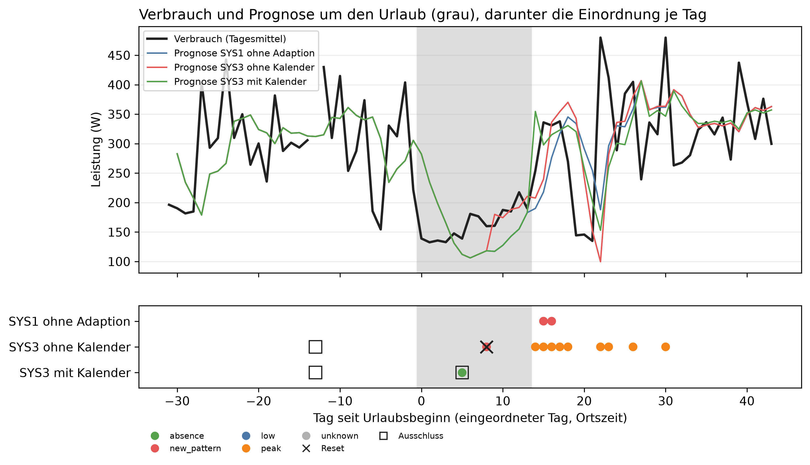
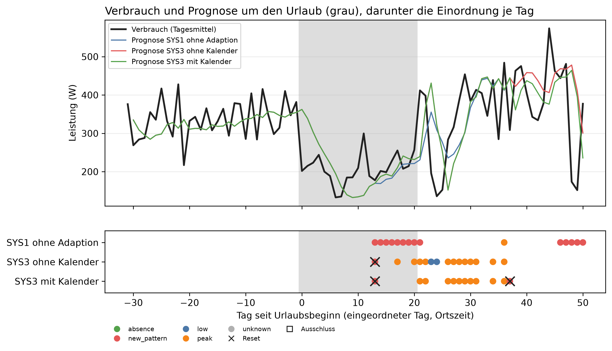

# E2 Abwesenheit, Lauf e2_006

## Setup

- Urlaub event-2014-08: 2014-08-03 bis vor 2014-08-17, Beginn = Tag 0, analysierte Tage 2014-07-03 bis 2014-09-15, Eintrag „Urlaub bei Oma“, Gegenfall „Oma kommt zu Besuch“
- Urlaub event-2015-10: 2015-10-04 bis vor 2015-10-25, Beginn = Tag 0, analysierte Tage 2015-09-03 bis 2015-11-23, Eintrag „Reise nach Tokio mit Moni“, ohne Gegenfall
- Kanäle: je Urlaub im Fenster aus Mains herausgerechnet, Coverage ab 90 %
- Systeme ctx0: SYS1, SYS2, SYS3_CTX0
- Systeme ctx1: SYS3_CTX1
- Systeme ctx1_visit: SYS3_CTX1_VISIT
- Systeme ctx2: SYS3_CTX2
- Commit: 6d06b1a

## event-2014-08: Kennzahlen

| Kennzahl | Wert | Bezug |
|---|---|---|
| SYS1: erster Treffer absence [Urlaubstag] | - | 0 von 9 Urlaubstagen mit offenem Gate, 0 × absence ohne Beleg |
| SYS2: erster Treffer absence [Urlaubstag] | - | 0 von 9 Urlaubstagen mit offenem Gate, 0 × absence ohne Beleg |
| SYS3_CTX0: erster Treffer absence [Urlaubstag] | - | 0 von 4 Urlaubstagen mit offenem Gate, 0 × absence ohne Beleg |
| SYS3_CTX1: erster Treffer absence [Urlaubstag] | 5 | 1 von 1 Urlaubstagen mit offenem Gate, 0 × absence ohne Beleg |
| SYS3_CTX1_VISIT: erster Treffer absence [Urlaubstag] | - | 0 von 4 Urlaubstagen mit offenem Gate, 0 × absence ohne Beleg |
| SYS3_CTX2: erster Treffer absence [Urlaubstag] | 5 | 1 von 1 Urlaubstagen mit offenem Gate, 0 × absence ohne Beleg |
| Absenkung durch das Herausrechnen im Mittel [W] | 94,9 | je Tag im Urlaubsfenster |

## event-2014-08: Einordnung je Phase

| System | Phase | Tage | Gate offen | davon Einzeltag | davon Drift | davon nur eine Skala | new_pattern | low | peak | absence | Resets | Meldungen | Ausfalltage |
|---|---|---:|---:|---:|---:|---:|---:|---:|---:|---:|---:|---:|---:|
| SYS1 | vor dem Urlaub | 31 | 11 | 0 | 0 | 10 | 0 | 0 | 0 | 0 | 0 | 1 | 0 |
| SYS1 | Urlaub | 14 | 9 | 0 | 0 | 9 | 0 | 0 | 0 | 0 | 0 | 0 | 0 |
| SYS1 | nach der Rückkehr | 30 | 21 | 0 | 2 | 19 | 2 | 0 | 0 | 0 | 0 | 2 | 0 |
| SYS2 | vor dem Urlaub | 31 | 11 | 0 | 0 | 10 | 0 | 0 | 0 | 0 | 0 | 1 | 0 |
| SYS2 | Urlaub | 14 | 9 | 0 | 0 | 9 | 0 | 0 | 0 | 0 | 0 | 0 | 0 |
| SYS2 | nach der Rückkehr | 30 | 15 | 3 | 1 | 11 | 1 | 0 | 3 | 0 | 1 | 4 | 0 |
| SYS3_CTX0 | vor dem Urlaub | 31 | 11 | 0 | 0 | 10 | 0 | 0 | 0 | 0 | 0 | 1 | 0 |
| SYS3_CTX0 | Urlaub | 14 | 4 | 0 | 0 | 4 | 1 | 0 | 0 | 0 | 1 | 1 | 0 |
| SYS3_CTX0 | nach der Rückkehr | 30 | 22 | 9 | 0 | 13 | 0 | 0 | 9 | 0 | 0 | 9 | 0 |
| SYS3_CTX1 | vor dem Urlaub | 31 | 11 | 0 | 0 | 10 | 0 | 0 | 0 | 0 | 0 | 1 | 0 |
| SYS3_CTX1 | Urlaub | 14 | 1 | 0 | 0 | 1 | 0 | 0 | 0 | 1 | 0 | 0 | 0 |
| SYS3_CTX1 | nach der Rückkehr | 30 | 2 | 0 | 0 | 2 | 0 | 0 | 0 | 0 | 0 | 0 | 0 |
| SYS3_CTX1_VISIT | vor dem Urlaub | 31 | 11 | 0 | 0 | 10 | 0 | 0 | 0 | 0 | 0 | 1 | 0 |
| SYS3_CTX1_VISIT | Urlaub | 14 | 4 | 0 | 0 | 4 | 1 | 0 | 0 | 0 | 1 | 1 | 0 |
| SYS3_CTX1_VISIT | nach der Rückkehr | 30 | 22 | 9 | 0 | 13 | 0 | 0 | 9 | 0 | 0 | 9 | 0 |
| SYS3_CTX2 | vor dem Urlaub | 31 | 11 | 0 | 0 | 10 | 0 | 0 | 0 | 0 | 0 | 1 | 0 |
| SYS3_CTX2 | Urlaub | 14 | 1 | 0 | 0 | 1 | 0 | 0 | 0 | 1 | 0 | 0 | 0 |
| SYS3_CTX2 | nach der Rückkehr | 30 | 2 | 0 | 0 | 2 | 0 | 0 | 0 | 0 | 0 | 0 | 0 |

## event-2014-08: Einordnung im Urlaub

| System | Urlaubstage | Treffer | erster Treffer [Urlaubstag] | absence ohne Beleg |
|---|---:|---|---:|---:|
| SYS1 | 14 | 0 von 9 | - | 0 |
| SYS2 | 14 | 0 von 9 | - | 0 |
| SYS3_CTX0 | 14 | 0 von 4 | - | 0 |
| SYS3_CTX1 | 14 | 1 von 1 | 5 | 0 |
| SYS3_CTX1_VISIT | 14 | 0 von 4 | - | 0 |
| SYS3_CTX2 | 14 | 1 von 1 | 5 | 0 |

## event-2014-08: Kalender im State

| System | Phase | eingeordnete Tage | davon Kalender im State |
|---|---|---:|---:|
| SYS1 | vor dem Urlaub | 11 | 0 |
| SYS1 | Urlaub | 9 | 0 |
| SYS1 | nach der Rückkehr | 21 | 0 |
| SYS2 | vor dem Urlaub | 11 | 0 |
| SYS2 | Urlaub | 9 | 0 |
| SYS2 | nach der Rückkehr | 15 | 0 |
| SYS3_CTX0 | vor dem Urlaub | 11 | 0 |
| SYS3_CTX0 | Urlaub | 4 | 0 |
| SYS3_CTX0 | nach der Rückkehr | 22 | 0 |
| SYS3_CTX1 | vor dem Urlaub | 11 | 11 |
| SYS3_CTX1 | Urlaub | 1 | 1 |
| SYS3_CTX1 | nach der Rückkehr | 2 | 2 |
| SYS3_CTX1_VISIT | vor dem Urlaub | 11 | 11 |
| SYS3_CTX1_VISIT | Urlaub | 4 | 4 |
| SYS3_CTX1_VISIT | nach der Rückkehr | 22 | 22 |
| SYS3_CTX2 | vor dem Urlaub | 11 | 2 |
| SYS3_CTX2 | Urlaub | 1 | 1 |
| SYS3_CTX2 | nach der Rückkehr | 2 | 0 |

## event-2014-08: Kalenderabruf per Tool, an Tagen mit Einordnung

| System | nützlich | überflüssig | verpasst | zu Recht nicht abgerufen |
|---|---:|---:|---:|---:|
| SYS3_CTX2 | 1 | 2 | 0 | 11 |

## event-2014-08: Prognose je Phase

| System | Phase | Tages-MAE [W] | Bias [W] | Differenz Tages-MAE zu SYS1 [W] | Standardfehler [W] | Anteil Tage besser | gepaarte Tage |
|---|---|---:|---:|---:|---:|---:|---:|
| SYS1 | vor dem Urlaub | 74,8 | -0,6 | - | - | - | - |
| SYS1 | Urlaub | 55,7 | -7,0 | - | - | - | - |
| SYS1 | nach der Rückkehr | 79,3 | 8,5 | - | - | - | - |
| SYS2 | vor dem Urlaub | 74,8 | -0,6 | 0,0 | 0,0 | 0,0 | 29,0 |
| SYS2 | Urlaub | 55,7 | -7,0 | 0,0 | 0,0 | 0,0 | 14,0 |
| SYS2 | nach der Rückkehr | 79,1 | 7,6 | -0,2 | 6,8 | 0,4 | 30,0 |
| SYS3_CTX0 | vor dem Urlaub | 74,8 | -0,6 | 0,0 | 0,0 | 0,0 | 29,0 |
| SYS3_CTX0 | Urlaub | 46,2 | 8,6 | -9,5 | 5,0 | 0,3 | 14,0 |
| SYS3_CTX0 | nach der Rückkehr | 74,9 | 7,1 | -4,4 | 5,3 | 0,3 | 30,0 |
| SYS3_CTX1 | vor dem Urlaub | 74,8 | -0,6 | 0,0 | 0,0 | 0,0 | 29,0 |
| SYS3_CTX1 | Urlaub | 55,7 | -7,0 | 0,0 | 0,0 | 0,0 | 14,0 |
| SYS3_CTX1 | nach der Rückkehr | 74,3 | 8,3 | -5,0 | 4,6 | 0,6 | 30,0 |
| SYS3_CTX1_VISIT | vor dem Urlaub | 74,8 | -0,6 | 0,0 | 0,0 | 0,0 | 29,0 |
| SYS3_CTX1_VISIT | Urlaub | 46,2 | 8,6 | -9,5 | 5,0 | 0,3 | 14,0 |
| SYS3_CTX1_VISIT | nach der Rückkehr | 74,9 | 7,1 | -4,4 | 5,3 | 0,3 | 30,0 |
| SYS3_CTX2 | vor dem Urlaub | 74,8 | -0,6 | 0,0 | 0,0 | 0,0 | 29,0 |
| SYS3_CTX2 | Urlaub | 55,7 | -7,0 | 0,0 | 0,0 | 0,0 | 14,0 |
| SYS3_CTX2 | nach der Rückkehr | 74,3 | 8,3 | -5,0 | 4,6 | 0,6 | 30,0 |

## event-2015-10: Kennzahlen

| Kennzahl | Wert | Bezug |
|---|---|---|
| SYS1: erster Treffer absence [Urlaubstag] | - | 0 von 12 Urlaubstagen mit offenem Gate, 0 × absence ohne Beleg |
| SYS2: erster Treffer absence [Urlaubstag] | - | 0 von 7 Urlaubstagen mit offenem Gate, 0 × absence ohne Beleg |
| SYS3_CTX0: erster Treffer absence [Urlaubstag] | - | 0 von 7 Urlaubstagen mit offenem Gate, 0 × absence ohne Beleg |
| SYS3_CTX1: erster Treffer absence [Urlaubstag] | - | 0 von 7 Urlaubstagen mit offenem Gate, 0 × absence ohne Beleg |
| SYS3_CTX2: erster Treffer absence [Urlaubstag] | - | 0 von 7 Urlaubstagen mit offenem Gate, 0 × absence ohne Beleg |
| Absenkung durch das Herausrechnen im Mittel [W] | 154,2 | je Tag im Urlaubsfenster |

## event-2015-10: Einordnung je Phase

| System | Phase | Tage | Gate offen | davon Einzeltag | davon Drift | davon nur eine Skala | new_pattern | low | peak | absence | Resets | Meldungen | Ausfalltage |
|---|---|---:|---:|---:|---:|---:|---:|---:|---:|---:|---:|---:|---:|
| SYS1 | vor dem Urlaub | 31 | 14 | 0 | 0 | 14 | 0 | 0 | 0 | 0 | 0 | 0 | 0 |
| SYS1 | Urlaub | 21 | 12 | 0 | 8 | 4 | 8 | 0 | 0 | 0 | 0 | 8 | 0 |
| SYS1 | nach der Rückkehr | 30 | 29 | 1 | 6 | 22 | 6 | 0 | 1 | 0 | 0 | 7 | 0 |
| SYS2 | vor dem Urlaub | 31 | 14 | 0 | 0 | 14 | 0 | 0 | 0 | 0 | 0 | 0 | 0 |
| SYS2 | Urlaub | 21 | 7 | 2 | 1 | 4 | 1 | 0 | 2 | 0 | 1 | 3 | 0 |
| SYS2 | nach der Rückkehr | 30 | 28 | 12 | 0 | 16 | 0 | 2 | 10 | 0 | 0 | 10 | 0 |
| SYS3_CTX0 | vor dem Urlaub | 31 | 14 | 0 | 0 | 14 | 0 | 0 | 0 | 0 | 0 | 0 | 0 |
| SYS3_CTX0 | Urlaub | 21 | 7 | 2 | 1 | 4 | 1 | 0 | 2 | 0 | 1 | 3 | 0 |
| SYS3_CTX0 | nach der Rückkehr | 30 | 28 | 12 | 0 | 16 | 0 | 2 | 10 | 0 | 0 | 10 | 0 |
| SYS3_CTX1 | vor dem Urlaub | 31 | 14 | 0 | 0 | 14 | 0 | 0 | 0 | 0 | 0 | 0 | 0 |
| SYS3_CTX1 | Urlaub | 21 | 7 | 2 | 1 | 4 | 1 | 0 | 0 | 0 | 1 | 1 | 0 |
| SYS3_CTX1 | nach der Rückkehr | 30 | 16 | 12 | 0 | 4 | 1 | 0 | 10 | 0 | 1 | 11 | 0 |
| SYS3_CTX2 | vor dem Urlaub | 31 | 14 | 0 | 0 | 14 | 0 | 0 | 0 | 0 | 0 | 0 | 0 |
| SYS3_CTX2 | Urlaub | 21 | 7 | 2 | 1 | 4 | 1 | 0 | 0 | 0 | 1 | 1 | 0 |
| SYS3_CTX2 | nach der Rückkehr | 30 | 16 | 12 | 0 | 4 | 1 | 0 | 10 | 0 | 1 | 11 | 0 |

## event-2015-10: Einordnung im Urlaub

| System | Urlaubstage | Treffer | erster Treffer [Urlaubstag] | absence ohne Beleg |
|---|---:|---|---:|---:|
| SYS1 | 21 | 0 von 12 | - | 0 |
| SYS2 | 21 | 0 von 7 | - | 0 |
| SYS3_CTX0 | 21 | 0 von 7 | - | 0 |
| SYS3_CTX1 | 21 | 0 von 7 | - | 0 |
| SYS3_CTX2 | 21 | 0 von 7 | - | 0 |

## event-2015-10: Kalender im State

| System | Phase | eingeordnete Tage | davon Kalender im State |
|---|---|---:|---:|
| SYS1 | vor dem Urlaub | 14 | 0 |
| SYS1 | Urlaub | 12 | 0 |
| SYS1 | nach der Rückkehr | 29 | 0 |
| SYS2 | vor dem Urlaub | 14 | 0 |
| SYS2 | Urlaub | 7 | 0 |
| SYS2 | nach der Rückkehr | 28 | 0 |
| SYS3_CTX0 | vor dem Urlaub | 14 | 0 |
| SYS3_CTX0 | Urlaub | 7 | 0 |
| SYS3_CTX0 | nach der Rückkehr | 28 | 0 |
| SYS3_CTX1 | vor dem Urlaub | 14 | 14 |
| SYS3_CTX1 | Urlaub | 7 | 7 |
| SYS3_CTX1 | nach der Rückkehr | 16 | 16 |
| SYS3_CTX2 | vor dem Urlaub | 14 | 1 |
| SYS3_CTX2 | Urlaub | 7 | 3 |
| SYS3_CTX2 | nach der Rückkehr | 16 | 15 |

## event-2015-10: Kalenderabruf per Tool, an Tagen mit Einordnung

| System | nützlich | überflüssig | verpasst | zu Recht nicht abgerufen |
|---|---:|---:|---:|---:|
| SYS3_CTX2 | 3 | 16 | 4 | 14 |

## event-2015-10: Prognose je Phase

| System | Phase | Tages-MAE [W] | Bias [W] | Differenz Tages-MAE zu SYS1 [W] | Standardfehler [W] | Anteil Tage besser | gepaarte Tage |
|---|---|---:|---:|---:|---:|---:|---:|
| SYS1 | vor dem Urlaub | 46,2 | -11,2 | - | - | - | - |
| SYS1 | Urlaub | 53,9 | 1,0 | - | - | - | - |
| SYS1 | nach der Rückkehr | 96,8 | 21,5 | - | - | - | - |
| SYS2 | vor dem Urlaub | 46,2 | -11,2 | 0,0 | 0,0 | 0,0 | 30,0 |
| SYS2 | Urlaub | 52,8 | 5,4 | -1,1 | 1,8 | 0,2 | 21,0 |
| SYS2 | nach der Rückkehr | 100,2 | 22,9 | 3,4 | 4,8 | 0,2 | 30,0 |
| SYS3_CTX0 | vor dem Urlaub | 46,2 | -11,2 | 0,0 | 0,0 | 0,0 | 30,0 |
| SYS3_CTX0 | Urlaub | 52,8 | 5,4 | -1,1 | 1,8 | 0,2 | 21,0 |
| SYS3_CTX0 | nach der Rückkehr | 100,2 | 22,9 | 3,4 | 4,8 | 0,2 | 30,0 |
| SYS3_CTX1 | vor dem Urlaub | 46,2 | -11,2 | 0,0 | 0,0 | 0,0 | 30,0 |
| SYS3_CTX1 | Urlaub | 52,8 | 5,4 | -1,1 | 1,8 | 0,2 | 21,0 |
| SYS3_CTX1 | nach der Rückkehr | 102,3 | 9,9 | 5,5 | 6,2 | 0,4 | 30,0 |
| SYS3_CTX2 | vor dem Urlaub | 46,2 | -11,2 | 0,0 | 0,0 | 0,0 | 30,0 |
| SYS3_CTX2 | Urlaub | 52,8 | 5,4 | -1,1 | 1,8 | 0,2 | 21,0 |
| SYS3_CTX2 | nach der Rückkehr | 102,3 | 9,9 | 5,5 | 6,2 | 0,4 | 30,0 |

## Hinweise

- Urlaubstag = analysierter Tag seit Beginn der Abwesenheit, 0 = erster Urlaubstag
- Treffer = absence mit passendem Kalendereintrag. absence ohne Beleg (ohne Kalender, Kalender nicht abgerufen oder nach der Rückkehr) zählt als Fehlklassifikation, über alle Phasen
- Treffer: von den Urlaubstagen mit offenem Gate, an den übrigen wird nicht eingeordnet. Wenige Tage, deshalb als Anzahl
- Einordnung je Phase: absence ist keine Meldung, im Urlaub ist jede Meldung ein Fehlalarm. Ausfalltage = LLM ohne gültige Antwort
- Gate offen: Einzeltag, Drift (weekly und long_term halten an) oder nur eine anhaltende Skala
- Prognose je Phase: Phase und Fehler nach dem Prognosetag. Tages-MAE = Betrag von Prognose-Tagesmittel minus Ist-Tagesmittel, gemittelt über die Tage. Bias = dasselbe mit Vorzeichen, negativ = Prognose zu niedrig
- Differenz Tages-MAE zu SYS1: gepaart am selben Prognosetag, negativ = besser
- ctx0 ohne, ctx1 mit Kalender im State, ctx2 Kalender per Tool. SYS1 und SYS2 lesen keinen Kalender und laufen nur in ctx0
- Kalendereinträge als Freitext aus calendar_events.json, im Gegenfall ctx1_visit steht zu denselben Zeiten nur ein Eintrag, der keine Abwesenheit meint. Dort ist jedes absence falsch und zählt als absence ohne Beleg
- Kalender im State: bei ctx2 hat das LLM an diesen Tagen nachgeschaut, jeder ctx2-Tag mit LLM kostet einen zusätzlichen Aufruf für die Tool-Entscheidung
- Kalenderabruf: nützlich = abgerufen an einem Urlaubstag (ein Eintrag deckt den Tag), überflüssig = abgerufen ohne deckenden Eintrag, verpasst = nicht abgerufen an einem Urlaubstag. Vergleich: ctx1 schaut immer nach

## Anhang

### event-2014-08: Absenkung je Tag im Urlaubsfenster

| Datum | Mains [W] | ohne Kanäle [W] | Absenkung [W] |
|---|---:|---:|---:|
| 2014-08-03 | 160,9 | 139,0 | 21,9 |
| 2014-08-04 | 151,5 | 132,6 | 18,9 |
| 2014-08-05 | 156,3 | 135,7 | 20,7 |
| 2014-08-06 | 155,3 | 132,8 | 22,4 |
| 2014-08-07 | 169,7 | 147,7 | 22,1 |
| 2014-08-08 | 163,6 | 138,9 | 24,7 |
| 2014-08-09 | 362,2 | 180,8 | 181,4 |
| 2014-08-10 | 270,1 | 176,7 | 93,5 |
| 2014-08-11 | 306,0 | 159,9 | 146,1 |
| 2014-08-12 | 277,7 | 160,6 | 117,1 |
| 2014-08-13 | 303,7 | 187,5 | 116,2 |
| 2014-08-14 | 362,9 | 184,9 | 178,0 |
| 2014-08-15 | 386,2 | 217,5 | 168,7 |
| 2014-08-16 | 387,4 | 190,0 | 197,4 |

### event-2015-10: Absenkung je Tag im Urlaubsfenster

| Datum | Mains [W] | ohne Kanäle [W] | Absenkung [W] |
|---|---:|---:|---:|
| 2015-10-04 | 498,4 | 202,0 | 296,4 |
| 2015-10-05 | 374,1 | 215,1 | 159,0 |
| 2015-10-06 | 335,2 | 223,4 | 111,8 |
| 2015-10-07 | 416,2 | 243,9 | 172,4 |
| 2015-10-08 | 362,5 | 200,0 | 162,5 |
| 2015-10-09 | 331,9 | 188,9 | 143,0 |
| 2015-10-10 | 163,3 | 133,0 | 30,3 |
| 2015-10-11 | 170,8 | 135,2 | 35,6 |
| 2015-10-12 | 371,4 | 184,7 | 186,7 |
| 2015-10-13 | 272,3 | 185,1 | 87,2 |
| 2015-10-14 | 368,0 | 209,6 | 158,4 |
| 2015-10-15 | 510,5 | 299,6 | 210,9 |
| 2015-10-16 | 330,9 | 188,6 | 142,4 |
| 2015-10-17 | 364,2 | 177,7 | 186,5 |
| 2015-10-18 | 332,1 | 201,8 | 130,3 |
| 2015-10-19 | 363,0 | 198,7 | 164,3 |
| 2015-10-20 | 386,2 | 227,9 | 158,4 |
| 2015-10-21 | 466,8 | 255,3 | 211,5 |
| 2015-10-22 | 347,7 | 207,6 | 140,0 |
| 2015-10-23 | 492,6 | 214,5 | 278,1 |
| 2015-10-24 | 329,9 | 256,7 | 73,2 |
