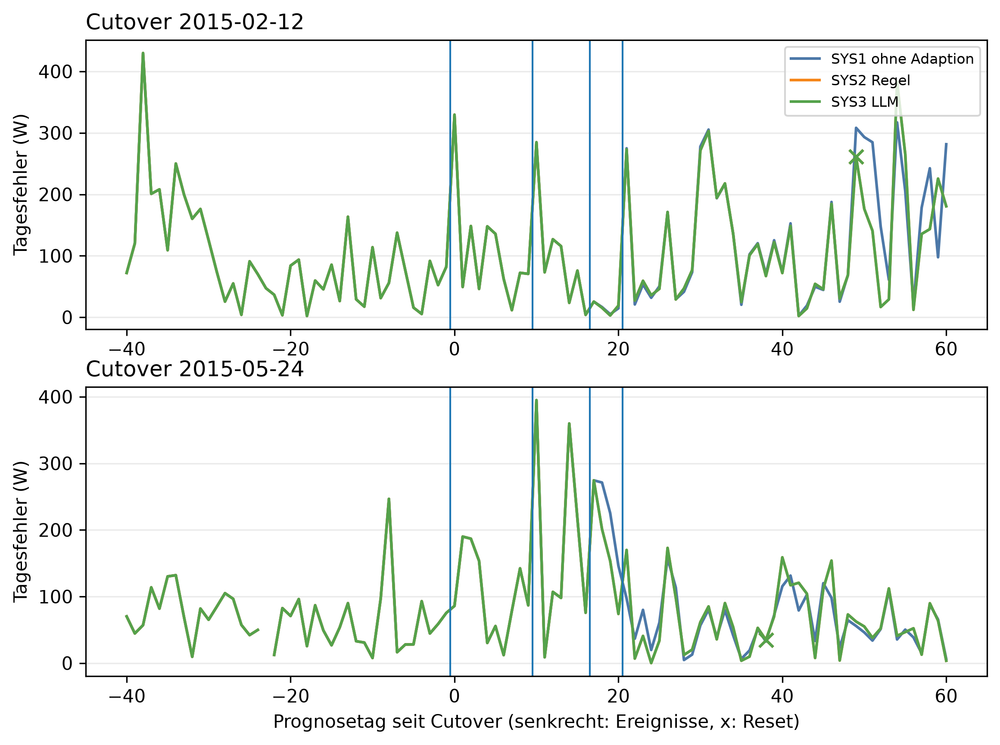

# E3 Dreiervergleich SYS1/SYS2/SYS3, Lauf e3_001

## Setup

- Cutover: CO2 (2015-02-12), CO3 (2015-05-24) (Tag 0, alle Tage und Daten in Ortszeit)
- Fenster: 40 Tage vor und 60 Tage ab Cutover
- Ereignislauf: 1: Spitze +1000 W über 6 h, Tag 0; 2: Spitze +1000 W über 6 h, Tag 10; 3: Festhänger über 12 h, Tag 17; 4: Sprung +30 %, Tag 21
- Systeme: SYS1 ohne Adaption, SYS2 Regel, SYS3 LLM
- LLM SYS3: ministral-3:8b, Prompt v30
- Kalender: keiner, wie CTX0
- Commit: 5984af9

## Kennzahlen

| Kennzahl | Wert | Bezug |
|---|---|---|
| SYS1 ohne Adaption: erkannt (TF1, ≥ 90 %) | 5/6 | 83,3 % |
| SYS1 ohne Adaption: richtig eingeordnet (TF2, ≥ 80 %) | 7/7 | 100,0 % der erkannten |
| SYS2 Regel: erkannt (TF1, ≥ 90 %) | 5/6 | 83,3 % |
| SYS2 Regel: richtig eingeordnet (TF2, ≥ 80 %) | 7/7 | 100,0 % der erkannten |
| SYS3 LLM: erkannt (TF1, ≥ 90 %) | 5/6 | 83,3 % |
| SYS3 LLM: richtig eingeordnet (TF2, ≥ 80 %) | 7/7 | 100,0 % der erkannten |
| 2015-02-12: SYS2 besser als SYS1 | ja | Tagesfehler gegen SYS1 ab Dauerlast -11,6 W, 0 Resets bei Einzeltag-Ereignissen, 0 im Kontrolllauf |
| 2015-02-12: SYS3 besser als SYS1 | nein | Tagesfehler gegen SYS1 ab Dauerlast -11,6 W, 0 Resets bei Einzeltag-Ereignissen, 1 im Kontrolllauf |
| 2015-02-12: SYS3 gleichwertig zu SYS2 | nein | 0 Ereignisse nur SYS2 richtig, 1 Resets mehr im Kontrolllauf |
| 2015-02-12: SYS3 besser als SYS2 | nein | 0 Ereignisse nur SYS3 richtig |
| 2015-05-24: SYS2 besser als SYS1 | nein | Tagesfehler gegen SYS1 ab Dauerlast 2,8 W, 0 Resets bei Einzeltag-Ereignissen, 0 im Kontrolllauf |
| 2015-05-24: SYS3 besser als SYS1 | nein | Tagesfehler gegen SYS1 ab Dauerlast 2,8 W, 0 Resets bei Einzeltag-Ereignissen, 0 im Kontrolllauf |
| 2015-05-24: SYS3 gleichwertig zu SYS2 | ja | 0 Ereignisse nur SYS2 richtig, 0 Resets mehr im Kontrolllauf |
| 2015-05-24: SYS3 besser als SYS2 | nein | 0 Ereignisse nur SYS3 richtig |

## Erkennung (TF1) und erste Einordnung (TF2) als Nebenzahlen, gepoolt über Cutover und Ereignisse

| System | erwartet | erkannt (TF1) | erkannt [%] | richtig eingeordnet (TF2) | richtig [%] |
|---|---|---|---:|---|---:|
| SYS1 ohne Adaption | alle Ereignisse | 5/6 | 83,3 | 7/7 | 100,0 |
| SYS1 ohne Adaption | measurement_error | 0/0 | - | 2/2 | 100,0 |
| SYS1 ohne Adaption | new_pattern | 2/2 | 100,0 | 2/2 | 100,0 |
| SYS1 ohne Adaption | peak | 3/4 | 75,0 | 3/3 | 100,0 |
| SYS2 Regel | alle Ereignisse | 5/6 | 83,3 | 7/7 | 100,0 |
| SYS2 Regel | measurement_error | 0/0 | - | 2/2 | 100,0 |
| SYS2 Regel | new_pattern | 2/2 | 100,0 | 2/2 | 100,0 |
| SYS2 Regel | peak | 3/4 | 75,0 | 3/3 | 100,0 |
| SYS3 LLM | alle Ereignisse | 5/6 | 83,3 | 7/7 | 100,0 |
| SYS3 LLM | measurement_error | 0/0 | - | 2/2 | 100,0 |
| SYS3 LLM | new_pattern | 2/2 | 100,0 | 2/2 | 100,0 |
| SYS3 LLM | peak | 3/4 | 75,0 | 3/3 | 100,0 |

## Erste Einordnung je Ereignis

| Cutover | Ereignis | System | erwartet | bewertet an Tag | Klasse | richtig | Skala | Meldungen davor | Reset an Tag | Aktion passend | nach Trennung |
|---|---|---|---|---:|---|---|---|---:|---:|---|---|
| 2015-02-12 | 1: Spitze +1000 W über 6 h, Tag 0 | SYS1 ohne Adaption | peak | 1 | peak | ja | daily | - | - | ja | nein |
| 2015-02-12 | 1: Spitze +1000 W über 6 h, Tag 0 | SYS2 Regel | peak | 1 | peak | ja | daily | - | - | ja | nein |
| 2015-02-12 | 1: Spitze +1000 W über 6 h, Tag 0 | SYS3 LLM | peak | 1 | peak | ja | daily | - | - | ja | nein |
| 2015-02-12 | 2: Spitze +1000 W über 6 h, Tag 10 | SYS1 ohne Adaption | peak | 11 | peak | ja | daily | - | - | ja | nein |
| 2015-02-12 | 2: Spitze +1000 W über 6 h, Tag 10 | SYS2 Regel | peak | 11 | peak | ja | daily | - | - | ja | nein |
| 2015-02-12 | 2: Spitze +1000 W über 6 h, Tag 10 | SYS3 LLM | peak | 11 | peak | ja | daily | - | - | ja | nein |
| 2015-02-12 | 3: Festhänger über 12 h, Tag 17 | SYS1 ohne Adaption | measurement_error | 18 | measurement_error | ja | daily | - | - | ja | nein |
| 2015-02-12 | 3: Festhänger über 12 h, Tag 17 | SYS2 Regel | measurement_error | 18 | measurement_error | ja | daily | - | - | ja | nein |
| 2015-02-12 | 3: Festhänger über 12 h, Tag 17 | SYS3 LLM | measurement_error | 18 | measurement_error | ja | daily | - | - | ja | nein |
| 2015-02-12 | 4: Sprung +30 %, Tag 21 | SYS1 ohne Adaption | new_pattern | 49 | new_pattern | ja | weekly+long_term | 2 | - | nein | ja |
| 2015-02-12 | 4: Sprung +30 %, Tag 21 | SYS2 Regel | new_pattern | 49 | new_pattern | ja | weekly+long_term | 2 | 49 | ja | ja |
| 2015-02-12 | 4: Sprung +30 %, Tag 21 | SYS3 LLM | new_pattern | 49 | new_pattern | ja | weekly+long_term | 2 | 49 | ja | ja |
| 2015-05-24 | 1: Spitze +1000 W über 6 h, Tag 0 | SYS1 ohne Adaption | peak | - | - | - | - | - | - | ja | ja |
| 2015-05-24 | 1: Spitze +1000 W über 6 h, Tag 0 | SYS2 Regel | peak | - | - | - | - | - | - | ja | ja |
| 2015-05-24 | 1: Spitze +1000 W über 6 h, Tag 0 | SYS3 LLM | peak | - | - | - | - | - | - | ja | ja |
| 2015-05-24 | 2: Spitze +1000 W über 6 h, Tag 10 | SYS1 ohne Adaption | peak | 11 | peak | ja | weekday | - | - | ja | ja |
| 2015-05-24 | 2: Spitze +1000 W über 6 h, Tag 10 | SYS2 Regel | peak | 11 | peak | ja | weekday | - | - | ja | ja |
| 2015-05-24 | 2: Spitze +1000 W über 6 h, Tag 10 | SYS3 LLM | peak | 11 | peak | ja | weekday | - | - | ja | ja |
| 2015-05-24 | 3: Festhänger über 12 h, Tag 17 | SYS1 ohne Adaption | measurement_error | 18 | measurement_error | ja | weekday | - | - | ja | ja |
| 2015-05-24 | 3: Festhänger über 12 h, Tag 17 | SYS2 Regel | measurement_error | 18 | measurement_error | ja | weekday | - | - | ja | ja |
| 2015-05-24 | 3: Festhänger über 12 h, Tag 17 | SYS3 LLM | measurement_error | 18 | measurement_error | ja | weekday | - | - | ja | ja |
| 2015-05-24 | 4: Sprung +30 %, Tag 21 | SYS1 ohne Adaption | new_pattern | 37 | new_pattern | ja | weekly+long_term | 1 | - | nein | ja |
| 2015-05-24 | 4: Sprung +30 %, Tag 21 | SYS2 Regel | new_pattern | 38 | new_pattern | ja | weekly+long_term | 1 | 38 | ja | ja |
| 2015-05-24 | 4: Sprung +30 %, Tag 21 | SYS3 LLM | new_pattern | 38 | new_pattern | ja | weekly+long_term | 1 | 38 | ja | ja |

## Prognose ab Dauerlast und im Kontrolllauf, gepaart gegen SYS1

| Cutover | Zeitraum | System | Tagesfehler [W] | MAE [W] | MAPE [%] | Differenz Tagesfehler [W] | Differenz MAE [W] | 2 Standardfehler [W] | Tage | Tage besser [%] | belastbar |
|---|---|---|---:|---:|---:|---:|---:|---:|---:|---:|---|
| 2015-02-12 | Kontrolllauf ab Tag 0 | SYS1 ohne Adaption | 88,4 | 185,7 | 59,0 | - | - | - | - | - | - |
| 2015-02-12 | Kontrolllauf ab Tag 0 | SYS2 Regel | 88,4 | 185,7 | 59,0 | 0,0 | 0,0 | 0,0 | 61 | 0,0 | nein |
| 2015-02-12 | Kontrolllauf ab Tag 0 | SYS3 LLM | 84,5 | 188,9 | 61,5 | -3,9 | 3,2 | 9,2 | 61 | 4,9 | nein |
| 2015-02-12 | Ereignislauf ab Tag 21 | SYS1 ohne Adaption | 134,4 | 245,4 | 64,0 | - | - | - | - | - | - |
| 2015-02-12 | Ereignislauf ab Tag 21 | SYS2 Regel | 122,8 | 241,4 | 60,9 | -11,6 | -4,0 | 15,7 | 40 | 62,5 | nein |
| 2015-02-12 | Ereignislauf ab Tag 21 | SYS3 LLM | 122,8 | 241,4 | 60,9 | -11,6 | -4,0 | 15,7 | 40 | 62,5 | nein |
| 2015-05-24 | Kontrolllauf ab Tag 0 | SYS1 ohne Adaption | 68,0 | 149,5 | 53,8 | - | - | - | - | - | - |
| 2015-05-24 | Kontrolllauf ab Tag 0 | SYS2 Regel | 68,0 | 149,5 | 53,8 | 0,0 | 0,0 | 0,0 | 61 | 0,0 | nein |
| 2015-05-24 | Kontrolllauf ab Tag 0 | SYS3 LLM | 68,0 | 149,5 | 53,8 | 0,0 | 0,0 | 0,0 | 61 | 0,0 | nein |
| 2015-05-24 | Ereignislauf ab Tag 21 | SYS1 ohne Adaption | 60,6 | 187,8 | 50,8 | - | - | - | - | - | - |
| 2015-05-24 | Ereignislauf ab Tag 21 | SYS2 Regel | 63,3 | 188,9 | 50,6 | 2,8 | 1,1 | 6,8 | 40 | 42,5 | nein |
| 2015-05-24 | Ereignislauf ab Tag 21 | SYS3 LLM | 63,3 | 188,9 | 50,6 | 2,8 | 1,1 | 6,8 | 40 | 42,5 | nein |

## Meldungen nach der Erkennung der Dauerlast, sehend und blind

| Cutover | System | Tage | Anzahl | Meldungen | unknown |
|---|---|---|---:|---:|---:|
| 2015-02-12 | SYS1 ohne Adaption | sehend | 11 | 1 | 0 |
| 2015-02-12 | SYS2 Regel | blind | 11 | 0 | 0 |
| 2015-02-12 | SYS3 LLM | blind | 11 | 0 | 0 |
| 2015-05-24 | SYS1 ohne Adaption | sehend | 23 | 4 | 0 |
| 2015-05-24 | SYS2 Regel | blind | 21 | 0 | 0 |
| 2015-05-24 | SYS2 Regel | sehend | 1 | 0 | 0 |
| 2015-05-24 | SYS3 LLM | blind | 21 | 0 | 0 |
| 2015-05-24 | SYS3 LLM | sehend | 1 | 0 | 0 |

## Kontrolllauf: Fehlalarme und unnötige Resets

| Cutover | System | Tage | Meldungen | unknown | Resets |
|---|---|---:|---:|---:|---:|
| 2015-02-12 | SYS1 ohne Adaption | 101 | 0 | 0 | 0 |
| 2015-02-12 | SYS2 Regel | 101 | 0 | 0 | 0 |
| 2015-02-12 | SYS3 LLM | 101 | 2 | 0 | 1 |
| 2015-05-24 | SYS1 ohne Adaption | 101 | 2 | 0 | 0 |
| 2015-05-24 | SYS2 Regel | 101 | 2 | 0 | 0 |
| 2015-05-24 | SYS3 LLM | 101 | 2 | 0 | 0 |

## Abweichungstage SYS2 gegen SYS3

| Cutover | Reihe | Tag | Datum | Ereignis | Klasse SYS2 | Klasse SYS3 | Aktion SYS2 | Aktion SYS3 | LLM-Ausfall |
|---|---|---:|---|---|---|---|---|---|---|
| 2015-02-12 | Kontrolllauf | 57 | 2015-04-09 | - | normal | new_pattern | none | advance_history_start | nein |
| 2015-02-12 | Kontrolllauf | 58 | 2015-04-10 | - | normal | peak | none | none | nein |

## Hinweise

- Tag = Entscheidungstag seit Cutover: an Tag n wird Tag n-1 eingeordnet, ein Ereignis an Tag s also ab Tag s+1
- bewertet an Tag: bei einer Spitze und beim Festhänger der eingeordnete Ereignistag, falls das Gate dort offen ist, bei der Dauerlast der erste Tag mit Drift oder new_pattern. Meldungen davor zählen als Meldungen, nicht als Einordnungsfehler. Ohne Bewertungstag gilt das Ereignis als nicht erkannt und zählt nicht bei der Einordnung. Der Festhänger zählt nicht bei der Erkennung, das Flag öffnet das Gate per Aufbau
- nach Trennung: vor Beginn des Ereignisses hat schon ein System anders gehandelt (Reset), die Systeme entscheiden dann nicht mehr über denselben Zustand
- sehend = alle Einzeltag-Skalen (daily, weekday) haben einen Score, sonst blind
- Kontrolllauf über das ganze Fenster, auch die Tage vor dem Cutover. Jede Meldung dort ist ein Fehlalarm, jeder Reset unnötig
- belastbar: Betrag der Differenz größer als 2 Standardfehler der gepaarten Differenzen, grobe Faustregel

## Anhang

### Laufzeit und Kosten SYS3, nur beschreibend

| Cutover | Reihe | Tage | Regel je Tag [s] | LLM-Aufrufe | Ausfalltage | Mehrlaufzeit gegen Regel [s] | je Aufruf [s] |
|---|---|---:|---:|---:|---:|---:|---:|
| 2015-02-12 | Kontrolllauf | 101 | 0,1 | 30 | 0 | 549,5 | 18,3 |
| 2015-05-24 | Kontrolllauf | 101 | 0,1 | 11 | 0 | 217,8 | 19,8 |
| 2015-02-12 | Ereignislauf | 101 | 0,1 | 51 | 0 | 925,3 | 18,1 |
| 2015-05-24 | Ereignislauf | 101 | 0,1 | 19 | 0 | 355,2 | 18,7 |

### Antworten des LLM

**Kontrolllauf, Cutover 2015-02-12**

2015-01-07 (Entscheidungstag -35): SYS3 normal, Regel normal, Aktion none

- Erklärung: Gestern war der Verbrauch für einen Wochentag ungewöhnlich hoch, aber die Abweichung hat sich nicht über mehrere Tage gehalten.
- Empfehlung: Da der Verbrauch gestern nur kurzzeitig erhöht war, ist keine weitere Handlung nötig.
- Unsicherheit: Ob die Abweichung durch ungewöhnliche Aktivitäten oder äußere Umstände wie Kälte verursacht wurde, kann nicht bestimmt werden.

2015-01-08 (Entscheidungstag -34): SYS3 normal, Regel normal, Aktion none

- Erklärung: Gestern war der Verbrauch für einen Wochentag ungewöhnlich hoch, aber die Abweichung hat sich nicht über mehrere Tage gehalten.
- Empfehlung: Es gibt nichts zu tun, da der erhöhte Verbrauch nur einen Tag betraf und keine weiteren Hinweise auf ein Problem vorliegen.
- Unsicherheit: Ob die Abweichung durch ungewöhnliche Aktivitäten oder äußere Umstände wie Kälte verursacht wurde, kann nicht bestimmt werden.

2015-01-19 (Entscheidungstag -23): SYS3 normal, Regel normal, Aktion none

- Erklärung: Der Verbrauch gestern lag im üblichen Bereich, obwohl die letzten vier Wochen insgesamt etwa 27 % niedriger waren als sonst.
- Empfehlung: Da der Verbrauch gestern normal war, ist nichts zu überprüfen. Die niedrigere Gesamtverbrauch in den letzten Wochen könnte mit dem Wetter oder einem anderen Faktor zusammenhängen – das lässt sich nicht ohne weitere Informationen klären.
- Unsicherheit: Ob die niedrigeren Werte seit Mitte Januar tatsächlich anhalten, hängt davon ab, ob der Verbrauch heute wieder im üblichen Bereich liegt.

2015-01-20 (Entscheidungstag -22): SYS3 normal, Regel normal, Aktion none

- Erklärung: Gestern war der Verbrauch im Vergleich zum üblichen Winterverlauf ungewöhnlich niedrig, aber die Abweichung ist nicht nachhaltig und liegt innerhalb der normalen Schwankungen.
- Empfehlung: Es gibt keine Handlungsbedarf, da der Verbrauch gestern im Rahmen lag und die Abweichung nur kurzfristig war.
- Unsicherheit: Ob der Verbrauch in den nächsten Tagen wieder normal ansteigt, hängt davon ab, ob sich das Wetter oder andere Faktoren wie Heizungsnutzung verändert haben.

2015-01-21 (Entscheidungstag -21): SYS3 normal, Regel normal, Aktion none

- Erklärung: Gestern war der Stromverbrauch um etwa 25 % niedriger als sonst im Januar, aber das ist nicht ungewöhnlich für diese Jahreszeit.
- Empfehlung: Da der Verbrauch seit Mitte Januar um etwa 30 % niedriger liegt, prüfen Sie bitte, ob sich etwas am Haushalt geändert hat – zum Beispiel weniger Heizung oder Beleuchtung durch längere Tageslichtstunden im Januar.
- Unsicherheit: Ob die Kalenderdaten verfügbar sind, ist nicht bekannt.

2015-01-22 (Entscheidungstag -20): SYS3 normal, Regel normal, Aktion none

- Erklärung: Gestern war der Stromverbrauch um etwa 26 % niedriger als sonst im Januar, aber das ist nicht ungewöhnlich für diese Jahreszeit.
- Empfehlung: Es gibt nichts zu überprüfen, da der Verbrauch im Januar typischerweise sinkt und die Abweichung nicht ungewöhnlich ist.
- Unsicherheit: Ob Sie kürzer oder weniger Strom verbraucht haben, können wir ohne Kalender nicht sicher sagen.

2015-01-23 (Entscheidungstag -19): SYS3 normal, Regel normal, Aktion none

- Erklärung: Gestern lag der Verbrauch im Vergleich zum üblichen Winterverlauf etwa 29 % niedriger, was auf eine ungewöhnlich geringe Nutzung hindeutet.
- Empfehlung: Da der Verbrauch seit Mitte Januar ungewöhnlich niedrig bleibt, prüfen Sie bitte, ob Geräte oder Heizung außer Betrieb sind oder ob jemand im Haushalt weniger Strom verbraucht als sonst.
- Unsicherheit: Ob die Kalenderdaten verfügbar wären, könnte den Grund für die Veränderung bestätigen.

2015-01-24 (Entscheidungstag -18): SYS3 normal, Regel normal, Aktion none

- Erklärung: Gestern lag der Verbrauch um etwa 22 % über dem üblichen Wert für einen Dienstag, aber die Abweichung ist nicht nachhaltig und betrifft nur diesen Tag.
- Empfehlung: Es gibt keinen Grund zur Sorge, da der erhöhte Verbrauch nur ein einmaliger Ausreißer war. Prüfen Sie ggf., ob gestern ungewöhnlich viele Geräte gleichzeitig genutzt wurden.
- Unsicherheit: Ob die Abweichung durch einen besonderen Anlass wie Gäste oder Wetterbedingungen verursacht wurde, kann nicht überprüft werden.

2015-01-25 (Entscheidungstag -17): SYS3 normal, Regel normal, Aktion none

- Erklärung: Gestern lag der Verbrauch im Vergleich zum üblichen Winterverlauf etwa 22 % niedriger als erwartet, was auf eine ungewöhnlich milde Witterung hindeuten könnte.
- Empfehlung: Da der Verbrauch gestern im Rahmen des Üblichen lag und keine ungewöhnlichen Ereignisse vorlagen, ist nichts weiter zu beachten. Die milde Witterung könnte jedoch ein Grund für den niedrigeren Winterverbrauch sein.
- Unsicherheit: Ob die gemessene Abweichung tatsächlich auf eine ungewöhnlich milde Witterung zurückzuführen ist, lässt sich ohne weitere Daten nicht sicher bestätigen.

2015-01-26 (Entscheidungstag -16): SYS3 normal, Regel normal, Aktion none

- Erklärung: Gestern war der Stromverbrauch um etwa 30 % niedriger als sonst an einem Dienstag, aber das ist nicht ungewöhnlich für diese Zeit des Jahres.
- Empfehlung: Es gibt nichts zu überprüfen, da der Verbrauch im Winter oft niedriger ist als in anderen Jahreszeiten.
- Unsicherheit: Ob die kalte Jahreszeit den Verbrauch tatsächlich so stark beeinflusst, hängt davon ab, wie viel Sie zu Hause heizen und welche Geräte Sie nutzen.

2015-01-27 (Entscheidungstag -15): SYS3 normal, Regel normal, Aktion none

- Erklärung: Gestern war der Stromverbrauch um etwa 5 % niedriger als sonst an einem Dienstag, aber das ist nicht ungewöhnlich und bleibt im üblichen Bereich.
- Empfehlung: Es gibt nichts zu beachten, da der Verbrauch im üblichen Rahmen liegt und keine ungewöhnliche Veränderung vorliegt.
- Unsicherheit: Ob ein geplanter Urlaub oder eine andere Abwesenheit den Verbrauch beeinflusst hat, kann nicht geprüft werden, da kein Kalender verfügbar ist.

2015-01-28 (Entscheidungstag -14): SYS3 normal, Regel normal, Aktion none

- Erklärung: Gestern lag der Verbrauch im Vergleich zum üblichen Winterverlauf etwa 10 % niedriger, aber die Abweichung ist nicht ungewöhnlich für diese Zeit des Jahres.
- Empfehlung: Keine Maßnahmen nötig. Der Verbrauch ist im Rahmen der saisonalen Schwankungen.
- Unsicherheit: Ob die Abweichung auf einen konkreten Grund wie Wetter oder Geräte zurückzuführen ist, kann ohne weitere Daten nicht geklärt werden.

2015-02-18 (Entscheidungstag 7): SYS3 normal, Regel normal, Aktion none

- Erklärung: Gestern war der Stromverbrauch etwas höher als sonst, aber nicht ungewöhnlich für die letzten Wochen.
- Empfehlung: Es gibt nichts zu beachten, da der Verbrauch im Rahmen liegt und keine ungewöhnlichen Geräte oder Aktivitäten bekannt sind.
- Unsicherheit: Ob ein geplanter Urlaub oder besondere Umstände den Verbrauch beeinflusst haben, kann nicht geprüft werden, da kein Kalender verfügbar ist.

2015-02-19 (Entscheidungstag 8): SYS3 normal, Regel normal, Aktion none

- Erklärung: Gestern lag der Verbrauch im Vergleich zum üblichen Winterverlauf etwa 28 % höher als sonst, aber das ist nicht ungewöhnlich für diese Jahreszeit.
- Empfehlung: Es gibt nichts zu überprüfen, da der erhöhte Verbrauch mit der Jahreszeit übereinstimmt.
- Unsicherheit: Ob die Kalenderdaten verfügbar sind, könnte eine andere Einschätzung ermöglichen.

2015-02-20 (Entscheidungstag 9): SYS3 normal, Regel normal, Aktion none

- Erklärung: Gestern war der Stromverbrauch etwas niedriger als sonst, aber nicht ungewöhnlich für einen einzelnen Tag.
- Empfehlung: Es gibt nichts zu überprüfen, da der Verbrauch im Rahmen liegt und keine ungewöhnlichen Umstände vorlagen.
- Unsicherheit: Ob ein geplanter Urlaub oder eine andere Abwesenheit den niedrigeren Verbrauch erklärt hätte, kann nicht geprüft werden, da kein Kalender verfügbar war.

2015-02-21 (Entscheidungstag 10): SYS3 normal, Regel normal, Aktion none

- Erklärung: Gestern lag der Verbrauch um etwa 22 % über dem üblichen Winterwert für diese Tageszeit, aber das ist nicht ungewöhnlich und bleibt ohne Folgen.
- Empfehlung: Keine Maßnahmen nötig. Der erhöhte Verbrauch ist seit Anfang Februar so stabil, dass er als neue Normalität gilt.
- Unsicherheit: Ob der Winterverbrauch tatsächlich höher liegt oder ob die Messung zufällig hoch war, lässt sich ohne weitere Daten nicht klären.

2015-02-22 (Entscheidungstag 11): SYS3 normal, Regel normal, Aktion none

- Erklärung: Gestern war der Stromverbrauch etwas höher als sonst, aber nicht ungewöhnlich für die letzten Wochen.
- Empfehlung: Es gibt nichts zu beachten, da der Verbrauch im Rahmen liegt und keine ungewöhnlichen Geräte oder Aktivitäten bekannt sind.
- Unsicherheit: Ob ein geplanter Aufenthalt außerhalb des Hauses den Verbrauch beeinflusst hat, kann nicht geprüft werden, da kein Kalender verfügbar ist.

2015-02-23 (Entscheidungstag 12): SYS3 normal, Regel normal, Aktion none

- Erklärung: Gestern war der Stromverbrauch im Vergleich zum üblichen Februar-Wochenende deutlich höher, aber die Abweichung ist nicht ungewöhnlich für diese Zeit des Jahres.
- Empfehlung: Keine Maßnahmen nötig. Der erhöhte Verbrauch ist vor allem auf die kürzeren Tage im Februar zurückzuführen.
- Unsicherheit: Ob der Verbrauch in den nächsten Tagen wieder sinkt, hängt davon ab, ob sich das Wetter oder die Nutzung von Heizung und Beleuchtung ändern.

2015-02-24 (Entscheidungstag 13): SYS3 normal, Regel normal, Aktion none

- Erklärung: Gestern war der Stromverbrauch etwas niedriger als sonst, aber nicht ungewöhnlich für einen einzelnen Tag.
- Empfehlung: Es gibt nichts zu überprüfen, da es sich um eine normale Abweichung handelt. Die Verbrauchswerte sind nicht auffällig niedrig oder hoch.
- Unsicherheit: Da der Kalender nicht verfügbar ist, kann keine geplante Abwesenheit ausgeschlossen werden.

2015-02-25 (Entscheidungstag 14): SYS3 normal, Regel normal, Aktion none

- Erklärung: Gestern war der Stromverbrauch im Vergleich zum üblichen Winterwert um etwa 12 % niedriger, aber die Abweichung ist nicht nachhaltig und liegt innerhalb der normalen Schwankungen.
- Empfehlung: Es gibt keinen Grund zur Sorge, da der Verbrauch gestern im Rahmen lag und keine ungewöhnlichen Geräte oder Aktivitäten zu erwarten waren.
- Unsicherheit: Ob die Abweichung durch eine geplante Abwesenheit oder andere Faktoren wie Wetterbedingungen verursacht wurde, kann nicht geprüft werden, da kein Kalender verfügbar ist.

2015-03-15 (Entscheidungstag 32): SYS3 low, Regel low, Aktion none

- Erklärung: Gestern war der Stromverbrauch um etwa 63 % niedriger als an einem normalen Wochentag. Das ist ungewöhnlich für diese Zeit des Jahres.
- Empfehlung: Überprüfen Sie, ob gestern niemand zu Hause war oder ob Geräte ausgeschaltet waren. Ein ungewöhnlich niedriger Verbrauch kann auch auf ein technisches Problem hinweisen.
- Unsicherheit: Da keine Kalendereinträge verfügbar sind, ist unklar, ob der niedrige Verbrauch geplant war.

2015-04-02 (Entscheidungstag 50): SYS3 low, Regel low, Aktion none

- Erklärung: Gestern war der Stromverbrauch um etwa 57 % niedriger als an einem normalen Dienstag. Das ist ungewöhnlich für einen solchen Tag.
- Empfehlung: Überprüfen Sie, ob der Stromzähler oder ein Gerät wie ein Heizstab oder eine Waschmaschine nicht funktioniert hat. Ein Defekt könnte den niedrigen Verbrauch erklären.
- Unsicherheit: Ob es sich um einen dauerhaften Zustand handelt, lässt sich erst nach mehreren Tagen mit ähnlichem Verbrauch klären.

2015-04-03 (Entscheidungstag 51): SYS3 low, Regel low, Aktion none

- Erklärung: Gestern war der Stromverbrauch um etwa 64 % niedriger als an einem normalen Dienstag. Das ist ungewöhnlich für einen solchen Tag.
- Empfehlung: Überprüfen Sie, ob gestern niemand zu Hause war oder ob Geräte ausgeschaltet waren. Ein längerer Urlaub oder ein ungewöhnliches Verhalten könnte der Grund sein.
- Unsicherheit: Da keine Kalendereinträge verfügbar sind, kann nicht ausgeschlossen werden, dass die Abwesenheit geplant war.

2015-04-04 (Entscheidungstag 52): SYS3 low, Regel low, Aktion none

- Erklärung: Gestern war der Stromverbrauch um etwa zwei Drittel niedriger als an einem normalen Wochentag.
- Empfehlung: Da kein Kalender verfügbar ist, prüfen Sie bitte, ob gestern ungewöhnlich wenig Strom verbraucht wurde – etwa durch längeres Fehlen oder besondere Umstände wie einen Stromausfall.
- Unsicherheit: Ohne Kalender kann nicht ausgeschlossen werden, dass ein geplanter Ausweg den Verbrauch beeinflusst hat.

2015-04-05 (Entscheidungstag 53): SYS3 low, Regel low, Aktion none

- Erklärung: Gestern war der Stromverbrauch um etwa zwei Drittel niedriger als an einem normalen Wochentag.
- Empfehlung: Da kein Kalender verfügbar ist, können Sie prüfen, ob der Verbrauch über mehrere Tage ungewöhnlich niedrig war oder ob möglicherweise Geräte nicht wie gewohnt genutzt wurden.
- Unsicherheit: Ob ein geplanter Urlaub oder eine andere Abwesenheit den Verbrauch beeinflusst hat, kann ohne Kalender nicht geprüft werden.

2015-04-06 (Entscheidungstag 54): SYS3 low, Regel low, Aktion none

- Erklärung: Gestern war der Stromverbrauch um etwa 58 % niedriger als an einem normalen Wochentag. Das ist ungewöhnlich für diese Zeit des Jahres.
- Empfehlung: Überprüfen Sie, ob der Stromzähler oder ein Gerät wie die Heizung oder Warmwasserbereitung gestört ist. Ein ungewöhnlich niedriger Verbrauch kann auch auf einen technischen Defekt hindeuten.
- Unsicherheit: Ob es sich um eine geplante Abwesenheit handelt, lässt sich ohne Kalender nicht feststellen.

2015-04-07 (Entscheidungstag 55): SYS3 normal, Regel normal, Aktion none

- Erklärung: Gestern war der Verbrauch etwas niedriger als sonst, aber das ist nicht ungewöhnlich und bleibt ohne Folgen.
- Empfehlung: Es gibt nichts zu beachten, da der Verbrauch nur kurzzeitig niedriger war und sich wieder normalisiert hat.
- Unsicherheit: Ob die Kalenderdaten verfügbar sind, könnte den Ausblick auf geplante Abwesenheiten beeinflussen.

2015-04-08 (Entscheidungstag 56): SYS3 normal, Regel normal, Aktion none

- Erklärung: Gestern war der Verbrauch im Vergleich zur Woche etwas niedriger, aber nicht ungewöhnlich für einen einzelnen Tag.
- Empfehlung: Es gibt nichts Ungewöhnliches zu überprüfen, da der Verbrauch gestern im Rahmen lag.
- Unsicherheit: Ob die Kalenderdaten verfügbar sind, ist nicht bekannt.

2015-04-09 (Entscheidungstag 57): SYS3 new_pattern, Regel normal, Aktion advance_history_start

- Erklärung: Gestern war der Stromverbrauch um etwa 41 % niedriger als sonst an einem Dienstag, und diese niedrigere Nutzung hat sich seit dem 2. April über mehrere Tage gehalten.
- Empfehlung: Da der Verbrauch seit längerem niedriger ist, prüfen Sie bitte, ob sich etwas am Haushalt geändert hat – etwa weniger Zeit zu Hause oder andere Gewohnheiten.
- Unsicherheit: Ob die Kalenderdaten verfügbar sind, kann den Grund für die Veränderung beeinflussen.

2015-04-10 (Entscheidungstag 58): SYS3 peak, Regel normal, Aktion none

- Erklärung: Gestern war der Stromverbrauch über den Tag verteilt ungewöhnlich hoch, besonders kurzfristig. Das könnte auf einen hohen Bedarf zu einer bestimmten Uhrzeit hinweisen.
- Empfehlung: Überprüfen Sie, ob gestern ein ungewöhnlich hoher Verbrauch zu einer bestimmten Uhrzeit aufgetreten ist. Vielleicht war z.B. eine Waschmaschine oder der Trockner länger in Betrieb.
- Unsicherheit: Da keine Kalendereinträge verfügbar sind, kann nicht ausgeschlossen werden, dass ein geplanter Aufenthalt außerhalb des Hauses den Verbrauch beeinflusst hat.

**Ereignislauf, Cutover 2015-02-12**

2015-01-07 (Entscheidungstag -35): SYS3 normal, Regel normal, Aktion none

- Erklärung: Gestern war der Verbrauch für einen Wochentag ungewöhnlich hoch, aber die Abweichung hat sich nicht über mehrere Tage gehalten.
- Empfehlung: Da der Verbrauch gestern nur kurzzeitig erhöht war, ist keine weitere Handlung nötig.
- Unsicherheit: Ob die Abweichung durch ungewöhnliche Aktivitäten oder äußere Umstände wie Kälte verursacht wurde, kann nicht bestimmt werden.

2015-01-08 (Entscheidungstag -34): SYS3 normal, Regel normal, Aktion none

- Erklärung: Gestern war der Verbrauch für einen Wochentag ungewöhnlich hoch, aber die Abweichung hat sich nicht über mehrere Tage gehalten.
- Empfehlung: Es gibt nichts zu tun, da der erhöhte Verbrauch nur einen Tag betraf und keine weiteren Hinweise auf ein Problem vorliegen.
- Unsicherheit: Ob die Abweichung durch ungewöhnliche Aktivitäten oder äußere Umstände wie Kälte verursacht wurde, kann nicht bestimmt werden.

2015-01-19 (Entscheidungstag -23): SYS3 normal, Regel normal, Aktion none

- Erklärung: Der Verbrauch gestern lag im üblichen Bereich, obwohl die letzten vier Wochen insgesamt etwa 27 % niedriger waren als sonst.
- Empfehlung: Da der Verbrauch gestern normal war, ist nichts zu überprüfen. Die niedrigere Gesamtverbrauch in den letzten Wochen könnte mit dem Wetter oder einem anderen Faktor zusammenhängen – das lässt sich nicht ohne weitere Informationen klären.
- Unsicherheit: Ob die niedrigeren Werte seit Mitte Januar tatsächlich anhalten, hängt davon ab, ob der Verbrauch heute wieder im üblichen Bereich liegt.

2015-01-20 (Entscheidungstag -22): SYS3 normal, Regel normal, Aktion none

- Erklärung: Gestern war der Verbrauch im Vergleich zum üblichen Winterverlauf ungewöhnlich niedrig, aber die Abweichung ist nicht nachhaltig und liegt innerhalb der normalen Schwankungen.
- Empfehlung: Es gibt keine Handlungsbedarf, da der Verbrauch gestern im Rahmen lag und die Abweichung nur kurzfristig war.
- Unsicherheit: Ob der Verbrauch in den nächsten Tagen wieder normal ansteigt, hängt davon ab, ob sich das Wetter oder andere Faktoren wie Heizungsnutzung verändert haben.

2015-01-21 (Entscheidungstag -21): SYS3 normal, Regel normal, Aktion none

- Erklärung: Gestern war der Stromverbrauch um etwa 25 % niedriger als sonst im Januar, aber das ist nicht ungewöhnlich für diese Jahreszeit.
- Empfehlung: Da der Verbrauch seit Mitte Januar um etwa 30 % niedriger liegt, prüfen Sie bitte, ob sich etwas am Haushalt geändert hat – zum Beispiel weniger Heizung oder Beleuchtung durch längere Tageslichtstunden im Januar.
- Unsicherheit: Ob die Kalenderdaten verfügbar sind, ist nicht bekannt.

2015-01-22 (Entscheidungstag -20): SYS3 normal, Regel normal, Aktion none

- Erklärung: Gestern war der Stromverbrauch um etwa 26 % niedriger als sonst im Januar, aber das ist nicht ungewöhnlich für diese Jahreszeit.
- Empfehlung: Es gibt nichts zu überprüfen, da der Verbrauch im Januar typischerweise sinkt und die Abweichung nicht ungewöhnlich ist.
- Unsicherheit: Ob Sie kürzer oder weniger Strom verbraucht haben, können wir ohne Kalender nicht sicher sagen.

2015-01-23 (Entscheidungstag -19): SYS3 normal, Regel normal, Aktion none

- Erklärung: Gestern lag der Verbrauch im Vergleich zum üblichen Winterverlauf etwa 29 % niedriger, was auf eine ungewöhnlich geringe Nutzung hindeutet.
- Empfehlung: Da der Verbrauch seit Mitte Januar ungewöhnlich niedrig bleibt, prüfen Sie bitte, ob Geräte oder Heizung außer Betrieb sind oder ob jemand im Haushalt weniger Strom verbraucht als sonst.
- Unsicherheit: Ob die Kalenderdaten verfügbar wären, könnte den Grund für die Veränderung bestätigen.

2015-01-24 (Entscheidungstag -18): SYS3 normal, Regel normal, Aktion none

- Erklärung: Gestern lag der Verbrauch um etwa 22 % über dem üblichen Wert für einen Dienstag, aber die Abweichung ist nicht nachhaltig und betrifft nur diesen Tag.
- Empfehlung: Es gibt keinen Grund zur Sorge, da der erhöhte Verbrauch nur ein einmaliger Ausreißer war. Prüfen Sie ggf., ob gestern ungewöhnlich viele Geräte gleichzeitig genutzt wurden.
- Unsicherheit: Ob die Abweichung durch einen besonderen Anlass wie Gäste oder Wetterbedingungen verursacht wurde, kann nicht überprüft werden.

2015-01-25 (Entscheidungstag -17): SYS3 normal, Regel normal, Aktion none

- Erklärung: Gestern lag der Verbrauch im Vergleich zum üblichen Winterverlauf etwa 22 % niedriger als erwartet, was auf eine ungewöhnlich milde Witterung hindeuten könnte.
- Empfehlung: Da der Verbrauch gestern im Rahmen des Üblichen lag und keine ungewöhnlichen Ereignisse vorlagen, ist nichts weiter zu beachten. Die milde Witterung könnte jedoch ein Grund für den niedrigeren Winterverbrauch sein.
- Unsicherheit: Ob die gemessene Abweichung tatsächlich auf eine ungewöhnlich milde Witterung zurückzuführen ist, lässt sich ohne weitere Daten nicht sicher bestätigen.

2015-01-26 (Entscheidungstag -16): SYS3 normal, Regel normal, Aktion none

- Erklärung: Gestern war der Stromverbrauch um etwa 30 % niedriger als sonst an einem Dienstag, aber das ist nicht ungewöhnlich für diese Zeit des Jahres.
- Empfehlung: Es gibt nichts zu überprüfen, da der Verbrauch im Winter oft niedriger ist als in anderen Jahreszeiten.
- Unsicherheit: Ob die kalte Jahreszeit den Verbrauch tatsächlich so stark beeinflusst, hängt davon ab, wie viel Sie zu Hause heizen und welche Geräte Sie nutzen.

2015-01-27 (Entscheidungstag -15): SYS3 normal, Regel normal, Aktion none

- Erklärung: Gestern war der Stromverbrauch um etwa 5 % niedriger als sonst an einem Dienstag, aber das ist nicht ungewöhnlich und bleibt im üblichen Bereich.
- Empfehlung: Es gibt nichts zu beachten, da der Verbrauch im üblichen Rahmen liegt und keine ungewöhnliche Veränderung vorliegt.
- Unsicherheit: Ob ein geplanter Urlaub oder eine andere Abwesenheit den Verbrauch beeinflusst hat, kann nicht geprüft werden, da kein Kalender verfügbar ist.

2015-01-28 (Entscheidungstag -14): SYS3 normal, Regel normal, Aktion none

- Erklärung: Gestern lag der Verbrauch im Vergleich zum üblichen Winterverlauf etwa 10 % niedriger, aber die Abweichung ist nicht ungewöhnlich für diese Zeit des Jahres.
- Empfehlung: Keine Maßnahmen nötig. Der Verbrauch ist im Rahmen der saisonalen Schwankungen.
- Unsicherheit: Ob die Abweichung auf einen konkreten Grund wie Wetter oder Geräte zurückzuführen ist, kann ohne weitere Daten nicht geklärt werden.

2015-02-12 (Entscheidungstag 1, Ereignis 1: Spitze +1000 W über 6 h, Tag 0): SYS3 peak, Regel peak, Aktion none

- Erklärung: Gestern war der Stromverbrauch ungewöhnlich hoch, sowohl im Tagesverlauf als auch insgesamt für einen Dienstag. Der Verbrauch lag etwa 106 % über dem üblichen Wert für diesen Wochentag.
- Empfehlung: Überprüfen Sie, ob gestern ungewöhnlich viele Geräte gleichzeitig genutzt wurden oder ob es technische Gründe gab, die den Verbrauch erhöht haben könnten.
- Unsicherheit: Da keine Kalendereinträge verfügbar sind, kann nicht ausgeschlossen werden, dass ein geplanter Aufenthalt im Ausland oder eine andere Abwesenheit den Vergleich erschwert.

2015-02-18 (Entscheidungstag 7, Ereignis 1: Spitze +1000 W über 6 h, Tag 0): SYS3 normal, Regel normal, Aktion none

- Erklärung: Gestern war der Stromverbrauch im Vergleich zum üblichen Februar-Wochenende um etwa 20 % höher, aber das ist nicht ungewöhnlich für diese Zeit des Jahres.
- Empfehlung: Es gibt nichts Ungewöhnliches zu beachten, da der erhöhte Verbrauch mit der Jahreszeit übereinstimmt. Sie können prüfen, ob die Heizung oder Beleuchtung wie gewohnt genutzt wurde.
- Unsicherheit: Ob ein geplanter Aufenthalt im Ausland den Verbrauch beeinflusst hat, kann nicht geprüft werden, da keine Kalenderdaten verfügbar sind.

2015-02-19 (Entscheidungstag 8, Ereignis 1: Spitze +1000 W über 6 h, Tag 0): SYS3 normal, Regel normal, Aktion none

- Erklärung: Gestern lag der Verbrauch im Vergleich zum üblichen Winterverlauf etwa 31 % höher als sonst in dieser Zeit, aber die Abweichung ist nicht neu oder ungewöhnlich für den Februar.
- Empfehlung: Es gibt keine Hinweise auf ungewöhnlichen Verbrauch oder technische Probleme. Sie können beruhigt bleiben, da die Abweichung bereits länger besteht und typisch für den Winter sein könnte.
- Unsicherheit: Ob der erhöhte Verbrauch tatsächlich saisonal bedingt ist, hängt davon ab, ob Sie im Februar regelmäßig höhere Werte als jetzt hatten.

2015-02-20 (Entscheidungstag 9, Ereignis 1: Spitze +1000 W über 6 h, Tag 0): SYS3 normal, Regel normal, Aktion none

- Erklärung: Gestern war der Verbrauch etwas niedriger als sonst, aber nicht ungewöhnlich für einen einzelnen Tag.
- Empfehlung: Es gibt nichts zu überprüfen, da der Verbrauch gestern im üblichen Rahmen lag.
- Unsicherheit: Ob ein geplanter Urlaub oder eine andere Abwesenheit den niedrigeren Verbrauch erklärt hätte, ist nicht bekannt.

2015-02-21 (Entscheidungstag 10, Ereignis 1: Spitze +1000 W über 6 h, Tag 0): SYS3 normal, Regel normal, Aktion none

- Erklärung: Gestern lag der Verbrauch um etwa 24 % über dem langfristigen Durchschnitt, aber das ist nicht ungewöhnlich für diesen Zeitraum im Februar.
- Empfehlung: Keine Maßnahmen nötig. Der erhöhte Verbrauch ist seit dem 13. Februar stabil, aber es gibt keine Hinweise auf ein Problem.
- Unsicherheit: Ob der Verbrauch tatsächlich höher ist oder ob die Messung korrekt war, kann nicht überprüft werden, da kein Kalender verfügbar ist.

2015-02-22 (Entscheidungstag 11, Ereignis 2: Spitze +1000 W über 6 h, Tag 10): SYS3 peak, Regel peak, Aktion none

- Erklärung: Gestern war der Stromverbrauch ungewöhnlich hoch, sowohl im Tagesverlauf als auch insgesamt für einen Dienstag. Der Verbrauch lag etwa 80 % über dem üblichen Niveau für diesen Tag.
- Empfehlung: Überprüfen Sie, ob gestern ungewöhnlich viele Geräte gleichzeitig genutzt wurden oder ob es technische Probleme gab, die den Verbrauch erhöht haben könnten.
- Unsicherheit: Da keine Kalendereinträge verfügbar sind, kann nicht ausgeschlossen werden, dass ein geplanter Aufenthalt außerhalb des Hauses eine Rolle spielt.

2015-02-23 (Entscheidungstag 12, Ereignis 2: Spitze +1000 W über 6 h, Tag 10): SYS3 normal, Regel normal, Aktion none

- Erklärung: Gestern war der Verbrauch zwar ungewöhnlich hoch für einen Wochentag, aber die Abweichung ist nur kurzfristig und nicht nachhaltig.
- Empfehlung: Da der Verbrauch gestern zwar erhöht war, aber keine nachhaltige Veränderung vorliegt, ist nichts weiter zu tun. Überprüfen Sie ggf., ob ungewöhnliche Aktivitäten wie Gäste oder längeres Nutzen von Geräten stattfanden.
- Unsicherheit: Ob die Abweichung auf einen einmaligen Grund zurückzuführen ist, kann ohne Kalenderdaten nicht sicher beurteilt werden.

2015-02-24 (Entscheidungstag 13, Ereignis 2: Spitze +1000 W über 6 h, Tag 10): SYS3 normal, Regel normal, Aktion none

- Erklärung: Gestern war der Verbrauch im Vergleich zum üblichen Februar-Wochenende um etwa 13 % niedriger, aber die Abweichung ist nicht nachhaltig und liegt innerhalb der normalen Schwankungen.
- Empfehlung: Es gibt keinen Grund zur Sorge, da der Verbrauch gestern im Rahmen lag. Prüfen Sie ggf., ob sich die Nutzung von Geräten oder Beleuchtung durch kürzere Tage oder Wetterbedingungen verändert hat.
- Unsicherheit: Da keine Kalendereinträge verfügbar sind, kann nicht ausgeschlossen werden, dass ein geplanter Aufenthalt außerhalb des Hauses den Verbrauch beeinflusst hat.

2015-02-25 (Entscheidungstag 14, Ereignis 2: Spitze +1000 W über 6 h, Tag 10): SYS3 normal, Regel normal, Aktion none

- Erklärung: Gestern war der Verbrauch im Vergleich zum üblichen Februar-Wochenende um etwa 12 % niedriger, aber die Abweichung ist nicht nachhaltig und liegt innerhalb der normalen Schwankungen.
- Empfehlung: Es gibt keine Handlungsbedarf, da der Verbrauch gestern im Rahmen lag und sich die Abweichung nicht wiederholt hat.
- Unsicherheit: Ob ein geplanter Urlaub oder eine andere Ursache den Verbrauch beeinflusst hat, kann nicht geprüft werden, da kein Kalender verfügbar ist.

2015-02-26 (Entscheidungstag 15, Ereignis 2: Spitze +1000 W über 6 h, Tag 10): SYS3 normal, Regel normal, Aktion none

- Erklärung: Gestern lag der Verbrauch um etwa 23 % über dem üblichen Wert für einen Freitag, aber es handelt sich nicht um eine anhaltende Veränderung.
- Empfehlung: Es gibt keine Handlungsbedarf, da der erhöhte Verbrauch nur ein einzelner Tag war und sich nicht wiederholt hat.
- Unsicherheit: Ob es sich um eine einmalige Ausnahme oder einen neuen Muster handelt, kann erst nach weiteren Tagen mit ähnlichem Verbrauch geklärt werden.

2015-02-27 (Entscheidungstag 16, Ereignis 2: Spitze +1000 W über 6 h, Tag 10): SYS3 normal, Regel normal, Aktion none

- Erklärung: Gestern war der Stromverbrauch etwas niedriger als sonst, aber nicht ungewöhnlich für einen einzelnen Tag.
- Empfehlung: Es gibt nichts zu überprüfen, da es sich um eine normale Abweichung handelt. Die Verbrauchswerte sind nicht auffällig und entsprechen der üblichen Schwankung.
- Unsicherheit: Da keine Kalendereinträge verfügbar sind, kann ein geplanter Urlaub oder ein Ausbleiben von Haushaltsmitgliedern nicht ausgeschlossen werden.

2015-03-01 (Entscheidungstag 18, Ereignis 3: Festhänger über 12 h, Tag 17): SYS3 measurement_error, Regel measurement_error, Aktion exclude_window

- Erklärung: Der gemessene Wert für gestern ist nicht vertrauenswürdig und kann daher keine Rückschlüsse auf den tatsächlichen Verbrauch zulassen.
- Empfehlung: Es gibt keinen zuverlässigen Wert, den Sie überprüfen könnten. Bitte prüfen Sie die Messgeräte oder kontaktieren Sie Ihren Stromanbieter.
- Unsicherheit: Ob der gemessene Wert korrekt war, kann ohne weitere Daten nicht beurteilt werden.

2015-03-05 (Entscheidungstag 22, Ereignis 4: Sprung +30 %, Tag 21): SYS3 peak, Regel peak, Aktion none

- Erklärung: Gestern war der Stromverbrauch um etwa 76 % höher als an einem normalen Wochentag. Das ist ungewöhnlich für einen einzigen Tag.
- Empfehlung: Überprüfen Sie, ob gestern ungewöhnliche Geräte oder Aktivitäten den Verbrauch erhöht haben könnten, z. B. längeres Nutzen von Heizungen oder elektrischen Geräten.
- Unsicherheit: Ob der erhöhte Verbrauch auf einen einmaligen Grund zurückzuführen ist oder länger anhält, lässt sich ohne Kalenderdaten nicht abschätzen.

2015-03-10 (Entscheidungstag 27, Ereignis 4: Sprung +30 %, Tag 21): SYS3 peak, Regel peak, Aktion none

- Erklärung: Gestern war der Stromverbrauch um etwa 56 % höher als an einem normalen Wochentag. Das ist ungewöhnlich für einen einzelnen Tag.
- Empfehlung: Überprüfen Sie, ob gestern ungewöhnliche Geräte oder Aktivitäten den Verbrauch erhöht haben könnten.
- Unsicherheit: Ob der erhöhte Verbrauch auf einen einmaligen Grund zurückzuführen ist oder länger anhält, lässt sich ohne weitere Informationen nicht abschätzen.

2015-03-11 (Entscheidungstag 28, Ereignis 4: Sprung +30 %, Tag 21): SYS3 normal, Regel normal, Aktion none

- Erklärung: Der Stromverbrauch war gestern im Vergleich zur Woche zuvor um etwa 23 % höher, aber die Abweichung ist nicht nachhaltig und liegt innerhalb der normalen Schwankungen.
- Empfehlung: Es gibt keinen Grund zur Sorge, da der erhöhte Verbrauch nur eine vorübergehende Abweichung war und keine ungewöhnlichen Geräte oder Aktivitäten nötig sind.
- Unsicherheit: Ob die Kalenderdaten verfügbar wären, könnte den Blick auf geplante Änderungen ermöglichen.

2015-03-12 (Entscheidungstag 29, Ereignis 4: Sprung +30 %, Tag 21): SYS3 normal, Regel normal, Aktion none

- Erklärung: Gestern war der Stromverbrauch für einen Dienstag ungewöhnlich hoch, aber die Abweichung hat sich nur über eine Woche gehalten und ist nicht nachhaltig.
- Empfehlung: Da die Abweichung nur kurz anhielt, ist keine weitere Handlung nötig. Sie können prüfen, ob der Verbrauch im Vergleich zu anderen Dienstagen in den letzten Wochen ungewöhnlich hoch war.
- Unsicherheit: Ob es sich um eine vorübergehende Erhöhung handelt oder ein neues Muster beginnt, lässt sich erst nach weiteren Tagen beurteilen.

2015-03-13 (Entscheidungstag 30, Ereignis 4: Sprung +30 %, Tag 21): SYS3 normal, Regel normal, Aktion none

- Erklärung: Gestern war der Stromverbrauch für einen Dienstag ungewöhnlich hoch, aber die Abweichung hat sich nur über eine Woche gehalten und ist nicht nachhaltig.
- Empfehlung: Da die Abweichung nur kurz anhielt, ist keine weitere Handlung nötig. Sie können prüfen, ob gestern ungewöhnlich viele Geräte gleichzeitig genutzt wurden oder ob ein Gerät länger lief als sonst.
- Unsicherheit: Ob der Verbrauch auch in den nächsten Tagen wieder normal bleibt, hängt davon ab, ob sich die Nutzung gestern wiederholt hat.

2015-03-14 (Entscheidungstag 31, Ereignis 4: Sprung +30 %, Tag 21): SYS3 normal, Regel normal, Aktion none

- Erklärung: Gestern war der Verbrauch im Vergleich zum üblichen Wochenverlauf niedriger, aber die Abweichung ist nicht ungewöhnlich und hält nur kurz an.
- Empfehlung: Es gibt nichts Ungewöhnliches zu beachten, da der Verbrauch gestern im Rahmen lag und keine weiteren Hinweise auf ein Problem vorliegen.
- Unsicherheit: Ob die Abweichung durch einen kurzfristigen Grund wie Wetter oder ungewöhnliche Nutzung verursacht wurde, kann nicht bestimmt werden.

2015-03-15 (Entscheidungstag 32, Ereignis 4: Sprung +30 %, Tag 21): SYS3 normal, Regel normal, Aktion none

- Erklärung: Gestern war der Verbrauch im Vergleich zum üblichen Wochenverlauf etwas niedriger, aber nicht ungewöhnlich für einen einzelnen Tag.
- Empfehlung: Es gibt keine Handlungsbedarf, da der Verbrauch gestern im Rahmen lag und sich die Abweichung nur auf den Wochenverlauf bezieht.
- Unsicherheit: Ob ein geplanter Urlaub oder eine andere Abwesenheit vorliegt, kann nicht geprüft werden, da kein Kalender verfügbar ist.

2015-03-16 (Entscheidungstag 33, Ereignis 4: Sprung +30 %, Tag 21): SYS3 normal, Regel normal, Aktion none

- Erklärung: Gestern war der Stromverbrauch für einen Dienstag ungewöhnlich hoch, aber die Abweichung hat sich nur über eine Woche gehalten und ist nicht nachhaltig.
- Empfehlung: Da die Abweichung nur kurz anhielt, ist keine weitere Handlung nötig. Sie können prüfen, ob der Verbrauch im Vergleich zu anderen Dienstagen in den letzten Wochen ungewöhnlich hoch war.
- Unsicherheit: Ob es sich um eine einmalige Ausnahme oder einen neuen Muster handelt, lässt sich erst nach weiteren Tagen beobachten.

2015-03-17 (Entscheidungstag 34, Ereignis 4: Sprung +30 %, Tag 21): SYS3 normal, Regel normal, Aktion none

- Erklärung: Gestern war der Verbrauch für einen Dienstag ungewöhnlich hoch, aber die Abweichung hat sich nur über eine Woche gehalten und ist nicht nachhaltig.
- Empfehlung: Da die Abweichung nur kurz anhielt, ist keine weitere Handlung nötig. Sie können prüfen, ob der Verbrauch im Vergleich zum Vorjahr oder zu anderen Dienstagen in diesem Monat ungewöhnlich hoch war.
- Unsicherheit: Ob es sich um eine einmalige Ausnahme oder einen neuen Muster handelt, lässt sich erst nach weiteren Tagen beurteilen.

2015-03-18 (Entscheidungstag 35, Ereignis 4: Sprung +30 %, Tag 21): SYS3 normal, Regel normal, Aktion none

- Erklärung: Gestern war der Stromverbrauch für einen Dienstag ungewöhnlich hoch, aber die Abweichung hat sich nur über eine Woche gehalten und ist nicht nachhaltig.
- Empfehlung: Da die Abweichung nur kurz anhielt, ist keine weitere Handlung nötig. Sie können prüfen, ob der Verbrauch im Vergleich zu anderen Dienstagen in den letzten Wochen ungewöhnlich hoch war.
- Unsicherheit: Ob es sich um eine einmalige Ausnahme oder einen neuen Muster handelt, lässt sich erst nach weiteren Tagen beurteilen.

2015-03-19 (Entscheidungstag 36, Ereignis 4: Sprung +30 %, Tag 21): SYS3 normal, Regel normal, Aktion none

- Erklärung: Gestern war der Stromverbrauch etwas höher als sonst an einem Donnerstag, aber nicht ungewöhnlich für die letzten sieben Tage.
- Empfehlung: Es gibt nichts zu beachten, da der erhöhte Verbrauch seit über einer Woche besteht und sich nicht weiter erhöht hat.
- Unsicherheit: Ob die Kalenderdaten verfügbar sind, könnte den Blick auf geplante Abwesenheiten ermöglichen.

2015-03-20 (Entscheidungstag 37, Ereignis 4: Sprung +30 %, Tag 21): SYS3 normal, Regel normal, Aktion none

- Erklärung: Gestern war der Verbrauch etwas niedriger als sonst an einem Freitag, aber das ist nicht ungewöhnlich und bleibt ohne Folgen.
- Empfehlung: Keine Maßnahmen nötig, da der Verbrauch im üblichen Rahmen liegt.
- Unsicherheit: Ob ein geplanter Urlaub oder eine andere Abwesenheit den niedrigeren Verbrauch erklärt hätte, kann nicht geprüft werden, weil keine Kalendereintragungen verfügbar sind.

2015-03-21 (Entscheidungstag 38, Ereignis 4: Sprung +30 %, Tag 21): SYS3 normal, Regel normal, Aktion none

- Erklärung: Gestern war der Stromverbrauch im Vergleich zur Woche insgesamt um etwa 23 % höher als üblich, aber das ist nicht ungewöhnlich für einen einzelnen Tag.
- Empfehlung: Es gibt keine Handlungsbedarf, da der erhöhte Verbrauch nur eine Woche anhält und nicht ungewöhnlich ist.
- Unsicherheit: Ob die Kalenderdaten verfügbar sind, könnte den Blick auf geplante Abwesenheiten ermöglichen.

2015-03-22 (Entscheidungstag 39, Ereignis 4: Sprung +30 %, Tag 21): SYS3 normal, Regel normal, Aktion none

- Erklärung: Gestern war der Stromverbrauch für einen Dienstag ungewöhnlich hoch, aber die Abweichung hat sich nur über eine Woche gehalten und ist nicht nachhaltig.
- Empfehlung: Da die Abweichung nur kurz anhielt, ist keine weitere Handlung nötig. Sie können prüfen, ob gestern ungewöhnlich viele Geräte gleichzeitig genutzt wurden oder ob ein Gerät länger lief als sonst.
- Unsicherheit: Ob der erhöhte Verbrauch auf einen einmaligen Grund zurückzuführen war, lässt sich ohne den Kalender nicht sicher klären.

2015-03-23 (Entscheidungstag 40, Ereignis 4: Sprung +30 %, Tag 21): SYS3 normal, Regel normal, Aktion none

- Erklärung: Gestern war der Verbrauch etwas niedriger als sonst an Wochentagen, aber die Abweichung ist nicht ungewöhnlich und hält nur seit einer Woche an.
- Empfehlung: Es gibt nichts zu beachten, da die Abweichung nur kurzfristig ist und keine ungewöhnlichen Umstände vorliegen.
- Unsicherheit: Ob der Verbrauch in den nächsten Tagen wieder normal bleibt, hängt davon ab, ob sich die Nutzung nicht dauerhaft geändert hat.

2015-03-24 (Entscheidungstag 41, Ereignis 4: Sprung +30 %, Tag 21): SYS3 normal, Regel normal, Aktion none

- Erklärung: Gestern war der Stromverbrauch etwas höher als sonst an einem Dienstag, aber nicht ungewöhnlich für die letzten Tage.
- Empfehlung: Es gibt nichts Ungewöhnliches zu beachten, da der erhöhte Verbrauch bereits seit einer Woche anhält und kein Grund für eine weitere Untersuchung vorliegt.
- Unsicherheit: Ob die Kalenderdaten verfügbar sind, könnte den Blick auf geplante Abwesenheiten ermöglichen.

2015-03-25 (Entscheidungstag 42, Ereignis 4: Sprung +30 %, Tag 21): SYS3 normal, Regel normal, Aktion none

- Erklärung: Gestern war der Verbrauch etwas niedriger als sonst an Wochentagen, aber die Abweichung ist nicht ungewöhnlich und hält nur seit einer Woche an.
- Empfehlung: Es gibt nichts zu beachten, da der Verbrauch im Rahmen liegt und keine ungewöhnlichen Ursachen erkennbar sind.
- Unsicherheit: Ob ein geplanter Urlaub oder eine andere Abwesenheit den Verbrauch beeinflusst hat, kann nicht geprüft werden, da kein Kalender verfügbar ist.

2015-03-26 (Entscheidungstag 43, Ereignis 4: Sprung +30 %, Tag 21): SYS3 normal, Regel normal, Aktion none

- Erklärung: Gestern war der Stromverbrauch etwas höher als sonst an einem Donnerstag, aber nicht ungewöhnlich für die letzten Tage.
- Empfehlung: Es gibt nichts Ungewöhnliches zu beachten, da der Verbrauch im Rahmen liegt und keine ungewöhnlichen Geräte oder Aktivitäten bekannt sind.
- Unsicherheit: Ob ein geplanter Urlaub oder eine andere Abwesenheit den Vergleich beeinflusst hätte, kann nicht geprüft werden, da kein Kalender verfügbar ist.

2015-03-27 (Entscheidungstag 44, Ereignis 4: Sprung +30 %, Tag 21): SYS3 normal, Regel normal, Aktion none

- Erklärung: Gestern war der Stromverbrauch etwas höher als sonst, aber die Abweichung ist nicht ungewöhnlich und hält nur seit wenigen Tagen an.
- Empfehlung: Es gibt nichts zu beachten, da die Abweichung nur kurzfristig auftritt und keine ungewöhnlichen Geräte oder Aktivitäten bekannt sind.
- Unsicherheit: Ob der Verbrauch länger erhöht bleibt, hängt davon ab, ob sich das Verhalten im Haushalt verändert hat.

2015-03-28 (Entscheidungstag 45, Ereignis 4: Sprung +30 %, Tag 21): SYS3 normal, Regel normal, Aktion none

- Erklärung: Gestern war der Stromverbrauch für einen Dienstag ungewöhnlich hoch, aber die Abweichung hat sich nur über die letzten sieben Tage eingestellt und ist nicht neu.
- Empfehlung: Da die Abweichung schon länger besteht, gibt es nichts weiter zu prüfen.
- Unsicherheit: Ob der Verbrauch in den nächsten Tagen wieder sinkt oder sich auf diesem Niveau einpendelt, hängt davon ab, ob sich etwas im Haushalt geändert hat.

2015-03-29 (Entscheidungstag 46, Ereignis 4: Sprung +30 %, Tag 21): SYS3 normal, Regel normal, Aktion none

- Erklärung: Gestern war der Stromverbrauch für einen Dienstag ungewöhnlich hoch, aber die Abweichung hat sich nur über die letzten sieben Tage eingestellt und ist nicht neu.
- Empfehlung: Da der Verbrauch sich nur langsam erhöht hat, ist es unwahrscheinlich, dass etwas Ungewöhnliches passiert ist. Sie können prüfen, ob die Heizung oder Beleuchtung im März ungewöhnlich stark genutzt wurde.
- Unsicherheit: Ob der erhöhte Verbrauch auf eine geplante Abwesenheit zurückzuführen ist, kann nicht geprüft werden, da keine Kalendereinträge verfügbar sind.

2015-03-30 (Entscheidungstag 47, Ereignis 4: Sprung +30 %, Tag 21): SYS3 normal, Regel normal, Aktion none

- Erklärung: Gestern war der Verbrauch etwas niedriger als sonst an einem Dienstag, aber die Abweichung ist nicht ungewöhnlich und hält nur seit einer Woche an.
- Empfehlung: Es gibt nichts zu überprüfen, da die Abweichung nur kurzfristig ist und keine ungewöhnlichen Umstände vorliegen.
- Unsicherheit: Ob der Verbrauch in den nächsten Tagen wieder normal wird, hängt davon ab, ob sich die Nutzung im Haushalt angepasst hat.

2015-03-31 (Entscheidungstag 48, Ereignis 4: Sprung +30 %, Tag 21): SYS3 normal, Regel normal, Aktion none

- Erklärung: Gestern war der Verbrauch für einen Dienstag ungewöhnlich hoch, aber die Abweichung hat sich nur über eine Woche gehalten und ist nicht neu.
- Empfehlung: Da der Verbrauch gestern zwar höher war als sonst, aber nicht ungewöhnlich lang anhält, ist nichts weiter zu tun.
- Unsicherheit: Ob die Abweichung durch einen besonderen Anlass wie Wetter oder Aktivitäten verursacht wurde, kann ohne Kalendereinträge nicht geklärt werden.

2015-04-01 (Entscheidungstag 49, Ereignis 4: Sprung +30 %, Tag 21): SYS3 new_pattern, Regel new_pattern, Aktion advance_history_start

- Erklärung: Der Stromverbrauch war gestern und in den letzten Wochen ungewöhnlich hoch, etwa 20 % mehr als sonst. Das hat sich seit Anfang März so gehalten.
- Empfehlung: Überprüfen Sie, ob sich der Stromverbrauch in den letzten Wochen erhöht hat oder ob Geräte wie Heizung, Warmwasser oder Beleuchtung länger laufen. Ein Wechsel zu längeren Tagen im Frühjahr kann den Verbrauch erhöhen.
- Unsicherheit: Ob die Kalenderdaten verfügbar sind, ist unklar.

2015-04-02 (Entscheidungstag 50, Ereignis 4: Sprung +30 %, Tag 21): SYS3 low, Regel low, Aktion none

- Erklärung: Gestern war der Stromverbrauch ungewöhnlich niedrig, da der Tagesverlauf sehr flach verlief.
- Empfehlung: Überprüfen Sie, ob Geräte oder Beleuchtung wie gewohnt genutzt wurden, besonders wenn gestern ungewöhnlich wenig Stromverbrauch auftrat.
- Unsicherheit: Ob der Verbrauch tatsächlich niedriger war, kann nicht überprüft werden, da keine Kalendereinträge verfügbar sind.

2015-04-03 (Entscheidungstag 51, Ereignis 4: Sprung +30 %, Tag 21): SYS3 low, Regel low, Aktion none

- Erklärung: Gestern war der Stromverbrauch ungewöhnlich niedrig, da die Last über den Tag sehr gleichmäßig verteilt war.
- Empfehlung: Überprüfen Sie, ob Geräte oder Beleuchtung wie gewohnt genutzt wurden, besonders wenn gestern ungewöhnlich wenig Stromverbrauch auftrat.
- Unsicherheit: Ob der Verbrauch tatsächlich niedriger war, kann nicht überprüft werden, da keine Kalendereinträge verfügbar sind.

2015-04-04 (Entscheidungstag 52, Ereignis 4: Sprung +30 %, Tag 21): SYS3 low, Regel low, Aktion none

- Erklärung: Gestern war der Stromverbrauch ungewöhnlich niedrig, da die Nutzung über den Tag sehr gleichmäßig verlief.
- Empfehlung: Überprüfen Sie, ob Geräte oder Beleuchtung wie gewohnt genutzt wurden, besonders wenn gestern ungewöhnlich wenig Stromverbrauch auftrat.
- Unsicherheit: Ob der Verbrauch tatsächlich niedriger war, kann nicht überprüft werden, da keine Kalendereinträge verfügbar sind.

**Kontrolllauf, Cutover 2015-05-24**

2015-04-29 (Entscheidungstag -24): SYS3 normal, Regel normal, Aktion none

- Erklärung: Gestern war der Verbrauch etwas höher als sonst an einem Donnerstag, aber insgesamt im üblichen Bereich.
- Empfehlung: Es gibt nichts Ungewöhnliches zu beachten. Der Verbrauch liegt weiterhin unter dem langfristigen Durchschnitt seit Anfang April, was auf eine mögliche Gewöhnung an geringeren Verbrauch hindeuten könnte.
- Unsicherheit: Ob der aktuelle niedrigere Verbrauch dauerhaft bleibt oder nur ein vorübergehender Effekt ist, lässt sich ohne Kalendereinträge nicht abschätzen.

2015-04-30 (Entscheidungstag -23): SYS3 normal, Regel normal, Aktion none

- Erklärung: Gestern war der Verbrauch etwas höher als an einem typischen Dienstag, aber insgesamt im üblichen Bereich und nicht ungewöhnlich für den Tag selbst.
- Empfehlung: Es gibt keine Anzeichen dafür, dass etwas Ungewöhnliches passiert ist. Sie können die Werte im Auge behalten, falls sich der Verbrauch in den nächsten Tagen weiter erhöht.
- Unsicherheit: Da kein Kalender verfügbar war, kann nicht ausgeschlossen werden, ob ein geplanter Aufenthalt außerhalb des Hauses eine Rolle spielt.

2015-05-01 (Entscheidungstag -22): SYS3 measurement_error, Regel measurement_error, Aktion exclude_window

- Erklärung: Der gemessene Wert für gestern ist nicht vertrauenswürdig und kann nicht ausgewertet werden.
- Empfehlung: Prüfen Sie, ob die Messung korrekt war oder ob der Zähler möglicherweise defekt ist. Ohne gültige Daten kann keine weitere Analyse durchgeführt werden.
- Unsicherheit: Ob und wann eine neue Messung vertrauenswürdig ist, hängt von der Ursache des Fehlers ab.

2015-05-31 (Entscheidungstag 8): SYS3 normal, Regel normal, Aktion none

- Erklärung: Gestern war der Stromverbrauch etwas niedriger als sonst, aber die Abweichung ist nicht ungewöhnlich für einen einzelnen Tag und hat sich nicht über mehrere Tage gehalten.
- Empfehlung: Es gibt keinen Grund zur Sorge, da der Verbrauch gestern im üblichen Rahmen lag und sich die Abweichung nicht wiederholt hat.
- Unsicherheit: Ob ein geplanter Urlaub oder eine andere Ursache den niedrigeren Verbrauch erklärt, kann nicht geprüft werden, da keine Kalendereintragungen verfügbar sind.

2015-06-01 (Entscheidungstag 9): SYS3 normal, Regel normal, Aktion none

- Erklärung: Gestern war der Verbrauch etwas niedriger als sonst an Wochentagen, aber die Abweichung ist nicht ungewöhnlich und hält nur seit einer Woche an.
- Empfehlung: Es gibt nichts zu beachten, da die Abweichung nur kurzfristig ist und keine ungewöhnlichen Geräte oder Aktivitäten vorliegen sollten.
- Unsicherheit: Ob der Verbrauch in den nächsten Tagen wieder normal bleibt, hängt davon ab, ob sich das Verhalten im Haushalt geändert hat.

2015-06-02 (Entscheidungstag 10): SYS3 normal, Regel normal, Aktion none

- Erklärung: Gestern war der Stromverbrauch etwas niedriger als sonst, aber die Abweichung ist nicht ungewöhnlich und hält nur seit einer Woche an.
- Empfehlung: Es gibt nichts zu beachten, da die Abweichung nur kurzfristig ist und keine ungewöhnlichen Umstände vorliegen.
- Unsicherheit: Ob der Verbrauch in den nächsten Tagen wieder normal wird, hängt davon ab, ob sich die Gewohnheiten oder äußere Faktoren wie das Wetter geändert haben.

2015-06-03 (Entscheidungstag 11): SYS3 normal, Regel normal, Aktion none

- Erklärung: Gestern war der Stromverbrauch etwas niedriger als sonst an einem Dienstag, aber die Abweichung ist nicht ungewöhnlich für diese Zeit des Jahres.
- Empfehlung: Es gibt nichts Ungewöhnliches zu beachten, da der Verbrauch im Rahmen liegt und keine ungewöhnlichen Geräte oder Aktivitäten bekannt sind.
- Unsicherheit: Ob die Abweichung durch den Sommer oder andere Faktoren wie weniger Heizbedarf verursacht wurde, kann nicht sicher bestimmt werden.

2015-06-04 (Entscheidungstag 12): SYS3 normal, Regel normal, Aktion none

- Erklärung: Gestern war der Verbrauch für einen Samstag ungewöhnlich hoch, aber die Abweichung hat sich nur auf den letzten Tag beschränkt und ist nicht nachhaltig.
- Empfehlung: Da es sich um eine einmalige Abweichung handelt, ist keine weitere Handlung nötig. Sie können prüfen, ob gestern ungewöhnlich viele Geräte gleichzeitig genutzt wurden oder ob ein Gerät länger lief als sonst.
- Unsicherheit: Ob der Verbrauch gestern tatsächlich höher war, hängt davon ab, ob die Messwerte korrekt erfasst wurden.

2015-06-05 (Entscheidungstag 13): SYS3 normal, Regel normal, Aktion none

- Erklärung: Gestern war der Stromverbrauch etwas niedriger als sonst, aber nicht ungewöhnlich für einen einzelnen Tag.
- Empfehlung: Es gibt nichts Ungewöhnliches zu beachten. Der Verbrauch liegt im üblichen Bereich und es ist Sommer, was oft mit etwas geringerer Nutzung einhergeht.
- Unsicherheit: Ob der niedrigere Verbrauch auf einen konkreten Grund wie weniger Heizbedarf oder Abwesenheit zurückzuführen ist, kann nicht beurteilt werden.

2015-06-06 (Entscheidungstag 14): SYS3 normal, Regel normal, Aktion none

- Erklärung: Der Verbrauch lag gestern im üblichen Bereich, aber die letzten vier Wochen waren insgesamt etwa 16 % niedriger als sonst.
- Empfehlung: Da der Verbrauch gestern normal war, ist nichts zu überprüfen. Die niedrigere Gesamtmenge der letzten Wochen könnte mit dem Wetter oder anderen Gewohnheiten zusammenhängen – das lässt sich nicht weiter eingrenzen.
- Unsicherheit: Ob die niedrigeren Werte seit Ende Mai tatsächlich anhalten, hängt davon ab, ob sich der Verbrauch in den nächsten Tagen wieder normalisiert.

2015-06-07 (Entscheidungstag 15): SYS3 peak, Regel peak, Aktion none

- Erklärung: Gestern war der Stromverbrauch ungewöhnlich hoch, sowohl im Tagesverlauf als auch insgesamt für einen Dienstag. Der Verbrauch lag etwa 167 % über dem üblichen Wert für diesen Tag.
- Empfehlung: Überprüfen Sie, ob gestern ungewöhnlich viele Geräte gleichzeitig genutzt wurden oder ob ein neues Gerät in Betrieb genommen wurde.
- Unsicherheit: Da keine Kalendereinträge verfügbar sind, kann nicht ausgeschlossen werden, dass ein geplanter Ausflug oder eine Abwesenheit den Verbrauch beeinflusst hat.

**Ereignislauf, Cutover 2015-05-24**

2015-04-29 (Entscheidungstag -24): SYS3 normal, Regel normal, Aktion none

- Erklärung: Gestern war der Verbrauch etwas höher als sonst an einem Donnerstag, aber insgesamt im üblichen Bereich.
- Empfehlung: Es gibt nichts Ungewöhnliches zu beachten. Der Verbrauch liegt weiterhin unter dem langfristigen Durchschnitt seit Anfang April, was auf eine mögliche Gewöhnung an geringeren Verbrauch hindeuten könnte.
- Unsicherheit: Ob der aktuelle niedrigere Verbrauch dauerhaft bleibt oder nur ein vorübergehender Effekt ist, lässt sich ohne Kalendereinträge nicht abschätzen.

2015-04-30 (Entscheidungstag -23): SYS3 normal, Regel normal, Aktion none

- Erklärung: Gestern war der Verbrauch etwas höher als an einem typischen Dienstag, aber insgesamt im üblichen Bereich und nicht ungewöhnlich für den Tag selbst.
- Empfehlung: Es gibt keine Anzeichen dafür, dass etwas Ungewöhnliches passiert ist. Sie können die Werte im Auge behalten, falls sich der Verbrauch in den nächsten Tagen weiter erhöht.
- Unsicherheit: Da kein Kalender verfügbar war, kann nicht ausgeschlossen werden, ob ein geplanter Aufenthalt außerhalb des Hauses eine Rolle spielt.

2015-05-01 (Entscheidungstag -22): SYS3 measurement_error, Regel measurement_error, Aktion exclude_window

- Erklärung: Der gemessene Wert für gestern ist nicht vertrauenswürdig und kann nicht ausgewertet werden.
- Empfehlung: Prüfen Sie, ob die Messung korrekt war oder ob der Zähler möglicherweise defekt ist. Ohne gültige Daten kann keine weitere Analyse durchgeführt werden.
- Unsicherheit: Ob und wann eine neue Messung vertrauenswürdig ist, hängt von der Ursache des Fehlers ab.

2015-06-01 (Entscheidungstag 9, Ereignis 1: Spitze +1000 W über 6 h, Tag 0): SYS3 normal, Regel normal, Aktion none

- Erklärung: Gestern war der Verbrauch etwas niedriger als sonst an einem Dienstag, aber die Abweichung ist nicht ungewöhnlich für einen einzelnen Tag und hat sich nicht über mehrere Tage gehalten.
- Empfehlung: Es gibt nichts Ungewöhnliches zu beachten, da der Verbrauch gestern im üblichen Rahmen lag und keine weiteren Hinweise auf ein Problem vorliegen.
- Unsicherheit: Ob die Abweichung von Dienstagen gegenüber anderen Tagen tatsächlich ungewöhnlich ist, hängt davon ab, ob Sie den Verbrauch an anderen ähnlichen Tagen kennen.

2015-06-02 (Entscheidungstag 10, Ereignis 1: Spitze +1000 W über 6 h, Tag 0): SYS3 normal, Regel normal, Aktion none

- Erklärung: Gestern war der Stromverbrauch etwas niedriger als sonst, aber die Abweichung ist nicht ungewöhnlich für einen einzelnen Tag und hat sich bereits wieder normalisiert.
- Empfehlung: Es gibt keinen Grund zur Sorge, da der Verbrauch sich wieder dem üblichen Niveau nähert.
- Unsicherheit: Ob die Abweichung durch einen kürzeren Aufenthalt im Haushalt oder andere Faktoren verursacht wurde, kann nicht bestimmt werden.

2015-06-03 (Entscheidungstag 11, Ereignis 2: Spitze +1000 W über 6 h, Tag 10): SYS3 peak, Regel peak, Aktion none

- Erklärung: Gestern war der Stromverbrauch um etwa 68 % höher als an einem normalen Dienstag im Mai. Das ist ungewöhnlich für einen einzelnen Tag.
- Empfehlung: Überprüfen Sie, ob gestern ungewöhnliche Geräte oder Aktivitäten den Verbrauch erhöht haben könnten, z. B. längeres Nutzen von Klimaanlagen oder Heizungen.
- Unsicherheit: Da keine Kalendereinträge verfügbar sind, kann nicht ausgeschlossen werden, dass ein geplanter Aufenthalt im Ausland die Daten beeinflusst hat.

2015-06-07 (Entscheidungstag 15, Ereignis 2: Spitze +1000 W über 6 h, Tag 10): SYS3 peak, Regel peak, Aktion none

- Erklärung: Gestern war der Stromverbrauch um etwa 130 % höher als an einem normalen Dienstag dieser Woche.
- Empfehlung: Überprüfen Sie, ob gestern ungewöhnlich viele Geräte gleichzeitig genutzt wurden oder ob ein neues Gerät in Betrieb genommen wurde.
- Unsicherheit: Ob der Verbrauch durch einen besonderen Anlass wie eine Party oder technische Gründe höher war, können Sie nur selbst einschätzen.

2015-06-10 (Entscheidungstag 18, Ereignis 3: Festhänger über 12 h, Tag 17): SYS3 measurement_error, Regel measurement_error, Aktion exclude_window

- Erklärung: Der gemessene Wert für gestern ist nicht vertrauenswürdig und kann keine Aussage über den tatsächlichen Verbrauch treffen.
- Empfehlung: Es gibt keinen zuverlässigen Wert, den Sie prüfen könnten. Die Messung muss wiederholt werden, bevor weitere Schritte möglich sind.
- Unsicherheit: Ob der gemessene Wert korrigiert oder als ungültig verworfen wird, hängt von einer erneuten Messung ab.

2015-06-19 (Entscheidungstag 27, Ereignis 4: Sprung +30 %, Tag 21): SYS3 peak, Regel peak, Aktion none

- Erklärung: Gestern war der Stromverbrauch um etwa 97 % höher als an einem typischen Freitag im Juni. Das ist ungewöhnlich für einen einzelnen Tag.
- Empfehlung: Überprüfen Sie, ob gestern ungewöhnliche Geräte oder Aktivitäten den Verbrauch stark erhöht haben könnten, z. B. längeres Nutzen von Klimaanlagen oder Heizungen.
- Unsicherheit: Da keine Kalendereinträge verfügbar sind, kann nicht ausgeschlossen werden, dass ein geplanter Aufenthalt im Ausland oder eine andere Abwesenheit die Messung beeinflusst hat.

2015-06-24 (Entscheidungstag 32, Ereignis 4: Sprung +30 %, Tag 21): SYS3 normal, Regel normal, Aktion none

- Erklärung: Gestern war der Stromverbrauch etwas höher als sonst in dieser Woche, aber nicht ungewöhnlich für einen einzelnen Tag.
- Empfehlung: Es gibt keinen Grund zur Sorge, da der erhöhte Verbrauch nur eine Woche anhält und nicht ungewöhnlich ist.
- Unsicherheit: Ob die höhere Nutzung auf einen konkreten Grund wie längere Gerätebenutzung zurückzuführen ist, kann ohne Kalenderdaten nicht geklärt werden.

2015-06-25 (Entscheidungstag 33, Ereignis 4: Sprung +30 %, Tag 21): SYS3 normal, Regel normal, Aktion none

- Erklärung: Gestern war der Stromverbrauch für einen Samstag ungewöhnlich hoch, aber die Abweichung hat sich nur über eine Woche gehalten und ist nicht nachhaltig.
- Empfehlung: Da der Verbrauch gestern zwar höher war, aber nicht ungewöhnlich lang anhält, ist keine weitere Handlung nötig.
- Unsicherheit: Ob die Abweichung durch den Sommer oder andere Faktoren wie Wetter oder Geräteausfälle verursacht wurde, kann ohne Kalender nicht geklärt werden.

2015-06-26 (Entscheidungstag 34, Ereignis 4: Sprung +30 %, Tag 21): SYS3 normal, Regel normal, Aktion none

- Erklärung: Gestern war der Stromverbrauch um etwa 24 % höher als an einem typischen Freitag dieser Woche, aber das ist nicht ungewöhnlich für die letzten sieben Tage.
- Empfehlung: Es gibt keine Handlungsbedarf, da der erhöhte Verbrauch seit mehreren Tagen so liegt und kein ungewöhnlicher Grund erkennbar ist.
- Unsicherheit: Ob die höhere Nutzung auf einen konkreten Grund wie längere Gerätebenutzung oder äußere Umstände zurückzuführen ist, kann nicht bestimmt werden.

2015-06-27 (Entscheidungstag 35, Ereignis 4: Sprung +30 %, Tag 21): SYS3 normal, Regel normal, Aktion none

- Erklärung: Gestern war der Stromverbrauch etwas höher als sonst, aber die Abweichung ist nicht ungewöhnlich für diese Zeit des Jahres und hält nur seit wenigen Tagen an.
- Empfehlung: Es ist nichts weiter zu tun, da der Verbrauch im Rahmen liegt und keine ungewöhnlichen Geräte oder Aktivitäten bekannt sind.
- Unsicherheit: Ob die Abweichung auf eine geplante Veränderung zurückzuführen ist, kann nicht geprüft werden, da kein Kalender verfügbar war.

2015-06-28 (Entscheidungstag 36, Ereignis 4: Sprung +30 %, Tag 21): SYS3 normal, Regel normal, Aktion none

- Erklärung: Gestern war der Stromverbrauch etwas höher als sonst, aber nicht ungewöhnlich für einen einzelnen Tag.
- Empfehlung: Es gibt nichts zu beachten, da der erhöhte Verbrauch nur eine Woche anhält und nicht ungewöhnlich ist.
- Unsicherheit: Ob die höhere Nutzung auf einen konkreten Grund wie längere Gerätebenutzung zurückzuführen ist, kann ohne weitere Informationen nicht geklärt werden.

2015-06-29 (Entscheidungstag 37, Ereignis 4: Sprung +30 %, Tag 21): SYS3 normal, Regel normal, Aktion none

- Erklärung: Gestern war der Stromverbrauch ungewöhnlich hoch für einen Dienstag, aber die Abweichung hat sich nur über eine Woche gehalten und ist nicht nachhaltig.
- Empfehlung: Da die Abweichung nur kurz anhielt, ist keine weitere Handlung nötig. Sie können prüfen, ob gestern ungewöhnlich viele Geräte gleichzeitig genutzt wurden oder ob ein Gerät länger lief als sonst.
- Unsicherheit: Ob der erhöhte Verbrauch auf einen einmaligen Grund zurückzuführen war, kann ohne Kalender nicht sicher beurteilt werden.

2015-06-30 (Entscheidungstag 38, Ereignis 4: Sprung +30 %, Tag 21): SYS3 new_pattern, Regel new_pattern, Aktion advance_history_start

- Erklärung: Gestern war der Stromverbrauch im Vergleich zur letzten Woche um etwa 22 % und im Vergleich zu den letzten vier Wochen sogar um etwa 36 % höher als üblich. Dies hat sich seit dem 19. Juni auf wöchentlicher und seit dem 25. Juni auch auf monatlicher Basis so gehalten.
- Empfehlung: Da der erhöhte Verbrauch seit mehreren Wochen anhält, prüfen Sie bitte, ob sich die Nutzung von Geräten oder Beleuchtung verändert hat. Besonders im Sommer kann mehr Außenbeleuchtung oder Klimaanlagen den Verbrauch erhöhen.
- Unsicherheit: Ohne Kalenderdaten ist nicht auszuschließen, dass ein geplanter Aufenthalt außerhalb des Hauses eine Rolle spielt.

2015-07-20 (Entscheidungstag 58, Ereignis 4: Sprung +30 %, Tag 21): SYS3 normal, Regel normal, Aktion none

- Erklärung: Gestern war der Stromverbrauch etwas niedriger als sonst, aber nicht ungewöhnlich für einen einzelnen Tag.
- Empfehlung: Es gibt nichts zu beachten, da der Verbrauch nur leicht und vorübergehend gesunken ist.
- Unsicherheit: Ob dies auf einen geplanten Urlaub oder eine andere Ursache zurückzuführen ist, kann nicht geprüft werden, da keine Kalendereinträge verfügbar sind.

2015-07-21 (Entscheidungstag 59, Ereignis 4: Sprung +30 %, Tag 21): SYS3 normal, Regel normal, Aktion none

- Erklärung: Der Stromverbrauch war gestern etwas niedriger als sonst in dieser Woche, aber nicht ungewöhnlich für einen einzelnen Tag.
- Empfehlung: Es gibt nichts zu beachten, da der Verbrauch im Rahmen liegt und keine ungewöhnlichen Umstände vorliegen.
- Unsicherheit: Ob ein geplanter Urlaub oder eine Abwesenheit den niedrigeren Verbrauch erklären könnte, lässt sich ohne Kalendereinträge nicht klären.

2015-07-22 (Entscheidungstag 60, Ereignis 4: Sprung +30 %, Tag 21): SYS3 normal, Regel normal, Aktion none

- Erklärung: Gestern war der Stromverbrauch um etwa 26 % niedriger als an einem typischen Dienstag dieser Woche, aber die Abweichung ist nicht nachhaltig.
- Empfehlung: Da die Abweichung nur einen Tag betrifft und keine nachhaltige Veränderung vorliegt, ist nichts weiter zu tun.
- Unsicherheit: Ob der Verbrauch gestern tatsächlich niedriger war, hängt davon ab, ob Sie ungewöhnliche Geräte oder Beleuchtung genutzt haben.

