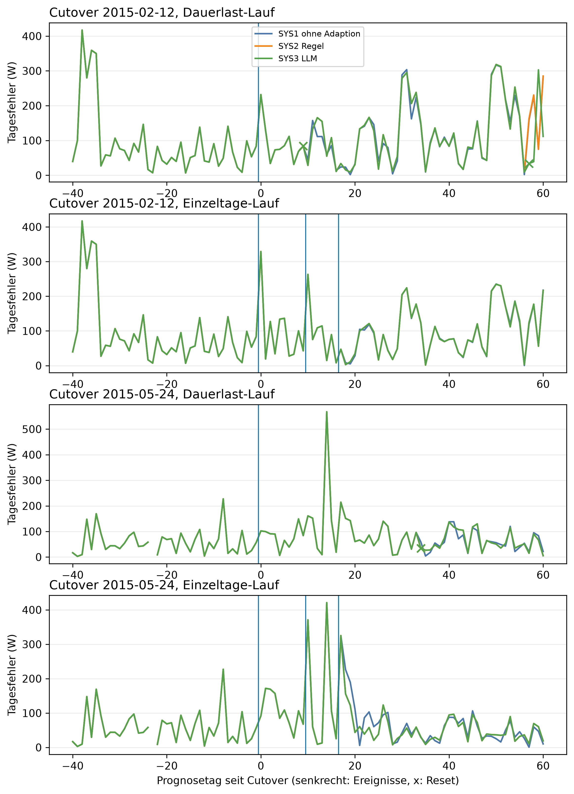

# E3 Dreiervergleich SYS1/SYS2/SYS3, Lauf e3_002

## Setup

- Cutover: CO2 (2015-02-12), CO3 (2015-05-24) (Tag 0, alle Tage und Daten in Ortszeit)
- Fenster: 40 Tage vor und 60 Tage ab Cutover
- Ereignisse: 1: Sprung +30 %, Tag 0; 2: Spitze +1000 W über 6 h, Tag 0; 3: Spitze +1000 W über 6 h, Tag 10; 4: Festhänger über 12 h, Tag 17
- Systeme: SYS1 ohne Adaption, SYS2 Regel, SYS3 LLM
- LLM SYS3: ministral-3:8b, Prompt v30
- Kalender: keiner, wie CTX0
- Commit: 19e516c

## Hauptkennzahlen, gepoolt über die Cutover

| Kennzahl | SYS1 ohne Adaption | SYS2 Regel | SYS3 LLM |
|---|---|---|---|
| Teilfrage 1: Hilft die Adaption? |  |  |  |
| Tagesfehler ab Dauerlast [W], alle Tage der Cutover | 98,9 | 100,3 | 98,1 |
| Differenz gegen SYS1 [W] | - | 1,4 | -0,8 |
| 2 Standardfehler der Differenz [W] | - | 2,2 | 6,4 |
| Differenz belastbar | - | nein | nein |
| Meldungen je 30 Tage nach Erkennung, insgesamt | 7,8 | 0,4 | 1,2 |
| davon Einzeltag-Anomalien | 0,0 | 0,4 | 0,8 |
| falsche Resets bei Einzeltag-Ereignissen | 0 | 0 | 0 |
| Resets im Kontrolllauf (Fehlalarme) | 0 | 0 | 1 |
| besser als SYS1 (Cutover) | - | 1/2 | 0/2 |
| Teilfrage 2: Macht das LLM es korrekt? |  |  |  |
| zusätzliche Resets im Kontrolllauf gegen SYS2 | - | - | 1 |
| gleichwertig zu SYS2 (Cutover) | - | - | 1/2 |

## Hinweise

- Tag = Entscheidungstag seit Cutover: an Tag n wird Tag n-1 eingeordnet, ein Ereignis an Tag s also ab Tag s+1
- bewertet an Tag: bei einer Spitze und beim Festhänger der eingeordnete Ereignistag, falls das Gate dort offen ist, bei der Dauerlast der erste Tag mit Drift oder new_pattern. Meldungen davor zählen als Meldungen, nicht als Einordnungsfehler. Ohne Bewertungstag gilt das Ereignis als nicht erkannt und zählt nicht bei der Einordnung. Der Festhänger zählt nicht bei der Erkennung, das Flag öffnet das Gate per Aufbau
- nach Trennung: vor Beginn des Ereignisses hat schon ein System anders gehandelt (Reset), die Systeme entscheiden dann nicht mehr über denselben Zustand
- Meldungen nach Erkennung: Tage nach dem Bewertungstag der Dauerlast, an denen das System peak, measurement_error oder new_pattern meldet. Einzeltag-Anomalien sind peak und measurement_error
- Kontrolllauf über das ganze Fenster, auch die Tage vor dem Cutover. Jede Meldung dort ist ein Fehlalarm, jeder Reset unnötig
- belastbar: Betrag der Differenz größer als 2 Standardfehler der gepaarten Differenzen, grobe Faustregel

## Anhang

### Kennzahlen je Cutover

| Kennzahl | Wert | Bezug |
|---|---|---|
| 2015-02-12: SYS2 besser als SYS1 | ja | Tagesfehler gegen SYS1 ab Dauerlast 2,4 W (nicht belastbar), Meldungen je 30 Tage nach Erkennung -11,2 gegen SYS1, 0 Resets bei Einzeltag-Ereignissen, 0 im Kontrolllauf |
| 2015-02-12: SYS3 besser als SYS1 | nein | Tagesfehler gegen SYS1 ab Dauerlast -2,0 W (nicht belastbar), Meldungen je 30 Tage nach Erkennung -10,0 gegen SYS1, 0 Resets bei Einzeltag-Ereignissen, 1 im Kontrolllauf |
| 2015-02-12: SYS3 gleichwertig zu SYS2 | nein | 0 Ereignisse nur SYS2 richtig, 1 Resets mehr im Kontrolllauf |
| 2015-05-24: SYS2 besser als SYS1 | nein | Tagesfehler gegen SYS1 ab Dauerlast 0,5 W (nicht belastbar), Meldungen je 30 Tage nach Erkennung 0,0 gegen SYS1, 0 Resets bei Einzeltag-Ereignissen, 0 im Kontrolllauf |
| 2015-05-24: SYS3 besser als SYS1 | nein | Tagesfehler gegen SYS1 ab Dauerlast 0,5 W (nicht belastbar), Meldungen je 30 Tage nach Erkennung 0,0 gegen SYS1, 0 Resets bei Einzeltag-Ereignissen, 0 im Kontrolllauf |
| 2015-05-24: SYS3 gleichwertig zu SYS2 | ja | 0 Ereignisse nur SYS2 richtig, 0 Resets mehr im Kontrolllauf |

### Tagesfehler je Woche ab der Dauerlast, Differenz gegen SYS1

| Cutover | Woche ab Dauerlast | Tagesfehler SYS1 ohne Adaption [W] | Tagesfehler SYS2 Regel [W] | Tagesfehler SYS3 LLM [W] | Differenz SYS2 Regel gegen SYS1 [W] | Differenz SYS3 LLM gegen SYS1 [W] |
|---|---:|---:|---:|---:|---:|---:|
| 2015-02-12 | 1 | 105,7 | 105,7 | 105,7 | 0,0 | 0,0 |
| 2015-05-24 | 1 | 70,5 | 70,5 | 70,5 | 0,0 | 0,0 |
| alle Cutover | 1 | 88,1 | 88,1 | 88,1 | 0,0 | 0,0 |
| 2015-02-12 | 2 | 86,9 | 95,0 | 95,0 | 8,2 | 8,2 |
| 2015-05-24 | 2 | 94,3 | 94,3 | 94,3 | 0,0 | 0,0 |
| alle Cutover | 2 | 90,6 | 94,7 | 94,7 | 4,1 | 4,1 |
| 2015-02-12 | 3 | 34,6 | 37,6 | 37,6 | 3,0 | 3,0 |
| 2015-05-24 | 3 | 185,4 | 185,4 | 185,4 | 0,0 | 0,0 |
| alle Cutover | 3 | 110,0 | 111,5 | 111,5 | 1,5 | 1,5 |
| 2015-02-12 | 4 | 114,1 | 110,8 | 110,8 | -3,2 | -3,2 |
| 2015-05-24 | 4 | 83,2 | 83,2 | 83,2 | 0,0 | 0,0 |
| alle Cutover | 4 | 98,7 | 97,0 | 97,0 | -1,6 | -1,6 |
| 2015-02-12 | 5 | 167,1 | 176,2 | 176,2 | 9,1 | 9,1 |
| 2015-05-24 | 5 | 52,6 | 49,0 | 49,0 | -3,5 | -3,5 |
| alle Cutover | 5 | 109,8 | 112,6 | 112,6 | 2,8 | 2,8 |
| 2015-02-12 | 6 | 89,9 | 90,3 | 90,3 | 0,4 | 0,4 |
| 2015-05-24 | 6 | 64,7 | 66,5 | 66,5 | 1,7 | 1,7 |
| alle Cutover | 6 | 77,3 | 78,4 | 78,4 | 1,1 | 1,1 |
| 2015-02-12 | 7 | 64,2 | 65,5 | 65,5 | 1,3 | 1,3 |
| 2015-05-24 | 7 | 67,1 | 79,3 | 79,3 | 12,2 | 12,2 |
| alle Cutover | 7 | 65,7 | 72,4 | 72,4 | 6,7 | 6,7 |
| 2015-02-12 | 8 | 241,4 | 241,5 | 241,5 | 0,0 | 0,0 |
| 2015-05-24 | 8 | 55,4 | 55,5 | 55,5 | 0,1 | 0,1 |
| alle Cutover | 8 | 148,4 | 148,5 | 148,5 | 0,1 | 0,1 |
| 2015-02-12 | 9 | 149,5 | 152,4 | 99,2 | 2,9 | -50,3 |
| 2015-05-24 | 9 | 55,0 | 45,7 | 45,7 | -9,3 | -9,3 |
| alle Cutover | 9 | 102,3 | 99,1 | 72,5 | -3,2 | -29,8 |

### Erste Einordnung je Ereignis

| Cutover | Ereignis | System | erwartet | bewertet an Tag | Klasse | richtig | Skala | Meldungen davor | Reset an Tag | Aktion passend | nach Trennung |
|---|---|---|---|---:|---|---|---|---:|---:|---|---|
| 2015-02-12 | 1: Sprung +30 %, Tag 0 | SYS1 ohne Adaption | new_pattern | 9 | new_pattern | ja | daily+weekday | 1 | - | nein | nein |
| 2015-02-12 | 1: Sprung +30 %, Tag 0 | SYS2 Regel | new_pattern | 9 | new_pattern | ja | daily+weekday | 1 | 9 | ja | nein |
| 2015-02-12 | 1: Sprung +30 %, Tag 0 | SYS3 LLM | new_pattern | 9 | new_pattern | ja | daily+weekday | 1 | 9 | ja | nein |
| 2015-02-12 | 2: Spitze +1000 W über 6 h, Tag 0 | SYS1 ohne Adaption | peak | 1 | peak | ja | daily | - | - | ja | nein |
| 2015-02-12 | 2: Spitze +1000 W über 6 h, Tag 0 | SYS2 Regel | peak | 1 | peak | ja | daily | - | - | ja | nein |
| 2015-02-12 | 2: Spitze +1000 W über 6 h, Tag 0 | SYS3 LLM | peak | 1 | peak | ja | daily | - | - | ja | nein |
| 2015-02-12 | 3: Spitze +1000 W über 6 h, Tag 10 | SYS1 ohne Adaption | peak | 11 | peak | ja | daily | - | - | ja | nein |
| 2015-02-12 | 3: Spitze +1000 W über 6 h, Tag 10 | SYS2 Regel | peak | 11 | peak | ja | daily | - | - | ja | nein |
| 2015-02-12 | 3: Spitze +1000 W über 6 h, Tag 10 | SYS3 LLM | peak | 11 | peak | ja | daily | - | - | ja | nein |
| 2015-02-12 | 4: Festhänger über 12 h, Tag 17 | SYS1 ohne Adaption | measurement_error | 18 | measurement_error | ja | daily | - | - | ja | nein |
| 2015-02-12 | 4: Festhänger über 12 h, Tag 17 | SYS2 Regel | measurement_error | 18 | measurement_error | ja | daily | - | - | ja | nein |
| 2015-02-12 | 4: Festhänger über 12 h, Tag 17 | SYS3 LLM | measurement_error | 18 | measurement_error | ja | daily | - | - | ja | nein |
| 2015-05-24 | 1: Sprung +30 %, Tag 0 | SYS1 ohne Adaption | new_pattern | 34 | new_pattern | ja | daily+weekday | 4 | - | nein | ja |
| 2015-05-24 | 1: Sprung +30 %, Tag 0 | SYS2 Regel | new_pattern | 34 | new_pattern | ja | daily+weekday | 4 | 34 | ja | ja |
| 2015-05-24 | 1: Sprung +30 %, Tag 0 | SYS3 LLM | new_pattern | 34 | new_pattern | ja | daily+weekday | 4 | 34 | ja | ja |
| 2015-05-24 | 2: Spitze +1000 W über 6 h, Tag 0 | SYS1 ohne Adaption | peak | - | - | - | - | - | - | ja | ja |
| 2015-05-24 | 2: Spitze +1000 W über 6 h, Tag 0 | SYS2 Regel | peak | - | - | - | - | - | - | ja | ja |
| 2015-05-24 | 2: Spitze +1000 W über 6 h, Tag 0 | SYS3 LLM | peak | - | - | - | - | - | - | ja | ja |
| 2015-05-24 | 3: Spitze +1000 W über 6 h, Tag 10 | SYS1 ohne Adaption | peak | 11 | peak | ja | weekday | - | - | ja | ja |
| 2015-05-24 | 3: Spitze +1000 W über 6 h, Tag 10 | SYS2 Regel | peak | 11 | peak | ja | weekday | - | - | ja | ja |
| 2015-05-24 | 3: Spitze +1000 W über 6 h, Tag 10 | SYS3 LLM | peak | 11 | peak | ja | weekday | - | - | ja | ja |
| 2015-05-24 | 4: Festhänger über 12 h, Tag 17 | SYS1 ohne Adaption | measurement_error | 18 | measurement_error | ja | weekday | - | - | ja | ja |
| 2015-05-24 | 4: Festhänger über 12 h, Tag 17 | SYS2 Regel | measurement_error | 18 | measurement_error | ja | weekday | - | - | ja | ja |
| 2015-05-24 | 4: Festhänger über 12 h, Tag 17 | SYS3 LLM | measurement_error | 18 | measurement_error | ja | weekday | - | - | ja | ja |

### Prognose ab Dauerlast und im Kontrolllauf, gepaart gegen SYS1

| Cutover | Zeitraum | System | Tagesfehler [W] | MAE [W] | MAPE [%] | Differenz Tagesfehler [W] | Differenz MAE [W] | 2 Standardfehler [W] | Tage | Tage besser [%] | belastbar |
|---|---|---|---:|---:|---:|---:|---:|---:|---:|---:|---|
| 2015-02-12 | Kontrolllauf ab Tag 0 | SYS1 ohne Adaption | 86,8 | 185,4 | 60,3 | - | - | - | - | - | - |
| 2015-02-12 | Kontrolllauf ab Tag 0 | SYS2 Regel | 86,8 | 185,4 | 60,3 | 0,0 | 0,0 | 0,0 | 61 | 0,0 | nein |
| 2015-02-12 | Kontrolllauf ab Tag 0 | SYS3 LLM | 85,2 | 189,7 | 63,5 | -1,6 | 4,3 | 10,3 | 61 | 6,6 | nein |
| 2015-02-12 | Dauerlast-Lauf ab Tag 0 | SYS1 ohne Adaption | 116,0 | 243,0 | 61,5 | - | - | - | - | - | - |
| 2015-02-12 | Dauerlast-Lauf ab Tag 0 | SYS2 Regel | 118,4 | 244,9 | 60,8 | 2,4 | 1,9 | 3,6 | 61 | 32,8 | nein |
| 2015-02-12 | Dauerlast-Lauf ab Tag 0 | SYS3 LLM | 114,0 | 249,4 | 63,3 | -2,0 | 6,4 | 12,5 | 61 | 36,1 | nein |
| 2015-05-24 | Kontrolllauf ab Tag 0 | SYS1 ohne Adaption | 67,2 | 147,8 | 52,8 | - | - | - | - | - | - |
| 2015-05-24 | Kontrolllauf ab Tag 0 | SYS2 Regel | 67,2 | 147,8 | 52,8 | 0,0 | 0,0 | 0,0 | 61 | 0,0 | nein |
| 2015-05-24 | Kontrolllauf ab Tag 0 | SYS3 LLM | 67,2 | 147,8 | 52,8 | 0,0 | 0,0 | 0,0 | 61 | 0,0 | nein |
| 2015-05-24 | Dauerlast-Lauf ab Tag 0 | SYS1 ohne Adaption | 81,8 | 188,3 | 52,0 | - | - | - | - | - | - |
| 2015-05-24 | Dauerlast-Lauf ab Tag 0 | SYS2 Regel | 82,2 | 188,6 | 51,7 | 0,5 | 0,3 | 2,5 | 61 | 24,6 | nein |
| 2015-05-24 | Dauerlast-Lauf ab Tag 0 | SYS3 LLM | 82,2 | 188,6 | 51,7 | 0,5 | 0,3 | 2,5 | 61 | 24,6 | nein |

### Meldungen nach der Erkennung der Dauerlast (Reihe Dauerlast ab Tag 0)

| Cutover | System | Tage nach Erkennung | Meldungen Einzeltag-Anomalien | Meldungen insgesamt | Meldungen je 30 Tage |
|---|---|---:|---:|---:|---:|
| 2015-02-12 | SYS1 ohne Adaption | 51 | 0 | 20 | 11,8 |
| 2015-02-12 | SYS2 Regel | 51 | 1 | 1 | 0,6 |
| 2015-02-12 | SYS3 LLM | 51 | 2 | 3 | 1,8 |
| 2015-05-24 | SYS1 ohne Adaption | 26 | 0 | 0 | 0,0 |
| 2015-05-24 | SYS2 Regel | 26 | 0 | 0 | 0,0 |
| 2015-05-24 | SYS3 LLM | 26 | 0 | 0 | 0,0 |

### Kontrolllauf: Fehlalarme und unnötige Resets

| Cutover | System | Tage | Meldungen | unknown | Resets |
|---|---|---:|---:|---:|---:|
| 2015-02-12 | SYS1 ohne Adaption | 101 | 0 | 0 | 0 |
| 2015-02-12 | SYS2 Regel | 101 | 0 | 0 | 0 |
| 2015-02-12 | SYS3 LLM | 101 | 3 | 0 | 1 |
| 2015-05-24 | SYS1 ohne Adaption | 101 | 4 | 0 | 0 |
| 2015-05-24 | SYS2 Regel | 101 | 4 | 0 | 0 |
| 2015-05-24 | SYS3 LLM | 101 | 4 | 0 | 0 |

### Abweichungstage SYS2 gegen SYS3

| Cutover | Reihe | Tag | Datum | Ereignis | Klasse SYS2 | Klasse SYS3 | Aktion SYS2 | Aktion SYS3 | LLM-Ausfall |
|---|---|---:|---|---|---|---|---|---|---|
| 2015-02-12 | Kontrolllauf | 55 | 2015-04-07 | - | normal | new_pattern | none | advance_history_start | nein |
| 2015-02-12 | Kontrolllauf | 56 | 2015-04-08 | - | normal | peak | none | none | nein |
| 2015-02-12 | Kontrolllauf | 57 | 2015-04-09 | - | normal | peak | none | none | nein |
| 2015-02-12 | Dauerlast-Lauf | 57 | 2015-04-09 | 1: Sprung +30 %, Tag 0 | normal | new_pattern | none | advance_history_start | nein |
| 2015-02-12 | Dauerlast-Lauf | 58 | 2015-04-10 | 1: Sprung +30 %, Tag 0 | normal | peak | none | none | nein |

### Erkennung (TF1) und erste Einordnung (TF2) als Nebenzahlen, gepoolt über Cutover und Ereignisse

| System | erwartet | erkannt (TF1) | erkannt [%] | richtig eingeordnet (TF2) | richtig [%] |
|---|---|---|---:|---|---:|
| SYS1 ohne Adaption | alle Ereignisse | 5/6 | 83,3 | 7/7 | 100,0 |
| SYS1 ohne Adaption | measurement_error | 0/0 | - | 2/2 | 100,0 |
| SYS1 ohne Adaption | new_pattern | 2/2 | 100,0 | 2/2 | 100,0 |
| SYS1 ohne Adaption | peak | 3/4 | 75,0 | 3/3 | 100,0 |
| SYS2 Regel | alle Ereignisse | 5/6 | 83,3 | 7/7 | 100,0 |
| SYS2 Regel | measurement_error | 0/0 | - | 2/2 | 100,0 |
| SYS2 Regel | new_pattern | 2/2 | 100,0 | 2/2 | 100,0 |
| SYS2 Regel | peak | 3/4 | 75,0 | 3/3 | 100,0 |
| SYS3 LLM | alle Ereignisse | 5/6 | 83,3 | 7/7 | 100,0 |
| SYS3 LLM | measurement_error | 0/0 | - | 2/2 | 100,0 |
| SYS3 LLM | new_pattern | 2/2 | 100,0 | 2/2 | 100,0 |
| SYS3 LLM | peak | 3/4 | 75,0 | 3/3 | 100,0 |

### Laufzeit und Kosten SYS3, nur beschreibend

| Cutover | Reihe | Tage | Regel je Tag [s] | LLM-Aufrufe | Ausfalltage | Mehrlaufzeit gegen Regel [s] | je Aufruf [s] |
|---|---|---:|---:|---:|---:|---:|---:|
| 2015-02-12 | Kontrolllauf | 101 | 0,1 | 33 | 0 | 616,9 | 18,7 |
| 2015-05-24 | Kontrolllauf | 101 | 0,1 | 15 | 0 | 291,8 | 19,5 |
| 2015-02-12 | Dauerlast-Lauf | 101 | 0,1 | 34 | 0 | 643,7 | 18,9 |
| 2015-05-24 | Dauerlast-Lauf | 101 | 0,1 | 24 | 0 | 442,2 | 18,4 |
| 2015-02-12 | Einzeltage-Lauf | 101 | 0,1 | 40 | 0 | 728,0 | 18,2 |
| 2015-05-24 | Einzeltage-Lauf | 101 | 0,1 | 10 | 0 | 204,9 | 20,5 |

### Antworten des LLM

**Kontrolllauf, Cutover 2015-02-12**

2015-01-02 (Entscheidungstag -40): SYS3 low, Regel low, Aktion none

- Erklärung: Gestern war der Stromverbrauch um etwa 62 % niedriger als an einem typischen Wochentag und der Tagesverlauf ungewöhnlich flach. Das könnte auf einen längeren Ausfall oder eine Störung zurückgehen.
- Empfehlung: Überprüfen Sie, ob gestern ein längerer Stromausfall oder eine Störung aufgetreten ist. Falls nicht, prüfen Sie, ob Geräte oder Beleuchtung ungewöhnlich lange ausgeschaltet waren.
- Unsicherheit: Da keine Kalenderdaten verfügbar sind, kann nicht ausgeschlossen werden, dass gestern ein geplanter Ausfall stattfand.

2015-01-03 (Entscheidungstag -39): SYS3 low, Regel low, Aktion none

- Erklärung: Gestern war der Stromverbrauch um etwa 60 % niedriger als an einem normalen Wochentag und der Tagesverlauf ungewöhnlich flach. Das könnte auf einen längeren Ausfall oder eine Störung zurückgehen.
- Empfehlung: Überprüfen Sie, ob gestern der Strom tatsächlich nicht verfügbar war oder ein Gerät ausgefallen ist. Ein längerer Ausfall könnte die Ursache sein.
- Unsicherheit: Ob es sich um einen geplanten Ausfall handelt, kann ohne Kalender nicht geprüft werden.

2015-01-04 (Entscheidungstag -38): SYS3 low, Regel low, Aktion none

- Erklärung: Gestern war der Stromverbrauch um etwa 53 % niedriger als an einem typischen Wochentag im Januar.
- Empfehlung: Da kein Kalender verfügbar war, um eine Abwesenheit zu bestätigen, prüfen Sie bitte, ob gestern niemand zu Hause war oder ob ein Gerät nicht wie üblich genutzt wurde.
- Unsicherheit: Ob die Stromverbrauchsmessung korrekt ist, kann ohne weitere Daten nicht überprüft werden.

2015-01-07 (Entscheidungstag -35): SYS3 normal, Regel normal, Aktion none

- Erklärung: Der Verbrauch von gestern lag zwar über dem üblichen Wert für einen Dienstag, aber die Abweichung war nicht ungewöhnlich und hat sich bereits wieder normalisiert.
- Empfehlung: Es ist nichts weiter zu tun, da der erhöhte Verbrauch nur ein kurzes Zwischenhoch war und sich nicht wiederholt hat.
- Unsicherheit: Ob die Abweichung durch ungewöhnliche Aktivitäten oder äußere Umstände wie Kälteeinbruch verursacht wurde, kann ohne weitere Informationen nicht geklärt werden.

2015-01-08 (Entscheidungstag -34): SYS3 normal, Regel normal, Aktion none

- Erklärung: Gestern lag der Verbrauch für einen Dienstag um etwa ein Drittel höher als üblich, aber die Abweichung ist nicht ungewöhnlich und hat sich bereits wieder normalisiert.
- Empfehlung: Es ist nichts zu tun, da der erhöhte Verbrauch nur ein einzelnes Mal aufgetreten ist und sich bereits wieder normalisiert hat.
- Unsicherheit: Ob die Abweichung durch ungewöhnliche Aktivitäten oder äußere Umstände wie Kälte verursacht wurde, kann nicht bestimmt werden.

2015-01-19 (Entscheidungstag -23): SYS3 normal, Regel normal, Aktion none

- Erklärung: Der Verbrauch gestern lag im üblichen Bereich, obwohl die letzten vier Wochen insgesamt etwa 27 % niedriger waren als sonst.
- Empfehlung: Es ist nichts zu tun, da der Verbrauch gestern normal war. Die niedrigere Gesamtverbrauch über die letzten Wochen könnte mit dem Wetter oder einem kürzeren Zeitraum im Januar zusammenhängen.
- Unsicherheit: Ob die niedrigere Verbrauch in den letzten vier Wochen tatsächlich anhält, hängt davon ab, ob sich der Verbrauch in den kommenden Tagen wieder normalisiert.

2015-01-20 (Entscheidungstag -22): SYS3 normal, Regel normal, Aktion none

- Erklärung: Gestern war der Stromverbrauch im Vergleich zu den letzten vier Wochen ungewöhnlich niedrig, aber es gibt keine Hinweise auf ein neues Muster oder eine Störung.
- Empfehlung: Da der Verbrauch seit Mitte Januar um etwa 29 % niedriger liegt, prüfen Sie bitte, ob sich die Gewohnheiten oder Umstände in Ihrem Haushalt verändert haben könnten (z. B. weniger Heizung, weniger Geräte im Einsatz).
- Unsicherheit: Ob der Verbrauch dauerhaft niedrig bleibt, hängt davon ab, ob sich die Ursache für den Rückgang nicht wieder normalisiert.

2015-01-21 (Entscheidungstag -21): SYS3 normal, Regel normal, Aktion none

- Erklärung: Der Verbrauch lag gestern im üblichen Bereich, obwohl die letzten vier Wochen insgesamt etwa 30 % niedriger waren als sonst.
- Empfehlung: Da der Verbrauch gestern normal war, ist nichts zu überprüfen. Die niedrigere Gesamtmenge der letzten vier Wochen könnte mit weniger Heizbedarf im Januar zusammenhängen.
- Unsicherheit: Ob die niedrige Verbrauchsmenge der letzten vier Wochen tatsächlich auf einen geringeren Bedarf oder eine andere Ursache zurückzuführen ist, lässt sich ohne Kalendereinträge nicht klären.

2015-01-22 (Entscheidungstag -20): SYS3 normal, Regel normal, Aktion none

- Erklärung: Gestern war der Stromverbrauch im Vergleich zum üblichen Winterverbrauch um etwa ein Drittel niedriger als erwartet, aber es gab keine ungewöhnliche Abweichung am Tag selbst.
- Empfehlung: Da der Verbrauch seit Mitte Januar ungewöhnlich niedrig bleibt, prüfen Sie bitte, ob sich etwas am Haushalt geändert hat – etwa weniger Heizung oder Beleuchtung durch längere Tageslichtzeiten im Januar.
- Unsicherheit: Ob die Abweichung auf einen konkreten Grund zurückzuführen ist, lässt sich ohne Kalendereintrag nicht sicher klären.

2015-01-23 (Entscheidungstag -19): SYS3 normal, Regel normal, Aktion none

- Erklärung: Gestern war der Stromverbrauch für einen Dienstag etwas höher als sonst, aber nicht ungewöhnlich hoch. Die Abweichung ist nur ein kurzer Anstieg ohne weitere Auffälligkeiten.
- Empfehlung: Es gibt keine Handlungsbedarf. Der Verbrauch liegt im üblichen Bereich, auch wenn er gestern etwas höher war.
- Unsicherheit: Ob der höhere Verbrauch auf einen konkreten Grund wie längeres Heizen oder Beleuchtung zurückzuführen ist, kann nicht überprüft werden.

2015-01-24 (Entscheidungstag -18): SYS3 normal, Regel normal, Aktion none

- Erklärung: Der Verbrauch von gestern lag zwar über dem üblichen Wert für einen Dienstag, aber die Abweichung war nicht ungewöhnlich und hat sich in den letzten Tagen nicht wiederholt.
- Empfehlung: Es gibt keine Handlungsbedarf, da der Verbrauch gestern im Rahmen lag und sich die Werte stabilisiert haben.
- Unsicherheit: Ob ein geplanter Urlaub oder eine andere Abwesenheit den Verbrauch beeinflusst hat, kann nicht geprüft werden, da kein Kalender verfügbar war.

2015-01-25 (Entscheidungstag -17): SYS3 normal, Regel normal, Aktion none

- Erklärung: Gestern lag der Verbrauch im Vergleich zum üblichen Winterverlauf etwa 22 % niedriger als erwartet, was auf eine ungewöhnlich geringe Nutzung hindeutet.
- Empfehlung: Da der Verbrauch seit Mitte Januar ungewöhnlich niedrig bleibt, prüfen Sie bitte, ob Geräte oder Heizung außer Betrieb sind oder ob die Beleuchtung reduziert wurde.
- Unsicherheit: Ob ein geplanter Urlaub oder eine technische Veränderung im Haushalt vorliegt, kann nicht geprüft werden, da keine Kalendereintragungen verfügbar sind.

2015-01-26 (Entscheidungstag -16): SYS3 normal, Regel normal, Aktion none

- Erklärung: Der Verbrauch lag gestern im üblichen Bereich, aber die letzten vier Wochen waren insgesamt etwa 19 % niedriger als sonst.
- Empfehlung: Da der Verbrauch gestern normal war, ist nichts zu überprüfen. Die niedrigere Gesamtmenge der letzten vier Wochen könnte mit weniger Heizbedarf im Januar zusammenhängen – prüfen Sie, ob sich die Nutzung von Heizung oder Warmwasser verändert hat.
- Unsicherheit: Ob die Verbrauchsminderung auf einen konkreten Grund zurückzuführen ist, lässt sich ohne Kalendereintrag nicht abschätzen.

2015-01-27 (Entscheidungstag -15): SYS3 normal, Regel normal, Aktion none

- Erklärung: Gestern lag der Verbrauch um etwa 15 % unter dem üblichen Winterwert, aber es gab keine ungewöhnliche Abweichung am Tag selbst.
- Empfehlung: Da der Verbrauch seit Mitte Januar niedriger ist, prüfen Sie bitte, ob sich etwas am Haushalt geändert hat – etwa weniger Heizung oder kürzere Gerätenutzung.
- Unsicherheit: Ob die Abweichung auf einen geplanten Urlaub zurückzuführen ist, kann nicht geprüft werden, da der Kalender nicht verfügbar war.

2015-01-28 (Entscheidungstag -14): SYS3 normal, Regel normal, Aktion none

- Erklärung: Gestern lag der Verbrauch im Vergleich zum üblichen Winterverlauf etwa 10 % niedriger, aber die Abweichung ist nicht ungewöhnlich für diese Zeit des Jahres.
- Empfehlung: Keine Maßnahmen nötig. Der Verbrauch ist im Rahmen der saisonalen Schwankungen.
- Unsicherheit: Ob die Abweichung durch kürzere Tage oder andere Faktoren wie Wetter oder Heizungsverhalten verursacht wurde, kann nicht bestimmt werden.

2015-02-18 (Entscheidungstag 7): SYS3 normal, Regel normal, Aktion none

- Erklärung: Gestern war der Stromverbrauch im Vergleich zum üblichen Februarwert um etwa 26 % höher, aber dieser Wert ist nicht ungewöhnlich für die letzten Wochen.
- Empfehlung: Es gibt keine Handlungsbedarf, da der erhöhte Verbrauch seit Wochen besteht und kein ungewöhnliches Muster zeigt.
- Unsicherheit: Ob die höhere Nutzung auf einen neuen Gewohnheitsverlauf oder äußere Umstände wie Wetter zurückzuführen ist, kann nicht bestimmt werden.

2015-02-19 (Entscheidungstag 8): SYS3 normal, Regel normal, Aktion none

- Erklärung: Gestern lag der Verbrauch im Vergleich zum üblichen Winterverlauf etwa 28 % höher als sonst, aber es gab keine ungewöhnliche Abweichung am Tag selbst.
- Empfehlung: Da der Verbrauch seit Mitte Februar ungewöhnlich hoch ist, prüfen Sie bitte, ob sich die Nutzung von Heizung oder Beleuchtung verändert hat.
- Unsicherheit: Ob ein geplanter Urlaub oder eine andere Abwesenheit den Verbrauch beeinflusst haben könnte, lässt sich ohne Kalender nicht klären.

2015-02-20 (Entscheidungstag 9): SYS3 normal, Regel normal, Aktion none

- Erklärung: Gestern war der Stromverbrauch etwas niedriger als sonst an einem Freitag, aber nicht ungewöhnlich für einen einzelnen Tag.
- Empfehlung: Es gibt nichts Ungewöhnliches zu beachten. Der Verbrauch liegt im üblichen Bereich, auch wenn er aktuell etwas niedriger ist als sonst an einem Freitag.
- Unsicherheit: Ob der Verbrauch tatsächlich niedriger bleibt oder nur kurzzeitig war, lässt sich erst in den nächsten Tagen beurteilen.

2015-02-21 (Entscheidungstag 10): SYS3 normal, Regel normal, Aktion none

- Erklärung: Gestern lag der Verbrauch um etwa 22 % über dem üblichen Winterwert für diese Tageszeit, aber es handelt sich nicht um eine neue Entwicklung.
- Empfehlung: Da der erhöhte Verbrauch seit Anfang Februar besteht, gibt es nichts Neues zu prüfen. Ein Blick auf die Heizung oder den Warmwasserverbrauch könnte helfen, aber Sie wissen bereits, ob sich daran etwas geändert hat.
- Unsicherheit: Ob der Winterverbrauch tatsächlich höher ist als sonst, hängt davon ab, ob die gemessenen Werte seit Anfang Februar zuverlässig sind.

2015-02-22 (Entscheidungstag 11): SYS3 normal, Regel normal, Aktion none

- Erklärung: Der Stromverbrauch lag gestern im üblichen Bereich, aber die letzten vier Wochen waren insgesamt etwa 20 % höher als sonst.
- Empfehlung: Es gibt nichts Ungewöhnliches zu beachten, da der Verbrauch gestern normal war. Die höhere Nutzung über vier Wochen könnte auf längere Tage im Februar oder mehr Zeit drinnen hindeuten – das ist aber kein Grund zur Sorge.
- Unsicherheit: Ob die erhöhte Nutzung seit dem 13. Februar tatsächlich anhält, kann nicht geprüft werden, da der Kalender nicht verfügbar war.

2015-02-23 (Entscheidungstag 12): SYS3 normal, Regel normal, Aktion none

- Erklärung: Gestern war der Stromverbrauch im Vergleich zum üblichen Februarwert um etwa 20 % höher, aber das ist nicht ungewöhnlich für diese Jahreszeit.
- Empfehlung: Es gibt keinen Grund zur Sorge, da der erhöhte Verbrauch seit Anfang Februar besteht und typisch für den Winter sein könnte. Sie können prüfen, ob sich die Heizung oder Beleuchtung im Vergleich zu anderen Februartagen verändert hat.
- Unsicherheit: Ob der höhere Verbrauch auf eine Veränderung in Ihrem Haushalt zurückzuführen ist, lässt sich ohne Kalendereintrag nicht abschließend klären.

2015-02-24 (Entscheidungstag 13): SYS3 normal, Regel normal, Aktion none

- Erklärung: Gestern war der Stromverbrauch im Vergleich zum üblichen Februarwert um etwa 13 % niedriger, aber die Abweichung ist nicht nachhaltig und liegt innerhalb der normalen Schwankungen.
- Empfehlung: Es gibt keine Handlungsbedarf, da der Verbrauch gestern im Rahmen lag und die Abweichung nicht auf ein Problem hindeutet. Sie können prüfen, ob sich Ihr Stromverbrauch in den letzten Tagen insgesamt normal anfühlt.
- Unsicherheit: Da kein Kalender verfügbar war, kann nicht ausgeschlossen werden, dass ein geplanter Urlaub oder eine Abwesenheit die Verbrauchswerte beeinflusst hat.

2015-02-25 (Entscheidungstag 14): SYS3 normal, Regel normal, Aktion none

- Erklärung: Der Verbrauch gestern lag im üblichen Bereich, aber die letzten vier Wochen waren insgesamt etwa 12 % niedriger als sonst.
- Empfehlung: Es gibt nichts Ungewöhnliches zu beachten, da der Verbrauch gestern normal war. Die niedrigere Gesamtmenge der letzten vier Wochen könnte mit weniger Heizbedarf im Februar zusammenhängen.
- Unsicherheit: Ob die niedrigere Verbrauchsmenze der letzten vier Wochen tatsächlich anhält oder nur ein kurzes Phänomen ist, lässt sich erst nach weiteren Tagen beurteilen.

2015-03-14 (Entscheidungstag 31): SYS3 low, Regel low, Aktion none

- Erklärung: Gestern war der Stromverbrauch um etwa die Hälfte niedriger als an einem normalen Wochentag.
- Empfehlung: Da kein Kalender verfügbar war, prüfen Sie bitte, ob gestern niemand zu Hause war oder ob ein ungewöhnliches Ereignis stattfand, das den Verbrauch stark reduziert haben könnte.
- Unsicherheit: Ob es sich um einen Ausreißer handelt oder eine neue Situation, hängt davon ab, ob der niedrige Verbrauch auch heute und morgen so bleibt.

2015-03-15 (Entscheidungstag 32): SYS3 low, Regel low, Aktion none

- Erklärung: Gestern war der Stromverbrauch um etwa 63 % niedriger als an einem typischen Wochentag im März.
- Empfehlung: Da kein Kalender verfügbar war, um eine Abwesenheit zu bestätigen, prüfen Sie bitte, ob gestern niemand zu Hause war oder ob der Verbrauch ungewöhnlich niedrig war.
- Unsicherheit: Ob es sich um einen Messfehler handelt oder ob die Stromzähler nicht korrekt abgelesen wurden, ist unklar.

2015-04-02 (Entscheidungstag 50): SYS3 low, Regel low, Aktion none

- Erklärung: Gestern war der Stromverbrauch um etwa 57 % niedriger als an einem typischen Dienstag und der Tagesverlauf ungewöhnlich flach. Dies könnte auf einen längeren Ausfall einzelner Geräte oder eine vorübergehende Reduzierung des Verbrauchs hindeuten.
- Empfehlung: Überprüfen Sie, ob Geräte oder Systeme wie Heizung, Warmwasserbereitung oder Beleuchtung gestört waren oder ob jemand den Verbrauch bewusst reduziert hat.
- Unsicherheit: Da keine Kalenderdaten verfügbar sind, kann nicht ausgeschlossen werden, dass ein geplanter Ausfall oder eine Abwesenheit vorlag.

2015-04-03 (Entscheidungstag 51): SYS3 low, Regel low, Aktion none

- Erklärung: Gestern war der Stromverbrauch um etwa zwei Drittel niedriger als sonst an einem Donnerstag und der Tagesverlauf ungewöhnlich flach. Das könnte auf einen längeren Ausfall von Geräten oder eine vorübergehende Unterbrechung des Stroms hindeuten.
- Empfehlung: Überprüfen Sie, ob es gestern zu einem längeren Stromausfall oder einer Störung gekommen ist. Falls nicht, prüfen Sie, ob Geräte wie Heizung oder Warmwasserbereiter abgeschaltet waren.
- Unsicherheit: Da keine Kalenderdaten verfügbar sind, kann ein längerer Ausfall von Personen nicht ausgeschlossen werden.

2015-04-04 (Entscheidungstag 52): SYS3 low, Regel low, Aktion none

- Erklärung: Gestern war der Stromverbrauch um etwa zwei Drittel niedriger als sonst an einem Donnerstag und der Tagesverlauf ungewöhnlich flach. Das könnte auf einen längeren Ausfall von Geräten oder eine vorübergehende Unterbrechung des Stroms hindeuten.
- Empfehlung: Überprüfen Sie, ob es gestern zu einem längeren Stromausfall oder einer Störung gekommen ist. Falls nicht, prüfen Sie, ob Geräte wie Heizung oder Warmwasserbereiter abgeschaltet waren.
- Unsicherheit: Da keine Kalenderdaten verfügbar sind, kann ein geplanter Ausflug oder Urlaub nicht ausgeschlossen werden.

2015-04-05 (Entscheidungstag 53): SYS3 low, Regel low, Aktion none

- Erklärung: Gestern war der Stromverbrauch um etwa zwei Drittel niedriger als an einem normalen Dienstag im April.
- Empfehlung: Da kein Kalender verfügbar war, um eine Abwesenheit zu prüfen, überprüfen Sie bitte, ob der Verbrauch ungewöhnlich niedrig war oder ob möglicherweise Geräte ausgeschaltet waren.
- Unsicherheit: Ob es sich um einen Messfehler handelt oder ob die Stromverbräuche tatsächlich so niedrig waren, lässt sich ohne Kalender nicht sicher klären.

2015-04-06 (Entscheidungstag 54): SYS3 low, Regel low, Aktion none

- Erklärung: Gestern war der Stromverbrauch um etwa 58 % niedriger als an einem typischen Dienstag dieser Woche.
- Empfehlung: Überprüfen Sie, ob der Stromzähler oder ein Unterbrecher ausgeschaltet war, da die Verbrauchswerte ungewöhnlich niedrig sind.
- Unsicherheit: Ob es sich um einen Messfehler handelt, kann nicht geprüft werden, da keine Kalenderdaten verfügbar sind.

2015-04-07 (Entscheidungstag 55): SYS3 new_pattern, Regel normal, Aktion advance_history_start

- Erklärung: Der Stromverbrauch war in den letzten sieben Tagen um etwa 45 % niedriger als sonst, seit dem 2. April. Das ist ungewöhnlich und könnte auf eine dauerhafte Veränderung hinweisen.
- Empfehlung: Überprüfen Sie, ob sich der Stromverbrauch tatsächlich dauerhaft reduziert hat oder ob ein Gerät nicht mehr läuft. Prüfen Sie z. B., ob Heizung, Warmwasser oder Beleuchtung anders eingestellt wurden.
- Unsicherheit: Da keine Kalenderdaten verfügbar sind, kann nicht ausgeschlossen werden, dass eine Abwesenheit den Verbrauch beeinflusst hat.

2015-04-08 (Entscheidungstag 56): SYS3 peak, Regel normal, Aktion none

- Erklärung: Gestern war der Stromverbrauch über den Tag verteilt ungewöhnlich hoch, mit einem kurzen Spitzenwert oder einer sehr ungleichmäßigen Verteilung.
- Empfehlung: Überprüfen Sie, ob gestern ungewöhnliche Geräte genutzt oder neue Geräte eingeschaltet wurden.
- Unsicherheit: Ob der Verbrauch durch einen konkreten Vorfall wie eine Reparatur oder ein neues Gerät verursacht wurde, kann nur mit Ihren eigenen Aufzeichnungen überprüft werden.

2015-04-09 (Entscheidungstag 57): SYS3 peak, Regel normal, Aktion none

- Erklärung: Gestern war der Stromverbrauch über den Tag verteilt ungewöhnlich hoch, mit einem kurzen Spitzenwert. Das ist nicht typisch für einen Dienstag.
- Empfehlung: Überprüfen Sie, ob gestern ungewöhnlich viele Geräte gleichzeitig genutzt wurden oder ob ein neues Gerät in Betrieb genommen wurde.
- Unsicherheit: Ob der Stromverbrauch tatsächlich höher war als sonst, kann nicht überprüft werden, da keine Kalenderdaten verfügbar sind.

**Dauerlast-Lauf, Cutover 2015-02-12**

2015-01-02 (Entscheidungstag -40): SYS3 low, Regel low, Aktion none

- Erklärung: Gestern war der Stromverbrauch um etwa 62 % niedriger als an einem typischen Wochentag und der Tagesverlauf ungewöhnlich flach. Das könnte auf einen längeren Ausfall oder eine Störung zurückgehen.
- Empfehlung: Überprüfen Sie, ob gestern ein längerer Stromausfall oder eine Störung aufgetreten ist. Falls nicht, prüfen Sie, ob Geräte oder Beleuchtung ungewöhnlich lange ausgeschaltet waren.
- Unsicherheit: Da keine Kalenderdaten verfügbar sind, kann nicht ausgeschlossen werden, dass gestern ein geplanter Ausfall stattfand.

2015-01-03 (Entscheidungstag -39): SYS3 low, Regel low, Aktion none

- Erklärung: Gestern war der Stromverbrauch um etwa 60 % niedriger als an einem normalen Wochentag und der Tagesverlauf ungewöhnlich flach. Das könnte auf einen längeren Ausfall oder eine Störung zurückgehen.
- Empfehlung: Überprüfen Sie, ob gestern der Strom tatsächlich nicht verfügbar war oder ein Gerät ausgefallen ist. Ein längerer Ausfall könnte die Ursache sein.
- Unsicherheit: Ob es sich um einen geplanten Ausfall handelt, kann ohne Kalender nicht geprüft werden.

2015-01-04 (Entscheidungstag -38): SYS3 low, Regel low, Aktion none

- Erklärung: Gestern war der Stromverbrauch um etwa 53 % niedriger als an einem typischen Wochentag im Januar.
- Empfehlung: Da kein Kalender verfügbar war, um eine Abwesenheit zu bestätigen, prüfen Sie bitte, ob gestern niemand zu Hause war oder ob ein Gerät nicht wie üblich genutzt wurde.
- Unsicherheit: Ob die Stromverbrauchsmessung korrekt ist, kann ohne weitere Daten nicht überprüft werden.

2015-01-07 (Entscheidungstag -35): SYS3 normal, Regel normal, Aktion none

- Erklärung: Der Verbrauch von gestern lag zwar über dem üblichen Wert für einen Dienstag, aber die Abweichung war nicht ungewöhnlich und hat sich bereits wieder normalisiert.
- Empfehlung: Es ist nichts weiter zu tun, da der erhöhte Verbrauch nur ein kurzes Zwischenhoch war und sich nicht wiederholt hat.
- Unsicherheit: Ob die Abweichung durch ungewöhnliche Aktivitäten oder äußere Umstände wie Kälteeinbruch verursacht wurde, kann ohne weitere Informationen nicht geklärt werden.

2015-01-08 (Entscheidungstag -34): SYS3 normal, Regel normal, Aktion none

- Erklärung: Gestern lag der Verbrauch für einen Dienstag um etwa ein Drittel höher als üblich, aber die Abweichung ist nicht ungewöhnlich und hat sich bereits wieder normalisiert.
- Empfehlung: Es ist nichts zu tun, da der erhöhte Verbrauch nur ein einzelnes Mal aufgetreten ist und sich bereits wieder normalisiert hat.
- Unsicherheit: Ob die Abweichung durch ungewöhnliche Aktivitäten oder äußere Umstände wie Kälte verursacht wurde, kann nicht bestimmt werden.

2015-01-19 (Entscheidungstag -23): SYS3 normal, Regel normal, Aktion none

- Erklärung: Der Verbrauch gestern lag im üblichen Bereich, obwohl die letzten vier Wochen insgesamt etwa 27 % niedriger waren als sonst.
- Empfehlung: Es ist nichts zu tun, da der Verbrauch gestern normal war. Die niedrigere Gesamtverbrauch über die letzten Wochen könnte mit dem Wetter oder einem kürzeren Zeitraum im Januar zusammenhängen.
- Unsicherheit: Ob die niedrigere Verbrauch in den letzten vier Wochen tatsächlich anhält, hängt davon ab, ob sich der Verbrauch in den kommenden Tagen wieder normalisiert.

2015-01-20 (Entscheidungstag -22): SYS3 normal, Regel normal, Aktion none

- Erklärung: Gestern war der Stromverbrauch im Vergleich zu den letzten vier Wochen ungewöhnlich niedrig, aber es gibt keine Hinweise auf ein neues Muster oder eine Störung.
- Empfehlung: Da der Verbrauch seit Mitte Januar um etwa 29 % niedriger liegt, prüfen Sie bitte, ob sich die Gewohnheiten oder Umstände in Ihrem Haushalt verändert haben könnten (z. B. weniger Heizung, weniger Geräte im Einsatz).
- Unsicherheit: Ob der Verbrauch dauerhaft niedrig bleibt, hängt davon ab, ob sich die Ursache für den Rückgang nicht wieder normalisiert.

2015-01-21 (Entscheidungstag -21): SYS3 normal, Regel normal, Aktion none

- Erklärung: Der Verbrauch lag gestern im üblichen Bereich, obwohl die letzten vier Wochen insgesamt etwa 30 % niedriger waren als sonst.
- Empfehlung: Da der Verbrauch gestern normal war, ist nichts zu überprüfen. Die niedrigere Gesamtmenge der letzten vier Wochen könnte mit weniger Heizbedarf im Januar zusammenhängen.
- Unsicherheit: Ob die niedrige Verbrauchsmenge der letzten vier Wochen tatsächlich auf einen geringeren Bedarf oder eine andere Ursache zurückzuführen ist, lässt sich ohne Kalendereinträge nicht klären.

2015-01-22 (Entscheidungstag -20): SYS3 normal, Regel normal, Aktion none

- Erklärung: Gestern war der Stromverbrauch im Vergleich zum üblichen Winterverbrauch um etwa ein Drittel niedriger als erwartet, aber es gab keine ungewöhnliche Abweichung am Tag selbst.
- Empfehlung: Da der Verbrauch seit Mitte Januar ungewöhnlich niedrig bleibt, prüfen Sie bitte, ob sich etwas am Haushalt geändert hat – etwa weniger Heizung oder Beleuchtung durch längere Tageslichtzeiten im Januar.
- Unsicherheit: Ob die Abweichung auf einen konkreten Grund zurückzuführen ist, lässt sich ohne Kalendereintrag nicht sicher klären.

2015-01-23 (Entscheidungstag -19): SYS3 normal, Regel normal, Aktion none

- Erklärung: Gestern war der Stromverbrauch für einen Dienstag etwas höher als sonst, aber nicht ungewöhnlich hoch. Die Abweichung ist nur ein kurzer Anstieg ohne weitere Auffälligkeiten.
- Empfehlung: Es gibt keine Handlungsbedarf. Der Verbrauch liegt im üblichen Bereich, auch wenn er gestern etwas höher war.
- Unsicherheit: Ob der höhere Verbrauch auf einen konkreten Grund wie längeres Heizen oder Beleuchtung zurückzuführen ist, kann nicht überprüft werden.

2015-01-24 (Entscheidungstag -18): SYS3 normal, Regel normal, Aktion none

- Erklärung: Der Verbrauch von gestern lag zwar über dem üblichen Wert für einen Dienstag, aber die Abweichung war nicht ungewöhnlich und hat sich in den letzten Tagen nicht wiederholt.
- Empfehlung: Es gibt keine Handlungsbedarf, da der Verbrauch gestern im Rahmen lag und sich die Werte stabilisiert haben.
- Unsicherheit: Ob ein geplanter Urlaub oder eine andere Abwesenheit den Verbrauch beeinflusst hat, kann nicht geprüft werden, da kein Kalender verfügbar war.

2015-01-25 (Entscheidungstag -17): SYS3 normal, Regel normal, Aktion none

- Erklärung: Gestern lag der Verbrauch im Vergleich zum üblichen Winterverlauf etwa 22 % niedriger als erwartet, was auf eine ungewöhnlich geringe Nutzung hindeutet.
- Empfehlung: Da der Verbrauch seit Mitte Januar ungewöhnlich niedrig bleibt, prüfen Sie bitte, ob Geräte oder Heizung außer Betrieb sind oder ob die Beleuchtung reduziert wurde.
- Unsicherheit: Ob ein geplanter Urlaub oder eine technische Veränderung im Haushalt vorliegt, kann nicht geprüft werden, da keine Kalendereintragungen verfügbar sind.

2015-01-26 (Entscheidungstag -16): SYS3 normal, Regel normal, Aktion none

- Erklärung: Der Verbrauch lag gestern im üblichen Bereich, aber die letzten vier Wochen waren insgesamt etwa 19 % niedriger als sonst.
- Empfehlung: Da der Verbrauch gestern normal war, ist nichts zu überprüfen. Die niedrigere Gesamtmenge der letzten vier Wochen könnte mit weniger Heizbedarf im Januar zusammenhängen – prüfen Sie, ob sich die Nutzung von Heizung oder Warmwasser verändert hat.
- Unsicherheit: Ob die Verbrauchsminderung auf einen konkreten Grund zurückzuführen ist, lässt sich ohne Kalendereintrag nicht abschätzen.

2015-01-27 (Entscheidungstag -15): SYS3 normal, Regel normal, Aktion none

- Erklärung: Gestern lag der Verbrauch um etwa 15 % unter dem üblichen Winterwert, aber es gab keine ungewöhnliche Abweichung am Tag selbst.
- Empfehlung: Da der Verbrauch seit Mitte Januar niedriger ist, prüfen Sie bitte, ob sich etwas am Haushalt geändert hat – etwa weniger Heizung oder kürzere Gerätenutzung.
- Unsicherheit: Ob die Abweichung auf einen geplanten Urlaub zurückzuführen ist, kann nicht geprüft werden, da der Kalender nicht verfügbar war.

2015-01-28 (Entscheidungstag -14): SYS3 normal, Regel normal, Aktion none

- Erklärung: Gestern lag der Verbrauch im Vergleich zum üblichen Winterverlauf etwa 10 % niedriger, aber die Abweichung ist nicht ungewöhnlich für diese Zeit des Jahres.
- Empfehlung: Keine Maßnahmen nötig. Der Verbrauch ist im Rahmen der saisonalen Schwankungen.
- Unsicherheit: Ob die Abweichung durch kürzere Tage oder andere Faktoren wie Wetter oder Heizungsverhalten verursacht wurde, kann nicht bestimmt werden.

2015-02-12 (Entscheidungstag 1, Ereignis 1: Sprung +30 %, Tag 0): SYS3 peak, Regel peak, Aktion none

- Erklärung: Gestern war der Stromverbrauch sowohl über den Tag verteilt als auch insgesamt um etwa 80 % höher als an einem normalen Dienstag. Das ist ungewöhnlich für diese Zeit des Jahres.
- Empfehlung: Überprüfen Sie, ob gestern ungewöhnliche Geräte oder Aktivitäten den Verbrauch erhöht haben könnten, z. B. Heizungsprobleme oder längeres Nutzen von Elektrogeräten.
- Unsicherheit: Da keine Kalenderdaten verfügbar sind, kann nicht ausgeschlossen werden, dass ein geplanter Aufenthalt außerhalb des Hauses die Messung beeinflusst hat.

2015-02-18 (Entscheidungstag 7, Ereignis 1: Sprung +30 %, Tag 0): SYS3 normal, Regel normal, Aktion none

- Erklärung: Gestern war der Stromverbrauch wie üblich, aber die letzten Wochen waren ungewöhnlich hoch.
- Empfehlung: Es gibt nichts zu überprüfen, da der Verbrauch gestern im üblichen Rahmen lag.
- Unsicherheit: Ob die ungewöhnlich hohen Werte der letzten Wochen auf einen neuen Verbrauchsverlauf oder eine andere Ursache zurückgehen, kann nicht beurteilt werden.

2015-02-19 (Entscheidungstag 8, Ereignis 1: Sprung +30 %, Tag 0): SYS3 normal, Regel normal, Aktion none

- Erklärung: Gestern war der Stromverbrauch im Vergleich zum üblichen Februarwert um etwa 40 % höher, aber dieser Wert ist nicht ungewöhnlich für die letzten Wochen.
- Empfehlung: Da der erhöhte Verbrauch bereits seit mehreren Wochen anhält, gibt es keinen Grund zur Sorge. Überprüfen Sie ggf., ob sich die Nutzung von Heizung oder Beleuchtung im Winter verändert hat.
- Unsicherheit: Ob der höhere Verbrauch auf eine dauerhafte Veränderung zurückzuführen ist, kann erst nach weiteren Tagen mit zuverlässigen Daten beurteilt werden.

2015-02-20 (Entscheidungstag 9, Ereignis 1: Sprung +30 %, Tag 0): SYS3 new_pattern, Regel new_pattern, Aktion advance_history_start

- Erklärung: Gestern war der Stromverbrauch im Vergleich zu den letzten Wochen ungewöhnlich hoch, und dieser Trend hält seit Mitte Februar an. Die Werte liegen etwa 27 % über dem üblichen Wochenwert und sogar um 37 % über dem langfristigen Durchschnitt.
- Empfehlung: Überprüfen Sie, ob sich der Stromverbrauch in den letzten Wochen verändert hat, zum Beispiel durch neue Geräte oder längere Nutzung von Heizung oder Beleuchtung. Die ungewöhnlich hohen Werte könnten auch auf eine Veränderung im Haushalt zurückzuführen sein.
- Unsicherheit: Da keine Kalenderdaten verfügbar sind, kann nicht ausgeschlossen werden, dass ein geplanter Aufenthalt außerhalb des Hauses die Verbrauchswerte beeinflusst hat.

2015-03-14 (Entscheidungstag 31, Ereignis 1: Sprung +30 %, Tag 0): SYS3 low, Regel low, Aktion none

- Erklärung: Gestern war der Stromverbrauch um etwa 48 % niedriger als an einem typischen Wochentag im März.
- Empfehlung: Da kein Kalender verfügbar war, um eine Abwesenheit zu bestätigen, prüfen Sie bitte, ob gestern niemand zu Hause war oder ob ungewöhnlich wenig Strom verbraucht wurde.
- Unsicherheit: Ob es sich um einen Messfehler oder ein tatsächliches Muster handelt, lässt sich ohne Kalender nicht sicher klären.

2015-03-15 (Entscheidungstag 32, Ereignis 1: Sprung +30 %, Tag 0): SYS3 low, Regel low, Aktion none

- Erklärung: Gestern war der Stromverbrauch ungewöhnlich niedrig, sowohl über den Tag verteilt als auch im Vergleich zu einem normalen Dienstag. Der Verbrauch lag etwa 65 % unter dem üblichen Wert für einen Dienstag.
- Empfehlung: Da kein Kalender verfügbar ist, um eine Abwesenheit zu bestätigen, prüfen Sie bitte, ob gestern ungewöhnlich wenig Strom verbraucht wurde. Möglicherweise waren Geräte ausgeschaltet oder es gab andere Gründe wie weniger Nutzung von Haushaltsgeräten.
- Unsicherheit: Ob die niedrige Verbrauchsmuster auf eine geplante Abwesenheit zurückzuführen ist, kann nicht geprüft werden, da der Kalender nicht verfügbar war.

2015-03-17 (Entscheidungstag 34, Ereignis 1: Sprung +30 %, Tag 0): SYS3 peak, Regel peak, Aktion none

- Erklärung: Gestern war der Stromverbrauch für einen Wochentag ungewöhnlich hoch, um etwa 35 % mehr als sonst an einem Dienstag.
- Empfehlung: Überprüfen Sie, ob gestern ungewöhnlich viele Geräte gleichzeitig genutzt wurden oder ob neue Verbraucher im Haushalt hinzugekommen sind.
- Unsicherheit: Ob der erhöhte Verbrauch auf einen einmaligen Grund wie ein Fest oder eine besondere Aktivität zurückzuführen ist, lässt sich ohne Kalendereinträge nicht abschließen.

2015-03-18 (Entscheidungstag 35, Ereignis 1: Sprung +30 %, Tag 0): SYS3 normal, Regel normal, Aktion none

- Erklärung: Gestern lag der Verbrauch für einen Dienstag um etwa 29 % über dem üblichen Wert, aber die Abweichung ist nicht nachhaltig und betrifft nur diesen Tag.
- Empfehlung: Es gibt keine Handlungsbedarf, da der erhöhte Verbrauch nur ein einzelner Tag war und sich nicht wiederholt hat.
- Unsicherheit: Ob es einen Grund für den höheren Verbrauch gab, kann ohne Kalenderdaten nicht geklärt werden.

2015-03-19 (Entscheidungstag 36, Ereignis 1: Sprung +30 %, Tag 0): SYS3 normal, Regel normal, Aktion none

- Erklärung: Gestern war der Stromverbrauch etwas niedriger als sonst an einem Donnerstag, aber nicht ungewöhnlich für einen einzelnen Tag.
- Empfehlung: Es gibt nichts zu überprüfen, da der Verbrauch im üblichen Rahmen liegt.
- Unsicherheit: Ob ein geplanter Urlaub oder eine Abwesenheit den niedrigeren Verbrauch erklären könnte, lässt sich nicht prüfen, da keine Kalendereintragungen verfügbar sind.

2015-03-20 (Entscheidungstag 37, Ereignis 1: Sprung +30 %, Tag 0): SYS3 normal, Regel normal, Aktion none

- Erklärung: Gestern war der Stromverbrauch etwas niedriger als sonst an einem Donnerstag, aber nicht ungewöhnlich für einen einzelnen Tag.
- Empfehlung: Es gibt nichts zu beachten, da der Verbrauch im Rahmen liegt und keine ungewöhnlichen Umstände vorliegen.
- Unsicherheit: Ob ein geplanter Urlaub oder eine Abwesenheit den niedrigeren Verbrauch erklären könnte, lässt sich nicht prüfen, da kein Kalender verfügbar war.

2015-03-21 (Entscheidungstag 38, Ereignis 1: Sprung +30 %, Tag 0): SYS3 normal, Regel normal, Aktion none

- Erklärung: Gestern war der Stromverbrauch für einen Dienstag ungewöhnlich hoch, aber nur um etwa 43 % über dem üblichen Wert. Dies ist ein einzelner Tag und kein anhaltender Trend.
- Empfehlung: Da es sich um einen einzelnen hohen Wert handelt und keine anhaltende Veränderung vorliegt, ist nichts weiter zu tun. Überprüfen Sie ggf., ob gestern ungewöhnlich viele Geräte gleichzeitig genutzt wurden oder ob ein neues Gerät hinzugekommen ist.
- Unsicherheit: Ob der hohe Verbrauch durch eine einmalige Nutzung von Geräten oder einen anderen Grund verursacht wurde, kann nicht sicher bestimmt werden.

2015-04-02 (Entscheidungstag 50, Ereignis 1: Sprung +30 %, Tag 0): SYS3 low, Regel low, Aktion none

- Erklärung: Gestern war der Stromverbrauch um etwa 57 % niedriger als an einem typischen Dienstag und der Tagesverlauf ungewöhnlich flach. Das könnte auf einen längeren Ausfall von Geräten oder eine vorübergehende Unterbrechung hindeuten.
- Empfehlung: Überprüfen Sie, ob gestern Geräte ausgefallen sind oder es zu einer längeren Stromunterbrechung kam. Ein längerer Ausfall von Heizung oder Warmwasser könnte den Unterschied erklären.
- Unsicherheit: Da keine Kalenderdaten verfügbar sind, kann nicht ausgeschlossen werden, dass ein geplanter Urlaub oder eine Abwesenheit die Ursache ist.

2015-04-03 (Entscheidungstag 51, Ereignis 1: Sprung +30 %, Tag 0): SYS3 low, Regel low, Aktion none

- Erklärung: Gestern war der Stromverbrauch um etwa 60 % niedriger als an einem normalen Dienstag und der Tagesverlauf ungewöhnlich flach. Das könnte auf einen längeren Ausfall eines Geräts oder eine vorübergehende Reduzierung des Verbrauchs hindeuten.
- Empfehlung: Überprüfen Sie, ob ein größeres Gerät wie der Kühlschrank oder die Heizungspumpe gestört war oder ob jemand den Strom bewusst reduziert hat.
- Unsicherheit: Da keine Kalenderdaten verfügbar sind, kann nicht ausgeschlossen werden, dass ein geplanter Ausfall oder eine Abwesenheit vorlag.

2015-04-04 (Entscheidungstag 52, Ereignis 1: Sprung +30 %, Tag 0): SYS3 low, Regel low, Aktion none

- Erklärung: Gestern war der Stromverbrauch ungewöhnlich niedrig, sowohl über den Tag verteilt als auch im Vergleich zu einem normalen Dienstag. Der Verbrauch lag etwa zwei Drittel unter dem üblichen Wert für einen Dienstag.
- Empfehlung: Da kein Kalender verfügbar ist, prüfen Sie bitte, ob gestern ungewöhnlich wenig Strom verbraucht wurde. Möglicherweise waren Geräte ausgeschaltet oder es gab einen technischen Grund wie eine Störung.
- Unsicherheit: Ob der niedrige Verbrauch auf einen Ausfall oder eine Absenz zurückzuführen ist, kann ohne Kalender nicht sicher beurteilt werden.

2015-04-05 (Entscheidungstag 53, Ereignis 1: Sprung +30 %, Tag 0): SYS3 low, Regel low, Aktion none

- Erklärung: Gestern war der Stromverbrauch um etwa zwei Drittel niedriger als sonst an einem Dienstag und der Tagesverlauf ungewöhnlich flach. Das könnte auf einen längeren Ausfall von Geräten oder eine vorübergehende Unterbrechung des Stroms hindeuten.
- Empfehlung: Überprüfen Sie, ob es gestern zu einem längeren Stromausfall oder einer Störung gekommen ist. Falls nicht, prüfen Sie, ob Geräte wie Heizung oder Warmwasserbereiter abgeschaltet waren.
- Unsicherheit: Da keine Kalenderdaten verfügbar sind, kann ein längerer Ausfall von Personen nicht ausgeschlossen werden.

2015-04-06 (Entscheidungstag 54, Ereignis 1: Sprung +30 %, Tag 0): SYS3 low, Regel low, Aktion none

- Erklärung: Gestern war der Stromverbrauch ungewöhnlich niedrig, sowohl über den Tag verteilt als auch im Vergleich zu einem normalen Dienstag. Der Verbrauch lag etwa um die Hälfte unter dem üblichen Wert für einen Dienstag.
- Empfehlung: Da kein Kalender verfügbar ist, prüfen Sie bitte, ob jemand zu Hause war oder ob Geräte wie Heizung oder Beleuchtung ungewöhnlich wenig genutzt wurden. Ein Vergleich mit ähnlichen Tagen in der Vergangenheit könnte helfen.
- Unsicherheit: Ob ein geplanter Urlaub oder eine andere Abwesenheit den niedrigen Verbrauch erklärt, kann nicht geprüft werden, da keine Kalenderdaten verfügbar sind.

2015-04-08 (Entscheidungstag 56, Ereignis 1: Sprung +30 %, Tag 0): SYS3 normal, Regel normal, Aktion none

- Erklärung: Der Verbrauch lag gestern im üblichen Bereich, aber die letzten sieben Tage zusammen waren etwa 44 % niedriger als sonst.
- Empfehlung: Da die Abweichung nur eine Woche anhält und keine ungewöhnlichen Ereignisse vorlagen, ist nichts weiter zu prüfen.
- Unsicherheit: Ob der Verbrauch in den nächsten Tagen wieder normal wird, hängt davon ab, ob sich die Ursache für die niedrigere Nutzung geändert hat.

2015-04-09 (Entscheidungstag 57, Ereignis 1: Sprung +30 %, Tag 0): SYS3 new_pattern, Regel normal, Aktion advance_history_start

- Erklärung: Der Stromverbrauch war in den letzten sieben Tagen um etwa 40 % niedriger als sonst, und dieser Trend hält seit dem 3. April an.
- Empfehlung: Überprüfen Sie, ob der Verbrauch seit dem 3. April tatsächlich niedriger ist und was dafür eine mögliche Ursache sein könnte, z. B. weniger Stromverbrauch durch Abwesenheit oder geänderte Gewohnheiten.
- Unsicherheit: Da keine Kalenderdaten verfügbar sind, kann nicht ausgeschlossen werden, dass ein geplanter Aufenthalt außerhalb des Hauses den Verbrauch beeinflusst hat.

2015-04-10 (Entscheidungstag 58, Ereignis 1: Sprung +30 %, Tag 0): SYS3 peak, Regel normal, Aktion none

- Erklärung: Gestern war der Stromverbrauch über den Tag verteilt ungewöhnlich hoch, mit einem kurzen Spitzenwert oder einer sehr ungleichmäßigen Verteilung.
- Empfehlung: Überprüfen Sie, ob gestern ungewöhnliche Geräte genutzt wurden oder ob ein Gerät länger als sonst in Betrieb war.
- Unsicherheit: Ob der Verbrauch durch einen konkreten Vorfall wie eine längere Nutzung von Heizung oder Beleuchtung verursacht wurde, ist ohne weitere Daten nicht sicher zu bestimmen.

**Einzeltage-Lauf, Cutover 2015-02-12**

2015-01-02 (Entscheidungstag -40): SYS3 low, Regel low, Aktion none

- Erklärung: Gestern war der Stromverbrauch um etwa 62 % niedriger als an einem typischen Wochentag und der Tagesverlauf ungewöhnlich flach. Das könnte auf einen längeren Ausfall oder eine Störung zurückgehen.
- Empfehlung: Überprüfen Sie, ob gestern ein längerer Stromausfall oder eine Störung aufgetreten ist. Falls nicht, prüfen Sie, ob Geräte oder Beleuchtung ungewöhnlich lange ausgeschaltet waren.
- Unsicherheit: Da keine Kalenderdaten verfügbar sind, kann nicht ausgeschlossen werden, dass gestern ein geplanter Ausfall stattfand.

2015-01-03 (Entscheidungstag -39): SYS3 low, Regel low, Aktion none

- Erklärung: Gestern war der Stromverbrauch um etwa 60 % niedriger als an einem normalen Wochentag und der Tagesverlauf ungewöhnlich flach. Das könnte auf einen längeren Ausfall oder eine Störung zurückgehen.
- Empfehlung: Überprüfen Sie, ob gestern der Strom tatsächlich nicht verfügbar war oder ein Gerät ausgefallen ist. Ein längerer Ausfall könnte die Ursache sein.
- Unsicherheit: Ob es sich um einen geplanten Ausfall handelt, kann ohne Kalender nicht geprüft werden.

2015-01-04 (Entscheidungstag -38): SYS3 low, Regel low, Aktion none

- Erklärung: Gestern war der Stromverbrauch um etwa 53 % niedriger als an einem typischen Wochentag im Januar.
- Empfehlung: Da kein Kalender verfügbar war, um eine Abwesenheit zu bestätigen, prüfen Sie bitte, ob gestern niemand zu Hause war oder ob ein Gerät nicht wie üblich genutzt wurde.
- Unsicherheit: Ob die Stromverbrauchsmessung korrekt ist, kann ohne weitere Daten nicht überprüft werden.

2015-01-07 (Entscheidungstag -35): SYS3 normal, Regel normal, Aktion none

- Erklärung: Der Verbrauch von gestern lag zwar über dem üblichen Wert für einen Dienstag, aber die Abweichung war nicht ungewöhnlich und hat sich bereits wieder normalisiert.
- Empfehlung: Es ist nichts weiter zu tun, da der erhöhte Verbrauch nur ein kurzes Zwischenhoch war und sich nicht wiederholt hat.
- Unsicherheit: Ob die Abweichung durch ungewöhnliche Aktivitäten oder äußere Umstände wie Kälteeinbruch verursacht wurde, kann ohne weitere Informationen nicht geklärt werden.

2015-01-08 (Entscheidungstag -34): SYS3 normal, Regel normal, Aktion none

- Erklärung: Gestern lag der Verbrauch für einen Dienstag um etwa ein Drittel höher als üblich, aber die Abweichung ist nicht ungewöhnlich und hat sich bereits wieder normalisiert.
- Empfehlung: Es ist nichts zu tun, da der erhöhte Verbrauch nur ein einzelnes Mal aufgetreten ist und sich bereits wieder normalisiert hat.
- Unsicherheit: Ob die Abweichung durch ungewöhnliche Aktivitäten oder äußere Umstände wie Kälte verursacht wurde, kann nicht bestimmt werden.

2015-01-19 (Entscheidungstag -23): SYS3 normal, Regel normal, Aktion none

- Erklärung: Der Verbrauch gestern lag im üblichen Bereich, obwohl die letzten vier Wochen insgesamt etwa 27 % niedriger waren als sonst.
- Empfehlung: Es ist nichts zu tun, da der Verbrauch gestern normal war. Die niedrigere Gesamtverbrauch über die letzten Wochen könnte mit dem Wetter oder einem kürzeren Zeitraum im Januar zusammenhängen.
- Unsicherheit: Ob die niedrigere Verbrauch in den letzten vier Wochen tatsächlich anhält, hängt davon ab, ob sich der Verbrauch in den kommenden Tagen wieder normalisiert.

2015-01-20 (Entscheidungstag -22): SYS3 normal, Regel normal, Aktion none

- Erklärung: Gestern war der Stromverbrauch im Vergleich zu den letzten vier Wochen ungewöhnlich niedrig, aber es gibt keine Hinweise auf ein neues Muster oder eine Störung.
- Empfehlung: Da der Verbrauch seit Mitte Januar um etwa 29 % niedriger liegt, prüfen Sie bitte, ob sich die Gewohnheiten oder Umstände in Ihrem Haushalt verändert haben könnten (z. B. weniger Heizung, weniger Geräte im Einsatz).
- Unsicherheit: Ob der Verbrauch dauerhaft niedrig bleibt, hängt davon ab, ob sich die Ursache für den Rückgang nicht wieder normalisiert.

2015-01-21 (Entscheidungstag -21): SYS3 normal, Regel normal, Aktion none

- Erklärung: Der Verbrauch lag gestern im üblichen Bereich, obwohl die letzten vier Wochen insgesamt etwa 30 % niedriger waren als sonst.
- Empfehlung: Da der Verbrauch gestern normal war, ist nichts zu überprüfen. Die niedrigere Gesamtmenge der letzten vier Wochen könnte mit weniger Heizbedarf im Januar zusammenhängen.
- Unsicherheit: Ob die niedrige Verbrauchsmenge der letzten vier Wochen tatsächlich auf einen geringeren Bedarf oder eine andere Ursache zurückzuführen ist, lässt sich ohne Kalendereinträge nicht klären.

2015-01-22 (Entscheidungstag -20): SYS3 normal, Regel normal, Aktion none

- Erklärung: Gestern war der Stromverbrauch im Vergleich zum üblichen Winterverbrauch um etwa ein Drittel niedriger als erwartet, aber es gab keine ungewöhnliche Abweichung am Tag selbst.
- Empfehlung: Da der Verbrauch seit Mitte Januar ungewöhnlich niedrig bleibt, prüfen Sie bitte, ob sich etwas am Haushalt geändert hat – etwa weniger Heizung oder Beleuchtung durch längere Tageslichtzeiten im Januar.
- Unsicherheit: Ob die Abweichung auf einen konkreten Grund zurückzuführen ist, lässt sich ohne Kalendereintrag nicht sicher klären.

2015-01-23 (Entscheidungstag -19): SYS3 normal, Regel normal, Aktion none

- Erklärung: Gestern war der Stromverbrauch für einen Dienstag etwas höher als sonst, aber nicht ungewöhnlich hoch. Die Abweichung ist nur ein kurzer Anstieg ohne weitere Auffälligkeiten.
- Empfehlung: Es gibt keine Handlungsbedarf. Der Verbrauch liegt im üblichen Bereich, auch wenn er gestern etwas höher war.
- Unsicherheit: Ob der höhere Verbrauch auf einen konkreten Grund wie längeres Heizen oder Beleuchtung zurückzuführen ist, kann nicht überprüft werden.

2015-01-24 (Entscheidungstag -18): SYS3 normal, Regel normal, Aktion none

- Erklärung: Der Verbrauch von gestern lag zwar über dem üblichen Wert für einen Dienstag, aber die Abweichung war nicht ungewöhnlich und hat sich in den letzten Tagen nicht wiederholt.
- Empfehlung: Es gibt keine Handlungsbedarf, da der Verbrauch gestern im Rahmen lag und sich die Werte stabilisiert haben.
- Unsicherheit: Ob ein geplanter Urlaub oder eine andere Abwesenheit den Verbrauch beeinflusst hat, kann nicht geprüft werden, da kein Kalender verfügbar war.

2015-01-25 (Entscheidungstag -17): SYS3 normal, Regel normal, Aktion none

- Erklärung: Gestern lag der Verbrauch im Vergleich zum üblichen Winterverlauf etwa 22 % niedriger als erwartet, was auf eine ungewöhnlich geringe Nutzung hindeutet.
- Empfehlung: Da der Verbrauch seit Mitte Januar ungewöhnlich niedrig bleibt, prüfen Sie bitte, ob Geräte oder Heizung außer Betrieb sind oder ob die Beleuchtung reduziert wurde.
- Unsicherheit: Ob ein geplanter Urlaub oder eine technische Veränderung im Haushalt vorliegt, kann nicht geprüft werden, da keine Kalendereintragungen verfügbar sind.

2015-01-26 (Entscheidungstag -16): SYS3 normal, Regel normal, Aktion none

- Erklärung: Der Verbrauch lag gestern im üblichen Bereich, aber die letzten vier Wochen waren insgesamt etwa 19 % niedriger als sonst.
- Empfehlung: Da der Verbrauch gestern normal war, ist nichts zu überprüfen. Die niedrigere Gesamtmenge der letzten vier Wochen könnte mit weniger Heizbedarf im Januar zusammenhängen – prüfen Sie, ob sich die Nutzung von Heizung oder Warmwasser verändert hat.
- Unsicherheit: Ob die Verbrauchsminderung auf einen konkreten Grund zurückzuführen ist, lässt sich ohne Kalendereintrag nicht abschätzen.

2015-01-27 (Entscheidungstag -15): SYS3 normal, Regel normal, Aktion none

- Erklärung: Gestern lag der Verbrauch um etwa 15 % unter dem üblichen Winterwert, aber es gab keine ungewöhnliche Abweichung am Tag selbst.
- Empfehlung: Da der Verbrauch seit Mitte Januar niedriger ist, prüfen Sie bitte, ob sich etwas am Haushalt geändert hat – etwa weniger Heizung oder kürzere Gerätenutzung.
- Unsicherheit: Ob die Abweichung auf einen geplanten Urlaub zurückzuführen ist, kann nicht geprüft werden, da der Kalender nicht verfügbar war.

2015-01-28 (Entscheidungstag -14): SYS3 normal, Regel normal, Aktion none

- Erklärung: Gestern lag der Verbrauch im Vergleich zum üblichen Winterverlauf etwa 10 % niedriger, aber die Abweichung ist nicht ungewöhnlich für diese Zeit des Jahres.
- Empfehlung: Keine Maßnahmen nötig. Der Verbrauch ist im Rahmen der saisonalen Schwankungen.
- Unsicherheit: Ob die Abweichung durch kürzere Tage oder andere Faktoren wie Wetter oder Heizungsverhalten verursacht wurde, kann nicht bestimmt werden.

2015-02-12 (Entscheidungstag 1, Ereignis 2: Spitze +1000 W über 6 h, Tag 0): SYS3 peak, Regel peak, Aktion none

- Erklärung: Gestern war der Stromverbrauch sowohl über den Tag verteilt als auch insgesamt ungewöhnlich hoch – um etwa 110 % des üblichen Werts für einen Dienstag und um 22 % mehr als in der letzten Woche.
- Empfehlung: Überprüfen Sie, ob gestern ungewöhnlich viele Geräte gleichzeitig genutzt wurden oder ob es längere Zeit sehr kalt war.
- Unsicherheit: Ob ein geplanter Urlaub oder eine andere Abwesenheit den Verbrauch gesenkt hat, kann nicht geprüft werden, da der Kalender nicht verfügbar ist.

2015-02-18 (Entscheidungstag 7, Ereignis 2: Spitze +1000 W über 6 h, Tag 0): SYS3 normal, Regel normal, Aktion none

- Erklärung: Gestern lag der Verbrauch im Vergleich zum üblichen Winterverlauf etwa 29 % höher als sonst, aber es gab keine ungewöhnliche Abweichung am Tag selbst.
- Empfehlung: Da der Verbrauch seit Mitte Februar ungewöhnlich hoch ist, prüfen Sie bitte, ob sich die Nutzung von Heizung oder Beleuchtung verändert hat.
- Unsicherheit: Ob es einen Grund für den erhöhten Verbrauch gibt, können wir nicht einschätzen, da keine Kalenderdaten verfügbar sind.

2015-02-19 (Entscheidungstag 8, Ereignis 2: Spitze +1000 W über 6 h, Tag 0): SYS3 normal, Regel normal, Aktion none

- Erklärung: Gestern lag der Verbrauch im Vergleich zum üblichen Winterverlauf etwa 30 % höher als sonst, aber es gab keine ungewöhnliche Abweichung am Tag selbst.
- Empfehlung: Da der Verbrauch seit Mitte Februar ungewöhnlich hoch ist, prüfen Sie bitte, ob sich die Nutzung von Heizung oder Beleuchtung verändert hat.
- Unsicherheit: Ob es sich um eine dauerhafte Veränderung handelt, lässt sich erst nach weiteren Tagen mit einem stabileren Wert beurteilen.

2015-02-20 (Entscheidungstag 9, Ereignis 2: Spitze +1000 W über 6 h, Tag 0): SYS3 normal, Regel normal, Aktion none

- Erklärung: Gestern war der Stromverbrauch im Vergleich zum üblichen Februarwert um etwa 29 % niedriger, aber dieser Wert bezieht sich auf die letzten vier Wochen insgesamt und nicht auf den einzelnen Tag.
- Empfehlung: Da der Verbrauch gestern nicht ungewöhnlich war und keine Hinweise auf eine Abwesenheit vorliegen, ist nichts weiter zu prüfen. Der niedrigere Wert über die letzten vier Wochen könnte mit dem Wetter oder anderen Faktoren zusammenhängen.
- Unsicherheit: Ob der gemessene Wert korrekt ist, kann nicht geprüft werden, da keine Kalendereinträge verfügbar sind.

2015-02-21 (Entscheidungstag 10, Ereignis 2: Spitze +1000 W über 6 h, Tag 0): SYS3 normal, Regel normal, Aktion none

- Erklärung: Gestern lag der Stromverbrauch im Vergleich zum üblichen Winterwert etwa 24 % höher, aber es gab keine ungewöhnliche Abweichung am Tag selbst oder in den letzten sieben Tagen.
- Empfehlung: Es gibt keine Hinweise auf ungewöhnlichen Verbrauch. Sie können prüfen, ob sich der Winterverlauf oder die Nutzung von Heizung oder Beleuchtung verändert hat.
- Unsicherheit: Ob ein geplanter Urlaub oder eine andere Abwesenheit den Verbrauch beeinflusst haben könnte, lässt sich ohne Kalender nicht klären.

2015-02-22 (Entscheidungstag 11, Ereignis 3: Spitze +1000 W über 6 h, Tag 10): SYS3 peak, Regel peak, Aktion none

- Erklärung: Gestern war der Stromverbrauch sowohl über den Tag verteilt als auch insgesamt deutlich höher als sonst – um etwa 80 % am Wochenende und rund 25 % im Vergleich zu den letzten vier Wochen.
- Empfehlung: Überprüfen Sie, ob gestern ungewöhnlich viele Geräte gleichzeitig liefen oder ob Heizung oder Warmwasser länger als sonst genutzt wurden.
- Unsicherheit: Ob der erhöhte Verbrauch auf einen konkreten Grund zurückzuführen ist, hängt davon ab, ob sich die Nutzung von Geräten oder Heizung tatsächlich verändert hat.

2015-02-23 (Entscheidungstag 12, Ereignis 3: Spitze +1000 W über 6 h, Tag 10): SYS3 normal, Regel normal, Aktion none

- Erklärung: Gestern war der Stromverbrauch im Vergleich zum üblichen Februarwert um etwa 25 % höher, aber das ist nicht ungewöhnlich für diese Jahreszeit.
- Empfehlung: Es gibt keine Handlungsbedarf, da der erhöhte Verbrauch seit Anfang Februar besteht und typisch für den Winter sein könnte.
- Unsicherheit: Ob die höhere Nutzung auf kürzere Tage oder andere Faktoren wie Heizung zurückzuführen ist, kann nicht bestimmt werden.

2015-02-24 (Entscheidungstag 13, Ereignis 3: Spitze +1000 W über 6 h, Tag 10): SYS3 normal, Regel normal, Aktion none

- Erklärung: Gestern war der Stromverbrauch etwas niedriger als sonst an einem Dienstag, aber nicht ungewöhnlich für einen einzelnen Tag.
- Empfehlung: Es gibt nichts Ungewöhnliches zu beachten. Der Verbrauch liegt im üblichen Bereich, auch wenn er aktuell etwas niedriger ist als sonst an einem Dienstag.
- Unsicherheit: Ob der Verbrauch tatsächlich niedriger bleibt oder nur kurzzeitig war, lässt sich erst in den nächsten Tagen beurteilen.

2015-02-25 (Entscheidungstag 14, Ereignis 3: Spitze +1000 W über 6 h, Tag 10): SYS3 normal, Regel normal, Aktion none

- Erklärung: Gestern war der Stromverbrauch etwas niedriger als sonst an einem Dienstag, aber nicht ungewöhnlich für einen einzelnen Tag.
- Empfehlung: Es gibt nichts Ungewöhnliches zu beachten. Der Verbrauch liegt im üblichen Bereich und es ist keine weitere Überprüfung nötig.
- Unsicherheit: Ob der niedrigere Wert auf einen kürzeren Aufenthalt im Haushalt oder andere Faktoren zurückzuführen ist, kann nicht bestimmt werden.

2015-02-26 (Entscheidungstag 15, Ereignis 3: Spitze +1000 W über 6 h, Tag 10): SYS3 normal, Regel normal, Aktion none

- Erklärung: Der Verbrauch lag gestern im üblichen Bereich, aber die letzten vier Wochen waren insgesamt etwa 15 % höher als sonst.
- Empfehlung: Es gibt nichts Ungewöhnliches zu beachten, da der Verbrauch gestern normal war. Die erhöhte Nutzung über die letzten Wochen könnte mit längeren Abenden im Winter zusammenhängen.
- Unsicherheit: Ob es sich um eine dauerhafte Veränderung handelt, lässt sich erst nach weiteren Tagen beurteilen.

2015-02-27 (Entscheidungstag 16, Ereignis 3: Spitze +1000 W über 6 h, Tag 10): SYS3 normal, Regel normal, Aktion none

- Erklärung: Gestern war der Stromverbrauch etwas niedriger als sonst an einem Freitag, aber nicht ungewöhnlich für einen einzelnen Tag.
- Empfehlung: Es gibt nichts Ungewöhnliches zu beachten. Der Verbrauch liegt im üblichen Bereich und es ist keine weitere Überprüfung nötig.
- Unsicherheit: Ob der Stromverbrauch in den nächsten Tagen wieder steigt, hängt davon ab, ob sich die Nutzung im Haushalt normalisiert hat.

2015-03-01 (Entscheidungstag 18, Ereignis 4: Festhänger über 12 h, Tag 17): SYS3 measurement_error, Regel measurement_error, Aktion exclude_window

- Erklärung: Der gemessene Wert für gestern ist nicht vertrauenswürdig und kann daher keine Rückschlüsse auf den tatsächlichen Verbrauch zulassen.
- Empfehlung: Es gibt keinen zuverlässigen Wert für gestern, um etwas zu überprüfen. Bitte prüfen Sie die Messgeräte oder den Stromzähler auf mögliche Fehler.
- Unsicherheit: Ob der Zähler funktioniert und ob ein korrekter Wert vorliegt, ist unklar.

2015-03-14 (Entscheidungstag 31, Ereignis 4: Festhänger über 12 h, Tag 17): SYS3 low, Regel low, Aktion none

- Erklärung: Gestern war der Stromverbrauch um etwa die Hälfte niedriger als an einem normalen Wochentag.
- Empfehlung: Da kein Kalender verfügbar war, prüfen Sie bitte, ob gestern niemand zu Hause war oder ob ein ungewöhnliches Ereignis stattfand, das den Verbrauch stark reduziert haben könnte.
- Unsicherheit: Ob es sich um einen Ausreißer handelt oder eine neue Situation, hängt davon ab, ob der niedrige Verbrauch auch heute und morgen so bleibt.

2015-03-15 (Entscheidungstag 32, Ereignis 4: Festhänger über 12 h, Tag 17): SYS3 low, Regel low, Aktion none

- Erklärung: Gestern war der Stromverbrauch um etwa 62 % niedriger als an einem typischen Wochentag im März.
- Empfehlung: Da kein Kalender verfügbar war, um eine Abwesenheit zu bestätigen, prüfen Sie bitte, ob gestern niemand zu Hause war oder ob der Verbrauch ungewöhnlich niedrig war.
- Unsicherheit: Ob es sich um einen Messfehler handelt oder ob die Stromverbrauchsmessung aktuell nicht vertrauenswürdig ist, kann ohne weitere Daten nicht beurteilt werden.

2015-04-02 (Entscheidungstag 50, Ereignis 4: Festhänger über 12 h, Tag 17): SYS3 low, Regel low, Aktion none

- Erklärung: Gestern war der Stromverbrauch um etwa 57 % niedriger als an einem typischen Dienstag und der Tagesverlauf ungewöhnlich flach. Dies könnte auf einen längeren Ausfall einzelner Geräte oder eine vorübergehende Reduzierung des Verbrauchs hindeuten.
- Empfehlung: Überprüfen Sie, ob Geräte oder Systeme wie Heizung, Warmwasserbereitung oder Beleuchtung gestört waren oder ob jemand den Verbrauch bewusst reduziert hat.
- Unsicherheit: Da keine Kalenderdaten verfügbar sind, kann nicht ausgeschlossen werden, dass ein geplanter Ausfall oder eine Abwesenheit vorlag.

2015-04-03 (Entscheidungstag 51, Ereignis 4: Festhänger über 12 h, Tag 17): SYS3 low, Regel low, Aktion none

- Erklärung: Gestern war der Stromverbrauch um etwa zwei Drittel niedriger als sonst an einem Donnerstag und der Tagesverlauf ungewöhnlich flach. Das könnte auf einen längeren Ausfall von Geräten oder eine unüblich kurze Nutzung zurückgehen.
- Empfehlung: Überprüfen Sie, ob gestern ungewöhnlich wenig Strom verbraucht wurde – etwa durch längeres Fehlen von Personen oder einen technischen Ausfall. Prüfen Sie auch, ob der Verbrauch in den letzten Tagen ähnlich niedrig war.
- Unsicherheit: Da keine Kalenderdaten verfügbar sind, kann nicht ausgeschlossen werden, dass ein geplanter Aufenthalt außerhalb des Hauses die Ursache ist.

2015-04-04 (Entscheidungstag 52, Ereignis 4: Festhänger über 12 h, Tag 17): SYS3 low, Regel low, Aktion none

- Erklärung: Gestern war der Stromverbrauch um etwa zwei Drittel niedriger als sonst an einem Donnerstag und der Tagesverlauf ungewöhnlich flach. Das könnte auf einen längeren Ausfall von Geräten oder eine vorübergehende Unterbrechung des Stroms hindeuten.
- Empfehlung: Überprüfen Sie, ob es gestern zu einem längeren Stromausfall oder einer Störung gekommen ist. Falls nicht, prüfen Sie, ob Geräte wie Heizung oder Warmwasserbereiter abgeschaltet waren.
- Unsicherheit: Da keine Kalenderdaten verfügbar sind, kann ein geplanter Ausflug oder Urlaub nicht ausgeschlossen werden.

2015-04-05 (Entscheidungstag 53, Ereignis 4: Festhänger über 12 h, Tag 17): SYS3 low, Regel low, Aktion none

- Erklärung: Gestern war der Stromverbrauch um etwa zwei Drittel niedriger als üblich und der Tagesverlauf ungewöhnlich flach. Das könnte an einem längeren Aufenthalt außerhalb des Hauses liegen, aber es ist nicht sicher.
- Empfehlung: Überprüfen Sie, ob Sie gestern länger als üblich weg waren oder ob Geräte ausgeschaltet wurden. Ein längeres Fehlen im Haushalt könnte den Verbrauch stark senken.
- Unsicherheit: Ob ein längerer Aufenthalt außerhalb des Hauses vorlag, ist nicht bekannt.

2015-04-06 (Entscheidungstag 54, Ereignis 4: Festhänger über 12 h, Tag 17): SYS3 low, Regel low, Aktion none

- Erklärung: Gestern war der Stromverbrauch um etwa 58 % niedriger als an einem typischen Dienstag dieser Woche.
- Empfehlung: Überprüfen Sie, ob der Stromzähler oder ein Gerät wie ein Heizstab defekt ist, da die Verbrauchswerte ungewöhnlich niedrig sind.
- Unsicherheit: Ob es sich um einen Messfehler handelt, kann nicht geprüft werden.

2015-04-07 (Entscheidungstag 55, Ereignis 4: Festhänger über 12 h, Tag 17): SYS3 normal, Regel normal, Aktion none

- Erklärung: Der Verbrauch lag gestern im üblichen Bereich, aber die letzten sieben Tage zusammen waren etwa 46 % niedriger als sonst.
- Empfehlung: Da der Verbrauch gestern normal war, ist nichts zu tun. Die ungewöhnlich niedrigen Werte der letzten Tage könnten Sie aber mit Ihrem Kalender oder Ihren Gewohnheiten abgleichen.
- Unsicherheit: Ob die niedrigen Werte auf einen längeren Zeitraum anhalten, hängt davon ab, ob sich Ihr Verbrauch wieder normalisiert.

2015-04-08 (Entscheidungstag 56, Ereignis 4: Festhänger über 12 h, Tag 17): SYS3 normal, Regel normal, Aktion none

- Erklärung: Gestern war der Verbrauch für einen Dienstag etwas niedriger als sonst, aber nicht ungewöhnlich. Die letzten sieben Tage zusammen lagen insgesamt etwa 46 % unter dem üblichen Wert.
- Empfehlung: Es gibt nichts zu überprüfen, da der Verbrauch im Rahmen liegt und keine ungewöhnlichen Muster vorliegen.
- Unsicherheit: Ob die Kalenderdaten verfügbar sind, ist unklar.

2015-04-09 (Entscheidungstag 57, Ereignis 4: Festhänger über 12 h, Tag 17): SYS3 normal, Regel normal, Aktion none

- Erklärung: Gestern war der Stromverbrauch ungewöhnlich niedrig, aber es gibt keine Hinweise auf einen dauerhaften Wandel oder eine Abwesenheit.
- Empfehlung: Da der Verbrauch nur für einen Tag ungewöhnlich niedrig war und keine Abwesenheit vorliegt, ist nichts weiter zu prüfen.
- Unsicherheit: Ob die Kalenderdaten verfügbar wären, könnte den Ausschlag geben.

2015-04-10 (Entscheidungstag 58, Ereignis 4: Festhänger über 12 h, Tag 17): SYS3 normal, Regel normal, Aktion none

- Erklärung: Gestern war der Verbrauch etwas höher als an einem typischen Dienstag, aber insgesamt im üblichen Bereich.
- Empfehlung: Es gibt nichts Ungewöhnliches zu beachten. Der Verbrauch liegt weiterhin im Rahmen der letzten Wochen.
- Unsicherheit: Ob die leichte Erhöhung auf einen konkreten Grund zurückzuführen ist, lässt sich ohne weitere Informationen nicht klären.

2015-04-11 (Entscheidungstag 59, Ereignis 4: Festhänger über 12 h, Tag 17): SYS3 normal, Regel normal, Aktion none

- Erklärung: Gestern war der Stromverbrauch im Vergleich zum üblichen Tagesverlauf normal, aber die letzten sieben Tage zusammen lagen etwa 20 % unter dem Erwarteten.
- Empfehlung: Da die Abweichung nur eine Woche anhält und keine ungewöhnlichen Ereignisse vorlagen, ist nichts weiter zu prüfen.
- Unsicherheit: Ob der Verbrauch in den nächsten Tagen wieder normal wird, hängt davon ab, ob sich die Ursache für die vorübergehende Senkung erledigt hat.

2015-04-12 (Entscheidungstag 60, Ereignis 4: Festhänger über 12 h, Tag 17): SYS3 low, Regel low, Aktion none

- Erklärung: Gestern war der Stromverbrauch um etwa 39 % niedriger als an einem typischen Dienstag in dieser Woche. Das ist ungewöhnlich für einen einzelnen Tag.
- Empfehlung: Da kein Kalender verfügbar war, um eine Abwesenheit zu bestätigen, prüfen Sie bitte, ob gestern ungewöhnlich wenig Strom verbraucht wurde. Möglicherweise waren Geräte ausgeschaltet oder es gab andere Gründe wie weniger Nutzung.
- Unsicherheit: Ob der Verbrauch tatsächlich niedriger war, hängt davon ab, ob ein Kalender verfügbar gewesen wäre, um eine geplante Abwesenheit zu bestätigen.

**Kontrolllauf, Cutover 2015-05-24**

2015-04-13 (Entscheidungstag -40): SYS3 peak, Regel peak, Aktion none

- Erklärung: Gestern war der Stromverbrauch um etwa 48 % höher als an einem normalen Dienstag im April. Das ist ungewöhnlich für einen einzigen Tag.
- Empfehlung: Überprüfen Sie, ob gestern ungewöhnliche Geräte oder Aktivitäten den Verbrauch erhöht haben könnten, z. B. längeres Nutzen von Heizungen, Kühlung oder elektrischen Geräten.
- Unsicherheit: Ob der erhöhte Verbrauch auf einen einmaligen Grund zurückzuführen ist oder länger anhält, lässt sich erst nach weiteren Tagen beurteilen.

2015-04-29 (Entscheidungstag -24): SYS3 normal, Regel normal, Aktion none

- Erklärung: Der Verbrauch gestern lag im üblichen Bereich, obwohl die letzten vier Wochen insgesamt etwa 17 % niedriger waren als sonst.
- Empfehlung: Es ist nichts zu tun, da der Verbrauch gestern normal war. Die niedrigere Gesamtverbrauch über die letzten vier Wochen könnte mit dem Wetter oder anderen Faktoren zusammenhängen – das lässt sich nicht ohne weitere Informationen klären.
- Unsicherheit: Ob die niedrigere Verbrauch in den letzten vier Wochen tatsächlich anhält, hängt davon ab, ob der Wert gestern noch unter dem üblichen Niveau lag.

2015-04-30 (Entscheidungstag -23): SYS3 normal, Regel normal, Aktion none

- Erklärung: Gestern war der Verbrauch für einen Dienstag etwas höher als sonst, aber nicht ungewöhnlich hoch. Die Abweichung ist nur ein kurzer Anstieg ohne nachhaltige Veränderung.
- Empfehlung: Es gibt nichts Ungewöhnliches zu beachten. Der Verbrauch liegt im üblichen Bereich, auch wenn er gestern etwas höher war.
- Unsicherheit: Ob der höhere Verbrauch auf einen konkreten Grund wie längeres Heizen oder mehr Gerätegebrauch zurückzuführen ist, kann nicht festgestellt werden.

2015-05-01 (Entscheidungstag -22): SYS3 measurement_error, Regel measurement_error, Aktion exclude_window

- Erklärung: Der gemessene Wert für gestern ist nicht vertrauenswürdig und kann daher keine Aussage über den tatsächlichen Verbrauch treffen.
- Empfehlung: Es gibt keinen zuverlässigen Wert, den Sie prüfen könnten. Bitte warten Sie auf eine korrekte Messung für weitere Analysen.
- Unsicherheit: Ob der Verbrauch gestern tatsächlich ungewöhnlich war oder nicht, kann erst nach einer gültigen Messung beurteilt werden.

2015-05-27 (Entscheidungstag 4): SYS3 low, Regel low, Aktion none

- Erklärung: Gestern war der Stromverbrauch um etwa 52 % niedriger als an einem normalen Dienstag. Das ist ungewöhnlich für einen solchen Tag.
- Empfehlung: Da kein Kalender verfügbar war, um eine Abwesenheit zu bestätigen, prüfen Sie bitte, ob gestern ungewöhnlich wenig Strom verbraucht wurde. Möglicherweise waren Geräte ausgeschaltet oder es gab einen technischen Grund wie ein Stromausfall.
- Unsicherheit: Ob der Verbrauch tatsächlich niedriger war, hängt davon ab, ob die Kalenderdaten verfügbar gewesen wären und eine Abwesenheit bestätigt hätten.

2015-05-30 (Entscheidungstag 7): SYS3 low, Regel low, Aktion none

- Erklärung: Gestern war der Stromverbrauch um etwa 46 % niedriger als an einem normalen Freitag. Seit dem 26. Mai liegt er überdurchschnittlich niedrig.
- Empfehlung: Da kein Kalender verfügbar ist, prüfen Sie bitte, ob gestern ungewöhnlich wenig Strom verbraucht wurde. Möglicherweise waren Geräte ausgeschaltet oder es gab einen technischen Grund wie eine Messungaußigkeit.
- Unsicherheit: Ob der niedrige Verbrauch auf einem geplanten Ausfall von Geräten oder einer anderen Ursache beruht, kann ohne Kalender nicht geklärt werden.

2015-05-31 (Entscheidungstag 8): SYS3 normal, Regel normal, Aktion none

- Erklärung: Gestern war der Stromverbrauch etwas niedriger als sonst, aber nicht ungewöhnlich für einen einzelnen Tag.
- Empfehlung: Es gibt nichts zu beachten, da der Verbrauch im Rahmen liegt und keine ungewöhnlichen Umstände vorlagen.
- Unsicherheit: Ob ein geplanter Urlaub oder eine Abwesenheit den niedrigeren Verbrauch erklären könnte, lässt sich nicht prüfen, da kein Kalender verfügbar war.

2015-06-01 (Entscheidungstag 9): SYS3 normal, Regel normal, Aktion none

- Erklärung: Gestern war der Stromverbrauch etwas niedriger als sonst an einem Dienstag, aber nicht ungewöhnlich für einen einzelnen Tag.
- Empfehlung: Es gibt nichts Ungewöhnliches zu überprüfen, da der Verbrauch gestern im üblichen Rahmen lag.
- Unsicherheit: Ob die niedrigere Woche auf einen geplanten Urlaub oder eine andere Veränderung zurückzuführen ist, kann nicht beurteilt werden, da keine Kalendereinträge verfügbar sind.

2015-06-02 (Entscheidungstag 10): SYS3 normal, Regel normal, Aktion none

- Erklärung: Der Verbrauch lag gestern im üblichen Bereich, aber die letzten sieben Tage waren insgesamt etwa 29 % niedriger als sonst.
- Empfehlung: Da der Verbrauch gestern normal war, ist nichts zu tun. Die niedrigere Gesamtmenge der letzten Tage könnte aber auf eine Abwesenheit oder weniger Stromverbrauch hindeuten – prüfen Sie, ob Geräte ausgeschaltet oder die Nutzung reduziert wurde.
- Unsicherheit: Ob es sich um eine geplante Abwesenheit handelt, kann nicht geprüft werden, da keine Kalendereintragungen verfügbar sind.

2015-06-03 (Entscheidungstag 11): SYS3 normal, Regel normal, Aktion none

- Erklärung: Gestern war der Stromverbrauch im Vergleich zu anderen Tagen im Mai etwas niedriger, aber nicht ungewöhnlich für diese Jahreszeit.
- Empfehlung: Es gibt nichts Ungewöhnliches zu beachten, da der Verbrauch im Rahmen liegt und keine ungewöhnlichen Geräte oder Aktivitäten bekannt sind.
- Unsicherheit: Da kein Kalender verfügbar war, kann nicht ausgeschlossen werden, ob ein geplanter Urlaub oder eine Abwesenheit den Verbrauch beeinflusst hat.

2015-06-04 (Entscheidungstag 12): SYS3 normal, Regel normal, Aktion none

- Erklärung: Gestern war der Stromverbrauch für einen Dienstag ungewöhnlich hoch, aber die Abweichung ist nur ein Tag und nicht nachhaltig.
- Empfehlung: Da es sich um einen Einzeltag handelt und keine nachhaltige Veränderung vorliegt, ist nichts weiter zu tun.
- Unsicherheit: Ob der erhöhte Verbrauch auf ungewöhnliche Aktivitäten oder äußere Umstände wie Wetter zurückzuführen ist, kann nicht bestimmt werden.

2015-06-05 (Entscheidungstag 13): SYS3 normal, Regel normal, Aktion none

- Erklärung: Der Stromverbrauch lag gestern im üblichen Bereich, aber die letzten vier Wochen waren insgesamt etwa 16 % niedriger als sonst.
- Empfehlung: Da der Verbrauch gestern normal war, ist nichts zu tun. Die niedrigere Gesamtmenge der letzten Wochen könnte mit dem Wetter oder einem kürzeren Aufenthalt im Haushalt zusammenhängen – das lässt sich nicht weiter prüfen.
- Unsicherheit: Ob die niedrigere Verbrauchsmenge auf einen längeren Urlaub oder andere Gründe zurückzuführen ist, kann ohne Kalendereinträge nicht geklärt werden.

2015-06-06 (Entscheidungstag 14): SYS3 normal, Regel normal, Aktion none

- Erklärung: Der Verbrauch lag gestern im üblichen Bereich, aber die letzten vier Wochen waren insgesamt etwa 16 % niedriger als sonst.
- Empfehlung: Da der Verbrauch gestern normal war, ist nichts zu überprüfen. Die niedrigere Gesamtmenge der letzten Wochen könnte mit dem Wetter oder einem veränderten Nutzungsverhalten zusammenhängen – das lässt sich nicht weiter eingrenzen.
- Unsicherheit: Ob die niedrigeren Werte auf einen konkreten Grund wie eine Abwesenheit zurückgehen, kann ohne Kalendereinträge nicht geklärt werden.

2015-06-07 (Entscheidungstag 15): SYS3 peak, Regel peak, Aktion none

- Erklärung: Gestern war der Stromverbrauch ungewöhnlich hoch, sowohl über den Tag verteilt als auch im Vergleich zu einem normalen Dienstag. Der Verbrauch lag etwa **doppelt so hoch** wie sonst an diesem Wochentag.
- Empfehlung: Überprüfen Sie, ob gestern ungewöhnlich viele Geräte gleichzeitig genutzt wurden oder ob ein neues Gerät in Betrieb genommen wurde.
- Unsicherheit: Ob der Verbrauch dauerhaft höher bleibt, hängt davon ab, ob sich die Ursache für den hohen Wert wiederholt.

2015-06-19 (Entscheidungstag 27): SYS3 peak, Regel peak, Aktion none

- Erklärung: Gestern war der Stromverbrauch um etwa 50 % höher als an einem normalen Freitag im Juni.
- Empfehlung: Überprüfen Sie, ob gestern ungewöhnlich viele Geräte gleichzeitig genutzt wurden oder ob ein neues Gerät in Betrieb genommen wurde.
- Unsicherheit: Da der Kalender nicht verfügbar war, kann nicht ausgeschlossen werden, dass ein geplanter Aufenthalt außerhalb des Hauses den Verbrauch beeinflusst hat.

**Dauerlast-Lauf, Cutover 2015-05-24**

2015-04-13 (Entscheidungstag -40): SYS3 peak, Regel peak, Aktion none

- Erklärung: Gestern war der Stromverbrauch um etwa 48 % höher als an einem normalen Dienstag im April. Das ist ungewöhnlich für einen einzigen Tag.
- Empfehlung: Überprüfen Sie, ob gestern ungewöhnliche Geräte oder Aktivitäten den Verbrauch erhöht haben könnten, z. B. längeres Nutzen von Heizungen, Kühlung oder elektrischen Geräten.
- Unsicherheit: Ob der erhöhte Verbrauch auf einen einmaligen Grund zurückzuführen ist oder länger anhält, lässt sich erst nach weiteren Tagen beurteilen.

2015-04-29 (Entscheidungstag -24): SYS3 normal, Regel normal, Aktion none

- Erklärung: Der Verbrauch gestern lag im üblichen Bereich, obwohl die letzten vier Wochen insgesamt etwa 17 % niedriger waren als sonst.
- Empfehlung: Es ist nichts zu tun, da der Verbrauch gestern normal war. Die niedrigere Gesamtverbrauch über die letzten vier Wochen könnte mit dem Wetter oder anderen Faktoren zusammenhängen – das lässt sich nicht ohne weitere Informationen klären.
- Unsicherheit: Ob die niedrigere Verbrauch in den letzten vier Wochen tatsächlich anhält, hängt davon ab, ob der Wert gestern noch unter dem üblichen Niveau lag.

2015-04-30 (Entscheidungstag -23): SYS3 normal, Regel normal, Aktion none

- Erklärung: Gestern war der Verbrauch für einen Dienstag etwas höher als sonst, aber nicht ungewöhnlich hoch. Die Abweichung ist nur ein kurzer Anstieg ohne nachhaltige Veränderung.
- Empfehlung: Es gibt nichts Ungewöhnliches zu beachten. Der Verbrauch liegt im üblichen Bereich, auch wenn er gestern etwas höher war.
- Unsicherheit: Ob der höhere Verbrauch auf einen konkreten Grund wie längeres Heizen oder mehr Gerätegebrauch zurückzuführen ist, kann nicht festgestellt werden.

2015-05-01 (Entscheidungstag -22): SYS3 measurement_error, Regel measurement_error, Aktion exclude_window

- Erklärung: Der gemessene Wert für gestern ist nicht vertrauenswürdig und kann daher keine Aussage über den tatsächlichen Verbrauch treffen.
- Empfehlung: Es gibt keinen zuverlässigen Wert, den Sie prüfen könnten. Bitte warten Sie auf eine korrekte Messung für weitere Analysen.
- Unsicherheit: Ob der Verbrauch gestern tatsächlich ungewöhnlich war oder nicht, kann erst nach einer gültigen Messung beurteilt werden.

2015-06-01 (Entscheidungstag 9, Ereignis 1: Sprung +30 %, Tag 0): SYS3 normal, Regel normal, Aktion none

- Erklärung: Gestern war der Verbrauch für einen Dienstag ungewöhnlich hoch, aber nur um etwa 41 % über dem üblichen Wert. Der Anstieg hat sich jedoch nicht auf die letzten sieben Tage insgesamt ausgewirkt.
- Empfehlung: Da der Verbrauch gestern nur für einen Tag ungewöhnlich hoch war und sich die Werte danach wieder normalisiert haben, ist keine weitere Handlung nötig.
- Unsicherheit: Ob es sich um eine einmalige Ausnahme oder ein neues Muster handelt, lässt sich erst nach weiteren Tagen beobachten.

2015-06-02 (Entscheidungstag 10, Ereignis 1: Sprung +30 %, Tag 0): SYS3 normal, Regel normal, Aktion none

- Erklärung: Gestern lag der Verbrauch im Vergleich zum üblichen Wochenverlauf etwa 20 % höher, aber die Abweichung ist nicht ungewöhnlich und hält nur seit einer Woche an.
- Empfehlung: Es gibt nichts Ungewöhnliches zu beachten, da die Abweichung nur kurzfristig auftrat und keine weiteren Hinweise vorliegen.
- Unsicherheit: Ob der Verbrauch in den nächsten Tagen wieder sinkt oder sich ein neues Niveau eingestellt hat, lässt sich erst nach weiteren Beobachtungen sagen.

2015-06-04 (Entscheidungstag 12, Ereignis 1: Sprung +30 %, Tag 0): SYS3 peak, Regel peak, Aktion none

- Erklärung: Gestern war der Stromverbrauch um etwa 54 % höher als an einem normalen Dienstag im Juni. Das ist ungewöhnlich für einen Tag.
- Empfehlung: Überprüfen Sie, ob gestern ungewöhnliche Geräte oder Aktivitäten den Verbrauch erhöht haben könnten, z. B. längeres Nutzen von Klimaanlagen oder Heizungen.
- Unsicherheit: Da der Kalender nicht verfügbar war, kann nicht ausgeschlossen werden, dass ein geplanter Aufenthalt außerhalb des Hauses die Messung beeinflusst hat.

2015-06-07 (Entscheidungstag 15, Ereignis 1: Sprung +30 %, Tag 0): SYS3 peak, Regel peak, Aktion none

- Erklärung: Gestern war der Stromverbrauch ungewöhnlich hoch, sowohl über den Tag verteilt als auch insgesamt für einen Dienstag. Der Verbrauch lag etwa **214 %** höher als sonst an einem Dienstag.
- Empfehlung: Überprüfen Sie, ob gestern ungewöhnlich viele Geräte gleichzeitig genutzt wurden oder ob ein neues Gerät in Betrieb genommen wurde.
- Unsicherheit: Ob der Verbrauch dauerhaft höher liegt, hängt davon ab, ob sich das Muster in den nächsten Tagen wiederholt.

2015-06-10 (Entscheidungstag 18, Ereignis 1: Sprung +30 %, Tag 0): SYS3 normal, Regel normal, Aktion none

- Erklärung: Gestern war der Stromverbrauch etwas niedriger als sonst an einem Dienstag, aber die Abweichung ist nicht ungewöhnlich für einen einzelnen Tag.
- Empfehlung: Es gibt keinen Grund zur Sorge, da der Verbrauch gestern im üblichen Rahmen lag und keine ungewöhnliche Veränderung vorliegt.
- Unsicherheit: Ob ein geplanter Urlaub oder eine andere Abwesenheit den niedrigeren Verbrauch erklärt hätte, kann nicht geprüft werden, da kein Kalender verfügbar war.

2015-06-11 (Entscheidungstag 19, Ereignis 1: Sprung +30 %, Tag 0): SYS3 normal, Regel normal, Aktion none

- Erklärung: Gestern war der Stromverbrauch im Vergleich zum üblichen Wochenwert um etwa 37 % höher, aber die Abweichung ist nicht langfristig und betrifft nur die letzten sieben Tage.
- Empfehlung: Da keine ungewöhnlichen Geräte oder Aktivitäten bekannt sind, prüfen Sie bitte, ob gestern ungewöhnlich viele elektrische Geräte gleichzeitig genutzt wurden oder ob die Außentemperatur besonders niedrig war.
- Unsicherheit: Ob der erhöhte Verbrauch auf eine geplante Abwesenheit zurückzuführen ist, kann nicht geprüft werden, da keine Kalendereintragungen verfügbar sind.

2015-06-12 (Entscheidungstag 20, Ereignis 1: Sprung +30 %, Tag 0): SYS3 normal, Regel normal, Aktion none

- Erklärung: Gestern war der Stromverbrauch etwas höher als sonst, aber nicht ungewöhnlich für einen einzelnen Tag.
- Empfehlung: Es gibt nichts zu beachten, da der erhöhte Verbrauch nur eine Woche anhält und nicht ungewöhnlich ist.
- Unsicherheit: Ob die höhere Nutzung auf einen konkreten Grund wie längere Gerätebenutzung oder das Wetter zurückzuführen ist, kann ohne weitere Informationen nicht geklärt werden.

2015-06-13 (Entscheidungstag 21, Ereignis 1: Sprung +30 %, Tag 0): SYS3 normal, Regel normal, Aktion none

- Erklärung: Gestern war der Stromverbrauch im Vergleich zum üblichen Wochenwert um etwa 35 % höher, aber die Abweichung ist nicht nachhaltig und liegt innerhalb des normalen Bereichs für einen einzelnen Tag.
- Empfehlung: Es gibt keinen Grund zur Sorge, da der erhöhte Verbrauch nur eine vorübergehende Abweichung war und keine weiteren Maßnahmen nötig sind.
- Unsicherheit: Ob die Kalenderdaten verfügbar wären, könnte den Blick auf geplante Abwesenheiten ermöglichen.

2015-06-14 (Entscheidungstag 22, Ereignis 1: Sprung +30 %, Tag 0): SYS3 peak, Regel peak, Aktion none

- Erklärung: Gestern war der Stromverbrauch um etwa 52 % höher als an einem normalen Dienstag dieser Woche. Das ist ungewöhnlich für einen einzelnen Tag.
- Empfehlung: Überprüfen Sie, ob gestern ungewöhnliche Geräte oder Aktivitäten den Verbrauch erhöht haben könnten, z. B. längeres Nutzen von Klimaanlagen oder Heizungen.
- Unsicherheit: Da keine Kalenderdaten verfügbar sind, kann nicht ausgeschlossen werden, dass ein geplanter Aufenthalt außerhalb des Hauses die Ursache ist.

2015-06-15 (Entscheidungstag 23, Ereignis 1: Sprung +30 %, Tag 0): SYS3 normal, Regel normal, Aktion none

- Erklärung: Gestern war der Stromverbrauch um etwa 23 % höher als an einem typischen Dienstag dieser Woche, aber die Abweichung ist nicht ungewöhnlich für einen einzelnen Tag.
- Empfehlung: Es gibt keinen Grund zur Sorge, da der erhöhte Verbrauch nur für diese Woche ungewöhnlich ist und nicht auf ein neues Muster hindeutet.
- Unsicherheit: Ob die Abweichung durch den Sommer oder andere Faktoren wie Wetter oder Nutzung verursacht wurde, kann ohne Kalendereinträge nicht geklärt werden.

2015-06-16 (Entscheidungstag 24, Ereignis 1: Sprung +30 %, Tag 0): SYS3 normal, Regel normal, Aktion none

- Erklärung: Gestern war der Stromverbrauch etwas höher als sonst an einem Dienstag, aber nicht ungewöhnlich für die letzten Tage.
- Empfehlung: Es gibt nichts zu beachten, da der Verbrauch im üblichen Rahmen liegt.
- Unsicherheit: Ob ein geplanter Urlaub oder eine andere Abwesenheit den Verbrauch beeinflusst hat, kann nicht geprüft werden, da keine Kalendereintragungen verfügbar sind.

2015-06-19 (Entscheidungstag 27, Ereignis 1: Sprung +30 %, Tag 0): SYS3 peak, Regel peak, Aktion none

- Erklärung: Gestern war der Stromverbrauch um etwa 80 % höher als an einem normalen Freitag im Juni. Das ist ungewöhnlich für einen Tag.
- Empfehlung: Überprüfen Sie, ob gestern ungewöhnliche Geräte oder Aktivitäten den Verbrauch stark erhöht haben könnten, z. B. längeres Nutzen von Klimaanlagen oder Heizungen.
- Unsicherheit: Da kein Kalender verfügbar war, kann nicht ausgeschlossen werden, dass ein geplanter Aufenthalt außerhalb des Hauses die Messung beeinflusst hat.

2015-06-24 (Entscheidungstag 32, Ereignis 1: Sprung +30 %, Tag 0): SYS3 normal, Regel normal, Aktion none

- Erklärung: Gestern war der Stromverbrauch etwas höher als sonst, aber nicht ungewöhnlich für einen einzelnen Tag.
- Empfehlung: Es gibt nichts Ungewöhnliches zu beachten. Der Verbrauch liegt im üblichen Bereich und es ist Sommer, weshalb der Strombedarf für Beleuchtung oder Heizung nicht ungewöhnlich hoch sein muss.
- Unsicherheit: Ob die erhöhte Nutzung auf den Sommer zurückzuführen ist oder andere Gründe hat, kann ohne weitere Informationen nicht genau bestimmt werden.

2015-06-25 (Entscheidungstag 33, Ereignis 1: Sprung +30 %, Tag 0): SYS3 normal, Regel normal, Aktion none

- Erklärung: Gestern war der Stromverbrauch für einen Dienstag ungewöhnlich hoch, aber die Abweichung hält nur seit einer Woche an und ist nicht nachhaltig.
- Empfehlung: Da die Abweichung nur kurzfristig aufgetreten ist und keine nachhaltige Veränderung vorliegt, ist kein Handeln nötig.
- Unsicherheit: Ob der Verbrauch in den nächsten Tagen wieder normal bleibt, hängt davon ab, ob sich die Ursache für die erhöhte Nutzung nicht wiederholt.

2015-06-26 (Entscheidungstag 34, Ereignis 1: Sprung +30 %, Tag 0): SYS3 new_pattern, Regel new_pattern, Aktion advance_history_start

- Erklärung: Gestern war der Stromverbrauch im Vergleich zu den letzten Wochen ungewöhnlich hoch, besonders seit dem 21. Juni. Die Abweichung hält bereits seit über einer Woche an und hat sich weiter verstärkt.
- Empfehlung: Überprüfen Sie, ob sich der Stromverbrauch in den letzten Tagen erhöht hat, zum Beispiel durch längere Nutzung von Klimaanlagen oder mehr elektrischen Geräten im Sommer.
- Unsicherheit: Da keine Kalenderdaten verfügbar sind, kann nicht ausgeschlossen werden, dass ein geplanter Aufenthalt außerhalb des Hauses die Verbrauchsänderung beeinflusst.

2015-07-01 (Entscheidungstag 39, Ereignis 1: Sprung +30 %, Tag 0): SYS3 low, Regel low, Aktion none

- Erklärung: Gestern war der Stromverbrauch ungewöhnlich niedrig, da der Tagesverlauf sehr flach verlief.
- Empfehlung: Überprüfen Sie, ob Geräte oder Beleuchtung ausgeschaltet waren oder ob ungewöhnlich wenig Strom verbraucht wurde, z. B. durch längeres Fehlen von Haushaltsmitgliedern.
- Unsicherheit: Ob ein geplanter Urlaub oder eine Abwesenheit vorlag, kann nicht geprüft werden, da der Kalender nicht verfügbar war.

2015-07-03 (Entscheidungstag 41, Ereignis 1: Sprung +30 %, Tag 0): SYS3 low, Regel low, Aktion none

- Erklärung: Gestern war der Stromverbrauch insgesamt ungewöhnlich niedrig, da der Tagesverlauf sehr flach verlief.
- Empfehlung: Da keine Kalendereinträge vorliegen und die Datenlage unsicher ist, prüfen Sie bitte, ob gestern ungewöhnlich wenig Strom verbraucht wurde. Möglicherweise war der Tag sehr ruhig oder es gab technische Gründe wie eine längere Abwesenheit ohne Planung.
- Unsicherheit: Ob ein Kalender verfügbar war, um geplante Abwesenheiten zu überprüfen, ist nicht bekannt.

2015-07-20 (Entscheidungstag 58, Ereignis 1: Sprung +30 %, Tag 0): SYS3 normal, Regel normal, Aktion none

- Erklärung: Gestern war der Stromverbrauch um etwa 16 % niedriger als an einem typischen Dienstag dieser Woche.
- Empfehlung: Da der Verbrauch seit dem 15. Juli um etwa 5 % niedriger ist und keine ungewöhnlichen Ereignisse vorliegen, gibt es nichts zu beachten.
- Unsicherheit: Ob die Kalenderdaten verfügbar sind, kann nicht geprüft werden.

2015-07-21 (Entscheidungstag 59, Ereignis 1: Sprung +30 %, Tag 0): SYS3 normal, Regel normal, Aktion none

- Erklärung: Gestern war der Stromverbrauch um etwa 21 % niedriger als an einem typischen Dienstag dieser Woche, aber die Abweichung ist nicht nachhaltig.
- Empfehlung: Da die Abweichung nur einen Tag betrifft und keine nachhaltige Veränderung vorliegt, ist nichts weiter zu prüfen.
- Unsicherheit: Ob der Verbrauch gestern tatsächlich niedriger war, hängt davon ab, ob ein geplanter Urlaub oder eine andere Abwesenheit stattfand.

2015-07-22 (Entscheidungstag 60, Ereignis 1: Sprung +30 %, Tag 0): SYS3 normal, Regel normal, Aktion none

- Erklärung: Gestern war der Stromverbrauch um etwa 26 % niedriger als an einem typischen Dienstag dieser Woche, aber die Abweichung ist nicht ungewöhnlich für einen einzelnen Tag und hat sich nicht über mehrere Tage gehalten.
- Empfehlung: Es gibt nichts Ungewöhnliches zu beachten, da die Abweichung nur einen Tag betraf und keine weiteren Hinweise auf ein Problem vorliegen.
- Unsicherheit: Ob der Verbrauch in den nächsten Tagen wieder normal wird, hängt davon ab, ob sich die Ursache für die niedrigere Nutzung gestern wiederholt.

**Einzeltage-Lauf, Cutover 2015-05-24**

2015-04-13 (Entscheidungstag -40): SYS3 peak, Regel peak, Aktion none

- Erklärung: Gestern war der Stromverbrauch um etwa 48 % höher als an einem normalen Dienstag im April. Das ist ungewöhnlich für einen einzigen Tag.
- Empfehlung: Überprüfen Sie, ob gestern ungewöhnliche Geräte oder Aktivitäten den Verbrauch erhöht haben könnten, z. B. längeres Nutzen von Heizungen, Kühlung oder elektrischen Geräten.
- Unsicherheit: Ob der erhöhte Verbrauch auf einen einmaligen Grund zurückzuführen ist oder länger anhält, lässt sich erst nach weiteren Tagen beurteilen.

2015-04-29 (Entscheidungstag -24): SYS3 normal, Regel normal, Aktion none

- Erklärung: Der Verbrauch gestern lag im üblichen Bereich, obwohl die letzten vier Wochen insgesamt etwa 17 % niedriger waren als sonst.
- Empfehlung: Es ist nichts zu tun, da der Verbrauch gestern normal war. Die niedrigere Gesamtverbrauch über die letzten vier Wochen könnte mit dem Wetter oder anderen Faktoren zusammenhängen – das lässt sich nicht ohne weitere Informationen klären.
- Unsicherheit: Ob die niedrigere Verbrauch in den letzten vier Wochen tatsächlich anhält, hängt davon ab, ob der Wert gestern noch unter dem üblichen Niveau lag.

2015-04-30 (Entscheidungstag -23): SYS3 normal, Regel normal, Aktion none

- Erklärung: Gestern war der Verbrauch für einen Dienstag etwas höher als sonst, aber nicht ungewöhnlich hoch. Die Abweichung ist nur ein kurzer Anstieg ohne nachhaltige Veränderung.
- Empfehlung: Es gibt nichts Ungewöhnliches zu beachten. Der Verbrauch liegt im üblichen Bereich, auch wenn er gestern etwas höher war.
- Unsicherheit: Ob der höhere Verbrauch auf einen konkreten Grund wie längeres Heizen oder mehr Gerätegebrauch zurückzuführen ist, kann nicht festgestellt werden.

2015-05-01 (Entscheidungstag -22): SYS3 measurement_error, Regel measurement_error, Aktion exclude_window

- Erklärung: Der gemessene Wert für gestern ist nicht vertrauenswürdig und kann daher keine Aussage über den tatsächlichen Verbrauch treffen.
- Empfehlung: Es gibt keinen zuverlässigen Wert, den Sie prüfen könnten. Bitte warten Sie auf eine korrekte Messung für weitere Analysen.
- Unsicherheit: Ob der Verbrauch gestern tatsächlich ungewöhnlich war oder nicht, kann erst nach einer gültigen Messung beurteilt werden.

2015-06-01 (Entscheidungstag 9, Ereignis 2: Spitze +1000 W über 6 h, Tag 0): SYS3 normal, Regel normal, Aktion none

- Erklärung: Gestern war der Stromverbrauch für einen Dienstag etwas höher als sonst, aber nicht ungewöhnlich hoch.
- Empfehlung: Es gibt nichts Ungewöhnliches zu beachten, da der Verbrauch im Rahmen liegt und keine ungewöhnlichen Geräte oder Aktivitäten bekannt sind.
- Unsicherheit: Ob ein geplanter Urlaub oder eine andere Abwesenheit den Verbrauch beeinflusst hat, kann nicht geprüft werden, da kein Kalender verfügbar war.

2015-06-02 (Entscheidungstag 10, Ereignis 2: Spitze +1000 W über 6 h, Tag 0): SYS3 normal, Regel normal, Aktion none

- Erklärung: Der Stromverbrauch war gestern im Vergleich zum üblichen Tagesverlauf normal, aber die letzten sieben Tage zusammen lagen etwa 30 % unter dem Erwarteten.
- Empfehlung: Da der Verbrauch gestern selbst normal war, gibt es nichts zu überprüfen. Die ungewöhnlich niedrigen Werte der letzten Tage könnten aber auf eine längere Abwesenheit oder einen technischen Grund hinweisen – prüfen Sie, ob Geräte ausgeschaltet oder die Beleuchtung reduziert wurde.
- Unsicherheit: Ob die Verbrauchswerte der letzten Tage tatsächlich durch äußere Umstände wie Urlaub oder technische Änderungen verursacht wurden, kann ohne Kalendereinträge nicht sicher beurteilt werden.

2015-06-03 (Entscheidungstag 11, Ereignis 3: Spitze +1000 W über 6 h, Tag 10): SYS3 peak, Regel peak, Aktion none

- Erklärung: Gestern war der Stromverbrauch für einen Wochentag ungewöhnlich hoch, etwa 68 % über dem üblichen Wert.
- Empfehlung: Überprüfen Sie, ob gestern ungewöhnlich viele Geräte gleichzeitig genutzt wurden oder ob neue Verbraucher hinzugekommen sind.
- Unsicherheit: Ob der erhöhte Verbrauch auf einen einmaligen Grund wie ein Fest oder eine längere Nutzung von Elektrogeräten zurückzuführen ist, lässt sich ohne Kalenderdaten nicht abschließend klären.

2015-06-07 (Entscheidungstag 15, Ereignis 3: Spitze +1000 W über 6 h, Tag 10): SYS3 peak, Regel peak, Aktion none

- Erklärung: Gestern war der Stromverbrauch sowohl über den Tag verteilt als auch insgesamt deutlich höher als sonst – um etwa 130 % am Dienstag und rund 25 % in der letzten Woche.
- Empfehlung: Überprüfen Sie, ob gestern ungewöhnlich viele Geräte gleichzeitig liefen oder ob neue Verbraucher hinzugekommen sind.
- Unsicherheit: Ob der erhöhte Verbrauch auf einen einmaligen Grund wie Hitze oder eine technische Störung zurückzuführen ist, lässt sich ohne weitere Informationen nicht klären.

2015-06-10 (Entscheidungstag 18, Ereignis 4: Festhänger über 12 h, Tag 17): SYS3 measurement_error, Regel measurement_error, Aktion exclude_window

- Erklärung: Der gemessene Wert für gestern ist nicht vertrauenswürdig und kann keine Aussage über den tatsächlichen Verbrauch treffen.
- Empfehlung: Es gibt keinen zuverlässigen Wert, den Sie prüfen könnten. Die Messung muss wiederholt werden, bevor weitere Schritte möglich sind.
- Unsicherheit: Ob der Verbrauch gestern tatsächlich ungewöhnlich hoch war oder ob die Messung fehlerhaft ist, kann erst nach einer korrekten Wiederholung der Messung geklärt werden.

2015-06-19 (Entscheidungstag 27, Ereignis 4: Festhänger über 12 h, Tag 17): SYS3 peak, Regel peak, Aktion none

- Erklärung: Gestern war der Stromverbrauch um etwa 50 % höher als an einem normalen Freitag im Juni.
- Empfehlung: Überprüfen Sie, ob gestern ungewöhnlich viele Geräte gleichzeitig genutzt wurden oder ob ein neues Gerät in Betrieb genommen wurde.
- Unsicherheit: Da der Kalender nicht verfügbar war, kann nicht ausgeschlossen werden, dass ein geplanter Aufenthalt außerhalb des Hauses den Verbrauch beeinflusst hat.

