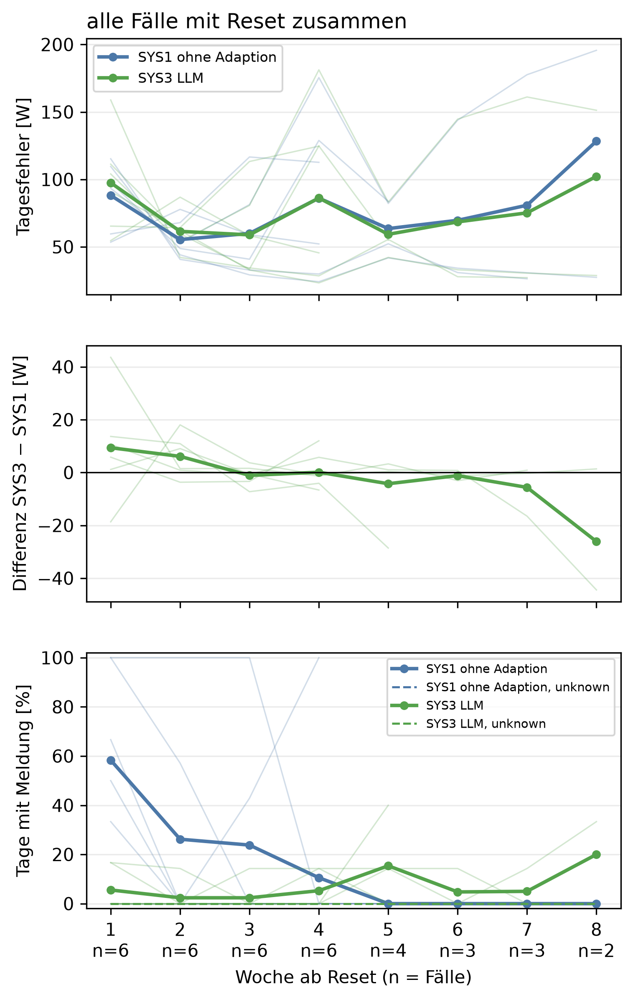
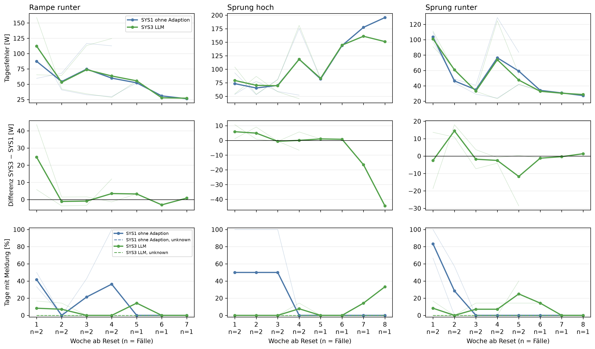
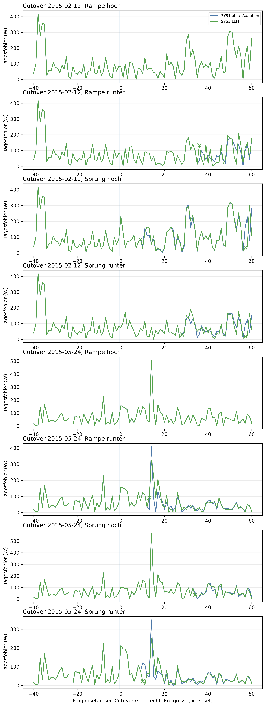

# E3 Adaption SYS1 gegen SYS3, Lauf e3_004

## Setup

- Cutover: CO2 (2015-02-12), CO3 (2015-05-24) (Tag 0, alle Tage und Daten in Ortszeit)
- Fenster: 40 Tage vor und 60 Tage ab Cutover
- Ereignisse: 1: Rampe über 28 Tage +20 %, Tag 0; 2: Rampe über 28 Tage −20 %, Tag 0; 3: Sprung +30 %, Tag 0; 4: Sprung −30 %, Tag 0
- Systeme: SYS1 ohne Adaption, SYS3 LLM
- LLM SYS3: ministral-3:8b, Prompt v30
- Kalender: keiner, wie CTX0
- Commit: 001a5ce (mit lokalen Änderungen)

## Hilft die Adaption? SYS3 gegen SYS1, nur Fälle mit Reset von SYS3

| Kennzahl | SYS1 ohne Adaption | SYS3 LLM |
|---|---|---|
| Fälle mit Reset (Cutover × Reihe) | 0/8 | 6/8 |
| Tagesfehler ab dem Reset [W], auf denselben Tagen | 72,8 | 73,8 |
| Differenz gegen SYS1 [W] | - | 1,0 |
| 2 Standardfehler der Differenz [W] | - | 5,2 |
| gepaarte Tage | - | 236 |
| Differenz belastbar | - | nein |
| Meldungstage, alle Fälle zusammen | 46 | 13 |
| unknown-Tage (blind), alle Fälle zusammen | 0 | 0 |
| Meldungen je 30 Tage nach dem Reset | 6,0 | 1,7 |
| Differenz gegen SYS1 | - | -4,3 |
| Resets im Kontrolllauf (Fehlalarme) | 0 | 1 |
| SYS3 besser als SYS1 (Fälle mit Reset) | - | 0/6 |

## Tagesfehler je Woche ab dem Reset, alle Fälle mit Reset zusammen

| Woche ab Reset | Fälle | Tagesfehler SYS3 LLM [W] | Tagesfehler SYS1 ohne Adaption [W] | Differenz SYS3 − SYS1 [W] |
|---:|---:|---:|---:|---:|
| 1 | 6 | 97,5 | 88,1 | 9,4 |
| 2 | 6 | 61,5 | 55,4 | 6,1 |
| 3 | 6 | 58,9 | 60,0 | -1,1 |
| 4 | 6 | 86,2 | 86,1 | 0,1 |
| 5 | 4 | 59,3 | 63,5 | -4,2 |
| 6 | 3 | 68,5 | 69,7 | -1,2 |
| 7 | 3 | 75,2 | 80,8 | -5,6 |
| 8 | 2 | 102,2 | 128,4 | -26,1 |

## Hinweise

- Tag = Entscheidungstag seit Cutover: an Tag n wird Tag n-1 eingeordnet, ein Ereignis an Tag s also ab Tag s+1
- Fall = Cutover × Reihe mit Ereignis. Ein Fall zählt in die Hauptzahlen, wenn SYS3 in der Reihe zurückgesetzt hat (Reset an Tag). Erkennung und Einordnung werden in E1 und E2 geprüft, hier nur als Beleg in der Ereignistabelle
- Tagesfehler: ab dem Reset-Tag, denn die Prognose desselben Tages enthält den Reset schon. SYS1 wird auf denselben Tagen gepaart, nie zurückgesetzt
- Meldungen: Tage nach dem Reset-Tag von SYS3, bei beiden Systemen auf denselben Tagen. Als Meldung zählen peak, new_pattern und measurement_error
- Woche ab Reset: Woche 1 sind die ersten Tage ab dem Reset. Später gehen Fälle mit weniger Tagen im Fenster verloren, die Spalte Fälle zeigt das
- bewertet an Tag: bei der Dauerlast der erste Tag mit Drift oder new_pattern. Meldungen davor zählen als Meldungen, nicht als Einordnungsfehler
- nach Trennung: vor Beginn des Ereignisses hat schon ein System anders gehandelt (Reset), die Systeme entscheiden dann nicht mehr über denselben Zustand
- Kontrolllauf über das ganze Fenster, auch die Tage vor dem Cutover. Jede Meldung dort ist ein Fehlalarm, jeder Reset unnötig
- belastbar: Betrag der Differenz größer als 2 Standardfehler der gepaarten Differenzen, grobe Faustregel

## Anhang

### Tagesfehler je Woche ab dem Reset, je Reihe

| Reihe | Woche ab Reset | Fälle | Tagesfehler SYS3 LLM [W] | Tagesfehler SYS1 ohne Adaption [W] | Differenz SYS3 − SYS1 [W] |
|---|---:|---:|---:|---:|---:|
| Rampe runter | 1 | 2 | 112,1 | 87,4 | 24,7 |
| Rampe runter | 2 | 2 | 53,2 | 54,3 | -1,1 |
| Rampe runter | 3 | 2 | 73,8 | 74,7 | -0,9 |
| Rampe runter | 4 | 2 | 63,4 | 60,0 | 3,5 |
| Rampe runter | 5 | 1 | 55,5 | 52,2 | 3,3 |
| Rampe runter | 6 | 1 | 27,8 | 30,9 | -3,1 |
| Rampe runter | 7 | 1 | 27,1 | 26,3 | 0,9 |
| Sprung hoch | 1 | 2 | 79,3 | 73,4 | 5,9 |
| Sprung hoch | 2 | 2 | 70,3 | 65,4 | 4,9 |
| Sprung hoch | 3 | 2 | 69,6 | 70,2 | -0,6 |
| Sprung hoch | 4 | 2 | 118,6 | 118,5 | 0,0 |
| Sprung hoch | 5 | 1 | 83,1 | 82,1 | 1,0 |
| Sprung hoch | 6 | 1 | 144,7 | 143,9 | 0,8 |
| Sprung hoch | 7 | 1 | 161,1 | 177,6 | -16,5 |
| Sprung hoch | 8 | 1 | 151,2 | 195,7 | -44,4 |
| Sprung runter | 1 | 2 | 101,1 | 103,6 | -2,5 |
| Sprung runter | 2 | 2 | 60,9 | 46,4 | 14,5 |
| Sprung runter | 3 | 2 | 33,2 | 35,0 | -1,8 |
| Sprung runter | 4 | 2 | 74,0 | 76,5 | -2,5 |
| Sprung runter | 5 | 2 | 47,5 | 59,2 | -11,7 |
| Sprung runter | 6 | 1 | 33,0 | 34,1 | -1,2 |
| Sprung runter | 7 | 1 | 30,5 | 30,8 | -0,3 |
| Sprung runter | 8 | 1 | 28,7 | 27,4 | 1,4 |

### Fälle je Cutover und Reihe

| Cutover | Reihe | Reset SYS3 an Tag | Differenz Tagesfehler gegen SYS1 [W] | belastbar | Differenz Meldungen je 30 Tage gegen SYS1 | Resets im Kontrolllauf | SYS3 besser |
|---|---|---:|---:|---|---:|---:|---|
| 2015-02-12 | Rampe hoch | - | - | - | - | 1 | nein |
| 2015-02-12 | Rampe runter | 36 | 1,6 | nein | -12,5 | 1 | nein |
| 2015-02-12 | Sprung hoch | 9 | -2,3 | nein | -10,0 | 1 | nein |
| 2015-02-12 | Sprung runter | 28 | -1,5 | nein | -7,5 | 1 | nein |
| 2015-05-24 | Rampe hoch | - | - | - | - | 0 | nein |
| 2015-05-24 | Rampe runter | 13 | 6,7 | nein | 0,6 | 0 | nein |
| 2015-05-24 | Sprung hoch | 34 | 1,0 | nein | 0,0 | 0 | nein |
| 2015-05-24 | Sprung runter | 10 | 0,2 | nein | 0,6 | 0 | nein |

### Erste Einordnung je Ereignis

| Cutover | Ereignis | System | bewertet an Tag | Klasse | Skala | Meldungen davor | Reset an Tag | nach Trennung |
|---|---|---|---:|---|---|---:|---:|---|
| 2015-02-12 | 1: Rampe über 28 Tage +20 %, Tag 0 | SYS1 ohne Adaption | - | - | - | 4 | - | nein |
| 2015-02-12 | 1: Rampe über 28 Tage +20 %, Tag 0 | SYS3 LLM | - | - | - | 4 | - | nein |
| 2015-02-12 | 2: Rampe über 28 Tage −20 %, Tag 0 | SYS1 ohne Adaption | 36 | new_pattern | weekly+long_term | 0 | - | nein |
| 2015-02-12 | 2: Rampe über 28 Tage −20 %, Tag 0 | SYS3 LLM | 36 | new_pattern | weekly+long_term | 0 | 36 | nein |
| 2015-02-12 | 3: Sprung +30 %, Tag 0 | SYS1 ohne Adaption | 9 | new_pattern | weekly+long_term | 1 | - | nein |
| 2015-02-12 | 3: Sprung +30 %, Tag 0 | SYS3 LLM | 9 | new_pattern | weekly+long_term | 1 | 9 | nein |
| 2015-02-12 | 4: Sprung −30 %, Tag 0 | SYS1 ohne Adaption | 28 | new_pattern | weekly+long_term | 0 | - | nein |
| 2015-02-12 | 4: Sprung −30 %, Tag 0 | SYS3 LLM | 28 | new_pattern | weekly+long_term | 0 | 28 | nein |
| 2015-05-24 | 1: Rampe über 28 Tage +20 %, Tag 0 | SYS1 ohne Adaption | - | - | - | 4 | - | ja |
| 2015-05-24 | 1: Rampe über 28 Tage +20 %, Tag 0 | SYS3 LLM | - | - | - | 4 | - | ja |
| 2015-05-24 | 2: Rampe über 28 Tage −20 %, Tag 0 | SYS1 ohne Adaption | 13 | new_pattern | weekly+long_term | 0 | - | ja |
| 2015-05-24 | 2: Rampe über 28 Tage −20 %, Tag 0 | SYS3 LLM | 13 | new_pattern | weekly+long_term | 0 | 13 | ja |
| 2015-05-24 | 3: Sprung +30 %, Tag 0 | SYS1 ohne Adaption | 34 | new_pattern | weekly+long_term | 4 | - | ja |
| 2015-05-24 | 3: Sprung +30 %, Tag 0 | SYS3 LLM | 34 | new_pattern | weekly+long_term | 4 | 34 | ja |
| 2015-05-24 | 4: Sprung −30 %, Tag 0 | SYS1 ohne Adaption | 12 | new_pattern | weekly+long_term | 0 | - | ja |
| 2015-05-24 | 4: Sprung −30 %, Tag 0 | SYS3 LLM | 10 | new_pattern | weekly | 0 | 10 | ja |

### Prognose ab dem Reset je Fall, gepaart gegen SYS1

| Cutover | Zeitraum | System | Tagesfehler [W] | MAE [W] | MAPE [%] | Differenz Tagesfehler gegen SYS1 [W] | Differenz MAE gegen SYS1 [W] | 2 Standardfehler [W] | Tage | Tage besser [%] | belastbar |
|---|---|---|---:|---:|---:|---:|---:|---:|---:|---:|---|
| 2015-02-12 | Rampe runter ab Reset an Tag 36 | SYS1 ohne Adaption | 86,4 | 150,1 | 66,4 | - | - | - | - | - | - |
| 2015-02-12 | Rampe runter ab Reset an Tag 36 | SYS3 LLM | 87,9 | 160,6 | 72,6 | 1,6 | 10,5 | 20,3 | 25 | 48,0 | nein |
| 2015-02-12 | Sprung hoch ab Reset an Tag 9 | SYS1 ohne Adaption | 119,9 | 249,3 | 64,7 | - | - | - | - | - | - |
| 2015-02-12 | Sprung hoch ab Reset an Tag 9 | SYS3 LLM | 117,6 | 256,8 | 66,9 | -2,3 | 7,5 | 14,7 | 52 | 42,3 | nein |
| 2015-02-12 | Sprung runter ab Reset an Tag 28 | SYS1 ohne Adaption | 79,7 | 135,6 | 68,3 | - | - | - | - | - | - |
| 2015-02-12 | Sprung runter ab Reset an Tag 28 | SYS3 LLM | 78,2 | 142,4 | 73,6 | -1,5 | 6,7 | 15,0 | 33 | 57,6 | nein |
| 2015-05-24 | Rampe runter ab Reset an Tag 13 | SYS1 ohne Adaption | 47,3 | 123,9 | 50,0 | - | - | - | - | - | - |
| 2015-05-24 | Rampe runter ab Reset an Tag 13 | SYS3 LLM | 54,0 | 129,1 | 53,6 | 6,7 | 5,2 | 9,5 | 48 | 52,1 | nein |
| 2015-05-24 | Sprung hoch ab Reset an Tag 34 | SYS1 ohne Adaption | 60,9 | 181,5 | 50,5 | - | - | - | - | - | - |
| 2015-05-24 | Sprung hoch ab Reset an Tag 34 | SYS3 LLM | 61,9 | 182,3 | 49,8 | 1,0 | 0,8 | 5,6 | 27 | 55,6 | nein |
| 2015-05-24 | Sprung runter ab Reset an Tag 10 | SYS1 ohne Adaption | 44,1 | 107,8 | 51,1 | - | - | - | - | - | - |
| 2015-05-24 | Sprung runter ab Reset an Tag 10 | SYS3 LLM | 44,3 | 108,7 | 53,9 | 0,2 | 0,8 | 9,5 | 51 | 49,0 | nein |

### Meldungen nach dem Reset je Fall und Woche ab Reset, Meldungstage nach Klasse

| Cutover | Reihe | System | Woche ab Reset | Tage | Meldungstage | davon peak | davon new_pattern | davon measurement_error | unknown-Tage | Meldungen je 30 Tage |
|---|---|---|---:|---:|---:|---:|---:|---:|---:|---:|
| 2015-02-12 | Rampe runter | SYS1 ohne Adaption | 1 | 6 | 3 | 0 | 3 | 0 | 0 | 15,0 |
| 2015-02-12 | Rampe runter | SYS1 ohne Adaption | 2 | 7 | 0 | 0 | 0 | 0 | 0 | 0,0 |
| 2015-02-12 | Rampe runter | SYS1 ohne Adaption | 3 | 7 | 3 | 0 | 3 | 0 | 0 | 12,9 |
| 2015-02-12 | Rampe runter | SYS1 ohne Adaption | 4 | 4 | 4 | 0 | 4 | 0 | 0 | 30,0 |
| 2015-02-12 | Rampe runter | SYS3 LLM | 1 | 6 | 0 | 0 | 0 | 0 | 0 | 0,0 |
| 2015-02-12 | Rampe runter | SYS3 LLM | 2 | 7 | 0 | 0 | 0 | 0 | 0 | 0,0 |
| 2015-02-12 | Rampe runter | SYS3 LLM | 3 | 7 | 0 | 0 | 0 | 0 | 0 | 0,0 |
| 2015-02-12 | Rampe runter | SYS3 LLM | 4 | 4 | 0 | 0 | 0 | 0 | 0 | 0,0 |
| 2015-02-12 | Sprung hoch | SYS1 ohne Adaption | 1 | 6 | 6 | 0 | 6 | 0 | 0 | 30,0 |
| 2015-02-12 | Sprung hoch | SYS1 ohne Adaption | 2 | 7 | 7 | 0 | 7 | 0 | 0 | 30,0 |
| 2015-02-12 | Sprung hoch | SYS1 ohne Adaption | 3 | 7 | 7 | 0 | 7 | 0 | 0 | 30,0 |
| 2015-02-12 | Sprung hoch | SYS1 ohne Adaption | 4 | 7 | 0 | 0 | 0 | 0 | 0 | 0,0 |
| 2015-02-12 | Sprung hoch | SYS1 ohne Adaption | 5 | 7 | 0 | 0 | 0 | 0 | 0 | 0,0 |
| 2015-02-12 | Sprung hoch | SYS1 ohne Adaption | 6 | 7 | 0 | 0 | 0 | 0 | 0 | 0,0 |
| 2015-02-12 | Sprung hoch | SYS1 ohne Adaption | 7 | 7 | 0 | 0 | 0 | 0 | 0 | 0,0 |
| 2015-02-12 | Sprung hoch | SYS1 ohne Adaption | 8 | 3 | 0 | 0 | 0 | 0 | 0 | 0,0 |
| 2015-02-12 | Sprung hoch | SYS3 LLM | 1 | 6 | 0 | 0 | 0 | 0 | 0 | 0,0 |
| 2015-02-12 | Sprung hoch | SYS3 LLM | 2 | 7 | 0 | 0 | 0 | 0 | 0 | 0,0 |
| 2015-02-12 | Sprung hoch | SYS3 LLM | 3 | 7 | 0 | 0 | 0 | 0 | 0 | 0,0 |
| 2015-02-12 | Sprung hoch | SYS3 LLM | 4 | 7 | 1 | 1 | 0 | 0 | 0 | 4,3 |
| 2015-02-12 | Sprung hoch | SYS3 LLM | 5 | 7 | 0 | 0 | 0 | 0 | 0 | 0,0 |
| 2015-02-12 | Sprung hoch | SYS3 LLM | 6 | 7 | 0 | 0 | 0 | 0 | 0 | 0,0 |
| 2015-02-12 | Sprung hoch | SYS3 LLM | 7 | 7 | 1 | 0 | 1 | 0 | 0 | 4,3 |
| 2015-02-12 | Sprung hoch | SYS3 LLM | 8 | 3 | 1 | 1 | 0 | 0 | 0 | 10,0 |
| 2015-02-12 | Sprung runter | SYS1 ohne Adaption | 1 | 6 | 6 | 0 | 6 | 0 | 0 | 30,0 |
| 2015-02-12 | Sprung runter | SYS1 ohne Adaption | 2 | 7 | 4 | 0 | 4 | 0 | 0 | 17,1 |
| 2015-02-12 | Sprung runter | SYS1 ohne Adaption | 3 | 7 | 0 | 0 | 0 | 0 | 0 | 0,0 |
| 2015-02-12 | Sprung runter | SYS1 ohne Adaption | 4 | 7 | 0 | 0 | 0 | 0 | 0 | 0,0 |
| 2015-02-12 | Sprung runter | SYS1 ohne Adaption | 5 | 5 | 0 | 0 | 0 | 0 | 0 | 0,0 |
| 2015-02-12 | Sprung runter | SYS3 LLM | 1 | 6 | 0 | 0 | 0 | 0 | 0 | 0,0 |
| 2015-02-12 | Sprung runter | SYS3 LLM | 2 | 7 | 0 | 0 | 0 | 0 | 0 | 0,0 |
| 2015-02-12 | Sprung runter | SYS3 LLM | 3 | 7 | 0 | 0 | 0 | 0 | 0 | 0,0 |
| 2015-02-12 | Sprung runter | SYS3 LLM | 4 | 7 | 0 | 0 | 0 | 0 | 0 | 0,0 |
| 2015-02-12 | Sprung runter | SYS3 LLM | 5 | 5 | 2 | 1 | 1 | 0 | 0 | 12,0 |
| 2015-05-24 | Rampe runter | SYS1 ohne Adaption | 1 | 6 | 2 | 1 | 1 | 0 | 0 | 10,0 |
| 2015-05-24 | Rampe runter | SYS1 ohne Adaption | 2 | 7 | 0 | 0 | 0 | 0 | 0 | 0,0 |
| 2015-05-24 | Rampe runter | SYS1 ohne Adaption | 3 | 7 | 0 | 0 | 0 | 0 | 0 | 0,0 |
| 2015-05-24 | Rampe runter | SYS1 ohne Adaption | 4 | 7 | 0 | 0 | 0 | 0 | 0 | 0,0 |
| 2015-05-24 | Rampe runter | SYS1 ohne Adaption | 5 | 7 | 0 | 0 | 0 | 0 | 0 | 0,0 |
| 2015-05-24 | Rampe runter | SYS1 ohne Adaption | 6 | 7 | 0 | 0 | 0 | 0 | 0 | 0,0 |
| 2015-05-24 | Rampe runter | SYS1 ohne Adaption | 7 | 6 | 0 | 0 | 0 | 0 | 0 | 0,0 |
| 2015-05-24 | Rampe runter | SYS3 LLM | 1 | 6 | 1 | 1 | 0 | 0 | 0 | 5,0 |
| 2015-05-24 | Rampe runter | SYS3 LLM | 2 | 7 | 1 | 1 | 0 | 0 | 0 | 4,3 |
| 2015-05-24 | Rampe runter | SYS3 LLM | 3 | 7 | 0 | 0 | 0 | 0 | 0 | 0,0 |
| 2015-05-24 | Rampe runter | SYS3 LLM | 4 | 7 | 0 | 0 | 0 | 0 | 0 | 0,0 |
| 2015-05-24 | Rampe runter | SYS3 LLM | 5 | 7 | 1 | 1 | 0 | 0 | 0 | 4,3 |
| 2015-05-24 | Rampe runter | SYS3 LLM | 6 | 7 | 0 | 0 | 0 | 0 | 0 | 0,0 |
| 2015-05-24 | Rampe runter | SYS3 LLM | 7 | 6 | 0 | 0 | 0 | 0 | 0 | 0,0 |
| 2015-05-24 | Sprung hoch | SYS1 ohne Adaption | 1 | 6 | 0 | 0 | 0 | 0 | 0 | 0,0 |
| 2015-05-24 | Sprung hoch | SYS1 ohne Adaption | 2 | 7 | 0 | 0 | 0 | 0 | 0 | 0,0 |
| 2015-05-24 | Sprung hoch | SYS1 ohne Adaption | 3 | 7 | 0 | 0 | 0 | 0 | 0 | 0,0 |
| 2015-05-24 | Sprung hoch | SYS1 ohne Adaption | 4 | 6 | 0 | 0 | 0 | 0 | 0 | 0,0 |
| 2015-05-24 | Sprung hoch | SYS3 LLM | 1 | 6 | 0 | 0 | 0 | 0 | 0 | 0,0 |
| 2015-05-24 | Sprung hoch | SYS3 LLM | 2 | 7 | 0 | 0 | 0 | 0 | 0 | 0,0 |
| 2015-05-24 | Sprung hoch | SYS3 LLM | 3 | 7 | 0 | 0 | 0 | 0 | 0 | 0,0 |
| 2015-05-24 | Sprung hoch | SYS3 LLM | 4 | 6 | 0 | 0 | 0 | 0 | 0 | 0,0 |
| 2015-05-24 | Sprung runter | SYS1 ohne Adaption | 1 | 6 | 4 | 0 | 4 | 0 | 0 | 20,0 |
| 2015-05-24 | Sprung runter | SYS1 ohne Adaption | 2 | 7 | 0 | 0 | 0 | 0 | 0 | 0,0 |
| 2015-05-24 | Sprung runter | SYS1 ohne Adaption | 3 | 7 | 0 | 0 | 0 | 0 | 0 | 0,0 |
| 2015-05-24 | Sprung runter | SYS1 ohne Adaption | 4 | 7 | 0 | 0 | 0 | 0 | 0 | 0,0 |
| 2015-05-24 | Sprung runter | SYS1 ohne Adaption | 5 | 7 | 0 | 0 | 0 | 0 | 0 | 0,0 |
| 2015-05-24 | Sprung runter | SYS1 ohne Adaption | 6 | 7 | 0 | 0 | 0 | 0 | 0 | 0,0 |
| 2015-05-24 | Sprung runter | SYS1 ohne Adaption | 7 | 7 | 0 | 0 | 0 | 0 | 0 | 0,0 |
| 2015-05-24 | Sprung runter | SYS1 ohne Adaption | 8 | 2 | 0 | 0 | 0 | 0 | 0 | 0,0 |
| 2015-05-24 | Sprung runter | SYS3 LLM | 1 | 6 | 1 | 1 | 0 | 0 | 0 | 5,0 |
| 2015-05-24 | Sprung runter | SYS3 LLM | 2 | 7 | 0 | 0 | 0 | 0 | 0 | 0,0 |
| 2015-05-24 | Sprung runter | SYS3 LLM | 3 | 7 | 1 | 1 | 0 | 0 | 0 | 4,3 |
| 2015-05-24 | Sprung runter | SYS3 LLM | 4 | 7 | 1 | 1 | 0 | 0 | 0 | 4,3 |
| 2015-05-24 | Sprung runter | SYS3 LLM | 5 | 7 | 1 | 1 | 0 | 0 | 0 | 4,3 |
| 2015-05-24 | Sprung runter | SYS3 LLM | 6 | 7 | 1 | 1 | 0 | 0 | 0 | 4,3 |
| 2015-05-24 | Sprung runter | SYS3 LLM | 7 | 7 | 0 | 0 | 0 | 0 | 0 | 0,0 |
| 2015-05-24 | Sprung runter | SYS3 LLM | 8 | 2 | 0 | 0 | 0 | 0 | 0 | 0,0 |

### Kontrolllauf: Fehlalarme und unnötige Resets

| Cutover | System | Tage | Meldungen | unknown | Resets |
|---|---|---:|---:|---:|---:|
| 2015-02-12 | SYS1 ohne Adaption | 101 | 0 | 0 | 0 |
| 2015-02-12 | SYS3 LLM | 101 | 3 | 0 | 1 |
| 2015-05-24 | SYS1 ohne Adaption | 101 | 4 | 0 | 0 |
| 2015-05-24 | SYS3 LLM | 101 | 4 | 0 | 0 |

### Laufzeit und Kosten SYS3, nur beschreibend

| Cutover | Reihe | Tage | SYS1 je Tag [s] | LLM-Aufrufe | Ausfalltage | Mehrlaufzeit gegen SYS1 [s] | je Aufruf [s] |
|---|---|---:|---:|---:|---:|---:|---:|
| 2015-02-12 | Kontrolllauf | 101 | 0,1 | 33 | 0 | 614,8 | 18,6 |
| 2015-05-24 | Kontrolllauf | 101 | 0,1 | 15 | 0 | 292,0 | 19,5 |
| 2015-02-12 | Rampe hoch | 101 | 0,1 | 53 | 0 | 960,4 | 18,1 |
| 2015-05-24 | Rampe hoch | 101 | 0,1 | 40 | 0 | 712,3 | 17,8 |
| 2015-02-12 | Rampe runter | 101 | 0,1 | 39 | 0 | 708,4 | 18,2 |
| 2015-05-24 | Rampe runter | 101 | 0,1 | 30 | 0 | 540,8 | 18,0 |
| 2015-02-12 | Sprung hoch | 101 | 0,1 | 34 | 0 | 638,6 | 18,8 |
| 2015-05-24 | Sprung hoch | 101 | 0,1 | 24 | 0 | 440,9 | 18,4 |
| 2015-02-12 | Sprung runter | 101 | 0,1 | 40 | 0 | 722,8 | 18,1 |
| 2015-05-24 | Sprung runter | 101 | 0,1 | 18 | 0 | 341,0 | 18,9 |

### Wochenverlauf je Reihe

### Tagesfehler je Cutover und Reihe

### Antworten des LLM

**Kontrolllauf, Cutover 2015-02-12**

2015-01-02 (Entscheidungstag -40): SYS3 low, Aktion none

- Erklärung: Gestern war der Stromverbrauch um etwa 62 % niedriger als an einem typischen Wochentag und der Tagesverlauf ungewöhnlich flach. Das könnte auf einen längeren Ausfall oder eine Störung zurückgehen.
- Empfehlung: Überprüfen Sie, ob gestern ein längerer Stromausfall oder eine Störung aufgetreten ist. Falls nicht, prüfen Sie, ob Geräte oder Beleuchtung ungewöhnlich lange ausgeschaltet waren.
- Unsicherheit: Da keine Kalenderdaten verfügbar sind, kann nicht ausgeschlossen werden, dass gestern ein geplanter Ausfall stattfand.

2015-01-03 (Entscheidungstag -39): SYS3 low, Aktion none

- Erklärung: Gestern war der Stromverbrauch um etwa 60 % niedriger als an einem normalen Wochentag und der Tagesverlauf ungewöhnlich flach. Das könnte auf einen längeren Ausfall oder eine Störung zurückgehen.
- Empfehlung: Überprüfen Sie, ob gestern der Strom tatsächlich nicht verfügbar war oder ein Gerät ausgefallen ist. Ein längerer Ausfall könnte die Ursache sein.
- Unsicherheit: Ob es sich um einen geplanten Ausfall handelt, kann ohne Kalender nicht geprüft werden.

2015-01-04 (Entscheidungstag -38): SYS3 low, Aktion none

- Erklärung: Gestern war der Stromverbrauch um etwa 53 % niedriger als an einem typischen Wochentag im Januar.
- Empfehlung: Da kein Kalender verfügbar war, um eine Abwesenheit zu bestätigen, prüfen Sie bitte, ob gestern niemand zu Hause war oder ob ein Gerät nicht wie üblich genutzt wurde.
- Unsicherheit: Ob die Stromverbrauchsmessung korrekt ist, kann ohne weitere Daten nicht überprüft werden.

2015-01-07 (Entscheidungstag -35): SYS3 normal, Aktion none

- Erklärung: Der Verbrauch von gestern lag zwar über dem üblichen Wert für einen Dienstag, aber die Abweichung war nicht ungewöhnlich und hat sich bereits wieder normalisiert.
- Empfehlung: Es ist nichts weiter zu tun, da der erhöhte Verbrauch nur ein kurzes Zwischenhoch war und sich nicht wiederholt hat.
- Unsicherheit: Ob die Abweichung durch ungewöhnliche Aktivitäten oder äußere Umstände wie Kälteeinbruch verursacht wurde, kann ohne weitere Informationen nicht geklärt werden.

2015-01-08 (Entscheidungstag -34): SYS3 normal, Aktion none

- Erklärung: Gestern lag der Verbrauch für einen Dienstag um etwa ein Drittel höher als üblich, aber die Abweichung ist nicht ungewöhnlich und hat sich bereits wieder normalisiert.
- Empfehlung: Es ist nichts zu tun, da der erhöhte Verbrauch nur ein einzelnes Mal aufgetreten ist und sich bereits wieder normalisiert hat.
- Unsicherheit: Ob die Abweichung durch ungewöhnliche Aktivitäten oder äußere Umstände wie Kälte verursacht wurde, kann nicht bestimmt werden.

2015-01-19 (Entscheidungstag -23): SYS3 normal, Aktion none

- Erklärung: Der Verbrauch gestern lag im üblichen Bereich, obwohl die letzten vier Wochen insgesamt etwa 27 % niedriger waren als sonst.
- Empfehlung: Es ist nichts zu tun, da der Verbrauch gestern normal war. Die niedrigere Gesamtverbrauch über die letzten Wochen könnte mit dem Wetter oder einem kürzeren Zeitraum im Januar zusammenhängen.
- Unsicherheit: Ob die niedrigere Verbrauch in den letzten vier Wochen tatsächlich anhält, hängt davon ab, ob sich der Verbrauch in den kommenden Tagen wieder normalisiert.

2015-01-20 (Entscheidungstag -22): SYS3 normal, Aktion none

- Erklärung: Gestern war der Stromverbrauch im Vergleich zu den letzten vier Wochen ungewöhnlich niedrig, aber es gibt keine Hinweise auf ein neues Muster oder eine Störung.
- Empfehlung: Da der Verbrauch seit Mitte Januar um etwa 29 % niedriger liegt, prüfen Sie bitte, ob sich die Gewohnheiten oder Umstände in Ihrem Haushalt verändert haben könnten (z. B. weniger Heizung, weniger Geräte im Einsatz).
- Unsicherheit: Ob der Verbrauch dauerhaft niedrig bleibt, hängt davon ab, ob sich die Ursache für den Rückgang nicht wieder normalisiert.

2015-01-21 (Entscheidungstag -21): SYS3 normal, Aktion none

- Erklärung: Der Verbrauch lag gestern im üblichen Bereich, obwohl die letzten vier Wochen insgesamt etwa 30 % niedriger waren als sonst.
- Empfehlung: Da der Verbrauch gestern normal war, ist nichts zu überprüfen. Die niedrigere Gesamtmenge der letzten vier Wochen könnte mit weniger Heizbedarf im Januar zusammenhängen.
- Unsicherheit: Ob die niedrige Verbrauchsmenge der letzten vier Wochen tatsächlich auf einen geringeren Bedarf oder eine andere Ursache zurückzuführen ist, lässt sich ohne Kalendereinträge nicht klären.

2015-01-22 (Entscheidungstag -20): SYS3 normal, Aktion none

- Erklärung: Gestern war der Stromverbrauch im Vergleich zum üblichen Winterverbrauch um etwa ein Drittel niedriger als erwartet, aber es gab keine ungewöhnliche Abweichung am Tag selbst.
- Empfehlung: Da der Verbrauch seit Mitte Januar ungewöhnlich niedrig bleibt, prüfen Sie bitte, ob sich etwas am Haushalt geändert hat – etwa weniger Heizung oder Beleuchtung durch längere Tageslichtzeiten im Januar.
- Unsicherheit: Ob die Abweichung auf einen konkreten Grund zurückzuführen ist, lässt sich ohne Kalendereintrag nicht sicher klären.

2015-01-23 (Entscheidungstag -19): SYS3 normal, Aktion none

- Erklärung: Gestern war der Stromverbrauch für einen Dienstag etwas höher als sonst, aber nicht ungewöhnlich hoch. Die Abweichung ist nur ein kurzer Anstieg ohne weitere Auffälligkeiten.
- Empfehlung: Es gibt keine Handlungsbedarf. Der Verbrauch liegt im üblichen Bereich, auch wenn er gestern etwas höher war.
- Unsicherheit: Ob der höhere Verbrauch auf einen konkreten Grund wie längeres Heizen oder Beleuchtung zurückzuführen ist, kann nicht überprüft werden.

2015-01-24 (Entscheidungstag -18): SYS3 normal, Aktion none

- Erklärung: Der Verbrauch von gestern lag zwar über dem üblichen Wert für einen Dienstag, aber die Abweichung war nicht ungewöhnlich und hat sich in den letzten Tagen nicht wiederholt.
- Empfehlung: Es gibt keine Handlungsbedarf, da der Verbrauch gestern im Rahmen lag und sich die Werte stabilisiert haben.
- Unsicherheit: Ob ein geplanter Urlaub oder eine andere Abwesenheit den Verbrauch beeinflusst hat, kann nicht geprüft werden, da kein Kalender verfügbar war.

2015-01-25 (Entscheidungstag -17): SYS3 normal, Aktion none

- Erklärung: Gestern lag der Verbrauch im Vergleich zum üblichen Winterverlauf etwa 22 % niedriger als erwartet, was auf eine ungewöhnlich geringe Nutzung hindeutet.
- Empfehlung: Da der Verbrauch seit Mitte Januar ungewöhnlich niedrig bleibt, prüfen Sie bitte, ob Geräte oder Heizung außer Betrieb sind oder ob die Beleuchtung reduziert wurde.
- Unsicherheit: Ob ein geplanter Urlaub oder eine technische Veränderung im Haushalt vorliegt, kann nicht geprüft werden, da keine Kalendereintragungen verfügbar sind.

2015-01-26 (Entscheidungstag -16): SYS3 normal, Aktion none

- Erklärung: Der Verbrauch lag gestern im üblichen Bereich, aber die letzten vier Wochen waren insgesamt etwa 19 % niedriger als sonst.
- Empfehlung: Da der Verbrauch gestern normal war, ist nichts zu überprüfen. Die niedrigere Gesamtmenge der letzten vier Wochen könnte mit weniger Heizbedarf im Januar zusammenhängen – prüfen Sie, ob sich die Nutzung von Heizung oder Warmwasser verändert hat.
- Unsicherheit: Ob die Verbrauchsminderung auf einen konkreten Grund zurückzuführen ist, lässt sich ohne Kalendereintrag nicht abschätzen.

2015-01-27 (Entscheidungstag -15): SYS3 normal, Aktion none

- Erklärung: Gestern lag der Verbrauch um etwa 15 % unter dem üblichen Winterwert, aber es gab keine ungewöhnliche Abweichung am Tag selbst.
- Empfehlung: Da der Verbrauch seit Mitte Januar niedriger ist, prüfen Sie bitte, ob sich etwas am Haushalt geändert hat – etwa weniger Heizung oder kürzere Gerätenutzung.
- Unsicherheit: Ob die Abweichung auf einen geplanten Urlaub zurückzuführen ist, kann nicht geprüft werden, da der Kalender nicht verfügbar war.

2015-01-28 (Entscheidungstag -14): SYS3 normal, Aktion none

- Erklärung: Gestern lag der Verbrauch im Vergleich zum üblichen Winterverlauf etwa 10 % niedriger, aber die Abweichung ist nicht ungewöhnlich für diese Zeit des Jahres.
- Empfehlung: Keine Maßnahmen nötig. Der Verbrauch ist im Rahmen der saisonalen Schwankungen.
- Unsicherheit: Ob die Abweichung durch kürzere Tage oder andere Faktoren wie Wetter oder Heizungsverhalten verursacht wurde, kann nicht bestimmt werden.

2015-02-18 (Entscheidungstag 7): SYS3 normal, Aktion none

- Erklärung: Gestern war der Stromverbrauch im Vergleich zum üblichen Februarwert um etwa 26 % höher, aber dieser Wert ist nicht ungewöhnlich für die letzten Wochen.
- Empfehlung: Es gibt keine Handlungsbedarf, da der erhöhte Verbrauch seit Wochen besteht und kein ungewöhnliches Muster zeigt.
- Unsicherheit: Ob die höhere Nutzung auf einen neuen Gewohnheitsverlauf oder äußere Umstände wie Wetter zurückzuführen ist, kann nicht bestimmt werden.

2015-02-19 (Entscheidungstag 8): SYS3 normal, Aktion none

- Erklärung: Gestern lag der Verbrauch im Vergleich zum üblichen Winterverlauf etwa 28 % höher als sonst, aber es gab keine ungewöhnliche Abweichung am Tag selbst.
- Empfehlung: Da der Verbrauch seit Mitte Februar ungewöhnlich hoch ist, prüfen Sie bitte, ob sich die Nutzung von Heizung oder Beleuchtung verändert hat.
- Unsicherheit: Ob ein geplanter Urlaub oder eine andere Abwesenheit den Verbrauch beeinflusst haben könnte, lässt sich ohne Kalender nicht klären.

2015-02-20 (Entscheidungstag 9): SYS3 normal, Aktion none

- Erklärung: Gestern war der Stromverbrauch etwas niedriger als sonst an einem Freitag, aber nicht ungewöhnlich für einen einzelnen Tag.
- Empfehlung: Es gibt nichts Ungewöhnliches zu beachten. Der Verbrauch liegt im üblichen Bereich, auch wenn er aktuell etwas niedriger ist als sonst an einem Freitag.
- Unsicherheit: Ob der Verbrauch tatsächlich niedriger bleibt oder nur kurzzeitig war, lässt sich erst in den nächsten Tagen beurteilen.

2015-02-21 (Entscheidungstag 10): SYS3 normal, Aktion none

- Erklärung: Gestern lag der Verbrauch um etwa 22 % über dem üblichen Winterwert für diese Tageszeit, aber es handelt sich nicht um eine neue Entwicklung.
- Empfehlung: Da der erhöhte Verbrauch seit Anfang Februar besteht, gibt es nichts Neues zu prüfen. Ein Blick auf die Heizung oder den Warmwasserverbrauch könnte helfen, aber Sie wissen bereits, ob sich daran etwas geändert hat.
- Unsicherheit: Ob der Winterverbrauch tatsächlich höher ist als sonst, hängt davon ab, ob die gemessenen Werte seit Anfang Februar zuverlässig sind.

2015-02-22 (Entscheidungstag 11): SYS3 normal, Aktion none

- Erklärung: Der Stromverbrauch lag gestern im üblichen Bereich, aber die letzten vier Wochen waren insgesamt etwa 20 % höher als sonst.
- Empfehlung: Es gibt nichts Ungewöhnliches zu beachten, da der Verbrauch gestern normal war. Die höhere Nutzung über vier Wochen könnte auf längere Tage im Februar oder mehr Zeit drinnen hindeuten – das ist aber kein Grund zur Sorge.
- Unsicherheit: Ob die erhöhte Nutzung seit dem 13. Februar tatsächlich anhält, kann nicht geprüft werden, da der Kalender nicht verfügbar war.

2015-02-23 (Entscheidungstag 12): SYS3 normal, Aktion none

- Erklärung: Gestern war der Stromverbrauch im Vergleich zum üblichen Februarwert um etwa 20 % höher, aber das ist nicht ungewöhnlich für diese Jahreszeit.
- Empfehlung: Es gibt keinen Grund zur Sorge, da der erhöhte Verbrauch seit Anfang Februar besteht und typisch für den Winter sein könnte. Sie können prüfen, ob sich die Heizung oder Beleuchtung im Vergleich zu anderen Februartagen verändert hat.
- Unsicherheit: Ob der höhere Verbrauch auf eine Veränderung in Ihrem Haushalt zurückzuführen ist, lässt sich ohne Kalendereintrag nicht abschließend klären.

2015-02-24 (Entscheidungstag 13): SYS3 normal, Aktion none

- Erklärung: Gestern war der Stromverbrauch im Vergleich zum üblichen Februarwert um etwa 13 % niedriger, aber die Abweichung ist nicht nachhaltig und liegt innerhalb der normalen Schwankungen.
- Empfehlung: Es gibt keine Handlungsbedarf, da der Verbrauch gestern im Rahmen lag und die Abweichung nicht auf ein Problem hindeutet. Sie können prüfen, ob sich Ihr Stromverbrauch in den letzten Tagen insgesamt normal anfühlt.
- Unsicherheit: Da kein Kalender verfügbar war, kann nicht ausgeschlossen werden, dass ein geplanter Urlaub oder eine Abwesenheit die Verbrauchswerte beeinflusst hat.

2015-02-25 (Entscheidungstag 14): SYS3 normal, Aktion none

- Erklärung: Der Verbrauch gestern lag im üblichen Bereich, aber die letzten vier Wochen waren insgesamt etwa 12 % niedriger als sonst.
- Empfehlung: Es gibt nichts Ungewöhnliches zu beachten, da der Verbrauch gestern normal war. Die niedrigere Gesamtmenge der letzten vier Wochen könnte mit weniger Heizbedarf im Februar zusammenhängen.
- Unsicherheit: Ob die niedrigere Verbrauchsmenze der letzten vier Wochen tatsächlich anhält oder nur ein kurzes Phänomen ist, lässt sich erst nach weiteren Tagen beurteilen.

2015-03-14 (Entscheidungstag 31): SYS3 low, Aktion none

- Erklärung: Gestern war der Stromverbrauch um etwa die Hälfte niedriger als an einem normalen Wochentag.
- Empfehlung: Da kein Kalender verfügbar war, prüfen Sie bitte, ob gestern niemand zu Hause war oder ob ein ungewöhnliches Ereignis stattfand, das den Verbrauch stark reduziert haben könnte.
- Unsicherheit: Ob es sich um einen Ausreißer handelt oder eine neue Situation, hängt davon ab, ob der niedrige Verbrauch auch heute und morgen so bleibt.

2015-03-15 (Entscheidungstag 32): SYS3 low, Aktion none

- Erklärung: Gestern war der Stromverbrauch um etwa 63 % niedriger als an einem typischen Wochentag im März.
- Empfehlung: Da kein Kalender verfügbar war, um eine Abwesenheit zu bestätigen, prüfen Sie bitte, ob gestern niemand zu Hause war oder ob der Verbrauch ungewöhnlich niedrig war.
- Unsicherheit: Ob es sich um einen Messfehler handelt oder ob die Stromzähler nicht korrekt abgelesen wurden, ist unklar.

2015-04-02 (Entscheidungstag 50): SYS3 low, Aktion none

- Erklärung: Gestern war der Stromverbrauch um etwa 57 % niedriger als an einem typischen Dienstag und der Tagesverlauf ungewöhnlich flach. Dies könnte auf einen längeren Ausfall einzelner Geräte oder eine vorübergehende Reduzierung des Verbrauchs hindeuten.
- Empfehlung: Überprüfen Sie, ob Geräte oder Systeme wie Heizung, Warmwasserbereitung oder Beleuchtung gestört waren oder ob jemand den Verbrauch bewusst reduziert hat.
- Unsicherheit: Da keine Kalenderdaten verfügbar sind, kann nicht ausgeschlossen werden, dass ein geplanter Ausfall oder eine Abwesenheit vorlag.

2015-04-03 (Entscheidungstag 51): SYS3 low, Aktion none

- Erklärung: Gestern war der Stromverbrauch um etwa zwei Drittel niedriger als sonst an einem Donnerstag und der Tagesverlauf ungewöhnlich flach. Das könnte auf einen längeren Ausfall von Geräten oder eine vorübergehende Unterbrechung des Stroms hindeuten.
- Empfehlung: Überprüfen Sie, ob es gestern zu einem längeren Stromausfall oder einer Störung gekommen ist. Falls nicht, prüfen Sie, ob Geräte wie Heizung oder Warmwasserbereiter abgeschaltet waren.
- Unsicherheit: Da keine Kalenderdaten verfügbar sind, kann ein längerer Ausfall von Personen nicht ausgeschlossen werden.

2015-04-04 (Entscheidungstag 52): SYS3 low, Aktion none

- Erklärung: Gestern war der Stromverbrauch um etwa zwei Drittel niedriger als sonst an einem Donnerstag und der Tagesverlauf ungewöhnlich flach. Das könnte auf einen längeren Ausfall von Geräten oder eine vorübergehende Unterbrechung des Stroms hindeuten.
- Empfehlung: Überprüfen Sie, ob es gestern zu einem längeren Stromausfall oder einer Störung gekommen ist. Falls nicht, prüfen Sie, ob Geräte wie Heizung oder Warmwasserbereiter abgeschaltet waren.
- Unsicherheit: Da keine Kalenderdaten verfügbar sind, kann ein geplanter Ausflug oder Urlaub nicht ausgeschlossen werden.

2015-04-05 (Entscheidungstag 53): SYS3 low, Aktion none

- Erklärung: Gestern war der Stromverbrauch um etwa zwei Drittel niedriger als an einem normalen Dienstag im April.
- Empfehlung: Da kein Kalender verfügbar war, um eine Abwesenheit zu prüfen, überprüfen Sie bitte, ob der Verbrauch ungewöhnlich niedrig war oder ob möglicherweise Geräte ausgeschaltet waren.
- Unsicherheit: Ob es sich um einen Messfehler handelt oder ob die Stromverbräuche tatsächlich so niedrig waren, lässt sich ohne Kalender nicht sicher klären.

2015-04-06 (Entscheidungstag 54): SYS3 low, Aktion none

- Erklärung: Gestern war der Stromverbrauch um etwa 58 % niedriger als an einem typischen Dienstag dieser Woche.
- Empfehlung: Überprüfen Sie, ob der Stromzähler oder ein Unterbrecher ausgeschaltet war, da die Verbrauchswerte ungewöhnlich niedrig sind.
- Unsicherheit: Ob es sich um einen Messfehler handelt, kann nicht geprüft werden, da keine Kalenderdaten verfügbar sind.

2015-04-07 (Entscheidungstag 55): SYS3 new_pattern, Aktion advance_history_start

- Erklärung: Der Stromverbrauch war in den letzten sieben Tagen um etwa 45 % niedriger als sonst, seit dem 2. April. Das ist ungewöhnlich und könnte auf eine dauerhafte Veränderung hinweisen.
- Empfehlung: Überprüfen Sie, ob sich der Stromverbrauch tatsächlich dauerhaft reduziert hat oder ob ein Gerät nicht mehr läuft. Prüfen Sie z. B., ob Heizung, Warmwasser oder Beleuchtung anders eingestellt wurden.
- Unsicherheit: Da keine Kalenderdaten verfügbar sind, kann nicht ausgeschlossen werden, dass eine Abwesenheit den Verbrauch beeinflusst hat.

2015-04-08 (Entscheidungstag 56): SYS3 peak, Aktion none

- Erklärung: Gestern war der Stromverbrauch über den Tag verteilt ungewöhnlich hoch, mit einem kurzen Spitzenwert oder einer sehr ungleichmäßigen Verteilung.
- Empfehlung: Überprüfen Sie, ob gestern ungewöhnliche Geräte genutzt oder neue Geräte eingeschaltet wurden.
- Unsicherheit: Ob der Verbrauch durch einen konkreten Vorfall wie eine Reparatur oder ein neues Gerät verursacht wurde, kann nur mit Ihren eigenen Aufzeichnungen überprüft werden.

2015-04-09 (Entscheidungstag 57): SYS3 peak, Aktion none

- Erklärung: Gestern war der Stromverbrauch über den Tag verteilt ungewöhnlich hoch, mit einem kurzen Spitzenwert. Das ist nicht typisch für einen Dienstag.
- Empfehlung: Überprüfen Sie, ob gestern ungewöhnlich viele Geräte gleichzeitig genutzt wurden oder ob ein neues Gerät in Betrieb genommen wurde.
- Unsicherheit: Ob der Stromverbrauch tatsächlich höher war als sonst, kann nicht überprüft werden, da keine Kalenderdaten verfügbar sind.

**Rampe hoch, Cutover 2015-02-12**

2015-01-02 (Entscheidungstag -40): SYS3 low, Aktion none

- Erklärung: Gestern war der Stromverbrauch um etwa 62 % niedriger als an einem typischen Wochentag und der Tagesverlauf ungewöhnlich flach. Das könnte auf einen längeren Ausfall oder eine Störung zurückgehen.
- Empfehlung: Überprüfen Sie, ob gestern ein längerer Stromausfall oder eine Störung aufgetreten ist. Falls nicht, prüfen Sie, ob Geräte oder Beleuchtung ungewöhnlich lange ausgeschaltet waren.
- Unsicherheit: Da keine Kalenderdaten verfügbar sind, kann nicht ausgeschlossen werden, dass gestern ein geplanter Ausfall stattfand.

2015-01-03 (Entscheidungstag -39): SYS3 low, Aktion none

- Erklärung: Gestern war der Stromverbrauch um etwa 60 % niedriger als an einem normalen Wochentag und der Tagesverlauf ungewöhnlich flach. Das könnte auf einen längeren Ausfall oder eine Störung zurückgehen.
- Empfehlung: Überprüfen Sie, ob gestern der Strom tatsächlich nicht verfügbar war oder ein Gerät ausgefallen ist. Ein längerer Ausfall könnte die Ursache sein.
- Unsicherheit: Ob es sich um einen geplanten Ausfall handelt, kann ohne Kalender nicht geprüft werden.

2015-01-04 (Entscheidungstag -38): SYS3 low, Aktion none

- Erklärung: Gestern war der Stromverbrauch um etwa 53 % niedriger als an einem typischen Wochentag im Januar.
- Empfehlung: Da kein Kalender verfügbar war, um eine Abwesenheit zu bestätigen, prüfen Sie bitte, ob gestern niemand zu Hause war oder ob ein Gerät nicht wie üblich genutzt wurde.
- Unsicherheit: Ob die Stromverbrauchsmessung korrekt ist, kann ohne weitere Daten nicht überprüft werden.

2015-01-07 (Entscheidungstag -35): SYS3 normal, Aktion none

- Erklärung: Der Verbrauch von gestern lag zwar über dem üblichen Wert für einen Dienstag, aber die Abweichung war nicht ungewöhnlich und hat sich bereits wieder normalisiert.
- Empfehlung: Es ist nichts weiter zu tun, da der erhöhte Verbrauch nur ein kurzes Zwischenhoch war und sich nicht wiederholt hat.
- Unsicherheit: Ob die Abweichung durch ungewöhnliche Aktivitäten oder äußere Umstände wie Kälteeinbruch verursacht wurde, kann ohne weitere Informationen nicht geklärt werden.

2015-01-08 (Entscheidungstag -34): SYS3 normal, Aktion none

- Erklärung: Gestern lag der Verbrauch für einen Dienstag um etwa ein Drittel höher als üblich, aber die Abweichung ist nicht ungewöhnlich und hat sich bereits wieder normalisiert.
- Empfehlung: Es ist nichts zu tun, da der erhöhte Verbrauch nur ein einzelnes Mal aufgetreten ist und sich bereits wieder normalisiert hat.
- Unsicherheit: Ob die Abweichung durch ungewöhnliche Aktivitäten oder äußere Umstände wie Kälte verursacht wurde, kann nicht bestimmt werden.

2015-01-19 (Entscheidungstag -23): SYS3 normal, Aktion none

- Erklärung: Der Verbrauch gestern lag im üblichen Bereich, obwohl die letzten vier Wochen insgesamt etwa 27 % niedriger waren als sonst.
- Empfehlung: Es ist nichts zu tun, da der Verbrauch gestern normal war. Die niedrigere Gesamtverbrauch über die letzten Wochen könnte mit dem Wetter oder einem kürzeren Zeitraum im Januar zusammenhängen.
- Unsicherheit: Ob die niedrigere Verbrauch in den letzten vier Wochen tatsächlich anhält, hängt davon ab, ob sich der Verbrauch in den kommenden Tagen wieder normalisiert.

2015-01-20 (Entscheidungstag -22): SYS3 normal, Aktion none

- Erklärung: Gestern war der Stromverbrauch im Vergleich zu den letzten vier Wochen ungewöhnlich niedrig, aber es gibt keine Hinweise auf ein neues Muster oder eine Störung.
- Empfehlung: Da der Verbrauch seit Mitte Januar um etwa 29 % niedriger liegt, prüfen Sie bitte, ob sich die Gewohnheiten oder Umstände in Ihrem Haushalt verändert haben könnten (z. B. weniger Heizung, weniger Geräte im Einsatz).
- Unsicherheit: Ob der Verbrauch dauerhaft niedrig bleibt, hängt davon ab, ob sich die Ursache für den Rückgang nicht wieder normalisiert.

2015-01-21 (Entscheidungstag -21): SYS3 normal, Aktion none

- Erklärung: Der Verbrauch lag gestern im üblichen Bereich, obwohl die letzten vier Wochen insgesamt etwa 30 % niedriger waren als sonst.
- Empfehlung: Da der Verbrauch gestern normal war, ist nichts zu überprüfen. Die niedrigere Gesamtmenge der letzten vier Wochen könnte mit weniger Heizbedarf im Januar zusammenhängen.
- Unsicherheit: Ob die niedrige Verbrauchsmenge der letzten vier Wochen tatsächlich auf einen geringeren Bedarf oder eine andere Ursache zurückzuführen ist, lässt sich ohne Kalendereinträge nicht klären.

2015-01-22 (Entscheidungstag -20): SYS3 normal, Aktion none

- Erklärung: Gestern war der Stromverbrauch im Vergleich zum üblichen Winterverbrauch um etwa ein Drittel niedriger als erwartet, aber es gab keine ungewöhnliche Abweichung am Tag selbst.
- Empfehlung: Da der Verbrauch seit Mitte Januar ungewöhnlich niedrig bleibt, prüfen Sie bitte, ob sich etwas am Haushalt geändert hat – etwa weniger Heizung oder Beleuchtung durch längere Tageslichtzeiten im Januar.
- Unsicherheit: Ob die Abweichung auf einen konkreten Grund zurückzuführen ist, lässt sich ohne Kalendereintrag nicht sicher klären.

2015-01-23 (Entscheidungstag -19): SYS3 normal, Aktion none

- Erklärung: Gestern war der Stromverbrauch für einen Dienstag etwas höher als sonst, aber nicht ungewöhnlich hoch. Die Abweichung ist nur ein kurzer Anstieg ohne weitere Auffälligkeiten.
- Empfehlung: Es gibt keine Handlungsbedarf. Der Verbrauch liegt im üblichen Bereich, auch wenn er gestern etwas höher war.
- Unsicherheit: Ob der höhere Verbrauch auf einen konkreten Grund wie längeres Heizen oder Beleuchtung zurückzuführen ist, kann nicht überprüft werden.

2015-01-24 (Entscheidungstag -18): SYS3 normal, Aktion none

- Erklärung: Der Verbrauch von gestern lag zwar über dem üblichen Wert für einen Dienstag, aber die Abweichung war nicht ungewöhnlich und hat sich in den letzten Tagen nicht wiederholt.
- Empfehlung: Es gibt keine Handlungsbedarf, da der Verbrauch gestern im Rahmen lag und sich die Werte stabilisiert haben.
- Unsicherheit: Ob ein geplanter Urlaub oder eine andere Abwesenheit den Verbrauch beeinflusst hat, kann nicht geprüft werden, da kein Kalender verfügbar war.

2015-01-25 (Entscheidungstag -17): SYS3 normal, Aktion none

- Erklärung: Gestern lag der Verbrauch im Vergleich zum üblichen Winterverlauf etwa 22 % niedriger als erwartet, was auf eine ungewöhnlich geringe Nutzung hindeutet.
- Empfehlung: Da der Verbrauch seit Mitte Januar ungewöhnlich niedrig bleibt, prüfen Sie bitte, ob Geräte oder Heizung außer Betrieb sind oder ob die Beleuchtung reduziert wurde.
- Unsicherheit: Ob ein geplanter Urlaub oder eine technische Veränderung im Haushalt vorliegt, kann nicht geprüft werden, da keine Kalendereintragungen verfügbar sind.

2015-01-26 (Entscheidungstag -16): SYS3 normal, Aktion none

- Erklärung: Der Verbrauch lag gestern im üblichen Bereich, aber die letzten vier Wochen waren insgesamt etwa 19 % niedriger als sonst.
- Empfehlung: Da der Verbrauch gestern normal war, ist nichts zu überprüfen. Die niedrigere Gesamtmenge der letzten vier Wochen könnte mit weniger Heizbedarf im Januar zusammenhängen – prüfen Sie, ob sich die Nutzung von Heizung oder Warmwasser verändert hat.
- Unsicherheit: Ob die Verbrauchsminderung auf einen konkreten Grund zurückzuführen ist, lässt sich ohne Kalendereintrag nicht abschätzen.

2015-01-27 (Entscheidungstag -15): SYS3 normal, Aktion none

- Erklärung: Gestern lag der Verbrauch um etwa 15 % unter dem üblichen Winterwert, aber es gab keine ungewöhnliche Abweichung am Tag selbst.
- Empfehlung: Da der Verbrauch seit Mitte Januar niedriger ist, prüfen Sie bitte, ob sich etwas am Haushalt geändert hat – etwa weniger Heizung oder kürzere Gerätenutzung.
- Unsicherheit: Ob die Abweichung auf einen geplanten Urlaub zurückzuführen ist, kann nicht geprüft werden, da der Kalender nicht verfügbar war.

2015-01-28 (Entscheidungstag -14): SYS3 normal, Aktion none

- Erklärung: Gestern lag der Verbrauch im Vergleich zum üblichen Winterverlauf etwa 10 % niedriger, aber die Abweichung ist nicht ungewöhnlich für diese Zeit des Jahres.
- Empfehlung: Keine Maßnahmen nötig. Der Verbrauch ist im Rahmen der saisonalen Schwankungen.
- Unsicherheit: Ob die Abweichung durch kürzere Tage oder andere Faktoren wie Wetter oder Heizungsverhalten verursacht wurde, kann nicht bestimmt werden.

2015-02-18 (Entscheidungstag 7, Ereignis 1: Rampe über 28 Tage +20 %, Tag 0): SYS3 normal, Aktion none

- Erklärung: Gestern lag der Verbrauch um etwa 27 % über dem langfristigen Durchschnitt, aber es handelt sich nicht um eine neue Veränderung, da dies bereits seit Anfang Februar so ist.
- Empfehlung: Da der erhöhte Verbrauch bereits länger anhält, gibt es nichts weiter zu prüfen. Möglicherweise liegt dies an den kürzeren Tagen und kälteren Temperaturen im Februar.
- Unsicherheit: Ob die kalte Jahreszeit tatsächlich der Grund für den höheren Verbrauch ist, lässt sich ohne weitere Informationen nicht sicher bestätigen.

2015-02-19 (Entscheidungstag 8, Ereignis 1: Rampe über 28 Tage +20 %, Tag 0): SYS3 normal, Aktion none

- Erklärung: Gestern lag der Verbrauch um etwa 30 % über dem langfristigen Durchschnitt, aber es handelt sich nicht um eine neue Entwicklung, da die Abweichung bereits seit dem 13. Februar besteht.
- Empfehlung: Da die erhöhte Nutzung bereits länger anhält, gibt es nichts Ungewöhnliches zu überprüfen. Möglicherweise verbrauchen Sie im Winter mehr Strom für Heizung oder Beleuchtung.
- Unsicherheit: Ob der Verbrauch tatsächlich höher ist, hängt davon ab, ob die gemessenen Werte korrekt sind.

2015-02-20 (Entscheidungstag 9, Ereignis 1: Rampe über 28 Tage +20 %, Tag 0): SYS3 normal, Aktion none

- Erklärung: Gestern war der Stromverbrauch etwas niedriger als sonst an einem Freitag, aber nicht ungewöhnlich für einen einzelnen Tag.
- Empfehlung: Es gibt nichts Ungewöhnliches zu beachten. Der Verbrauch liegt im üblichen Bereich, auch wenn er in den letzten vier Wochen insgesamt etwas niedriger war.
- Unsicherheit: Ob der niedrigere Verbrauch auf einen konkreten Grund wie weniger Heizbedarf oder Abwesenheit zurückzuführen ist, kann nicht festgestellt werden.

2015-02-21 (Entscheidungstag 10, Ereignis 1: Rampe über 28 Tage +20 %, Tag 0): SYS3 normal, Aktion none

- Erklärung: Gestern war der Stromverbrauch im Vergleich zum üblichen Februarwert um etwa 29 % höher, aber dieser Wert liegt noch innerhalb des normalen Bereichs für einen einzelnen Tag.
- Empfehlung: Es gibt keine Handlungsbedarf, da der erhöhte Verbrauch nur auf den langfristigen Durchschnitt bezogen ist und nicht als ungewöhnlich eingestuft wird. Sie können prüfen, ob sich die Nutzung von Heizung oder Beleuchtung im Februar gegenüber anderen Monaten erhöht hat.
- Unsicherheit: Da keine Kalenderdaten verfügbar sind, kann ein geplanter Urlaub oder eine Abwesenheit nicht ausgeschlossen werden.

2015-02-22 (Entscheidungstag 11, Ereignis 1: Rampe über 28 Tage +20 %, Tag 0): SYS3 normal, Aktion none

- Erklärung: Der Stromverbrauch lag gestern im Vergleich zum üblichen Februar-Wochenende um etwa 22 % höher, aber es gab keine ungewöhnliche Abweichung vom Tagesverlauf oder von der letzten Woche.
- Empfehlung: Es gibt keine Hinweise auf ungewöhnliche Geräte oder Aktivitäten. Da der Verbrauch im langfristigen Vergleich erhöht ist, prüfen Sie bitte, ob sich die Beleuchtung oder Heizungsnutzung verändert hat.
- Unsicherheit: Da kein Kalender verfügbar war, kann nicht ausgeschlossen werden, dass ein geplanter Aufenthalt außerhalb des Hauses den Verbrauch beeinflusst haben könnte.

2015-02-23 (Entscheidungstag 12, Ereignis 1: Rampe über 28 Tage +20 %, Tag 0): SYS3 peak, Aktion none

- Erklärung: Gestern war der Stromverbrauch sowohl über den Tag verteilt als auch insgesamt deutlich höher als sonst – um etwa 66 % mehr als an einem normalen Dienstag und um 22 % mehr als im Durchschnitt der letzten vier Wochen. Dies ist ungewöhnlich für diese Zeit des Jahres.
- Empfehlung: Überprüfen Sie, ob gestern ungewöhnliche Geräte oder Aktivitäten im Haushalt waren, die den erhöhten Verbrauch erklären könnten.
- Unsicherheit: Ob der Stromverbrauch dauerhaft höher liegt, hängt davon ab, ob sich das Muster in den kommenden Tagen fortsetzt.

2015-02-24 (Entscheidungstag 13, Ereignis 1: Rampe über 28 Tage +20 %, Tag 0): SYS3 normal, Aktion none

- Erklärung: Gestern war der Stromverbrauch etwas niedriger als sonst an einem Dienstag, aber nicht ungewöhnlich für einen einzelnen Tag.
- Empfehlung: Es gibt nichts Ungewöhnliches zu beachten. Der Verbrauch liegt im üblichen Bereich und es ist keine weitere Überprüfung nötig.
- Unsicherheit: Ob der Stromverbrauch in den nächsten Tagen wieder steigt, hängt davon ab, ob sich die Nutzung im Haushalt normalisiert hat.

2015-02-25 (Entscheidungstag 14, Ereignis 1: Rampe über 28 Tage +20 %, Tag 0): SYS3 normal, Aktion none

- Erklärung: Der Verbrauch lag gestern im üblichen Bereich, obwohl die letzten vier Wochen insgesamt etwa 15 % höher waren als sonst.
- Empfehlung: Es ist nichts zu tun, da der Verbrauch gestern normal war. Die erhöhten Werte der letzten vier Wochen sind kein Grund zur Sorge.
- Unsicherheit: Ob die höheren Werte der letzten vier Wochen auf einen neuen Verbrauchsverlauf oder eine andere Ursache zurückgehen, lässt sich ohne Kalendereinträge nicht klären.

2015-02-26 (Entscheidungstag 15, Ereignis 1: Rampe über 28 Tage +20 %, Tag 0): SYS3 normal, Aktion none

- Erklärung: Der Stromverbrauch lag gestern im üblichen Bereich, aber die letzten vier Wochen waren insgesamt etwa 14 % höher als sonst.
- Empfehlung: Es gibt nichts Ungewöhnliches zu beachten, da der Verbrauch gestern normal war. Die leicht erhöhte Nutzung über die letzten Wochen könnte mit längeren Abenden im Februar zusammenhängen.
- Unsicherheit: Ob es sich um eine dauerhafte Veränderung handelt oder nur ein vorübergehender Anstieg ist, lässt sich erst nach weiteren Tagen beurteilen.

2015-03-05 (Entscheidungstag 22, Ereignis 1: Rampe über 28 Tage +20 %, Tag 0): SYS3 peak, Aktion none

- Erklärung: Gestern war der Stromverbrauch um etwa 52 % höher als an einem normalen Dienstag dieser Woche.
- Empfehlung: Überprüfen Sie, ob gestern ungewöhnlich viele Geräte gleichzeitig genutzt wurden oder ob ein neues Gerät in Betrieb genommen wurde.
- Unsicherheit: Ob der erhöhte Verbrauch auf einen besonderen Anlass zurückzuführen ist, können Sie nur mit Ihrem eigenen Wissen über die Nutzung im Haushalt beurteilen.

2015-03-08 (Entscheidungstag 25, Ereignis 1: Rampe über 28 Tage +20 %, Tag 0): SYS3 normal, Aktion none

- Erklärung: Der Verbrauch lag gestern im üblichen Bereich, obwohl die letzten sieben Tage insgesamt etwas höher waren als sonst.
- Empfehlung: Es ist nichts zu tun, da der Verbrauch gestern normal war und die erhöhte Woche auf den letzten Tagen bereits nachlässt.
- Unsicherheit: Ob ein geplanter Urlaub oder eine andere Abwesenheit den Verbrauch in den letzten Tagen beeinflusst hat, kann nicht geprüft werden.

2015-03-09 (Entscheidungstag 26, Ereignis 1: Rampe über 28 Tage +20 %, Tag 0): SYS3 normal, Aktion none

- Erklärung: Gestern war der Stromverbrauch etwas höher als sonst an einem Dienstag, aber nicht ungewöhnlich für die letzten Tage.
- Empfehlung: Es gibt nichts zu beachten, da der Verbrauch im üblichen Rahmen liegt.
- Unsicherheit: Ob ein geplanter Urlaub oder eine andere Abwesenheit den Verbrauch beeinflusst hat, kann nicht geprüft werden, da keine Kalendereintragungen verfügbar sind.

2015-03-10 (Entscheidungstag 27, Ereignis 1: Rampe über 28 Tage +20 %, Tag 0): SYS3 normal, Aktion none

- Erklärung: Gestern war der Stromverbrauch um etwa 43 % höher als an einem typischen Wochentag, aber die Abweichung ist nicht ungewöhnlich für diese Woche und hat sich nicht über mehrere Tage gehalten.
- Empfehlung: Es gibt keinen Grund zur Sorge, da der erhöhte Verbrauch nur für diese Woche ungewöhnlich war und sich nicht wiederholt hat.
- Unsicherheit: Ob die Abweichung durch besondere Umstände wie Wetter oder Aktivitäten verursacht wurde, kann ohne Kalendereinträge nicht geklärt werden.

2015-03-11 (Entscheidungstag 28, Ereignis 1: Rampe über 28 Tage +20 %, Tag 0): SYS3 normal, Aktion none

- Erklärung: Gestern war der Stromverbrauch um etwa 12 % höher als an einem typischen Dienstag dieser Woche, aber das ist nicht ungewöhnlich und bleibt im üblichen Bereich.
- Empfehlung: Es gibt nichts Ungewöhnliches zu beachten, da der erhöhte Verbrauch nur eine kurze Abweichung war und sich die Werte bereits wieder normalisiert haben.
- Unsicherheit: Ob ein geplanter Urlaub oder andere Gründe den Verbrauch beeinflusst haben, kann nicht geprüft werden, da keine Kalendereintragungen verfügbar sind.

2015-03-12 (Entscheidungstag 29, Ereignis 1: Rampe über 28 Tage +20 %, Tag 0): SYS3 normal, Aktion none

- Erklärung: Gestern lag der Verbrauch um etwa 22 % über dem für diesen Wochentag üblichen Wert, aber es gab keine ungewöhnliche Abweichung vom Tagesverlauf oder von den letzten sieben Tagen.
- Empfehlung: Es gibt keine Hinweise auf ein Problem, da der erhöhte Verbrauch nur für diesen Wochentag ungewöhnlich war und sich die letzten sieben Tage insgesamt normal entwickelt haben.
- Unsicherheit: Ob der höhere Verbrauch durch besondere Umstände wie Wetter oder Aktivitäten verursacht wurde, kann nicht überprüft werden.

2015-03-13 (Entscheidungstag 30, Ereignis 1: Rampe über 28 Tage +20 %, Tag 0): SYS3 normal, Aktion none

- Erklärung: Gestern lag der Verbrauch um etwa 30 % über dem üblichen Wert für einen Freitag, aber es handelt sich nicht um eine anhaltende Veränderung.
- Empfehlung: Es gibt keine Handlungsbedarf, da der erhöhte Verbrauch nur einen Tag anhielt und nicht auf eine dauerhafte Veränderung hindeutet.
- Unsicherheit: Ob es sich um ein einmaliges Ereignis oder eine kurzfristige Störung handelte, lässt sich ohne weitere Informationen nicht abschließend klären.

2015-03-15 (Entscheidungstag 32, Ereignis 1: Rampe über 28 Tage +20 %, Tag 0): SYS3 low, Aktion none

- Erklärung: Gestern war der Stromverbrauch um etwa 57 % niedriger als an einem typischen Wochentag im März.
- Empfehlung: Da kein Kalender verfügbar war, um einen Ausflug oder Urlaub zu prüfen, überprüfen Sie bitte, ob gestern ungewöhnlich wenig Strom verbraucht wurde. Möglicherweise waren viele Geräte ausgeschaltet oder es gab längere Abwesenheiten.
- Unsicherheit: Ob der Verbrauch tatsächlich niedriger war, hängt davon ab, ob ein Kalendereintrag für gestern fehlte.

2015-03-17 (Entscheidungstag 34, Ereignis 1: Rampe über 28 Tage +20 %, Tag 0): SYS3 peak, Aktion none

- Erklärung: Gestern war der Stromverbrauch um etwa 45 % höher als an einem normalen Dienstag im März. Das ist ungewöhnlich für einen einzigen Tag.
- Empfehlung: Überprüfen Sie, ob gestern ungewöhnliche Geräte oder Aktivitäten den Verbrauch erhöht haben könnten, z. B. längeres Nutzen von Heizungen oder elektrischen Geräten.
- Unsicherheit: Ob der erhöhte Verbrauch auf einen einmaligen Grund zurückzuführen ist oder länger anhält, lässt sich erst nach weiteren Tagen beurteilen.

2015-03-21 (Entscheidungstag 38, Ereignis 1: Rampe über 28 Tage +20 %, Tag 0): SYS3 peak, Aktion none

- Erklärung: Gestern war der Stromverbrauch um etwa 47 % höher als an einem normalen Freitag im März. Der erhöhte Verbrauch hält seit drei Tagen an, aber es gibt keine Hinweise auf eine dauerhafte Veränderung.
- Empfehlung: Überprüfen Sie, ob gestern ungewöhnlich viele Geräte gleichzeitig genutzt wurden oder ob es einen Grund für den erhöhten Verbrauch gibt, z. B. längeres Heizen oder Beleuchtung.
- Unsicherheit: Ob der erhöhte Verbrauch auf eine geplante Abwesenheit zurückzuführen ist, kann nicht geprüft werden, da keine Kalendereinträge verfügbar sind.

2015-03-24 (Entscheidungstag 41, Ereignis 1: Rampe über 28 Tage +20 %, Tag 0): SYS3 normal, Aktion none

- Erklärung: Gestern war der Stromverbrauch um etwa 18 % höher als an einem typischen Dienstag dieser Woche, aber das ist nicht ungewöhnlich für sich allein.
- Empfehlung: Es gibt keinen Grund zur Sorge, da der erhöhte Verbrauch nur eine Woche anhält und keine ungewöhnlichen Geräte oder Aktivitäten bekannt sind.
- Unsicherheit: Ob die höhere Nutzung auf einen bestimmten Haushaltsgerät oder äußere Umstände wie das Wetter zurückzuführen ist, kann nicht bestimmt werden.

2015-03-25 (Entscheidungstag 42, Ereignis 1: Rampe über 28 Tage +20 %, Tag 0): SYS3 normal, Aktion none

- Erklärung: Gestern war der Stromverbrauch etwas niedriger als sonst an einem Dienstag, aber nicht ungewöhnlich für einen einzelnen Tag.
- Empfehlung: Es gibt nichts Ungewöhnliches zu überprüfen, da der Verbrauch gestern im üblichen Rahmen lag.
- Unsicherheit: Ob ein geplanter Urlaub oder eine Abwesenheit den Verbrauch beeinflusst hat, kann nicht geprüft werden, da keine Kalendereintragungen verfügbar sind.

2015-03-26 (Entscheidungstag 43, Ereignis 1: Rampe über 28 Tage +20 %, Tag 0): SYS3 normal, Aktion none

- Erklärung: Der Stromverbrauch lag gestern im üblichen Bereich, aber die letzten sieben Tage zusammen waren etwa 12 % höher als sonst.
- Empfehlung: Es ist nichts zu tun, da der Verbrauch gestern normal war und die höhere Woche auf mehrere Tage verteilt bleibt.
- Unsicherheit: Ob es sich um eine vorübergehende Erhöhung handelt oder ein neues Muster beginnt, lässt sich erst nach weiteren Tagen beurteilen.

2015-03-27 (Entscheidungstag 44, Ereignis 1: Rampe über 28 Tage +20 %, Tag 0): SYS3 normal, Aktion none

- Erklärung: Gestern war der Stromverbrauch etwas höher als sonst an einem Donnerstag, aber nicht ungewöhnlich für die letzten Tage.
- Empfehlung: Es gibt nichts zu beachten, da der Verbrauch im üblichen Rahmen liegt.
- Unsicherheit: Ob ein geplanter Urlaub oder eine andere Abwesenheit den Verbrauch beeinflusst hat, kann nicht geprüft werden, da keine Kalendereintragungen verfügbar sind.

2015-03-28 (Entscheidungstag 45, Ereignis 1: Rampe über 28 Tage +20 %, Tag 0): SYS3 normal, Aktion none

- Erklärung: Gestern war der Stromverbrauch für einen Dienstag ungewöhnlich hoch, aber nur um etwa 40 % über dem üblichen Wert. Dies ist ein einzelner Tag und kein neues Muster.
- Empfehlung: Da es sich um einen einzelnen Tag handelt und keine ungewöhnlichen Aktivitäten oder Gerätewechsel bekannt sind, ist kein Handeln nötig. Sie können prüfen, ob gestern ungewöhnlich viele elektrische Geräte gleichzeitig genutzt wurden.
- Unsicherheit: Ob der erhöhte Verbrauch auf ein einzelnes Ereignis zurückzuführen ist, kann ohne Kalenderdaten nicht sicher beurteilt werden.

2015-03-29 (Entscheidungstag 46, Ereignis 1: Rampe über 28 Tage +20 %, Tag 0): SYS3 normal, Aktion none

- Erklärung: Gestern war der Stromverbrauch für einen Dienstag ungewöhnlich hoch, aber nur um etwa 32 % über dem üblichen Wert. Dies ist ein einzelner Tag und kein neues Muster.
- Empfehlung: Da es sich um einen einzelnen Tag handelt und keine ungewöhnlichen Aktivitäten oder Gerätewechsel bekannt sind, ist kein Handeln nötig. Sie können prüfen, ob gestern ungewöhnlich viele elektrische Geräte gleichzeitig genutzt wurden.
- Unsicherheit: Ob der erhöhte Verbrauch auf ein neues Muster hinweist, hängt davon ab, ob sich dieser Trend in den kommenden Tagen fortsetzt.

2015-03-30 (Entscheidungstag 47, Ereignis 1: Rampe über 28 Tage +20 %, Tag 0): SYS3 normal, Aktion none

- Erklärung: Gestern war der Stromverbrauch etwas niedriger als sonst an einem Dienstag, aber nicht ungewöhnlich für einen einzelnen Tag.
- Empfehlung: Es gibt nichts zu überprüfen, da der Verbrauch gestern im üblichen Rahmen lag.
- Unsicherheit: Ob ein geplanter Urlaub oder eine Abwesenheit den Verbrauch beeinflusst hat, kann nicht geprüft werden, da keine Kalendereintragungen verfügbar sind.

2015-03-31 (Entscheidungstag 48, Ereignis 1: Rampe über 28 Tage +20 %, Tag 0): SYS3 normal, Aktion none

- Erklärung: Gestern lag der Verbrauch um etwa 10 % über dem üblichen Wert für einen Dienstag, aber es gab keine ungewöhnliche Abweichung am Tag selbst oder eine anhaltende Veränderung.
- Empfehlung: Es gibt keine Hinweise auf ungewöhnlichen Verbrauch oder Probleme, also ist nichts zu überprüfen.
- Unsicherheit: Ob der leicht erhöhte Wert durch den Frühling oder andere Faktoren wie längere Tage bedingt ist, lässt sich ohne weitere Informationen nicht klären.

2015-04-01 (Entscheidungstag 49, Ereignis 1: Rampe über 28 Tage +20 %, Tag 0): SYS3 normal, Aktion none

- Erklärung: Der Verbrauch lag gestern im üblichen Bereich, aber die letzten sieben Tage zusammen waren etwa 12 % höher als sonst.
- Empfehlung: Es ist nichts zu tun, da der Verbrauch gestern normal war.
- Unsicherheit: Ob die höhere Nutzung in den letzten sieben Tagen auf einen neuen Gewohnheitsverlauf oder eine vorübergehende Ursache zurückzuführen ist, lässt sich ohne weitere Informationen nicht klären.

2015-04-02 (Entscheidungstag 50, Ereignis 1: Rampe über 28 Tage +20 %, Tag 0): SYS3 low, Aktion none

- Erklärung: Gestern war der Stromverbrauch um etwa 57 % niedriger als an einem typischen Dienstag im April. Das ist ungewöhnlich für einen solchen Tag.
- Empfehlung: Überprüfen Sie, ob der Stromzähler oder ein Unterbrecher ausgeschaltet war. Ein längerer Ausfall könnte den niedrigen Verbrauch erklären.
- Unsicherheit: Ob es sich um einen dauerhaften Rückgang handelt, lässt sich erst nach einigen Tagen mit zuverlässigen Werten beurteilen.

2015-04-03 (Entscheidungstag 51, Ereignis 1: Rampe über 28 Tage +20 %, Tag 0): SYS3 low, Aktion none

- Erklärung: Gestern war der Stromverbrauch ungewöhnlich niedrig, sowohl über den Tag verteilt als auch im Vergleich zu einem normalen Dienstag. Der Verbrauch lag etwa um 60 % unter dem üblichen Wert für einen Dienstag.
- Empfehlung: Da kein Kalender verfügbar ist, prüfen Sie bitte, ob gestern ungewöhnlich wenig Strom verbraucht wurde. Möglicherweise waren Geräte ausgeschaltet oder es gab einen technischen Grund wie eine Störung.
- Unsicherheit: Ob der niedrige Verbrauch auf einen Ausfall oder eine Absenz zurückzuführen ist, kann ohne Kalender nicht sicher beurteilt werden.

2015-04-04 (Entscheidungstag 52, Ereignis 1: Rampe über 28 Tage +20 %, Tag 0): SYS3 low, Aktion none

- Erklärung: Gestern war der Stromverbrauch um etwa 62 % niedriger als an einem typischen Dienstag dieser Zeit. Das ist ungewöhnlich für einen solchen Tag.
- Empfehlung: Überprüfen Sie, ob der Stromzähler oder ein Unterbrecher ausgeschaltet war. Ein längerer Ausfall könnte den niedrigen Verbrauch erklären.
- Unsicherheit: Ob es sich um einen dauerhaften Rückgang handelt, lässt sich erst nach einigen Tagen mit zuverlässigen Werten beurteilen.

2015-04-05 (Entscheidungstag 53, Ereignis 1: Rampe über 28 Tage +20 %, Tag 0): SYS3 low, Aktion none

- Erklärung: Gestern war der Stromverbrauch um etwa 58 % niedriger als an einem typischen Dienstag dieser Zeit. Das ist ungewöhnlich für einen solchen Tag.
- Empfehlung: Da kein Kalender verfügbar war, um eine Abwesenheit zu bestätigen, prüfen Sie bitte, ob gestern niemand zu Hause war oder ob der Verbrauch ungewöhnlich niedrig war. Möglicherweise waren die Tage kürzer und es wurde weniger Strom verbraucht.
- Unsicherheit: Ob ein Kalender verfügbar ist, könnte die Einschätzung ändern.

2015-04-06 (Entscheidungstag 54, Ereignis 1: Rampe über 28 Tage +20 %, Tag 0): SYS3 low, Aktion none

- Erklärung: Gestern war der Stromverbrauch um etwa 56 % niedriger als an einem typischen Dienstag dieser Zeit. Das ist ungewöhnlich für einen solchen Tag.
- Empfehlung: Überprüfen Sie, ob der Stromzähler oder ein Unterbrecher ausgeschaltet war. Ein längerer Ausfall könnte den niedrigen Verbrauch erklären.
- Unsicherheit: Ob es sich um einen geplanten Urlaub oder eine technische Störung handelt, lässt sich ohne Kalendereinträge nicht klären.

2015-04-08 (Entscheidungstag 56, Ereignis 1: Rampe über 28 Tage +20 %, Tag 0): SYS3 normal, Aktion none

- Erklärung: Gestern lag der Verbrauch im Vergleich zur Woche etwas niedriger, aber nicht ungewöhnlich für einen einzelnen Tag.
- Empfehlung: Es gibt nichts Ungewöhnliches zu beachten, da der Verbrauch gestern im üblichen Rahmen lag.
- Unsicherheit: Ob ein geplanter Urlaub oder eine Abwesenheit den niedrigeren Wert erklärt hätte, kann nicht geprüft werden, da keine Kalendereintragungen verfügbar sind.

2015-04-09 (Entscheidungstag 57, Ereignis 1: Rampe über 28 Tage +20 %, Tag 0): SYS3 normal, Aktion none

- Erklärung: Gestern war der Stromverbrauch um etwa ein Drittel niedriger als sonst an einem Dienstag, aber das ist nicht ungewöhnlich für diese Zeit des Jahres.
- Empfehlung: Es gibt nichts zu überprüfen, da der Verbrauch im Rahmen liegt und die Abweichung nur eine Woche anhält.
- Unsicherheit: Ob es sich um einen vorübergehenden Effekt oder ein neues Muster handelt, lässt sich erst nach einigen weiteren Tagen beurteilen.

2015-04-10 (Entscheidungstag 58, Ereignis 1: Rampe über 28 Tage +20 %, Tag 0): SYS3 normal, Aktion none

- Erklärung: Gestern war der Verbrauch für einen Dienstag ungewöhnlich hoch, aber nur um etwa 19 %. Die Abweichung hat sich nicht über mehrere Tage gehalten.
- Empfehlung: Da der Verbrauch gestern nur kurzzeitig höher war, ist keine weitere Handlung nötig. Sie können prüfen, ob es ungewöhnliche Aktivitäten wie Gäste oder längeres Nutzen von Geräten gab.
- Unsicherheit: Ob die Abweichung auf einen einmaligen Grund zurückzuführen ist, kann nicht sicher gesagt werden, da der Kalender für diese Analyse nicht verfügbar war.

2015-04-11 (Entscheidungstag 59, Ereignis 1: Rampe über 28 Tage +20 %, Tag 0): SYS3 normal, Aktion none

- Erklärung: Gestern war der Verbrauch für einen Dienstag ungewöhnlich hoch, aber nur um etwa 32 % über dem üblichen Wert. Der Anstieg ist seit Anfang dieser Woche nicht mehr so stark.
- Empfehlung: Da der Verbrauch gestern zwar erhöht war, aber die Abweichung nur kurz anhielt und keine ungewöhnlichen Aktivitäten bekannt sind, ist nichts weiter zu tun.
- Unsicherheit: Ob es sich um eine vorübergehende Erhöhung oder einen neuen Trend handelt, lässt sich erst nach weiteren Tagen beobachten.

2015-04-12 (Entscheidungstag 60, Ereignis 1: Rampe über 28 Tage +20 %, Tag 0): SYS3 normal, Aktion none

- Erklärung: Gestern war der Stromverbrauch um etwa 30 % niedriger als an einem typischen Dienstag dieser Woche, aber das ist nicht ungewöhnlich für die letzten sieben Tage.
- Empfehlung: Es gibt nichts Ungewöhnliches zu überprüfen, da sich der Verbrauch bereits seit Tagen auf diesem niedrigeren Niveau befindet.
- Unsicherheit: Ob es einen Grund für den niedrigen Verbrauch gibt, kann nicht beurteilt werden, da keine Kalendereinträge verfügbar sind.

**Rampe runter, Cutover 2015-02-12**

2015-01-02 (Entscheidungstag -40): SYS3 low, Aktion none

- Erklärung: Gestern war der Stromverbrauch um etwa 62 % niedriger als an einem typischen Wochentag und der Tagesverlauf ungewöhnlich flach. Das könnte auf einen längeren Ausfall oder eine Störung zurückgehen.
- Empfehlung: Überprüfen Sie, ob gestern ein längerer Stromausfall oder eine Störung aufgetreten ist. Falls nicht, prüfen Sie, ob Geräte oder Beleuchtung ungewöhnlich lange ausgeschaltet waren.
- Unsicherheit: Da keine Kalenderdaten verfügbar sind, kann nicht ausgeschlossen werden, dass gestern ein geplanter Ausfall stattfand.

2015-01-03 (Entscheidungstag -39): SYS3 low, Aktion none

- Erklärung: Gestern war der Stromverbrauch um etwa 60 % niedriger als an einem normalen Wochentag und der Tagesverlauf ungewöhnlich flach. Das könnte auf einen längeren Ausfall oder eine Störung zurückgehen.
- Empfehlung: Überprüfen Sie, ob gestern der Strom tatsächlich nicht verfügbar war oder ein Gerät ausgefallen ist. Ein längerer Ausfall könnte die Ursache sein.
- Unsicherheit: Ob es sich um einen geplanten Ausfall handelt, kann ohne Kalender nicht geprüft werden.

2015-01-04 (Entscheidungstag -38): SYS3 low, Aktion none

- Erklärung: Gestern war der Stromverbrauch um etwa 53 % niedriger als an einem typischen Wochentag im Januar.
- Empfehlung: Da kein Kalender verfügbar war, um eine Abwesenheit zu bestätigen, prüfen Sie bitte, ob gestern niemand zu Hause war oder ob ein Gerät nicht wie üblich genutzt wurde.
- Unsicherheit: Ob die Stromverbrauchsmessung korrekt ist, kann ohne weitere Daten nicht überprüft werden.

2015-01-07 (Entscheidungstag -35): SYS3 normal, Aktion none

- Erklärung: Der Verbrauch von gestern lag zwar über dem üblichen Wert für einen Dienstag, aber die Abweichung war nicht ungewöhnlich und hat sich bereits wieder normalisiert.
- Empfehlung: Es ist nichts weiter zu tun, da der erhöhte Verbrauch nur ein kurzes Zwischenhoch war und sich nicht wiederholt hat.
- Unsicherheit: Ob die Abweichung durch ungewöhnliche Aktivitäten oder äußere Umstände wie Kälteeinbruch verursacht wurde, kann ohne weitere Informationen nicht geklärt werden.

2015-01-08 (Entscheidungstag -34): SYS3 normal, Aktion none

- Erklärung: Gestern lag der Verbrauch für einen Dienstag um etwa ein Drittel höher als üblich, aber die Abweichung ist nicht ungewöhnlich und hat sich bereits wieder normalisiert.
- Empfehlung: Es ist nichts zu tun, da der erhöhte Verbrauch nur ein einzelnes Mal aufgetreten ist und sich bereits wieder normalisiert hat.
- Unsicherheit: Ob die Abweichung durch ungewöhnliche Aktivitäten oder äußere Umstände wie Kälte verursacht wurde, kann nicht bestimmt werden.

2015-01-19 (Entscheidungstag -23): SYS3 normal, Aktion none

- Erklärung: Der Verbrauch gestern lag im üblichen Bereich, obwohl die letzten vier Wochen insgesamt etwa 27 % niedriger waren als sonst.
- Empfehlung: Es ist nichts zu tun, da der Verbrauch gestern normal war. Die niedrigere Gesamtverbrauch über die letzten Wochen könnte mit dem Wetter oder einem kürzeren Zeitraum im Januar zusammenhängen.
- Unsicherheit: Ob die niedrigere Verbrauch in den letzten vier Wochen tatsächlich anhält, hängt davon ab, ob sich der Verbrauch in den kommenden Tagen wieder normalisiert.

2015-01-20 (Entscheidungstag -22): SYS3 normal, Aktion none

- Erklärung: Gestern war der Stromverbrauch im Vergleich zu den letzten vier Wochen ungewöhnlich niedrig, aber es gibt keine Hinweise auf ein neues Muster oder eine Störung.
- Empfehlung: Da der Verbrauch seit Mitte Januar um etwa 29 % niedriger liegt, prüfen Sie bitte, ob sich die Gewohnheiten oder Umstände in Ihrem Haushalt verändert haben könnten (z. B. weniger Heizung, weniger Geräte im Einsatz).
- Unsicherheit: Ob der Verbrauch dauerhaft niedrig bleibt, hängt davon ab, ob sich die Ursache für den Rückgang nicht wieder normalisiert.

2015-01-21 (Entscheidungstag -21): SYS3 normal, Aktion none

- Erklärung: Der Verbrauch lag gestern im üblichen Bereich, obwohl die letzten vier Wochen insgesamt etwa 30 % niedriger waren als sonst.
- Empfehlung: Da der Verbrauch gestern normal war, ist nichts zu überprüfen. Die niedrigere Gesamtmenge der letzten vier Wochen könnte mit weniger Heizbedarf im Januar zusammenhängen.
- Unsicherheit: Ob die niedrige Verbrauchsmenge der letzten vier Wochen tatsächlich auf einen geringeren Bedarf oder eine andere Ursache zurückzuführen ist, lässt sich ohne Kalendereinträge nicht klären.

2015-01-22 (Entscheidungstag -20): SYS3 normal, Aktion none

- Erklärung: Gestern war der Stromverbrauch im Vergleich zum üblichen Winterverbrauch um etwa ein Drittel niedriger als erwartet, aber es gab keine ungewöhnliche Abweichung am Tag selbst.
- Empfehlung: Da der Verbrauch seit Mitte Januar ungewöhnlich niedrig bleibt, prüfen Sie bitte, ob sich etwas am Haushalt geändert hat – etwa weniger Heizung oder Beleuchtung durch längere Tageslichtzeiten im Januar.
- Unsicherheit: Ob die Abweichung auf einen konkreten Grund zurückzuführen ist, lässt sich ohne Kalendereintrag nicht sicher klären.

2015-01-23 (Entscheidungstag -19): SYS3 normal, Aktion none

- Erklärung: Gestern war der Stromverbrauch für einen Dienstag etwas höher als sonst, aber nicht ungewöhnlich hoch. Die Abweichung ist nur ein kurzer Anstieg ohne weitere Auffälligkeiten.
- Empfehlung: Es gibt keine Handlungsbedarf. Der Verbrauch liegt im üblichen Bereich, auch wenn er gestern etwas höher war.
- Unsicherheit: Ob der höhere Verbrauch auf einen konkreten Grund wie längeres Heizen oder Beleuchtung zurückzuführen ist, kann nicht überprüft werden.

2015-01-24 (Entscheidungstag -18): SYS3 normal, Aktion none

- Erklärung: Der Verbrauch von gestern lag zwar über dem üblichen Wert für einen Dienstag, aber die Abweichung war nicht ungewöhnlich und hat sich in den letzten Tagen nicht wiederholt.
- Empfehlung: Es gibt keine Handlungsbedarf, da der Verbrauch gestern im Rahmen lag und sich die Werte stabilisiert haben.
- Unsicherheit: Ob ein geplanter Urlaub oder eine andere Abwesenheit den Verbrauch beeinflusst hat, kann nicht geprüft werden, da kein Kalender verfügbar war.

2015-01-25 (Entscheidungstag -17): SYS3 normal, Aktion none

- Erklärung: Gestern lag der Verbrauch im Vergleich zum üblichen Winterverlauf etwa 22 % niedriger als erwartet, was auf eine ungewöhnlich geringe Nutzung hindeutet.
- Empfehlung: Da der Verbrauch seit Mitte Januar ungewöhnlich niedrig bleibt, prüfen Sie bitte, ob Geräte oder Heizung außer Betrieb sind oder ob die Beleuchtung reduziert wurde.
- Unsicherheit: Ob ein geplanter Urlaub oder eine technische Veränderung im Haushalt vorliegt, kann nicht geprüft werden, da keine Kalendereintragungen verfügbar sind.

2015-01-26 (Entscheidungstag -16): SYS3 normal, Aktion none

- Erklärung: Der Verbrauch lag gestern im üblichen Bereich, aber die letzten vier Wochen waren insgesamt etwa 19 % niedriger als sonst.
- Empfehlung: Da der Verbrauch gestern normal war, ist nichts zu überprüfen. Die niedrigere Gesamtmenge der letzten vier Wochen könnte mit weniger Heizbedarf im Januar zusammenhängen – prüfen Sie, ob sich die Nutzung von Heizung oder Warmwasser verändert hat.
- Unsicherheit: Ob die Verbrauchsminderung auf einen konkreten Grund zurückzuführen ist, lässt sich ohne Kalendereintrag nicht abschätzen.

2015-01-27 (Entscheidungstag -15): SYS3 normal, Aktion none

- Erklärung: Gestern lag der Verbrauch um etwa 15 % unter dem üblichen Winterwert, aber es gab keine ungewöhnliche Abweichung am Tag selbst.
- Empfehlung: Da der Verbrauch seit Mitte Januar niedriger ist, prüfen Sie bitte, ob sich etwas am Haushalt geändert hat – etwa weniger Heizung oder kürzere Gerätenutzung.
- Unsicherheit: Ob die Abweichung auf einen geplanten Urlaub zurückzuführen ist, kann nicht geprüft werden, da der Kalender nicht verfügbar war.

2015-01-28 (Entscheidungstag -14): SYS3 normal, Aktion none

- Erklärung: Gestern lag der Verbrauch im Vergleich zum üblichen Winterverlauf etwa 10 % niedriger, aber die Abweichung ist nicht ungewöhnlich für diese Zeit des Jahres.
- Empfehlung: Keine Maßnahmen nötig. Der Verbrauch ist im Rahmen der saisonalen Schwankungen.
- Unsicherheit: Ob die Abweichung durch kürzere Tage oder andere Faktoren wie Wetter oder Heizungsverhalten verursacht wurde, kann nicht bestimmt werden.

2015-02-18 (Entscheidungstag 7, Ereignis 2: Rampe über 28 Tage −20 %, Tag 0): SYS3 normal, Aktion none

- Erklärung: Gestern lag der Verbrauch im Vergleich zum üblichen Winterverlauf etwa 25 % höher als sonst, aber es gab keine ungewöhnliche Abweichung am Tag selbst.
- Empfehlung: Da der Verbrauch seit Mitte Februar ungewöhnlich hoch ist, prüfen Sie bitte, ob sich die Nutzung von Heizung oder Beleuchtung verändert hat.
- Unsicherheit: Ob es sich um eine dauerhafte Veränderung handelt, lässt sich erst nach weiteren Tagen mit einem stabileren Wert beurteilen.

2015-02-19 (Entscheidungstag 8, Ereignis 2: Rampe über 28 Tage −20 %, Tag 0): SYS3 normal, Aktion none

- Erklärung: Gestern lag der Verbrauch im Vergleich zum langfristigen Durchschnitt um etwa 27 % höher als üblich, aber dies ist kein ungewöhnlicher Tag und die Abweichung hat sich nicht über mehrere Tage gehalten.
- Empfehlung: Es gibt keine Handlungsbedarf, da der erhöhte Verbrauch nur eine einmalige Abweichung war und sich nicht wiederholt hat.
- Unsicherheit: Ob die Kalenderdaten verfügbar sind, könnte den Ausblick auf geplante Abwesenheiten beeinflussen.

2015-02-20 (Entscheidungstag 9, Ereignis 2: Rampe über 28 Tage −20 %, Tag 0): SYS3 normal, Aktion none

- Erklärung: Gestern war der Stromverbrauch im Vergleich zum üblichen Februarwert um etwa 21 % niedriger, aber die Abweichung ist nicht nachhaltig und liegt innerhalb der normalen Schwankungen.
- Empfehlung: Es gibt keine Handlungsbedarf, da der Verbrauch gestern im Rahmen lag und die Abweichung nicht auf ein Problem hindeutet. Sie können prüfen, ob sich Ihr Nutzungsverhalten in den letzten Tagen verändert hat.
- Unsicherheit: Da kein Kalender verfügbar war, kann eine geplante Abwesenheit nicht ausgeschlossen werden.

2015-02-21 (Entscheidungstag 10, Ereignis 2: Rampe über 28 Tage −20 %, Tag 0): SYS3 normal, Aktion none

- Erklärung: Gestern lag der Verbrauch im Vergleich zum üblichen Winterverlauf etwa 20 % höher als sonst, aber es gab keine ungewöhnliche Abweichung am Tag selbst.
- Empfehlung: Da der Verbrauch im Winter oft höher ist als im Frühling, könnte dies ein normaler Anstieg sein. Sie können prüfen, ob sich die Nutzung von Heizung oder Beleuchtung verändert hat.
- Unsicherheit: Ob es sich um einen dauerhaften Anstieg handelt, lässt sich erst nach weiteren Tagen beurteilen.

2015-02-22 (Entscheidungstag 11, Ereignis 2: Rampe über 28 Tage −20 %, Tag 0): SYS3 normal, Aktion none

- Erklärung: Gestern lag der Verbrauch im Vergleich zum langfristigen Durchschnitt um etwa 18 % höher als üblich, aber dies ist kein ungewöhnlicher Tag.
- Empfehlung: Es gibt keine Handlungsbedarf, da der Verbrauch gestern im Rahmen lag und die erhöhte langfristige Entwicklung nicht auf einen konkreten Grund hinweist.
- Unsicherheit: Ob es sich um eine saisonale Veränderung handelt, lässt sich ohne Kalenderdaten nicht abschließen.

2015-02-23 (Entscheidungstag 12, Ereignis 2: Rampe über 28 Tage −20 %, Tag 0): SYS3 normal, Aktion none

- Erklärung: Gestern lag der Verbrauch um etwa 18 % über dem üblichen Winterwert, aber es gab keine ungewöhnliche Abweichung am Tag selbst oder eine anhaltende Veränderung.
- Empfehlung: Es gibt keine Hinweise auf ein Problem. Der Verbrauch ist im Winter etwas höher als sonst, was typisch sein kann.
- Unsicherheit: Ob der erhöhte Wert dauerhaft bleibt oder nur eine vorübergehende Veränderung ist, lässt sich erst in den nächsten Tagen klären.

2015-02-24 (Entscheidungstag 13, Ereignis 2: Rampe über 28 Tage −20 %, Tag 0): SYS3 normal, Aktion none

- Erklärung: Gestern war der Stromverbrauch etwas niedriger als sonst an einem Dienstag, aber nicht ungewöhnlich für einen einzelnen Tag.
- Empfehlung: Es gibt nichts Ungewöhnliches zu beachten. Der Verbrauch liegt im üblichen Bereich und es ist keine weitere Handlung nötig.
- Unsicherheit: Ob der niedrigere Wert auf einen kürzeren Aufenthalt im Haushalt oder andere Faktoren zurückzuführen ist, kann nicht bestimmt werden.

2015-03-12 (Entscheidungstag 29, Ereignis 2: Rampe über 28 Tage −20 %, Tag 0): SYS3 normal, Aktion none

- Erklärung: Gestern war der Stromverbrauch um etwa 22 % niedriger als sonst an einem Donnerstag, aber das ist nicht ungewöhnlich für diese Zeit des Jahres.
- Empfehlung: Es gibt nichts zu überprüfen, da der Verbrauch im Rahmen liegt und keine ungewöhnlichen Ereignisse vorlagen.
- Unsicherheit: Ob ein geplanter Urlaub oder eine andere Abwesenheit den Verbrauch beeinflusst hat, kann nicht geprüft werden, da kein Kalender verfügbar war.

2015-03-13 (Entscheidungstag 30, Ereignis 2: Rampe über 28 Tage −20 %, Tag 0): SYS3 normal, Aktion none

- Erklärung: Gestern war der Stromverbrauch etwas niedriger als sonst, aber nicht ungewöhnlich für einen einzelnen Tag.
- Empfehlung: Es gibt nichts zu überprüfen, da der Verbrauch im Rahmen liegt und keine ungewöhnlichen Umstände vorlagen.
- Unsicherheit: Ob ein geplanter Urlaub oder eine Abwesenheit den Verbrauch beeinflusst hat, kann nicht geprüft werden, da kein Kalender verfügbar war.

2015-03-14 (Entscheidungstag 31, Ereignis 2: Rampe über 28 Tage −20 %, Tag 0): SYS3 low, Aktion none

- Erklärung: Gestern war der Stromverbrauch um etwa 58 % niedriger als an einem normalen Wochentag.
- Empfehlung: Da kein Kalender verfügbar war, um eine Abwesenheit zu bestätigen, prüfen Sie bitte, ob gestern ungewöhnlich wenig Strom verbraucht wurde. Möglicherweise waren Geräte ausgeschaltet oder es gab einen technischen Grund wie ein Stromausfall.
- Unsicherheit: Ob der Verbrauch tatsächlich niedriger war, hängt davon ab, ob die Kalenderdaten verfügbar gewesen wären.

2015-03-15 (Entscheidungstag 32, Ereignis 2: Rampe über 28 Tage −20 %, Tag 0): SYS3 low, Aktion none

- Erklärung: Gestern war der Stromverbrauch um etwa 70 % niedriger als an einem normalen Wochentag.
- Empfehlung: Da kein Kalender verfügbar war, um eine Abwesenheit zu prüfen, überprüfen Sie bitte, ob gestern ungewöhnlich wenig Strom verbraucht wurde. Möglicherweise waren Geräte ausgeschaltet oder es gab einen technischen Grund wie ein Stromausfall.
- Unsicherheit: Ob der Verbrauch tatsächlich niedriger war, hängt davon ab, ob die Messung vertrauenswürdig ist.

2015-03-16 (Entscheidungstag 33, Ereignis 2: Rampe über 28 Tage −20 %, Tag 0): SYS3 normal, Aktion none

- Erklärung: Gestern war der Stromverbrauch etwas niedriger als sonst, aber nicht ungewöhnlich für einen einzelnen Tag.
- Empfehlung: Es gibt nichts Ungewöhnliches zu beachten. Der Verbrauch liegt im üblichen Bereich und es ist keine weitere Handlung nötig.
- Unsicherheit: Ob ein geplanter Urlaub oder eine Abwesenheit den Verbrauch beeinflusst hat, kann nicht geprüft werden, da der Kalender nicht verfügbar war.

2015-03-17 (Entscheidungstag 34, Ereignis 2: Rampe über 28 Tage −20 %, Tag 0): SYS3 normal, Aktion none

- Erklärung: Gestern war der Stromverbrauch etwas niedriger als sonst, aber nicht ungewöhnlich für einen einzelnen Tag.
- Empfehlung: Es gibt nichts Ungewöhnliches zu beachten. Der Verbrauch liegt im üblichen Bereich und es ist keine weitere Handlung nötig.
- Unsicherheit: Ob ein geplanter Urlaub oder eine andere Abwesenheit den niedrigeren Verbrauch erklärt, kann nicht geprüft werden, da der Kalender nicht verfügbar war.

2015-03-18 (Entscheidungstag 35, Ereignis 2: Rampe über 28 Tage −20 %, Tag 0): SYS3 normal, Aktion none

- Erklärung: Gestern war der Stromverbrauch etwas niedriger als sonst an einem Dienstag, aber nicht ungewöhnlich für einen einzelnen Tag.
- Empfehlung: Es gibt nichts Ungewöhnliches zu überprüfen, da der Verbrauch gestern im üblichen Rahmen lag.
- Unsicherheit: Ob ein geplanter Urlaub oder eine Abwesenheit den Verbrauch beeinflusst hat, kann nicht geprüft werden, da keine Kalendereintragungen verfügbar sind.

2015-03-19 (Entscheidungstag 36, Ereignis 2: Rampe über 28 Tage −20 %, Tag 0): SYS3 new_pattern, Aktion advance_history_start

- Erklärung: Gestern war der Stromverbrauch um etwa 20 % niedriger als sonst in einer Woche, und dieser Trend hält seit dem 7. März an. Seit Mitte Februar ist die Nutzung insgesamt um rund 17 % gesunken.
- Empfehlung: Da der Verbrauch seit Wochen niedriger ist, prüfen Sie bitte, ob Geräte oder Heizung kürzer laufen oder weniger genutzt werden. Vielleicht haben sich Gewohnheiten geändert oder ein Gerät wurde abgeschaltet.
- Unsicherheit: Ohne Kalender kann nicht ausgeschlossen werden, dass eine Abwesenheit den Verbrauch beeinflusst hat.

2015-04-02 (Entscheidungstag 50, Ereignis 2: Rampe über 28 Tage −20 %, Tag 0): SYS3 low, Aktion none

- Erklärung: Gestern war der Stromverbrauch insgesamt ungewöhnlich niedrig, da der Tagesverlauf sehr flach verlief.
- Empfehlung: Überprüfen Sie, ob gestern ungewöhnlich wenig Strom verbraucht wurde, z. B. durch weniger Heizung oder Beleuchtung.
- Unsicherheit: Ob ein geplanter Urlaub oder eine andere Abwesenheit den Verbrauch beeinflusst hat, kann nicht geprüft werden.

2015-04-03 (Entscheidungstag 51, Ereignis 2: Rampe über 28 Tage −20 %, Tag 0): SYS3 low, Aktion none

- Erklärung: Gestern war der Stromverbrauch ungewöhnlich niedrig, da der Tagesverlauf sehr flach verlief.
- Empfehlung: Da kein Kalender verfügbar ist, prüfen Sie bitte, ob Geräte oder Beleuchtung ungewöhnlich wenig genutzt wurden. Ein Vergleich mit ähnlichen Tagen im Frühjahr könnte helfen.
- Unsicherheit: Ob ein geplanter Urlaub oder eine Abwesenheit den Verbrauch beeinflusst hat, kann nicht geprüft werden.

2015-04-04 (Entscheidungstag 52, Ereignis 2: Rampe über 28 Tage −20 %, Tag 0): SYS3 low, Aktion none

- Erklärung: Gestern war der Stromverbrauch ungewöhnlich niedrig, da der Tagesverlauf sehr flach verlief. Die letzten sieben Tage zusammen lagen um etwa 28 % unter dem üblichen Wert.
- Empfehlung: Überprüfen Sie, ob der Stromzähler oder ein Gerät wie ein Heizstab defekt ist. Ein ungewöhnlich niedriger Verbrauch kann auch auf einen technischen Defekt hindeuten.
- Unsicherheit: Ob die Kalenderdaten verfügbar sind, könnte den Grund für den niedrigen Verbrauch beeinflussen.

2015-04-05 (Entscheidungstag 53, Ereignis 2: Rampe über 28 Tage −20 %, Tag 0): SYS3 low, Aktion none

- Erklärung: Gestern war der Stromverbrauch ungewöhnlich niedrig, da der Tagesverlauf sehr flach verlief. Seit dem 3. April liegt er im Schnitt um etwa 40 % unter dem üblichen Wert für diese Zeit.
- Empfehlung: Überprüfen Sie, ob der Stromzähler oder die Messung gestört war, da ein so starker Rückgang ungewöhnlich ist und keine geplante Abwesenheit vorliegt.
- Unsicherheit: Ob es sich um einen dauerhaften niedrigen Verbrauch handelt, hängt davon ab, ob sich dieser Trend in den nächsten Tagen fortsetzt.

2015-04-08 (Entscheidungstag 56, Ereignis 2: Rampe über 28 Tage −20 %, Tag 0): SYS3 normal, Aktion none

- Erklärung: Der Verbrauch war gestern ungewöhnlich niedrig, aber es gibt keine Hinweise auf einen dauerhaften Wandel oder eine Abwesenheit.
- Empfehlung: Da der Verbrauch nur für einen Tag niedrig war und keine Abwesenheit vorliegt, ist nichts weiter zu tun.
- Unsicherheit: Ob es sich um eine einmalige Ausnahme oder den Beginn eines neuen Musters handelt, lässt sich erst nach weiteren Tagen beobachten.

2015-04-09 (Entscheidungstag 57, Ereignis 2: Rampe über 28 Tage −20 %, Tag 0): SYS3 normal, Aktion none

- Erklärung: Gestern war der Stromverbrauch ungewöhnlich niedrig, aber es gibt keine Hinweise darauf, dass Sie weg waren oder etwas Ungewöhnliches passiert ist.
- Empfehlung: Da der Verbrauch seit dem 3. April um etwa 40 % niedriger ist, prüfen Sie bitte, ob sich etwas am Haushalt geändert hat oder Geräte nicht mehr genutzt werden.
- Unsicherheit: Ob die Kalenderdaten verfügbar sind, kann den Hinweis auf eine Abwesenheit beeinflussen.

2015-04-10 (Entscheidungstag 58, Ereignis 2: Rampe über 28 Tage −20 %, Tag 0): SYS3 normal, Aktion none

- Erklärung: Gestern war der Stromverbrauch etwas niedriger als sonst an einem Dienstag, aber nicht ungewöhnlich für einen einzelnen Tag.
- Empfehlung: Es gibt nichts zu beachten, da der Verbrauch gestern im üblichen Rahmen lag.
- Unsicherheit: Ob ein geplanter Urlaub oder eine Abwesenheit den niedrigeren Verbrauch erklären könnte, lässt sich nicht prüfen, da keine Kalendereintragungen verfügbar sind.

2015-04-11 (Entscheidungstag 59, Ereignis 2: Rampe über 28 Tage −20 %, Tag 0): SYS3 normal, Aktion none

- Erklärung: Gestern war der Verbrauch für einen Dienstag ungewöhnlich hoch, aber nur um etwa 41 % über dem üblichen Wert. Da es sich nicht um eine anhaltende Veränderung handelt und keine Hinweise auf ein Problem vorliegen, ist dies kein Grund zur Sorge.
- Empfehlung: Es gibt nichts zu überprüfen, da der erhöhte Verbrauch gestern nur ein einmaliges Ereignis war und keine weiteren Maßnahmen nötig sind.
- Unsicherheit: Ob es sich um einen vorübergehenden Anstieg oder eine kurzfristige Störung handelt, lässt sich ohne weitere Informationen nicht abschließend klären.

2015-04-12 (Entscheidungstag 60, Ereignis 2: Rampe über 28 Tage −20 %, Tag 0): SYS3 normal, Aktion none

- Erklärung: Gestern war der Stromverbrauch um etwa 17 % niedriger als an einem typischen Dienstag dieser Woche.
- Empfehlung: Da der Verbrauch seit dem 3. April um etwa 13 % niedriger ist, prüfen Sie bitte, ob sich etwas am Haushalt geändert hat – zum Beispiel weniger Heizung oder Beleuchtung durch längere Tageslichtstunden im Frühling.
- Unsicherheit: Ob der Verbrauch weiter sinkt oder sich stabilisiert, hängt davon ab, ob die aktuellen Bedingungen (z. B. Wetter) anhalten.

**Sprung hoch, Cutover 2015-02-12**

2015-01-02 (Entscheidungstag -40): SYS3 low, Aktion none

- Erklärung: Gestern war der Stromverbrauch um etwa 62 % niedriger als an einem typischen Wochentag und der Tagesverlauf ungewöhnlich flach. Das könnte auf einen längeren Ausfall oder eine Störung zurückgehen.
- Empfehlung: Überprüfen Sie, ob gestern ein längerer Stromausfall oder eine Störung aufgetreten ist. Falls nicht, prüfen Sie, ob Geräte oder Beleuchtung ungewöhnlich lange ausgeschaltet waren.
- Unsicherheit: Da keine Kalenderdaten verfügbar sind, kann nicht ausgeschlossen werden, dass gestern ein geplanter Ausfall stattfand.

2015-01-03 (Entscheidungstag -39): SYS3 low, Aktion none

- Erklärung: Gestern war der Stromverbrauch um etwa 60 % niedriger als an einem normalen Wochentag und der Tagesverlauf ungewöhnlich flach. Das könnte auf einen längeren Ausfall oder eine Störung zurückgehen.
- Empfehlung: Überprüfen Sie, ob gestern der Strom tatsächlich nicht verfügbar war oder ein Gerät ausgefallen ist. Ein längerer Ausfall könnte die Ursache sein.
- Unsicherheit: Ob es sich um einen geplanten Ausfall handelt, kann ohne Kalender nicht geprüft werden.

2015-01-04 (Entscheidungstag -38): SYS3 low, Aktion none

- Erklärung: Gestern war der Stromverbrauch um etwa 53 % niedriger als an einem typischen Wochentag im Januar.
- Empfehlung: Da kein Kalender verfügbar war, um eine Abwesenheit zu bestätigen, prüfen Sie bitte, ob gestern niemand zu Hause war oder ob ein Gerät nicht wie üblich genutzt wurde.
- Unsicherheit: Ob die Stromverbrauchsmessung korrekt ist, kann ohne weitere Daten nicht überprüft werden.

2015-01-07 (Entscheidungstag -35): SYS3 normal, Aktion none

- Erklärung: Der Verbrauch von gestern lag zwar über dem üblichen Wert für einen Dienstag, aber die Abweichung war nicht ungewöhnlich und hat sich bereits wieder normalisiert.
- Empfehlung: Es ist nichts weiter zu tun, da der erhöhte Verbrauch nur ein kurzes Zwischenhoch war und sich nicht wiederholt hat.
- Unsicherheit: Ob die Abweichung durch ungewöhnliche Aktivitäten oder äußere Umstände wie Kälteeinbruch verursacht wurde, kann ohne weitere Informationen nicht geklärt werden.

2015-01-08 (Entscheidungstag -34): SYS3 normal, Aktion none

- Erklärung: Gestern lag der Verbrauch für einen Dienstag um etwa ein Drittel höher als üblich, aber die Abweichung ist nicht ungewöhnlich und hat sich bereits wieder normalisiert.
- Empfehlung: Es ist nichts zu tun, da der erhöhte Verbrauch nur ein einzelnes Mal aufgetreten ist und sich bereits wieder normalisiert hat.
- Unsicherheit: Ob die Abweichung durch ungewöhnliche Aktivitäten oder äußere Umstände wie Kälte verursacht wurde, kann nicht bestimmt werden.

2015-01-19 (Entscheidungstag -23): SYS3 normal, Aktion none

- Erklärung: Der Verbrauch gestern lag im üblichen Bereich, obwohl die letzten vier Wochen insgesamt etwa 27 % niedriger waren als sonst.
- Empfehlung: Es ist nichts zu tun, da der Verbrauch gestern normal war. Die niedrigere Gesamtverbrauch über die letzten Wochen könnte mit dem Wetter oder einem kürzeren Zeitraum im Januar zusammenhängen.
- Unsicherheit: Ob die niedrigere Verbrauch in den letzten vier Wochen tatsächlich anhält, hängt davon ab, ob sich der Verbrauch in den kommenden Tagen wieder normalisiert.

2015-01-20 (Entscheidungstag -22): SYS3 normal, Aktion none

- Erklärung: Gestern war der Stromverbrauch im Vergleich zu den letzten vier Wochen ungewöhnlich niedrig, aber es gibt keine Hinweise auf ein neues Muster oder eine Störung.
- Empfehlung: Da der Verbrauch seit Mitte Januar um etwa 29 % niedriger liegt, prüfen Sie bitte, ob sich die Gewohnheiten oder Umstände in Ihrem Haushalt verändert haben könnten (z. B. weniger Heizung, weniger Geräte im Einsatz).
- Unsicherheit: Ob der Verbrauch dauerhaft niedrig bleibt, hängt davon ab, ob sich die Ursache für den Rückgang nicht wieder normalisiert.

2015-01-21 (Entscheidungstag -21): SYS3 normal, Aktion none

- Erklärung: Der Verbrauch lag gestern im üblichen Bereich, obwohl die letzten vier Wochen insgesamt etwa 30 % niedriger waren als sonst.
- Empfehlung: Da der Verbrauch gestern normal war, ist nichts zu überprüfen. Die niedrigere Gesamtmenge der letzten vier Wochen könnte mit weniger Heizbedarf im Januar zusammenhängen.
- Unsicherheit: Ob die niedrige Verbrauchsmenge der letzten vier Wochen tatsächlich auf einen geringeren Bedarf oder eine andere Ursache zurückzuführen ist, lässt sich ohne Kalendereinträge nicht klären.

2015-01-22 (Entscheidungstag -20): SYS3 normal, Aktion none

- Erklärung: Gestern war der Stromverbrauch im Vergleich zum üblichen Winterverbrauch um etwa ein Drittel niedriger als erwartet, aber es gab keine ungewöhnliche Abweichung am Tag selbst.
- Empfehlung: Da der Verbrauch seit Mitte Januar ungewöhnlich niedrig bleibt, prüfen Sie bitte, ob sich etwas am Haushalt geändert hat – etwa weniger Heizung oder Beleuchtung durch längere Tageslichtzeiten im Januar.
- Unsicherheit: Ob die Abweichung auf einen konkreten Grund zurückzuführen ist, lässt sich ohne Kalendereintrag nicht sicher klären.

2015-01-23 (Entscheidungstag -19): SYS3 normal, Aktion none

- Erklärung: Gestern war der Stromverbrauch für einen Dienstag etwas höher als sonst, aber nicht ungewöhnlich hoch. Die Abweichung ist nur ein kurzer Anstieg ohne weitere Auffälligkeiten.
- Empfehlung: Es gibt keine Handlungsbedarf. Der Verbrauch liegt im üblichen Bereich, auch wenn er gestern etwas höher war.
- Unsicherheit: Ob der höhere Verbrauch auf einen konkreten Grund wie längeres Heizen oder Beleuchtung zurückzuführen ist, kann nicht überprüft werden.

2015-01-24 (Entscheidungstag -18): SYS3 normal, Aktion none

- Erklärung: Der Verbrauch von gestern lag zwar über dem üblichen Wert für einen Dienstag, aber die Abweichung war nicht ungewöhnlich und hat sich in den letzten Tagen nicht wiederholt.
- Empfehlung: Es gibt keine Handlungsbedarf, da der Verbrauch gestern im Rahmen lag und sich die Werte stabilisiert haben.
- Unsicherheit: Ob ein geplanter Urlaub oder eine andere Abwesenheit den Verbrauch beeinflusst hat, kann nicht geprüft werden, da kein Kalender verfügbar war.

2015-01-25 (Entscheidungstag -17): SYS3 normal, Aktion none

- Erklärung: Gestern lag der Verbrauch im Vergleich zum üblichen Winterverlauf etwa 22 % niedriger als erwartet, was auf eine ungewöhnlich geringe Nutzung hindeutet.
- Empfehlung: Da der Verbrauch seit Mitte Januar ungewöhnlich niedrig bleibt, prüfen Sie bitte, ob Geräte oder Heizung außer Betrieb sind oder ob die Beleuchtung reduziert wurde.
- Unsicherheit: Ob ein geplanter Urlaub oder eine technische Veränderung im Haushalt vorliegt, kann nicht geprüft werden, da keine Kalendereintragungen verfügbar sind.

2015-01-26 (Entscheidungstag -16): SYS3 normal, Aktion none

- Erklärung: Der Verbrauch lag gestern im üblichen Bereich, aber die letzten vier Wochen waren insgesamt etwa 19 % niedriger als sonst.
- Empfehlung: Da der Verbrauch gestern normal war, ist nichts zu überprüfen. Die niedrigere Gesamtmenge der letzten vier Wochen könnte mit weniger Heizbedarf im Januar zusammenhängen – prüfen Sie, ob sich die Nutzung von Heizung oder Warmwasser verändert hat.
- Unsicherheit: Ob die Verbrauchsminderung auf einen konkreten Grund zurückzuführen ist, lässt sich ohne Kalendereintrag nicht abschätzen.

2015-01-27 (Entscheidungstag -15): SYS3 normal, Aktion none

- Erklärung: Gestern lag der Verbrauch um etwa 15 % unter dem üblichen Winterwert, aber es gab keine ungewöhnliche Abweichung am Tag selbst.
- Empfehlung: Da der Verbrauch seit Mitte Januar niedriger ist, prüfen Sie bitte, ob sich etwas am Haushalt geändert hat – etwa weniger Heizung oder kürzere Gerätenutzung.
- Unsicherheit: Ob die Abweichung auf einen geplanten Urlaub zurückzuführen ist, kann nicht geprüft werden, da der Kalender nicht verfügbar war.

2015-01-28 (Entscheidungstag -14): SYS3 normal, Aktion none

- Erklärung: Gestern lag der Verbrauch im Vergleich zum üblichen Winterverlauf etwa 10 % niedriger, aber die Abweichung ist nicht ungewöhnlich für diese Zeit des Jahres.
- Empfehlung: Keine Maßnahmen nötig. Der Verbrauch ist im Rahmen der saisonalen Schwankungen.
- Unsicherheit: Ob die Abweichung durch kürzere Tage oder andere Faktoren wie Wetter oder Heizungsverhalten verursacht wurde, kann nicht bestimmt werden.

2015-02-12 (Entscheidungstag 1, Ereignis 3: Sprung +30 %, Tag 0): SYS3 peak, Aktion none

- Erklärung: Gestern war der Stromverbrauch sowohl über den Tag verteilt als auch insgesamt um etwa 80 % höher als an einem normalen Dienstag. Das ist ungewöhnlich für diese Zeit des Jahres.
- Empfehlung: Überprüfen Sie, ob gestern ungewöhnliche Geräte oder Aktivitäten den Verbrauch erhöht haben könnten, z. B. Heizungsprobleme oder längeres Nutzen von Elektrogeräten.
- Unsicherheit: Da keine Kalenderdaten verfügbar sind, kann nicht ausgeschlossen werden, dass ein geplanter Aufenthalt außerhalb des Hauses die Messung beeinflusst hat.

2015-02-18 (Entscheidungstag 7, Ereignis 3: Sprung +30 %, Tag 0): SYS3 normal, Aktion none

- Erklärung: Gestern war der Stromverbrauch wie üblich, aber die letzten Wochen waren ungewöhnlich hoch.
- Empfehlung: Es gibt nichts zu überprüfen, da der Verbrauch gestern im üblichen Rahmen lag.
- Unsicherheit: Ob die ungewöhnlich hohen Werte der letzten Wochen auf einen neuen Verbrauchsverlauf oder eine andere Ursache zurückgehen, kann nicht beurteilt werden.

2015-02-19 (Entscheidungstag 8, Ereignis 3: Sprung +30 %, Tag 0): SYS3 normal, Aktion none

- Erklärung: Gestern war der Stromverbrauch im Vergleich zum üblichen Februarwert um etwa 40 % höher, aber dieser Wert ist nicht ungewöhnlich für die letzten Wochen.
- Empfehlung: Da der erhöhte Verbrauch bereits seit mehreren Wochen anhält, gibt es keinen Grund zur Sorge. Überprüfen Sie ggf., ob sich die Nutzung von Heizung oder Beleuchtung im Winter verändert hat.
- Unsicherheit: Ob der höhere Verbrauch auf eine dauerhafte Veränderung zurückzuführen ist, kann erst nach weiteren Tagen mit zuverlässigen Daten beurteilt werden.

2015-02-20 (Entscheidungstag 9, Ereignis 3: Sprung +30 %, Tag 0): SYS3 new_pattern, Aktion advance_history_start

- Erklärung: Gestern war der Stromverbrauch im Vergleich zu den letzten Wochen ungewöhnlich hoch, und dieser Trend hält seit Mitte Februar an. Die Werte liegen etwa 27 % über dem üblichen Wochenwert und sogar um 37 % über dem langfristigen Durchschnitt.
- Empfehlung: Überprüfen Sie, ob sich der Stromverbrauch in den letzten Wochen verändert hat, zum Beispiel durch neue Geräte oder längere Nutzung von Heizung oder Beleuchtung. Die ungewöhnlich hohen Werte könnten auch auf eine Veränderung im Haushalt zurückzuführen sein.
- Unsicherheit: Da keine Kalenderdaten verfügbar sind, kann nicht ausgeschlossen werden, dass ein geplanter Aufenthalt außerhalb des Hauses die Verbrauchswerte beeinflusst hat.

2015-03-14 (Entscheidungstag 31, Ereignis 3: Sprung +30 %, Tag 0): SYS3 low, Aktion none

- Erklärung: Gestern war der Stromverbrauch um etwa 48 % niedriger als an einem typischen Wochentag im März.
- Empfehlung: Da kein Kalender verfügbar war, um eine Abwesenheit zu bestätigen, prüfen Sie bitte, ob gestern niemand zu Hause war oder ob ungewöhnlich wenig Strom verbraucht wurde.
- Unsicherheit: Ob es sich um einen Messfehler oder ein tatsächliches Muster handelt, lässt sich ohne Kalender nicht sicher klären.

2015-03-15 (Entscheidungstag 32, Ereignis 3: Sprung +30 %, Tag 0): SYS3 low, Aktion none

- Erklärung: Gestern war der Stromverbrauch ungewöhnlich niedrig, sowohl über den Tag verteilt als auch im Vergleich zu einem normalen Dienstag. Der Verbrauch lag etwa 65 % unter dem üblichen Wert für einen Dienstag.
- Empfehlung: Da kein Kalender verfügbar ist, um eine Abwesenheit zu bestätigen, prüfen Sie bitte, ob gestern ungewöhnlich wenig Strom verbraucht wurde. Möglicherweise waren Geräte ausgeschaltet oder es gab andere Gründe wie weniger Nutzung von Haushaltsgeräten.
- Unsicherheit: Ob die niedrige Verbrauchsmuster auf eine geplante Abwesenheit zurückzuführen ist, kann nicht geprüft werden, da der Kalender nicht verfügbar war.

2015-03-17 (Entscheidungstag 34, Ereignis 3: Sprung +30 %, Tag 0): SYS3 peak, Aktion none

- Erklärung: Gestern war der Stromverbrauch für einen Wochentag ungewöhnlich hoch, um etwa 35 % mehr als sonst an einem Dienstag.
- Empfehlung: Überprüfen Sie, ob gestern ungewöhnlich viele Geräte gleichzeitig genutzt wurden oder ob neue Verbraucher im Haushalt hinzugekommen sind.
- Unsicherheit: Ob der erhöhte Verbrauch auf einen einmaligen Grund wie ein Fest oder eine besondere Aktivität zurückzuführen ist, lässt sich ohne Kalendereinträge nicht abschließen.

2015-03-18 (Entscheidungstag 35, Ereignis 3: Sprung +30 %, Tag 0): SYS3 normal, Aktion none

- Erklärung: Gestern lag der Verbrauch für einen Dienstag um etwa 29 % über dem üblichen Wert, aber die Abweichung ist nicht nachhaltig und betrifft nur diesen Tag.
- Empfehlung: Es gibt keine Handlungsbedarf, da der erhöhte Verbrauch nur ein einzelner Tag war und sich nicht wiederholt hat.
- Unsicherheit: Ob es einen Grund für den höheren Verbrauch gab, kann ohne Kalenderdaten nicht geklärt werden.

2015-03-19 (Entscheidungstag 36, Ereignis 3: Sprung +30 %, Tag 0): SYS3 normal, Aktion none

- Erklärung: Gestern war der Stromverbrauch etwas niedriger als sonst an einem Donnerstag, aber nicht ungewöhnlich für einen einzelnen Tag.
- Empfehlung: Es gibt nichts zu überprüfen, da der Verbrauch im üblichen Rahmen liegt.
- Unsicherheit: Ob ein geplanter Urlaub oder eine Abwesenheit den niedrigeren Verbrauch erklären könnte, lässt sich nicht prüfen, da keine Kalendereintragungen verfügbar sind.

2015-03-20 (Entscheidungstag 37, Ereignis 3: Sprung +30 %, Tag 0): SYS3 normal, Aktion none

- Erklärung: Gestern war der Stromverbrauch etwas niedriger als sonst an einem Donnerstag, aber nicht ungewöhnlich für einen einzelnen Tag.
- Empfehlung: Es gibt nichts zu beachten, da der Verbrauch im Rahmen liegt und keine ungewöhnlichen Umstände vorliegen.
- Unsicherheit: Ob ein geplanter Urlaub oder eine Abwesenheit den niedrigeren Verbrauch erklären könnte, lässt sich nicht prüfen, da kein Kalender verfügbar war.

2015-03-21 (Entscheidungstag 38, Ereignis 3: Sprung +30 %, Tag 0): SYS3 normal, Aktion none

- Erklärung: Gestern war der Stromverbrauch für einen Dienstag ungewöhnlich hoch, aber nur um etwa 43 % über dem üblichen Wert. Dies ist ein einzelner Tag und kein anhaltender Trend.
- Empfehlung: Da es sich um einen einzelnen hohen Wert handelt und keine anhaltende Veränderung vorliegt, ist nichts weiter zu tun. Überprüfen Sie ggf., ob gestern ungewöhnlich viele Geräte gleichzeitig genutzt wurden oder ob ein neues Gerät hinzugekommen ist.
- Unsicherheit: Ob der hohe Verbrauch durch eine einmalige Nutzung von Geräten oder einen anderen Grund verursacht wurde, kann nicht sicher bestimmt werden.

2015-04-02 (Entscheidungstag 50, Ereignis 3: Sprung +30 %, Tag 0): SYS3 low, Aktion none

- Erklärung: Gestern war der Stromverbrauch um etwa 57 % niedriger als an einem typischen Dienstag und der Tagesverlauf ungewöhnlich flach. Das könnte auf einen längeren Ausfall von Geräten oder eine vorübergehende Unterbrechung hindeuten.
- Empfehlung: Überprüfen Sie, ob gestern Geräte ausgefallen sind oder es zu einer längeren Stromunterbrechung kam. Ein längerer Ausfall von Heizung oder Warmwasser könnte den Unterschied erklären.
- Unsicherheit: Da keine Kalenderdaten verfügbar sind, kann nicht ausgeschlossen werden, dass ein geplanter Urlaub oder eine Abwesenheit die Ursache ist.

2015-04-03 (Entscheidungstag 51, Ereignis 3: Sprung +30 %, Tag 0): SYS3 low, Aktion none

- Erklärung: Gestern war der Stromverbrauch um etwa 60 % niedriger als an einem normalen Dienstag und der Tagesverlauf ungewöhnlich flach. Das könnte auf einen längeren Ausfall eines Geräts oder eine vorübergehende Reduzierung des Verbrauchs hindeuten.
- Empfehlung: Überprüfen Sie, ob ein größeres Gerät wie der Kühlschrank oder die Heizungspumpe gestört war oder ob jemand den Strom bewusst reduziert hat.
- Unsicherheit: Da keine Kalenderdaten verfügbar sind, kann nicht ausgeschlossen werden, dass ein geplanter Ausfall oder eine Abwesenheit vorlag.

2015-04-04 (Entscheidungstag 52, Ereignis 3: Sprung +30 %, Tag 0): SYS3 low, Aktion none

- Erklärung: Gestern war der Stromverbrauch ungewöhnlich niedrig, sowohl über den Tag verteilt als auch im Vergleich zu einem normalen Dienstag. Der Verbrauch lag etwa zwei Drittel unter dem üblichen Wert für einen Dienstag.
- Empfehlung: Da kein Kalender verfügbar ist, prüfen Sie bitte, ob gestern ungewöhnlich wenig Strom verbraucht wurde. Möglicherweise waren Geräte ausgeschaltet oder es gab einen technischen Grund wie eine Störung.
- Unsicherheit: Ob der niedrige Verbrauch auf einen Ausfall oder eine Absenz zurückzuführen ist, kann ohne Kalender nicht sicher beurteilt werden.

2015-04-05 (Entscheidungstag 53, Ereignis 3: Sprung +30 %, Tag 0): SYS3 low, Aktion none

- Erklärung: Gestern war der Stromverbrauch um etwa zwei Drittel niedriger als sonst an einem Dienstag und der Tagesverlauf ungewöhnlich flach. Das könnte auf einen längeren Ausfall von Geräten oder eine vorübergehende Unterbrechung des Stroms hindeuten.
- Empfehlung: Überprüfen Sie, ob es gestern zu einem längeren Stromausfall oder einer Störung gekommen ist. Falls nicht, prüfen Sie, ob Geräte wie Heizung oder Warmwasserbereiter abgeschaltet waren.
- Unsicherheit: Da keine Kalenderdaten verfügbar sind, kann ein längerer Ausfall von Personen nicht ausgeschlossen werden.

2015-04-06 (Entscheidungstag 54, Ereignis 3: Sprung +30 %, Tag 0): SYS3 low, Aktion none

- Erklärung: Gestern war der Stromverbrauch ungewöhnlich niedrig, sowohl über den Tag verteilt als auch im Vergleich zu einem normalen Dienstag. Der Verbrauch lag etwa um die Hälfte unter dem üblichen Wert für einen Dienstag.
- Empfehlung: Da kein Kalender verfügbar ist, prüfen Sie bitte, ob jemand zu Hause war oder ob Geräte wie Heizung oder Beleuchtung ungewöhnlich wenig genutzt wurden. Ein Vergleich mit ähnlichen Tagen in der Vergangenheit könnte helfen.
- Unsicherheit: Ob ein geplanter Urlaub oder eine andere Abwesenheit den niedrigen Verbrauch erklärt, kann nicht geprüft werden, da keine Kalenderdaten verfügbar sind.

2015-04-08 (Entscheidungstag 56, Ereignis 3: Sprung +30 %, Tag 0): SYS3 normal, Aktion none

- Erklärung: Der Verbrauch lag gestern im üblichen Bereich, aber die letzten sieben Tage zusammen waren etwa 44 % niedriger als sonst.
- Empfehlung: Da die Abweichung nur eine Woche anhält und keine ungewöhnlichen Ereignisse vorlagen, ist nichts weiter zu prüfen.
- Unsicherheit: Ob der Verbrauch in den nächsten Tagen wieder normal wird, hängt davon ab, ob sich die Ursache für die niedrigere Nutzung geändert hat.

2015-04-09 (Entscheidungstag 57, Ereignis 3: Sprung +30 %, Tag 0): SYS3 new_pattern, Aktion advance_history_start

- Erklärung: Der Stromverbrauch war in den letzten sieben Tagen um etwa 40 % niedriger als sonst, und dieser Trend hält seit dem 3. April an.
- Empfehlung: Überprüfen Sie, ob der Verbrauch seit dem 3. April tatsächlich niedriger ist und was dafür eine mögliche Ursache sein könnte, z. B. weniger Stromverbrauch durch Abwesenheit oder geänderte Gewohnheiten.
- Unsicherheit: Da keine Kalenderdaten verfügbar sind, kann nicht ausgeschlossen werden, dass ein geplanter Aufenthalt außerhalb des Hauses den Verbrauch beeinflusst hat.

2015-04-10 (Entscheidungstag 58, Ereignis 3: Sprung +30 %, Tag 0): SYS3 peak, Aktion none

- Erklärung: Gestern war der Stromverbrauch über den Tag verteilt ungewöhnlich hoch, mit einem kurzen Spitzenwert oder einer sehr ungleichmäßigen Verteilung.
- Empfehlung: Überprüfen Sie, ob gestern ungewöhnliche Geräte genutzt wurden oder ob ein Gerät länger als sonst in Betrieb war.
- Unsicherheit: Ob der Verbrauch durch einen konkreten Vorfall wie eine längere Nutzung von Heizung oder Beleuchtung verursacht wurde, ist ohne weitere Daten nicht sicher zu bestimmen.

**Sprung runter, Cutover 2015-02-12**

2015-01-02 (Entscheidungstag -40): SYS3 low, Aktion none

- Erklärung: Gestern war der Stromverbrauch um etwa 62 % niedriger als an einem typischen Wochentag und der Tagesverlauf ungewöhnlich flach. Das könnte auf einen längeren Ausfall oder eine Störung zurückgehen.
- Empfehlung: Überprüfen Sie, ob gestern ein längerer Stromausfall oder eine Störung aufgetreten ist. Falls nicht, prüfen Sie, ob Geräte oder Beleuchtung ungewöhnlich lange ausgeschaltet waren.
- Unsicherheit: Da keine Kalenderdaten verfügbar sind, kann nicht ausgeschlossen werden, dass gestern ein geplanter Ausfall stattfand.

2015-01-03 (Entscheidungstag -39): SYS3 low, Aktion none

- Erklärung: Gestern war der Stromverbrauch um etwa 60 % niedriger als an einem normalen Wochentag und der Tagesverlauf ungewöhnlich flach. Das könnte auf einen längeren Ausfall oder eine Störung zurückgehen.
- Empfehlung: Überprüfen Sie, ob gestern der Strom tatsächlich nicht verfügbar war oder ein Gerät ausgefallen ist. Ein längerer Ausfall könnte die Ursache sein.
- Unsicherheit: Ob es sich um einen geplanten Ausfall handelt, kann ohne Kalender nicht geprüft werden.

2015-01-04 (Entscheidungstag -38): SYS3 low, Aktion none

- Erklärung: Gestern war der Stromverbrauch um etwa 53 % niedriger als an einem typischen Wochentag im Januar.
- Empfehlung: Da kein Kalender verfügbar war, um eine Abwesenheit zu bestätigen, prüfen Sie bitte, ob gestern niemand zu Hause war oder ob ein Gerät nicht wie üblich genutzt wurde.
- Unsicherheit: Ob die Stromverbrauchsmessung korrekt ist, kann ohne weitere Daten nicht überprüft werden.

2015-01-07 (Entscheidungstag -35): SYS3 normal, Aktion none

- Erklärung: Der Verbrauch von gestern lag zwar über dem üblichen Wert für einen Dienstag, aber die Abweichung war nicht ungewöhnlich und hat sich bereits wieder normalisiert.
- Empfehlung: Es ist nichts weiter zu tun, da der erhöhte Verbrauch nur ein kurzes Zwischenhoch war und sich nicht wiederholt hat.
- Unsicherheit: Ob die Abweichung durch ungewöhnliche Aktivitäten oder äußere Umstände wie Kälteeinbruch verursacht wurde, kann ohne weitere Informationen nicht geklärt werden.

2015-01-08 (Entscheidungstag -34): SYS3 normal, Aktion none

- Erklärung: Gestern lag der Verbrauch für einen Dienstag um etwa ein Drittel höher als üblich, aber die Abweichung ist nicht ungewöhnlich und hat sich bereits wieder normalisiert.
- Empfehlung: Es ist nichts zu tun, da der erhöhte Verbrauch nur ein einzelnes Mal aufgetreten ist und sich bereits wieder normalisiert hat.
- Unsicherheit: Ob die Abweichung durch ungewöhnliche Aktivitäten oder äußere Umstände wie Kälte verursacht wurde, kann nicht bestimmt werden.

2015-01-19 (Entscheidungstag -23): SYS3 normal, Aktion none

- Erklärung: Der Verbrauch gestern lag im üblichen Bereich, obwohl die letzten vier Wochen insgesamt etwa 27 % niedriger waren als sonst.
- Empfehlung: Es ist nichts zu tun, da der Verbrauch gestern normal war. Die niedrigere Gesamtverbrauch über die letzten Wochen könnte mit dem Wetter oder einem kürzeren Zeitraum im Januar zusammenhängen.
- Unsicherheit: Ob die niedrigere Verbrauch in den letzten vier Wochen tatsächlich anhält, hängt davon ab, ob sich der Verbrauch in den kommenden Tagen wieder normalisiert.

2015-01-20 (Entscheidungstag -22): SYS3 normal, Aktion none

- Erklärung: Gestern war der Stromverbrauch im Vergleich zu den letzten vier Wochen ungewöhnlich niedrig, aber es gibt keine Hinweise auf ein neues Muster oder eine Störung.
- Empfehlung: Da der Verbrauch seit Mitte Januar um etwa 29 % niedriger liegt, prüfen Sie bitte, ob sich die Gewohnheiten oder Umstände in Ihrem Haushalt verändert haben könnten (z. B. weniger Heizung, weniger Geräte im Einsatz).
- Unsicherheit: Ob der Verbrauch dauerhaft niedrig bleibt, hängt davon ab, ob sich die Ursache für den Rückgang nicht wieder normalisiert.

2015-01-21 (Entscheidungstag -21): SYS3 normal, Aktion none

- Erklärung: Der Verbrauch lag gestern im üblichen Bereich, obwohl die letzten vier Wochen insgesamt etwa 30 % niedriger waren als sonst.
- Empfehlung: Da der Verbrauch gestern normal war, ist nichts zu überprüfen. Die niedrigere Gesamtmenge der letzten vier Wochen könnte mit weniger Heizbedarf im Januar zusammenhängen.
- Unsicherheit: Ob die niedrige Verbrauchsmenge der letzten vier Wochen tatsächlich auf einen geringeren Bedarf oder eine andere Ursache zurückzuführen ist, lässt sich ohne Kalendereinträge nicht klären.

2015-01-22 (Entscheidungstag -20): SYS3 normal, Aktion none

- Erklärung: Gestern war der Stromverbrauch im Vergleich zum üblichen Winterverbrauch um etwa ein Drittel niedriger als erwartet, aber es gab keine ungewöhnliche Abweichung am Tag selbst.
- Empfehlung: Da der Verbrauch seit Mitte Januar ungewöhnlich niedrig bleibt, prüfen Sie bitte, ob sich etwas am Haushalt geändert hat – etwa weniger Heizung oder Beleuchtung durch längere Tageslichtzeiten im Januar.
- Unsicherheit: Ob die Abweichung auf einen konkreten Grund zurückzuführen ist, lässt sich ohne Kalendereintrag nicht sicher klären.

2015-01-23 (Entscheidungstag -19): SYS3 normal, Aktion none

- Erklärung: Gestern war der Stromverbrauch für einen Dienstag etwas höher als sonst, aber nicht ungewöhnlich hoch. Die Abweichung ist nur ein kurzer Anstieg ohne weitere Auffälligkeiten.
- Empfehlung: Es gibt keine Handlungsbedarf. Der Verbrauch liegt im üblichen Bereich, auch wenn er gestern etwas höher war.
- Unsicherheit: Ob der höhere Verbrauch auf einen konkreten Grund wie längeres Heizen oder Beleuchtung zurückzuführen ist, kann nicht überprüft werden.

2015-01-24 (Entscheidungstag -18): SYS3 normal, Aktion none

- Erklärung: Der Verbrauch von gestern lag zwar über dem üblichen Wert für einen Dienstag, aber die Abweichung war nicht ungewöhnlich und hat sich in den letzten Tagen nicht wiederholt.
- Empfehlung: Es gibt keine Handlungsbedarf, da der Verbrauch gestern im Rahmen lag und sich die Werte stabilisiert haben.
- Unsicherheit: Ob ein geplanter Urlaub oder eine andere Abwesenheit den Verbrauch beeinflusst hat, kann nicht geprüft werden, da kein Kalender verfügbar war.

2015-01-25 (Entscheidungstag -17): SYS3 normal, Aktion none

- Erklärung: Gestern lag der Verbrauch im Vergleich zum üblichen Winterverlauf etwa 22 % niedriger als erwartet, was auf eine ungewöhnlich geringe Nutzung hindeutet.
- Empfehlung: Da der Verbrauch seit Mitte Januar ungewöhnlich niedrig bleibt, prüfen Sie bitte, ob Geräte oder Heizung außer Betrieb sind oder ob die Beleuchtung reduziert wurde.
- Unsicherheit: Ob ein geplanter Urlaub oder eine technische Veränderung im Haushalt vorliegt, kann nicht geprüft werden, da keine Kalendereintragungen verfügbar sind.

2015-01-26 (Entscheidungstag -16): SYS3 normal, Aktion none

- Erklärung: Der Verbrauch lag gestern im üblichen Bereich, aber die letzten vier Wochen waren insgesamt etwa 19 % niedriger als sonst.
- Empfehlung: Da der Verbrauch gestern normal war, ist nichts zu überprüfen. Die niedrigere Gesamtmenge der letzten vier Wochen könnte mit weniger Heizbedarf im Januar zusammenhängen – prüfen Sie, ob sich die Nutzung von Heizung oder Warmwasser verändert hat.
- Unsicherheit: Ob die Verbrauchsminderung auf einen konkreten Grund zurückzuführen ist, lässt sich ohne Kalendereintrag nicht abschätzen.

2015-01-27 (Entscheidungstag -15): SYS3 normal, Aktion none

- Erklärung: Gestern lag der Verbrauch um etwa 15 % unter dem üblichen Winterwert, aber es gab keine ungewöhnliche Abweichung am Tag selbst.
- Empfehlung: Da der Verbrauch seit Mitte Januar niedriger ist, prüfen Sie bitte, ob sich etwas am Haushalt geändert hat – etwa weniger Heizung oder kürzere Gerätenutzung.
- Unsicherheit: Ob die Abweichung auf einen geplanten Urlaub zurückzuführen ist, kann nicht geprüft werden, da der Kalender nicht verfügbar war.

2015-01-28 (Entscheidungstag -14): SYS3 normal, Aktion none

- Erklärung: Gestern lag der Verbrauch im Vergleich zum üblichen Winterverlauf etwa 10 % niedriger, aber die Abweichung ist nicht ungewöhnlich für diese Zeit des Jahres.
- Empfehlung: Keine Maßnahmen nötig. Der Verbrauch ist im Rahmen der saisonalen Schwankungen.
- Unsicherheit: Ob die Abweichung durch kürzere Tage oder andere Faktoren wie Wetter oder Heizungsverhalten verursacht wurde, kann nicht bestimmt werden.

2015-02-17 (Entscheidungstag 6, Ereignis 4: Sprung −30 %, Tag 0): SYS3 low, Aktion none

- Erklärung: Gestern war der Stromverbrauch um etwa 50 % niedriger als an einem normalen Dienstag im Februar. Das ist ungewöhnlich für einen solchen Tag.
- Empfehlung: Überprüfen Sie, ob gestern niemand zu Hause war oder ob der Stromzähler nicht korrekt abgelesen wurde.
- Unsicherheit: Da keine Kalenderdaten verfügbar sind, kann ein geplanter Aufenthalt im Ausland oder eine Abwesenheit nicht ausgeschlossen werden.

2015-02-22 (Entscheidungstag 11, Ereignis 4: Sprung −30 %, Tag 0): SYS3 normal, Aktion none

- Erklärung: Gestern war der Stromverbrauch etwas niedriger als sonst an einem Dienstag, aber nicht ungewöhnlich für einen einzelnen Tag.
- Empfehlung: Es gibt nichts Ungewöhnliches zu überprüfen, da der Verbrauch gestern im üblichen Rahmen lag.
- Unsicherheit: Ob ein geplanter Urlaub oder eine Abwesenheit den niedrigeren Verbrauch erklären könnte, lässt sich nicht prüfen, da keine Kalendereintragungen verfügbar sind.

2015-02-23 (Entscheidungstag 12, Ereignis 4: Sprung −30 %, Tag 0): SYS3 normal, Aktion none

- Erklärung: Gestern lag der Verbrauch im Vergleich zur Woche etwas niedriger, aber die Abweichung ist nicht ungewöhnlich und hält nur kurz an.
- Empfehlung: Es ist nichts zu tun, da der Verbrauch gestern im üblichen Rahmen lag und keine ungewöhnliche Entwicklung vorliegt.
- Unsicherheit: Ob die Abweichung von der Woche auf einen konkreten Grund zurückzuführen ist, lässt sich ohne Kalendereinträge nicht klären.

2015-03-05 (Entscheidungstag 22, Ereignis 4: Sprung −30 %, Tag 0): SYS3 normal, Aktion none

- Erklärung: Der Verbrauch lag gestern im üblichen Bereich, obwohl die letzten vier Wochen insgesamt etwa 18 % niedriger waren als sonst.
- Empfehlung: Es ist nichts zu tun, da der Verbrauch gestern normal war. Die niedrigere Gesamtmenge der letzten vier Wochen könnte mit dem Wetter oder anderen Faktoren zusammenhängen – das lässt sich nicht ohne weitere Daten klären.
- Unsicherheit: Ob die niedrigere Verbrauchsmenge der letzten vier Wochen tatsächlich anhält, hängt davon ab, ob sich der Wert in den kommenden Tagen wieder normalisiert.

2015-03-06 (Entscheidungstag 23, Ereignis 4: Sprung −30 %, Tag 0): SYS3 normal, Aktion none

- Erklärung: Der Verbrauch war gestern im Vergleich zum üblichen Tagesverlauf normal, aber die letzten vier Wochen waren insgesamt etwa 21 % niedriger als sonst.
- Empfehlung: Da der Verbrauch gestern nicht auffällig war, ist keine weitere Handlung nötig. Überprüfen Sie ggf., ob sich die Gewohnheiten oder Geräte im Haushalt verändert haben, da die niedrigere Nutzung über mehrere Wochen ungewöhnlich ist.
- Unsicherheit: Ob es einen Grund für den langfristig niedrigeren Verbrauch gibt, kann nicht beurteilt werden, da keine Kalendereinträge verfügbar sind.

2015-03-07 (Entscheidungstag 24, Ereignis 4: Sprung −30 %, Tag 0): SYS3 normal, Aktion none

- Erklärung: Gestern war der Stromverbrauch ungewöhnlich niedrig, aber es gibt keine Hinweise auf einen dauerhaften Wandel oder eine Abwesenheit.
- Empfehlung: Da der Verbrauch nur für einen Tag ungewöhnlich niedrig war und keine Abwesenheit vorliegt, ist nichts weiter zu prüfen. Überprüfen Sie ggf., ob gestern besondere Umstände wie ein Stromausfall oder eine technische Störung vorgelegen haben könnten.
- Unsicherheit: Ob der Verbrauch dauerhaft sinkt, lässt sich erst nach weiteren Tagen beurteilen.

2015-03-08 (Entscheidungstag 25, Ereignis 4: Sprung −30 %, Tag 0): SYS3 normal, Aktion none

- Erklärung: Der Verbrauch lag gestern im üblichen Bereich, obwohl die letzten vier Wochen insgesamt etwa 25 % niedriger waren als sonst.
- Empfehlung: Da die Verbrauchswerte seit Wochen niedriger sind, prüfen Sie bitte, ob sich etwas am Haushalt geändert hat – etwa weniger Heizung oder kürzere Gerätenutzung.
- Unsicherheit: Ob der aktuelle Wert zuverlässig ist, kann nicht geprüft werden, da keine Kalenderdaten verfügbar sind.

2015-03-09 (Entscheidungstag 26, Ereignis 4: Sprung −30 %, Tag 0): SYS3 normal, Aktion none

- Erklärung: Gestern war der Stromverbrauch um etwa 26 % niedriger als sonst in dieser Zeit des Jahres, aber es gibt keine Hinweise auf eine ungewöhnliche Ursache.
- Empfehlung: Da der Verbrauch seit Wochen niedriger ist und keine ungewöhnlichen Ereignisse vorliegen, gibt es nichts zu beachten. Überprüfen Sie ggf., ob sich die Gewohnheiten im Haushalt verändert haben.
- Unsicherheit: Ob der niedrigere Verbrauch auf eine geplante Abwesenheit zurückzuführen ist, kann nicht geprüft werden, da keine Kalendereintragungen verfügbar sind.

2015-03-10 (Entscheidungstag 27, Ereignis 4: Sprung −30 %, Tag 0): SYS3 normal, Aktion none

- Erklärung: Gestern war der Stromverbrauch um etwa 11 % niedriger als an einem typischen Dienstag dieser Woche, aber das ist nicht ungewöhnlich für die letzten Tage.
- Empfehlung: Es gibt nichts Ungewöhnliches zu überprüfen, da die Werte im üblichen Rahmen liegen und keine Hinweise auf ein Problem vorliegen.
- Unsicherheit: Da der Kalender nicht verfügbar war, kann eine geplante Abwesenheit nicht ausgeschlossen werden.

2015-03-11 (Entscheidungstag 28, Ereignis 4: Sprung −30 %, Tag 0): SYS3 new_pattern, Aktion advance_history_start

- Erklärung: Der Stromverbrauch war gestern um etwa 26 % niedriger als an einem typischen Wochentag und liegt seit dem 6. März auf diesem Niveau. Seit Anfang Februar ist der Verbrauch insgesamt um rund 30 % gesunken.
- Empfehlung: Da der Verbrauch seit Wochen niedriger ist, prüfen Sie bitte, ob Geräte oder Beleuchtung länger ausgeschaltet sind als sonst. Vielleicht nutzen Sie jetzt weniger Strom als üblich.
- Unsicherheit: Ob ein geplanter Urlaub oder eine andere Abwesenheit den Verbrauch beeinflusst hat, kann nicht geprüft werden.

2015-03-14 (Entscheidungstag 31, Ereignis 4: Sprung −30 %, Tag 0): SYS3 low, Aktion none

- Erklärung: Gestern war der Stromverbrauch ungewöhnlich niedrig, da der Tagesverlauf sehr flach verlief.
- Empfehlung: Überprüfen Sie, ob alle Geräte wie gewohnt genutzt wurden oder ob möglicherweise einige nicht eingeschaltet waren.
- Unsicherheit: Ob ein geplanter Urlaub oder eine Abwesenheit den Verbrauch beeinflusst hat, kann nicht geprüft werden.

2015-03-15 (Entscheidungstag 32, Ereignis 4: Sprung −30 %, Tag 0): SYS3 low, Aktion none

- Erklärung: Gestern war der Stromverbrauch ungewöhnlich niedrig, da der Tagesverlauf sehr flach verlief.
- Empfehlung: Überprüfen Sie, ob alle Geräte wie gewohnt genutzt wurden oder ob möglicherweise einige nicht eingeschaltet waren.
- Unsicherheit: Ob ein geplanter Urlaub oder eine Abwesenheit den Verbrauch beeinflusst hat, kann nicht geprüft werden, da der Kalender nicht verfügbar war.

2015-03-26 (Entscheidungstag 43, Ereignis 4: Sprung −30 %, Tag 0): SYS3 normal, Aktion none

- Erklärung: Gestern war der Stromverbrauch im Vergleich zur letzten Woche um etwa 7 % höher, aber dies ist nicht ungewöhnlich und bleibt innerhalb des üblichen Bereichs.
- Empfehlung: Es gibt nichts Ungewöhnliches zu beachten, da der Verbrauch im Rahmen liegt und keine ungewöhnlichen Spitzen oder Ausfälle vorliegen.
- Unsicherheit: Ob ein geplanter Urlaub oder besondere Aktivitäten den Verbrauch beeinflusst haben könnten, lässt sich ohne Kalender nicht klären.

2015-03-27 (Entscheidungstag 44, Ereignis 4: Sprung −30 %, Tag 0): SYS3 normal, Aktion none

- Erklärung: Gestern war der Stromverbrauch im Vergleich zur letzten Woche um etwa 11 % höher, aber dies ist nicht ungewöhnlich und bleibt innerhalb des üblichen Bereichs.
- Empfehlung: Es gibt nichts Ungewöhnliches zu beachten, da der erhöhte Verbrauch nur eine vorübergehende Abweichung ohne weitere Auffälligkeiten darstellt.
- Unsicherheit: Ob die Kalenderdaten verfügbar sind, könnte den Blick auf geplante Abwesenheiten ermöglichen.

2015-03-28 (Entscheidungstag 45, Ereignis 4: Sprung −30 %, Tag 0): SYS3 normal, Aktion none

- Erklärung: Gestern war der Stromverbrauch etwas höher als sonst in dieser Woche, aber nicht ungewöhnlich für einen einzelnen Tag.
- Empfehlung: Es gibt nichts zu beachten, da der erhöhte Verbrauch nur eine Woche anhält und nicht ungewöhnlich ist.
- Unsicherheit: Ob die Kalenderdaten verfügbar sind, könnte den Blick auf mögliche Ausnahmen ändern.

2015-03-29 (Entscheidungstag 46, Ereignis 4: Sprung −30 %, Tag 0): SYS3 normal, Aktion none

- Erklärung: Gestern war der Stromverbrauch im Vergleich zur letzten Woche um etwa 8 % höher, aber das ist nicht ungewöhnlich und bleibt innerhalb des üblichen Bereichs.
- Empfehlung: Es gibt nichts Ungewöhnliches zu beachten, da der Verbrauch im Rahmen liegt und keine ungewöhnlichen Spitzen oder Ausfälle vorlagen.
- Unsicherheit: Ob die leichte Erhöhung auf einen bestimmten Grund wie Wetter oder Nutzung zurückzuführen ist, kann ohne weitere Informationen nicht geklärt werden.

2015-03-30 (Entscheidungstag 47, Ereignis 4: Sprung −30 %, Tag 0): SYS3 normal, Aktion none

- Erklärung: Gestern war der Stromverbrauch etwas niedriger als sonst, aber nicht ungewöhnlich für einen einzelnen Tag.
- Empfehlung: Es gibt nichts zu überprüfen, da der Verbrauch im Rahmen liegt und keine ungewöhnlichen Umstände vorliegen.
- Unsicherheit: Ob die Kalenderdaten verfügbar sind, ist unklar.

2015-04-02 (Entscheidungstag 50, Ereignis 4: Sprung −30 %, Tag 0): SYS3 low, Aktion none

- Erklärung: Gestern war der Stromverbrauch um etwa 57 % niedriger als an einem typischen Dienstag und der Tagesverlauf ungewöhnlich flach. Das könnte auf einen längeren Ausfall von Geräten oder eine vorübergehende Unterbrechung hindeuten.
- Empfehlung: Überprüfen Sie, ob gestern Geräte oder die Stromversorgung ausgefallen sind oder ob jemand den Hauptschalter versehentlich ausgeschaltet hat.
- Unsicherheit: Da keine Kalenderdaten verfügbar sind, kann nicht ausgeschlossen werden, dass ein geplanter Ausfall oder eine Abwesenheit vorlag.

2015-04-03 (Entscheidungstag 51, Ereignis 4: Sprung −30 %, Tag 0): SYS3 low, Aktion none

- Erklärung: Gestern war der Stromverbrauch um etwa zwei Drittel niedriger als sonst an einem Dienstag und der Tagesverlauf ungewöhnlich flach. Das könnte auf einen längeren Ausfall von Geräten oder eine vorübergehende Unterbrechung des Stroms hindeuten.
- Empfehlung: Überprüfen Sie, ob gestern Geräte ausgefallen sind oder es zu einer Stromunterbrechung kam. Ein längerer Ausfall von Heizung oder Warmwasser könnte den niedrigen Verbrauch erklären.
- Unsicherheit: Da keine Kalenderdaten verfügbar sind, kann nicht ausgeschlossen werden, dass ein geplanter Urlaub oder eine Abwesenheit die Ursache ist.

2015-04-04 (Entscheidungstag 52, Ereignis 4: Sprung −30 %, Tag 0): SYS3 low, Aktion none

- Erklärung: Gestern war der Stromverbrauch um etwa zwei Drittel niedriger als üblich und der Tagesverlauf ungewöhnlich flach. Das könnte an einem längeren Aufenthalt im Urlaub liegen, aber es ist nicht sicher.
- Empfehlung: Überprüfen Sie, ob der Verbrauch tatsächlich niedriger war als sonst. Falls ja, könnte ein längerer Aufenthalt im Urlaub oder eine längere Abwesenheit die Ursache sein.
- Unsicherheit: Da keine Kalenderdaten verfügbar sind, kann nicht sicher ausgeschlossen werden, dass gestern kein geplanter Urlaub stattfand.

2015-04-05 (Entscheidungstag 53, Ereignis 4: Sprung −30 %, Tag 0): SYS3 low, Aktion none

- Erklärung: Gestern war der Stromverbrauch ungewöhnlich niedrig, sowohl über den Tag verteilt als auch im Vergleich zu einem normalen Dienstag. Der Verbrauch lag etwa um die Hälfte unter dem üblichen Wert für einen Dienstag.
- Empfehlung: Da kein Kalender verfügbar ist, um eine Abwesenheit zu bestätigen, prüfen Sie bitte, ob der niedrige Verbrauch auf ungewöhnliche Umstände wie einen längeren Stromausfall oder technische Probleme zurückzuführen sein könnte. Andernfalls könnte es sich um ein vorübergehendes Phänomen handeln.
- Unsicherheit: Ob die Abwesenheit des Haushalts den niedrigen Verbrauch erklärt, ist ohne Kalenderinformationen nicht sicher zu beurteilen.

2015-04-06 (Entscheidungstag 54, Ereignis 4: Sprung −30 %, Tag 0): SYS3 low, Aktion none

- Erklärung: Gestern war der Stromverbrauch um etwa 56 % niedriger als an einem typischen Dienstag dieser Woche.
- Empfehlung: Überprüfen Sie, ob der Stromzähler oder ein Unterbrecher ausgeschaltet war, da die Verbrauchswerte ungewöhnlich niedrig sind.
- Unsicherheit: Ob es sich um einen Messfehler handelt, kann nicht geprüft werden, da keine Kalenderdaten verfügbar sind.

2015-04-08 (Entscheidungstag 56, Ereignis 4: Sprung −30 %, Tag 0): SYS3 normal, Aktion none

- Erklärung: Gestern war der Stromverbrauch im Vergleich zum üblichen Tagesverlauf normal, obwohl die letzten sieben Tage insgesamt etwa 43 % niedriger lagen als sonst.
- Empfehlung: Da die Abweichung nur auf den letzten sieben Tagen beruht und keine ungewöhnlichen Ereignisse vorlagen, ist nichts weiter zu prüfen.
- Unsicherheit: Ob der niedrigere Verbrauch über mehrere Wochen anhält oder sich wieder normalisiert, hängt davon ab, ob sich die Ursache ändert.

2015-04-09 (Entscheidungstag 57, Ereignis 4: Sprung −30 %, Tag 0): SYS3 new_pattern, Aktion advance_history_start

- Erklärung: Der Stromverbrauch war in der letzten Woche um etwa 40 % niedriger als sonst, und dieser Trend hält seit dem 3. April an.
- Empfehlung: Überprüfen Sie, ob Geräte oder Beleuchtung ausgeschaltet wurden oder ob jemand im Haushalt weniger Strom verbraucht als sonst.
- Unsicherheit: Ob der Verbrauch tatsächlich niedriger bleibt, hängt davon ab, ob sich die Ursache für den Rückgang nicht wieder ändert.

2015-04-10 (Entscheidungstag 58, Ereignis 4: Sprung −30 %, Tag 0): SYS3 peak, Aktion none

- Erklärung: Gestern war der Stromverbrauch über den Tag verteilt ungewöhnlich hoch, mit einem kurzen Spitzenwert oder einer sehr ungleichmäßigen Verteilung.
- Empfehlung: Überprüfen Sie, ob gestern ungewöhnliche Geräte genutzt wurden oder ob ein Gerät länger als sonst in Betrieb war.
- Unsicherheit: Ob der Verbrauch durch einen konkreten Vorfall wie eine längere Nutzung von Heizung oder Beleuchtung verursacht wurde, ist ohne weitere Daten nicht sicher zu bestimmen.

**Kontrolllauf, Cutover 2015-05-24**

2015-04-13 (Entscheidungstag -40): SYS3 peak, Aktion none

- Erklärung: Gestern war der Stromverbrauch um etwa 48 % höher als an einem normalen Dienstag im April. Das ist ungewöhnlich für einen einzigen Tag.
- Empfehlung: Überprüfen Sie, ob gestern ungewöhnliche Geräte oder Aktivitäten den Verbrauch erhöht haben könnten, z. B. längeres Nutzen von Heizungen, Kühlung oder elektrischen Geräten.
- Unsicherheit: Ob der erhöhte Verbrauch auf einen einmaligen Grund zurückzuführen ist oder länger anhält, lässt sich erst nach weiteren Tagen beurteilen.

2015-04-29 (Entscheidungstag -24): SYS3 normal, Aktion none

- Erklärung: Der Verbrauch gestern lag im üblichen Bereich, obwohl die letzten vier Wochen insgesamt etwa 17 % niedriger waren als sonst.
- Empfehlung: Es ist nichts zu tun, da der Verbrauch gestern normal war. Die niedrigere Gesamtverbrauch über die letzten vier Wochen könnte mit dem Wetter oder anderen Faktoren zusammenhängen – das lässt sich nicht ohne weitere Informationen klären.
- Unsicherheit: Ob die niedrigere Verbrauch in den letzten vier Wochen tatsächlich anhält, hängt davon ab, ob der Wert gestern noch unter dem üblichen Niveau lag.

2015-04-30 (Entscheidungstag -23): SYS3 normal, Aktion none

- Erklärung: Gestern war der Verbrauch für einen Dienstag etwas höher als sonst, aber nicht ungewöhnlich hoch. Die Abweichung ist nur ein kurzer Anstieg ohne nachhaltige Veränderung.
- Empfehlung: Es gibt nichts Ungewöhnliches zu beachten. Der Verbrauch liegt im üblichen Bereich, auch wenn er gestern etwas höher war.
- Unsicherheit: Ob der höhere Verbrauch auf einen konkreten Grund wie längeres Heizen oder mehr Gerätegebrauch zurückzuführen ist, kann nicht festgestellt werden.

2015-05-01 (Entscheidungstag -22): SYS3 measurement_error, Aktion exclude_window

- Erklärung: Der gemessene Wert für gestern ist nicht vertrauenswürdig und kann daher keine Aussage über den tatsächlichen Verbrauch treffen.
- Empfehlung: Es gibt keinen zuverlässigen Wert, den Sie prüfen könnten. Bitte warten Sie auf eine korrekte Messung für weitere Analysen.
- Unsicherheit: Ob der Verbrauch gestern tatsächlich ungewöhnlich war oder nicht, kann erst nach einer gültigen Messung beurteilt werden.

2015-05-27 (Entscheidungstag 4): SYS3 low, Aktion none

- Erklärung: Gestern war der Stromverbrauch um etwa 52 % niedriger als an einem normalen Dienstag. Das ist ungewöhnlich für einen solchen Tag.
- Empfehlung: Da kein Kalender verfügbar war, um eine Abwesenheit zu bestätigen, prüfen Sie bitte, ob gestern ungewöhnlich wenig Strom verbraucht wurde. Möglicherweise waren Geräte ausgeschaltet oder es gab einen technischen Grund wie ein Stromausfall.
- Unsicherheit: Ob der Verbrauch tatsächlich niedriger war, hängt davon ab, ob die Kalenderdaten verfügbar gewesen wären und eine Abwesenheit bestätigt hätten.

2015-05-30 (Entscheidungstag 7): SYS3 low, Aktion none

- Erklärung: Gestern war der Stromverbrauch um etwa 46 % niedriger als an einem normalen Freitag. Seit dem 26. Mai liegt er überdurchschnittlich niedrig.
- Empfehlung: Da kein Kalender verfügbar ist, prüfen Sie bitte, ob gestern ungewöhnlich wenig Strom verbraucht wurde. Möglicherweise waren Geräte ausgeschaltet oder es gab einen technischen Grund wie eine Messungaußigkeit.
- Unsicherheit: Ob der niedrige Verbrauch auf einem geplanten Ausfall von Geräten oder einer anderen Ursache beruht, kann ohne Kalender nicht geklärt werden.

2015-05-31 (Entscheidungstag 8): SYS3 normal, Aktion none

- Erklärung: Gestern war der Stromverbrauch etwas niedriger als sonst, aber nicht ungewöhnlich für einen einzelnen Tag.
- Empfehlung: Es gibt nichts zu beachten, da der Verbrauch im Rahmen liegt und keine ungewöhnlichen Umstände vorlagen.
- Unsicherheit: Ob ein geplanter Urlaub oder eine Abwesenheit den niedrigeren Verbrauch erklären könnte, lässt sich nicht prüfen, da kein Kalender verfügbar war.

2015-06-01 (Entscheidungstag 9): SYS3 normal, Aktion none

- Erklärung: Gestern war der Stromverbrauch etwas niedriger als sonst an einem Dienstag, aber nicht ungewöhnlich für einen einzelnen Tag.
- Empfehlung: Es gibt nichts Ungewöhnliches zu überprüfen, da der Verbrauch gestern im üblichen Rahmen lag.
- Unsicherheit: Ob die niedrigere Woche auf einen geplanten Urlaub oder eine andere Veränderung zurückzuführen ist, kann nicht beurteilt werden, da keine Kalendereinträge verfügbar sind.

2015-06-02 (Entscheidungstag 10): SYS3 normal, Aktion none

- Erklärung: Der Verbrauch lag gestern im üblichen Bereich, aber die letzten sieben Tage waren insgesamt etwa 29 % niedriger als sonst.
- Empfehlung: Da der Verbrauch gestern normal war, ist nichts zu tun. Die niedrigere Gesamtmenge der letzten Tage könnte aber auf eine Abwesenheit oder weniger Stromverbrauch hindeuten – prüfen Sie, ob Geräte ausgeschaltet oder die Nutzung reduziert wurde.
- Unsicherheit: Ob es sich um eine geplante Abwesenheit handelt, kann nicht geprüft werden, da keine Kalendereintragungen verfügbar sind.

2015-06-03 (Entscheidungstag 11): SYS3 normal, Aktion none

- Erklärung: Gestern war der Stromverbrauch im Vergleich zu anderen Tagen im Mai etwas niedriger, aber nicht ungewöhnlich für diese Jahreszeit.
- Empfehlung: Es gibt nichts Ungewöhnliches zu beachten, da der Verbrauch im Rahmen liegt und keine ungewöhnlichen Geräte oder Aktivitäten bekannt sind.
- Unsicherheit: Da kein Kalender verfügbar war, kann nicht ausgeschlossen werden, ob ein geplanter Urlaub oder eine Abwesenheit den Verbrauch beeinflusst hat.

2015-06-04 (Entscheidungstag 12): SYS3 normal, Aktion none

- Erklärung: Gestern war der Stromverbrauch für einen Dienstag ungewöhnlich hoch, aber die Abweichung ist nur ein Tag und nicht nachhaltig.
- Empfehlung: Da es sich um einen Einzeltag handelt und keine nachhaltige Veränderung vorliegt, ist nichts weiter zu tun.
- Unsicherheit: Ob der erhöhte Verbrauch auf ungewöhnliche Aktivitäten oder äußere Umstände wie Wetter zurückzuführen ist, kann nicht bestimmt werden.

2015-06-05 (Entscheidungstag 13): SYS3 normal, Aktion none

- Erklärung: Der Stromverbrauch lag gestern im üblichen Bereich, aber die letzten vier Wochen waren insgesamt etwa 16 % niedriger als sonst.
- Empfehlung: Da der Verbrauch gestern normal war, ist nichts zu tun. Die niedrigere Gesamtmenge der letzten Wochen könnte mit dem Wetter oder einem kürzeren Aufenthalt im Haushalt zusammenhängen – das lässt sich nicht weiter prüfen.
- Unsicherheit: Ob die niedrigere Verbrauchsmenge auf einen längeren Urlaub oder andere Gründe zurückzuführen ist, kann ohne Kalendereinträge nicht geklärt werden.

2015-06-06 (Entscheidungstag 14): SYS3 normal, Aktion none

- Erklärung: Der Verbrauch lag gestern im üblichen Bereich, aber die letzten vier Wochen waren insgesamt etwa 16 % niedriger als sonst.
- Empfehlung: Da der Verbrauch gestern normal war, ist nichts zu überprüfen. Die niedrigere Gesamtmenge der letzten Wochen könnte mit dem Wetter oder einem veränderten Nutzungsverhalten zusammenhängen – das lässt sich nicht weiter eingrenzen.
- Unsicherheit: Ob die niedrigeren Werte auf einen konkreten Grund wie eine Abwesenheit zurückgehen, kann ohne Kalendereinträge nicht geklärt werden.

2015-06-07 (Entscheidungstag 15): SYS3 peak, Aktion none

- Erklärung: Gestern war der Stromverbrauch ungewöhnlich hoch, sowohl über den Tag verteilt als auch im Vergleich zu einem normalen Dienstag. Der Verbrauch lag etwa **doppelt so hoch** wie sonst an diesem Wochentag.
- Empfehlung: Überprüfen Sie, ob gestern ungewöhnlich viele Geräte gleichzeitig genutzt wurden oder ob ein neues Gerät in Betrieb genommen wurde.
- Unsicherheit: Ob der Verbrauch dauerhaft höher bleibt, hängt davon ab, ob sich die Ursache für den hohen Wert wiederholt.

2015-06-19 (Entscheidungstag 27): SYS3 peak, Aktion none

- Erklärung: Gestern war der Stromverbrauch um etwa 50 % höher als an einem normalen Freitag im Juni.
- Empfehlung: Überprüfen Sie, ob gestern ungewöhnlich viele Geräte gleichzeitig genutzt wurden oder ob ein neues Gerät in Betrieb genommen wurde.
- Unsicherheit: Da der Kalender nicht verfügbar war, kann nicht ausgeschlossen werden, dass ein geplanter Aufenthalt außerhalb des Hauses den Verbrauch beeinflusst hat.

**Rampe hoch, Cutover 2015-05-24**

2015-04-13 (Entscheidungstag -40): SYS3 peak, Aktion none

- Erklärung: Gestern war der Stromverbrauch um etwa 48 % höher als an einem normalen Dienstag im April. Das ist ungewöhnlich für einen einzigen Tag.
- Empfehlung: Überprüfen Sie, ob gestern ungewöhnliche Geräte oder Aktivitäten den Verbrauch erhöht haben könnten, z. B. längeres Nutzen von Heizungen, Kühlung oder elektrischen Geräten.
- Unsicherheit: Ob der erhöhte Verbrauch auf einen einmaligen Grund zurückzuführen ist oder länger anhält, lässt sich erst nach weiteren Tagen beurteilen.

2015-04-29 (Entscheidungstag -24): SYS3 normal, Aktion none

- Erklärung: Der Verbrauch gestern lag im üblichen Bereich, obwohl die letzten vier Wochen insgesamt etwa 17 % niedriger waren als sonst.
- Empfehlung: Es ist nichts zu tun, da der Verbrauch gestern normal war. Die niedrigere Gesamtverbrauch über die letzten vier Wochen könnte mit dem Wetter oder anderen Faktoren zusammenhängen – das lässt sich nicht ohne weitere Informationen klären.
- Unsicherheit: Ob die niedrigere Verbrauch in den letzten vier Wochen tatsächlich anhält, hängt davon ab, ob der Wert gestern noch unter dem üblichen Niveau lag.

2015-04-30 (Entscheidungstag -23): SYS3 normal, Aktion none

- Erklärung: Gestern war der Verbrauch für einen Dienstag etwas höher als sonst, aber nicht ungewöhnlich hoch. Die Abweichung ist nur ein kurzer Anstieg ohne nachhaltige Veränderung.
- Empfehlung: Es gibt nichts Ungewöhnliches zu beachten. Der Verbrauch liegt im üblichen Bereich, auch wenn er gestern etwas höher war.
- Unsicherheit: Ob der höhere Verbrauch auf einen konkreten Grund wie längeres Heizen oder mehr Gerätegebrauch zurückzuführen ist, kann nicht festgestellt werden.

2015-05-01 (Entscheidungstag -22): SYS3 measurement_error, Aktion exclude_window

- Erklärung: Der gemessene Wert für gestern ist nicht vertrauenswürdig und kann daher keine Aussage über den tatsächlichen Verbrauch treffen.
- Empfehlung: Es gibt keinen zuverlässigen Wert, den Sie prüfen könnten. Bitte warten Sie auf eine korrekte Messung für weitere Analysen.
- Unsicherheit: Ob der Verbrauch gestern tatsächlich ungewöhnlich war oder nicht, kann erst nach einer gültigen Messung beurteilt werden.

2015-05-27 (Entscheidungstag 4, Ereignis 1: Rampe über 28 Tage +20 %, Tag 0): SYS3 low, Aktion none

- Erklärung: Gestern war der Stromverbrauch um etwa die Hälfte niedriger als an einem normalen Dienstag im Mai.
- Empfehlung: Da kein Kalender verfügbar war, um eine Abwesenheit zu prüfen, überprüfen Sie bitte, ob gestern jemand zu Hause war und ob Geräte oder Beleuchtung ungewöhnlich lange ausgeschaltet waren.
- Unsicherheit: Ob der Verbrauch durch einen Ausfall von Geräten oder eine geplante Abwesenheit niedriger war, ist ohne Kalender nicht sicher.

2015-05-31 (Entscheidungstag 8, Ereignis 1: Rampe über 28 Tage +20 %, Tag 0): SYS3 normal, Aktion none

- Erklärung: Gestern war der Stromverbrauch etwas niedriger als sonst, aber nicht ungewöhnlich für einen einzelnen Tag.
- Empfehlung: Es gibt nichts zu beachten, da der Verbrauch im Rahmen liegt und keine ungewöhnlichen Umstände vorlagen.
- Unsicherheit: Ob ein geplanter Urlaub oder eine Abwesenheit den niedrigeren Verbrauch erklären könnte, lässt sich nicht prüfen, da kein Kalender verfügbar war.

2015-06-01 (Entscheidungstag 9, Ereignis 1: Rampe über 28 Tage +20 %, Tag 0): SYS3 normal, Aktion none

- Erklärung: Gestern war der Verbrauch für einen Dienstag ungewöhnlich hoch, aber die Abweichung ist nur ein Tag und nicht nachhaltig.
- Empfehlung: Da es sich um einen Einzeltag handelt und keine nachhaltige Veränderung vorliegt, ist nichts weiter zu tun.
- Unsicherheit: Ob der Verbrauch gestern tatsächlich höher war, hängt davon ab, ob die Messwerte korrekt sind.

2015-06-02 (Entscheidungstag 10, Ereignis 1: Rampe über 28 Tage +20 %, Tag 0): SYS3 normal, Aktion none

- Erklärung: Der Verbrauch lag gestern im üblichen Bereich, aber die letzten sieben Tage waren insgesamt etwa 26 % niedriger als sonst.
- Empfehlung: Da der Verbrauch gestern normal war, ist nichts zu tun. Die niedrigere Gesamtmenge der letzten Tage könnte aber auf eine mögliche Abwesenheit oder weniger Stromverbrauch hindeuten – prüfen Sie, ob Geräte ausgeschaltet oder die Nutzung reduziert wurde.
- Unsicherheit: Ob es sich um eine geplante Abwesenheit handelt, kann nicht geprüft werden, da keine Kalendereintragungen verfügbar sind.

2015-06-03 (Entscheidungstag 11, Ereignis 1: Rampe über 28 Tage +20 %, Tag 0): SYS3 normal, Aktion none

- Erklärung: Gestern war der Stromverbrauch etwas höher als an einem typischen Dienstag, aber insgesamt im üblichen Bereich.
- Empfehlung: Es gibt keinen Grund zur Sorge, da der Verbrauch gestern im Rahmen lag und keine ungewöhnlichen Geräte oder Aktivitäten zu erwarten waren.
- Unsicherheit: Ob ein geplanter Urlaub oder eine andere Abwesenheit den Verbrauch beeinflusst hat, kann nicht geprüft werden, da kein Kalender verfügbar war.

2015-06-04 (Entscheidungstag 12, Ereignis 1: Rampe über 28 Tage +20 %, Tag 0): SYS3 normal, Aktion none

- Erklärung: Gestern war der Stromverbrauch für einen Dienstag ungewöhnlich hoch, aber die Abweichung ist nur ein Tag und nicht nachhaltig.
- Empfehlung: Da es sich um einen Einzeltag handelt und keine nachhaltige Veränderung vorliegt, ist nichts weiter zu tun.
- Unsicherheit: Ob der erhöhte Verbrauch auf ungewöhnliche Aktivitäten oder äußere Umstände wie Wetter zurückzuführen ist, kann nicht bestimmt werden.

2015-06-07 (Entscheidungstag 15, Ereignis 1: Rampe über 28 Tage +20 %, Tag 0): SYS3 peak, Aktion none

- Erklärung: Gestern war der Stromverbrauch ungewöhnlich hoch, sowohl über den Tag verteilt als auch insgesamt für einen Dienstag. Der Verbrauch lag etwa doppelt so hoch wie sonst an einem solchen Tag.
- Empfehlung: Überprüfen Sie, ob gestern ungewöhnlich viele Geräte gleichzeitig genutzt wurden oder ob ein neues Gerät in Betrieb genommen wurde.
- Unsicherheit: Da keine Kalenderdaten verfügbar sind, kann nicht ausgeschlossen werden, dass ein geplanter Aufenthalt außerhalb des Hauses den Verbrauch beeinflusst hat.

2015-06-12 (Entscheidungstag 20, Ereignis 1: Rampe über 28 Tage +20 %, Tag 0): SYS3 normal, Aktion none

- Erklärung: Gestern war der Stromverbrauch etwas niedriger als sonst an einem Freitag, aber nicht ungewöhnlich für einen einzelnen Tag.
- Empfehlung: Es gibt nichts Ungewöhnliches zu beachten, da der Verbrauch im Rahmen liegt und keine weiteren Hinweise auf eine Veränderung vorliegen.
- Unsicherheit: Ob ein geplanter Urlaub oder andere Abwesenheiten den Verbrauch beeinflusst haben, kann nicht geprüft werden, da kein Kalender verfügbar war.

2015-06-13 (Entscheidungstag 21, Ereignis 1: Rampe über 28 Tage +20 %, Tag 0): SYS3 normal, Aktion none

- Erklärung: Gestern war der Stromverbrauch etwas höher als sonst an einem Freitag, aber nicht ungewöhnlich für die letzten sieben Tage.
- Empfehlung: Es gibt nichts zu beachten, da der Verbrauch im üblichen Rahmen liegt.
- Unsicherheit: Ob ein geplanter Urlaub oder eine andere Abwesenheit den Verbrauch beeinflusst hat, kann nicht geprüft werden, da keine Kalendereintragungen verfügbar sind.

2015-06-14 (Entscheidungstag 22, Ereignis 1: Rampe über 28 Tage +20 %, Tag 0): SYS3 peak, Aktion none

- Erklärung: Gestern war der Stromverbrauch um etwa 46 % höher als an einem normalen Dienstag im Juni. Das ist ungewöhnlich für einen einzelnen Tag.
- Empfehlung: Überprüfen Sie, ob gestern ungewöhnliche Geräte oder Aktivitäten den Verbrauch erhöht haben könnten, z. B. längeres Nutzen von Klimaanlagen oder Heizungen.
- Unsicherheit: Da keine Kalenderdaten verfügbar sind, kann nicht ausgeschlossen werden, dass ein geplanter Aufenthalt außerhalb des Hauses die ungewöhnlich hohe Nutzung erklärt.

2015-06-19 (Entscheidungstag 27, Ereignis 1: Rampe über 28 Tage +20 %, Tag 0): SYS3 peak, Aktion none

- Erklärung: Gestern war der Stromverbrauch um etwa 67 % höher als an einem normalen Freitag im Juni. Das ist ungewöhnlich für einen Tag.
- Empfehlung: Überprüfen Sie, ob gestern ungewöhnliche Geräte oder Aktivitäten den Verbrauch erhöht haben könnten, z. B. längeres Nutzen von Klimaanlagen oder Heizungen.
- Unsicherheit: Da kein Kalender verfügbar war, kann nicht ausgeschlossen werden, dass ein geplanter Aufenthalt außerhalb des Hauses die Messung beeinflusst hat.

2015-06-24 (Entscheidungstag 32, Ereignis 1: Rampe über 28 Tage +20 %, Tag 0): SYS3 normal, Aktion none

- Erklärung: Gestern war der Stromverbrauch etwas höher als sonst in dieser Woche, aber nicht ungewöhnlich für einen einzelnen Tag.
- Empfehlung: Es gibt nichts Ungewöhnliches zu beachten, da der erhöhte Verbrauch nur eine Woche anhält und nicht auf ein Problem hindeutet.
- Unsicherheit: Ob die höhere Nutzung durch den Sommer oder andere Faktoren wie längere Abwesenheit verursacht wurde, kann ohne Kalendereinträge nicht geklärt werden.

2015-06-25 (Entscheidungstag 33, Ereignis 1: Rampe über 28 Tage +20 %, Tag 0): SYS3 normal, Aktion none

- Erklärung: Gestern war der Stromverbrauch für einen Samstag ungewöhnlich hoch, aber die Abweichung ist nur kurzfristig und nicht nachhaltig.
- Empfehlung: Da die Abweichung nur einen Tag betrifft und keine Geräte oder Gewohnheiten nachhaltig verändert wurden, ist kein Handeln nötig.
- Unsicherheit: Ob der Verbrauch gestern tatsächlich ungewöhnlich hoch war, hängt davon ab, ob ein geplanter Stromverbrauch (z. B. durch Gäste) stattfand.

2015-06-26 (Entscheidungstag 34, Ereignis 1: Rampe über 28 Tage +20 %, Tag 0): SYS3 normal, Aktion none

- Erklärung: Gestern war der Stromverbrauch etwas höher als sonst, aber nicht ungewöhnlich für einen einzelnen Tag.
- Empfehlung: Es gibt nichts Ungewöhnliches zu beachten, da der Verbrauch nur leicht erhöht war und sich die Werte in den letzten Tagen normalisiert haben.
- Unsicherheit: Ob es sich um eine vorübergehende Erhöhung handelt oder ein neues Muster beginnt, lässt sich erst nach weiteren Tagen beobachten.

2015-06-27 (Entscheidungstag 35, Ereignis 1: Rampe über 28 Tage +20 %, Tag 0): SYS3 normal, Aktion none

- Erklärung: Gestern war der Stromverbrauch etwas höher als sonst, aber nicht ungewöhnlich für einen einzelnen Tag.
- Empfehlung: Es gibt nichts Ungewöhnliches zu beachten. Der Verbrauch liegt im üblichen Bereich und es ist noch Sommer, sodass höhere Werte möglich sind.
- Unsicherheit: Ob der erhöhte Verbrauch auf einen konkreten Grund wie längere Nutzung von Geräten oder äußere Umstände zurückzuführen ist, kann nicht bestimmt werden.

2015-06-30 (Entscheidungstag 38, Ereignis 1: Rampe über 28 Tage +20 %, Tag 0): SYS3 normal, Aktion none

- Erklärung: Der Stromverbrauch war gestern im Vergleich zum üblichen Sommerverbrauch höher, aber nicht ungewöhnlich für einen einzelnen Tag.
- Empfehlung: Es gibt keinen Grund zur Sorge, da der Verbrauch nur leicht über dem üblichen Sommerverbrauch liegt und keine ungewöhnliche Veränderung vorliegt.
- Unsicherheit: Ob die höhere Nutzung auf den Sommer oder andere Faktoren wie längere Abwesenheit zurückzuführen ist, kann nicht beurteilt werden.

2015-07-01 (Entscheidungstag 39, Ereignis 1: Rampe über 28 Tage +20 %, Tag 0): SYS3 normal, Aktion none

- Erklärung: Der Stromverbrauch war gestern im Vergleich zum üblichen Sommerverbrauch höher, aber nicht ungewöhnlich für einen einzelnen Tag.
- Empfehlung: Es gibt keinen Grund zur Sorge, da der Verbrauch zwar erhöht war, aber nicht ungewöhnlich für einen einzelnen Tag. Überprüfen Sie ggf., ob die längere Dämmerung im Sommer oder ein ungewöhnliches Wetter den Verbrauch beeinflusst haben könnte.
- Unsicherheit: Ob es sich um eine vorübergehende Erhöhung handelt, hängt davon ab, ob der erhöhte Verbrauch in den nächsten Tagen anhält.

2015-07-02 (Entscheidungstag 40, Ereignis 1: Rampe über 28 Tage +20 %, Tag 0): SYS3 peak, Aktion none

- Erklärung: Gestern war der Stromverbrauch um etwa 46 % höher als an einem normalen Dienstag im Sommer. Das ist ungewöhnlich für diese Jahreszeit.
- Empfehlung: Überprüfen Sie, ob gestern ungewöhnliche Geräte oder Aktivitäten den Verbrauch erhöht haben könnten, z. B. längeres Nutzen von Klimaanlagen oder elektrischen Heizungen.
- Unsicherheit: Ob der erhöhte Verbrauch auf eine einmalige Ursache zurückzuführen ist oder sich fortsetzt, lässt sich erst nach weiteren Tagen beurteilen.

2015-07-03 (Entscheidungstag 41, Ereignis 1: Rampe über 28 Tage +20 %, Tag 0): SYS3 normal, Aktion none

- Erklärung: Der Verbrauch lag gestern im üblichen Bereich, obwohl die letzten vier Wochen insgesamt etwa 28 % niedriger waren als sonst.
- Empfehlung: Da der Verbrauch gestern normal war, ist nichts zu überprüfen. Die niedrigere Gesamtmenge der letzten vier Wochen könnte mit dem Sommer zusammenhängen.
- Unsicherheit: Ob die niedrigeren Werte auf den Sommer zurückgehen oder andere Gründe haben, lässt sich ohne Kalender nicht klären.

2015-07-04 (Entscheidungstag 42, Ereignis 1: Rampe über 28 Tage +20 %, Tag 0): SYS3 normal, Aktion none

- Erklärung: Der Verbrauch lag gestern im üblichen Bereich, obwohl die letzten vier Wochen insgesamt etwa 29 % höher waren als sonst.
- Empfehlung: Es ist nichts zu tun, da der Verbrauch gestern normal war. Die erhöhte Nutzung über die letzten vier Wochen könnte mit dem Sommer beginnen, aber das ist nur eine Möglichkeit.
- Unsicherheit: Ob die höheren Werte in den letzten vier Wochen tatsächlich ein neues Muster sind oder auf äußere Umstände wie Urlaub zurückgehen, lässt sich ohne Kalender nicht klären.

2015-07-05 (Entscheidungstag 43, Ereignis 1: Rampe über 28 Tage +20 %, Tag 0): SYS3 normal, Aktion none

- Erklärung: Der Stromverbrauch lag gestern im üblichen Bereich, aber die letzten vier Wochen waren insgesamt etwa 17 % höher als sonst.
- Empfehlung: Da der Verbrauch gestern normal war, ist nichts zu tun. Die höhere Nutzung über vier Wochen könnte mit dem Sommerwetter zusammenhängen – prüfen Sie, ob Geräte wie Klimaanlagen oder Lüfter länger laufen.
- Unsicherheit: Ob die erhöhte Nutzung auf den Sommer zurückzuführen ist, hängt davon ab, ob Sie kürzlich neue Verbraucher hinzugefügt haben.

2015-07-06 (Entscheidungstag 44, Ereignis 1: Rampe über 28 Tage +20 %, Tag 0): SYS3 normal, Aktion none

- Erklärung: Der Stromverbrauch lag gestern im Vergleich zum üblichen Sommerverbrauch etwa 18 % höher, aber es gab keine ungewöhnliche Abweichung am Tag selbst.
- Empfehlung: Da der Verbrauch im langfristigen Vergleich erhöht ist, prüfen Sie bitte, ob sich die Nutzung von Geräten oder Beleuchtung verändert hat.
- Unsicherheit: Ob ein geplanter Urlaub oder eine andere Abwesenheit den Verbrauch beeinflusst haben könnte, lässt sich ohne Kalender nicht klären.

2015-07-07 (Entscheidungstag 45, Ereignis 1: Rampe über 28 Tage +20 %, Tag 0): SYS3 normal, Aktion none

- Erklärung: Der Stromverbrauch lag gestern im Vergleich zum üblichen Sommerverbrauch etwa 17 % höher, aber es gab keine ungewöhnliche Abweichung am Tag selbst.
- Empfehlung: Da der Verbrauch im Sommer normalerweise niedriger ist, könnte dies auf ungewöhnliches Verhalten wie längeres Nutzen von Klimaanlagen oder anderen Geräten hindeuten. Prüfen Sie, ob Sie gestern mehr Stromverbrauch als sonst hatten.
- Unsicherheit: Ob die Abweichung durch den Sommer oder andere Faktoren verursacht wurde, lässt sich ohne Kalendereinträge nicht genau bestimmen.

2015-07-08 (Entscheidungstag 46, Ereignis 1: Rampe über 28 Tage +20 %, Tag 0): SYS3 normal, Aktion none

- Erklärung: Gestern war der Stromverbrauch im Vergleich zum üblichen Sommerwert deutlich höher, aber nicht ungewöhnlich für einen einzelnen Tag.
- Empfehlung: Da der Verbrauch nur für einen Tag erhöht war und keine ungewöhnlichen Geräte oder Aktivitäten bekannt sind, ist das kein Grund zur Sorge. Sie können prüfen, ob gestern ungewöhnlich viele Elektrogeräte gleichzeitig genutzt wurden.
- Unsicherheit: Ob die erhöhte Nutzung auf ein einzelnes Ereignis zurückzuführen ist, kann nur durch Rückfrage an den Haushalt geklärt werden.

2015-07-09 (Entscheidungstag 47, Ereignis 1: Rampe über 28 Tage +20 %, Tag 0): SYS3 normal, Aktion none

- Erklärung: Gestern war der Stromverbrauch etwas niedriger als sonst, aber nicht ungewöhnlich für einen einzelnen Tag.
- Empfehlung: Es gibt nichts Ungewöhnliches zu beachten. Der Verbrauch liegt im üblichen Bereich und es ist keine weitere Handlung nötig.
- Unsicherheit: Ob der niedrigere Verbrauch auf einen geplanten Urlaub oder eine andere Abwesenheit zurückzuführen ist, kann nicht geprüft werden, da kein Kalender verfügbar war.

2015-07-10 (Entscheidungstag 48, Ereignis 1: Rampe über 28 Tage +20 %, Tag 0): SYS3 normal, Aktion none

- Erklärung: Gestern war der Stromverbrauch im Vergleich zum üblichen Sommerwert um etwa 20 % höher, aber das liegt noch im normalen Bereich für die letzten Wochen.
- Empfehlung: Es gibt keinen Grund zur Sorge, da der Verbrauch zwar erhöht war, aber noch im üblichen Sommerbereich liegt. Prüfen Sie ggf., ob die längeren Abende im Juli den erhöhten Verbrauch erklären könnten.
- Unsicherheit: Ob der Verbrauch tatsächlich ungewöhnlich hoch ist, hängt davon ab, ob sich die Haushaltsgewohnheiten oder Geräte seit Juni verändert haben.

2015-07-11 (Entscheidungstag 49, Ereignis 1: Rampe über 28 Tage +20 %, Tag 0): SYS3 normal, Aktion none

- Erklärung: Gestern war der Stromverbrauch etwas höher als sonst, aber nicht ungewöhnlich für die letzten Wochen.
- Empfehlung: Es gibt nichts Ungewöhnliches zu beachten. Der Verbrauch liegt im üblichen Bereich trotz der höheren Werte in den letzten Tagen.
- Unsicherheit: Ob die erhöhten Werte auf eine dauerhafte Veränderung oder nur auf kurze Zeit zurückzuführen sind, lässt sich ohne Kalendereintrag nicht abschätzen.

2015-07-12 (Entscheidungstag 50, Ereignis 1: Rampe über 28 Tage +20 %, Tag 0): SYS3 normal, Aktion none

- Erklärung: Gestern war der Stromverbrauch etwas niedriger als sonst an einem Dienstag, aber die Abweichung ist nicht ungewöhnlich und hält nur kurz an.
- Empfehlung: Es gibt nichts zu beachten, da der Verbrauch nur kurzzeitig leicht niedriger war und sich wieder normalisiert hat.
- Unsicherheit: Ob die Abweichung durch einen kürzeren Aufenthalt im Haushalt oder andere Faktoren verursacht wurde, lässt sich ohne Kalendereinträge nicht klären.

2015-07-13 (Entscheidungstag 51, Ereignis 1: Rampe über 28 Tage +20 %, Tag 0): SYS3 normal, Aktion none

- Erklärung: Gestern war der Stromverbrauch etwas niedriger als sonst, aber nicht ungewöhnlich für einen einzelnen Tag.
- Empfehlung: Es gibt nichts Ungewöhnliches zu beachten. Der Verbrauch liegt im üblichen Bereich und es ist Sommer, was oft mit etwas geringerer Nutzung einhergeht.
- Unsicherheit: Ob der niedrigere Verbrauch auf einen geplanten Urlaub oder andere Gründe zurückzuführen ist, kann nicht geprüft werden, da keine Kalendereintragungen verfügbar sind.

2015-07-14 (Entscheidungstag 52, Ereignis 1: Rampe über 28 Tage +20 %, Tag 0): SYS3 normal, Aktion none

- Erklärung: Der Verbrauch war gestern im Vergleich zum üblichen Sommerverlauf etwas höher als erwartet, aber nicht ungewöhnlich.
- Empfehlung: Es ist nichts zu tun, da der Verbrauch im Rahmen liegt und keine ungewöhnlichen Geräte oder Aktivitäten bekannt sind.
- Unsicherheit: Ob die höhere Nutzung auf den Sommer zurückzuführen ist oder andere Faktoren wie längere Benutzung von Klimaanlagen oder Gartenbeleuchtung, lässt sich ohne weitere Informationen nicht klären.

2015-07-15 (Entscheidungstag 53, Ereignis 1: Rampe über 28 Tage +20 %, Tag 0): SYS3 normal, Aktion none

- Erklärung: Der Stromverbrauch lag gestern im üblichen Bereich, aber die letzten vier Wochen waren insgesamt etwa 23 % höher als sonst.
- Empfehlung: Da der Verbrauch gestern normal war, ist nichts zu tun. Die höhere Nutzung über die letzten Wochen könnte mit dem Sommerwetter zusammenhängen, aber das lässt sich nicht sicher sagen.
- Unsicherheit: Ob die erhöhte Nutzung seit Anfang Juni tatsächlich anhält oder nur ein kurzes Phänomen war, hängt davon ab, ob der Verbrauch in den nächsten Tagen wieder sinkt.

2015-07-16 (Entscheidungstag 54, Ereignis 1: Rampe über 28 Tage +20 %, Tag 0): SYS3 normal, Aktion none

- Erklärung: Gestern war der Stromverbrauch etwas niedriger als sonst, aber nicht ungewöhnlich für einen einzelnen Tag.
- Empfehlung: Es gibt nichts zu überprüfen. Der Verbrauch liegt im üblichen Bereich und die Abweichung ist nicht nachhaltig.
- Unsicherheit: Ob der Verbrauch in den nächsten Tagen wieder steigt, hängt davon ab, ob sich Ihr Nutzungsverhalten oder äußere Umstände wie Wetter oder Gerätewechsel geändert haben.

2015-07-17 (Entscheidungstag 55, Ereignis 1: Rampe über 28 Tage +20 %, Tag 0): SYS3 normal, Aktion none

- Erklärung: Gestern war der Stromverbrauch um etwa 24 % höher als an einem typischen Freitag im Sommer, aber dieser Wert liegt noch innerhalb des üblichen Bereichs.
- Empfehlung: Es gibt keinen Grund zur Sorge, da der erhöhte Verbrauch nur ein einzelnes Ereignis war und sich nicht über mehrere Tage erstreckt hat.
- Unsicherheit: Ob die Kalenderdaten verfügbar sind, könnte den Blick auf geplante Abwesenheiten ermöglichen.

2015-07-18 (Entscheidungstag 56, Ereignis 1: Rampe über 28 Tage +20 %, Tag 0): SYS3 normal, Aktion none

- Erklärung: Gestern lag der Stromverbrauch um etwa 18 % über dem langfristigen Durchschnitt, aber es gab keine ungewöhnlichen Schwankungen im Tagesverlauf oder an diesem Wochentag selbst.
- Empfehlung: Es gibt keine Handlungsbedarf, da der erhöhte Verbrauch seit Juni besteht und sich die Werte stabilisiert haben. Prüfen Sie ggf., ob sich der Stromverbrauch im Sommer insgesamt erhöht hat.
- Unsicherheit: Ob der höhere Verbrauch auf den Sommer zurückzuführen ist oder andere Faktoren wie Gerätealterung oder Nutzung, lässt sich ohne weitere Informationen nicht abschließend klären.

2015-07-19 (Entscheidungstag 57, Ereignis 1: Rampe über 28 Tage +20 %, Tag 0): SYS3 normal, Aktion none

- Erklärung: Gestern war der Stromverbrauch etwas niedriger als sonst an einem Dienstag, aber nicht ungewöhnlich für einen einzelnen Tag.
- Empfehlung: Es gibt nichts Ungewöhnliches zu beachten. Der Verbrauch liegt im üblichen Bereich und es ist Sommer, was oft mit etwas geringerer Beleuchtung verbunden ist.
- Unsicherheit: Ob der niedrigere Wert auf die Jahreszeit oder andere Faktoren zurückzuführen ist, lässt sich ohne weitere Informationen nicht genau sagen.

2015-07-20 (Entscheidungstag 58, Ereignis 1: Rampe über 28 Tage +20 %, Tag 0): SYS3 normal, Aktion none

- Erklärung: Gestern war der Stromverbrauch etwas höher als sonst, aber nicht ungewöhnlich für die letzten Wochen.
- Empfehlung: Es gibt nichts zu beachten, da der Verbrauch im Rahmen liegt und keine ungewöhnlichen Geräte oder Aktivitäten bekannt sind.
- Unsicherheit: Ob die höhere Nutzung auf den Sommer zurückzuführen ist, lässt sich ohne Kalender nicht sicher sagen.

**Rampe runter, Cutover 2015-05-24**

2015-04-13 (Entscheidungstag -40): SYS3 peak, Aktion none

- Erklärung: Gestern war der Stromverbrauch um etwa 48 % höher als an einem normalen Dienstag im April. Das ist ungewöhnlich für einen einzigen Tag.
- Empfehlung: Überprüfen Sie, ob gestern ungewöhnliche Geräte oder Aktivitäten den Verbrauch erhöht haben könnten, z. B. längeres Nutzen von Heizungen, Kühlung oder elektrischen Geräten.
- Unsicherheit: Ob der erhöhte Verbrauch auf einen einmaligen Grund zurückzuführen ist oder länger anhält, lässt sich erst nach weiteren Tagen beurteilen.

2015-04-29 (Entscheidungstag -24): SYS3 normal, Aktion none

- Erklärung: Der Verbrauch gestern lag im üblichen Bereich, obwohl die letzten vier Wochen insgesamt etwa 17 % niedriger waren als sonst.
- Empfehlung: Es ist nichts zu tun, da der Verbrauch gestern normal war. Die niedrigere Gesamtverbrauch über die letzten vier Wochen könnte mit dem Wetter oder anderen Faktoren zusammenhängen – das lässt sich nicht ohne weitere Informationen klären.
- Unsicherheit: Ob die niedrigere Verbrauch in den letzten vier Wochen tatsächlich anhält, hängt davon ab, ob der Wert gestern noch unter dem üblichen Niveau lag.

2015-04-30 (Entscheidungstag -23): SYS3 normal, Aktion none

- Erklärung: Gestern war der Verbrauch für einen Dienstag etwas höher als sonst, aber nicht ungewöhnlich hoch. Die Abweichung ist nur ein kurzer Anstieg ohne nachhaltige Veränderung.
- Empfehlung: Es gibt nichts Ungewöhnliches zu beachten. Der Verbrauch liegt im üblichen Bereich, auch wenn er gestern etwas höher war.
- Unsicherheit: Ob der höhere Verbrauch auf einen konkreten Grund wie längeres Heizen oder mehr Gerätegebrauch zurückzuführen ist, kann nicht festgestellt werden.

2015-05-01 (Entscheidungstag -22): SYS3 measurement_error, Aktion exclude_window

- Erklärung: Der gemessene Wert für gestern ist nicht vertrauenswürdig und kann daher keine Aussage über den tatsächlichen Verbrauch treffen.
- Empfehlung: Es gibt keinen zuverlässigen Wert, den Sie prüfen könnten. Bitte warten Sie auf eine korrekte Messung für weitere Analysen.
- Unsicherheit: Ob der Verbrauch gestern tatsächlich ungewöhnlich war oder nicht, kann erst nach einer gültigen Messung beurteilt werden.

2015-05-27 (Entscheidungstag 4, Ereignis 2: Rampe über 28 Tage −20 %, Tag 0): SYS3 low, Aktion none

- Erklärung: Gestern war der Stromverbrauch um etwa 53 % niedriger als an einem normalen Dienstag. Das ist ungewöhnlich für einen solchen Tag.
- Empfehlung: Da kein Kalender verfügbar war, um eine Abwesenheit zu bestätigen, prüfen Sie bitte, ob gestern ungewöhnlich wenig Strom verbraucht wurde. Möglicherweise waren Geräte ausgeschaltet oder es gab einen technischen Grund wie ein Stromausfall.
- Unsicherheit: Ob der Verbrauch tatsächlich niedriger war, hängt davon ab, ob die Kalenderdaten verfügbar gewesen wären und eine Abwesenheit bestätigt hätten.

2015-05-29 (Entscheidungstag 6, Ereignis 2: Rampe über 28 Tage −20 %, Tag 0): SYS3 low, Aktion none

- Erklärung: Gestern war der Stromverbrauch um etwa 46 % niedriger als an einem normalen Freitag. Das ist ungewöhnlich für einen Tag ohne Abwesenheit.
- Empfehlung: Überprüfen Sie, ob gestern Geräte oder Beleuchtung ausgeschaltet waren oder ob jemand zu Hause war. Ein längerer Aufenthalt im Ausland könnte den Unterschied erklären.
- Unsicherheit: Da keine Kalenderdaten verfügbar sind, kann nicht ausgeschlossen werden, dass ein geplanter Ausflug oder Urlaub die Ursache ist.

2015-05-30 (Entscheidungstag 7, Ereignis 2: Rampe über 28 Tage −20 %, Tag 0): SYS3 low, Aktion none

- Erklärung: Gestern war der Stromverbrauch um etwa 48 % niedriger als an einem normalen Freitag. Das ist ungewöhnlich für einen Tag ohne Abwesenheit.
- Empfehlung: Überprüfen Sie, ob gestern Geräte oder Beleuchtung ausgeschaltet waren oder ob jemand zu Hause war. Ein längerer Aufenthalt im Ausland oder eine ungewöhnlich kalte Witterung könnten ebenfalls einen Einfluss gehabt haben.
- Unsicherheit: Da kein Kalender verfügbar ist, kann nicht ausgeschlossen werden, dass ein geplanter Ausflug oder Urlaub die Ursache sein könnte.

2015-05-31 (Entscheidungstag 8, Ereignis 2: Rampe über 28 Tage −20 %, Tag 0): SYS3 normal, Aktion none

- Erklärung: Gestern war der Stromverbrauch etwas niedriger als sonst, aber nicht ungewöhnlich für einen einzelnen Tag.
- Empfehlung: Es gibt nichts zu überprüfen, da der Verbrauch gestern im üblichen Rahmen lag.
- Unsicherheit: Ob ein geplanter Urlaub oder eine Abwesenheit den niedrigeren Verbrauch erklärt hätte, kann nicht geprüft werden, da keine Kalendereintragungen verfügbar sind.

2015-06-01 (Entscheidungstag 9, Ereignis 2: Rampe über 28 Tage −20 %, Tag 0): SYS3 normal, Aktion none

- Erklärung: Gestern war der Stromverbrauch etwas niedriger als sonst, aber nicht ungewöhnlich für einen einzelnen Tag.
- Empfehlung: Es gibt nichts Ungewöhnliches zu überprüfen, da der Verbrauch gestern im üblichen Rahmen lag.
- Unsicherheit: Ob ein geplanter Urlaub oder eine Abwesenheit den niedrigeren Verbrauch erklärt hätte, kann nicht geprüft werden, da keine Kalendereintragungen verfügbar sind.

2015-06-02 (Entscheidungstag 10, Ereignis 2: Rampe über 28 Tage −20 %, Tag 0): SYS3 normal, Aktion none

- Erklärung: Gestern war der Stromverbrauch etwas niedriger als sonst, aber nicht ungewöhnlich für einen einzelnen Tag.
- Empfehlung: Es gibt nichts Ungewöhnliches zu überprüfen, da der Verbrauch gestern im üblichen Rahmen lag.
- Unsicherheit: Ob ein geplanter Urlaub oder eine Abwesenheit den niedrigeren Verbrauch erklärt hätte, kann nicht geprüft werden, da keine Kalendereintragungen verfügbar sind.

2015-06-03 (Entscheidungstag 11, Ereignis 2: Rampe über 28 Tage −20 %, Tag 0): SYS3 normal, Aktion none

- Erklärung: Gestern war der Stromverbrauch etwas niedriger als sonst, aber nicht ungewöhnlich für einen einzelnen Tag.
- Empfehlung: Es gibt nichts zu überprüfen, da der Verbrauch im Rahmen liegt und keine ungewöhnlichen Umstände vorliegen.
- Unsicherheit: Ob ein geplanter Urlaub oder eine Abwesenheit den niedrigeren Verbrauch erklären könnte, lässt sich nicht prüfen, da kein Kalender verfügbar war.

2015-06-04 (Entscheidungstag 12, Ereignis 2: Rampe über 28 Tage −20 %, Tag 0): SYS3 normal, Aktion none

- Erklärung: Gestern war der Stromverbrauch etwas höher als an einem typischen Dienstag, aber insgesamt im üblichen Bereich.
- Empfehlung: Es gibt keinen Grund zur Sorge, da der Verbrauch gestern im Rahmen lag und keine ungewöhnlichen Geräte oder Aktivitäten zu erwarten waren.
- Unsicherheit: Ob ein geplanter Urlaub oder eine andere Abwesenheit den Verbrauch beeinflusst hat, kann nicht geprüft werden, da kein Kalender verfügbar war.

2015-06-05 (Entscheidungstag 13, Ereignis 2: Rampe über 28 Tage −20 %, Tag 0): SYS3 new_pattern, Aktion advance_history_start

- Erklärung: Gestern war der Stromverbrauch um etwa 17 % niedriger als sonst in dieser Zeit des Jahres. Das hat sich seit Mitte Mai so gehalten.
- Empfehlung: Überprüfen Sie, ob sich der Stromverbrauch in den letzten Wochen tatsächlich so stark verändert hat oder ob ein Gerät oder eine Heizung außer Betrieb genommen wurde.
- Unsicherheit: Da keine Kalenderdaten verfügbar sind, kann nicht ausgeschlossen werden, dass die Abwesenheit des Haushalts einen Teil der Veränderung erklärt.

2015-06-07 (Entscheidungstag 15, Ereignis 2: Rampe über 28 Tage −20 %, Tag 0): SYS3 peak, Aktion none

- Erklärung: Gestern war der Stromverbrauch über den Tag verteilt ungewöhnlich hoch, besonders in kurzen Spitzen. Das ist für Juni ungewöhnlich.
- Empfehlung: Überprüfen Sie, ob gestern Geräte wie Klimaanlagen oder Heizungen ungewöhnlich lange oder gleichzeitig genutzt wurden.
- Unsicherheit: Ob die Spitzen auf ein einzelnes Gerät zurückgehen, können Sie nur mit Ihrem Wissen über den Tag erkennen.

2015-06-10 (Entscheidungstag 18, Ereignis 2: Rampe über 28 Tage −20 %, Tag 0): SYS3 normal, Aktion none

- Erklärung: Gestern war der Tagesverlauf ungewöhnlich flach, aber die Gesamtmenge lag im üblichen Bereich.
- Empfehlung: Es ist nichts zu überprüfen, da keine Abweichung von der normalen Tagesmenge vorliegt. Der ungewöhnliche Verlauf könnte auf einen kurzen Stromausfall oder eine Messwertverzögerung hindeuten.
- Unsicherheit: Ob die ungewöhnliche Form des Tagesverlaufs tatsächlich auffällig ist, hängt davon ab, ob es sich um ein einmaliges Ereignis handelt.

2015-06-12 (Entscheidungstag 20, Ereignis 2: Rampe über 28 Tage −20 %, Tag 0): SYS3 normal, Aktion none

- Erklärung: Gestern war der Stromverbrauch über den Tag verteilt ungewöhnlich niedrig, aber insgesamt lag er im üblichen Rahmen.
- Empfehlung: Es gibt keine Handlungsbedarf. Der Verbrauch war zwar flacher als sonst, aber nicht ungewöhnlich niedrig für den Tag insgesamt.
- Unsicherheit: Ob ein geplanter Urlaub oder eine andere Abwesenheit gestern stattfand, ist nicht überprüfbar.

2015-06-14 (Entscheidungstag 22, Ereignis 2: Rampe über 28 Tage −20 %, Tag 0): SYS3 peak, Aktion none

- Erklärung: Gestern war der Stromverbrauch über den Tag verteilt ungewöhnlich hoch, besonders durch kurze Spitzen. Das entspricht einer Abweichung von etwa 13 % weniger als im Vergleich zur letzten Woche.
- Empfehlung: Überprüfen Sie, ob gestern ungewöhnliche Geräte genutzt wurden oder ob es technische Änderungen gab, die den erhöhten Verbrauch erklären könnten.
- Unsicherheit: Da keine Kalenderdaten verfügbar sind, kann nicht ausgeschlossen werden, dass ein geplanter Termin oder eine Abwesenheit den Verbrauch beeinflusst hat.

2015-06-19 (Entscheidungstag 27, Ereignis 2: Rampe über 28 Tage −20 %, Tag 0): SYS3 normal, Aktion none

- Erklärung: Die Stromnutzung der letzten Woche war um etwa 11 % niedriger als üblich, aber gestern lag sie wieder im normalen Bereich.
- Empfehlung: Es gibt nichts Ungewöhnliches zu beachten, da die Werte gestern wieder im üblichen Rahmen lagen.
- Unsicherheit: Ob der Rückgang auf eine geplante Abwesenheit oder andere Faktoren zurückzuführen ist, kann nicht überprüft werden, da keine Kalendereinträge verfügbar sind.

2015-06-20 (Entscheidungstag 28, Ereignis 2: Rampe über 28 Tage −20 %, Tag 0): SYS3 normal, Aktion none

- Erklärung: Gestern war der Stromverbrauch im Vergleich zur letzten Woche um etwa 13 % niedriger, aber das ist nicht ungewöhnlich für diese Jahreszeit.
- Empfehlung: Es gibt nichts Ungewöhnliches zu beachten, da die Verbrauchswerte im üblichen Rahmen liegen und keine ungewöhnliche Abweichung vorliegt.
- Unsicherheit: Da der Kalender nicht verfügbar war, kann eine geplante Abwesenheit nicht ausgeschlossen werden.

2015-06-21 (Entscheidungstag 29, Ereignis 2: Rampe über 28 Tage −20 %, Tag 0): SYS3 normal, Aktion none

- Erklärung: Die Stromnutzung der letzten Woche war um etwa 14 % niedriger als üblich, aber gestern lag sie wieder im normalen Bereich.
- Empfehlung: Es gibt nichts Ungewöhnliches zu beachten, da die Werte gestern wieder im üblichen Rahmen lagen.
- Unsicherheit: Ob der Rückgang auf eine geplante Abwesenheit oder andere Faktoren zurückzuführen ist, kann nicht überprüft werden, da keine Kalendereinträge verfügbar sind.

2015-06-22 (Entscheidungstag 30, Ereignis 2: Rampe über 28 Tage −20 %, Tag 0): SYS3 normal, Aktion none

- Erklärung: Die Stromnutzung lag gestern im üblichen Bereich, aber die letzten sieben Tage zusammen waren etwa 11 % niedriger als sonst.
- Empfehlung: Es gibt nichts zu beachten, da die Werte im Rahmen liegen und keine ungewöhnlichen Veränderungen vorliegen.
- Unsicherheit: Ob der niedrigere Wert über mehrere Wochen anhält oder nur eine vorübergehende Abweichung ist, lässt sich ohne weitere Daten nicht klären.

2015-06-23 (Entscheidungstag 31, Ereignis 2: Rampe über 28 Tage −20 %, Tag 0): SYS3 normal, Aktion none

- Erklärung: Gestern war der Stromverbrauch etwas niedriger als sonst, aber nicht ungewöhnlich für einen einzelnen Tag.
- Empfehlung: Es gibt nichts zu überprüfen, da der Verbrauch nur leicht unter dem üblichen Niveau lag und sich die Situation nicht anhält.
- Unsicherheit: Ob es sich um eine vorübergehende Veränderung handelt oder ob ein Gerät weniger genutzt wurde, lässt sich ohne weitere Informationen nicht klären.

2015-06-26 (Entscheidungstag 34, Ereignis 2: Rampe über 28 Tage −20 %, Tag 0): SYS3 low, Aktion none

- Erklärung: Gestern war der Stromverbrauch insgesamt ungewöhnlich niedrig, vor allem weil der Tag sehr gleichmäßig verlief und kaum Schwankungen hatte.
- Empfehlung: Da kein Kalender verfügbar ist, können Sie prüfen, ob Geräte oder Beleuchtung ungewöhnlich wenig genutzt wurden – etwa durch längere Abwesenheit von zu Hause oder besondere Umstände wie eine Reparatur.
- Unsicherheit: Ob der niedrige Verbrauch auf einen konkreten Grund zurückzuführen ist, lässt sich ohne Kalender nicht sicher klären.

2015-07-03 (Entscheidungstag 41, Ereignis 2: Rampe über 28 Tage −20 %, Tag 0): SYS3 low, Aktion none

- Erklärung: Gestern war der Stromverbrauch ungewöhnlich niedrig, da die Tageskurve sehr flach verlief und insgesamt etwa 22 % unter dem üblichen Wert für einen Dienstag lag.
- Empfehlung: Überprüfen Sie, ob Geräte oder Beleuchtung ungewöhnlich wenig genutzt wurden, da der Verbrauch deutlich unter dem Erwarteten lag.
- Unsicherheit: Ob ein geplanter Urlaub oder eine Abwesenheit den niedrigen Verbrauch erklärt hätte, ist nicht bekannt.

2015-07-04 (Entscheidungstag 42, Ereignis 2: Rampe über 28 Tage −20 %, Tag 0): SYS3 low, Aktion none

- Erklärung: Gestern war der Stromverbrauch um etwa 24 % niedriger als an einem typischen Dienstag in dieser Woche.
- Empfehlung: Überprüfen Sie, ob der Stromzähler oder ein Gerät wie die Heizung oder Klimaanlage ungewöhnlich wenig genutzt wurde.
- Unsicherheit: Da keine Kalenderdaten verfügbar sind, kann nicht ausgeschlossen werden, dass ein geplanter Aufenthalt im Ausland den Verbrauch beeinflusst hat.

2015-07-08 (Entscheidungstag 46, Ereignis 2: Rampe über 28 Tage −20 %, Tag 0): SYS3 peak, Aktion none

- Erklärung: Gestern war der Stromverbrauch um etwa 37 % höher als an einem normalen Dienstag im Juli. Das ist ungewöhnlich für einen Tag.
- Empfehlung: Überprüfen Sie, ob gestern ungewöhnliche Geräte oder Aktivitäten den Verbrauch erhöht haben könnten, z. B. längeres Nutzen von Klimaanlagen oder elektrischen Heizungen.
- Unsicherheit: Ob der erhöhte Verbrauch auf eine geplante Abwesenheit zurückzuführen ist, kann nicht geprüft werden, da keine Kalendereinträge verfügbar sind.

2015-07-09 (Entscheidungstag 47, Ereignis 2: Rampe über 28 Tage −20 %, Tag 0): SYS3 low, Aktion none

- Erklärung: Gestern war der Stromverbrauch um etwa 28 % niedriger als an einem typischen Dienstag in dieser Woche.
- Empfehlung: Da kein Kalender verfügbar war, prüfen Sie bitte, ob gestern ungewöhnlich wenig Strom verbraucht wurde – etwa durch Abwesenheit oder besondere Umstände wie eine längere Reise oder einen Ausfall von Geräten.
- Unsicherheit: Ob es sich um ein einmaliges Ereignis handelt oder ein neues Muster beginnt, lässt sich erst nach weiteren Tagen beurteilen.

2015-07-20 (Entscheidungstag 58, Ereignis 2: Rampe über 28 Tage −20 %, Tag 0): SYS3 normal, Aktion none

- Erklärung: Gestern war der Stromverbrauch um etwa 14 % niedriger als an einem typischen Dienstag dieser Woche.
- Empfehlung: Da der Verbrauch seit dem 15. Juli um etwa 10 % niedriger ist, aber keine ungewöhnlichen Ereignisse vorliegen, prüfen Sie bitte, ob sich die Gewohnheiten im Haushalt geändert haben oder Geräte weniger genutzt werden.
- Unsicherheit: Ob ein geplanter Urlaub oder eine andere Abwesenheit den Verbrauch beeinflusst hat, kann nicht geprüft werden, da der Kalender nicht verfügbar war.

2015-07-21 (Entscheidungstag 59, Ereignis 2: Rampe über 28 Tage −20 %, Tag 0): SYS3 normal, Aktion none

- Erklärung: Gestern war der Stromverbrauch um etwa 22 % niedriger als an einem typischen Dienstag dieser Woche.
- Empfehlung: Da der Verbrauch seit dem 15. Juli um etwa 12 % niedriger ist, aber keine ungewöhnlichen Ereignisse vorliegen, prüfen Sie bitte, ob sich die Gewohnheiten im Haushalt geändert haben oder Geräte länger ausgeschaltet waren.
- Unsicherheit: Ob ein geplanter Urlaub oder eine andere Abwesenheit den Verbrauch beeinflusst hat, kann nicht geprüft werden, da keine Kalendereintragungen verfügbar sind.

2015-07-22 (Entscheidungstag 60, Ereignis 2: Rampe über 28 Tage −20 %, Tag 0): SYS3 normal, Aktion none

- Erklärung: Gestern war der Stromverbrauch um etwa 25 % niedriger als an einem typischen Dienstag dieser Woche, aber es gab keine ungewöhnlichen Ereignisse oder Abwesenheiten.
- Empfehlung: Da der Verbrauch seit dem 15. Juli um etwa 17 % niedriger ist, aber keine Abwesenheit oder ungewöhnliche Nutzung vorliegt, prüfen Sie bitte, ob sich die Gewohnheiten im Haushalt geändert haben könnten (z. B. weniger Geräte im Einsatz oder längere Abwesenheit von Personen).
- Unsicherheit: Ohne Zugriff auf den Kalender kann keine geplante Abwesenheit ausgeschlossen werden.

**Sprung hoch, Cutover 2015-05-24**

2015-04-13 (Entscheidungstag -40): SYS3 peak, Aktion none

- Erklärung: Gestern war der Stromverbrauch um etwa 48 % höher als an einem normalen Dienstag im April. Das ist ungewöhnlich für einen einzigen Tag.
- Empfehlung: Überprüfen Sie, ob gestern ungewöhnliche Geräte oder Aktivitäten den Verbrauch erhöht haben könnten, z. B. längeres Nutzen von Heizungen, Kühlung oder elektrischen Geräten.
- Unsicherheit: Ob der erhöhte Verbrauch auf einen einmaligen Grund zurückzuführen ist oder länger anhält, lässt sich erst nach weiteren Tagen beurteilen.

2015-04-29 (Entscheidungstag -24): SYS3 normal, Aktion none

- Erklärung: Der Verbrauch gestern lag im üblichen Bereich, obwohl die letzten vier Wochen insgesamt etwa 17 % niedriger waren als sonst.
- Empfehlung: Es ist nichts zu tun, da der Verbrauch gestern normal war. Die niedrigere Gesamtverbrauch über die letzten vier Wochen könnte mit dem Wetter oder anderen Faktoren zusammenhängen – das lässt sich nicht ohne weitere Informationen klären.
- Unsicherheit: Ob die niedrigere Verbrauch in den letzten vier Wochen tatsächlich anhält, hängt davon ab, ob der Wert gestern noch unter dem üblichen Niveau lag.

2015-04-30 (Entscheidungstag -23): SYS3 normal, Aktion none

- Erklärung: Gestern war der Verbrauch für einen Dienstag etwas höher als sonst, aber nicht ungewöhnlich hoch. Die Abweichung ist nur ein kurzer Anstieg ohne nachhaltige Veränderung.
- Empfehlung: Es gibt nichts Ungewöhnliches zu beachten. Der Verbrauch liegt im üblichen Bereich, auch wenn er gestern etwas höher war.
- Unsicherheit: Ob der höhere Verbrauch auf einen konkreten Grund wie längeres Heizen oder mehr Gerätegebrauch zurückzuführen ist, kann nicht festgestellt werden.

2015-05-01 (Entscheidungstag -22): SYS3 measurement_error, Aktion exclude_window

- Erklärung: Der gemessene Wert für gestern ist nicht vertrauenswürdig und kann daher keine Aussage über den tatsächlichen Verbrauch treffen.
- Empfehlung: Es gibt keinen zuverlässigen Wert, den Sie prüfen könnten. Bitte warten Sie auf eine korrekte Messung für weitere Analysen.
- Unsicherheit: Ob der Verbrauch gestern tatsächlich ungewöhnlich war oder nicht, kann erst nach einer gültigen Messung beurteilt werden.

2015-06-01 (Entscheidungstag 9, Ereignis 3: Sprung +30 %, Tag 0): SYS3 normal, Aktion none

- Erklärung: Gestern war der Verbrauch für einen Dienstag ungewöhnlich hoch, aber nur um etwa 41 % über dem üblichen Wert. Der Anstieg hat sich jedoch nicht auf die letzten sieben Tage insgesamt ausgewirkt.
- Empfehlung: Da der Verbrauch gestern nur für einen Tag ungewöhnlich hoch war und sich die Werte danach wieder normalisiert haben, ist keine weitere Handlung nötig.
- Unsicherheit: Ob es sich um eine einmalige Ausnahme oder ein neues Muster handelt, lässt sich erst nach weiteren Tagen beobachten.

2015-06-02 (Entscheidungstag 10, Ereignis 3: Sprung +30 %, Tag 0): SYS3 normal, Aktion none

- Erklärung: Gestern lag der Verbrauch im Vergleich zum üblichen Wochenverlauf etwa 20 % höher, aber die Abweichung ist nicht ungewöhnlich und hält nur seit einer Woche an.
- Empfehlung: Es gibt nichts Ungewöhnliches zu beachten, da die Abweichung nur kurzfristig auftrat und keine weiteren Hinweise vorliegen.
- Unsicherheit: Ob der Verbrauch in den nächsten Tagen wieder sinkt oder sich ein neues Niveau eingestellt hat, lässt sich erst nach weiteren Beobachtungen sagen.

2015-06-04 (Entscheidungstag 12, Ereignis 3: Sprung +30 %, Tag 0): SYS3 peak, Aktion none

- Erklärung: Gestern war der Stromverbrauch um etwa 54 % höher als an einem normalen Dienstag im Juni. Das ist ungewöhnlich für einen Tag.
- Empfehlung: Überprüfen Sie, ob gestern ungewöhnliche Geräte oder Aktivitäten den Verbrauch erhöht haben könnten, z. B. längeres Nutzen von Klimaanlagen oder Heizungen.
- Unsicherheit: Da der Kalender nicht verfügbar war, kann nicht ausgeschlossen werden, dass ein geplanter Aufenthalt außerhalb des Hauses die Messung beeinflusst hat.

2015-06-07 (Entscheidungstag 15, Ereignis 3: Sprung +30 %, Tag 0): SYS3 peak, Aktion none

- Erklärung: Gestern war der Stromverbrauch ungewöhnlich hoch, sowohl über den Tag verteilt als auch insgesamt für einen Dienstag. Der Verbrauch lag etwa **214 %** höher als sonst an einem Dienstag.
- Empfehlung: Überprüfen Sie, ob gestern ungewöhnlich viele Geräte gleichzeitig genutzt wurden oder ob ein neues Gerät in Betrieb genommen wurde.
- Unsicherheit: Ob der Verbrauch dauerhaft höher liegt, hängt davon ab, ob sich das Muster in den nächsten Tagen wiederholt.

2015-06-10 (Entscheidungstag 18, Ereignis 3: Sprung +30 %, Tag 0): SYS3 normal, Aktion none

- Erklärung: Gestern war der Stromverbrauch etwas niedriger als sonst an einem Dienstag, aber die Abweichung ist nicht ungewöhnlich für einen einzelnen Tag.
- Empfehlung: Es gibt keinen Grund zur Sorge, da der Verbrauch gestern im üblichen Rahmen lag und keine ungewöhnliche Veränderung vorliegt.
- Unsicherheit: Ob ein geplanter Urlaub oder eine andere Abwesenheit den niedrigeren Verbrauch erklärt hätte, kann nicht geprüft werden, da kein Kalender verfügbar war.

2015-06-11 (Entscheidungstag 19, Ereignis 3: Sprung +30 %, Tag 0): SYS3 normal, Aktion none

- Erklärung: Gestern war der Stromverbrauch im Vergleich zum üblichen Wochenwert um etwa 37 % höher, aber die Abweichung ist nicht langfristig und betrifft nur die letzten sieben Tage.
- Empfehlung: Da keine ungewöhnlichen Geräte oder Aktivitäten bekannt sind, prüfen Sie bitte, ob gestern ungewöhnlich viele elektrische Geräte gleichzeitig genutzt wurden oder ob die Außentemperatur besonders niedrig war.
- Unsicherheit: Ob der erhöhte Verbrauch auf eine geplante Abwesenheit zurückzuführen ist, kann nicht geprüft werden, da keine Kalendereintragungen verfügbar sind.

2015-06-12 (Entscheidungstag 20, Ereignis 3: Sprung +30 %, Tag 0): SYS3 normal, Aktion none

- Erklärung: Gestern war der Stromverbrauch etwas höher als sonst, aber nicht ungewöhnlich für einen einzelnen Tag.
- Empfehlung: Es gibt nichts zu beachten, da der erhöhte Verbrauch nur eine Woche anhält und nicht ungewöhnlich ist.
- Unsicherheit: Ob die höhere Nutzung auf einen konkreten Grund wie längere Gerätebenutzung oder das Wetter zurückzuführen ist, kann ohne weitere Informationen nicht geklärt werden.

2015-06-13 (Entscheidungstag 21, Ereignis 3: Sprung +30 %, Tag 0): SYS3 normal, Aktion none

- Erklärung: Gestern war der Stromverbrauch im Vergleich zum üblichen Wochenwert um etwa 35 % höher, aber die Abweichung ist nicht nachhaltig und liegt innerhalb des normalen Bereichs für einen einzelnen Tag.
- Empfehlung: Es gibt keinen Grund zur Sorge, da der erhöhte Verbrauch nur eine vorübergehende Abweichung war und keine weiteren Maßnahmen nötig sind.
- Unsicherheit: Ob die Kalenderdaten verfügbar wären, könnte den Blick auf geplante Abwesenheiten ermöglichen.

2015-06-14 (Entscheidungstag 22, Ereignis 3: Sprung +30 %, Tag 0): SYS3 peak, Aktion none

- Erklärung: Gestern war der Stromverbrauch um etwa 52 % höher als an einem normalen Dienstag dieser Woche. Das ist ungewöhnlich für einen einzelnen Tag.
- Empfehlung: Überprüfen Sie, ob gestern ungewöhnliche Geräte oder Aktivitäten den Verbrauch erhöht haben könnten, z. B. längeres Nutzen von Klimaanlagen oder Heizungen.
- Unsicherheit: Da keine Kalenderdaten verfügbar sind, kann nicht ausgeschlossen werden, dass ein geplanter Aufenthalt außerhalb des Hauses die Ursache ist.

2015-06-15 (Entscheidungstag 23, Ereignis 3: Sprung +30 %, Tag 0): SYS3 normal, Aktion none

- Erklärung: Gestern war der Stromverbrauch um etwa 23 % höher als an einem typischen Dienstag dieser Woche, aber die Abweichung ist nicht ungewöhnlich für einen einzelnen Tag.
- Empfehlung: Es gibt keinen Grund zur Sorge, da der erhöhte Verbrauch nur für diese Woche ungewöhnlich ist und nicht auf ein neues Muster hindeutet.
- Unsicherheit: Ob die Abweichung durch den Sommer oder andere Faktoren wie Wetter oder Nutzung verursacht wurde, kann ohne Kalendereinträge nicht geklärt werden.

2015-06-16 (Entscheidungstag 24, Ereignis 3: Sprung +30 %, Tag 0): SYS3 normal, Aktion none

- Erklärung: Gestern war der Stromverbrauch etwas höher als sonst an einem Dienstag, aber nicht ungewöhnlich für die letzten Tage.
- Empfehlung: Es gibt nichts zu beachten, da der Verbrauch im üblichen Rahmen liegt.
- Unsicherheit: Ob ein geplanter Urlaub oder eine andere Abwesenheit den Verbrauch beeinflusst hat, kann nicht geprüft werden, da keine Kalendereintragungen verfügbar sind.

2015-06-19 (Entscheidungstag 27, Ereignis 3: Sprung +30 %, Tag 0): SYS3 peak, Aktion none

- Erklärung: Gestern war der Stromverbrauch um etwa 80 % höher als an einem normalen Freitag im Juni. Das ist ungewöhnlich für einen Tag.
- Empfehlung: Überprüfen Sie, ob gestern ungewöhnliche Geräte oder Aktivitäten den Verbrauch stark erhöht haben könnten, z. B. längeres Nutzen von Klimaanlagen oder Heizungen.
- Unsicherheit: Da kein Kalender verfügbar war, kann nicht ausgeschlossen werden, dass ein geplanter Aufenthalt außerhalb des Hauses die Messung beeinflusst hat.

2015-06-24 (Entscheidungstag 32, Ereignis 3: Sprung +30 %, Tag 0): SYS3 normal, Aktion none

- Erklärung: Gestern war der Stromverbrauch etwas höher als sonst, aber nicht ungewöhnlich für einen einzelnen Tag.
- Empfehlung: Es gibt nichts Ungewöhnliches zu beachten. Der Verbrauch liegt im üblichen Bereich und es ist Sommer, weshalb der Strombedarf für Beleuchtung oder Heizung nicht ungewöhnlich hoch sein muss.
- Unsicherheit: Ob die erhöhte Nutzung auf den Sommer zurückzuführen ist oder andere Gründe hat, kann ohne weitere Informationen nicht genau bestimmt werden.

2015-06-25 (Entscheidungstag 33, Ereignis 3: Sprung +30 %, Tag 0): SYS3 normal, Aktion none

- Erklärung: Gestern war der Stromverbrauch für einen Dienstag ungewöhnlich hoch, aber die Abweichung hält nur seit einer Woche an und ist nicht nachhaltig.
- Empfehlung: Da die Abweichung nur kurzfristig aufgetreten ist und keine nachhaltige Veränderung vorliegt, ist kein Handeln nötig.
- Unsicherheit: Ob der Verbrauch in den nächsten Tagen wieder normal bleibt, hängt davon ab, ob sich die Ursache für die erhöhte Nutzung nicht wiederholt.

2015-06-26 (Entscheidungstag 34, Ereignis 3: Sprung +30 %, Tag 0): SYS3 new_pattern, Aktion advance_history_start

- Erklärung: Gestern war der Stromverbrauch im Vergleich zu den letzten Wochen ungewöhnlich hoch, besonders seit dem 21. Juni. Die Abweichung hält bereits seit über einer Woche an und hat sich weiter verstärkt.
- Empfehlung: Überprüfen Sie, ob sich der Stromverbrauch in den letzten Tagen erhöht hat, zum Beispiel durch längere Nutzung von Klimaanlagen oder mehr elektrischen Geräten im Sommer.
- Unsicherheit: Da keine Kalenderdaten verfügbar sind, kann nicht ausgeschlossen werden, dass ein geplanter Aufenthalt außerhalb des Hauses die Verbrauchsänderung beeinflusst.

2015-07-01 (Entscheidungstag 39, Ereignis 3: Sprung +30 %, Tag 0): SYS3 low, Aktion none

- Erklärung: Gestern war der Stromverbrauch ungewöhnlich niedrig, da der Tagesverlauf sehr flach verlief.
- Empfehlung: Überprüfen Sie, ob Geräte oder Beleuchtung ausgeschaltet waren oder ob ungewöhnlich wenig Strom verbraucht wurde, z. B. durch längeres Fehlen von Haushaltsmitgliedern.
- Unsicherheit: Ob ein geplanter Urlaub oder eine Abwesenheit vorlag, kann nicht geprüft werden, da der Kalender nicht verfügbar war.

2015-07-03 (Entscheidungstag 41, Ereignis 3: Sprung +30 %, Tag 0): SYS3 low, Aktion none

- Erklärung: Gestern war der Stromverbrauch insgesamt ungewöhnlich niedrig, da der Tagesverlauf sehr flach verlief.
- Empfehlung: Da keine Kalendereinträge vorliegen und die Datenlage unsicher ist, prüfen Sie bitte, ob gestern ungewöhnlich wenig Strom verbraucht wurde. Möglicherweise war der Tag sehr ruhig oder es gab technische Gründe wie eine längere Abwesenheit ohne Planung.
- Unsicherheit: Ob ein Kalender verfügbar war, um geplante Abwesenheiten zu überprüfen, ist nicht bekannt.

2015-07-20 (Entscheidungstag 58, Ereignis 3: Sprung +30 %, Tag 0): SYS3 normal, Aktion none

- Erklärung: Gestern war der Stromverbrauch um etwa 16 % niedriger als an einem typischen Dienstag dieser Woche.
- Empfehlung: Da der Verbrauch seit dem 15. Juli um etwa 5 % niedriger ist und keine ungewöhnlichen Ereignisse vorliegen, gibt es nichts zu beachten.
- Unsicherheit: Ob die Kalenderdaten verfügbar sind, kann nicht geprüft werden.

2015-07-21 (Entscheidungstag 59, Ereignis 3: Sprung +30 %, Tag 0): SYS3 normal, Aktion none

- Erklärung: Gestern war der Stromverbrauch um etwa 21 % niedriger als an einem typischen Dienstag dieser Woche, aber die Abweichung ist nicht nachhaltig.
- Empfehlung: Da die Abweichung nur einen Tag betrifft und keine nachhaltige Veränderung vorliegt, ist nichts weiter zu prüfen.
- Unsicherheit: Ob der Verbrauch gestern tatsächlich niedriger war, hängt davon ab, ob ein geplanter Urlaub oder eine andere Abwesenheit stattfand.

2015-07-22 (Entscheidungstag 60, Ereignis 3: Sprung +30 %, Tag 0): SYS3 normal, Aktion none

- Erklärung: Gestern war der Stromverbrauch um etwa 26 % niedriger als an einem typischen Dienstag dieser Woche, aber die Abweichung ist nicht ungewöhnlich für einen einzelnen Tag und hat sich nicht über mehrere Tage gehalten.
- Empfehlung: Es gibt nichts Ungewöhnliches zu beachten, da die Abweichung nur einen Tag betraf und keine weiteren Hinweise auf ein Problem vorliegen.
- Unsicherheit: Ob der Verbrauch in den nächsten Tagen wieder normal wird, hängt davon ab, ob sich die Ursache für die niedrigere Nutzung gestern wiederholt.

**Sprung runter, Cutover 2015-05-24**

2015-04-13 (Entscheidungstag -40): SYS3 peak, Aktion none

- Erklärung: Gestern war der Stromverbrauch um etwa 48 % höher als an einem normalen Dienstag im April. Das ist ungewöhnlich für einen einzigen Tag.
- Empfehlung: Überprüfen Sie, ob gestern ungewöhnliche Geräte oder Aktivitäten den Verbrauch erhöht haben könnten, z. B. längeres Nutzen von Heizungen, Kühlung oder elektrischen Geräten.
- Unsicherheit: Ob der erhöhte Verbrauch auf einen einmaligen Grund zurückzuführen ist oder länger anhält, lässt sich erst nach weiteren Tagen beurteilen.

2015-04-29 (Entscheidungstag -24): SYS3 normal, Aktion none

- Erklärung: Der Verbrauch gestern lag im üblichen Bereich, obwohl die letzten vier Wochen insgesamt etwa 17 % niedriger waren als sonst.
- Empfehlung: Es ist nichts zu tun, da der Verbrauch gestern normal war. Die niedrigere Gesamtverbrauch über die letzten vier Wochen könnte mit dem Wetter oder anderen Faktoren zusammenhängen – das lässt sich nicht ohne weitere Informationen klären.
- Unsicherheit: Ob die niedrigere Verbrauch in den letzten vier Wochen tatsächlich anhält, hängt davon ab, ob der Wert gestern noch unter dem üblichen Niveau lag.

2015-04-30 (Entscheidungstag -23): SYS3 normal, Aktion none

- Erklärung: Gestern war der Verbrauch für einen Dienstag etwas höher als sonst, aber nicht ungewöhnlich hoch. Die Abweichung ist nur ein kurzer Anstieg ohne nachhaltige Veränderung.
- Empfehlung: Es gibt nichts Ungewöhnliches zu beachten. Der Verbrauch liegt im üblichen Bereich, auch wenn er gestern etwas höher war.
- Unsicherheit: Ob der höhere Verbrauch auf einen konkreten Grund wie längeres Heizen oder mehr Gerätegebrauch zurückzuführen ist, kann nicht festgestellt werden.

2015-05-01 (Entscheidungstag -22): SYS3 measurement_error, Aktion exclude_window

- Erklärung: Der gemessene Wert für gestern ist nicht vertrauenswürdig und kann daher keine Aussage über den tatsächlichen Verbrauch treffen.
- Empfehlung: Es gibt keinen zuverlässigen Wert, den Sie prüfen könnten. Bitte warten Sie auf eine korrekte Messung für weitere Analysen.
- Unsicherheit: Ob der Verbrauch gestern tatsächlich ungewöhnlich war oder nicht, kann erst nach einer gültigen Messung beurteilt werden.

2015-05-24 (Entscheidungstag 1, Ereignis 4: Sprung −30 %, Tag 0): SYS3 low, Aktion none

- Erklärung: Gestern war der Stromverbrauch um etwa 59 % niedriger als an einem normalen Dienstag im Mai.
- Empfehlung: Da kein Kalender verfügbar war, um eine Abwesenheit zu bestätigen, prüfen Sie bitte, ob gestern ungewöhnlich wenig Strom verbraucht wurde. Möglicherweise waren Geräte ausgeschaltet oder es gab einen technischen Grund wie ein Stromausfall.
- Unsicherheit: Ob der Verbrauch tatsächlich niedriger war, hängt davon ab, ob die Kalenderdaten verfügbar gewesen wären und eine Abwesenheit bestätigt hätten.

2015-05-25 (Entscheidungstag 2, Ereignis 4: Sprung −30 %, Tag 0): SYS3 low, Aktion none

- Erklärung: Gestern war der Stromverbrauch um etwa 57 % niedriger als an einem typischen Dienstag im Mai. Das ist ungewöhnlich für einen solchen Tag.
- Empfehlung: Da kein Kalender verfügbar war, um eine Abwesenheit zu bestätigen, prüfen Sie bitte, ob gestern niemand zu Hause war oder ob der Verbrauch ungewöhnlich niedrig war. Möglicherweise waren viele Geräte ausgeschaltet oder es gab einen technischen Grund wie ein Stromausfall.
- Unsicherheit: Ob die Kalenderdaten verfügbar gewesen wären, hätte eine Abwesenheit bestätigt.

2015-05-26 (Entscheidungstag 3, Ereignis 4: Sprung −30 %, Tag 0): SYS3 low, Aktion none

- Erklärung: Gestern war der Stromverbrauch um etwa 60 % niedriger als an einem normalen Dienstag. Das ist ungewöhnlich für einen solchen Tag.
- Empfehlung: Überprüfen Sie, ob gestern niemand zu Hause war oder ob ein größerer Verbraucher (z. B. Heizung, Warmwasser) ausgeschaltet oder nicht genutzt wurde.
- Unsicherheit: Da keine Kalenderdaten verfügbar sind, kann nicht ausgeschlossen werden, dass ein geplanter Aufenthalt im Ausland oder eine andere Abwesenheit den niedrigen Verbrauch erklärt.

2015-05-27 (Entscheidungstag 4, Ereignis 4: Sprung −30 %, Tag 0): SYS3 low, Aktion none

- Erklärung: Gestern war der Stromverbrauch um etwa zwei Drittel niedriger als an einem normalen Dienstag im Mai.
- Empfehlung: Da kein Kalender verfügbar war, um eine Abwesenheit zu bestätigen, prüfen Sie bitte, ob gestern ungewöhnlich wenig Strom verbraucht wurde. Möglicherweise waren Geräte ausgeschaltet oder es gab einen technischen Grund wie ein Stromausfall.
- Unsicherheit: Ob der Verbrauch tatsächlich niedriger war, hängt davon ab, ob die Kalenderdaten verfügbar gewesen wären und eine Abwesenheit bestätigt hätten.

2015-05-29 (Entscheidungstag 6, Ereignis 4: Sprung −30 %, Tag 0): SYS3 low, Aktion none

- Erklärung: Gestern war der Stromverbrauch um etwa 61 % niedriger als an einem normalen Freitag. Das ist ungewöhnlich für einen solchen Tag.
- Empfehlung: Überprüfen Sie, ob gestern niemand zu Hause war oder ob Geräte ausgeschaltet waren. Ein längerer Urlaub oder ein ungewöhnliches Verhalten könnte der Grund sein.
- Unsicherheit: Da keine Kalenderdaten verfügbar sind, kann nicht ausgeschlossen werden, dass ein geplanter Aufenthalt außerhalb des Hauses den Verbrauch beeinflusst hat.

2015-05-30 (Entscheidungstag 7, Ereignis 4: Sprung −30 %, Tag 0): SYS3 low, Aktion none

- Erklärung: Gestern war der Stromverbrauch um etwa 62 % niedriger als an einem normalen Freitag im Mai. Das ist ungewöhnlich für einen Tag ohne Abwesenheit.
- Empfehlung: Überprüfen Sie, ob gestern niemand zu Hause war oder ob Geräte ausgeschaltet waren. Ein ungewöhnlich niedriger Verbrauch kann auch auf ein technisches Problem hinweisen.
- Unsicherheit: Da keine Kalenderdaten verfügbar sind, kann nicht ausgeschlossen werden, dass eine geplante Abwesenheit den Verbrauch beeinflusst hat.

2015-05-31 (Entscheidungstag 8, Ereignis 4: Sprung −30 %, Tag 0): SYS3 normal, Aktion none

- Erklärung: Gestern war der Stromverbrauch ungewöhnlich niedrig, aber es gibt keine Hinweise auf einen dauerhaften Wandel oder eine Abwesenheit.
- Empfehlung: Da der Verbrauch nur für einen Tag ungewöhnlich niedrig war und keine Abwesenheit vorliegt, ist nichts weiter zu prüfen.
- Unsicherheit: Ob die Kalenderdaten verfügbar wären, könnte den Befund ändern.

2015-06-01 (Entscheidungstag 9, Ereignis 4: Sprung −30 %, Tag 0): SYS3 normal, Aktion none

- Erklärung: Gestern war der Stromverbrauch im Vergleich zum üblichen Wochenverlauf ungewöhnlich niedrig, aber es gibt keine Hinweise auf ein neues Muster oder eine Störung.
- Empfehlung: Da der Verbrauch seit Anfang Mai deutlich niedriger ist, prüfen Sie bitte, ob sich etwas im Haushalt geändert hat, z.B. weniger Heizung oder Beleuchtung durch längere Tageslichtzeiten.
- Unsicherheit: Ob die Kalenderdaten verfügbar sind, kann den Ausschlag geben, da ein geplanter Urlaub oder eine Abwesenheit nicht berücksichtigt werden konnte.

2015-06-02 (Entscheidungstag 10, Ereignis 4: Sprung −30 %, Tag 0): SYS3 new_pattern, Aktion advance_history_start

- Erklärung: Der Stromverbrauch war in den letzten sieben Tagen um etwa die Hälfte niedriger als sonst, seit dem 25. Mai. Das ist ungewöhnlich und könnte auf eine dauerhafte Veränderung hinweisen.
- Empfehlung: Überprüfen Sie, ob Geräte oder Beleuchtung abgeschaltet wurden oder ob jemand den Haushalt verlassen hat, ohne dass dies im Kalender eingetragen war.
- Unsicherheit: Da der Kalender nicht verfügbar ist, kann nicht ausgeschlossen werden, dass ein geplanter Aufenthalt außerhalb des Hauses die Verbrauchswerte beeinflusst.

2015-06-07 (Entscheidungstag 15, Ereignis 4: Sprung −30 %, Tag 0): SYS3 peak, Aktion none

- Erklärung: Gestern war der Stromverbrauch über den Tag verteilt ungewöhnlich hoch, besonders in kurzen Spitzen. Das ist für Juni ungewöhnlich.
- Empfehlung: Überprüfen Sie, ob gestern Geräte wie Klimaanlagen oder Heizungen ungewöhnlich lange oder gleichzeitig genutzt wurden.
- Unsicherheit: Ob die Spitzen auf ein einzelnes Gerät zurückgehen, können Sie nur mit Ihrem Wissen über den Tag erkennen.

2015-06-19 (Entscheidungstag 27, Ereignis 4: Sprung −30 %, Tag 0): SYS3 peak, Aktion none

- Erklärung: Gestern war der Stromverbrauch über den Tag verteilt ungewöhnlich hoch, besonders kurzfristig. Der gesamte Tag lag um etwa 4 % über dem üblichen Wochenwert.
- Empfehlung: Da es im Juni bereits lange Tage sind und die Temperaturen oft hoch liegen, könnte der erhöhte Verbrauch durch längeres Lüften oder Klimaanlagen verursacht worden sein. Prüfen Sie, ob ungewöhnlich viele Geräte gleichzeitig genutzt wurden.
- Unsicherheit: Ob ein geplanter Urlaub oder eine Abwesenheit den Verbrauch beeinflusst hat, kann nicht geprüft werden, da der Kalender nicht verfügbar war.

2015-06-25 (Entscheidungstag 33, Ereignis 4: Sprung −30 %, Tag 0): SYS3 peak, Aktion none

- Erklärung: Gestern war der Stromverbrauch um etwa 33 % höher als an einem normalen Freitag im Juni. Das ist ungewöhnlich für einen Tag.
- Empfehlung: Überprüfen Sie, ob gestern ungewöhnliche Geräte oder Aktivitäten den Verbrauch erhöht haben könnten, z. B. längeres Nutzen von Klimaanlagen oder elektrischen Heizungen.
- Unsicherheit: Ob der erhöhte Verbrauch auf eine geplante Abwesenheit zurückzuführen ist, kann nicht geprüft werden, da keine Kalendereinträge verfügbar sind.

2015-07-02 (Entscheidungstag 40, Ereignis 4: Sprung −30 %, Tag 0): SYS3 peak, Aktion none

- Erklärung: Gestern war der Stromverbrauch um etwa 30 % höher als an einem normalen Dienstag im Juli.
- Empfehlung: Überprüfen Sie, ob gestern ungewöhnlich viele Geräte gleichzeitig genutzt wurden oder ob ein neues Gerät in Betrieb genommen wurde.
- Unsicherheit: Ob der erhöhte Verbrauch auf eine geplante Abwesenheit zurückzuführen ist, kann nicht geprüft werden, da keine Kalendereinträge verfügbar sind.

2015-07-08 (Entscheidungstag 46, Ereignis 4: Sprung −30 %, Tag 0): SYS3 peak, Aktion none

- Erklärung: Gestern war der Stromverbrauch um etwa 43 % höher als an einem normalen Dienstag im Sommer. Das ist ungewöhnlich für diese Jahreszeit.
- Empfehlung: Überprüfen Sie, ob gestern ungewöhnliche Geräte oder Aktivitäten den Verbrauch erhöht haben könnten, z. B. längeres Nutzen von Klimaanlagen oder elektrischen Heizungen.
- Unsicherheit: Ob der erhöhte Verbrauch auf eine geplante Abwesenheit zurückzuführen ist, kann nicht geprüft werden, da keine Kalendereinträge verfügbar sind.

