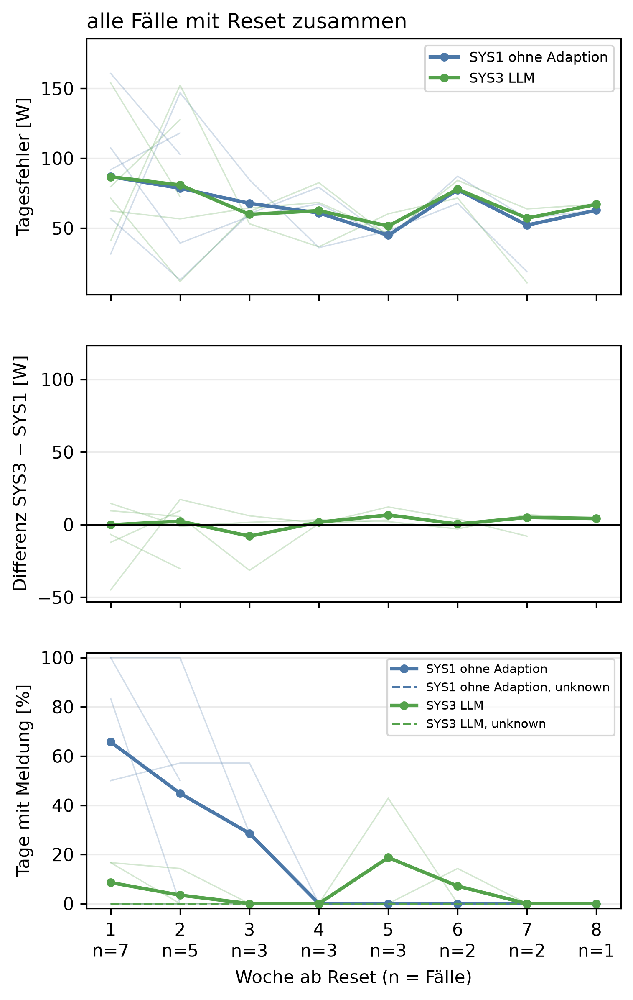
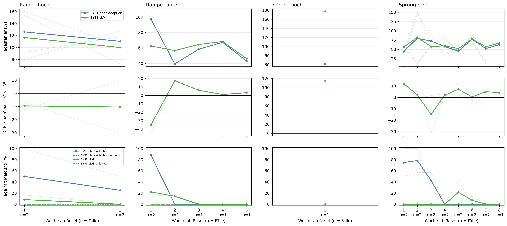
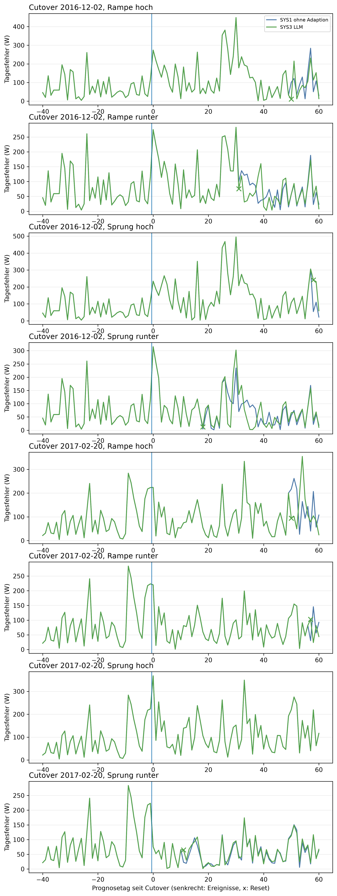

# E3 Adaption SYS1 gegen SYS3, Lauf e3_005

## Setup

- Cutover: CO6 (2016-12-02), CO7 (2017-02-20) (Tag 0, alle Tage und Daten in Ortszeit)
- Fenster: 40 Tage vor und 60 Tage ab Cutover
- Ereignisse: 1: Rampe über 28 Tage +20 %, Tag 0; 2: Rampe über 28 Tage −20 %, Tag 0; 3: Sprung +30 %, Tag 0; 4: Sprung −30 %, Tag 0
- Systeme: SYS1 ohne Adaption, SYS3 LLM
- LLM SYS3: ministral-3:8b, Prompt v30
- Kalender: keiner, wie CTX0
- Commit: 200d726

## Hilft die Adaption? SYS3 gegen SYS1, nur Fälle mit Reset von SYS3

| Kennzahl | SYS1 ohne Adaption | SYS3 LLM |
|---|---|---|
| Fälle mit Reset (Cutover × Reihe) | 0/8 | 7/8 |
| Tagesfehler ab dem Reset [W], auf denselben Tagen | 71,8 | 72,4 |
| Differenz gegen SYS1 [W] | - | 0,6 |
| 2 Standardfehler der Differenz [W] | - | 8,5 |
| gepaarte Tage | - | 152 |
| Differenz belastbar | - | nein |
| Meldungstage, alle Fälle zusammen | 42 | 8 |
| unknown-Tage (blind), alle Fälle zusammen | 0 | 0 |
| Meldungen je 30 Tage nach dem Reset | 8,7 | 1,7 |
| Differenz gegen SYS1 | - | -7,0 |
| Resets im Kontrolllauf (Fehlalarme) | 0 | 0 |
| SYS3 besser als SYS1 (Fälle mit Reset) | - | 5/7 |

## Tagesfehler je Woche ab dem Reset, alle Fälle mit Reset zusammen

| Woche ab Reset | Fälle | Tagesfehler SYS3 LLM [W] | Tagesfehler SYS1 ohne Adaption [W] | Differenz SYS3 − SYS1 [W] |
|---:|---:|---:|---:|---:|
| 1 | 7 | 86,7 | 86,9 | -0,1 |
| 2 | 5 | 80,9 | 78,6 | 2,4 |
| 3 | 3 | 59,8 | 67,8 | -7,9 |
| 4 | 3 | 62,5 | 60,9 | 1,6 |
| 5 | 3 | 51,6 | 44,9 | 6,6 |
| 6 | 2 | 77,9 | 77,5 | 0,4 |
| 7 | 2 | 57,2 | 52,2 | 5,0 |
| 8 | 1 | 67,1 | 62,9 | 4,2 |

## Hinweise

- Tag = Entscheidungstag seit Cutover: an Tag n wird Tag n-1 eingeordnet, ein Ereignis an Tag s also ab Tag s+1
- Fall = Cutover × Reihe mit Ereignis. Ein Fall zählt in die Hauptzahlen, wenn SYS3 in der Reihe zurückgesetzt hat (Reset an Tag). Erkennung und Einordnung werden in E1 und E2 geprüft, hier nur als Beleg in der Ereignistabelle
- Tagesfehler: ab dem Reset-Tag, denn die Prognose desselben Tages enthält den Reset schon. SYS1 wird auf denselben Tagen gepaart, nie zurückgesetzt
- Meldungen: Tage nach dem Reset-Tag von SYS3, bei beiden Systemen auf denselben Tagen. Als Meldung zählen peak, new_pattern und measurement_error
- Woche ab Reset: Woche 1 sind die ersten Tage ab dem Reset. Später gehen Fälle mit weniger Tagen im Fenster verloren, die Spalte Fälle zeigt das
- bewertet an Tag: bei der Dauerlast der erste Tag mit Drift oder new_pattern. Meldungen davor zählen als Meldungen, nicht als Einordnungsfehler
- nach Trennung: vor Beginn des Ereignisses hat schon ein System anders gehandelt (Reset), die Systeme entscheiden dann nicht mehr über denselben Zustand
- Kontrolllauf über das ganze Fenster, auch die Tage vor dem Cutover. Jede Meldung dort ist ein Fehlalarm, jeder Reset unnötig
- belastbar: Betrag der Differenz größer als 2 Standardfehler der gepaarten Differenzen, grobe Faustregel

## Anhang

### Tagesfehler je Woche ab dem Reset, je Reihe

| Reihe | Woche ab Reset | Fälle | Tagesfehler SYS3 LLM [W] | Tagesfehler SYS1 ohne Adaption [W] | Differenz SYS3 − SYS1 [W] |
|---|---:|---:|---:|---:|---:|
| Rampe hoch | 1 | 2 | 116,8 | 126,3 | -9,5 |
| Rampe hoch | 2 | 2 | 100,1 | 110,5 | -10,4 |
| Rampe runter | 1 | 2 | 62,6 | 97,8 | -35,2 |
| Rampe runter | 2 | 1 | 56,7 | 39,4 | 17,3 |
| Rampe runter | 3 | 1 | 64,5 | 58,4 | 6,1 |
| Rampe runter | 4 | 1 | 68,4 | 67,4 | 1,0 |
| Rampe runter | 5 | 1 | 46,3 | 43,1 | 3,2 |
| Sprung hoch | 1 | 1 | 177,3 | 62,1 | 115,2 |
| Sprung runter | 1 | 2 | 56,2 | 44,2 | 12,0 |
| Sprung runter | 2 | 2 | 82,1 | 79,9 | 2,2 |
| Sprung runter | 3 | 2 | 57,5 | 72,5 | -14,9 |
| Sprung runter | 4 | 2 | 59,6 | 57,7 | 1,9 |
| Sprung runter | 5 | 2 | 52,3 | 45,2 | 7,1 |
| Sprung runter | 6 | 2 | 77,9 | 77,5 | 0,4 |
| Sprung runter | 7 | 2 | 57,2 | 52,2 | 5,0 |
| Sprung runter | 8 | 1 | 67,1 | 62,9 | 4,2 |

### Fälle je Cutover und Reihe

| Cutover | Reihe | Reset SYS3 an Tag | Differenz Tagesfehler gegen SYS1 [W] | belastbar | Differenz Meldungen je 30 Tage gegen SYS1 | Resets im Kontrolllauf | SYS3 besser |
|---|---|---:|---:|---|---:|---:|---|
| 2016-12-02 | Rampe hoch | 50 | -4,3 | nein | -21,0 | 0 | ja |
| 2016-12-02 | Rampe runter | 31 | -4,6 | nein | -3,1 | 0 | ja |
| 2016-12-02 | Sprung hoch | 58 | 115,2 | ja | 0,0 | 0 | nein |
| 2016-12-02 | Sprung runter | 18 | -0,2 | nein | -5,7 | 0 | ja |
| 2017-02-20 | Rampe hoch | 50 | -15,4 | nein | 0,0 | 0 | nein |
| 2017-02-20 | Rampe runter | 57 | -18,2 | nein | -20,0 | 0 | ja |
| 2017-02-20 | Sprung hoch | - | - | - | - | 0 | nein |
| 2017-02-20 | Sprung runter | 11 | 3,5 | ja | -8,6 | 0 | ja |

### Erste Einordnung je Ereignis

| Cutover | Ereignis | System | bewertet an Tag | Klasse | Skala | Meldungen davor | Reset an Tag | nach Trennung |
|---|---|---|---:|---|---|---:|---:|---|
| 2016-12-02 | 1: Rampe über 28 Tage +20 %, Tag 0 | SYS1 ohne Adaption | 50 | new_pattern | weekly+long_term | 10 | - | nein |
| 2016-12-02 | 1: Rampe über 28 Tage +20 %, Tag 0 | SYS3 LLM | 50 | new_pattern | weekly+long_term | 10 | 50 | nein |
| 2016-12-02 | 2: Rampe über 28 Tage −20 %, Tag 0 | SYS1 ohne Adaption | 31 | new_pattern | weekly+long_term | 1 | - | nein |
| 2016-12-02 | 2: Rampe über 28 Tage −20 %, Tag 0 | SYS3 LLM | 31 | new_pattern | weekly+long_term | 1 | 31 | nein |
| 2016-12-02 | 3: Sprung +30 %, Tag 0 | SYS1 ohne Adaption | - | - | - | 9 | - | nein |
| 2016-12-02 | 3: Sprung +30 %, Tag 0 | SYS3 LLM | 58 | new_pattern | weekly | 8 | 58 | nein |
| 2016-12-02 | 4: Sprung −30 %, Tag 0 | SYS1 ohne Adaption | 18 | new_pattern | weekly+long_term | 0 | - | nein |
| 2016-12-02 | 4: Sprung −30 %, Tag 0 | SYS3 LLM | 18 | new_pattern | weekly+long_term | 0 | 18 | nein |
| 2017-02-20 | 1: Rampe über 28 Tage +20 %, Tag 0 | SYS1 ohne Adaption | - | - | - | 6 | - | nein |
| 2017-02-20 | 1: Rampe über 28 Tage +20 %, Tag 0 | SYS3 LLM | 50 | new_pattern | long_term | 6 | 50 | nein |
| 2017-02-20 | 2: Rampe über 28 Tage −20 %, Tag 0 | SYS1 ohne Adaption | 57 | new_pattern | weekly+long_term | 0 | - | nein |
| 2017-02-20 | 2: Rampe über 28 Tage −20 %, Tag 0 | SYS3 LLM | 57 | new_pattern | weekly+long_term | 0 | 57 | nein |
| 2017-02-20 | 3: Sprung +30 %, Tag 0 | SYS1 ohne Adaption | - | - | - | 6 | - | nein |
| 2017-02-20 | 3: Sprung +30 %, Tag 0 | SYS3 LLM | - | - | - | 6 | - | nein |
| 2017-02-20 | 4: Sprung −30 %, Tag 0 | SYS1 ohne Adaption | 12 | new_pattern | weekly+long_term | 0 | - | nein |
| 2017-02-20 | 4: Sprung −30 %, Tag 0 | SYS3 LLM | 11 | new_pattern | long_term | 0 | 11 | nein |

### Prognose ab dem Reset je Fall, gepaart gegen SYS1

| Cutover | Zeitraum | System | Tagesfehler [W] | MAE [W] | MAPE [%] | Differenz Tagesfehler gegen SYS1 [W] | Differenz MAE gegen SYS1 [W] | 2 Standardfehler [W] | Tage | Tage besser [%] | belastbar |
|---|---|---|---:|---:|---:|---:|---:|---:|---:|---:|---|
| 2016-12-02 | Rampe hoch ab Reset an Tag 50 | SYS1 ohne Adaption | 101,4 | 237,4 | 59,0 | - | - | - | - | - | - |
| 2016-12-02 | Rampe hoch ab Reset an Tag 50 | SYS3 LLM | 97,2 | 240,7 | 54,8 | -4,3 | 3,2 | 35,7 | 11 | 63,6 | nein |
| 2016-12-02 | Rampe runter ab Reset an Tag 31 | SYS1 ohne Adaption | 66,5 | 157,3 | 53,6 | - | - | - | - | - | - |
| 2016-12-02 | Rampe runter ab Reset an Tag 31 | SYS3 LLM | 61,9 | 173,4 | 69,2 | -4,6 | 16,1 | 15,7 | 30 | 60,0 | nein |
| 2016-12-02 | Sprung hoch ab Reset an Tag 58 | SYS1 ohne Adaption | 62,1 | 240,6 | 45,0 | - | - | - | - | - | - |
| 2016-12-02 | Sprung hoch ab Reset an Tag 58 | SYS3 LLM | 177,3 | 261,4 | 41,3 | 115,2 | 20,7 | 86,5 | 3 | 0,0 | ja |
| 2016-12-02 | Sprung runter ab Reset an Tag 18 | SYS1 ohne Adaption | 68,0 | 144,7 | 71,1 | - | - | - | - | - | - |
| 2016-12-02 | Sprung runter ab Reset an Tag 18 | SYS3 LLM | 67,8 | 147,5 | 68,7 | -0,2 | 2,8 | 14,0 | 43 | 34,9 | nein |
| 2017-02-20 | Rampe hoch ab Reset an Tag 50 | SYS1 ohne Adaption | 139,7 | 225,6 | 70,6 | - | - | - | - | - | - |
| 2017-02-20 | Rampe hoch ab Reset an Tag 50 | SYS3 LLM | 124,3 | 216,3 | 59,7 | -15,4 | -9,3 | 75,9 | 11 | 54,5 | nein |
| 2017-02-20 | Rampe runter ab Reset an Tag 57 | SYS1 ohne Adaption | 81,0 | 139,0 | 40,4 | - | - | - | - | - | - |
| 2017-02-20 | Rampe runter ab Reset an Tag 57 | SYS3 LLM | 62,9 | 157,9 | 59,8 | -18,2 | 18,9 | 85,3 | 4 | 50,0 | nein |
| 2017-02-20 | Sprung runter ab Reset an Tag 11 | SYS1 ohne Adaption | 56,7 | 138,0 | 61,5 | - | - | - | - | - | - |
| 2017-02-20 | Sprung runter ab Reset an Tag 11 | SYS3 LLM | 60,1 | 137,9 | 61,9 | 3,5 | -0,1 | 2,8 | 50 | 38,0 | ja |

### Meldungen nach dem Reset je Fall und Woche ab Reset, Meldungstage nach Klasse

| Cutover | Reihe | System | Woche ab Reset | Tage | Meldungstage | davon peak | davon new_pattern | davon measurement_error | unknown-Tage | Meldungen je 30 Tage |
|---|---|---|---:|---:|---:|---:|---:|---:|---:|---:|
| 2016-12-02 | Rampe hoch | SYS1 ohne Adaption | 1 | 6 | 6 | 0 | 6 | 0 | 0 | 30,0 |
| 2016-12-02 | Rampe hoch | SYS1 ohne Adaption | 2 | 4 | 2 | 0 | 2 | 0 | 0 | 15,0 |
| 2016-12-02 | Rampe hoch | SYS3 LLM | 1 | 6 | 1 | 1 | 0 | 0 | 0 | 5,0 |
| 2016-12-02 | Rampe hoch | SYS3 LLM | 2 | 4 | 0 | 0 | 0 | 0 | 0 | 0,0 |
| 2016-12-02 | Rampe runter | SYS1 ohne Adaption | 1 | 6 | 5 | 0 | 5 | 0 | 0 | 25,0 |
| 2016-12-02 | Rampe runter | SYS1 ohne Adaption | 2 | 7 | 0 | 0 | 0 | 0 | 0 | 0,0 |
| 2016-12-02 | Rampe runter | SYS1 ohne Adaption | 3 | 7 | 0 | 0 | 0 | 0 | 0 | 0,0 |
| 2016-12-02 | Rampe runter | SYS1 ohne Adaption | 4 | 7 | 0 | 0 | 0 | 0 | 0 | 0,0 |
| 2016-12-02 | Rampe runter | SYS1 ohne Adaption | 5 | 2 | 0 | 0 | 0 | 0 | 0 | 0,0 |
| 2016-12-02 | Rampe runter | SYS3 LLM | 1 | 6 | 1 | 1 | 0 | 0 | 0 | 5,0 |
| 2016-12-02 | Rampe runter | SYS3 LLM | 2 | 7 | 1 | 1 | 0 | 0 | 0 | 4,3 |
| 2016-12-02 | Rampe runter | SYS3 LLM | 3 | 7 | 0 | 0 | 0 | 0 | 0 | 0,0 |
| 2016-12-02 | Rampe runter | SYS3 LLM | 4 | 7 | 0 | 0 | 0 | 0 | 0 | 0,0 |
| 2016-12-02 | Rampe runter | SYS3 LLM | 5 | 2 | 0 | 0 | 0 | 0 | 0 | 0,0 |
| 2016-12-02 | Sprung hoch | SYS1 ohne Adaption | 1 | 2 | 0 | 0 | 0 | 0 | 0 | 0,0 |
| 2016-12-02 | Sprung hoch | SYS3 LLM | 1 | 2 | 0 | 0 | 0 | 0 | 0 | 0,0 |
| 2016-12-02 | Sprung runter | SYS1 ohne Adaption | 1 | 6 | 3 | 0 | 3 | 0 | 0 | 15,0 |
| 2016-12-02 | Sprung runter | SYS1 ohne Adaption | 2 | 7 | 4 | 0 | 4 | 0 | 0 | 17,1 |
| 2016-12-02 | Sprung runter | SYS1 ohne Adaption | 3 | 7 | 4 | 0 | 4 | 0 | 0 | 17,1 |
| 2016-12-02 | Sprung runter | SYS1 ohne Adaption | 4 | 7 | 0 | 0 | 0 | 0 | 0 | 0,0 |
| 2016-12-02 | Sprung runter | SYS1 ohne Adaption | 5 | 7 | 0 | 0 | 0 | 0 | 0 | 0,0 |
| 2016-12-02 | Sprung runter | SYS1 ohne Adaption | 6 | 7 | 0 | 0 | 0 | 0 | 0 | 0,0 |
| 2016-12-02 | Sprung runter | SYS1 ohne Adaption | 7 | 1 | 0 | 0 | 0 | 0 | 0 | 0,0 |
| 2016-12-02 | Sprung runter | SYS3 LLM | 1 | 6 | 0 | 0 | 0 | 0 | 0 | 0,0 |
| 2016-12-02 | Sprung runter | SYS3 LLM | 2 | 7 | 0 | 0 | 0 | 0 | 0 | 0,0 |
| 2016-12-02 | Sprung runter | SYS3 LLM | 3 | 7 | 0 | 0 | 0 | 0 | 0 | 0,0 |
| 2016-12-02 | Sprung runter | SYS3 LLM | 4 | 7 | 0 | 0 | 0 | 0 | 0 | 0,0 |
| 2016-12-02 | Sprung runter | SYS3 LLM | 5 | 7 | 3 | 3 | 0 | 0 | 0 | 12,9 |
| 2016-12-02 | Sprung runter | SYS3 LLM | 6 | 7 | 0 | 0 | 0 | 0 | 0 | 0,0 |
| 2016-12-02 | Sprung runter | SYS3 LLM | 7 | 1 | 0 | 0 | 0 | 0 | 0 | 0,0 |
| 2017-02-20 | Rampe hoch | SYS1 ohne Adaption | 1 | 6 | 0 | 0 | 0 | 0 | 0 | 0,0 |
| 2017-02-20 | Rampe hoch | SYS1 ohne Adaption | 2 | 4 | 0 | 0 | 0 | 0 | 0 | 0,0 |
| 2017-02-20 | Rampe hoch | SYS3 LLM | 1 | 6 | 0 | 0 | 0 | 0 | 0 | 0,0 |
| 2017-02-20 | Rampe hoch | SYS3 LLM | 2 | 4 | 0 | 0 | 0 | 0 | 0 | 0,0 |
| 2017-02-20 | Rampe runter | SYS1 ohne Adaption | 1 | 3 | 3 | 0 | 3 | 0 | 0 | 30,0 |
| 2017-02-20 | Rampe runter | SYS3 LLM | 1 | 3 | 1 | 1 | 0 | 0 | 0 | 10,0 |
| 2017-02-20 | Sprung runter | SYS1 ohne Adaption | 1 | 6 | 6 | 0 | 6 | 0 | 0 | 30,0 |
| 2017-02-20 | Sprung runter | SYS1 ohne Adaption | 2 | 7 | 7 | 0 | 7 | 0 | 0 | 30,0 |
| 2017-02-20 | Sprung runter | SYS1 ohne Adaption | 3 | 7 | 2 | 0 | 2 | 0 | 0 | 8,6 |
| 2017-02-20 | Sprung runter | SYS1 ohne Adaption | 4 | 7 | 0 | 0 | 0 | 0 | 0 | 0,0 |
| 2017-02-20 | Sprung runter | SYS1 ohne Adaption | 5 | 7 | 0 | 0 | 0 | 0 | 0 | 0,0 |
| 2017-02-20 | Sprung runter | SYS1 ohne Adaption | 6 | 7 | 0 | 0 | 0 | 0 | 0 | 0,0 |
| 2017-02-20 | Sprung runter | SYS1 ohne Adaption | 7 | 7 | 0 | 0 | 0 | 0 | 0 | 0,0 |
| 2017-02-20 | Sprung runter | SYS1 ohne Adaption | 8 | 1 | 0 | 0 | 0 | 0 | 0 | 0,0 |
| 2017-02-20 | Sprung runter | SYS3 LLM | 1 | 6 | 0 | 0 | 0 | 0 | 0 | 0,0 |
| 2017-02-20 | Sprung runter | SYS3 LLM | 2 | 7 | 0 | 0 | 0 | 0 | 0 | 0,0 |
| 2017-02-20 | Sprung runter | SYS3 LLM | 3 | 7 | 0 | 0 | 0 | 0 | 0 | 0,0 |
| 2017-02-20 | Sprung runter | SYS3 LLM | 4 | 7 | 0 | 0 | 0 | 0 | 0 | 0,0 |
| 2017-02-20 | Sprung runter | SYS3 LLM | 5 | 7 | 0 | 0 | 0 | 0 | 0 | 0,0 |
| 2017-02-20 | Sprung runter | SYS3 LLM | 6 | 7 | 1 | 1 | 0 | 0 | 0 | 4,3 |
| 2017-02-20 | Sprung runter | SYS3 LLM | 7 | 7 | 0 | 0 | 0 | 0 | 0 | 0,0 |
| 2017-02-20 | Sprung runter | SYS3 LLM | 8 | 1 | 0 | 0 | 0 | 0 | 0 | 0,0 |

### Kontrolllauf: Fehlalarme und unnötige Resets

| Cutover | System | Tage | Meldungen | unknown | Resets |
|---|---|---:|---:|---:|---:|
| 2016-12-02 | SYS1 ohne Adaption | 101 | 9 | 0 | 0 |
| 2016-12-02 | SYS3 LLM | 101 | 9 | 0 | 0 |
| 2017-02-20 | SYS1 ohne Adaption | 101 | 5 | 0 | 0 |
| 2017-02-20 | SYS3 LLM | 101 | 5 | 0 | 0 |

### Laufzeit und Kosten SYS3, nur beschreibend

| Cutover | Reihe | Tage | SYS1 je Tag [s] | LLM-Aufrufe | Ausfalltage | Mehrlaufzeit gegen SYS1 [s] | je Aufruf [s] |
|---|---|---:|---:|---:|---:|---:|---:|
| 2016-12-02 | Kontrolllauf | 101 | 0,1 | 36 | 0 | 714,6 | 19,9 |
| 2017-02-20 | Kontrolllauf | 101 | 0,1 | 55 | 0 | 1044,6 | 19,0 |
| 2016-12-02 | Rampe hoch | 101 | 0,1 | 42 | 0 | 789,6 | 18,8 |
| 2017-02-20 | Rampe hoch | 101 | 0,1 | 65 | 0 | 1173,1 | 18,0 |
| 2016-12-02 | Rampe runter | 101 | 0,1 | 34 | 0 | 646,1 | 19,0 |
| 2017-02-20 | Rampe runter | 101 | 0,1 | 56 | 0 | 1033,7 | 18,5 |
| 2016-12-02 | Sprung hoch | 101 | 0,1 | 55 | 0 | 1051,8 | 19,1 |
| 2017-02-20 | Sprung hoch | 101 | 0,1 | 79 | 0 | 1483,3 | 18,8 |
| 2016-12-02 | Sprung runter | 101 | 0,1 | 46 | 0 | 868,7 | 18,9 |
| 2017-02-20 | Sprung runter | 101 | 0,1 | 59 | 0 | 1092,7 | 18,5 |

### Wochenverlauf je Reihe

### Tagesfehler je Cutover und Reihe

### Antworten des LLM

**Kontrolllauf, Cutover 2016-12-02**

2016-10-22 (Entscheidungstag -40): SYS3 normal, Aktion none

- Erklärung: Gestern war der Tagesverlauf ungewöhnlich flach, aber die durchschnittliche Strommenge lag im üblichen Bereich.
- Empfehlung: Es ist nichts zu tun. Der Unterschied zum sonstigen Verlauf könnte auf einen ungewöhnlichen Tag liegen, z.B. wenn weniger Geräte genutzt wurden oder die Beleuchtung kürzer lief.
- Unsicherheit: Ob der flache Tagesverlauf tatsächlich ungewöhnlich war, hängt davon ab, ob gestern besondere Umstände vorlagen.

2016-10-23 (Entscheidungstag -39): SYS3 normal, Aktion none

- Erklärung: Gestern war der Tagesverlauf ungewöhnlich flach, aber die durchschnittliche Strommenge lag im üblichen Bereich.
- Empfehlung: Es ist nichts zu tun. Der Unterschied zum sonstigen Verlauf könnte auf einen ungewöhnlich ruhigen Tag zurückzuführen sein, etwa wenn viele Menschen nicht zu Hause waren oder weniger Strom verbraucht haben.
- Unsicherheit: Ob ein geplanter Urlaub oder eine andere Abwesenheit den Verbrauch beeinflusst hat, kann nicht geprüft werden, da keine Kalendereintragungen verfügbar sind.

2016-10-27 (Entscheidungstag -35): SYS3 normal, Aktion none

- Erklärung: Der Verbrauch lag gestern im üblichen Bereich, aber die letzten vier Wochen waren insgesamt etwa 18 % niedriger als sonst.
- Empfehlung: Da der Verbrauch gestern normal war, ist nichts zu überprüfen. Die niedrigere Gesamtmenge der letzten Wochen könnte mit weniger Heizbedarf im Oktober zusammenhängen – das können Sie mit Ihrem eigenen Gefühl für die Witterung abgleichen.
- Unsicherheit: Ob die niedrigere Verbrauchsmenge auf einen veränderten Lebensstil oder äußere Umstände wie milderes Wetter zurückzuführen ist, kann ohne Kalendereinträge nicht geklärt werden.

2016-10-28 (Entscheidungstag -34): SYS3 normal, Aktion none

- Erklärung: Gestern war der Stromverbrauch insgesamt niedriger als sonst, aber die Abweichung ist nicht groß genug für eine Warnung.
- Empfehlung: Es gibt nichts zu beachten, da der Verbrauch nur leicht unter dem üblichen Niveau lag und keine ungewöhnliche Ursache erkennbar ist.
- Unsicherheit: Ob die Abweichung auf einen kürzeren Aufenthalt im Haushalt oder eine andere Veränderung zurückzuführen ist, lässt sich ohne Kalendereinträge nicht klären.

2016-10-29 (Entscheidungstag -33): SYS3 normal, Aktion none

- Erklärung: Gestern war der Stromverbrauch etwas niedriger als sonst, aber nicht ungewöhnlich für einen einzelnen Tag.
- Empfehlung: Es gibt nichts zu überprüfen, da der Verbrauch gestern im üblichen Rahmen lag.
- Unsicherheit: Ob die niedrigere Stromnutzung in den letzten Tagen auf eine geplante Abwesenheit zurückzuführen ist, kann nicht geprüft werden, da keine Kalendereintragungen verfügbar sind.

2016-11-08 (Entscheidungstag -23): SYS3 peak, Aktion none

- Erklärung: Gestern war der Stromverbrauch um etwa 91 % höher als an einem normalen Dienstag im November. Das ist ungewöhnlich für einen einzigen Tag.
- Empfehlung: Überprüfen Sie, ob gestern ungewöhnliche Geräte oder Aktivitäten den Verbrauch stark erhöht haben könnten, z. B. Heizungsprobleme oder längeres Nutzen von Elektrogeräten.
- Unsicherheit: Ob der hohe Verbrauch auf einen einmaligen Grund zurückzuführen ist oder länger anhält, lässt sich erst nach weiteren Tagen beurteilen.

2016-11-14 (Entscheidungstag -17): SYS3 peak, Aktion none

- Erklärung: Gestern war der Stromverbrauch für einen Dienstag um etwa 36 % höher als üblich und hat sich seit dem 13. November auf dieser Ebene gehalten.
- Empfehlung: Überprüfen Sie, ob gestern ungewöhnlich viele Geräte gleichzeitig genutzt wurden oder ob es einen Grund für den erhöhten Verbrauch gibt, z. B. längeres Heizen oder zusätzliche Beleuchtung.
- Unsicherheit: Da keine Kalenderdaten verfügbar sind, kann nicht ausgeschlossen werden, dass ein geplanter Aufenthalt außerhalb des Hauses die Werte beeinflusst hat.

2016-12-02 (Entscheidungstag 1): SYS3 low, Aktion none

- Erklärung: Gestern war der Stromverbrauch ungewöhnlich niedrig, sowohl über den Tag verteilt als auch im Vergleich zu einem normalen Dienstag. Der Verbrauch lag um etwa 60 % unter dem üblichen Wert für einen Dienstag.
- Empfehlung: Überprüfen Sie, ob der Stromzähler oder die Messung möglicherweise nicht korrekt funktioniert hat. Alternativ könnte ein ungewöhnliches Verhalten wie eine längere Abwesenheit ohne geplante Reise den Verbrauch beeinflusst haben.
- Unsicherheit: Da keine Kalenderdaten verfügbar sind, kann nicht ausgeschlossen werden, ob gestern tatsächlich niemand zu Hause war.

2016-12-03 (Entscheidungstag 2): SYS3 low, Aktion none

- Erklärung: Gestern war der Stromverbrauch ungewöhnlich niedrig, sowohl über den Tag verteilt als auch im Vergleich zu einem normalen Wochentag. Der Verbrauch lag etwa 64 % unter dem üblichen Wert für einen Wochentag.
- Empfehlung: Da kein Kalender verfügbar war, um eine Abwesenheit zu bestätigen, prüfen Sie bitte, ob gestern niemand zu Hause war oder ob ungewöhnliche Umstände vorlagen, die den niedrigen Verbrauch erklären könnten.
- Unsicherheit: Ob der Stromverbrauch tatsächlich niedriger war, hängt davon ab, ob ein Kalender verfügbar gewesen wäre und ob eine Abwesenheit stattfand.

2016-12-04 (Entscheidungstag 3): SYS3 low, Aktion none

- Erklärung: Gestern war der Stromverbrauch ungewöhnlich niedrig, sowohl über den Tag verteilt als auch im Vergleich zu einem normalen Dienstag. Der Verbrauch lag etwa 70 % unter dem üblichen Wert für einen Dienstag.
- Empfehlung: Da kein Kalender verfügbar ist, prüfen Sie bitte, ob gestern ungewöhnlich wenig Strom verbraucht wurde. Möglicherweise waren Geräte ausgeschaltet oder es gab einen technischen Grund wie eine Störung.
- Unsicherheit: Ob der Verbrauch tatsächlich niedriger war, hängt davon ab, ob ein Kalender verfügbar gewesen wäre und ob die Abwesenheit des Haushalts gestern stattgefunden hat.

2016-12-08 (Entscheidungstag 7): SYS3 normal, Aktion none

- Erklärung: Gestern war der Stromverbrauch etwas niedriger als sonst, aber nicht ungewöhnlich für einen einzelnen Tag.
- Empfehlung: Es gibt nichts zu beachten, da der Verbrauch im Rahmen liegt und keine ungewöhnlichen Umstände vorliegen.
- Unsicherheit: Ob ein geplanter Urlaub oder eine Abwesenheit den niedrigeren Verbrauch erklären könnte, lässt sich ohne Kalender nicht prüfen.

2016-12-09 (Entscheidungstag 8): SYS3 normal, Aktion none

- Erklärung: Gestern war der Stromverbrauch etwas niedriger als sonst in dieser Woche, aber nicht ungewöhnlich für einen einzelnen Tag.
- Empfehlung: Es gibt nichts Ungewöhnliches zu beachten, da der Verbrauch im Rahmen liegt.
- Unsicherheit: Ob ein geplanter Urlaub oder eine Abwesenheit den Verbrauch beeinflusst hat, kann nicht geprüft werden, da keine Kalendereintragungen verfügbar sind.

2016-12-10 (Entscheidungstag 9): SYS3 peak, Aktion none

- Erklärung: Gestern war der Stromverbrauch für einen Wochentag ungewöhnlich hoch, um etwa 48 % über dem üblichen Wert. Dies könnte auf erhöhten Bedarf durch längere Dunkelheit oder Heizungsnutzung im Dezember hindeuten.
- Empfehlung: Überprüfen Sie, ob ungewöhnliche Geräte oder Aktivitäten wie zusätzliche Heizungen oder längeres Nutzen von Elektrogeräten gestern aufgetreten sind.
- Unsicherheit: Da keine Kalendereinträge verfügbar sind, kann nicht ausgeschlossen werden, dass ein geplanter Besuch oder eine besondere Aktivität den Verbrauch beeinflusst hat.

2016-12-16 (Entscheidungstag 15): SYS3 peak, Aktion none

- Erklärung: Gestern war der Stromverbrauch um etwa 33 % höher als an einem normalen Freitag in dieser Woche.
- Empfehlung: Überprüfen Sie, ob gestern ungewöhnlich viele Geräte gleichzeitig genutzt wurden oder ob es einen Grund für erhöhten Verbrauch gab.
- Unsicherheit: Da keine Kalenderdaten verfügbar sind, kann nicht ausgeschlossen werden, dass ein geplanter Aufenthalt außerhalb des Hauses den Verbrauch beeinflusst hat.

2016-12-17 (Entscheidungstag 16): SYS3 peak, Aktion none

- Erklärung: Gestern war der Stromverbrauch um etwa 45 % höher als an einem normalen Freitag in dieser Woche. Das ist ungewöhnlich für einen Tag.
- Empfehlung: Überprüfen Sie, ob gestern ungewöhnliche Geräte oder Aktivitäten den Verbrauch erhöht haben könnten, z. B. Heizungs- oder Beleuchtungsnutzung.
- Unsicherheit: Ob der erhöhte Verbrauch auf eine geplante Abwesenheit zurückzuführen ist, kann nicht geprüft werden, da keine Kalendereinträge verfügbar sind.

2016-12-18 (Entscheidungstag 17): SYS3 low, Aktion none

- Erklärung: Gestern war der Stromverbrauch um etwa 49 % niedriger als an einem typischen Dienstag im Dezember. Das ist ungewöhnlich für einen solchen Tag.
- Empfehlung: Da kein Kalender verfügbar war, um eine Abwesenheit zu bestätigen, prüfen Sie bitte, ob gestern niemand zu Hause war oder ob der Verbrauch ungewöhnlich niedrig war. Möglicherweise waren die Tage kürzer und es wurde weniger Strom verbraucht.
- Unsicherheit: Ob ein Kalender verfügbar ist, könnte die Einschätzung ändern.

2016-12-27 (Entscheidungstag 26): SYS3 low, Aktion none

- Erklärung: Gestern war der Stromverbrauch ungewöhnlich niedrig, sowohl über den Tag verteilt als auch im Vergleich zu einem normalen Dienstag. Der Verbrauch lag um etwa 69 % unter dem üblichen Wert für einen Dienstag.
- Empfehlung: Da kein Kalender verfügbar ist, um eine Abwesenheit zu bestätigen, prüfen Sie bitte, ob gestern niemand zu Hause war oder ob ungewöhnliche Umstände (z. B. Stromausfall) vorgelegen haben.
- Unsicherheit: Ob es sich um einen dauerhaften niedrigen Verbrauch handelt, hängt davon ab, ob der Kalender in Zukunft verfügbar ist und ob die Werte stabil bleiben.

2016-12-28 (Entscheidungstag 27): SYS3 low, Aktion none

- Erklärung: Gestern war der Stromverbrauch ungewöhnlich niedrig, sowohl über den Tag verteilt als auch im Vergleich zu einem normalen Dienstag. Der Verbrauch lag um etwa 70 % unter dem üblichen Wert für einen Dienstag.
- Empfehlung: Da kein Kalender verfügbar ist, um eine Abwesenheit zu bestätigen, prüfen Sie bitte, ob der Verbrauch tatsächlich niedriger war als sonst. Überlegen Sie, ob Geräte ausgeschaltet oder der Stromverbrauch aus anderen Gründen reduziert wurde.
- Unsicherheit: Ob es sich um einen dauerhaften niedrigen Verbrauch handelt, hängt davon ab, ob die Kalenderdaten später verfügbar sind und eine Abwesenheit bestätigen.

2016-12-29 (Entscheidungstag 28): SYS3 low, Aktion none

- Erklärung: Gestern war der Stromverbrauch ungewöhnlich niedrig, sowohl über den Tag verteilt als auch im Vergleich zu einem normalen Dienstag. Der Verbrauch lag etwa zwei Drittel unter dem üblichen Wert für einen Dienstag.
- Empfehlung: Da kein Kalender verfügbar ist, können Sie prüfen, ob gestern ungewöhnlich wenig Strom verbraucht wurde – etwa durch längeres Fehlen oder besondere Umstände wie eine technische Störung. Überprüfen Sie auch, ob der Messwert plausibel erscheint.
- Unsicherheit: Ob ein geplanter Ausfall oder eine Abwesenheit vorlag, kann nicht geprüft werden, da keine Kalenderdaten verfügbar sind.

2016-12-30 (Entscheidungstag 29): SYS3 low, Aktion none

- Erklärung: Gestern war der Stromverbrauch um etwa zwei Drittel niedriger als an einem normalen Wochentag im Dezember.
- Empfehlung: Da kein Kalender verfügbar war, prüfen Sie bitte, ob gestern ungewöhnlich wenig Strom verbraucht wurde – etwa durch längeres Fehlen oder besondere Umstände wie einen Stromausfall.
- Unsicherheit: Ob der Verbrauch tatsächlich niedriger war, hängt davon ab, ob ein Kalender zur Verfügung stand und ob die gemessenen Werte vertrauenswürdig sind.

2017-01-01 (Entscheidungstag 31): SYS3 peak, Aktion none

- Erklärung: Gestern war der Stromverbrauch ungewöhnlich hoch, sowohl über den Tag verteilt als auch im Vergleich zu einem normalen Wochentag. Der Verbrauch lag etwa 57 % höher als sonst an einem solchen Tag.
- Empfehlung: Überprüfen Sie, ob gestern ungewöhnlich viele Geräte gleichzeitig genutzt wurden oder ob es einen Grund für erhöhten Verbrauch gab, z. B. Heizungsprobleme oder längere Nutzung von Elektrogeräten.
- Unsicherheit: Da keine Kalenderdaten verfügbar sind, kann nicht ausgeschlossen werden, dass ein geplanter Aufenthalt im Ausland den Verbrauch beeinflusst hat.

2017-01-02 (Entscheidungstag 32): SYS3 normal, Aktion none

- Erklärung: Der Verbrauch lag gestern im üblichen Bereich, aber die letzten sieben Tage zusammen waren ungewöhnlich niedrig.
- Empfehlung: Da der Verbrauch gestern normal war, ist nichts zu tun. Die ungewöhnlich niedrigen Werte der letzten sieben Tage könnten aber auf eine längere Abwesenheit oder einen technischen Grund hinweisen – prüfen Sie, ob Geräte ausgeschaltet oder die Heizung gedrosselt wurde.
- Unsicherheit: Ob es sich um eine geplante Abwesenheit handelt, kann nicht geprüft werden, da der Kalender nicht verfügbar war.

2017-01-03 (Entscheidungstag 33): SYS3 normal, Aktion none

- Erklärung: Gestern war der Stromverbrauch etwas niedriger als sonst an Wochentagen, aber nicht ungewöhnlich für die letzten Tage.
- Empfehlung: Es gibt nichts zu überprüfen, da der Verbrauch im üblichen Rahmen liegt.
- Unsicherheit: Ob ein geplanter Urlaub oder eine andere Abwesenheit den Verbrauch beeinflusst hat, kann nicht geprüft werden, da keine Kalendereintragungen verfügbar sind.

2017-01-04 (Entscheidungstag 34): SYS3 normal, Aktion none

- Erklärung: Gestern war der Stromverbrauch etwas niedriger als sonst, aber nicht ungewöhnlich für einen einzelnen Tag.
- Empfehlung: Es gibt nichts zu überprüfen, da der Verbrauch im Rahmen liegt und keine ungewöhnlichen Umstände vorlagen.
- Unsicherheit: Ob ein geplanter Urlaub oder eine Abwesenheit den Verbrauch beeinflusst hat, kann nicht geprüft werden, da kein Kalender verfügbar war.

2017-01-05 (Entscheidungstag 35): SYS3 normal, Aktion none

- Erklärung: Der Verbrauch lag gestern im üblichen Bereich, aber die letzten sieben Tage zusammen waren etwa 25 % höher als sonst.
- Empfehlung: Nichts zu tun, da der Verbrauch gestern normal war und die höhere Woche auf mehrere Tage zurückzuführen ist.
- Unsicherheit: Ob es sich um eine vorübergehende Erhöhung oder einen neuen Verbrauchsverlauf handelt, lässt sich erst nach weiteren Tagen beurteilen.

2017-01-13 (Entscheidungstag 43): SYS3 peak, Aktion none

- Erklärung: Gestern war der Stromverbrauch um etwa 40 % höher als an einem normalen Wochentag im Januar.
- Empfehlung: Überprüfen Sie, ob gestern ungewöhnlich viele Geräte gleichzeitig genutzt wurden oder ob ein neues Gerät in Betrieb genommen wurde.
- Unsicherheit: Ob der Verbrauch durch einen besonderen Anlass wie Gäste oder eine längere Nutzung von Heizung oder Beleuchtung erklärt werden kann, können Sie selbst einschätzen.

2017-01-16 (Entscheidungstag 46): SYS3 peak, Aktion none

- Erklärung: Gestern war der Stromverbrauch um etwa 46 % höher als an einem normalen Dienstag im Januar. Das ist ungewöhnlich für einen einzigen Tag.
- Empfehlung: Überprüfen Sie, ob gestern ungewöhnliche Geräte oder Aktivitäten den Verbrauch erhöht haben könnten, z. B. Heizungsprobleme oder längeres Nutzen von Elektrogeräten.
- Unsicherheit: Ob der erhöhte Verbrauch auf einen einmaligen Grund zurückzuführen ist oder länger anhält, lässt sich erst nach weiteren Tagen beurteilen.

2017-01-20 (Entscheidungstag 50): SYS3 normal, Aktion none

- Erklärung: Gestern war der Stromverbrauch für einen Dienstag ungewöhnlich hoch, aber nur um etwa 24 % über dem üblichen Wert. Dies ist kein neues Muster, da es sich nicht seit mehreren Tagen so verhält.
- Empfehlung: Da es sich um eine einmalige Abweichung handelt, ist keine weitere Handlung nötig. Sie können prüfen, ob gestern ungewöhnlich viele Geräte gleichzeitig genutzt wurden oder ob die Außentemperatur besonders niedrig war.
- Unsicherheit: Ob der erhöhte Verbrauch auf einen besonderen Anlass zurückzuführen ist, kann ohne Kalendereinträge nicht sicher beurteilt werden.

2017-01-21 (Entscheidungstag 51): SYS3 normal, Aktion none

- Erklärung: Gestern war der Stromverbrauch etwas niedriger als sonst an einem Dienstag, aber nicht ungewöhnlich für einen einzelnen Tag.
- Empfehlung: Es gibt nichts Ungewöhnliches zu überprüfen, da der Verbrauch gestern im üblichen Rahmen lag.
- Unsicherheit: Ob ein geplanter Urlaub oder eine Abwesenheit den niedrigeren Verbrauch erklären könnte, lässt sich nicht prüfen, da keine Kalendereintragungen verfügbar sind.

2017-01-22 (Entscheidungstag 52): SYS3 peak, Aktion none

- Erklärung: Gestern war der Stromverbrauch für einen Dienstag um etwa 30 % höher als üblich und hat sich seit dem 14. Januar auf diesem Niveau gehalten.
- Empfehlung: Überprüfen Sie, ob Geräte wie Heizung oder Beleuchtung ungewöhnlich lange oder intensiver genutzt wurden.
- Unsicherheit: Ob der erhöhte Verbrauch auf eine geplante Abwesenheit zurückzuführen ist, kann nicht geprüft werden, da keine Kalendereinträge verfügbar sind.

2017-01-23 (Entscheidungstag 53): SYS3 normal, Aktion none

- Erklärung: Gestern lag der Verbrauch um etwa 25 % über dem üblichen Wert für einen Dienstag, aber es gab keine ungewöhnliche Abweichung im Tagesverlauf oder eine anhaltende Veränderung.
- Empfehlung: Es gibt keine Hinweise auf ein Problem oder eine ungewöhnliche Nutzung. Sie können den Verbrauch wie gewohnt beobachten.
- Unsicherheit: Ob der erhöhte Verbrauch durch äußere Umstände wie Kälte oder besondere Aktivitäten verursacht wurde, kann nicht überprüft werden.

2017-01-24 (Entscheidungstag 54): SYS3 normal, Aktion none

- Erklärung: Der Stromverbrauch lag gestern im üblichen Bereich, aber die letzten sieben Tage waren insgesamt etwa 18 % höher als sonst.
- Empfehlung: Es gibt nichts Ungewöhnliches zu beachten, da der Verbrauch gestern normal war.
- Unsicherheit: Ob die erhöhte Nutzung in den letzten sieben Tagen auf einen konkreten Grund zurückzuführen ist, lässt sich ohne Kalenderdaten nicht klären.

2017-01-25 (Entscheidungstag 55): SYS3 normal, Aktion none

- Erklärung: Gestern war der Stromverbrauch etwas niedriger als sonst an einem Dienstag, aber nicht ungewöhnlich für einen einzelnen Tag.
- Empfehlung: Es gibt nichts Ungewöhnliches zu überprüfen, da der Verbrauch gestern im üblichen Rahmen lag.
- Unsicherheit: Ob ein geplanter Urlaub oder eine Abwesenheit den niedrigeren Verbrauch erklären könnte, lässt sich nicht prüfen, da keine Kalendereintragungen verfügbar sind.

2017-01-26 (Entscheidungstag 56): SYS3 normal, Aktion none

- Erklärung: Gestern war der Stromverbrauch für einen Dienstag ungewöhnlich hoch, aber es handelt sich um eine einmalige Abweichung ohne weitere Hinweise auf ein neues Muster.
- Empfehlung: Da es sich um eine einmalige Abweichung handelt und keine weiteren Hinweise auf ein Problem vorliegen, ist keine weitere Handlung nötig.
- Unsicherheit: Ob der erhöhte Verbrauch durch ungewöhnliche Aktivitäten oder äußere Umstände wie Kälte verursacht wurde, kann nicht bestimmt werden.

2017-01-28 (Entscheidungstag 58): SYS3 low, Aktion none

- Erklärung: Gestern war der Stromverbrauch ungewöhnlich niedrig, sowohl über den Tag verteilt als auch im Vergleich zu einem normalen Dienstag. Der Verbrauch lag etwa 43 % unter dem üblichen Wert für einen Dienstag.
- Empfehlung: Da kein Kalender verfügbar ist, prüfen Sie bitte, ob gestern ungewöhnlich wenig Strom verbraucht wurde. Möglicherweise waren Geräte ausgeschaltet oder es gab einen technischen Grund wie eine Störung.
- Unsicherheit: Ob der niedrige Verbrauch auf einen geplanten Ausfall von Geräten oder ein technisches Problem zurückzuführen ist, kann ohne Kalender nicht sicher beurteilt werden.

2017-01-30 (Entscheidungstag 60): SYS3 normal, Aktion none

- Erklärung: Gestern war der Stromverbrauch etwas höher als sonst, aber nicht ungewöhnlich für die letzten Wochen.
- Empfehlung: Es gibt nichts zu beachten, da der Verbrauch im Rahmen liegt und keine ungewöhnlichen Geräte oder Aktivitäten bekannt sind.
- Unsicherheit: Ob die leicht erhöhte Nutzung auf eine geplante Abwesenheit zurückzuführen ist, kann nicht geprüft werden, da kein Kalender verfügbar war.

**Rampe hoch, Cutover 2016-12-02**

2016-10-22 (Entscheidungstag -40): SYS3 normal, Aktion none

- Erklärung: Gestern war der Tagesverlauf ungewöhnlich flach, aber die durchschnittliche Strommenge lag im üblichen Bereich.
- Empfehlung: Es ist nichts zu tun. Der Unterschied zum sonstigen Verlauf könnte auf einen ungewöhnlichen Tag liegen, z.B. wenn weniger Geräte genutzt wurden oder die Beleuchtung kürzer lief.
- Unsicherheit: Ob der flache Tagesverlauf tatsächlich ungewöhnlich war, hängt davon ab, ob gestern besondere Umstände vorlagen.

2016-10-23 (Entscheidungstag -39): SYS3 normal, Aktion none

- Erklärung: Gestern war der Tagesverlauf ungewöhnlich flach, aber die durchschnittliche Strommenge lag im üblichen Bereich.
- Empfehlung: Es ist nichts zu tun. Der Unterschied zum sonstigen Verlauf könnte auf einen ungewöhnlich ruhigen Tag zurückzuführen sein, etwa wenn viele Menschen nicht zu Hause waren oder weniger Strom verbraucht haben.
- Unsicherheit: Ob ein geplanter Urlaub oder eine andere Abwesenheit den Verbrauch beeinflusst hat, kann nicht geprüft werden, da keine Kalendereintragungen verfügbar sind.

2016-10-27 (Entscheidungstag -35): SYS3 normal, Aktion none

- Erklärung: Der Verbrauch lag gestern im üblichen Bereich, aber die letzten vier Wochen waren insgesamt etwa 18 % niedriger als sonst.
- Empfehlung: Da der Verbrauch gestern normal war, ist nichts zu überprüfen. Die niedrigere Gesamtmenge der letzten Wochen könnte mit weniger Heizbedarf im Oktober zusammenhängen – das können Sie mit Ihrem eigenen Gefühl für die Witterung abgleichen.
- Unsicherheit: Ob die niedrigere Verbrauchsmenge auf einen veränderten Lebensstil oder äußere Umstände wie milderes Wetter zurückzuführen ist, kann ohne Kalendereinträge nicht geklärt werden.

2016-10-28 (Entscheidungstag -34): SYS3 normal, Aktion none

- Erklärung: Gestern war der Stromverbrauch insgesamt niedriger als sonst, aber die Abweichung ist nicht groß genug für eine Warnung.
- Empfehlung: Es gibt nichts zu beachten, da der Verbrauch nur leicht unter dem üblichen Niveau lag und keine ungewöhnliche Ursache erkennbar ist.
- Unsicherheit: Ob die Abweichung auf einen kürzeren Aufenthalt im Haushalt oder eine andere Veränderung zurückzuführen ist, lässt sich ohne Kalendereinträge nicht klären.

2016-10-29 (Entscheidungstag -33): SYS3 normal, Aktion none

- Erklärung: Gestern war der Stromverbrauch etwas niedriger als sonst, aber nicht ungewöhnlich für einen einzelnen Tag.
- Empfehlung: Es gibt nichts zu überprüfen, da der Verbrauch gestern im üblichen Rahmen lag.
- Unsicherheit: Ob die niedrigere Stromnutzung in den letzten Tagen auf eine geplante Abwesenheit zurückzuführen ist, kann nicht geprüft werden, da keine Kalendereintragungen verfügbar sind.

2016-11-08 (Entscheidungstag -23): SYS3 peak, Aktion none

- Erklärung: Gestern war der Stromverbrauch um etwa 91 % höher als an einem normalen Dienstag im November. Das ist ungewöhnlich für einen einzigen Tag.
- Empfehlung: Überprüfen Sie, ob gestern ungewöhnliche Geräte oder Aktivitäten den Verbrauch stark erhöht haben könnten, z. B. Heizungsprobleme oder längeres Nutzen von Elektrogeräten.
- Unsicherheit: Ob der hohe Verbrauch auf einen einmaligen Grund zurückzuführen ist oder länger anhält, lässt sich erst nach weiteren Tagen beurteilen.

2016-11-14 (Entscheidungstag -17): SYS3 peak, Aktion none

- Erklärung: Gestern war der Stromverbrauch für einen Dienstag um etwa 36 % höher als üblich und hat sich seit dem 13. November auf dieser Ebene gehalten.
- Empfehlung: Überprüfen Sie, ob gestern ungewöhnlich viele Geräte gleichzeitig genutzt wurden oder ob es einen Grund für den erhöhten Verbrauch gibt, z. B. längeres Heizen oder zusätzliche Beleuchtung.
- Unsicherheit: Da keine Kalenderdaten verfügbar sind, kann nicht ausgeschlossen werden, dass ein geplanter Aufenthalt außerhalb des Hauses die Werte beeinflusst hat.

2016-12-02 (Entscheidungstag 1, Ereignis 1: Rampe über 28 Tage +20 %, Tag 0): SYS3 low, Aktion none

- Erklärung: Gestern war der Stromverbrauch um etwa zwei Drittel niedriger als sonst an einem Dienstag und der Tagesverlauf ungewöhnlich flach. Das könnte auf einen längeren Ausfall von Geräten oder eine andere Störung hindeuten.
- Empfehlung: Überprüfen Sie, ob gestern Geräte oder Beleuchtung ausgefallen sind oder ob jemand den Strom bewusst reduziert hat. Ein längerer Ausfall von Heizungen oder anderen großen Verbrauchern wäre ein möglicher Grund.
- Unsicherheit: Ob der niedrige Verbrauch auf einen geplanten Ausfall zurückzuführen ist, kann nicht geprüft werden, da keine Kalendereinträge verfügbar sind.

2016-12-03 (Entscheidungstag 2, Ereignis 1: Rampe über 28 Tage +20 %, Tag 0): SYS3 low, Aktion none

- Erklärung: Gestern war der Stromverbrauch ungewöhnlich niedrig, sowohl über den Tag verteilt als auch im Vergleich zu einem normalen Dienstag. Der Verbrauch lag etwa um zwei Drittel unter dem üblichen Wert für einen Dienstag.
- Empfehlung: Da kein Kalender verfügbar ist, können Sie prüfen, ob gestern ungewöhnlich wenig Strom verbraucht wurde – etwa durch längeres Fehlen oder reduzierte Nutzung von Geräten wie Heizung oder Beleuchtung.
- Unsicherheit: Ob der niedrige Verbrauch auf einen Ausfall oder eine geplante Abwesenheit zurückzuführen ist, kann ohne Kalender nicht sicher festgestellt werden.

2016-12-04 (Entscheidungstag 3, Ereignis 1: Rampe über 28 Tage +20 %, Tag 0): SYS3 low, Aktion none

- Erklärung: Gestern war der Stromverbrauch ungewöhnlich niedrig, sowohl über den Tag verteilt als auch im Vergleich zu einem normalen Dienstag. Der Verbrauch lag etwa 70 % unter dem üblichen Wert für einen Dienstag.
- Empfehlung: Da kein Kalender verfügbar ist, prüfen Sie bitte, ob gestern ungewöhnlich wenig Strom verbraucht wurde – etwa durch längeres Fehlen oder besondere Umstände wie eine technische Störung. Überprüfen Sie auch, ob der Verbrauch in den letzten Tagen ähnlich niedrig war.
- Unsicherheit: Ob ein Kalender verfügbar ist, könnte die Einschätzung beeinflussen.

2016-12-08 (Entscheidungstag 7, Ereignis 1: Rampe über 28 Tage +20 %, Tag 0): SYS3 normal, Aktion none

- Erklärung: Gestern war der Stromverbrauch etwas niedriger als sonst an einem Dienstag, aber nicht ungewöhnlich für einen einzelnen Tag.
- Empfehlung: Es gibt nichts zu beachten, da der Verbrauch im Rahmen liegt und keine ungewöhnlichen Umstände vorliegen.
- Unsicherheit: Ob ein geplanter Urlaub oder eine Abwesenheit den Verbrauch beeinflusst hat, kann nicht geprüft werden, da kein Kalender verfügbar war.

2016-12-09 (Entscheidungstag 8, Ereignis 1: Rampe über 28 Tage +20 %, Tag 0): SYS3 normal, Aktion none

- Erklärung: Gestern war der Verbrauch für einen Dienstag etwas höher als sonst, aber nicht ungewöhnlich.
- Empfehlung: Es gibt nichts zu beachten. Der Unterschied liegt im üblichen Bereich und ist kein Grund zur Sorge.
- Unsicherheit: Ob ein geplanter Urlaub oder eine andere Abwesenheit den Verbrauch beeinflusst hat, kann nicht geprüft werden, da der Kalender nicht verfügbar war.

2016-12-10 (Entscheidungstag 9, Ereignis 1: Rampe über 28 Tage +20 %, Tag 0): SYS3 peak, Aktion none

- Erklärung: Gestern war der Stromverbrauch für einen Wochentag ungewöhnlich hoch, um etwa 57 % über dem üblichen Wert. Dies ist ein einzelner Ausreißer und kein neues Muster.
- Empfehlung: Überprüfen Sie, ob gestern ungewöhnlich viele Geräte gleichzeitig genutzt wurden oder ob es andere bekannte Gründe für den erhöhten Verbrauch gab.
- Unsicherheit: Da kein Kalender verfügbar war, kann nicht ausgeschlossen werden, dass ein geplanter Aufenthalt außerhalb des Hauses die Messung beeinflusst hat.

2016-12-13 (Entscheidungstag 12, Ereignis 1: Rampe über 28 Tage +20 %, Tag 0): SYS3 peak, Aktion none

- Erklärung: Gestern war der Stromverbrauch um etwa 29 % höher als an einem typischen Dienstag in dieser Woche. Das ist ungewöhnlich für einen einzelnen Tag.
- Empfehlung: Überprüfen Sie, ob gestern ungewöhnliche Geräte oder Aktivitäten den Verbrauch erhöht haben könnten, z. B. längeres Heizen oder zusätzliche Beleuchtung.
- Unsicherheit: Ob der erhöhte Verbrauch auf eine geplante Abwesenheit zurückzuführen ist, kann nicht geprüft werden, da keine Kalendereinträge verfügbar sind.

2016-12-16 (Entscheidungstag 15, Ereignis 1: Rampe über 28 Tage +20 %, Tag 0): SYS3 peak, Aktion none

- Erklärung: Gestern war der Stromverbrauch um etwa 47 % höher als an einem normalen Freitag in dieser Woche. Der erhöhte Verbrauch hält seit dem 13. Dezember an.
- Empfehlung: Überprüfen Sie, ob ungewöhnlich viele Geräte gleichzeitig genutzt wurden oder ob Heizungs- oder Beleuchtungseinstellungen angepasst wurden.
- Unsicherheit: Da keine Kalenderdaten verfügbar sind, kann nicht ausgeschlossen werden, dass ein geplanter Aufenthalt außerhalb des Hauses den Verbrauch beeinflusst hat.

2016-12-17 (Entscheidungstag 16, Ereignis 1: Rampe über 28 Tage +20 %, Tag 0): SYS3 peak, Aktion none

- Erklärung: Gestern war der Stromverbrauch um etwa 60 % höher als an einem normalen Wochentag im Dezember. Das ist ungewöhnlich für diese Zeit des Jahres.
- Empfehlung: Überprüfen Sie, ob gestern ungewöhnliche Geräte oder Aktivitäten den Verbrauch erhöht haben könnten, z. B. Heizungs- oder Beleuchtungsanlagen.
- Unsicherheit: Ob der erhöhte Verbrauch auf eine geplante Abwesenheit zurückzuführen ist, kann nicht geprüft werden, da keine Kalendereinträge verfügbar sind.

2016-12-18 (Entscheidungstag 17, Ereignis 1: Rampe über 28 Tage +20 %, Tag 0): SYS3 low, Aktion none

- Erklärung: Gestern war der Stromverbrauch um etwa 43 % niedriger als an einem typischen Dienstag in dieser Woche. Seit dem 13. Dezember liegt die wöchentliche Durchschnittsmenge wieder im üblichen Bereich.
- Empfehlung: Da kein Kalender verfügbar ist, können Sie prüfen, ob der Verbrauch in den letzten Tagen ungewöhnlich niedrig war oder ob möglicherweise Geräte nicht wie gewohnt genutzt wurden.
- Unsicherheit: Ob ein geplanter Urlaub oder eine andere Abwesenheit die Ursache sein könnte, lässt sich ohne Kalender nicht klären.

2016-12-19 (Entscheidungstag 18, Ereignis 1: Rampe über 28 Tage +20 %, Tag 0): SYS3 normal, Aktion none

- Erklärung: Gestern war der Stromverbrauch für einen Dienstag ungewöhnlich hoch, aber nur um etwa 28 % über dem üblichen Wert. Dies ist ein einzelner Tag und kein neues Muster.
- Empfehlung: Da es sich um einen einzelnen Tag handelt und keine ungewöhnlichen Aktivitäten oder Gerätewechsel bekannt sind, ist kein Handeln nötig. Sie können prüfen, ob gestern besondere Umstände wie Gäste oder längeres Nutzen von Heizgeräten vorgelegen haben.
- Unsicherheit: Ob der erhöhte Verbrauch auf einen einmaligen Grund zurückzuführen ist, hängt davon ab, ob ungewöhnliche Aktivitäten stattfanden.

2016-12-20 (Entscheidungstag 19, Ereignis 1: Rampe über 28 Tage +20 %, Tag 0): SYS3 normal, Aktion none

- Erklärung: Gestern war der Verbrauch etwas niedriger als sonst an einem Dienstag, aber nicht ungewöhnlich für einen einzelnen Tag.
- Empfehlung: Es gibt nichts Ungewöhnliches zu überprüfen. Der Verbrauch liegt im üblichen Bereich und die Abweichung ist nicht nachhaltig.
- Unsicherheit: Ob ein geplanter Urlaub oder eine andere Abwesenheit den niedrigeren Verbrauch erklärt, kann nicht geprüft werden, da keine Kalendereintragungen verfügbar sind.

2016-12-22 (Entscheidungstag 21, Ereignis 1: Rampe über 28 Tage +20 %, Tag 0): SYS3 peak, Aktion none

- Erklärung: Gestern war der Stromverbrauch um etwa 58 % höher als an einem normalen Dienstag in dieser Woche. Das ist ungewöhnlich für einen einzigen Tag.
- Empfehlung: Überprüfen Sie, ob gestern ungewöhnliche Geräte oder Aktivitäten den Verbrauch erhöht haben könnten, z. B. längeres Heizen oder zusätzliche Beleuchtung.
- Unsicherheit: Ob der erhöhte Verbrauch auf einen einmaligen Grund zurückzuführen ist oder länger anhält, lässt sich erst nach weiteren Tagen beurteilen.

2016-12-26 (Entscheidungstag 25, Ereignis 1: Rampe über 28 Tage +20 %, Tag 0): SYS3 peak, Aktion none

- Erklärung: Gestern war der Stromverbrauch über den Tag verteilt ungewöhnlich hoch, besonders gegen Ende des Tages. Der Verbrauch lag insgesamt um etwa 12 % höher als an einem typischen Dienstag.
- Empfehlung: Überprüfen Sie, ob gestern ungewöhnlich viele Geräte gleichzeitig genutzt wurden oder ob es längere Zeit hell war als sonst.
- Unsicherheit: Ob der Verbrauch durch die kürzeren Tage im Dezember beeinflusst wurde, lässt sich ohne Kalender nicht abschließen.

2016-12-27 (Entscheidungstag 26, Ereignis 1: Rampe über 28 Tage +20 %, Tag 0): SYS3 low, Aktion none

- Erklärung: Gestern war der Stromverbrauch ungewöhnlich niedrig, sowohl über den Tag verteilt als auch im Vergleich zu einem normalen Dienstag. Seit dem 22. Dezember liegt die wöchentliche Durchschnittsmenge leicht über dem üblichen Wert.
- Empfehlung: Da kein Kalender verfügbar ist, prüfen Sie bitte, ob gestern ungewöhnlich wenig Strom verbraucht wurde – etwa durch Abwesenheit oder besondere Umstände wie eine längere Abwesenheit von zu Hause.
- Unsicherheit: Ob die niedrige Verbrauchsmenge auf einen besonderen Grund zurückzuführen ist, hängt davon ab, ob der Kalender korrekt war und ob Sie gestern tatsächlich weniger Strom verbraucht haben.

2016-12-28 (Entscheidungstag 27, Ereignis 1: Rampe über 28 Tage +20 %, Tag 0): SYS3 low, Aktion none

- Erklärung: Gestern war der Stromverbrauch ungewöhnlich niedrig, sowohl über den Tag verteilt als auch im Vergleich zu einem normalen Dienstag. Der Verbrauch lag um etwa 70 % unter dem üblichen Wert für einen Dienstag.
- Empfehlung: Da kein Kalender verfügbar ist, prüfen Sie bitte, ob gestern ungewöhnlich wenig Strom verbraucht wurde – etwa durch längeres Fehlen oder besondere Umstände wie eine technische Störung. Überprüfen Sie auch, ob der Messwert plausibel erscheint.
- Unsicherheit: Ob ein geplanter Ausfall oder eine Abwesenheit vorlag, kann nicht geprüft werden, da keine Kalenderdaten verfügbar sind.

2016-12-29 (Entscheidungstag 28, Ereignis 1: Rampe über 28 Tage +20 %, Tag 0): SYS3 low, Aktion none

- Erklärung: Gestern war der Stromverbrauch um etwa 60 % niedriger als an einem typischen Dienstag und der Tagesverlauf ungewöhnlich flach. Das könnte auf einen längeren Ausfall einzelner Geräte oder eine vorübergehende Reduzierung des Verbrauchs hindeuten.
- Empfehlung: Überprüfen Sie, ob Geräte oder Beleuchtung gestört waren oder ob jemand den Verbrauch bewusst reduziert hat. Ein Vergleich mit dem üblichen Tagesverlauf könnte helfen.
- Unsicherheit: Da keine Kalenderdaten verfügbar sind, kann nicht ausgeschlossen werden, dass ein geplanter Ausfall oder eine Abwesenheit vorlag.

2016-12-30 (Entscheidungstag 29, Ereignis 1: Rampe über 28 Tage +20 %, Tag 0): SYS3 low, Aktion none

- Erklärung: Gestern war der Stromverbrauch um etwa 61 % niedriger als an einem typischen Freitag in dieser Woche. Das ist ungewöhnlich für einen Wochentag.
- Empfehlung: Da kein Kalender verfügbar war, um eine Abwesenheit zu bestätigen, prüfen Sie bitte, ob gestern niemand zu Hause war oder ob der Verbrauch ungewöhnlich niedrig war. Möglicherweise waren die Tage kürzer und es wurde weniger Strom verbraucht.
- Unsicherheit: Ob ein Kalender verfügbar ist, könnte die Einschätzung ändern.

2017-01-01 (Entscheidungstag 31, Ereignis 1: Rampe über 28 Tage +20 %, Tag 0): SYS3 peak, Aktion none

- Erklärung: Gestern war der Stromverbrauch ungewöhnlich hoch, sowohl über den Tag verteilt als auch insgesamt für einen Wochentag. Der Verbrauch lag etwa 85 % höher als sonst an einem solchen Tag.
- Empfehlung: Überprüfen Sie, ob gestern ungewöhnlich viele Geräte gleichzeitig genutzt wurden oder ob ein Gerät länger lief als sonst.
- Unsicherheit: Ob der Verbrauch dauerhaft höher ist, lässt sich erst nach mehreren Tagen beurteilen.

2017-01-05 (Entscheidungstag 35, Ereignis 1: Rampe über 28 Tage +20 %, Tag 0): SYS3 peak, Aktion none

- Erklärung: Gestern war der Stromverbrauch um etwa 48 % höher als an einem normalen Wochentag.
- Empfehlung: Überprüfen Sie, ob gestern ungewöhnlich viele Geräte gleichzeitig genutzt wurden oder ob ein neues Gerät in Betrieb genommen wurde.
- Unsicherheit: Ob der erhöhte Verbrauch auf einen besonderen Anlass zurückzuführen ist, können Sie nur mit Ihrem eigenen Erfahrungshinterhalt beurteilen.

2017-01-10 (Entscheidungstag 40, Ereignis 1: Rampe über 28 Tage +20 %, Tag 0): SYS3 normal, Aktion none

- Erklärung: Gestern war der Stromverbrauch etwas niedriger als sonst an einem Dienstag, aber nicht ungewöhnlich für einen einzelnen Tag.
- Empfehlung: Es gibt nichts Ungewöhnliches zu überprüfen, da der Verbrauch gestern im üblichen Rahmen lag.
- Unsicherheit: Ob ein geplanter Urlaub oder eine Abwesenheit den niedrigeren Verbrauch erklären könnte, lässt sich nicht prüfen, da keine Kalendereintragungen verfügbar sind.

2017-01-11 (Entscheidungstag 41, Ereignis 1: Rampe über 28 Tage +20 %, Tag 0): SYS3 normal, Aktion none

- Erklärung: Der Stromverbrauch war gestern im Vergleich zu einem normalen Dienstag um etwa 16 % höher, aber die Abweichung ist nicht ungewöhnlich und hält nur seit einer Woche an.
- Empfehlung: Es gibt keinen Grund zur Sorge, da der Verbrauch nur kurzzeitig erhöht war und sich wieder normalisiert hat.
- Unsicherheit: Ob die erhöhte Nutzung auf ungewöhnliche Aktivitäten oder äußere Umstände wie Kälte zurückzuführen ist, kann nicht bestimmt werden.

2017-01-12 (Entscheidungstag 42, Ereignis 1: Rampe über 28 Tage +20 %, Tag 0): SYS3 normal, Aktion none

- Erklärung: Gestern war der Stromverbrauch im Vergleich zu einem normalen Dienstag um etwa 40 % höher als sonst, aber das ist nicht ungewöhnlich für diese Zeit des Jahres.
- Empfehlung: Es gibt nichts Ungewöhnliches zu beachten, da der erhöhte Verbrauch seit einer Woche anhält und typisch für den Winter ist.
- Unsicherheit: Ob die Kalenderdaten verfügbar sind, könnte die Einschätzung beeinflussen.

2017-01-13 (Entscheidungstag 43, Ereignis 1: Rampe über 28 Tage +20 %, Tag 0): SYS3 peak, Aktion none

- Erklärung: Gestern war der Stromverbrauch um etwa 55 % höher als an einem normalen Wochentag im Januar.
- Empfehlung: Überprüfen Sie, ob gestern ungewöhnlich viele Geräte gleichzeitig genutzt wurden oder ob es einen Grund für den erhöhten Verbrauch gibt, z. B. Heizungsprobleme oder längere Nutzung von Elektrogeräten.
- Unsicherheit: Da keine Kalenderdaten verfügbar sind, kann nicht ausgeschlossen werden, dass ein geplanter Aufenthalt außerhalb des Hauses die Messung beeinflusst hat.

2017-01-14 (Entscheidungstag 44, Ereignis 1: Rampe über 28 Tage +20 %, Tag 0): SYS3 normal, Aktion none

- Erklärung: Gestern war der Stromverbrauch für einen Dienstag ungewöhnlich hoch, aber es handelt sich um eine einmalige Abweichung ohne weitere Hinweise auf ein neues Muster.
- Empfehlung: Da es sich um eine einmalige Abweichung handelt und keine weiteren Hinweise auf ein Problem vorliegen, ist keine weitere Handlung nötig.
- Unsicherheit: Ob der erhöhte Verbrauch durch ungewöhnliche Aktivitäten oder äußere Umstände wie Kälte verursacht wurde, kann nicht bestimmt werden.

2017-01-15 (Entscheidungstag 45, Ereignis 1: Rampe über 28 Tage +20 %, Tag 0): SYS3 normal, Aktion none

- Erklärung: Gestern war der Stromverbrauch etwas höher als sonst an einem Dienstag, aber nicht ungewöhnlich für die letzten Tage.
- Empfehlung: Es gibt keinen Grund zur Sorge, da der Verbrauch im Rahmen liegt und keine ungewöhnlichen Geräte oder Aktivitäten zu erwarten sind.
- Unsicherheit: Ob ein geplanter Urlaub oder eine andere Abwesenheit den Vergleichswert beeinflusst hätte, kann nicht geprüft werden.

2017-01-16 (Entscheidungstag 46, Ereignis 1: Rampe über 28 Tage +20 %, Tag 0): SYS3 peak, Aktion none

- Erklärung: Gestern war der Stromverbrauch um etwa 56 % höher als an einem normalen Wochentag im Januar.
- Empfehlung: Überprüfen Sie, ob gestern ungewöhnlich viele Geräte gleichzeitig genutzt wurden oder ob ein neues Gerät hinzugekommen ist.
- Unsicherheit: Ob der erhöhte Verbrauch auf einen konkreten Grund zurückzuführen ist, hängt davon ab, ob sich die Nutzung von Elektrogeräten verändert hat.

2017-01-17 (Entscheidungstag 47, Ereignis 1: Rampe über 28 Tage +20 %, Tag 0): SYS3 normal, Aktion none

- Erklärung: Gestern war der Stromverbrauch etwas höher als sonst, aber nicht ungewöhnlich für die letzten Tage.
- Empfehlung: Es gibt nichts zu beachten, da der Verbrauch im Rahmen liegt und keine ungewöhnlichen Ereignisse vorlagen.
- Unsicherheit: Ob ein geplanter Aufenthalt außerhalb des Hauses den Verbrauch beeinflusst hat, kann nicht geprüft werden, da kein Kalender verfügbar war.

2017-01-18 (Entscheidungstag 48, Ereignis 1: Rampe über 28 Tage +20 %, Tag 0): SYS3 normal, Aktion none

- Erklärung: Gestern war der Stromverbrauch etwas höher als sonst, aber nicht ungewöhnlich für die letzten Tage.
- Empfehlung: Es gibt nichts Ungewöhnliches zu beachten, da der Verbrauch nur leicht erhöht war und sich seit Tagen so verhält.
- Unsicherheit: Ob ein geplanter Urlaub oder eine andere Abwesenheit den Verbrauch beeinflusst hat, kann nicht geprüft werden, da keine Kalendereintragungen verfügbar sind.

2017-01-19 (Entscheidungstag 49, Ereignis 1: Rampe über 28 Tage +20 %, Tag 0): SYS3 normal, Aktion none

- Erklärung: Gestern war der Stromverbrauch etwas höher als sonst an einem Dienstag, aber nicht ungewöhnlich für die letzten Tage.
- Empfehlung: Es gibt nichts Ungewöhnliches zu überprüfen, da der Verbrauch im Rahmen liegt und keine ungewöhnlichen Geräte oder Aktivitäten bekannt sind.
- Unsicherheit: Ob ein geplanter Urlaub oder eine andere Abwesenheit den Vergleichswert beeinflusst hätte, kann nicht geprüft werden, da kein Kalender verfügbar war.

2017-01-20 (Entscheidungstag 50, Ereignis 1: Rampe über 28 Tage +20 %, Tag 0): SYS3 new_pattern, Aktion advance_history_start

- Erklärung: Der Stromverbrauch war gestern und in den letzten Wochen ungewöhnlich hoch, etwa 30 % mehr als sonst. Das hat sich seit Anfang Januar so gehalten.
- Empfehlung: Überprüfen Sie, ob Geräte oder Heizung ungewöhnlich stark genutzt wurden, da der Verbrauch seit Anfang Januar deutlich gestiegen ist.
- Unsicherheit: Ob die Kalenderdaten verfügbar sind, kann den Grund für den erhöhten Verbrauch beeinflussen.

2017-01-21 (Entscheidungstag 51, Ereignis 1: Rampe über 28 Tage +20 %, Tag 0): SYS3 normal, Aktion none

- Erklärung: Gestern war der Tagesverlauf ungewöhnlich flach, aber die Gesamtmenge lag im üblichen Bereich.
- Empfehlung: Es ist nichts zu überprüfen, da keine Abweichung von der normalen Menge vorliegt. Die ungewöhnlich flache Tageskurve könnte auf einen kurzen Ausfall oder eine kurze Überlastung hinweisen, aber das hat keinen Einfluss auf die Gesamtmenge.
- Unsicherheit: Ob es sich um ein einmaliges Ereignis handelt, lässt sich ohne weitere Daten nicht abschätzen.

2017-01-22 (Entscheidungstag 52, Ereignis 1: Rampe über 28 Tage +20 %, Tag 0): SYS3 peak, Aktion none

- Erklärung: Gestern war der Stromverbrauch über den Tag verteilt ungewöhnlich hoch, besonders in kurzen Spitzen. Das ist nicht typisch für einen Dienstag im Januar.
- Empfehlung: Überprüfen Sie, ob gestern ungewöhnlich viele Geräte gleichzeitig genutzt wurden oder ob ein neues Gerät in Betrieb genommen wurde.
- Unsicherheit: Ob der Verbrauch durch einen konkreten Grund wie Heizung oder Beleuchtung höher war, können wir nicht erkennen.

2017-01-27 (Entscheidungstag 57, Ereignis 1: Rampe über 28 Tage +20 %, Tag 0): SYS3 normal, Aktion none

- Erklärung: Gestern war der Stromverbrauch über den Tag verteilt ungewöhnlich niedrig, aber insgesamt lag er im üblichen Rahmen.
- Empfehlung: Es gibt nichts zu beachten, da die Abweichung nur den Tagesverlauf betraf und nicht den Gesamtverbrauch gestern erhöhte oder verringerte.
- Unsicherheit: Ob der Verbrauch tatsächlich ungewöhnlich niedrig war, hängt davon ab, ob Sie gestern wie gewohnt Strom verbraucht haben.

2017-01-28 (Entscheidungstag 58, Ereignis 1: Rampe über 28 Tage +20 %, Tag 0): SYS3 normal, Aktion none

- Erklärung: Gestern war der Stromverbrauch über den Tag verteilt ungewöhnlich niedrig, aber insgesamt lag er im üblichen Rahmen für einen Dienstag.
- Empfehlung: Es gibt nichts zu prüfen, da der Gesamtverbrauch gestern normal war. Der ungewöhnlich flache Tagesverlauf könnte ein Zufall sein oder auf eine kurze Abwesenheit hindeuten, die Sie nicht im Kalender eingetragen haben.
- Unsicherheit: Ob es sich um einen einmaligen Effekt handelt, hängt davon ab, ob der Verbrauch heute wieder normaler verläuft.

**Rampe runter, Cutover 2016-12-02**

2016-10-22 (Entscheidungstag -40): SYS3 normal, Aktion none

- Erklärung: Gestern war der Tagesverlauf ungewöhnlich flach, aber die durchschnittliche Strommenge lag im üblichen Bereich.
- Empfehlung: Es ist nichts zu tun. Der Unterschied zum sonstigen Verlauf könnte auf einen ungewöhnlichen Tag liegen, z.B. wenn weniger Geräte genutzt wurden oder die Beleuchtung kürzer lief.
- Unsicherheit: Ob der flache Tagesverlauf tatsächlich ungewöhnlich war, hängt davon ab, ob gestern besondere Umstände vorlagen.

2016-10-23 (Entscheidungstag -39): SYS3 normal, Aktion none

- Erklärung: Gestern war der Tagesverlauf ungewöhnlich flach, aber die durchschnittliche Strommenge lag im üblichen Bereich.
- Empfehlung: Es ist nichts zu tun. Der Unterschied zum sonstigen Verlauf könnte auf einen ungewöhnlich ruhigen Tag zurückzuführen sein, etwa wenn viele Menschen nicht zu Hause waren oder weniger Strom verbraucht haben.
- Unsicherheit: Ob ein geplanter Urlaub oder eine andere Abwesenheit den Verbrauch beeinflusst hat, kann nicht geprüft werden, da keine Kalendereintragungen verfügbar sind.

2016-10-27 (Entscheidungstag -35): SYS3 normal, Aktion none

- Erklärung: Der Verbrauch lag gestern im üblichen Bereich, aber die letzten vier Wochen waren insgesamt etwa 18 % niedriger als sonst.
- Empfehlung: Da der Verbrauch gestern normal war, ist nichts zu überprüfen. Die niedrigere Gesamtmenge der letzten Wochen könnte mit weniger Heizbedarf im Oktober zusammenhängen – das können Sie mit Ihrem eigenen Gefühl für die Witterung abgleichen.
- Unsicherheit: Ob die niedrigere Verbrauchsmenge auf einen veränderten Lebensstil oder äußere Umstände wie milderes Wetter zurückzuführen ist, kann ohne Kalendereinträge nicht geklärt werden.

2016-10-28 (Entscheidungstag -34): SYS3 normal, Aktion none

- Erklärung: Gestern war der Stromverbrauch insgesamt niedriger als sonst, aber die Abweichung ist nicht groß genug für eine Warnung.
- Empfehlung: Es gibt nichts zu beachten, da der Verbrauch nur leicht unter dem üblichen Niveau lag und keine ungewöhnliche Ursache erkennbar ist.
- Unsicherheit: Ob die Abweichung auf einen kürzeren Aufenthalt im Haushalt oder eine andere Veränderung zurückzuführen ist, lässt sich ohne Kalendereinträge nicht klären.

2016-10-29 (Entscheidungstag -33): SYS3 normal, Aktion none

- Erklärung: Gestern war der Stromverbrauch etwas niedriger als sonst, aber nicht ungewöhnlich für einen einzelnen Tag.
- Empfehlung: Es gibt nichts zu überprüfen, da der Verbrauch gestern im üblichen Rahmen lag.
- Unsicherheit: Ob die niedrigere Stromnutzung in den letzten Tagen auf eine geplante Abwesenheit zurückzuführen ist, kann nicht geprüft werden, da keine Kalendereintragungen verfügbar sind.

2016-11-08 (Entscheidungstag -23): SYS3 peak, Aktion none

- Erklärung: Gestern war der Stromverbrauch um etwa 91 % höher als an einem normalen Dienstag im November. Das ist ungewöhnlich für einen einzigen Tag.
- Empfehlung: Überprüfen Sie, ob gestern ungewöhnliche Geräte oder Aktivitäten den Verbrauch stark erhöht haben könnten, z. B. Heizungsprobleme oder längeres Nutzen von Elektrogeräten.
- Unsicherheit: Ob der hohe Verbrauch auf einen einmaligen Grund zurückzuführen ist oder länger anhält, lässt sich erst nach weiteren Tagen beurteilen.

2016-11-14 (Entscheidungstag -17): SYS3 peak, Aktion none

- Erklärung: Gestern war der Stromverbrauch für einen Dienstag um etwa 36 % höher als üblich und hat sich seit dem 13. November auf dieser Ebene gehalten.
- Empfehlung: Überprüfen Sie, ob gestern ungewöhnlich viele Geräte gleichzeitig genutzt wurden oder ob es einen Grund für den erhöhten Verbrauch gibt, z. B. längeres Heizen oder zusätzliche Beleuchtung.
- Unsicherheit: Da keine Kalenderdaten verfügbar sind, kann nicht ausgeschlossen werden, dass ein geplanter Aufenthalt außerhalb des Hauses die Werte beeinflusst hat.

2016-12-02 (Entscheidungstag 1, Ereignis 2: Rampe über 28 Tage −20 %, Tag 0): SYS3 low, Aktion none

- Erklärung: Gestern war der Stromverbrauch um etwa zwei Drittel niedriger als sonst an einem Dienstag und der Tagesverlauf ungewöhnlich flach. Das könnte auf einen längeren Ausfall von Geräten oder eine andere Störung hindeuten.
- Empfehlung: Überprüfen Sie, ob gestern Geräte oder Beleuchtung ausgefallen sind oder ob jemand den Strom bewusst reduziert hat. Ein längerer Ausfall von Heizungen oder anderen großen Verbrauchern wäre ein möglicher Grund.
- Unsicherheit: Ob der niedrige Verbrauch auf einen geplanten Ausfall zurückzuführen ist, kann nicht geprüft werden, da keine Kalendereinträge verfügbar sind.

2016-12-03 (Entscheidungstag 2, Ereignis 2: Rampe über 28 Tage −20 %, Tag 0): SYS3 low, Aktion none

- Erklärung: Gestern war der Stromverbrauch ungewöhnlich niedrig, sowohl über den Tag verteilt als auch im Vergleich zu einem normalen Wochentag. Der Verbrauch lag etwa um zwei Drittel unter dem üblichen Wert für einen solchen Tag.
- Empfehlung: Da kein Kalender verfügbar war, um eine Abwesenheit zu bestätigen, prüfen Sie bitte, ob gestern niemand zu Hause war oder ob ungewöhnlich wenig Strom verbraucht wurde. Möglicherweise waren die Tage kürzer und es gab weniger Beleuchtung oder Heizbedarf.
- Unsicherheit: Ob der niedrige Verbrauch auf eine Abwesenheit zurückzuführen ist, kann ohne Kalender nicht sicher festgestellt werden.

2016-12-04 (Entscheidungstag 3, Ereignis 2: Rampe über 28 Tage −20 %, Tag 0): SYS3 low, Aktion none

- Erklärung: Gestern war der Stromverbrauch ungewöhnlich niedrig, sowohl über den Tag verteilt als auch im Vergleich zu einem normalen Dienstag. Der Verbrauch lag etwa um 70 % unter dem üblichen Wert für einen Dienstag.
- Empfehlung: Da kein Kalender verfügbar ist, prüfen Sie bitte, ob gestern ungewöhnlich wenig Strom verbraucht wurde – etwa durch längeres Fehlen oder besondere Umstände wie eine technische Störung. Überprüfen Sie auch, ob der Verbrauch in den letzten Tagen ähnlich niedrig war.
- Unsicherheit: Ob es sich um einen dauerhaften Rückgang handelt, lässt sich erst nach weiteren Tagen mit zuverlässigen Daten beurteilen.

2016-12-08 (Entscheidungstag 7, Ereignis 2: Rampe über 28 Tage −20 %, Tag 0): SYS3 normal, Aktion none

- Erklärung: Gestern war der Stromverbrauch etwas niedriger als sonst an einem Dienstag, aber nicht ungewöhnlich für einen einzelnen Tag.
- Empfehlung: Es gibt nichts Ungewöhnliches zu überprüfen, da der Verbrauch gestern im üblichen Rahmen lag.
- Unsicherheit: Ob ein geplanter Urlaub oder eine Abwesenheit den niedrigeren Verbrauch erklären könnte, lässt sich nicht prüfen, da keine Kalendereintragungen verfügbar sind.

2016-12-09 (Entscheidungstag 8, Ereignis 2: Rampe über 28 Tage −20 %, Tag 0): SYS3 normal, Aktion none

- Erklärung: Gestern war der Stromverbrauch etwas niedriger als sonst, aber nicht ungewöhnlich für einen einzelnen Tag.
- Empfehlung: Es gibt nichts zu beachten, da der Verbrauch im Rahmen liegt und keine ungewöhnlichen Umstände vorliegen.
- Unsicherheit: Ob ein geplanter Urlaub oder eine Abwesenheit den Verbrauch beeinflusst hat, kann nicht geprüft werden, da kein Kalender verfügbar war.

2016-12-10 (Entscheidungstag 9, Ereignis 2: Rampe über 28 Tage −20 %, Tag 0): SYS3 peak, Aktion none

- Erklärung: Gestern war der Stromverbrauch für einen Wochentag ungewöhnlich hoch, um etwa 39 % über dem üblichen Niveau.
- Empfehlung: Überprüfen Sie, ob gestern ungewöhnlich viele Geräte gleichzeitig genutzt wurden oder ob es andere bekannte Gründe für den erhöhten Verbrauch gab.
- Unsicherheit: Da keine Kalenderdaten verfügbar sind, kann nicht ausgeschlossen werden, dass ein geplanter Aufenthalt außerhalb des Hauses die Werte beeinflusst hat.

2016-12-18 (Entscheidungstag 17, Ereignis 2: Rampe über 28 Tage −20 %, Tag 0): SYS3 low, Aktion none

- Erklärung: Gestern war der Stromverbrauch um etwa 53 % niedriger als an einem typischen Wochentag im Dezember.
- Empfehlung: Da kein Kalender verfügbar war, um eine Abwesenheit zu bestätigen, prüfen Sie bitte, ob gestern niemand zu Hause war oder ob der Verbrauch ungewöhnlich niedrig war.
- Unsicherheit: Ob es sich um einen Messfehler handelt oder ob die Stromzähler nicht korrekt abgelesen wurden, ist unklar.

2016-12-27 (Entscheidungstag 26, Ereignis 2: Rampe über 28 Tage −20 %, Tag 0): SYS3 low, Aktion none

- Erklärung: Gestern war der Stromverbrauch ungewöhnlich niedrig, sowohl über den Tag verteilt als auch im Vergleich zu einem normalen Dienstag. Der Verbrauch lag um etwa 74 % unter dem üblichen Wert für einen Dienstag.
- Empfehlung: Da kein Kalender verfügbar ist, um eine Abwesenheit zu bestätigen, prüfen Sie bitte, ob der niedrige Verbrauch auf ungewöhnliche Umstände wie einen technischen Defekt oder eine geplante Maßnahme zurückzuführen ist. Überprüfen Sie ggf., ob Geräte ausgeschaltet oder Stromkreise abgestellt wurden.
- Unsicherheit: Ob es sich um eine dauerhafte Veränderung handelt, lässt sich erst nach weiteren Tagen mit zuverlässigen Messwerten beurteilen.

2016-12-28 (Entscheidungstag 27, Ereignis 2: Rampe über 28 Tage −20 %, Tag 0): SYS3 low, Aktion none

- Erklärung: Gestern war der Stromverbrauch ungewöhnlich niedrig, sowohl über den Tag verteilt als auch im Vergleich zu einem normalen Dienstag. Der Verbrauch lag um etwa 77 % unter dem üblichen Wert für einen Dienstag.
- Empfehlung: Da kein Kalender verfügbar ist, um eine Abwesenheit zu bestätigen, prüfen Sie bitte, ob der Verbrauch tatsächlich niedriger war als sonst. Möglicherweise waren weniger Geräte im Einsatz oder es gab ungewöhnliche Umstände wie längere Abwesenheit von Personen.
- Unsicherheit: Ob die Kalenderdaten verfügbar sind, könnte die Einschätzung beeinflussen.

2016-12-29 (Entscheidungstag 28, Ereignis 2: Rampe über 28 Tage −20 %, Tag 0): SYS3 low, Aktion none

- Erklärung: Gestern war der Stromverbrauch ungewöhnlich niedrig, sowohl über den Tag verteilt als auch im Vergleich zu einem normalen Wochentag. Der Verbrauch lag um etwa 73 % unter dem üblichen Niveau für einen Wochentag.
- Empfehlung: Da kein Kalender verfügbar ist, um eine Abwesenheit zu bestätigen, prüfen Sie bitte, ob der Verbrauch tatsächlich niedriger war als sonst. Möglicherweise waren weniger Geräte im Einsatz oder es gab ungewöhnliche Umstände wie längere Abwesenheit von Personen.
- Unsicherheit: Ob die Kalenderdaten verfügbar sind, könnte die Einschätzung beeinflussen.

2016-12-30 (Entscheidungstag 29, Ereignis 2: Rampe über 28 Tage −20 %, Tag 0): SYS3 low, Aktion none

- Erklärung: Gestern war der Stromverbrauch um etwa 70 % niedriger als an einem normalen Dienstag im Dezember, und der Tag verlief ungewöhnlich flach. Seit dem 24. Dezember liegt die Verbrauchsmenge über vier Wochen hinweg etwa 23 % unter dem üblichen Wert.
- Empfehlung: Da kein Kalender verfügbar ist, können Sie prüfen, ob der Stromzähler gestern nicht abgelesen oder falsch erfasst wurde. Falls nicht, könnte ein längerer Ausfall von Geräten oder eine ungewöhnliche Abwesenheit vorliegen.
- Unsicherheit: Ob die Verbrauchsminderung auf einen technischen Fehler zurückzuführen ist, hängt davon ab, ob der Stromzähler gestern korrekt funktioniert hat.

2016-12-31 (Entscheidungstag 30, Ereignis 2: Rampe über 28 Tage −20 %, Tag 0): SYS3 normal, Aktion none

- Erklärung: Gestern war der Stromverbrauch etwas niedriger als sonst, aber nicht ungewöhnlich für einen einzelnen Tag.
- Empfehlung: Es gibt nichts Ungewöhnliches zu überprüfen, da der Verbrauch gestern im üblichen Rahmen lag.
- Unsicherheit: Ob die niedrigere Verbrauchsentwicklung seit Anfang Dezember auf einen geplanten Urlaub oder eine andere Ursache zurückzuführen ist, kann nicht beurteilt werden, da keine Kalendereinträge verfügbar sind.

2017-01-01 (Entscheidungstag 31, Ereignis 2: Rampe über 28 Tage −20 %, Tag 0): SYS3 new_pattern, Aktion advance_history_start

- Erklärung: Gestern war der Stromverbrauch über den Tag verteilt ungewöhnlich hoch, während die letzten Wochen insgesamt deutlich niedriger lagen als sonst. Seit Anfang Dezember ist der Verbrauch im Vergleich zu den vorherigen vier Wochen um etwa 15 % gesunken.
- Empfehlung: Überprüfen Sie, ob sich der Stromverbrauch in den letzten Wochen tatsächlich verändert hat, zum Beispiel durch weniger Heizung oder andere Änderungen im Haushalt.
- Unsicherheit: Da keine Kalenderdaten verfügbar sind, kann nicht ausgeschlossen werden, dass ein geplanter Urlaub oder eine Abwesenheit die Verbrauchsänderung beeinflusst.

2017-01-02 (Entscheidungstag 32, Ereignis 2: Rampe über 28 Tage −20 %, Tag 0): SYS3 peak, Aktion none

- Erklärung: Gestern war der Stromverbrauch über den Tag verteilt ungewöhnlich hoch, besonders in kurzen Spitzen. Das ist nicht typisch für einen normalen Wochentag.
- Empfehlung: Überprüfen Sie, ob gestern ungewöhnlich viele Geräte gleichzeitig genutzt wurden oder ob ein neues Gerät in Betrieb genommen wurde.
- Unsicherheit: Ob der Verbrauch durch einen konkreten Vorfall wie Heizungsreparaturen oder längeres Arbeiten mit elektrischen Geräten verursacht wurde, ist ohne weitere Informationen nicht klar.

2017-01-08 (Entscheidungstag 38, Ereignis 2: Rampe über 28 Tage −20 %, Tag 0): SYS3 peak, Aktion none

- Erklärung: Gestern war der Stromverbrauch über den ganzen Tag verteilt ungewöhnlich hoch, etwa 58 % mehr als an einem normalen Wochentag.
- Empfehlung: Überprüfen Sie, ob gestern ungewöhnlich viele Geräte gleichzeitig liefen oder ob ein neues Gerät genutzt wurde.
- Unsicherheit: Ob der Verbrauch durch einen besonderen Anlass wie Weihnachten oder Silvester erhöht war, ist nicht bekannt.

2017-01-10 (Entscheidungstag 40, Ereignis 2: Rampe über 28 Tage −20 %, Tag 0): SYS3 low, Aktion none

- Erklärung: Gestern war der Stromverbrauch insgesamt ungewöhnlich niedrig, da die Schwankungen im Tagesverlauf sehr gering waren.
- Empfehlung: Da kein Kalender verfügbar ist, können Sie prüfen, ob gestern ungewöhnlich wenig Strom verbraucht wurde – etwa durch längeres Fehlen oder reduzierte Nutzung von Geräten.
- Unsicherheit: Ob der Verbrauch tatsächlich niedriger war, lässt sich ohne Kalender nicht sicher bestätigen.

2017-01-14 (Entscheidungstag 44, Ereignis 2: Rampe über 28 Tage −20 %, Tag 0): SYS3 normal, Aktion none

- Erklärung: Der Stromverbrauch war gestern im Vergleich zur letzten Woche um etwa 25 % höher, aber es gibt keine ungewöhnlichen Muster oder Hinweise auf ein Problem.
- Empfehlung: Es gibt nichts Ungewöhnliches zu beachten, da der erhöhte Verbrauch nur eine Woche anhält und keine weiteren Auffälligkeiten vorliegen.
- Unsicherheit: Ob die höhere Nutzung auf einen vorübergehenden Grund wie kälteres Wetter oder längere Gerätebenutzung zurückzuführen ist, kann nicht bestimmt werden.

2017-01-15 (Entscheidungstag 45, Ereignis 2: Rampe über 28 Tage −20 %, Tag 0): SYS3 normal, Aktion none

- Erklärung: Der Stromverbrauch war gestern im Vergleich zur letzten Woche um etwa 21 % höher, aber die Abweichung ist nicht nachhaltig und betrifft nur den Wochenverlauf.
- Empfehlung: Es gibt keinen Grund zur Sorge, da der erhöhte Verbrauch nur eine vorübergehende Abweichung war.
- Unsicherheit: Ob die Abweichung durch äußere Umstände wie Wetter oder besondere Aktivitäten verursacht wurde, kann nicht überprüft werden.

2017-01-16 (Entscheidungstag 46, Ereignis 2: Rampe über 28 Tage −20 %, Tag 0): SYS3 normal, Aktion none

- Erklärung: Der Stromverbrauch war gestern im Vergleich zur letzten Woche um etwa 24 % höher, aber es gibt keine ungewöhnlichen Muster oder Hinweise auf ein Problem.
- Empfehlung: Es gibt nichts Ungewöhnliches zu beachten, da der erhöhte Verbrauch nur eine Woche anhält und keine weiteren Auffälligkeiten vorliegen.
- Unsicherheit: Ob die höhere Nutzung auf einen vorübergehenden Grund wie Wetter oder besondere Aktivitäten zurückzuführen ist, kann nicht bestimmt werden.

2017-01-17 (Entscheidungstag 47, Ereignis 2: Rampe über 28 Tage −20 %, Tag 0): SYS3 normal, Aktion none

- Erklärung: Der Stromverbrauch war gestern im Vergleich zur letzten Woche um etwa 28 % höher, aber es handelt sich nicht um eine anhaltende Veränderung.
- Empfehlung: Es gibt keinen Grund zur Sorge, da der erhöhte Verbrauch nur eine Woche anhielt und keine weiteren Hinweise auf ein Problem vorliegen.
- Unsicherheit: Ob es sich um einen vorübergehenden Anstieg handelt oder ob weitere Faktoren wie Wetter oder Gerätewechsel beteiligt waren, kann nicht ohne zusätzliche Informationen beurteilt werden.

2017-01-18 (Entscheidungstag 48, Ereignis 2: Rampe über 28 Tage −20 %, Tag 0): SYS3 normal, Aktion none

- Erklärung: Gestern war der Stromverbrauch im Vergleich zur letzten Woche um etwa 25 % niedriger, aber es gibt keine Hinweise auf eine ungewöhnliche Ursache oder einen anhaltenden Trend.
- Empfehlung: Da keine ungewöhnlichen Ereignisse oder Geräteänderungen bekannt sind, ist kein Handeln nötig. Überprüfen Sie ggf., ob der Verbrauch in den letzten Tagen stabil bleibt.
- Unsicherheit: Ob die niedrigere Nutzung auf einen vorübergehenden Effekt wie Wetter oder Abwesenheit zurückzuführen ist, kann ohne Kalendereinträge nicht geklärt werden.

2017-01-19 (Entscheidungstag 49, Ereignis 2: Rampe über 28 Tage −20 %, Tag 0): SYS3 normal, Aktion none

- Erklärung: Gestern war der Stromverbrauch etwas niedriger als sonst, aber nicht ungewöhnlich für einen einzelnen Tag.
- Empfehlung: Es gibt nichts zu überprüfen, da der Verbrauch im Rahmen liegt und keine ungewöhnlichen Umstände vorliegen.
- Unsicherheit: Ob ein geplanter Urlaub oder eine Abwesenheit den niedrigeren Verbrauch erklären könnte, lässt sich nicht prüfen, da kein Kalender verfügbar war.

2017-01-20 (Entscheidungstag 50, Ereignis 2: Rampe über 28 Tage −20 %, Tag 0): SYS3 normal, Aktion none

- Erklärung: Der Stromverbrauch war gestern im Vergleich zur letzten Woche um etwa 18 % höher, aber die Abweichung ist nicht nachhaltig und betrifft nur den Wochenverlauf.
- Empfehlung: Es gibt keinen Grund zur Sorge, da der erhöhte Verbrauch nur eine vorübergehende Abweichung war.
- Unsicherheit: Ob die Kalenderdaten verfügbar sind, könnte den Blick auf mögliche Ausnahmen ändern.

2017-01-21 (Entscheidungstag 51, Ereignis 2: Rampe über 28 Tage −20 %, Tag 0): SYS3 normal, Aktion none

- Erklärung: Gestern war der Stromverbrauch insgesamt niedriger als sonst, aber nur für einen kurzen Zeitraum am Tag ungewöhnlich verteilt.
- Empfehlung: Es gibt nichts zu überprüfen, da die Abweichung nicht nachhaltig ist und keine Hinweise auf ein Problem vorliegen.
- Unsicherheit: Ob der Verbrauch in den nächsten Tagen wieder normal bleibt, hängt davon ab, ob sich das Muster wiederholt.

2017-01-22 (Entscheidungstag 52, Ereignis 2: Rampe über 28 Tage −20 %, Tag 0): SYS3 normal, Aktion none

- Erklärung: Der Stromverbrauch war gestern im Vergleich zur letzten Woche um etwa 18 % höher, aber die Abweichung ist nicht groß genug für eine Warnung.
- Empfehlung: Es gibt nichts Ungewöhnliches zu beachten, da die Abweichung nur kurzfristig und nicht nachhaltig ist.
- Unsicherheit: Ob der Verbrauch in den nächsten Tagen wieder sinkt, hängt davon ab, ob sich die Nutzung im Haushalt verändert hat.

2017-01-27 (Entscheidungstag 57, Ereignis 2: Rampe über 28 Tage −20 %, Tag 0): SYS3 low, Aktion none

- Erklärung: Gestern war der Stromverbrauch insgesamt ungewöhnlich niedrig, vor allem weil der Tagesverlauf sehr flach verlief. Der Wert lag um etwa 17 % unter dem üblichen für einen Dienstag.
- Empfehlung: Überprüfen Sie, ob gestern ungewöhnlich wenig Strom verbraucht wurde – etwa durch längeres Fehlen oder reduzierte Nutzung von Geräten wie Heizung oder Beleuchtung.
- Unsicherheit: Da der Kalender nicht verfügbar war, kann ein geplanter Ausfall nicht ausgeschlossen werden.

2017-01-28 (Entscheidungstag 58, Ereignis 2: Rampe über 28 Tage −20 %, Tag 0): SYS3 low, Aktion none

- Erklärung: Gestern war der Stromverbrauch ungewöhnlich niedrig, sowohl über den Tag verteilt als auch im Vergleich zu einem normalen Dienstag. Der Verbrauch lag etwa 43 % unter dem üblichen Wert für einen Dienstag.
- Empfehlung: Da kein Kalender verfügbar ist, um eine Abwesenheit zu bestätigen, prüfen Sie bitte, ob gestern ungewöhnlich wenig Strom verbraucht wurde. Möglicherweise waren Geräte ausgeschaltet oder es gab andere Gründe wie kälteres Wetter im Januar.
- Unsicherheit: Ob der niedrige Verbrauch auf eine geplante Abwesenheit zurückzuführen ist, kann nicht geprüft werden, da keine Kalenderdaten verfügbar sind.

**Sprung hoch, Cutover 2016-12-02**

2016-10-22 (Entscheidungstag -40): SYS3 normal, Aktion none

- Erklärung: Gestern war der Tagesverlauf ungewöhnlich flach, aber die durchschnittliche Strommenge lag im üblichen Bereich.
- Empfehlung: Es ist nichts zu tun. Der Unterschied zum sonstigen Verlauf könnte auf einen ungewöhnlichen Tag liegen, z.B. wenn weniger Geräte genutzt wurden oder die Beleuchtung kürzer lief.
- Unsicherheit: Ob der flache Tagesverlauf tatsächlich ungewöhnlich war, hängt davon ab, ob gestern besondere Umstände vorlagen.

2016-10-23 (Entscheidungstag -39): SYS3 normal, Aktion none

- Erklärung: Gestern war der Tagesverlauf ungewöhnlich flach, aber die durchschnittliche Strommenge lag im üblichen Bereich.
- Empfehlung: Es ist nichts zu tun. Der Unterschied zum sonstigen Verlauf könnte auf einen ungewöhnlich ruhigen Tag zurückzuführen sein, etwa wenn viele Menschen nicht zu Hause waren oder weniger Strom verbraucht haben.
- Unsicherheit: Ob ein geplanter Urlaub oder eine andere Abwesenheit den Verbrauch beeinflusst hat, kann nicht geprüft werden, da keine Kalendereintragungen verfügbar sind.

2016-10-27 (Entscheidungstag -35): SYS3 normal, Aktion none

- Erklärung: Der Verbrauch lag gestern im üblichen Bereich, aber die letzten vier Wochen waren insgesamt etwa 18 % niedriger als sonst.
- Empfehlung: Da der Verbrauch gestern normal war, ist nichts zu überprüfen. Die niedrigere Gesamtmenge der letzten Wochen könnte mit weniger Heizbedarf im Oktober zusammenhängen – das können Sie mit Ihrem eigenen Gefühl für die Witterung abgleichen.
- Unsicherheit: Ob die niedrigere Verbrauchsmenge auf einen veränderten Lebensstil oder äußere Umstände wie milderes Wetter zurückzuführen ist, kann ohne Kalendereinträge nicht geklärt werden.

2016-10-28 (Entscheidungstag -34): SYS3 normal, Aktion none

- Erklärung: Gestern war der Stromverbrauch insgesamt niedriger als sonst, aber die Abweichung ist nicht groß genug für eine Warnung.
- Empfehlung: Es gibt nichts zu beachten, da der Verbrauch nur leicht unter dem üblichen Niveau lag und keine ungewöhnliche Ursache erkennbar ist.
- Unsicherheit: Ob die Abweichung auf einen kürzeren Aufenthalt im Haushalt oder eine andere Veränderung zurückzuführen ist, lässt sich ohne Kalendereinträge nicht klären.

2016-10-29 (Entscheidungstag -33): SYS3 normal, Aktion none

- Erklärung: Gestern war der Stromverbrauch etwas niedriger als sonst, aber nicht ungewöhnlich für einen einzelnen Tag.
- Empfehlung: Es gibt nichts zu überprüfen, da der Verbrauch gestern im üblichen Rahmen lag.
- Unsicherheit: Ob die niedrigere Stromnutzung in den letzten Tagen auf eine geplante Abwesenheit zurückzuführen ist, kann nicht geprüft werden, da keine Kalendereintragungen verfügbar sind.

2016-11-08 (Entscheidungstag -23): SYS3 peak, Aktion none

- Erklärung: Gestern war der Stromverbrauch um etwa 91 % höher als an einem normalen Dienstag im November. Das ist ungewöhnlich für einen einzigen Tag.
- Empfehlung: Überprüfen Sie, ob gestern ungewöhnliche Geräte oder Aktivitäten den Verbrauch stark erhöht haben könnten, z. B. Heizungsprobleme oder längeres Nutzen von Elektrogeräten.
- Unsicherheit: Ob der hohe Verbrauch auf einen einmaligen Grund zurückzuführen ist oder länger anhält, lässt sich erst nach weiteren Tagen beurteilen.

2016-11-14 (Entscheidungstag -17): SYS3 peak, Aktion none

- Erklärung: Gestern war der Stromverbrauch für einen Dienstag um etwa 36 % höher als üblich und hat sich seit dem 13. November auf dieser Ebene gehalten.
- Empfehlung: Überprüfen Sie, ob gestern ungewöhnlich viele Geräte gleichzeitig genutzt wurden oder ob es einen Grund für den erhöhten Verbrauch gibt, z. B. längeres Heizen oder zusätzliche Beleuchtung.
- Unsicherheit: Da keine Kalenderdaten verfügbar sind, kann nicht ausgeschlossen werden, dass ein geplanter Aufenthalt außerhalb des Hauses die Werte beeinflusst hat.

2016-12-02 (Entscheidungstag 1, Ereignis 3: Sprung +30 %, Tag 0): SYS3 low, Aktion none

- Erklärung: Gestern war der Stromverbrauch ungewöhnlich niedrig, sowohl über den Tag verteilt als auch im Vergleich zu einem normalen Dienstag. Der Verbrauch lag um etwa 52 % unter dem üblichen Wert für einen Dienstag.
- Empfehlung: Da kein Kalender verfügbar ist, prüfen Sie bitte, ob gestern ungewöhnlich wenig Strom verbraucht wurde. Möglicherweise waren Geräte ausgeschaltet oder es gab einen technischen Grund wie eine Messungauigkeit.
- Unsicherheit: Ob der niedrige Verbrauch auf einem geplanten Ausfall von Geräten oder einer anderen Ursache beruht, kann ohne Kalender nicht sicher beurteilt werden.

2016-12-03 (Entscheidungstag 2, Ereignis 3: Sprung +30 %, Tag 0): SYS3 low, Aktion none

- Erklärung: Gestern war der Stromverbrauch ungewöhnlich niedrig, sowohl über den Tag verteilt als auch im Vergleich zu einem normalen Dienstag. Der Verbrauch lag etwa um die Hälfte unter dem üblichen Wert für einen solchen Tag.
- Empfehlung: Da kein Kalender verfügbar ist, um eine Abwesenheit zu bestätigen, prüfen Sie bitte, ob gestern niemand zu Hause war oder ob ungewöhnliche Umstände (z. B. Stromausfall) vorgelegen haben könnten.
- Unsicherheit: Ob es sich um einen dauerhaften niedrigeren Verbrauch handelt, hängt davon ab, ob der Kalender in Zukunft verfügbar ist und ob die Werte sich stabilisieren.

2016-12-04 (Entscheidungstag 3, Ereignis 3: Sprung +30 %, Tag 0): SYS3 low, Aktion none

- Erklärung: Gestern war der Stromverbrauch ungewöhnlich niedrig, sowohl über den Tag verteilt als auch im Vergleich zu einem normalen Dienstag. Der Verbrauch lag etwa um 60 % unter dem üblichen Wert für einen Dienstag.
- Empfehlung: Da kein Kalender verfügbar ist, können Sie prüfen, ob gestern ungewöhnlich wenig Strom verbraucht wurde – etwa durch längeres Fehlen oder reduzierte Nutzung von Geräten wie Heizung oder Beleuchtung.
- Unsicherheit: Ob der niedrige Verbrauch auf einen Ausfall oder eine geplante Abwesenheit zurückzuführen ist, kann ohne Kalender nicht sicher festgestellt werden.

2016-12-06 (Entscheidungstag 5, Ereignis 3: Sprung +30 %, Tag 0): SYS3 peak, Aktion none

- Erklärung: Gestern war der Stromverbrauch ungewöhnlich hoch, sowohl im Tagesverlauf als auch insgesamt für einen Dienstag. Der Verbrauch lag etwa 35 % über dem üblichen Wert für diesen Wochentag.
- Empfehlung: Überprüfen Sie, ob gestern ungewöhnlich viele Geräte gleichzeitig genutzt wurden oder ob es längere Zeit sehr kalt war.
- Unsicherheit: Ob der Verbrauch durch äußere Umstände wie Kälte oder besondere Aktivitäten erklärt werden kann, hängt davon ab, was in Ihrem Haushalt passiert ist.

2016-12-10 (Entscheidungstag 9, Ereignis 3: Sprung +30 %, Tag 0): SYS3 peak, Aktion none

- Erklärung: Gestern war der Stromverbrauch um etwa 92 % höher als an einem normalen Dienstag in dieser Woche. Das ist ungewöhnlich für einen einzigen Tag.
- Empfehlung: Überprüfen Sie, ob gestern ungewöhnliche Geräte oder Aktivitäten den Verbrauch erhöht haben könnten, z. B. Heizungs- oder Beleuchtungsanlagen.
- Unsicherheit: Ob der erhöhte Verbrauch auf eine geplante Abwesenheit zurückzuführen ist, kann nicht geprüft werden, da keine Kalendereinträge verfügbar sind.

2016-12-11 (Entscheidungstag 10, Ereignis 3: Sprung +30 %, Tag 0): SYS3 peak, Aktion none

- Erklärung: Gestern war der Stromverbrauch um etwa 40 % höher als an einem normalen Dienstag in dieser Woche. Der erhöhte Verbrauch hält seit zwei Tagen an.
- Empfehlung: Überprüfen Sie, ob ungewöhnlich viele Geräte gleichzeitig genutzt wurden oder ob Heizungs- oder Beleuchtungseinstellungen geändert wurden.
- Unsicherheit: Ob der erhöhte Verbrauch auf eine geplante Abwesenheit zurückzuführen ist, kann nicht geprüft werden, da keine Kalendereinträge verfügbar sind.

2016-12-13 (Entscheidungstag 12, Ereignis 3: Sprung +30 %, Tag 0): SYS3 peak, Aktion none

- Erklärung: Gestern war der Stromverbrauch ungewöhnlich hoch, sowohl über den Tag verteilt als auch insgesamt für einen Dienstag. Der Verbrauch lag etwa 55 % höher als sonst an einem Dienstag.
- Empfehlung: Überprüfen Sie, ob gestern ungewöhnlich viele Geräte gleichzeitig genutzt wurden oder ob es längere Zeit sehr kalt war.
- Unsicherheit: Ob der Verbrauch durch die kalte Jahreszeit beeinflusst wurde, lässt sich ohne Kalendereinträge nicht abschätzen.

2016-12-15 (Entscheidungstag 14, Ereignis 3: Sprung +30 %, Tag 0): SYS3 normal, Aktion none

- Erklärung: Gestern war der Stromverbrauch etwas höher als sonst an einem Dienstag, aber nicht ungewöhnlich für die letzten Tage.
- Empfehlung: Es gibt nichts Ungewöhnliches zu beachten, da der Verbrauch im Rahmen liegt und keine ungewöhnlichen Geräte oder Aktivitäten bekannt sind.
- Unsicherheit: Ob die erhöhte Nutzung auf kürzere Tage oder andere Faktoren wie Heizung zurückzuführen ist, kann nicht genau bestimmt werden.

2016-12-16 (Entscheidungstag 15, Ereignis 3: Sprung +30 %, Tag 0): SYS3 peak, Aktion none

- Erklärung: Gestern war der Stromverbrauch um etwa 73 % höher als an einem normalen Wochentag im Dezember. Das ist ungewöhnlich für diese Jahreszeit.
- Empfehlung: Überprüfen Sie, ob gestern ungewöhnliche Geräte oder Aktivitäten den Verbrauch erhöht haben könnten, z. B. Heizungsprobleme oder längeres Nutzen von Elektrogeräten.
- Unsicherheit: Da der Kalender nicht verfügbar war, kann ein geplanter Aufenthalt im Ausland nicht ausgeschlossen werden.

2016-12-17 (Entscheidungstag 16, Ereignis 3: Sprung +30 %, Tag 0): SYS3 peak, Aktion none

- Erklärung: Gestern war der Stromverbrauch um etwa 89 % höher als an einem normalen Freitag in dieser Woche. Das ist ungewöhnlich für einen einzelnen Tag.
- Empfehlung: Überprüfen Sie, ob gestern ungewöhnliche Geräte oder Aktivitäten den Verbrauch erhöht haben könnten, z. B. Heizungs- oder Beleuchtungsanlagen.
- Unsicherheit: Da der Kalender nicht verfügbar war, kann ein geplanter Aufenthalt im Ausland nicht ausgeschlossen werden.

2016-12-18 (Entscheidungstag 17, Ereignis 3: Sprung +30 %, Tag 0): SYS3 normal, Aktion none

- Erklärung: Gestern war der Verbrauch für einen Wochentag ungewöhnlich niedrig, aber die Abweichung hat sich nicht über mehrere Tage gehalten.
- Empfehlung: Es gibt nichts zu beachten, da der Verbrauch gestern nur für einen Tag ungewöhnlich war und sich nicht wiederholt hat.
- Unsicherheit: Ob ein geplanter Urlaub oder eine andere Abwesenheit den niedrigen Verbrauch erklärt hätte, kann nicht geprüft werden, da keine Kalendereintragungen verfügbar sind.

2016-12-19 (Entscheidungstag 18, Ereignis 3: Sprung +30 %, Tag 0): SYS3 normal, Aktion none

- Erklärung: Gestern war der Stromverbrauch für einen Dienstag ungewöhnlich hoch, aber es handelt sich um eine einmalige Abweichung ohne weitere Hinweise auf ein neues Muster.
- Empfehlung: Da es sich um eine einmalige Abweichung handelt und keine Geräte oder ungewöhnliche Aktivitäten bekannt sind, ist kein Handeln nötig.
- Unsicherheit: Ob der erhöhte Verbrauch auf einen besonderen Anlass wie Weihnachtsvorbereitungen zurückzuführen ist, kann nicht überprüft werden.

2016-12-20 (Entscheidungstag 19, Ereignis 3: Sprung +30 %, Tag 0): SYS3 normal, Aktion none

- Erklärung: Gestern war der Stromverbrauch etwas höher als sonst an einem Dienstag, aber nicht ungewöhnlich für die letzten Tage.
- Empfehlung: Es gibt nichts Ungewöhnliches zu beachten, da der Verbrauch im üblichen Rahmen liegt.
- Unsicherheit: Ob ein geplanter Urlaub oder eine andere Abwesenheit den Verbrauch beeinflusst hat, kann nicht geprüft werden, da keine Kalendereintragungen verfügbar sind.

2016-12-21 (Entscheidungstag 20, Ereignis 3: Sprung +30 %, Tag 0): SYS3 normal, Aktion none

- Erklärung: Gestern war der Stromverbrauch für einen Dienstag ungewöhnlich hoch, aber nur um etwa 27 %. Das ist nicht auffällig genug, um von einem neuen Muster auszugehen.
- Empfehlung: Es gibt nichts zu überprüfen, da der erhöhte Verbrauch nur einen Tag anhielt und keine weiteren Hinweise auf ein Problem vorliegen.
- Unsicherheit: Ob die Erhöhung durch ungewöhnliche Aktivitäten oder äußere Umstände wie Kälte verursacht wurde, kann nicht bestimmt werden.

2016-12-22 (Entscheidungstag 21, Ereignis 3: Sprung +30 %, Tag 0): SYS3 peak, Aktion none

- Erklärung: Gestern war der Stromverbrauch um etwa 65 % höher als an einem normalen Dienstag im Dezember. Das ist ungewöhnlich für einen einzigen Tag.
- Empfehlung: Überprüfen Sie, ob gestern ungewöhnliche Geräte oder Aktivitäten den Verbrauch erhöht haben könnten, z. B. Heizungsprobleme oder längeres Nutzen von Elektrogeräten.
- Unsicherheit: Da kein Kalender verfügbar war, kann nicht ausgeschlossen werden, dass ein geplanter Termin oder eine Abwesenheit die Bewertung beeinflusst hätte.

2016-12-23 (Entscheidungstag 22, Ereignis 3: Sprung +30 %, Tag 0): SYS3 normal, Aktion none

- Erklärung: Gestern war der Stromverbrauch für einen Wochentag ungewöhnlich hoch, aber es handelt sich um eine einmalige Abweichung ohne weitere Hinweise auf ein neues Muster.
- Empfehlung: Da es sich um eine einmalige Abweichung handelt und keine weiteren Hinweise auf ein Problem vorliegen, ist keine weitere Handlung nötig.
- Unsicherheit: Ob der erhöhte Verbrauch durch ungewöhnliche Aktivitäten oder äußere Umstände wie das Wetter verursacht wurde, lässt sich ohne weitere Informationen nicht klären.

2016-12-24 (Entscheidungstag 23, Ereignis 3: Sprung +30 %, Tag 0): SYS3 normal, Aktion none

- Erklärung: Gestern war der Stromverbrauch für einen Wochentag ungewöhnlich hoch, aber es handelt sich um eine einmalige Abweichung ohne weitere Hinweise auf ein neues Muster.
- Empfehlung: Da es sich um eine einmalige Abweichung handelt und keine weiteren Hinweise auf ein Problem vorliegen, ist keine weitere Handlung nötig.
- Unsicherheit: Ob der erhöhte Verbrauch durch Weihnachtsvorbereitungen oder andere kurzfristige Gründe wie längere Nutzung von Beleuchtung oder Geräten verursacht wurde, kann nicht sicher bestimmt werden.

2016-12-25 (Entscheidungstag 24, Ereignis 3: Sprung +30 %, Tag 0): SYS3 normal, Aktion none

- Erklärung: Gestern war der Stromverbrauch etwas niedriger als sonst an einem Freitag, aber nicht ungewöhnlich für einen einzelnen Tag.
- Empfehlung: Es gibt nichts Ungewöhnliches zu überprüfen, da der Verbrauch gestern im üblichen Rahmen lag.
- Unsicherheit: Ob ein geplanter Urlaub oder eine Abwesenheit den niedrigeren Verbrauch erklären könnte, lässt sich ohne Kalender nicht klären.

2016-12-26 (Entscheidungstag 25, Ereignis 3: Sprung +30 %, Tag 0): SYS3 normal, Aktion none

- Erklärung: Gestern war der Stromverbrauch über den Tag verteilt ungewöhnlich hoch, aber insgesamt lag er im üblichen Bereich für einen Dienstag.
- Empfehlung: Da die Abweichung nur den Tagesverlauf betrifft und nicht das Gesamtvolumen, ist keine weitere Handlung nötig. Sie können prüfen, ob der Stromverbrauch über den Tag gleichmäßiger war als sonst.
- Unsicherheit: Ob es sich um eine vorübergehende Störung oder ein neues Muster handelt, lässt sich erst nach weiteren Tagen beurteilen.

2016-12-27 (Entscheidungstag 26, Ereignis 3: Sprung +30 %, Tag 0): SYS3 low, Aktion none

- Erklärung: Gestern war der Stromverbrauch ungewöhnlich niedrig, sowohl über den Tag verteilt als auch im Vergleich zu einem normalen Dienstag. Der Verbrauch lag etwa 60 % unter dem üblichen Wert für einen Dienstag.
- Empfehlung: Da kein Kalender verfügbar ist, um eine Abwesenheit zu bestätigen, prüfen Sie bitte, ob der niedrige Verbrauch auf ungewöhnliche Umstände wie einen technischen Defekt oder eine geplante Reduzierung des Stromverbrauchs zurückzuführen sein könnte.
- Unsicherheit: Ob es sich um eine dauerhafte Veränderung handelt, hängt davon ab, ob der Kalender in Zukunft verfügbar ist und ob die Abwesenheit bestätigt werden kann.

2016-12-28 (Entscheidungstag 27, Ereignis 3: Sprung +30 %, Tag 0): SYS3 low, Aktion none

- Erklärung: Gestern war der Stromverbrauch ungewöhnlich niedrig, sowohl über den Tag verteilt als auch im Vergleich zu einem normalen Dienstag. Der Verbrauch lag um etwa zwei Drittel unter dem üblichen Wert für einen solchen Tag.
- Empfehlung: Da kein Kalender verfügbar ist, prüfen Sie bitte, ob gestern ungewöhnlich wenig Strom verbraucht wurde – etwa durch längeres Fehlen oder besondere Umstände wie eine technische Störung. Überprüfen Sie auch, ob der Verbrauch in den letzten Tagen ähnlich niedrig war.
- Unsicherheit: Ob es sich um einen dauerhaften Rückgang handelt, hängt davon ab, ob der Stromverbrauch in den kommenden Tagen wieder normaler wird.

2016-12-29 (Entscheidungstag 28, Ereignis 3: Sprung +30 %, Tag 0): SYS3 low, Aktion none

- Erklärung: Gestern war der Stromverbrauch ungewöhnlich niedrig, sowohl über den Tag verteilt als auch im Vergleich zu einem normalen Dienstag. Der Verbrauch lag etwa um 60 % unter dem üblichen Wert für einen Dienstag.
- Empfehlung: Da kein Kalender verfügbar ist, prüfen Sie bitte, ob gestern ungewöhnlich wenig Strom verbraucht wurde. Möglicherweise waren Geräte ausgeschaltet oder es gab einen technischen Grund wie eine Störung.
- Unsicherheit: Ob der niedrige Verbrauch auf einen geplanten Ausfall von Geräten oder ein technisches Problem zurückzuführen ist, kann ohne Kalender nicht sicher beurteilt werden.

2016-12-30 (Entscheidungstag 29, Ereignis 3: Sprung +30 %, Tag 0): SYS3 low, Aktion none

- Erklärung: Gestern war der Stromverbrauch um etwa 62 % niedriger als an einem normalen Wochentag.
- Empfehlung: Da kein Kalender verfügbar war, um eine Abwesenheit zu bestätigen, prüfen Sie bitte, ob gestern niemand zu Hause war oder ob der Verbrauch ungewöhnlich niedrig war.
- Unsicherheit: Ob es sich um einen Messfehler handelt oder ob die Stromverbrauchsmessung aktuell nicht vertrauenswürdig ist, kann ohne weitere Daten nicht beurteilt werden.

2017-01-01 (Entscheidungstag 31, Ereignis 3: Sprung +30 %, Tag 0): SYS3 peak, Aktion none

- Erklärung: Gestern war der Stromverbrauch ungewöhnlich hoch, sowohl über den Tag verteilt als auch im Vergleich zu einem normalen Werktag. Der Verbrauch lag etwa 90 % höher als sonst an einem solchen Tag.
- Empfehlung: Überprüfen Sie, ob gestern ungewöhnlich viele Geräte gleichzeitig genutzt wurden oder ob ein neues Gerät in Betrieb genommen wurde.
- Unsicherheit: Da keine Kalendereinträge verfügbar sind, kann nicht ausgeschlossen werden, dass ein geplanter Ausflug oder eine Abwesenheit den Verbrauch beeinflusst hat.

2017-01-05 (Entscheidungstag 35, Ereignis 3: Sprung +30 %, Tag 0): SYS3 normal, Aktion none

- Erklärung: Gestern war der Stromverbrauch im Vergleich zu einem normalen Wochentag um etwa 46 % höher, aber die Abweichung ist nicht ungewöhnlich für diese Zeit des Jahres.
- Empfehlung: Es gibt keine Handlungsbedarf, da der erhöhte Verbrauch mit den kürzeren Tagen und kälteren Temperaturen im Januar übereinstimmt.
- Unsicherheit: Ob die Abweichung auf ungewöhnliche Geräte- oder Heizungsnutzung zurückzuführen ist, kann nicht beurteilt werden.

2017-01-06 (Entscheidungstag 36, Ereignis 3: Sprung +30 %, Tag 0): SYS3 normal, Aktion none

- Erklärung: Der Stromverbrauch lag gestern im üblichen Bereich, obwohl die letzten vier Wochen insgesamt etwa 22 % höher waren als sonst.
- Empfehlung: Es ist nichts zu tun, da der Verbrauch gestern normal war. Die erhöhte Nutzung über die letzten Wochen könnte mit den kürzeren Tagen im Winter zusammenhängen.
- Unsicherheit: Ob die höhere Nutzung seit Dezember tatsächlich auf die kürzeren Tage zurückzuführen ist, lässt sich ohne weitere Informationen nicht sicher sagen.

2017-01-07 (Entscheidungstag 37, Ereignis 3: Sprung +30 %, Tag 0): SYS3 normal, Aktion none

- Erklärung: Gestern war der Stromverbrauch etwas höher als sonst, aber nicht ungewöhnlich für die letzten Wochen.
- Empfehlung: Es gibt nichts zu beachten. Der Verbrauch liegt im üblichen Bereich und es ist keine Veränderung erkennbar, die Sie prüfen müssten.
- Unsicherheit: Ob der höhere Verbrauch auf eine geplante Abwesenheit oder andere Faktoren wie längere Nutzung von Heizung oder Beleuchtung zurückzuführen ist, kann nicht geprüft werden, da kein Kalender verfügbar war.

2017-01-08 (Entscheidungstag 38, Ereignis 3: Sprung +30 %, Tag 0): SYS3 normal, Aktion none

- Erklärung: Gestern war der Stromverbrauch etwas höher als sonst, aber nicht ungewöhnlich für die letzten Wochen.
- Empfehlung: Es gibt nichts Ungewöhnliches zu beachten. Der Verbrauch liegt im üblichen Bereich trotz der höheren Werte in den letzten Tagen.
- Unsicherheit: Ob die erhöhten Werte auf eine dauerhafte Veränderung oder nur auf kurzfristige Faktoren wie das Wetter hindeuten, lässt sich ohne weitere Informationen nicht abschätzen.

2017-01-09 (Entscheidungstag 39, Ereignis 3: Sprung +30 %, Tag 0): SYS3 normal, Aktion none

- Erklärung: Gestern war der Stromverbrauch etwas höher als sonst, aber nicht ungewöhnlich für die letzten Wochen.
- Empfehlung: Es gibt nichts Ungewöhnliches zu beachten, da der Verbrauch im Rahmen liegt und keine ungewöhnlichen Geräte oder Aktivitäten bekannt sind.
- Unsicherheit: Ob die erhöhte Nutzung auf eine neue Gewohnheit oder äußere Umstände wie kälteres Wetter zurückzuführen ist, kann nicht sicher bestimmt werden.

2017-01-10 (Entscheidungstag 40, Ereignis 3: Sprung +30 %, Tag 0): SYS3 normal, Aktion none

- Erklärung: Der Stromverbrauch war gestern im Vergleich zu anderen Tagen dieser Woche etwas niedriger, aber nicht ungewöhnlich für die letzten Wochen.
- Empfehlung: Es gibt keinen Grund zur Sorge. Der Verbrauch liegt im üblichen Bereich, auch wenn er in den letzten Wochen etwas niedriger war.
- Unsicherheit: Ob der Verbrauch tatsächlich niedriger ist oder ob die Messung zuverlässig bleibt, kann nicht überprüft werden, da keine Kalenderdaten verfügbar sind.

2017-01-11 (Entscheidungstag 41, Ereignis 3: Sprung +30 %, Tag 0): SYS3 normal, Aktion none

- Erklärung: Gestern lag der Verbrauch um etwa 27 % über dem üblichen Wert für diese Woche, aber es handelt sich nicht um eine anhaltende Veränderung.
- Empfehlung: Da es sich nicht um eine anhaltende Veränderung handelt, ist keine weitere Handlung nötig.
- Unsicherheit: Ob der Verbrauch in den nächsten Tagen wieder sinkt, hängt davon ab, ob sich die Ursache für diese Erhöhung ändert.

2017-01-12 (Entscheidungstag 42, Ereignis 3: Sprung +30 %, Tag 0): SYS3 normal, Aktion none

- Erklärung: Der Stromverbrauch war gestern im Vergleich zu einem normalen Wochentag um etwa ein Drittel höher, aber die Abweichung ist nicht ungewöhnlich für die letzten Tage.
- Empfehlung: Es gibt keinen Grund zur Sorge, da der erhöhte Verbrauch bereits seit mehreren Tagen anhält und sich nicht weiter verschärft hat.
- Unsicherheit: Ob die Abweichung durch äußere Umstände wie kälteres Wetter oder besondere Aktivitäten verursacht wurde, kann ohne Kalendereinträge nicht geklärt werden.

2017-01-13 (Entscheidungstag 43, Ereignis 3: Sprung +30 %, Tag 0): SYS3 normal, Aktion none

- Erklärung: Gestern war der Stromverbrauch im Vergleich zu einem normalen Wochentag um etwa 50 % höher, aber die Abweichung ist nicht ungewöhnlich für diese Zeit des Jahres.
- Empfehlung: Es gibt keine Handlungsbedarf, da der erhöhte Verbrauch mit den kürzeren Tagen im Januar übereinstimmt und sich nicht über mehrere Tage hinweg verändert hat.
- Unsicherheit: Ob die Abweichung auf ungewöhnliche Aktivitäten oder Geräte zurückzuführen ist, kann ohne Kalenderdaten nicht sicher beurteilt werden.

2017-01-14 (Entscheidungstag 44, Ereignis 3: Sprung +30 %, Tag 0): SYS3 normal, Aktion none

- Erklärung: Der Stromverbrauch lag gestern im üblichen Bereich, aber die letzten sieben Tage waren insgesamt etwa 30 % höher als sonst.
- Empfehlung: Da der Verbrauch gestern normal war, ist nichts zu tun. Die erhöhte Nutzung über die letzten sieben Tage könnte mit dem Winter oder ungewöhnlichen Aktivitäten zusammenhängen – prüfen Sie, ob sich Ihr Nutzungsverhalten verändert hat.
- Unsicherheit: Ob die höhere Nutzung auf Dauer anhält, hängt davon ab, ob sich der Verbrauch in den nächsten Tagen wieder normalisiert.

2017-01-15 (Entscheidungstag 45, Ereignis 3: Sprung +30 %, Tag 0): SYS3 normal, Aktion none

- Erklärung: Der Stromverbrauch lag gestern im üblichen Bereich, obwohl die letzten sieben Tage insgesamt etwa 28 % höher waren als sonst.
- Empfehlung: Es ist nichts zu tun, da der Verbrauch gestern normal war und die erhöhte Nutzung der letzten Tage nicht auf eine dauerhafte Veränderung hindeutet.
- Unsicherheit: Ob es sich um einen vorübergehenden Anstieg handelt oder ob weitere Geräte genutzt wurden, lässt sich ohne Kalenderdaten nicht abschließen.

2017-01-16 (Entscheidungstag 46, Ereignis 3: Sprung +30 %, Tag 0): SYS3 normal, Aktion none

- Erklärung: Der Stromverbrauch lag gestern im Vergleich zum üblichen Tagesverlauf normal, obwohl die letzten sieben Tage insgesamt etwa ein Drittel höher waren als sonst.
- Empfehlung: Es ist nichts Ungewöhnliches zu beachten, da der erhöhte Verbrauch über die letzten sieben Tage bereits als normal eingestuft wird.
- Unsicherheit: Ob sich der höhere Verbrauch fortsetzt oder nur ein vorübergehender Anstieg war, hängt davon ab, ob er in den nächsten Tagen ähnlich bleibt.

2017-01-17 (Entscheidungstag 47, Ereignis 3: Sprung +30 %, Tag 0): SYS3 normal, Aktion none

- Erklärung: Gestern war der Stromverbrauch für einen Wochentag ungewöhnlich hoch, aber es handelt sich um eine einmalige Abweichung ohne weitere Hinweise auf ein neues Muster.
- Empfehlung: Da es sich um eine einmalige Abweichung handelt und keine weiteren Hinweise auf ein Problem vorliegen, ist keine weitere Handlung nötig.
- Unsicherheit: Ob der erhöhte Verbrauch durch ungewöhnliche Aktivitäten oder äußere Umstände wie Kälte verursacht wurde, kann nicht bestimmt werden.

2017-01-18 (Entscheidungstag 48, Ereignis 3: Sprung +30 %, Tag 0): SYS3 normal, Aktion none

- Erklärung: Gestern war der Stromverbrauch etwas höher als sonst, aber nicht ungewöhnlich für die letzten Tage.
- Empfehlung: Es gibt nichts zu beachten, da der Verbrauch im Rahmen liegt und keine ungewöhnlichen Geräte oder Aktivitäten bekannt sind.
- Unsicherheit: Ob ein geplanter Urlaub oder eine andere Abwesenheit den Verbrauch beeinflusst hat, kann nicht geprüft werden, da kein Kalender verfügbar ist.

2017-01-19 (Entscheidungstag 49, Ereignis 3: Sprung +30 %, Tag 0): SYS3 normal, Aktion none

- Erklärung: Gestern war der Stromverbrauch etwas niedriger als sonst, aber nicht ungewöhnlich für einen einzelnen Tag.
- Empfehlung: Es gibt nichts zu überprüfen, da der Verbrauch im Rahmen liegt und keine ungewöhnlichen Umstände vorlagen.
- Unsicherheit: Ob ein geplanter Urlaub oder eine Abwesenheit den niedrigeren Verbrauch erklären könnte, lässt sich nicht prüfen, da kein Kalender verfügbar war.

2017-01-20 (Entscheidungstag 50, Ereignis 3: Sprung +30 %, Tag 0): SYS3 normal, Aktion none

- Erklärung: Der Stromverbrauch lag gestern im üblichen Bereich, obwohl die letzten sieben Tage insgesamt etwa 30 % höher waren als sonst.
- Empfehlung: Es ist nichts zu tun, da der Verbrauch gestern normal war und die erhöhte Nutzung der letzten Tage nicht auf eine konkrete Ursache hinweist.
- Unsicherheit: Ob die höhere Nutzung der letzten sieben Tage anhält oder nur ein vorübergehender Effekt war, lässt sich erst in den nächsten Tagen klären.

2017-01-21 (Entscheidungstag 51, Ereignis 3: Sprung +30 %, Tag 0): SYS3 normal, Aktion none

- Erklärung: Der Stromverbrauch lag gestern im üblichen Bereich, obwohl die letzten sieben Tage insgesamt etwa 26 % höher waren als sonst.
- Empfehlung: Es ist nichts zu tun, da der Verbrauch gestern normal war und die erhöhte Nutzung der letzten Tage nicht auf eine dauerhafte Veränderung hindeutet.
- Unsicherheit: Ob die höhere Nutzung der letzten sieben Tage anhält oder nur ein vorübergehender Effekt war, lässt sich erst in den nächsten Tagen klären.

2017-01-22 (Entscheidungstag 52, Ereignis 3: Sprung +30 %, Tag 0): SYS3 normal, Aktion none

- Erklärung: Der Verbrauch lag gestern im üblichen Bereich, obwohl die letzten sieben Tage insgesamt etwa 31 % höher waren als sonst.
- Empfehlung: Es ist nichts zu tun, da der Verbrauch gestern normal war und die erhöhte Nutzung der letzten Tage nicht auf eine dauerhafte Veränderung hindeutet.
- Unsicherheit: Ob es sich um einen vorübergehenden Anstieg handelt oder ob weitere Faktoren wie Wetter oder Gerätewechsel beteiligt sind, lässt sich ohne Kalendereinträge nicht abschließend klären.

2017-01-23 (Entscheidungstag 53, Ereignis 3: Sprung +30 %, Tag 0): SYS3 normal, Aktion none

- Erklärung: Gestern war der Stromverbrauch für einen Dienstag ungewöhnlich hoch, aber nur um etwa 25 % über dem üblichen Wert. Die erhöhte Nutzung hat sich seit Anfang Januar gehalten.
- Empfehlung: Da die erhöhte Nutzung bereits seit Anfang Januar anhält, prüfen Sie bitte, ob sich der Alltag in dieser Zeit verändert hat – etwa durch längere Heizzeiten oder mehr elektrischen Verbrauch im Haushalt.
- Unsicherheit: Ob es sich um eine dauerhafte Veränderung handelt, lässt sich erst nach weiteren Tagen mit einem stabileren Wert beurteilen.

2017-01-24 (Entscheidungstag 54, Ereignis 3: Sprung +30 %, Tag 0): SYS3 normal, Aktion none

- Erklärung: Gestern war der Stromverbrauch etwas höher als sonst, aber nicht ungewöhnlich für einen einzelnen Tag.
- Empfehlung: Es gibt nichts zu beachten. Der Verbrauch liegt im üblichen Bereich und es ist kein Grund zur Sorge.
- Unsicherheit: Ob der höhere Verbrauch auf einen konkreten Grund wie längere Nutzung von Geräten oder die Jahreszeit zurückzuführen ist, kann nicht bestimmt werden.

2017-01-25 (Entscheidungstag 55, Ereignis 3: Sprung +30 %, Tag 0): SYS3 normal, Aktion none

- Erklärung: Gestern war der Stromverbrauch etwas niedriger als sonst an einem Dienstag, aber nicht ungewöhnlich für einen einzelnen Tag.
- Empfehlung: Es gibt nichts Ungewöhnliches zu überprüfen, da der Verbrauch gestern im üblichen Rahmen lag.
- Unsicherheit: Ob ein geplanter Urlaub oder eine Abwesenheit den niedrigeren Verbrauch erklären könnte, lässt sich nicht prüfen, da keine Kalendereintragungen verfügbar sind.

2017-01-26 (Entscheidungstag 56, Ereignis 3: Sprung +30 %, Tag 0): SYS3 normal, Aktion none

- Erklärung: Gestern war der Stromverbrauch für einen Dienstag ungewöhnlich hoch, aber es handelt sich um eine einmalige Abweichung ohne weitere Hinweise auf ein neues Muster.
- Empfehlung: Da es sich um eine einmalige Abweichung handelt und keine weiteren Hinweise auf ein Problem vorliegen, ist keine weitere Handlung nötig.
- Unsicherheit: Ob der erhöhte Verbrauch durch ungewöhnliche Aktivitäten oder äußere Umstände wie Kälte verursacht wurde, kann nicht eindeutig geklärt werden.

2017-01-27 (Entscheidungstag 57, Ereignis 3: Sprung +30 %, Tag 0): SYS3 normal, Aktion none

- Erklärung: Gestern war der Stromverbrauch etwas niedriger als sonst an einem Freitag, aber die Abweichung ist nicht ungewöhnlich für einen einzelnen Tag.
- Empfehlung: Es gibt nichts Ungewöhnliches zu überprüfen, da die Abweichung nur einen Tag betrifft und keine weiteren Hinweise auf ein Problem vorliegen.
- Unsicherheit: Ob der Verbrauch in den nächsten Tagen wieder normal bleibt, hängt davon ab, ob sich die Nutzung im Haushalt verändert hat.

2017-01-28 (Entscheidungstag 58, Ereignis 3: Sprung +30 %, Tag 0): SYS3 new_pattern, Aktion advance_history_start

- Erklärung: Gestern war der Stromverbrauch um etwa 43 % niedriger als an einem normalen Wochentag. Seit dem 6. Januar ist die wöchentliche Durchschnittsmenge um rund 15 % höher als sonst, aber gestern lag sie wieder deutlich darunter.
- Empfehlung: Überprüfen Sie, ob der Verbrauch seit dem 6. Januar tatsächlich niedriger war oder ob es einen Messfehler gab. Prüfen Sie auch, ob die Abwesenheit von Personen den Unterschied erklären könnte.
- Unsicherheit: Da keine Kalenderdaten verfügbar sind, kann nicht ausgeschlossen werden, dass ein geplanter Aufenthalt außerhalb des Hauses den niedrigeren Verbrauch erklärt.

**Sprung runter, Cutover 2016-12-02**

2016-10-22 (Entscheidungstag -40): SYS3 normal, Aktion none

- Erklärung: Gestern war der Tagesverlauf ungewöhnlich flach, aber die durchschnittliche Strommenge lag im üblichen Bereich.
- Empfehlung: Es ist nichts zu tun. Der Unterschied zum sonstigen Verlauf könnte auf einen ungewöhnlichen Tag liegen, z.B. wenn weniger Geräte genutzt wurden oder die Beleuchtung kürzer lief.
- Unsicherheit: Ob der flache Tagesverlauf tatsächlich ungewöhnlich war, hängt davon ab, ob gestern besondere Umstände vorlagen.

2016-10-23 (Entscheidungstag -39): SYS3 normal, Aktion none

- Erklärung: Gestern war der Tagesverlauf ungewöhnlich flach, aber die durchschnittliche Strommenge lag im üblichen Bereich.
- Empfehlung: Es ist nichts zu tun. Der Unterschied zum sonstigen Verlauf könnte auf einen ungewöhnlich ruhigen Tag zurückzuführen sein, etwa wenn viele Menschen nicht zu Hause waren oder weniger Strom verbraucht haben.
- Unsicherheit: Ob ein geplanter Urlaub oder eine andere Abwesenheit den Verbrauch beeinflusst hat, kann nicht geprüft werden, da keine Kalendereintragungen verfügbar sind.

2016-10-27 (Entscheidungstag -35): SYS3 normal, Aktion none

- Erklärung: Der Verbrauch lag gestern im üblichen Bereich, aber die letzten vier Wochen waren insgesamt etwa 18 % niedriger als sonst.
- Empfehlung: Da der Verbrauch gestern normal war, ist nichts zu überprüfen. Die niedrigere Gesamtmenge der letzten Wochen könnte mit weniger Heizbedarf im Oktober zusammenhängen – das können Sie mit Ihrem eigenen Gefühl für die Witterung abgleichen.
- Unsicherheit: Ob die niedrigere Verbrauchsmenge auf einen veränderten Lebensstil oder äußere Umstände wie milderes Wetter zurückzuführen ist, kann ohne Kalendereinträge nicht geklärt werden.

2016-10-28 (Entscheidungstag -34): SYS3 normal, Aktion none

- Erklärung: Gestern war der Stromverbrauch insgesamt niedriger als sonst, aber die Abweichung ist nicht groß genug für eine Warnung.
- Empfehlung: Es gibt nichts zu beachten, da der Verbrauch nur leicht unter dem üblichen Niveau lag und keine ungewöhnliche Ursache erkennbar ist.
- Unsicherheit: Ob die Abweichung auf einen kürzeren Aufenthalt im Haushalt oder eine andere Veränderung zurückzuführen ist, lässt sich ohne Kalendereinträge nicht klären.

2016-10-29 (Entscheidungstag -33): SYS3 normal, Aktion none

- Erklärung: Gestern war der Stromverbrauch etwas niedriger als sonst, aber nicht ungewöhnlich für einen einzelnen Tag.
- Empfehlung: Es gibt nichts zu überprüfen, da der Verbrauch gestern im üblichen Rahmen lag.
- Unsicherheit: Ob die niedrigere Stromnutzung in den letzten Tagen auf eine geplante Abwesenheit zurückzuführen ist, kann nicht geprüft werden, da keine Kalendereintragungen verfügbar sind.

2016-11-08 (Entscheidungstag -23): SYS3 peak, Aktion none

- Erklärung: Gestern war der Stromverbrauch um etwa 91 % höher als an einem normalen Dienstag im November. Das ist ungewöhnlich für einen einzigen Tag.
- Empfehlung: Überprüfen Sie, ob gestern ungewöhnliche Geräte oder Aktivitäten den Verbrauch stark erhöht haben könnten, z. B. Heizungsprobleme oder längeres Nutzen von Elektrogeräten.
- Unsicherheit: Ob der hohe Verbrauch auf einen einmaligen Grund zurückzuführen ist oder länger anhält, lässt sich erst nach weiteren Tagen beurteilen.

2016-11-14 (Entscheidungstag -17): SYS3 peak, Aktion none

- Erklärung: Gestern war der Stromverbrauch für einen Dienstag um etwa 36 % höher als üblich und hat sich seit dem 13. November auf dieser Ebene gehalten.
- Empfehlung: Überprüfen Sie, ob gestern ungewöhnlich viele Geräte gleichzeitig genutzt wurden oder ob es einen Grund für den erhöhten Verbrauch gibt, z. B. längeres Heizen oder zusätzliche Beleuchtung.
- Unsicherheit: Da keine Kalenderdaten verfügbar sind, kann nicht ausgeschlossen werden, dass ein geplanter Aufenthalt außerhalb des Hauses die Werte beeinflusst hat.

2016-12-02 (Entscheidungstag 1, Ereignis 4: Sprung −30 %, Tag 0): SYS3 low, Aktion none

- Erklärung: Gestern war der Stromverbrauch um etwa 74 % niedriger als an einem normalen Dienstag und der Tagesverlauf ungewöhnlich flach. Das könnte auf einen längeren Ausfall zurückgehen, aber es ist nicht sicher.
- Empfehlung: Überprüfen Sie, ob gestern der Strom komplett ausgefallen war oder ob Geräte nicht funktioniert haben. Ein längerer Ausfall könnte den ungewöhnlich niedrigen Verbrauch erklären.
- Unsicherheit: Ohne Kalender kann nicht ausgeschlossen werden, dass ein geplanter Urlaub oder eine Abwesenheit die Ursache ist.

2016-12-03 (Entscheidungstag 2, Ereignis 4: Sprung −30 %, Tag 0): SYS3 low, Aktion none

- Erklärung: Gestern war der Stromverbrauch ungewöhnlich niedrig, sowohl über den Tag verteilt als auch im Vergleich zu einem normalen Dienstag. Der Verbrauch lag etwa um 75 % unter dem üblichen Wert für einen Dienstag.
- Empfehlung: Da kein Kalender verfügbar ist, prüfen Sie bitte, ob gestern niemand zu Hause war oder ob ungewöhnliche Umstände wie ein Stromausfall vorlagen.
- Unsicherheit: Ob es sich um einen geplanten Aufenthalt außerhalb des Hauses handelte, kann nicht geprüft werden, da keine Kalenderdaten verfügbar sind.

2016-12-04 (Entscheidungstag 3, Ereignis 4: Sprung −30 %, Tag 0): SYS3 low, Aktion none

- Erklärung: Gestern war der Stromverbrauch ungewöhnlich niedrig, sowohl über den Tag verteilt als auch im Vergleich zu einem normalen Dienstag. Der Verbrauch lag etwa 80 % unter dem üblichen Niveau für einen Dienstag.
- Empfehlung: Da kein Kalender verfügbar ist, prüfen Sie bitte, ob gestern niemand zu Hause war oder ob der Stromzähler nicht korrekt abgelesen wurde. Ein ungewöhnlich niedriger Verbrauch kann auch auf ein technisches Problem hinweisen.
- Unsicherheit: Ob es sich um einen tatsächlichen niedrigen Verbrauch handelt oder eine Messung ausfällt, lässt sich ohne Kalenderinformationen nicht sicher klären.

2016-12-05 (Entscheidungstag 4, Ereignis 4: Sprung −30 %, Tag 0): SYS3 low, Aktion none

- Erklärung: Gestern war der Stromverbrauch um etwa 37 % niedriger als an einem typischen Dienstag in dieser Woche. Das ist ungewöhnlich für einen solchen Tag.
- Empfehlung: Da kein Kalender verfügbar war, um eine Abwesenheit zu bestätigen, prüfen Sie bitte, ob gestern ungewöhnlich wenig Strom verbraucht wurde. Möglicherweise waren Geräte ausgeschaltet oder es gab weniger Nutzung als sonst.
- Unsicherheit: Ob der Verbrauch tatsächlich niedriger war, hängt davon ab, ob ein Kalender verfügbar gewesen wäre und ob eine Abwesenheit stattfand.

2016-12-07 (Entscheidungstag 6, Ereignis 4: Sprung −30 %, Tag 0): SYS3 low, Aktion none

- Erklärung: Gestern war der Stromverbrauch um etwa ein Drittel niedriger als an einem normalen Wochentag im Dezember.
- Empfehlung: Da kein Kalender verfügbar war, um eine Abwesenheit zu prüfen, überprüfen Sie bitte, ob gestern ungewöhnlich wenig Strom verbraucht wurde. Möglicherweise waren Geräte ausgeschaltet oder es gab weniger Nutzung als sonst.
- Unsicherheit: Ob der Verbrauch tatsächlich niedriger war, hängt davon ab, ob ein Kalender verfügbar gewesen wäre, um eine geplante Abwesenheit zu bestätigen.

2016-12-08 (Entscheidungstag 7, Ereignis 4: Sprung −30 %, Tag 0): SYS3 normal, Aktion none

- Erklärung: Gestern war der Stromverbrauch im Vergleich zum üblichen Dezember-Wochenende um etwa 30 % niedriger, aber die Abweichung ist nicht nachhaltig.
- Empfehlung: Da die Abweichung nur einen Tag betrifft und keine Geräte oder ungewöhnliche Aktivitäten bekannt sind, ist kein Handeln nötig.
- Unsicherheit: Ob der Verbrauch in den nächsten Tagen wieder normal wird, hängt davon ab, ob sich etwas im Haushalt geändert hat.

2016-12-09 (Entscheidungstag 8, Ereignis 4: Sprung −30 %, Tag 0): SYS3 normal, Aktion none

- Erklärung: Gestern war der Stromverbrauch um etwa 44 % niedriger als sonst an einem Dienstag, aber das ist nicht ungewöhnlich für diese Zeit des Jahres.
- Empfehlung: Da der Verbrauch seit dem 3. Dezember um etwa 44 % niedriger ist, prüfen Sie bitte, ob die Familie oder Besucher zu Hause waren und den Verbrauch beeinflusst haben könnten.
- Unsicherheit: Ob ein geplanter Urlaub stattgefunden hat, kann nicht geprüft werden, da der Kalender nicht verfügbar war.

2016-12-10 (Entscheidungstag 9, Ereignis 4: Sprung −30 %, Tag 0): SYS3 normal, Aktion none

- Erklärung: Gestern war der Stromverbrauch etwas niedriger als sonst, aber nicht ungewöhnlich für einen einzelnen Tag.
- Empfehlung: Es gibt nichts zu beachten, da der Verbrauch im Rahmen liegt und keine ungewöhnlichen Umstände vorlagen.
- Unsicherheit: Ob ein geplanter Urlaub oder eine Abwesenheit den niedrigeren Verbrauch erklären könnte, lässt sich ohne Kalendereinträge nicht klären.

2016-12-11 (Entscheidungstag 10, Ereignis 4: Sprung −30 %, Tag 0): SYS3 normal, Aktion none

- Erklärung: Gestern war der Stromverbrauch um etwa 25 % niedriger als an einem typischen Dienstag dieser Woche, aber es gibt keine Hinweise auf eine dauerhafte Veränderung oder einen Ausfall.
- Empfehlung: Da der Verbrauch nur für einen Tag ungewöhnlich niedrig war und keine Hinweise auf ein Problem vorliegen, ist nichts weiter zu tun.
- Unsicherheit: Ob es sich um eine einmalige Abweichung oder den Beginn einer dauerhaften Veränderung handelt, lässt sich erst nach weiteren Tagen beobachten.

2016-12-12 (Entscheidungstag 11, Ereignis 4: Sprung −30 %, Tag 0): SYS3 normal, Aktion none

- Erklärung: Gestern war der Stromverbrauch im Vergleich zum üblichen Dezember-Wochenende um etwa ein Viertel niedriger als sonst, aber es gibt keine Hinweise auf eine ungewöhnliche Ursache.
- Empfehlung: Da der Verbrauch seit dem 3. Dezember nur noch um etwa ein Viertel unter dem üblichen liegt, ist das kein Grund zur Sorge. Prüfen Sie ggf., ob sich die Beleuchtung oder Heizungsnutzung im Vergleich zu anderen Wochenenden verändert hat.
- Unsicherheit: Ob der Verbrauch tatsächlich niedriger bleibt oder nur kurzzeitig war, lässt sich erst nach weiteren Tagen beurteilen.

2016-12-13 (Entscheidungstag 12, Ereignis 4: Sprung −30 %, Tag 0): SYS3 normal, Aktion none

- Erklärung: Gestern war der Stromverbrauch etwas niedriger als sonst, aber nicht ungewöhnlich für einen einzelnen Tag.
- Empfehlung: Es gibt nichts Ungewöhnliches zu überprüfen, da der Verbrauch gestern im üblichen Rahmen lag.
- Unsicherheit: Ob ein geplanter Urlaub oder eine Abwesenheit den niedrigeren Verbrauch erklärt hätte, kann nicht geprüft werden, da keine Kalendereintragungen verfügbar sind.

2016-12-14 (Entscheidungstag 13, Ereignis 4: Sprung −30 %, Tag 0): SYS3 normal, Aktion none

- Erklärung: Gestern war der Stromverbrauch etwas niedriger als sonst, aber nicht ungewöhnlich für einen einzelnen Tag.
- Empfehlung: Es gibt nichts Ungewöhnliches zu überprüfen, da der Verbrauch gestern im üblichen Rahmen lag.
- Unsicherheit: Ob ein geplanter Urlaub oder eine Abwesenheit den niedrigeren Verbrauch erklärt hätte, kann nicht geprüft werden, da keine Kalendereintragungen verfügbar sind.

2016-12-15 (Entscheidungstag 14, Ereignis 4: Sprung −30 %, Tag 0): SYS3 normal, Aktion none

- Erklärung: Gestern war der Stromverbrauch ungewöhnlich niedrig, aber es gibt keine Hinweise auf einen dauerhaften Wandel oder eine Abwesenheit.
- Empfehlung: Da der Verbrauch nur für einen Tag ungewöhnlich niedrig war und keine Abwesenheit vorliegt, ist nichts weiter zu prüfen.
- Unsicherheit: Ob die Kalenderdaten verfügbar wären, könnte den Ausschlag geben.

2016-12-16 (Entscheidungstag 15, Ereignis 4: Sprung −30 %, Tag 0): SYS3 normal, Aktion none

- Erklärung: Gestern war der Stromverbrauch etwas niedriger als sonst, aber nicht ungewöhnlich für einen einzelnen Tag.
- Empfehlung: Es gibt nichts Ungewöhnliches zu überprüfen, da der Verbrauch im Rahmen liegt und keine Hinweise auf ein Problem vorliegen.
- Unsicherheit: Ob die niedrigere Nutzung durch einen geplanten Aufenthalt außerhalb des Hauses verursacht wurde, kann nicht geprüft werden, da kein Kalender verfügbar ist.

2016-12-17 (Entscheidungstag 16, Ereignis 4: Sprung −30 %, Tag 0): SYS3 normal, Aktion none

- Erklärung: Gestern war der Stromverbrauch etwas niedriger als sonst, aber nicht ungewöhnlich für einen einzelnen Tag.
- Empfehlung: Es gibt nichts Ungewöhnliches zu überprüfen, da der Verbrauch im Rahmen liegt.
- Unsicherheit: Ob ein geplanter Urlaub oder eine Abwesenheit den niedrigeren Verbrauch erklärt, kann nicht geprüft werden, da keine Kalendereintragungen verfügbar sind.

2016-12-18 (Entscheidungstag 17, Ereignis 4: Sprung −30 %, Tag 0): SYS3 normal, Aktion none

- Erklärung: Gestern war der Stromverbrauch ungewöhnlich niedrig, aber es gibt keine Hinweise auf einen dauerhaften Wandel oder eine Abwesenheit.
- Empfehlung: Da der Verbrauch nur für einen Tag ungewöhnlich niedrig war und keine Abwesenheit vorliegt, ist nichts weiter zu prüfen.
- Unsicherheit: Ob die Kalenderdaten verfügbar wären, könnte den Ausschlag geben.

2016-12-19 (Entscheidungstag 18, Ereignis 4: Sprung −30 %, Tag 0): SYS3 new_pattern, Aktion advance_history_start

- Erklärung: Der Stromverbrauch war in den letzten Wochen deutlich niedriger als sonst, seit dem 3. Dezember um etwa 20 % und seit dem 13. Dezember sogar um rund 22 %. Gestern lag er weiterhin unter dem üblichen Niveau.
- Empfehlung: Da kein Kalender verfügbar ist, prüfen Sie bitte, ob sich der Stromverbrauch in den letzten Wochen tatsächlich so stark verändert hat. Vielleicht haben Sie Geräte abgeschaltet oder weniger genutzt.
- Unsicherheit: Ohne Zugriff auf einen Kalender kann nicht ausgeschlossen werden, dass ein geplanter Aufenthalt außerhalb des Hauses die Verbrauchsänderung erklärt.

2016-12-27 (Entscheidungstag 26, Ereignis 4: Sprung −30 %, Tag 0): SYS3 low, Aktion none

- Erklärung: Gestern war der Stromverbrauch insgesamt ungewöhnlich niedrig, da der Tagesverlauf sehr flach verlief. Das könnte an einem kurzen Ausfall oder einer vorübergehenden Störung liegen.
- Empfehlung: Überprüfen Sie, ob gestern ein Stromausfall oder eine andere Störung aufgetreten ist, die den Verbrauch beeinflusst haben könnte. Da kein Kalender verfügbar war, kann dies nicht ausgeschlossen werden.
- Unsicherheit: Ob der niedrige Verbrauch durch einen Ausfall oder eine geplante Abwesenheit verursacht wurde, lässt sich ohne Kalenderdaten nicht sicher feststellen.

2017-01-01 (Entscheidungstag 31, Ereignis 4: Sprung −30 %, Tag 0): SYS3 normal, Aktion none

- Erklärung: Der Verlauf des gestrigen Tages war ungewöhnlich, aber der gesamte Tag lag im üblichen Rahmen.
- Empfehlung: Da die Abweichung nur den Tagesverlauf betrifft und kein dauerhafter Trend vorliegt, ist keine weitere Handlung nötig. Sie können prüfen, ob gestern ungewöhnlich viele Geräte gleichzeitig genutzt wurden.
- Unsicherheit: Ob der ungewöhnliche Tagesverlauf auf ein einzelnes Ereignis oder eine Kombination mehrerer Faktoren zurückzuführen ist, lässt sich ohne weitere Informationen nicht abschließend klären.

2017-01-02 (Entscheidungstag 32, Ereignis 4: Sprung −30 %, Tag 0): SYS3 normal, Aktion none

- Erklärung: Der Verbrauch war gestern im Vergleich zur letzten Woche um etwa ein Drittel niedriger, aber es gibt keine Hinweise auf eine ungewöhnliche Ursache.
- Empfehlung: Da der Verbrauch seit dem 27. Dezember um etwa ein Drittel niedriger ist, prüfen Sie bitte, ob es ungewöhnliche Umstände wie einen längeren Aufenthalt im Ausland oder eine technische Veränderung gab.
- Unsicherheit: Ob die Kalenderdaten verfügbar sind, kann nicht geprüft werden.

2017-01-03 (Entscheidungstag 33, Ereignis 4: Sprung −30 %, Tag 0): SYS3 normal, Aktion none

- Erklärung: Die Stromnutzung lag gestern im üblichen Bereich, obwohl die letzten sieben Tage insgesamt etwa 24 % niedriger waren als sonst.
- Empfehlung: Es ist nichts zu tun, da die Werte gestern normal waren und keine ungewöhnlichen Geräte oder Aktivitäten vorlagen.
- Unsicherheit: Ob der niedrigere Verbrauch über die letzten sieben Tage auf einen geplanten Urlaub oder eine andere Ursache zurückzuführen ist, kann nicht beurteilt werden, da kein Kalender verfügbar war.

2017-01-04 (Entscheidungstag 34, Ereignis 4: Sprung −30 %, Tag 0): SYS3 normal, Aktion none

- Erklärung: Der Stromverbrauch war gestern im Vergleich zur letzten Woche um etwa 11 % niedriger, aber die Abweichung ist nicht ungewöhnlich und hält nur kurz an.
- Empfehlung: Es ist nichts zu tun, da die Abweichung nur kurz anhielt und keine ungewöhnlichen Umstände vorlagen.
- Unsicherheit: Ob der Verbrauch in den nächsten Tagen wieder normal wird, hängt davon ab, ob sich die Ursache für die vorübergehende Senkung erledigt hat.

2017-01-05 (Entscheidungstag 35, Ereignis 4: Sprung −30 %, Tag 0): SYS3 normal, Aktion none

- Erklärung: Der Verbrauch lag gestern im üblichen Bereich, aber die letzten sieben Tage zusammen waren etwa 4 % höher als sonst.
- Empfehlung: Es ist nichts zu tun, da der Verbrauch gestern normal war und sich die höheren Werte über mehrere Tage erstrecken.
- Unsicherheit: Ob es sich um eine saisonale Veränderung handelt, lässt sich ohne Kalenderdaten nicht abschließen.

2017-01-11 (Entscheidungstag 41, Ereignis 4: Sprung −30 %, Tag 0): SYS3 normal, Aktion none

- Erklärung: Gestern lag der Verbrauch im Vergleich zu einem normalen Dienstag um etwa 25 % höher als sonst in dieser Woche.
- Empfehlung: Da der erhöhte Verbrauch seit mehreren Tagen anhält, prüfen Sie bitte, ob sich etwas im Haushalt verändert hat (z. B. neue Geräte oder längere Nutzung von Heizung oder Beleuchtung).
- Unsicherheit: Ob ein geplanter Urlaub oder eine andere Abwesenheit den Verbrauch beeinflusst haben könnte, lässt sich ohne Kalender nicht klären.

2017-01-12 (Entscheidungstag 42, Ereignis 4: Sprung −30 %, Tag 0): SYS3 normal, Aktion none

- Erklärung: Gestern war der Stromverbrauch etwas höher als sonst an einem Dienstag, aber nicht ungewöhnlich für die letzten Tage.
- Empfehlung: Es gibt nichts zu beachten, da der Verbrauch im üblichen Rahmen liegt.
- Unsicherheit: Ob ein geplanter Urlaub oder eine andere Abwesenheit den Verbrauch beeinflusst hat, kann nicht geprüft werden, da keine Kalendereintragungen verfügbar sind.

2017-01-13 (Entscheidungstag 43, Ereignis 4: Sprung −30 %, Tag 0): SYS3 normal, Aktion none

- Erklärung: Gestern war der Stromverbrauch für einen Dienstag ungewöhnlich hoch, aber nur um etwa 25 % über dem üblichen Wert. Dies ist ein einzelner Tag und kein neues Muster.
- Empfehlung: Da es sich um einen einzelnen Tag handelt und keine ungewöhnlichen Aktivitäten oder Gerätewechsel bekannt sind, ist kein Handeln nötig. Sie können prüfen, ob gestern ungewöhnlich viele elektrische Geräte gleichzeitig genutzt wurden.
- Unsicherheit: Ob der erhöhte Verbrauch auf eine geplante Abwesenheit oder andere Faktoren zurückzuführen ist, kann nicht beurteilt werden, da keine Kalendereinträge verfügbar sind.

2017-01-14 (Entscheidungstag 44, Ereignis 4: Sprung −30 %, Tag 0): SYS3 normal, Aktion none

- Erklärung: Gestern war der Stromverbrauch etwas höher als sonst an einem Freitag, aber nicht ungewöhnlich für die letzten sieben Tage.
- Empfehlung: Es gibt nichts zu beachten, da der Verbrauch im üblichen Rahmen liegt.
- Unsicherheit: Ob ein geplanter Urlaub oder eine andere Abwesenheit den Verbrauch beeinflusst hat, kann nicht geprüft werden, da keine Kalendereintragungen verfügbar sind.

2017-01-15 (Entscheidungstag 45, Ereignis 4: Sprung −30 %, Tag 0): SYS3 normal, Aktion none

- Erklärung: Gestern lag der Verbrauch um etwa 22 % über dem üblichen Wert für diese Woche, aber es gab keine ungewöhnliche Abweichung am Tag selbst.
- Empfehlung: Da der Verbrauch seit dem 6. Januar überdurchschnittlich hoch ist, prüfen Sie bitte, ob sich die Gewohnheiten oder Geräte im Haushalt verändert haben könnten.
- Unsicherheit: Ob ein geplanter Urlaub oder eine andere Abwesenheit den Verbrauch beeinflusst hat, kann nicht geprüft werden, da der Kalender nicht verfügbar war.

2017-01-16 (Entscheidungstag 46, Ereignis 4: Sprung −30 %, Tag 0): SYS3 peak, Aktion none

- Erklärung: Gestern war der Stromverbrauch um etwa 40 % höher als an einem normalen Wochentag im Januar.
- Empfehlung: Überprüfen Sie, ob gestern ungewöhnlich viele Geräte gleichzeitig genutzt wurden oder ob es einen Grund für den erhöhten Verbrauch gibt, z. B. längeres Heizen oder zusätzliche Beleuchtung.
- Unsicherheit: Da keine Kalenderdaten verfügbar sind, kann nicht ausgeschlossen werden, dass ein geplanter Aufenthalt im Ausland oder eine andere Abwesenheit die Werte beeinflusst hat.

2017-01-17 (Entscheidungstag 47, Ereignis 4: Sprung −30 %, Tag 0): SYS3 peak, Aktion none

- Erklärung: Gestern war der Stromverbrauch um etwa 38 % höher als an einem normalen Dienstag im Januar. Das ist ungewöhnlich für einen einzelnen Tag.
- Empfehlung: Überprüfen Sie, ob gestern ungewöhnliche Geräte oder Aktivitäten den Verbrauch erhöht haben könnten, zum Beispiel längeres Heizen oder zusätzliche Beleuchtung.
- Unsicherheit: Ob der erhöhte Verbrauch auf eine geplante Abwesenheit zurückzuführen ist, kann nicht geprüft werden, da keine Kalendereinträge verfügbar sind.

2017-01-18 (Entscheidungstag 48, Ereignis 4: Sprung −30 %, Tag 0): SYS3 normal, Aktion none

- Erklärung: Gestern war der Stromverbrauch etwas niedriger als sonst an einem Dienstag, aber nicht ungewöhnlich für einen einzelnen Tag.
- Empfehlung: Es gibt nichts zu überprüfen, da der Verbrauch gestern im üblichen Rahmen lag.
- Unsicherheit: Ob ein geplanter Urlaub oder eine Abwesenheit den niedrigeren Wert erklärt hätte, kann nicht geprüft werden, da keine Kalendereintragungen verfügbar sind.

2017-01-19 (Entscheidungstag 49, Ereignis 4: Sprung −30 %, Tag 0): SYS3 normal, Aktion none

- Erklärung: Gestern war der Stromverbrauch etwas niedriger als sonst an einem Dienstag, aber nicht ungewöhnlich für einen einzelnen Tag.
- Empfehlung: Es gibt nichts zu überprüfen, da der Verbrauch gestern im üblichen Rahmen lag.
- Unsicherheit: Ob ein geplanter Urlaub oder eine Abwesenheit den niedrigeren Wert erklärt hätte, kann nicht geprüft werden, da keine Kalendereintragungen verfügbar sind.

2017-01-20 (Entscheidungstag 50, Ereignis 4: Sprung −30 %, Tag 0): SYS3 normal, Aktion none

- Erklärung: Gestern lag der Verbrauch im Vergleich zur üblichen Woche um etwa 23 % höher, aber es gab keine ungewöhnliche Tagesform oder einen auffälligen Spitzenwert.
- Empfehlung: Es gibt keine Hinweise auf ein Problem, aber Sie können prüfen, ob sich der Verbrauch in den letzten Tagen verändert hat oder ob ungewöhnliche Geräte genutzt wurden.
- Unsicherheit: Ob die erhöhte Nutzung durch äußere Umstände wie Kälte oder längere Anwesenheit erklärt werden kann, hängt davon ab, was Sie selbst beobachten.

2017-01-21 (Entscheidungstag 51, Ereignis 4: Sprung −30 %, Tag 0): SYS3 normal, Aktion none

- Erklärung: Gestern war der Stromverbrauch etwas niedriger als sonst an einem Dienstag, aber nicht ungewöhnlich für einen einzelnen Tag.
- Empfehlung: Es gibt nichts zu überprüfen, da der Verbrauch gestern im üblichen Rahmen lag.
- Unsicherheit: Ob ein geplanter Urlaub oder eine Abwesenheit den niedrigeren Verbrauch erklären könnte, lässt sich nicht prüfen, da keine Kalendereintragungen verfügbar sind.

2017-01-22 (Entscheidungstag 52, Ereignis 4: Sprung −30 %, Tag 0): SYS3 peak, Aktion none

- Erklärung: Gestern war der Stromverbrauch um etwa 32 % höher als an einem normalen Dienstag im Januar. Das ist ungewöhnlich für einen einzelnen Tag.
- Empfehlung: Überprüfen Sie, ob gestern ungewöhnliche Geräte oder Aktivitäten den Verbrauch erhöht haben könnten, zum Beispiel längeres Heizen oder zusätzliche Beleuchtung.
- Unsicherheit: Ob der erhöhte Verbrauch auf einen einmaligen Grund zurückzuführen ist oder länger anhält, lässt sich erst nach weiteren Tagen beurteilen.

2017-01-23 (Entscheidungstag 53, Ereignis 4: Sprung −30 %, Tag 0): SYS3 normal, Aktion none

- Erklärung: Gestern war der Stromverbrauch im Vergleich zu einem normalen Dienstag um etwa 17 % höher als sonst, aber das ist nicht ungewöhnlich für diese Zeit des Jahres.
- Empfehlung: Es gibt keinen Grund zur Sorge, da der erhöhte Verbrauch seit über einer Woche anhält und typisch für den Winter ist.
- Unsicherheit: Ob die höhere Nutzung auf Heizung oder andere Geräte zurückzuführen ist, kann nur durch einen Blick auf die täglichen Verbrauchswerte geklärt werden.

2017-01-24 (Entscheidungstag 54, Ereignis 4: Sprung −30 %, Tag 0): SYS3 normal, Aktion none

- Erklärung: Gestern lag der Verbrauch um etwa 15 % über dem üblichen Wert für einen Dienstag, aber es gab keine ungewöhnliche Abweichung am Tag selbst oder eine anhaltende Veränderung.
- Empfehlung: Es gibt keine Hinweise auf ein Problem oder etwas, das Sie überprüfen sollten.
- Unsicherheit: Ob der Verbrauch tatsächlich höher ist, kann nicht sicher beurteilt werden, da kein Kalender für geplante Abwesenheiten verfügbar war.

2017-01-28 (Entscheidungstag 58, Ereignis 4: Sprung −30 %, Tag 0): SYS3 low, Aktion none

- Erklärung: Gestern war der Stromverbrauch ungewöhnlich niedrig, sowohl über den Tag verteilt als auch im Vergleich zu einem normalen Dienstag. Der Verbrauch lag etwa 43 % unter dem üblichen Wert für einen Dienstag.
- Empfehlung: Da kein Kalender verfügbar ist, prüfen Sie bitte, ob gestern ungewöhnlich wenig Strom verbraucht wurde. Möglicherweise waren Geräte ausgeschaltet oder es gab einen technischen Grund wie eine Störung.
- Unsicherheit: Ob der niedrige Verbrauch auf einen Ausfall oder eine Absenz zurückzuführen ist, kann ohne Kalender nicht sicher beurteilt werden.

2017-01-30 (Entscheidungstag 60, Ereignis 4: Sprung −30 %, Tag 0): SYS3 normal, Aktion none

- Erklärung: Gestern war der Stromverbrauch etwas höher als sonst, aber nicht ungewöhnlich für die letzten Wochen.
- Empfehlung: Es gibt nichts zu beachten, da der Verbrauch im Rahmen liegt und keine ungewöhnlichen Geräte oder Aktivitäten bekannt sind.
- Unsicherheit: Ob die leicht erhöhte Nutzung auf eine geplante Abwesenheit oder andere Faktoren wie längere Beleuchtung zurückzuführen ist, kann nicht geprüft werden.

**Kontrolllauf, Cutover 2017-02-20**

2017-01-13 (Entscheidungstag -37): SYS3 peak, Aktion none

- Erklärung: Gestern war der Stromverbrauch um etwa 40 % höher als an einem normalen Wochentag im Januar.
- Empfehlung: Überprüfen Sie, ob gestern ungewöhnlich viele Geräte gleichzeitig genutzt wurden oder ob es einen Grund für den erhöhten Verbrauch gab.
- Unsicherheit: Da keine Kalenderdaten verfügbar sind, kann nicht ausgeschlossen werden, dass ein geplanter Aufenthalt außerhalb des Hauses die Messung beeinflusst hat.

2017-01-16 (Entscheidungstag -34): SYS3 peak, Aktion none

- Erklärung: Gestern war der Stromverbrauch um etwa 46 % höher als an einem normalen Wochentag im Januar.
- Empfehlung: Überprüfen Sie, ob gestern ungewöhnlich viele Geräte gleichzeitig genutzt wurden oder ob ein neues Gerät in Betrieb genommen wurde.
- Unsicherheit: Ob der erhöhte Verbrauch auf eine geplante Abwesenheit zurückzuführen ist, kann nicht geprüft werden, da keine Kalendereinträge verfügbar sind.

2017-01-18 (Entscheidungstag -32): SYS3 normal, Aktion none

- Erklärung: Gestern war der Stromverbrauch etwas niedriger als sonst an einem Dienstag, aber die Abweichung ist nicht ungewöhnlich für einen einzelnen Tag.
- Empfehlung: Es gibt nichts Ungewöhnliches zu überprüfen, da der Verbrauch gestern im üblichen Rahmen lag.
- Unsicherheit: Ob ein geplanter Urlaub oder eine Abwesenheit den Verbrauch beeinflusst hat, kann nicht geprüft werden, da keine Kalendereintragungen verfügbar sind.

2017-01-19 (Entscheidungstag -31): SYS3 normal, Aktion none

- Erklärung: Gestern war der Stromverbrauch etwas niedriger als sonst an einem Dienstag, aber nicht ungewöhnlich für einen einzelnen Tag.
- Empfehlung: Es gibt nichts Ungewöhnliches zu überprüfen, da der Verbrauch gestern im üblichen Rahmen lag.
- Unsicherheit: Ob ein geplanter Urlaub oder eine Abwesenheit den Verbrauch beeinflusst hat, kann nicht geprüft werden, da keine Kalendereintragungen verfügbar sind.

2017-01-20 (Entscheidungstag -30): SYS3 normal, Aktion none

- Erklärung: Gestern war der Stromverbrauch für einen Dienstag ungewöhnlich hoch, aber nur um etwa 24 % über dem üblichen Wert. Dies ist kein neues Muster, da es sich auf die letzten sieben Tage beschränkt.
- Empfehlung: Da der Verbrauch gestern nicht ungewöhnlich hoch war und sich die Situation bereits normalisiert hat, ist keine weitere Handlung nötig.
- Unsicherheit: Ob es sich um eine vorübergehende Erhöhung oder ein neues Muster handelt, kann erst nach weiteren Tagen beurteilt werden.

2017-01-21 (Entscheidungstag -29): SYS3 normal, Aktion none

- Erklärung: Gestern war der Stromverbrauch etwas niedriger als sonst an einem Dienstag, aber nicht ungewöhnlich für einen einzelnen Tag.
- Empfehlung: Es gibt nichts Ungewöhnliches zu überprüfen, da der Verbrauch gestern im üblichen Rahmen lag.
- Unsicherheit: Ob ein geplanter Urlaub oder eine Abwesenheit den Verbrauch beeinflusst hat, kann nicht geprüft werden, da keine Kalendereintragungen verfügbar sind.

2017-01-22 (Entscheidungstag -28): SYS3 peak, Aktion none

- Erklärung: Gestern war der Stromverbrauch um etwa 30 % höher als an einem normalen Dienstag im Januar. Der erhöhte Verbrauch hat sich seit dem 13. Januar über mehrere Tage gehalten.
- Empfehlung: Überprüfen Sie, ob ungewöhnlich viele Geräte gleichzeitig genutzt wurden oder ob Heizungs- oder Beleuchtungseinstellungen angepasst wurden.
- Unsicherheit: Da keine Kalenderdaten verfügbar sind, kann nicht ausgeschlossen werden, dass ein geplanter Aufenthalt außerhalb des Hauses den Verbrauch beeinflusst hat.

2017-01-23 (Entscheidungstag -27): SYS3 normal, Aktion none

- Erklärung: Gestern war der Stromverbrauch für einen Dienstag ungewöhnlich hoch, aber nur um etwa 25 % über dem üblichen Wert. Die erhöhte Nutzung hat sich seit dem 13. Januar gehalten.
- Empfehlung: Da die erhöhte Nutzung bereits seit über einer Woche anhält, prüfen Sie bitte, ob sich der Alltag in Ihrem Haushalt verändert hat oder ob Geräte länger laufen als sonst.
- Unsicherheit: Ob es sich um eine dauerhafte Veränderung handelt, hängt davon ab, ob sich der Verbrauch in den kommenden Tagen wieder normalisiert.

2017-01-24 (Entscheidungstag -26): SYS3 normal, Aktion none

- Erklärung: Der Stromverbrauch lag gestern im üblichen Bereich, aber die letzten sieben Tage waren insgesamt etwa 18 % höher als sonst.
- Empfehlung: Es gibt nichts Ungewöhnliches zu beachten, da der Verbrauch gestern normal war.
- Unsicherheit: Ob die erhöhte Nutzung in den letzten sieben Tagen auf einen konkreten Grund zurückzuführen ist, lässt sich ohne Kalenderdaten nicht klären.

2017-01-25 (Entscheidungstag -25): SYS3 normal, Aktion none

- Erklärung: Gestern war der Stromverbrauch etwas niedriger als sonst an einem Dienstag, aber nicht ungewöhnlich für einen einzelnen Tag.
- Empfehlung: Es gibt nichts Ungewöhnliches zu überprüfen, da der Verbrauch gestern im üblichen Rahmen lag.
- Unsicherheit: Ob ein geplanter Urlaub oder eine Abwesenheit den niedrigeren Verbrauch erklären könnte, lässt sich nicht prüfen, da keine Kalendereintragungen verfügbar sind.

2017-01-26 (Entscheidungstag -24): SYS3 normal, Aktion none

- Erklärung: Gestern war der Stromverbrauch für einen Dienstag ungewöhnlich hoch, aber es handelt sich um eine einmalige Abweichung ohne weitere Hinweise auf ein neues Muster.
- Empfehlung: Da es sich um eine einmalige Abweichung handelt und keine weiteren Hinweise auf ein Problem vorliegen, ist keine weitere Handlung nötig.
- Unsicherheit: Ob der erhöhte Verbrauch durch ungewöhnliche Aktivitäten oder äußere Umstände wie Kälte verursacht wurde, kann nicht bestimmt werden.

2017-01-28 (Entscheidungstag -22): SYS3 low, Aktion none

- Erklärung: Gestern war der Stromverbrauch ungewöhnlich niedrig, sowohl über den Tag verteilt als auch im Vergleich zu einem normalen Dienstag. Der Verbrauch lag etwa 43 % unter dem üblichen Wert für einen Dienstag.
- Empfehlung: Da kein Kalender verfügbar ist, prüfen Sie bitte, ob gestern ungewöhnlich wenig Strom verbraucht wurde. Möglicherweise waren Geräte ausgeschaltet oder es gab einen technischen Grund wie eine Störung.
- Unsicherheit: Ob der niedrige Verbrauch auf einen geplanten Ausfall von Geräten oder ein technisches Problem zurückzuführen ist, kann ohne Kalender nicht sicher beurteilt werden.

2017-01-30 (Entscheidungstag -20): SYS3 normal, Aktion none

- Erklärung: Gestern war der Stromverbrauch etwas höher als sonst, aber nicht ungewöhnlich für die letzten Wochen.
- Empfehlung: Es gibt nichts zu beachten, da der Verbrauch im Rahmen liegt und keine ungewöhnlichen Geräte oder Aktivitäten bekannt sind.
- Unsicherheit: Ob die leicht erhöhte Nutzung auf eine geplante Abwesenheit zurückzuführen ist, kann nicht geprüft werden, da kein Kalender verfügbar war.

2017-01-31 (Entscheidungstag -19): SYS3 normal, Aktion none

- Erklärung: Der Verbrauch gestern lag etwas über dem üblichen Winterniveau, aber nicht ungewöhnlich hoch für einen einzelnen Tag.
- Empfehlung: Es gibt keinen Grund zur Sorge, da der Verbrauch im Rahmen liegt. Sie können prüfen, ob sich die Nutzung von Heizung oder Beleuchtung verändert hat.
- Unsicherheit: Ob ein geplanter Urlaub oder eine andere Abwesenheit den Verbrauch beeinflusst haben könnte, lässt sich nicht überprüfen, da keine Kalendereinträge verfügbar sind.

2017-02-01 (Entscheidungstag -18): SYS3 normal, Aktion none

- Erklärung: Der Verbrauch lag gestern im üblichen Bereich, aber die letzten vier Wochen waren insgesamt etwa 20 % höher als sonst.
- Empfehlung: Nichts zu tun. Der aktuelle Wert ist normal, aber Sie können prüfen, ob sich der Verbrauch in den letzten Wochen durch längere Dunkelheit oder andere Faktoren erhöht hat.
- Unsicherheit: Ob die erhöhte Nutzung auf einen neuen Verbrauchsverlauf hinweist, hängt davon ab, ob sich dieser Trend fortsetzt.

2017-02-02 (Entscheidungstag -17): SYS3 normal, Aktion none

- Erklärung: Der Verbrauch lag gestern im üblichen Bereich, aber die letzten vier Wochen waren insgesamt etwa 19 % niedriger als sonst.
- Empfehlung: Da der Verbrauch gestern normal war, ist nichts zu tun. Die niedrigere Gesamtmenge der letzten vier Wochen könnte mit weniger Heizbedarf im Februar zusammenhängen – prüfen Sie, ob sich die Gewohnheiten oder das Wetter verändert haben.
- Unsicherheit: Ob die niedrigere Verbrauchsmenge auf eine geplante Abwesenheit zurückzuführen ist, kann nicht geprüft werden, da der Kalender nicht verfügbar war.

2017-02-03 (Entscheidungstag -16): SYS3 normal, Aktion none

- Erklärung: Der Verbrauch lag gestern im üblichen Bereich, aber die letzten vier Wochen waren insgesamt etwa 18 % niedriger als sonst.
- Empfehlung: Es gibt nichts Ungewöhnliches zu beachten, da der Verbrauch gestern normal war. Die niedrigere Gesamtmenge der letzten vier Wochen könnte mit kürzeren Tagen oder weniger Heizbedarf zusammenhängen – das ist aber kein Grund zur Sorge.
- Unsicherheit: Ob die niedrigere Verbrauchsmenze seit Anfang Januar tatsächlich anhält, hängt davon ab, ob sich der Wert in den nächsten Tagen wieder normalisiert.

2017-02-04 (Entscheidungstag -15): SYS3 normal, Aktion none

- Erklärung: Der Verbrauch lag gestern im üblichen Bereich, aber die letzten vier Wochen waren insgesamt etwa 18 % höher als sonst.
- Empfehlung: Nichts zu tun. Der aktuelle Verbrauch ist normal, aber Sie können prüfen, ob sich der Gesamtverbrauch über die letzten Wochen erhöht hat.
- Unsicherheit: Ob es einen Grund für den erhöhten Verbrauch gibt, kann nur durch manuelle Überprüfung einzelner Geräte oder Gewohnheiten geklärt werden.

2017-02-05 (Entscheidungstag -14): SYS3 normal, Aktion none

- Erklärung: Der Verbrauch lag gestern im üblichen Bereich, obwohl die letzten vier Wochen insgesamt etwa 17 % niedriger waren als sonst.
- Empfehlung: Es ist nichts zu tun, da der Verbrauch gestern normal war. Die niedrigere Gesamtmenge der letzten vier Wochen könnte mit dem Wetter oder anderen Faktoren zusammenhängen – das lässt sich nicht ohne weitere Informationen klären.
- Unsicherheit: Ob die niedrigeren Werte der letzten vier Wochen tatsächlich anhalten, hängt davon ab, ob sich der Verbrauch in den kommenden Tagen wieder normalisiert.

2017-02-06 (Entscheidungstag -13): SYS3 normal, Aktion none

- Erklärung: Der Verbrauch lag gestern im üblichen Bereich, aber die letzten vier Wochen waren insgesamt etwa 18 % höher als sonst.
- Empfehlung: Nichts zu tun. Der aktuelle Verbrauch ist normal, aber Sie können prüfen, ob sich der Gesamtverbrauch über die letzten Wochen erhöht hat.
- Unsicherheit: Ob es einen Grund für den erhöhten Verbrauch gibt, kann nur durch manuelle Überprüfung einzelner Geräte oder Gewohnheiten geklärt werden.

2017-02-07 (Entscheidungstag -12): SYS3 normal, Aktion none

- Erklärung: Der Verbrauch gestern lag im üblichen Bereich, aber die letzten vier Wochen waren insgesamt etwa 20 % niedriger als sonst.
- Empfehlung: Da der Verbrauch gestern normal war, ist nichts zu überprüfen. Die niedrigere Gesamtmenge der letzten vier Wochen könnte mit weniger Heizbedarf im Februar zusammenhängen.
- Unsicherheit: Ob die niedrigere Verbrauchsmenge anhaltend bleibt oder nur ein kurzes Phänomen war, hängt davon ab, ob sich das Wetter in den nächsten Tagen weiter abkühlt.

2017-02-08 (Entscheidungstag -11): SYS3 normal, Aktion none

- Erklärung: Der Verbrauch lag gestern im üblichen Bereich, aber die letzten vier Wochen waren insgesamt etwa 21 % höher als sonst.
- Empfehlung: Nichts zu tun. Der aktuelle Verbrauch ist normal, aber Sie können prüfen, ob sich der Gesamtverbrauch über die letzten Wochen erhöht hat.
- Unsicherheit: Ob es einen Grund für den erhöhten Verbrauch in den letzten vier Wochen gibt, kann nur durch manuelle Überprüfung einzelner Geräte oder Gewohnheiten geklärt werden.

2017-02-09 (Entscheidungstag -10): SYS3 normal, Aktion none

- Erklärung: Gestern lag der Verbrauch um etwa 20 % über dem langfristigen Durchschnitt seit Anfang Januar, aber die Abweichung ist nicht nachhaltig und liegt im Rahmen des Üblichen.
- Empfehlung: Es gibt keine Handlungsbedarf, da die Abweichung nicht ungewöhnlich ist und sich der Verbrauch bereits wieder normalisiert hat.
- Unsicherheit: Ob der Verbrauch in den nächsten Tagen weiter sinkt oder sich stabilisiert, hängt davon ab, ob sich das Wetter oder andere Faktoren ändern.

2017-02-10 (Entscheidungstag -9): SYS3 normal, Aktion none

- Erklärung: Gestern lag der Verbrauch im Vergleich zum langfristigen Durchschnitt um etwa 18 % niedriger, aber es gab keine ungewöhnlichen Schwankungen oder einen deutlichen Abfall am Tag selbst.
- Empfehlung: Da der Verbrauch seit Anfang Januar niedriger ist, prüfen Sie bitte, ob sich die Gewohnheiten oder Geräte im Haushalt verändert haben könnten. Ein Vergleich mit dem Winterverbrauch des Vorjahres könnte ebenfalls hilfreich sein.
- Unsicherheit: Ob es sich um eine dauerhafte Veränderung handelt, lässt sich erst nach weiteren Tagen beurteilen.

2017-02-11 (Entscheidungstag -8): SYS3 low, Aktion none

- Erklärung: Gestern war der Stromverbrauch ungewöhnlich niedrig, sowohl über den Tag verteilt als auch im Vergleich zu einem normalen Dienstag. Der Verbrauch lag etwa 62 % unter dem üblichen Wert für einen Dienstag.
- Empfehlung: Überprüfen Sie, ob gestern ungewöhnlich wenig Strom verbraucht wurde, z. B. durch längeres Fehlen oder reduzierte Nutzung von Geräten wie Heizung oder Beleuchtung.
- Unsicherheit: Da keine Kalenderdaten verfügbar sind, kann nicht ausgeschlossen werden, dass ein geplanter Aufenthalt außerhalb des Hauses den Verbrauch beeinflusst hat.

2017-02-12 (Entscheidungstag -7): SYS3 low, Aktion none

- Erklärung: Gestern war der Stromverbrauch ungewöhnlich niedrig, sowohl über den Tag verteilt als auch im Vergleich zu einem normalen Dienstag. Seit Anfang Januar liegt er insgesamt etwa 10 % unter dem üblichen Wert.
- Empfehlung: Da kein Kalender verfügbar ist, prüfen Sie bitte, ob gestern ungewöhnlich wenig Strom verbraucht wurde – etwa durch Abwesenheit oder besondere Umstände wie eine längere Reise oder einen technischen Ausfall. Falls nichts Auffälliges auffällt, könnte es sich um ein vorübergehendes Phänomen handeln.
- Unsicherheit: Ob der niedrige Verbrauch auf einer geplanten Abwesenheit beruht, kann nicht geprüft werden, da kein Kalender verfügbar ist.

2017-02-13 (Entscheidungstag -6): SYS3 low, Aktion none

- Erklärung: Gestern war der Stromverbrauch ungewöhnlich niedrig, sowohl über den Tag verteilt als auch im Vergleich zu einem normalen Dienstag. Der Verbrauch lag um etwa 63 % unter dem üblichen Wert für einen Dienstag.
- Empfehlung: Da kein Kalender verfügbar ist, können Sie prüfen, ob gestern ungewöhnlich wenig Strom verbraucht wurde – etwa durch längeres Fehlen oder besondere Umstände wie eine technische Störung. Überprüfen Sie auch, ob der Verbrauch in den letzten Tagen ähnlich niedrig war.
- Unsicherheit: Ob es sich um einen dauerhaften Rückgang handelt, hängt davon ab, ob der Stromverbrauch in den kommenden Tagen wieder normaler wird.

2017-02-14 (Entscheidungstag -5): SYS3 low, Aktion none

- Erklärung: Gestern war der Stromverbrauch ungewöhnlich niedrig, sowohl über den Tag verteilt als auch im Vergleich zu einem normalen Dienstag. Der Verbrauch lag um etwa 60 % unter dem üblichen Wert für einen Dienstag.
- Empfehlung: Da kein Kalender verfügbar ist, können Sie prüfen, ob gestern ungewöhnlich wenig Strom verbraucht wurde – etwa durch längeres Fehlen oder besondere Umstände wie eine technische Störung. Überprüfen Sie auch, ob der Verbrauch in den letzten Tagen ähnlich niedrig war.
- Unsicherheit: Ob es sich um einen dauerhaften Rückgang handelt, lässt sich erst nach Verfügbarkeit des Kalenders sicher beurteilen.

2017-02-15 (Entscheidungstag -4): SYS3 low, Aktion none

- Erklärung: Gestern war der Stromverbrauch ungewöhnlich niedrig, sowohl über den Tag verteilt als auch im Vergleich zu einem normalen Dienstag. Der Verbrauch lag etwa 58 % unter dem üblichen Niveau für einen Dienstag.
- Empfehlung: Da kein Kalender verfügbar ist, prüfen Sie bitte, ob gestern ungewöhnlich wenig Strom verbraucht wurde. Möglicherweise waren Geräte ausgeschaltet oder es gab einen technischen Grund wie eine Störung.
- Unsicherheit: Ob der niedrige Verbrauch auf einen geplanten Ausfall von Geräten oder ein technisches Problem zurückzuführen ist, kann ohne Kalender nicht sicher beurteilt werden.

2017-02-16 (Entscheidungstag -3): SYS3 low, Aktion none

- Erklärung: Gestern war der Stromverbrauch ungewöhnlich niedrig, sowohl über den Tag verteilt als auch im Vergleich zu einem normalen Dienstag. Der Verbrauch lag um etwa 62 % unter dem üblichen Wert für einen Dienstag.
- Empfehlung: Da kein Kalender verfügbar ist, prüfen Sie bitte, ob gestern ungewöhnlich wenig Strom verbraucht wurde. Möglicherweise waren Geräte ausgeschaltet oder es gab einen technischen Grund wie eine Störung.
- Unsicherheit: Ob der niedrige Verbrauch auf einen geplanten Ausfall von Geräten oder ein technisches Problem zurückzuführen ist, kann ohne Kalender nicht sicher beurteilt werden.

2017-02-18 (Entscheidungstag -1): SYS3 normal, Aktion none

- Erklärung: Gestern war der Stromverbrauch etwas niedriger als sonst, aber nicht ungewöhnlich für einen einzelnen Tag.
- Empfehlung: Es gibt nichts zu überprüfen, da der Verbrauch im Rahmen liegt und keine ungewöhnlichen Umstände vorlagen.
- Unsicherheit: Ob ein geplanter Urlaub oder eine Abwesenheit den niedrigeren Verbrauch erklären könnte, lässt sich nicht prüfen, da kein Kalender verfügbar war.

2017-02-19 (Entscheidungstag 0): SYS3 normal, Aktion none

- Erklärung: Gestern war der Verbrauch im Vergleich zur letzten Woche ungewöhnlich niedrig, aber die Abweichung ist nicht nachhaltig und liegt innerhalb des üblichen Bereichs für einen Dienstag.
- Empfehlung: Es gibt keine Handlungsbedarf, da der Verbrauch gestern im üblichen Rahmen lag und die Abweichung nur kurzfristig war.
- Unsicherheit: Ob ein geplanter Urlaub oder eine andere Abwesenheit den niedrigeren Verbrauch erklärt hätte, kann nicht geprüft werden, da keine Kalendereintragungen verfügbar sind.

2017-02-20 (Entscheidungstag 1): SYS3 normal, Aktion none

- Erklärung: Gestern war der Stromverbrauch etwas niedriger als sonst an einem Dienstag, aber nicht ungewöhnlich für einen einzelnen Tag.
- Empfehlung: Es gibt nichts zu beachten, da der Verbrauch im Rahmen liegt und keine ungewöhnlichen Geräte oder Aktivitäten bekannt sind.
- Unsicherheit: Ob ein geplanter Urlaub oder eine Abwesenheit den Verbrauch beeinflusst hat, kann nicht geprüft werden, da kein Kalender verfügbar war.

2017-02-21 (Entscheidungstag 2): SYS3 normal, Aktion none

- Erklärung: Gestern war der Stromverbrauch um etwa 24 % niedriger als an einem typischen Dienstag dieser Woche.
- Empfehlung: Da der Verbrauch seit dem 13. Februar um etwa 18 % niedriger ist als sonst, prüfen Sie bitte, ob sich etwas am Haushalt geändert hat – zum Beispiel weniger Heizung oder Beleuchtung durch längere Tageslichtstunden im Februar.
- Unsicherheit: Ob der Verbrauch tatsächlich so niedrig bleibt, hängt davon ab, ob die Ursache für den Rückgang anhält.

2017-02-22 (Entscheidungstag 3): SYS3 normal, Aktion none

- Erklärung: Gestern lag der Verbrauch im Vergleich zum üblichen Wochenverlauf etwa 8 % unter dem Erwarteten, aber die Abweichung ist nicht ungewöhnlich für einen einzelnen Tag.
- Empfehlung: Es gibt keine Handlungsbedarf, da die Abweichung nur kurzfristig und nicht nachhaltig ist.
- Unsicherheit: Ob der Verbrauch in den nächsten Tagen wieder normal bleibt, hängt davon ab, ob sich das Wetter oder andere Faktoren ändern.

2017-03-01 (Entscheidungstag 10): SYS3 normal, Aktion none

- Erklärung: Der Verbrauch lag gestern im üblichen Bereich, obwohl die letzten vier Wochen insgesamt etwa 18 % niedriger waren als sonst.
- Empfehlung: Es ist nichts zu tun, da der Verbrauch gestern normal war. Die niedrigere Gesamtmenge der letzten vier Wochen könnte mit dem Wetter oder anderen Faktoren zusammenhängen – das lässt sich nicht ohne weitere Informationen klären.
- Unsicherheit: Ob die niedrigeren Werte der letzten vier Wochen tatsächlich anhalten, hängt davon ab, ob sich der Verbrauch in den kommenden Tagen wieder normalisiert.

2017-03-02 (Entscheidungstag 11): SYS3 normal, Aktion none

- Erklärung: Der Verbrauch war gestern im Vergleich zum üblichen Tagesverlauf normal, aber die letzten vier Wochen lagen insgesamt etwa 16 % niedriger als sonst.
- Empfehlung: Da der Verbrauch gestern nicht auffällig war, ist keine weitere Handlung nötig. Die niedrigere Gesamtverbrauchsentwicklung der letzten vier Wochen könnte mit weniger Heizbedarf im März zusammenhängen – prüfen Sie, ob sich die Nutzung von Heizung oder Warmwasser verändert hat.
- Unsicherheit: Ob die Verbrauchsänderung auf eine konkrete Ursache wie Gerätewechsel oder geänderte Gewohnheiten zurückzuführen ist, kann ohne weitere Informationen nicht geklärt werden.

2017-03-03 (Entscheidungstag 12): SYS3 normal, Aktion none

- Erklärung: Der Stromverbrauch lag gestern im üblichen Bereich, obwohl die letzten vier Wochen insgesamt etwa 16 % niedriger waren als sonst.
- Empfehlung: Es ist nichts zu tun, da der Verbrauch gestern normal war. Die niedrigere Gesamtverbrauch über die letzten Wochen könnte mit dem Wetter oder anderen Faktoren zusammenhängen – das lässt sich nicht ohne weitere Daten klären.
- Unsicherheit: Ob die niedrigere Verbrauch in den letzten vier Wochen tatsächlich anhält, hängt davon ab, ob der Wert gestern noch unter dem üblichen Niveau lag.

2017-03-04 (Entscheidungstag 13): SYS3 normal, Aktion none

- Erklärung: Der Verbrauch lag gestern im üblichen Bereich, aber die letzten vier Wochen waren insgesamt etwa 17 % niedriger als sonst.
- Empfehlung: Da der Verbrauch gestern normal war, ist nichts zu überprüfen. Die niedrigere Gesamtmenge der letzten Wochen könnte mit weniger Heizbedarf im März zusammenhängen – das können Sie mit Ihrem eigenen Gefühl für die Raumtemperaturen prüfen.
- Unsicherheit: Ob die Verbrauchsminderung tatsächlich anhält, hängt davon ab, ob sich der Trend in den nächsten Tagen fortsetzt.

2017-03-05 (Entscheidungstag 14): SYS3 normal, Aktion none

- Erklärung: Der Verbrauch lag gestern im üblichen Bereich, aber die letzten vier Wochen waren insgesamt etwa 17 % niedriger als sonst.
- Empfehlung: Da der Verbrauch gestern normal war, ist nichts zu überprüfen. Die niedrigere Gesamtmenge der letzten vier Wochen könnte mit weniger Heizbedarf im März zusammenhängen – das können Sie mit Ihrem eigenen Gefühl für die Raumtemperaturen prüfen.
- Unsicherheit: Ob die Verbrauchsminderung seit Anfang Februar tatsächlich anhält, hängt davon ab, ob die nächsten Tage wieder normal ausfallen.

2017-03-06 (Entscheidungstag 15): SYS3 normal, Aktion none

- Erklärung: Der Verbrauch gestern lag im üblichen Bereich, aber die letzten vier Wochen waren insgesamt etwa 18 % niedriger als sonst.
- Empfehlung: Nichts zu tun. Der aktuelle Verbrauch ist normal, aber Sie könnten prüfen, ob sich der Gesamtverbrauch über die letzten Wochen verändert hat.
- Unsicherheit: Ob es einen Grund für den niedrigeren Verbrauch in den letzten vier Wochen gibt, kann nicht beurteilt werden, da keine Kalenderdaten verfügbar sind.

2017-03-07 (Entscheidungstag 16): SYS3 peak, Aktion none

- Erklärung: Gestern war der Stromverbrauch für einen Wochentag ungewöhnlich hoch, um etwa 34 % über dem üblichen Wert. Dies ist ein einzelner Ausreißer und kein neues Muster.
- Empfehlung: Überprüfen Sie, ob gestern ungewöhnlich viele Geräte gleichzeitig genutzt wurden oder ob ein neues Gerät hinzugekommen ist.
- Unsicherheit: Ob der erhöhte Verbrauch auf einen einmaligen Grund wie eine längere Nutzung von Heizung oder Beleuchtung zurückzuführen ist, kann nur durch Rückfrage geklärt werden.

2017-03-08 (Entscheidungstag 17): SYS3 normal, Aktion none

- Erklärung: Gestern war der Stromverbrauch im Vergleich zum üblichen Tagesverlauf normal, aber die letzten vier Wochen lagen insgesamt etwa 18 % niedriger als sonst.
- Empfehlung: Da der Verbrauch gestern nicht auffällig war, ist keine weitere Handlung nötig. Die niedrigere Gesamtverbrauch über die letzten vier Wochen könnte mit weniger Heizbedarf im März zusammenhängen – prüfen Sie, ob sich das Wetter oder Nutzungsgewohnheiten geändert haben.
- Unsicherheit: Ob der Verbrauch in den nächsten Tagen wieder steigt, hängt davon ab, ob sich die äußeren Bedingungen (z. B. Wetter) oder Gewohnheiten ändern.

2017-03-09 (Entscheidungstag 18): SYS3 normal, Aktion none

- Erklärung: Gestern war der Stromverbrauch um etwa 19 % niedriger als sonst im Februar und März, aber es gab keine ungewöhnlichen Ereignisse.
- Empfehlung: Es gibt nichts Ungewöhnliches zu überprüfen, da der Verbrauch im üblichen Rahmen liegt.
- Unsicherheit: Ob ein geplanter Urlaub oder eine andere Abwesenheit den Verbrauch beeinflusst hat, kann nicht geprüft werden, da keine Kalendereintragungen verfügbar sind.

2017-03-10 (Entscheidungstag 19): SYS3 normal, Aktion none

- Erklärung: Gestern lag der Verbrauch im Vergleich zum üblichen Winterwert um etwa 18 % niedriger, aber die Abweichung ist nicht neu und bleibt auf diesem Niveau seit Anfang Februar.
- Empfehlung: Es gibt nichts zu überprüfen, da die Abweichung bereits seit Wochen bekannt ist und sich nicht verschärft hat.
- Unsicherheit: Ob der Verbrauch im Frühling weiter sinkt oder sich stabilisiert, hängt davon ab, ob Sie Geräte wie Heizungen oder Beleuchtung weniger nutzen.

2017-03-11 (Entscheidungstag 20): SYS3 normal, Aktion none

- Erklärung: Gestern lag der Verbrauch im Vergleich zum langfristigen Durchschnitt um etwa 14 % niedriger, was auf eine mögliche Veränderung hinweist.
- Empfehlung: Da der Verbrauch seit Anfang Februar um etwa 14 % niedriger ist, prüfen Sie bitte, ob sich etwas am Haushalt geändert hat (z. B. weniger Heizung oder Beleuchtung).
- Unsicherheit: Ob die Kalenderdaten verfügbar sind, kann den Ausschlag geben.

2017-03-17 (Entscheidungstag 26): SYS3 low, Aktion none

- Erklärung: Gestern war der Stromverbrauch um etwa 41 % niedriger als an einem typischen Dienstag und der Tagesverlauf ungewöhnlich flach. Das könnte auf einen längeren Ausfall eines Geräts oder eine andere Ursache hindeuten.
- Empfehlung: Überprüfen Sie, ob gestern ein größeres Gerät wie die Heizung oder der Kühlschrank ausgeschaltet war oder gewartet wurde. Ein längerer Ausfall könnte den Unterschied erklären.
- Unsicherheit: Da keine Kalenderdaten verfügbar sind, kann nicht ausgeschlossen werden, dass ein geplanter Urlaub oder eine Abwesenheit den Verbrauch beeinflusst hat.

2017-03-22 (Entscheidungstag 31): SYS3 peak, Aktion none

- Erklärung: Gestern war der Stromverbrauch um etwa 28 % höher als an einem typischen Dienstag im März. Das ist ungewöhnlich für einen einzelnen Tag.
- Empfehlung: Überprüfen Sie, ob gestern ungewöhnliche Geräte oder Aktivitäten den Verbrauch erhöht haben könnten, z. B. längeres Nutzen von Heizungen oder Elektrogeräten.
- Unsicherheit: Ob der erhöhte Verbrauch auf einen einmaligen Grund zurückzuführen ist oder länger anhält, lässt sich erst nach weiteren Tagen beurteilen.

2017-03-25 (Entscheidungstag 34): SYS3 low, Aktion none

- Erklärung: Gestern war der Stromverbrauch ungewöhnlich niedrig, sowohl über den Tag verteilt als auch im Vergleich zu einem normalen Dienstag. Der Verbrauch lag etwa um die Hälfte unter dem üblichen Wert für einen solchen Tag.
- Empfehlung: Da kein Kalender verfügbar ist, prüfen Sie bitte, ob gestern ungewöhnlich wenig Strom verbraucht wurde – etwa durch längeres Fehlen oder besondere Umstände wie eine technische Störung. Überprüfen Sie auch, ob der Verbrauch in den letzten Tagen ähnlich niedrig war.
- Unsicherheit: Ob ein Kalender verfügbar ist, um geplante Abwesenheiten zu prüfen, ist unklar.

2017-04-10 (Entscheidungstag 50): SYS3 low, Aktion none

- Erklärung: Gestern war der Stromverbrauch um etwa 43 % niedriger als an einem typischen Dienstag im April.
- Empfehlung: Da kein Kalender verfügbar war, um eine Abwesenheit zu bestätigen, prüfen Sie bitte, ob gestern ungewöhnlich wenig Strom verbraucht wurde. Möglicherweise waren Geräte ausgeschaltet oder es gab andere Gründe wie längeres Fehlen von Personen im Haushalt.
- Unsicherheit: Ob der Verbrauch tatsächlich niedriger war, hängt davon ab, ob ein Kalender verfügbar gewesen wäre und ob eine Abwesenheit stattfand.

2017-04-11 (Entscheidungstag 51): SYS3 low, Aktion none

- Erklärung: Gestern war der Stromverbrauch um etwa 46 % niedriger als an einem typischen Dienstag im April. Da kein Kalender verfügbar ist, kann nicht geprüft werden, ob Sie weg waren.
- Empfehlung: Überprüfen Sie, ob der Verbrauch gestern ungewöhnlich niedrig war. Möglicherweise waren Geräte ausgeschaltet oder es gab einen technischen Grund wie eine Störung.
- Unsicherheit: Ob Sie weg waren, kann nicht geprüft werden, da kein Kalender verfügbar ist.

2017-04-12 (Entscheidungstag 52): SYS3 low, Aktion none

- Erklärung: Gestern war der Stromverbrauch um etwa 60 % niedriger als an einem typischen Dienstag und der Tagesverlauf ungewöhnlich flach. Das könnte auf einen längeren Ausfall von Geräten oder eine vorübergehende Unterbrechung des Stroms hindeuten.
- Empfehlung: Überprüfen Sie, ob gestern Geräte ausgefallen sind oder der Strom kurzzeitig weg war. Ein längerer Ausfall von Kühlschrank oder Heizungspumpe könnte den Unterschied erklären.
- Unsicherheit: Ob ein geplanter Urlaub oder eine andere Abwesenheit die Ursache ist, kann nicht geprüft werden, da keine Kalendereinträge verfügbar sind.

2017-04-13 (Entscheidungstag 53): SYS3 low, Aktion none

- Erklärung: Gestern war der Stromverbrauch ungewöhnlich niedrig, sowohl über den Tag verteilt als auch im Vergleich zu einem normalen Donnerstag. Der Verbrauch lag um etwa 60 % unter dem üblichen Wert für einen Donnerstag.
- Empfehlung: Da kein Kalender verfügbar ist, prüfen Sie bitte, ob gestern ungewöhnlich wenig Strom verbraucht wurde. Möglicherweise waren Geräte ausgeschaltet oder es gab einen technischen Grund wie eine Störung.
- Unsicherheit: Ob der niedrige Verbrauch auf einen geplanten Ausfall von Geräten oder ein technisches Problem zurückzuführen ist, kann ohne Kalender nicht sicher beurteilt werden.

2017-04-18 (Entscheidungstag 58): SYS3 normal, Aktion none

- Erklärung: Gestern war der Stromverbrauch um etwa 16 % niedriger als an einem typischen Dienstag dieser Woche.
- Empfehlung: Da der Verbrauch seit dem 13. April um etwa 21 % niedriger ist, prüfen Sie bitte, ob sich etwas am Haushalt geändert hat oder Geräte nicht mehr genutzt werden.
- Unsicherheit: Ob ein geplanter Urlaub oder eine andere Abwesenheit den Verbrauch beeinflusst hat, kann nicht geprüft werden, da der Kalender nicht verfügbar war.

2017-04-19 (Entscheidungstag 59): SYS3 normal, Aktion none

- Erklärung: Gestern war der Verbrauch für einen Dienstag ungewöhnlich hoch, aber nur um etwa 16 %. Die Abweichung hat sich seit dem 13. April nicht fortgesetzt.
- Empfehlung: Da der Verbrauch gestern nur kurzzeitig erhöht war und sich die Abweichung nicht fortgesetzt hat, ist keine weitere Handlung nötig.
- Unsicherheit: Ob es einen Grund für den erhöhten Verbrauch gab, können Sie prüfen, indem Sie Ihre Geräte und Gewohnheiten vom Dienstag im Vergleich zu anderen Tagen betrachten.

**Rampe hoch, Cutover 2017-02-20**

2017-01-13 (Entscheidungstag -37): SYS3 peak, Aktion none

- Erklärung: Gestern war der Stromverbrauch um etwa 40 % höher als an einem normalen Wochentag im Januar.
- Empfehlung: Überprüfen Sie, ob gestern ungewöhnlich viele Geräte gleichzeitig genutzt wurden oder ob es einen Grund für den erhöhten Verbrauch gab.
- Unsicherheit: Da keine Kalenderdaten verfügbar sind, kann nicht ausgeschlossen werden, dass ein geplanter Aufenthalt außerhalb des Hauses die Messung beeinflusst hat.

2017-01-16 (Entscheidungstag -34): SYS3 peak, Aktion none

- Erklärung: Gestern war der Stromverbrauch um etwa 46 % höher als an einem normalen Wochentag im Januar.
- Empfehlung: Überprüfen Sie, ob gestern ungewöhnlich viele Geräte gleichzeitig genutzt wurden oder ob ein neues Gerät in Betrieb genommen wurde.
- Unsicherheit: Ob der erhöhte Verbrauch auf eine geplante Abwesenheit zurückzuführen ist, kann nicht geprüft werden, da keine Kalendereinträge verfügbar sind.

2017-01-18 (Entscheidungstag -32): SYS3 normal, Aktion none

- Erklärung: Gestern war der Stromverbrauch etwas niedriger als sonst an einem Dienstag, aber die Abweichung ist nicht ungewöhnlich für einen einzelnen Tag.
- Empfehlung: Es gibt nichts Ungewöhnliches zu überprüfen, da der Verbrauch gestern im üblichen Rahmen lag.
- Unsicherheit: Ob ein geplanter Urlaub oder eine Abwesenheit den Verbrauch beeinflusst hat, kann nicht geprüft werden, da keine Kalendereintragungen verfügbar sind.

2017-01-19 (Entscheidungstag -31): SYS3 normal, Aktion none

- Erklärung: Gestern war der Stromverbrauch etwas niedriger als sonst an einem Dienstag, aber nicht ungewöhnlich für einen einzelnen Tag.
- Empfehlung: Es gibt nichts Ungewöhnliches zu überprüfen, da der Verbrauch gestern im üblichen Rahmen lag.
- Unsicherheit: Ob ein geplanter Urlaub oder eine Abwesenheit den Verbrauch beeinflusst hat, kann nicht geprüft werden, da keine Kalendereintragungen verfügbar sind.

2017-01-20 (Entscheidungstag -30): SYS3 normal, Aktion none

- Erklärung: Gestern war der Stromverbrauch für einen Dienstag ungewöhnlich hoch, aber nur um etwa 24 % über dem üblichen Wert. Dies ist kein neues Muster, da es sich auf die letzten sieben Tage beschränkt.
- Empfehlung: Da der Verbrauch gestern nicht ungewöhnlich hoch war und sich die Situation bereits normalisiert hat, ist keine weitere Handlung nötig.
- Unsicherheit: Ob es sich um eine vorübergehende Erhöhung oder ein neues Muster handelt, kann erst nach weiteren Tagen beurteilt werden.

2017-01-21 (Entscheidungstag -29): SYS3 normal, Aktion none

- Erklärung: Gestern war der Stromverbrauch etwas niedriger als sonst an einem Dienstag, aber nicht ungewöhnlich für einen einzelnen Tag.
- Empfehlung: Es gibt nichts Ungewöhnliches zu überprüfen, da der Verbrauch gestern im üblichen Rahmen lag.
- Unsicherheit: Ob ein geplanter Urlaub oder eine Abwesenheit den Verbrauch beeinflusst hat, kann nicht geprüft werden, da keine Kalendereintragungen verfügbar sind.

2017-01-22 (Entscheidungstag -28): SYS3 peak, Aktion none

- Erklärung: Gestern war der Stromverbrauch um etwa 30 % höher als an einem normalen Dienstag im Januar. Der erhöhte Verbrauch hat sich seit dem 13. Januar über mehrere Tage gehalten.
- Empfehlung: Überprüfen Sie, ob ungewöhnlich viele Geräte gleichzeitig genutzt wurden oder ob Heizungs- oder Beleuchtungseinstellungen angepasst wurden.
- Unsicherheit: Da keine Kalenderdaten verfügbar sind, kann nicht ausgeschlossen werden, dass ein geplanter Aufenthalt außerhalb des Hauses den Verbrauch beeinflusst hat.

2017-01-23 (Entscheidungstag -27): SYS3 normal, Aktion none

- Erklärung: Gestern war der Stromverbrauch für einen Dienstag ungewöhnlich hoch, aber nur um etwa 25 % über dem üblichen Wert. Die erhöhte Nutzung hat sich seit dem 13. Januar gehalten.
- Empfehlung: Da die erhöhte Nutzung bereits seit über einer Woche anhält, prüfen Sie bitte, ob sich der Alltag in Ihrem Haushalt verändert hat oder ob Geräte länger laufen als sonst.
- Unsicherheit: Ob es sich um eine dauerhafte Veränderung handelt, hängt davon ab, ob sich der Verbrauch in den kommenden Tagen wieder normalisiert.

2017-01-24 (Entscheidungstag -26): SYS3 normal, Aktion none

- Erklärung: Der Stromverbrauch lag gestern im üblichen Bereich, aber die letzten sieben Tage waren insgesamt etwa 18 % höher als sonst.
- Empfehlung: Es gibt nichts Ungewöhnliches zu beachten, da der Verbrauch gestern normal war.
- Unsicherheit: Ob die erhöhte Nutzung in den letzten sieben Tagen auf einen konkreten Grund zurückzuführen ist, lässt sich ohne Kalenderdaten nicht klären.

2017-01-25 (Entscheidungstag -25): SYS3 normal, Aktion none

- Erklärung: Gestern war der Stromverbrauch etwas niedriger als sonst an einem Dienstag, aber nicht ungewöhnlich für einen einzelnen Tag.
- Empfehlung: Es gibt nichts Ungewöhnliches zu überprüfen, da der Verbrauch gestern im üblichen Rahmen lag.
- Unsicherheit: Ob ein geplanter Urlaub oder eine Abwesenheit den niedrigeren Verbrauch erklären könnte, lässt sich nicht prüfen, da keine Kalendereintragungen verfügbar sind.

2017-01-26 (Entscheidungstag -24): SYS3 normal, Aktion none

- Erklärung: Gestern war der Stromverbrauch für einen Dienstag ungewöhnlich hoch, aber es handelt sich um eine einmalige Abweichung ohne weitere Hinweise auf ein neues Muster.
- Empfehlung: Da es sich um eine einmalige Abweichung handelt und keine weiteren Hinweise auf ein Problem vorliegen, ist keine weitere Handlung nötig.
- Unsicherheit: Ob der erhöhte Verbrauch durch ungewöhnliche Aktivitäten oder äußere Umstände wie Kälte verursacht wurde, kann nicht bestimmt werden.

2017-01-28 (Entscheidungstag -22): SYS3 low, Aktion none

- Erklärung: Gestern war der Stromverbrauch ungewöhnlich niedrig, sowohl über den Tag verteilt als auch im Vergleich zu einem normalen Dienstag. Der Verbrauch lag etwa 43 % unter dem üblichen Wert für einen Dienstag.
- Empfehlung: Da kein Kalender verfügbar ist, prüfen Sie bitte, ob gestern ungewöhnlich wenig Strom verbraucht wurde. Möglicherweise waren Geräte ausgeschaltet oder es gab einen technischen Grund wie eine Störung.
- Unsicherheit: Ob der niedrige Verbrauch auf einen geplanten Ausfall von Geräten oder ein technisches Problem zurückzuführen ist, kann ohne Kalender nicht sicher beurteilt werden.

2017-01-30 (Entscheidungstag -20): SYS3 normal, Aktion none

- Erklärung: Gestern war der Stromverbrauch etwas höher als sonst, aber nicht ungewöhnlich für die letzten Wochen.
- Empfehlung: Es gibt nichts zu beachten, da der Verbrauch im Rahmen liegt und keine ungewöhnlichen Geräte oder Aktivitäten bekannt sind.
- Unsicherheit: Ob die leicht erhöhte Nutzung auf eine geplante Abwesenheit zurückzuführen ist, kann nicht geprüft werden, da kein Kalender verfügbar war.

2017-01-31 (Entscheidungstag -19): SYS3 normal, Aktion none

- Erklärung: Der Verbrauch gestern lag etwas über dem üblichen Winterniveau, aber nicht ungewöhnlich hoch für einen einzelnen Tag.
- Empfehlung: Es gibt keinen Grund zur Sorge, da der Verbrauch im Rahmen liegt. Sie können prüfen, ob sich die Nutzung von Heizung oder Beleuchtung verändert hat.
- Unsicherheit: Ob ein geplanter Urlaub oder eine andere Abwesenheit den Verbrauch beeinflusst haben könnte, lässt sich nicht überprüfen, da keine Kalendereinträge verfügbar sind.

2017-02-01 (Entscheidungstag -18): SYS3 normal, Aktion none

- Erklärung: Der Verbrauch lag gestern im üblichen Bereich, aber die letzten vier Wochen waren insgesamt etwa 20 % höher als sonst.
- Empfehlung: Nichts zu tun. Der aktuelle Wert ist normal, aber Sie können prüfen, ob sich der Verbrauch in den letzten Wochen durch längere Dunkelheit oder andere Faktoren erhöht hat.
- Unsicherheit: Ob die erhöhte Nutzung auf einen neuen Verbrauchsverlauf hinweist, hängt davon ab, ob sich dieser Trend fortsetzt.

2017-02-02 (Entscheidungstag -17): SYS3 normal, Aktion none

- Erklärung: Der Verbrauch lag gestern im üblichen Bereich, aber die letzten vier Wochen waren insgesamt etwa 19 % niedriger als sonst.
- Empfehlung: Da der Verbrauch gestern normal war, ist nichts zu tun. Die niedrigere Gesamtmenge der letzten vier Wochen könnte mit weniger Heizbedarf im Februar zusammenhängen – prüfen Sie, ob sich die Gewohnheiten oder das Wetter verändert haben.
- Unsicherheit: Ob die niedrigere Verbrauchsmenge auf eine geplante Abwesenheit zurückzuführen ist, kann nicht geprüft werden, da der Kalender nicht verfügbar war.

2017-02-03 (Entscheidungstag -16): SYS3 normal, Aktion none

- Erklärung: Der Verbrauch lag gestern im üblichen Bereich, aber die letzten vier Wochen waren insgesamt etwa 18 % niedriger als sonst.
- Empfehlung: Es gibt nichts Ungewöhnliches zu beachten, da der Verbrauch gestern normal war. Die niedrigere Gesamtmenge der letzten vier Wochen könnte mit kürzeren Tagen oder weniger Heizbedarf zusammenhängen – das ist aber kein Grund zur Sorge.
- Unsicherheit: Ob die niedrigere Verbrauchsmenze seit Anfang Januar tatsächlich anhält, hängt davon ab, ob sich der Wert in den nächsten Tagen wieder normalisiert.

2017-02-04 (Entscheidungstag -15): SYS3 normal, Aktion none

- Erklärung: Der Verbrauch lag gestern im üblichen Bereich, aber die letzten vier Wochen waren insgesamt etwa 18 % höher als sonst.
- Empfehlung: Nichts zu tun. Der aktuelle Verbrauch ist normal, aber Sie können prüfen, ob sich der Gesamtverbrauch über die letzten Wochen erhöht hat.
- Unsicherheit: Ob es einen Grund für den erhöhten Verbrauch gibt, kann nur durch manuelle Überprüfung einzelner Geräte oder Gewohnheiten geklärt werden.

2017-02-05 (Entscheidungstag -14): SYS3 normal, Aktion none

- Erklärung: Der Verbrauch lag gestern im üblichen Bereich, obwohl die letzten vier Wochen insgesamt etwa 17 % niedriger waren als sonst.
- Empfehlung: Es ist nichts zu tun, da der Verbrauch gestern normal war. Die niedrigere Gesamtmenge der letzten vier Wochen könnte mit dem Wetter oder anderen Faktoren zusammenhängen – das lässt sich nicht ohne weitere Informationen klären.
- Unsicherheit: Ob die niedrigeren Werte der letzten vier Wochen tatsächlich anhalten, hängt davon ab, ob sich der Verbrauch in den kommenden Tagen wieder normalisiert.

2017-02-06 (Entscheidungstag -13): SYS3 normal, Aktion none

- Erklärung: Der Verbrauch lag gestern im üblichen Bereich, aber die letzten vier Wochen waren insgesamt etwa 18 % höher als sonst.
- Empfehlung: Nichts zu tun. Der aktuelle Verbrauch ist normal, aber Sie können prüfen, ob sich der Gesamtverbrauch über die letzten Wochen erhöht hat.
- Unsicherheit: Ob es einen Grund für den erhöhten Verbrauch gibt, kann nur durch manuelle Überprüfung einzelner Geräte oder Gewohnheiten geklärt werden.

2017-02-07 (Entscheidungstag -12): SYS3 normal, Aktion none

- Erklärung: Der Verbrauch gestern lag im üblichen Bereich, aber die letzten vier Wochen waren insgesamt etwa 20 % niedriger als sonst.
- Empfehlung: Da der Verbrauch gestern normal war, ist nichts zu überprüfen. Die niedrigere Gesamtmenge der letzten vier Wochen könnte mit weniger Heizbedarf im Februar zusammenhängen.
- Unsicherheit: Ob die niedrigere Verbrauchsmenge anhaltend bleibt oder nur ein kurzes Phänomen war, hängt davon ab, ob sich das Wetter in den nächsten Tagen weiter abkühlt.

2017-02-08 (Entscheidungstag -11): SYS3 normal, Aktion none

- Erklärung: Der Verbrauch lag gestern im üblichen Bereich, aber die letzten vier Wochen waren insgesamt etwa 21 % höher als sonst.
- Empfehlung: Nichts zu tun. Der aktuelle Verbrauch ist normal, aber Sie können prüfen, ob sich der Gesamtverbrauch über die letzten Wochen erhöht hat.
- Unsicherheit: Ob es einen Grund für den erhöhten Verbrauch in den letzten vier Wochen gibt, kann nur durch manuelle Überprüfung einzelner Geräte oder Gewohnheiten geklärt werden.

2017-02-09 (Entscheidungstag -10): SYS3 normal, Aktion none

- Erklärung: Gestern lag der Verbrauch um etwa 20 % über dem langfristigen Durchschnitt seit Anfang Januar, aber die Abweichung ist nicht nachhaltig und liegt im Rahmen des Üblichen.
- Empfehlung: Es gibt keine Handlungsbedarf, da die Abweichung nicht ungewöhnlich ist und sich der Verbrauch bereits wieder normalisiert hat.
- Unsicherheit: Ob der Verbrauch in den nächsten Tagen weiter sinkt oder sich stabilisiert, hängt davon ab, ob sich das Wetter oder andere Faktoren ändern.

2017-02-10 (Entscheidungstag -9): SYS3 normal, Aktion none

- Erklärung: Gestern lag der Verbrauch im Vergleich zum langfristigen Durchschnitt um etwa 18 % niedriger, aber es gab keine ungewöhnlichen Schwankungen oder einen deutlichen Abfall am Tag selbst.
- Empfehlung: Da der Verbrauch seit Anfang Januar niedriger ist, prüfen Sie bitte, ob sich die Gewohnheiten oder Geräte im Haushalt verändert haben könnten. Ein Vergleich mit dem Winterverbrauch des Vorjahres könnte ebenfalls hilfreich sein.
- Unsicherheit: Ob es sich um eine dauerhafte Veränderung handelt, lässt sich erst nach weiteren Tagen beurteilen.

2017-02-11 (Entscheidungstag -8): SYS3 low, Aktion none

- Erklärung: Gestern war der Stromverbrauch ungewöhnlich niedrig, sowohl über den Tag verteilt als auch im Vergleich zu einem normalen Dienstag. Der Verbrauch lag etwa 62 % unter dem üblichen Wert für einen Dienstag.
- Empfehlung: Überprüfen Sie, ob gestern ungewöhnlich wenig Strom verbraucht wurde, z. B. durch längeres Fehlen oder reduzierte Nutzung von Geräten wie Heizung oder Beleuchtung.
- Unsicherheit: Da keine Kalenderdaten verfügbar sind, kann nicht ausgeschlossen werden, dass ein geplanter Aufenthalt außerhalb des Hauses den Verbrauch beeinflusst hat.

2017-02-12 (Entscheidungstag -7): SYS3 low, Aktion none

- Erklärung: Gestern war der Stromverbrauch ungewöhnlich niedrig, sowohl über den Tag verteilt als auch im Vergleich zu einem normalen Dienstag. Seit Anfang Januar liegt er insgesamt etwa 10 % unter dem üblichen Wert.
- Empfehlung: Da kein Kalender verfügbar ist, prüfen Sie bitte, ob gestern ungewöhnlich wenig Strom verbraucht wurde – etwa durch Abwesenheit oder besondere Umstände wie eine längere Reise oder einen technischen Ausfall. Falls nichts Auffälliges auffällt, könnte es sich um ein vorübergehendes Phänomen handeln.
- Unsicherheit: Ob der niedrige Verbrauch auf einer geplanten Abwesenheit beruht, kann nicht geprüft werden, da kein Kalender verfügbar ist.

2017-02-13 (Entscheidungstag -6): SYS3 low, Aktion none

- Erklärung: Gestern war der Stromverbrauch ungewöhnlich niedrig, sowohl über den Tag verteilt als auch im Vergleich zu einem normalen Dienstag. Der Verbrauch lag um etwa 63 % unter dem üblichen Wert für einen Dienstag.
- Empfehlung: Da kein Kalender verfügbar ist, können Sie prüfen, ob gestern ungewöhnlich wenig Strom verbraucht wurde – etwa durch längeres Fehlen oder besondere Umstände wie eine technische Störung. Überprüfen Sie auch, ob der Verbrauch in den letzten Tagen ähnlich niedrig war.
- Unsicherheit: Ob es sich um einen dauerhaften Rückgang handelt, hängt davon ab, ob der Stromverbrauch in den kommenden Tagen wieder normaler wird.

2017-02-14 (Entscheidungstag -5): SYS3 low, Aktion none

- Erklärung: Gestern war der Stromverbrauch ungewöhnlich niedrig, sowohl über den Tag verteilt als auch im Vergleich zu einem normalen Dienstag. Der Verbrauch lag um etwa 60 % unter dem üblichen Wert für einen Dienstag.
- Empfehlung: Da kein Kalender verfügbar ist, können Sie prüfen, ob gestern ungewöhnlich wenig Strom verbraucht wurde – etwa durch längeres Fehlen oder besondere Umstände wie eine technische Störung. Überprüfen Sie auch, ob der Verbrauch in den letzten Tagen ähnlich niedrig war.
- Unsicherheit: Ob es sich um einen dauerhaften Rückgang handelt, lässt sich erst nach Verfügbarkeit des Kalenders sicher beurteilen.

2017-02-15 (Entscheidungstag -4): SYS3 low, Aktion none

- Erklärung: Gestern war der Stromverbrauch ungewöhnlich niedrig, sowohl über den Tag verteilt als auch im Vergleich zu einem normalen Dienstag. Der Verbrauch lag etwa 58 % unter dem üblichen Niveau für einen Dienstag.
- Empfehlung: Da kein Kalender verfügbar ist, prüfen Sie bitte, ob gestern ungewöhnlich wenig Strom verbraucht wurde. Möglicherweise waren Geräte ausgeschaltet oder es gab einen technischen Grund wie eine Störung.
- Unsicherheit: Ob der niedrige Verbrauch auf einen geplanten Ausfall von Geräten oder ein technisches Problem zurückzuführen ist, kann ohne Kalender nicht sicher beurteilt werden.

2017-02-16 (Entscheidungstag -3): SYS3 low, Aktion none

- Erklärung: Gestern war der Stromverbrauch ungewöhnlich niedrig, sowohl über den Tag verteilt als auch im Vergleich zu einem normalen Dienstag. Der Verbrauch lag um etwa 62 % unter dem üblichen Wert für einen Dienstag.
- Empfehlung: Da kein Kalender verfügbar ist, prüfen Sie bitte, ob gestern ungewöhnlich wenig Strom verbraucht wurde. Möglicherweise waren Geräte ausgeschaltet oder es gab einen technischen Grund wie eine Störung.
- Unsicherheit: Ob der niedrige Verbrauch auf einen geplanten Ausfall von Geräten oder ein technisches Problem zurückzuführen ist, kann ohne Kalender nicht sicher beurteilt werden.

2017-02-18 (Entscheidungstag -1): SYS3 normal, Aktion none

- Erklärung: Gestern war der Stromverbrauch etwas niedriger als sonst, aber nicht ungewöhnlich für einen einzelnen Tag.
- Empfehlung: Es gibt nichts zu überprüfen, da der Verbrauch im Rahmen liegt und keine ungewöhnlichen Umstände vorlagen.
- Unsicherheit: Ob ein geplanter Urlaub oder eine Abwesenheit den niedrigeren Verbrauch erklären könnte, lässt sich nicht prüfen, da kein Kalender verfügbar war.

2017-02-19 (Entscheidungstag 0): SYS3 normal, Aktion none

- Erklärung: Gestern war der Verbrauch im Vergleich zur letzten Woche ungewöhnlich niedrig, aber die Abweichung ist nicht nachhaltig und liegt innerhalb des üblichen Bereichs für einen Dienstag.
- Empfehlung: Es gibt keine Handlungsbedarf, da der Verbrauch gestern im üblichen Rahmen lag und die Abweichung nur kurzfristig war.
- Unsicherheit: Ob ein geplanter Urlaub oder eine andere Abwesenheit den niedrigeren Verbrauch erklärt hätte, kann nicht geprüft werden, da keine Kalendereintragungen verfügbar sind.

2017-02-20 (Entscheidungstag 1, Ereignis 1: Rampe über 28 Tage +20 %, Tag 0): SYS3 normal, Aktion none

- Erklärung: Gestern war der Stromverbrauch etwas niedriger als sonst an einem Dienstag, aber nicht ungewöhnlich für einen einzelnen Tag.
- Empfehlung: Es gibt nichts zu beachten, da der Verbrauch im Rahmen liegt und keine ungewöhnlichen Muster vorliegen.
- Unsicherheit: Ob ein geplanter Urlaub oder eine Abwesenheit den Verbrauch beeinflusst hat, kann nicht geprüft werden, da kein Kalender verfügbar war.

2017-02-21 (Entscheidungstag 2, Ereignis 1: Rampe über 28 Tage +20 %, Tag 0): SYS3 normal, Aktion none

- Erklärung: Gestern war der Stromverbrauch um etwa 23 % niedriger als an einem typischen Dienstag dieser Woche.
- Empfehlung: Da der Verbrauch seit dem 13. Februar um etwa 17 % niedriger ist, prüfen Sie bitte, ob sich etwas am Haushalt geändert hat – zum Beispiel weniger Heizung oder Beleuchtung durch längere Tageslichtstunden im Februar.
- Unsicherheit: Ob der Verbrauch tatsächlich gesunken ist, kann nicht überprüft werden, da keine Kalendereinträge verfügbar sind.

2017-02-22 (Entscheidungstag 3, Ereignis 1: Rampe über 28 Tage +20 %, Tag 0): SYS3 normal, Aktion none

- Erklärung: Gestern war der Verbrauch für einen Dienstag etwas höher als sonst, aber nicht ungewöhnlich hoch.
- Empfehlung: Es gibt nichts zu überprüfen, da der Verbrauch im Rahmen liegt.
- Unsicherheit: Ob ein geplanter Urlaub oder eine andere Abwesenheit den Verbrauch beeinflusst hat, kann nicht geprüft werden, da keine Kalendereintragungen verfügbar sind.

2017-03-04 (Entscheidungstag 13, Ereignis 1: Rampe über 28 Tage +20 %, Tag 0): SYS3 normal, Aktion none

- Erklärung: Der Verbrauch lag gestern im üblichen Bereich, aber die letzten vier Wochen waren insgesamt etwa 15 % niedriger als sonst.
- Empfehlung: Da der Verbrauch gestern normal war, ist nichts zu tun. Die niedrigere Gesamtmenge der letzten Wochen könnte mit weniger Heizbedarf im März zusammenhängen – prüfen Sie, ob sich die Nutzung von Geräten oder Beleuchtung verändert hat.
- Unsicherheit: Ob es einen Grund für den niedrigeren Verbrauch über vier Wochen gibt, lässt sich ohne Kalenderdaten nicht abschätzen.

2017-03-05 (Entscheidungstag 14, Ereignis 1: Rampe über 28 Tage +20 %, Tag 0): SYS3 normal, Aktion none

- Erklärung: Der Verbrauch lag gestern im üblichen Bereich, aber die letzten vier Wochen waren insgesamt etwa 14 % niedriger als sonst.
- Empfehlung: Nichts zu tun. Der Verbrauch ist seit Wochen niedriger, aber es gibt keine Hinweise auf ein Problem.
- Unsicherheit: Ob der Verbrauch tatsächlich dauerhaft gesunken ist oder nur eine kurze Phase hat, lässt sich erst nach einigen weiteren Tagen beurteilen.

2017-03-06 (Entscheidungstag 15, Ereignis 1: Rampe über 28 Tage +20 %, Tag 0): SYS3 normal, Aktion none

- Erklärung: Der Verbrauch lag gestern im üblichen Bereich, aber die letzten vier Wochen waren insgesamt etwa 15 % niedriger als sonst.
- Empfehlung: Nichts zu tun. Der aktuelle Verbrauch ist normal, aber Sie können prüfen, ob sich der Gesamtverbrauch über die letzten Wochen verändert hat.
- Unsicherheit: Ob es einen Grund für den niedrigeren Verbrauch in den letzten vier Wochen gibt, kann nicht beurteilt werden, da keine Kalenderdaten verfügbar sind.

2017-03-07 (Entscheidungstag 16, Ereignis 1: Rampe über 28 Tage +20 %, Tag 0): SYS3 peak, Aktion none

- Erklärung: Gestern war der Stromverbrauch um etwa 50 % höher als an einem normalen Dienstag im März. Der erhöhte Verbrauch hielt sich auf ein einzelnes Tag beschränkt.
- Empfehlung: Überprüfen Sie, ob gestern ungewöhnlich viele Geräte gleichzeitig genutzt wurden oder ob ein neues Gerät in Betrieb genommen wurde.
- Unsicherheit: Ob der erhöhte Verbrauch auf einen einmaligen Grund zurückzuführen ist, hängt davon ab, ob sich die Werte heute wieder normalisieren.

2017-03-08 (Entscheidungstag 17, Ereignis 1: Rampe über 28 Tage +20 %, Tag 0): SYS3 normal, Aktion none

- Erklärung: Der Verbrauch lag gestern im üblichen Bereich, aber die letzten vier Wochen waren insgesamt etwa 14 % niedriger als sonst.
- Empfehlung: Da der Verbrauch gestern normal war, ist nichts zu überprüfen. Die niedrigere Gesamtmenge der letzten Wochen könnte mit weniger Heizbedarf im März zusammenhängen – das können Sie selbst einschätzen.
- Unsicherheit: Ob die niedrigere Verbrauchsmenge der letzten vier Wochen tatsächlich anhält oder nur ein kurzes Phänomen war, lässt sich erst nach weiteren Tagen beurteilen.

2017-03-09 (Entscheidungstag 18, Ereignis 1: Rampe über 28 Tage +20 %, Tag 0): SYS3 normal, Aktion none

- Erklärung: Gestern war der Stromverbrauch etwas niedriger als sonst, aber nicht ungewöhnlich für einen einzelnen Tag.
- Empfehlung: Es gibt nichts Ungewöhnliches zu beachten. Der Verbrauch liegt im üblichen Bereich und es ist keine weitere Handlung nötig.
- Unsicherheit: Ob der niedrigere Verbrauch auf einen geplanten Urlaub oder eine andere Abwesenheit zurückzuführen ist, kann nicht geprüft werden, da kein Kalender verfügbar war.

2017-03-17 (Entscheidungstag 26, Ereignis 1: Rampe über 28 Tage +20 %, Tag 0): SYS3 low, Aktion none

- Erklärung: Gestern war der Stromverbrauch ungewöhnlich niedrig, da die Last über den Tag sehr gleichmäßig verteilt war und insgesamt etwa 33 % unter dem üblichen Tagesverlauf lag.
- Empfehlung: Überprüfen Sie, ob gestern ungewöhnlich wenig Strom verbraucht wurde, z. B. durch weniger Heizung oder Beleuchtung als sonst.
- Unsicherheit: Da kein Kalender verfügbar war, kann nicht ausgeschlossen werden, dass ein geplanter Aufenthalt außerhalb des Hauses den Verbrauch beeinflusst hat.

2017-03-21 (Entscheidungstag 30, Ereignis 1: Rampe über 28 Tage +20 %, Tag 0): SYS3 peak, Aktion none

- Erklärung: Gestern war der Stromverbrauch für einen Wochentag ungewöhnlich hoch, um etwa 41 % über dem üblichen Wert. Der Verbrauch lag seit Mitte März insgesamt deutlich höher als sonst.
- Empfehlung: Überprüfen Sie, ob gestern ungewöhnlich viele Geräte gleichzeitig genutzt wurden oder ob es andere Gründe für den erhöhten Verbrauch gab.
- Unsicherheit: Ob der höhere Verbrauch auf einen einmaligen Grund zurückzuführen ist oder länger anhält, lässt sich ohne Kalender nicht abschließen.

2017-03-22 (Entscheidungstag 31, Ereignis 1: Rampe über 28 Tage +20 %, Tag 0): SYS3 peak, Aktion none

- Erklärung: Gestern war der Stromverbrauch um etwa 46 % höher als an einem typischen Dienstag im März. Das ist ungewöhnlich für einen einzelnen Tag.
- Empfehlung: Überprüfen Sie, ob gestern ungewöhnliche Geräte oder Aktivitäten den Verbrauch erhöht haben könnten, z. B. längeres Nutzen von Heizungen oder elektrischen Geräten.
- Unsicherheit: Ob der erhöhte Verbrauch auf einen einmaligen Grund zurückzuführen ist oder länger anhält, lässt sich erst nach weiteren Tagen beurteilen.

2017-03-23 (Entscheidungstag 32, Ereignis 1: Rampe über 28 Tage +20 %, Tag 0): SYS3 normal, Aktion none

- Erklärung: Gestern war der Stromverbrauch etwas höher als sonst, aber nicht ungewöhnlich für die letzten Wochen.
- Empfehlung: Es gibt nichts zu beachten. Der Verbrauch liegt im üblichen Rahmen und es ist kein Grund zur Sorge vorhanden.
- Unsicherheit: Ob der höhere Verbrauch auf eine geplante Abwesenheit oder andere Faktoren wie längere Nutzung von Geräten zurückzuführen ist, kann nicht überprüft werden.

2017-03-24 (Entscheidungstag 33, Ereignis 1: Rampe über 28 Tage +20 %, Tag 0): SYS3 normal, Aktion none

- Erklärung: Gestern war der Stromverbrauch etwas höher als sonst, aber nicht ungewöhnlich für die letzten Wochen.
- Empfehlung: Es gibt nichts zu beachten, da der Verbrauch im Rahmen liegt und keine ungewöhnlichen Geräte oder Aktivitäten bekannt sind.
- Unsicherheit: Ob ein geplanter Urlaub oder eine andere Abwesenheit den Vergleichswert beeinflusst hätte, ist nicht überprüfbar.

2017-03-25 (Entscheidungstag 34, Ereignis 1: Rampe über 28 Tage +20 %, Tag 0): SYS3 low, Aktion none

- Erklärung: Gestern war der Stromverbrauch ungewöhnlich niedrig, sowohl über den Tag verteilt als auch im Vergleich zu einem normalen Dienstag. Der Verbrauch lag etwa 48 % unter dem üblichen Wert für einen Dienstag.
- Empfehlung: Da kein Kalender verfügbar ist, um eine Abwesenheit zu bestätigen, prüfen Sie bitte, ob der niedrige Verbrauch auf ungewöhnliche Umstände wie einen längeren Stromausfall oder technische Probleme zurückzuführen sein könnte. Andernfalls könnte es sich um ein vorübergehendes Phänomen handeln.
- Unsicherheit: Ob die Abwesenheit des Haushalts den niedrigen Verbrauch erklärt, kann nicht geprüft werden, da kein Kalender verfügbar ist.

2017-03-26 (Entscheidungstag 35, Ereignis 1: Rampe über 28 Tage +20 %, Tag 0): SYS3 normal, Aktion none

- Erklärung: Gestern war der Stromverbrauch etwas niedriger als sonst an Wochentagen, aber die Abweichung ist nicht ungewöhnlich und hält nur kurz an.
- Empfehlung: Es gibt nichts zu beachten, da der Verbrauch gestern im üblichen Rahmen lag und keine ungewöhnliche Veränderung vorliegt.
- Unsicherheit: Ob ein geplanter Urlaub oder eine andere Abwesenheit den Verbrauch beeinflusst hat, kann nicht geprüft werden, da kein Kalender verfügbar war.

2017-03-27 (Entscheidungstag 36, Ereignis 1: Rampe über 28 Tage +20 %, Tag 0): SYS3 normal, Aktion none

- Erklärung: Gestern war der Stromverbrauch etwas höher als sonst, aber nicht ungewöhnlich für die letzten Wochen.
- Empfehlung: Es gibt nichts zu beachten. Der Verbrauch liegt im üblichen Rahmen und es ist keine Veränderung erkennbar, die Sie prüfen müssten.
- Unsicherheit: Ob ein geplanter Urlaub oder eine andere Abwesenheit den Verbrauch beeinflusst hat, kann nicht geprüft werden, da der Kalender nicht verfügbar war.

2017-03-28 (Entscheidungstag 37, Ereignis 1: Rampe über 28 Tage +20 %, Tag 0): SYS3 normal, Aktion none

- Erklärung: Der Stromverbrauch war gestern im Vergleich zu den letzten vier Wochen ungewöhnlich hoch, aber nur um etwa 24 %. Die Abweichung hält seit dem 16. März an.
- Empfehlung: Da die Abweichung schon länger besteht, gibt es nichts weiter zu prüfen. Der Verbrauch könnte durch längere Tage im März oder mehr Zeit im Haushalt bedingt sein.
- Unsicherheit: Ob der höhere Verbrauch auf eine neue Gewohnheit oder ein Gerät zurückzuführen ist, lässt sich ohne weitere Hinweise nicht klären.

2017-03-29 (Entscheidungstag 38, Ereignis 1: Rampe über 28 Tage +20 %, Tag 0): SYS3 peak, Aktion none

- Erklärung: Gestern war der Stromverbrauch um etwa 45 % höher als an einem normalen Dienstag im März. Das ist ungewöhnlich für einen einzelnen Tag.
- Empfehlung: Überprüfen Sie, ob gestern ungewöhnliche Geräte oder Aktivitäten den Verbrauch erhöht haben könnten, z. B. längeres Nutzen von Heizungen oder Elektrogeräten.
- Unsicherheit: Ob der erhöhte Verbrauch auf einen einmaligen Grund zurückzuführen ist oder länger anhält, lässt sich erst nach weiteren Tagen beurteilen.

2017-03-30 (Entscheidungstag 39, Ereignis 1: Rampe über 28 Tage +20 %, Tag 0): SYS3 normal, Aktion none

- Erklärung: Gestern war der Stromverbrauch etwas niedriger als sonst, aber nicht ungewöhnlich für einen einzelnen Tag.
- Empfehlung: Es gibt nichts zu überprüfen, da der Verbrauch im Rahmen liegt und keine ungewöhnlichen Umstände vorliegen.
- Unsicherheit: Ob ein geplanter Urlaub oder eine andere Abwesenheit den niedrigeren Verbrauch erklärt hätte, kann nicht geprüft werden, da kein Kalender verfügbar war.

2017-03-31 (Entscheidungstag 40, Ereignis 1: Rampe über 28 Tage +20 %, Tag 0): SYS3 normal, Aktion none

- Erklärung: Gestern war der Stromverbrauch etwas niedriger als sonst, aber nicht ungewöhnlich für einen einzelnen Tag.
- Empfehlung: Es gibt nichts Ungewöhnliches zu beachten. Der Verbrauch liegt im üblichen Bereich und es ist keine weitere Handlung nötig.
- Unsicherheit: Ob der niedrigere Verbrauch auf einen geplanten Urlaub oder eine andere Abwesenheit zurückzuführen ist, kann nicht geprüft werden, da kein Kalender verfügbar war.

2017-04-01 (Entscheidungstag 41, Ereignis 1: Rampe über 28 Tage +20 %, Tag 0): SYS3 normal, Aktion none

- Erklärung: Der Stromverbrauch war gestern im Vergleich zum üblichen Tagesverlauf normal, aber die letzten vier Wochen waren insgesamt etwa 25 % höher als sonst.
- Empfehlung: Da der Verbrauch gestern nicht auffällig war, ist keine weitere Handlung nötig. Die erhöhte Nutzung über die letzten Wochen könnte mit längeren Tagen im Frühling zusammenhängen.
- Unsicherheit: Ob der höhere Verbrauch über vier Wochen tatsächlich auf den Frühling zurückzuführen ist oder andere Gründe hat, lässt sich ohne weitere Informationen nicht klären.

2017-04-02 (Entscheidungstag 42, Ereignis 1: Rampe über 28 Tage +20 %, Tag 0): SYS3 peak, Aktion none

- Erklärung: Gestern war der Stromverbrauch um etwa 46 % höher als an einem normalen Dienstag im April. Das ist ungewöhnlich für einen einzelnen Tag.
- Empfehlung: Überprüfen Sie, ob gestern ungewöhnliche Geräte oder Aktivitäten den Verbrauch erhöht haben könnten, z. B. längeres Nutzen von Heizungen, Kühlung oder elektrischen Geräten.
- Unsicherheit: Ob der erhöhte Verbrauch auf einen einmaligen Grund zurückzuführen ist oder länger anhält, hängt davon ab, ob sich die Werte in den nächsten Tagen normalisieren.

2017-04-03 (Entscheidungstag 43, Ereignis 1: Rampe über 28 Tage +20 %, Tag 0): SYS3 normal, Aktion none

- Erklärung: Der Stromverbrauch war gestern im Vergleich zum üblichen Tagesverlauf normal, aber die letzten vier Wochen waren insgesamt etwa 26 % höher als sonst.
- Empfehlung: Es gibt nichts Ungewöhnliches zu beachten, da der Verbrauch gestern im Rahmen lag. Die erhöhte Nutzung über die letzten vier Wochen könnte mit längeren Tagen oder mehr Aktivität im Haushalt zusammenhängen.
- Unsicherheit: Ob es sich um eine dauerhafte Veränderung handelt, lässt sich erst nach weiteren Beobachtungen klären.

2017-04-04 (Entscheidungstag 44, Ereignis 1: Rampe über 28 Tage +20 %, Tag 0): SYS3 normal, Aktion none

- Erklärung: Der Stromverbrauch lag gestern im üblichen Bereich, aber die letzten vier Wochen waren insgesamt etwa 22 % höher als sonst.
- Empfehlung: Da der Verbrauch gestern normal war, ist nichts zu tun. Die höhere Nutzung über die letzten Wochen könnte mit dem Wetter oder anderen Gewohnheiten zusammenhängen – das lässt sich nicht ohne weitere Daten klären.
- Unsicherheit: Ob die erhöhte Nutzung seit März tatsächlich anhält, hängt davon ab, ob der Verbrauch in den nächsten Tagen wieder sinkt.

2017-04-05 (Entscheidungstag 45, Ereignis 1: Rampe über 28 Tage +20 %, Tag 0): SYS3 normal, Aktion none

- Erklärung: Der Stromverbrauch lag gestern im üblichen Bereich, aber die letzten vier Wochen waren insgesamt etwa 25 % höher als sonst.
- Empfehlung: Da der Verbrauch gestern normal war, ist nichts zu tun. Die höhere Nutzung über die letzten Wochen könnte mit dem Frühling zusammenhängen, aber das lässt sich nicht sicher sagen.
- Unsicherheit: Ob die erhöhte Nutzung seit März tatsächlich anhält oder nur ein kurzes Phänomen war, hängt davon ab, ob der Verbrauch in den nächsten Tagen wieder sinkt.

2017-04-06 (Entscheidungstag 46, Ereignis 1: Rampe über 28 Tage +20 %, Tag 0): SYS3 peak, Aktion none

- Erklärung: Gestern war der Stromverbrauch um etwa 39 % höher als an einem normalen Donnerstag. Der erhöhte Verbrauch hält seit Mitte März an, aber gestern lag er besonders hoch.
- Empfehlung: Überprüfen Sie, ob ungewöhnlich viele Geräte gleichzeitig genutzt wurden oder ob neue Verbraucher wie Heizlüfter oder zusätzliche Beleuchtung im Einsatz waren.
- Unsicherheit: Ob der erhöhte Verbrauch auf eine geplante Abwesenheit zurückzuführen ist, kann nicht geprüft werden, da keine Kalendereinträge verfügbar sind.

2017-04-07 (Entscheidungstag 47, Ereignis 1: Rampe über 28 Tage +20 %, Tag 0): SYS3 normal, Aktion none

- Erklärung: Gestern war der Stromverbrauch etwas niedriger als sonst, aber nicht ungewöhnlich für einen einzelnen Tag.
- Empfehlung: Es gibt nichts zu beachten. Der Verbrauch liegt im üblichen Bereich und es ist keine weitere Überprüfung nötig.
- Unsicherheit: Ob ein geplanter Urlaub oder eine andere Abwesenheit den niedrigeren Verbrauch erklärt, kann nicht geprüft werden, da der Kalender nicht verfügbar war.

2017-04-08 (Entscheidungstag 48, Ereignis 1: Rampe über 28 Tage +20 %, Tag 0): SYS3 normal, Aktion none

- Erklärung: Der Stromverbrauch war gestern im Vergleich zum üblichen Tagesverlauf normal, aber die letzten vier Wochen waren insgesamt etwa 20 % niedriger als sonst.
- Empfehlung: Da der Verbrauch seit Wochen niedriger ist, prüfen Sie bitte, ob sich etwas am Haushalt geändert hat (z. B. weniger Geräte im Einsatz oder längere Abwesenheit).
- Unsicherheit: Ob die Kalenderdaten verfügbar sind, kann nicht geprüft werden.

2017-04-09 (Entscheidungstag 49, Ereignis 1: Rampe über 28 Tage +20 %, Tag 0): SYS3 normal, Aktion none

- Erklärung: Gestern war der Stromverbrauch wie üblich, aber die letzten vier Wochen lagen insgesamt etwa 20 % höher als sonst.
- Empfehlung: Es gibt nichts zu beachten, da der Verbrauch gestern im üblichen Rahmen lag. Die höhere Nutzung über die letzten Wochen könnte aber auf eine erhöhte Aktivität oder längere Gerätebenutzung hinweisen – Sie können das mit Ihrem gewohnten Verbrauch vergleichen.
- Unsicherheit: Ob die höheren Werte seit März tatsächlich anhalten, hängt davon ab, ob sich der Verbrauch in den nächsten Tagen wieder normalisiert.

2017-04-10 (Entscheidungstag 50, Ereignis 1: Rampe über 28 Tage +20 %, Tag 0): SYS3 new_pattern, Aktion advance_history_start

- Erklärung: Der Stromverbrauch war gestern ungewöhnlich niedrig, und die Abweichung hält seit Wochen an. Das System hat den neuen Verbrauch als neue Normalität erkannt.
- Empfehlung: Überprüfen Sie, ob sich der Stromverbrauch in den letzten Wochen tatsächlich so stark verändert hat. Vielleicht haben Sie Geräte abgestellt oder die Beleuchtung angepasst.
- Unsicherheit: Ob es sich um eine dauerhafte Veränderung handelt, hängt davon ab, ob der niedrigere Verbrauch auch in den kommenden Tagen anhält.

2017-04-12 (Entscheidungstag 52, Ereignis 1: Rampe über 28 Tage +20 %, Tag 0): SYS3 low, Aktion none

- Erklärung: Gestern war der Stromverbrauch ungewöhnlich niedrig, da der Tagesverlauf sehr flach verlief.
- Empfehlung: Überprüfen Sie, ob alle Geräte wie gewohnt genutzt wurden oder ob möglicherweise einige nicht eingeschaltet waren.
- Unsicherheit: Da keine Kalenderdaten verfügbar sind, kann ein geplanter Urlaub oder eine Abwesenheit nicht ausgeschlossen werden.

2017-04-13 (Entscheidungstag 53, Ereignis 1: Rampe über 28 Tage +20 %, Tag 0): SYS3 low, Aktion none

- Erklärung: Gestern war der Stromverbrauch insgesamt sehr niedrig und der Tagesverlauf ungewöhnlich flach, ohne dass ein Grund dafür erkennbar ist.
- Empfehlung: Überprüfen Sie, ob gestern Geräte oder Beleuchtung ausgeschaltet waren oder ob jemand zu Hause war und den Verbrauch beeinflusst haben könnte.
- Unsicherheit: Ob ein geplanter Urlaub oder eine Abwesenheit vorliegt, kann nicht geprüft werden, da der Kalender nicht verfügbar ist.

**Rampe runter, Cutover 2017-02-20**

2017-01-13 (Entscheidungstag -37): SYS3 peak, Aktion none

- Erklärung: Gestern war der Stromverbrauch um etwa 40 % höher als an einem normalen Wochentag im Januar.
- Empfehlung: Überprüfen Sie, ob gestern ungewöhnlich viele Geräte gleichzeitig genutzt wurden oder ob es einen Grund für den erhöhten Verbrauch gab.
- Unsicherheit: Da keine Kalenderdaten verfügbar sind, kann nicht ausgeschlossen werden, dass ein geplanter Aufenthalt außerhalb des Hauses die Messung beeinflusst hat.

2017-01-16 (Entscheidungstag -34): SYS3 peak, Aktion none

- Erklärung: Gestern war der Stromverbrauch um etwa 46 % höher als an einem normalen Wochentag im Januar.
- Empfehlung: Überprüfen Sie, ob gestern ungewöhnlich viele Geräte gleichzeitig genutzt wurden oder ob ein neues Gerät in Betrieb genommen wurde.
- Unsicherheit: Ob der erhöhte Verbrauch auf eine geplante Abwesenheit zurückzuführen ist, kann nicht geprüft werden, da keine Kalendereinträge verfügbar sind.

2017-01-18 (Entscheidungstag -32): SYS3 normal, Aktion none

- Erklärung: Gestern war der Stromverbrauch etwas niedriger als sonst an einem Dienstag, aber die Abweichung ist nicht ungewöhnlich für einen einzelnen Tag.
- Empfehlung: Es gibt nichts Ungewöhnliches zu überprüfen, da der Verbrauch gestern im üblichen Rahmen lag.
- Unsicherheit: Ob ein geplanter Urlaub oder eine Abwesenheit den Verbrauch beeinflusst hat, kann nicht geprüft werden, da keine Kalendereintragungen verfügbar sind.

2017-01-19 (Entscheidungstag -31): SYS3 normal, Aktion none

- Erklärung: Gestern war der Stromverbrauch etwas niedriger als sonst an einem Dienstag, aber nicht ungewöhnlich für einen einzelnen Tag.
- Empfehlung: Es gibt nichts Ungewöhnliches zu überprüfen, da der Verbrauch gestern im üblichen Rahmen lag.
- Unsicherheit: Ob ein geplanter Urlaub oder eine Abwesenheit den Verbrauch beeinflusst hat, kann nicht geprüft werden, da keine Kalendereintragungen verfügbar sind.

2017-01-20 (Entscheidungstag -30): SYS3 normal, Aktion none

- Erklärung: Gestern war der Stromverbrauch für einen Dienstag ungewöhnlich hoch, aber nur um etwa 24 % über dem üblichen Wert. Dies ist kein neues Muster, da es sich auf die letzten sieben Tage beschränkt.
- Empfehlung: Da der Verbrauch gestern nicht ungewöhnlich hoch war und sich die Situation bereits normalisiert hat, ist keine weitere Handlung nötig.
- Unsicherheit: Ob es sich um eine vorübergehende Erhöhung oder ein neues Muster handelt, kann erst nach weiteren Tagen beurteilt werden.

2017-01-21 (Entscheidungstag -29): SYS3 normal, Aktion none

- Erklärung: Gestern war der Stromverbrauch etwas niedriger als sonst an einem Dienstag, aber nicht ungewöhnlich für einen einzelnen Tag.
- Empfehlung: Es gibt nichts Ungewöhnliches zu überprüfen, da der Verbrauch gestern im üblichen Rahmen lag.
- Unsicherheit: Ob ein geplanter Urlaub oder eine Abwesenheit den Verbrauch beeinflusst hat, kann nicht geprüft werden, da keine Kalendereintragungen verfügbar sind.

2017-01-22 (Entscheidungstag -28): SYS3 peak, Aktion none

- Erklärung: Gestern war der Stromverbrauch um etwa 30 % höher als an einem normalen Dienstag im Januar. Der erhöhte Verbrauch hat sich seit dem 13. Januar über mehrere Tage gehalten.
- Empfehlung: Überprüfen Sie, ob ungewöhnlich viele Geräte gleichzeitig genutzt wurden oder ob Heizungs- oder Beleuchtungseinstellungen angepasst wurden.
- Unsicherheit: Da keine Kalenderdaten verfügbar sind, kann nicht ausgeschlossen werden, dass ein geplanter Aufenthalt außerhalb des Hauses den Verbrauch beeinflusst hat.

2017-01-23 (Entscheidungstag -27): SYS3 normal, Aktion none

- Erklärung: Gestern war der Stromverbrauch für einen Dienstag ungewöhnlich hoch, aber nur um etwa 25 % über dem üblichen Wert. Die erhöhte Nutzung hat sich seit dem 13. Januar gehalten.
- Empfehlung: Da die erhöhte Nutzung bereits seit über einer Woche anhält, prüfen Sie bitte, ob sich der Alltag in Ihrem Haushalt verändert hat oder ob Geräte länger laufen als sonst.
- Unsicherheit: Ob es sich um eine dauerhafte Veränderung handelt, hängt davon ab, ob sich der Verbrauch in den kommenden Tagen wieder normalisiert.

2017-01-24 (Entscheidungstag -26): SYS3 normal, Aktion none

- Erklärung: Der Stromverbrauch lag gestern im üblichen Bereich, aber die letzten sieben Tage waren insgesamt etwa 18 % höher als sonst.
- Empfehlung: Es gibt nichts Ungewöhnliches zu beachten, da der Verbrauch gestern normal war.
- Unsicherheit: Ob die erhöhte Nutzung in den letzten sieben Tagen auf einen konkreten Grund zurückzuführen ist, lässt sich ohne Kalenderdaten nicht klären.

2017-01-25 (Entscheidungstag -25): SYS3 normal, Aktion none

- Erklärung: Gestern war der Stromverbrauch etwas niedriger als sonst an einem Dienstag, aber nicht ungewöhnlich für einen einzelnen Tag.
- Empfehlung: Es gibt nichts Ungewöhnliches zu überprüfen, da der Verbrauch gestern im üblichen Rahmen lag.
- Unsicherheit: Ob ein geplanter Urlaub oder eine Abwesenheit den niedrigeren Verbrauch erklären könnte, lässt sich nicht prüfen, da keine Kalendereintragungen verfügbar sind.

2017-01-26 (Entscheidungstag -24): SYS3 normal, Aktion none

- Erklärung: Gestern war der Stromverbrauch für einen Dienstag ungewöhnlich hoch, aber es handelt sich um eine einmalige Abweichung ohne weitere Hinweise auf ein neues Muster.
- Empfehlung: Da es sich um eine einmalige Abweichung handelt und keine weiteren Hinweise auf ein Problem vorliegen, ist keine weitere Handlung nötig.
- Unsicherheit: Ob der erhöhte Verbrauch durch ungewöhnliche Aktivitäten oder äußere Umstände wie Kälte verursacht wurde, kann nicht bestimmt werden.

2017-01-28 (Entscheidungstag -22): SYS3 low, Aktion none

- Erklärung: Gestern war der Stromverbrauch ungewöhnlich niedrig, sowohl über den Tag verteilt als auch im Vergleich zu einem normalen Dienstag. Der Verbrauch lag etwa 43 % unter dem üblichen Wert für einen Dienstag.
- Empfehlung: Da kein Kalender verfügbar ist, prüfen Sie bitte, ob gestern ungewöhnlich wenig Strom verbraucht wurde. Möglicherweise waren Geräte ausgeschaltet oder es gab einen technischen Grund wie eine Störung.
- Unsicherheit: Ob der niedrige Verbrauch auf einen geplanten Ausfall von Geräten oder ein technisches Problem zurückzuführen ist, kann ohne Kalender nicht sicher beurteilt werden.

2017-01-30 (Entscheidungstag -20): SYS3 normal, Aktion none

- Erklärung: Gestern war der Stromverbrauch etwas höher als sonst, aber nicht ungewöhnlich für die letzten Wochen.
- Empfehlung: Es gibt nichts zu beachten, da der Verbrauch im Rahmen liegt und keine ungewöhnlichen Geräte oder Aktivitäten bekannt sind.
- Unsicherheit: Ob die leicht erhöhte Nutzung auf eine geplante Abwesenheit zurückzuführen ist, kann nicht geprüft werden, da kein Kalender verfügbar war.

2017-01-31 (Entscheidungstag -19): SYS3 normal, Aktion none

- Erklärung: Der Verbrauch gestern lag etwas über dem üblichen Winterniveau, aber nicht ungewöhnlich hoch für einen einzelnen Tag.
- Empfehlung: Es gibt keinen Grund zur Sorge, da der Verbrauch im Rahmen liegt. Sie können prüfen, ob sich die Nutzung von Heizung oder Beleuchtung verändert hat.
- Unsicherheit: Ob ein geplanter Urlaub oder eine andere Abwesenheit den Verbrauch beeinflusst haben könnte, lässt sich nicht überprüfen, da keine Kalendereinträge verfügbar sind.

2017-02-01 (Entscheidungstag -18): SYS3 normal, Aktion none

- Erklärung: Der Verbrauch lag gestern im üblichen Bereich, aber die letzten vier Wochen waren insgesamt etwa 20 % höher als sonst.
- Empfehlung: Nichts zu tun. Der aktuelle Wert ist normal, aber Sie können prüfen, ob sich der Verbrauch in den letzten Wochen durch längere Dunkelheit oder andere Faktoren erhöht hat.
- Unsicherheit: Ob die erhöhte Nutzung auf einen neuen Verbrauchsverlauf hinweist, hängt davon ab, ob sich dieser Trend fortsetzt.

2017-02-02 (Entscheidungstag -17): SYS3 normal, Aktion none

- Erklärung: Der Verbrauch lag gestern im üblichen Bereich, aber die letzten vier Wochen waren insgesamt etwa 19 % niedriger als sonst.
- Empfehlung: Da der Verbrauch gestern normal war, ist nichts zu tun. Die niedrigere Gesamtmenge der letzten vier Wochen könnte mit weniger Heizbedarf im Februar zusammenhängen – prüfen Sie, ob sich die Gewohnheiten oder das Wetter verändert haben.
- Unsicherheit: Ob die niedrigere Verbrauchsmenge auf eine geplante Abwesenheit zurückzuführen ist, kann nicht geprüft werden, da der Kalender nicht verfügbar war.

2017-02-03 (Entscheidungstag -16): SYS3 normal, Aktion none

- Erklärung: Der Verbrauch lag gestern im üblichen Bereich, aber die letzten vier Wochen waren insgesamt etwa 18 % niedriger als sonst.
- Empfehlung: Es gibt nichts Ungewöhnliches zu beachten, da der Verbrauch gestern normal war. Die niedrigere Gesamtmenge der letzten vier Wochen könnte mit kürzeren Tagen oder weniger Heizbedarf zusammenhängen – das ist aber kein Grund zur Sorge.
- Unsicherheit: Ob die niedrigere Verbrauchsmenze seit Anfang Januar tatsächlich anhält, hängt davon ab, ob sich der Wert in den nächsten Tagen wieder normalisiert.

2017-02-04 (Entscheidungstag -15): SYS3 normal, Aktion none

- Erklärung: Der Verbrauch lag gestern im üblichen Bereich, aber die letzten vier Wochen waren insgesamt etwa 18 % höher als sonst.
- Empfehlung: Nichts zu tun. Der aktuelle Verbrauch ist normal, aber Sie können prüfen, ob sich der Gesamtverbrauch über die letzten Wochen erhöht hat.
- Unsicherheit: Ob es einen Grund für den erhöhten Verbrauch gibt, kann nur durch manuelle Überprüfung einzelner Geräte oder Gewohnheiten geklärt werden.

2017-02-05 (Entscheidungstag -14): SYS3 normal, Aktion none

- Erklärung: Der Verbrauch lag gestern im üblichen Bereich, obwohl die letzten vier Wochen insgesamt etwa 17 % niedriger waren als sonst.
- Empfehlung: Es ist nichts zu tun, da der Verbrauch gestern normal war. Die niedrigere Gesamtmenge der letzten vier Wochen könnte mit dem Wetter oder anderen Faktoren zusammenhängen – das lässt sich nicht ohne weitere Informationen klären.
- Unsicherheit: Ob die niedrigeren Werte der letzten vier Wochen tatsächlich anhalten, hängt davon ab, ob sich der Verbrauch in den kommenden Tagen wieder normalisiert.

2017-02-06 (Entscheidungstag -13): SYS3 normal, Aktion none

- Erklärung: Der Verbrauch lag gestern im üblichen Bereich, aber die letzten vier Wochen waren insgesamt etwa 18 % höher als sonst.
- Empfehlung: Nichts zu tun. Der aktuelle Verbrauch ist normal, aber Sie können prüfen, ob sich der Gesamtverbrauch über die letzten Wochen erhöht hat.
- Unsicherheit: Ob es einen Grund für den erhöhten Verbrauch gibt, kann nur durch manuelle Überprüfung einzelner Geräte oder Gewohnheiten geklärt werden.

2017-02-07 (Entscheidungstag -12): SYS3 normal, Aktion none

- Erklärung: Der Verbrauch gestern lag im üblichen Bereich, aber die letzten vier Wochen waren insgesamt etwa 20 % niedriger als sonst.
- Empfehlung: Da der Verbrauch gestern normal war, ist nichts zu überprüfen. Die niedrigere Gesamtmenge der letzten vier Wochen könnte mit weniger Heizbedarf im Februar zusammenhängen.
- Unsicherheit: Ob die niedrigere Verbrauchsmenge anhaltend bleibt oder nur ein kurzes Phänomen war, hängt davon ab, ob sich das Wetter in den nächsten Tagen weiter abkühlt.

2017-02-08 (Entscheidungstag -11): SYS3 normal, Aktion none

- Erklärung: Der Verbrauch lag gestern im üblichen Bereich, aber die letzten vier Wochen waren insgesamt etwa 21 % höher als sonst.
- Empfehlung: Nichts zu tun. Der aktuelle Verbrauch ist normal, aber Sie können prüfen, ob sich der Gesamtverbrauch über die letzten Wochen erhöht hat.
- Unsicherheit: Ob es einen Grund für den erhöhten Verbrauch in den letzten vier Wochen gibt, kann nur durch manuelle Überprüfung einzelner Geräte oder Gewohnheiten geklärt werden.

2017-02-09 (Entscheidungstag -10): SYS3 normal, Aktion none

- Erklärung: Gestern lag der Verbrauch um etwa 20 % über dem langfristigen Durchschnitt seit Anfang Januar, aber die Abweichung ist nicht nachhaltig und liegt im Rahmen des Üblichen.
- Empfehlung: Es gibt keine Handlungsbedarf, da die Abweichung nicht ungewöhnlich ist und sich der Verbrauch bereits wieder normalisiert hat.
- Unsicherheit: Ob der Verbrauch in den nächsten Tagen weiter sinkt oder sich stabilisiert, hängt davon ab, ob sich das Wetter oder andere Faktoren ändern.

2017-02-10 (Entscheidungstag -9): SYS3 normal, Aktion none

- Erklärung: Gestern lag der Verbrauch im Vergleich zum langfristigen Durchschnitt um etwa 18 % niedriger, aber es gab keine ungewöhnlichen Schwankungen oder einen deutlichen Abfall am Tag selbst.
- Empfehlung: Da der Verbrauch seit Anfang Januar niedriger ist, prüfen Sie bitte, ob sich die Gewohnheiten oder Geräte im Haushalt verändert haben könnten. Ein Vergleich mit dem Winterverbrauch des Vorjahres könnte ebenfalls hilfreich sein.
- Unsicherheit: Ob es sich um eine dauerhafte Veränderung handelt, lässt sich erst nach weiteren Tagen beurteilen.

2017-02-11 (Entscheidungstag -8): SYS3 low, Aktion none

- Erklärung: Gestern war der Stromverbrauch ungewöhnlich niedrig, sowohl über den Tag verteilt als auch im Vergleich zu einem normalen Dienstag. Der Verbrauch lag etwa 62 % unter dem üblichen Wert für einen Dienstag.
- Empfehlung: Überprüfen Sie, ob gestern ungewöhnlich wenig Strom verbraucht wurde, z. B. durch längeres Fehlen oder reduzierte Nutzung von Geräten wie Heizung oder Beleuchtung.
- Unsicherheit: Da keine Kalenderdaten verfügbar sind, kann nicht ausgeschlossen werden, dass ein geplanter Aufenthalt außerhalb des Hauses den Verbrauch beeinflusst hat.

2017-02-12 (Entscheidungstag -7): SYS3 low, Aktion none

- Erklärung: Gestern war der Stromverbrauch ungewöhnlich niedrig, sowohl über den Tag verteilt als auch im Vergleich zu einem normalen Dienstag. Seit Anfang Januar liegt er insgesamt etwa 10 % unter dem üblichen Wert.
- Empfehlung: Da kein Kalender verfügbar ist, prüfen Sie bitte, ob gestern ungewöhnlich wenig Strom verbraucht wurde – etwa durch Abwesenheit oder besondere Umstände wie eine längere Reise oder einen technischen Ausfall. Falls nichts Auffälliges auffällt, könnte es sich um ein vorübergehendes Phänomen handeln.
- Unsicherheit: Ob der niedrige Verbrauch auf einer geplanten Abwesenheit beruht, kann nicht geprüft werden, da kein Kalender verfügbar ist.

2017-02-13 (Entscheidungstag -6): SYS3 low, Aktion none

- Erklärung: Gestern war der Stromverbrauch ungewöhnlich niedrig, sowohl über den Tag verteilt als auch im Vergleich zu einem normalen Dienstag. Der Verbrauch lag um etwa 63 % unter dem üblichen Wert für einen Dienstag.
- Empfehlung: Da kein Kalender verfügbar ist, können Sie prüfen, ob gestern ungewöhnlich wenig Strom verbraucht wurde – etwa durch längeres Fehlen oder besondere Umstände wie eine technische Störung. Überprüfen Sie auch, ob der Verbrauch in den letzten Tagen ähnlich niedrig war.
- Unsicherheit: Ob es sich um einen dauerhaften Rückgang handelt, hängt davon ab, ob der Stromverbrauch in den kommenden Tagen wieder normaler wird.

2017-02-14 (Entscheidungstag -5): SYS3 low, Aktion none

- Erklärung: Gestern war der Stromverbrauch ungewöhnlich niedrig, sowohl über den Tag verteilt als auch im Vergleich zu einem normalen Dienstag. Der Verbrauch lag um etwa 60 % unter dem üblichen Wert für einen Dienstag.
- Empfehlung: Da kein Kalender verfügbar ist, können Sie prüfen, ob gestern ungewöhnlich wenig Strom verbraucht wurde – etwa durch längeres Fehlen oder besondere Umstände wie eine technische Störung. Überprüfen Sie auch, ob der Verbrauch in den letzten Tagen ähnlich niedrig war.
- Unsicherheit: Ob es sich um einen dauerhaften Rückgang handelt, lässt sich erst nach Verfügbarkeit des Kalenders sicher beurteilen.

2017-02-15 (Entscheidungstag -4): SYS3 low, Aktion none

- Erklärung: Gestern war der Stromverbrauch ungewöhnlich niedrig, sowohl über den Tag verteilt als auch im Vergleich zu einem normalen Dienstag. Der Verbrauch lag etwa 58 % unter dem üblichen Niveau für einen Dienstag.
- Empfehlung: Da kein Kalender verfügbar ist, prüfen Sie bitte, ob gestern ungewöhnlich wenig Strom verbraucht wurde. Möglicherweise waren Geräte ausgeschaltet oder es gab einen technischen Grund wie eine Störung.
- Unsicherheit: Ob der niedrige Verbrauch auf einen geplanten Ausfall von Geräten oder ein technisches Problem zurückzuführen ist, kann ohne Kalender nicht sicher beurteilt werden.

2017-02-16 (Entscheidungstag -3): SYS3 low, Aktion none

- Erklärung: Gestern war der Stromverbrauch ungewöhnlich niedrig, sowohl über den Tag verteilt als auch im Vergleich zu einem normalen Dienstag. Der Verbrauch lag um etwa 62 % unter dem üblichen Wert für einen Dienstag.
- Empfehlung: Da kein Kalender verfügbar ist, prüfen Sie bitte, ob gestern ungewöhnlich wenig Strom verbraucht wurde. Möglicherweise waren Geräte ausgeschaltet oder es gab einen technischen Grund wie eine Störung.
- Unsicherheit: Ob der niedrige Verbrauch auf einen geplanten Ausfall von Geräten oder ein technisches Problem zurückzuführen ist, kann ohne Kalender nicht sicher beurteilt werden.

2017-02-18 (Entscheidungstag -1): SYS3 normal, Aktion none

- Erklärung: Gestern war der Stromverbrauch etwas niedriger als sonst, aber nicht ungewöhnlich für einen einzelnen Tag.
- Empfehlung: Es gibt nichts zu überprüfen, da der Verbrauch im Rahmen liegt und keine ungewöhnlichen Umstände vorlagen.
- Unsicherheit: Ob ein geplanter Urlaub oder eine Abwesenheit den niedrigeren Verbrauch erklären könnte, lässt sich nicht prüfen, da kein Kalender verfügbar war.

2017-02-19 (Entscheidungstag 0): SYS3 normal, Aktion none

- Erklärung: Gestern war der Verbrauch im Vergleich zur letzten Woche ungewöhnlich niedrig, aber die Abweichung ist nicht nachhaltig und liegt innerhalb des üblichen Bereichs für einen Dienstag.
- Empfehlung: Es gibt keine Handlungsbedarf, da der Verbrauch gestern im üblichen Rahmen lag und die Abweichung nur kurzfristig war.
- Unsicherheit: Ob ein geplanter Urlaub oder eine andere Abwesenheit den niedrigeren Verbrauch erklärt hätte, kann nicht geprüft werden, da keine Kalendereintragungen verfügbar sind.

2017-02-20 (Entscheidungstag 1, Ereignis 2: Rampe über 28 Tage −20 %, Tag 0): SYS3 normal, Aktion none

- Erklärung: Gestern war der Stromverbrauch etwas niedriger als sonst an einem Dienstag, aber nicht ungewöhnlich für einen einzelnen Tag.
- Empfehlung: Es gibt nichts zu beachten, da der Verbrauch im Rahmen liegt und keine ungewöhnlichen Geräte oder Aktivitäten bekannt sind.
- Unsicherheit: Ob ein geplanter Urlaub oder eine Abwesenheit den Verbrauch beeinflusst hat, kann nicht geprüft werden, da kein Kalender verfügbar war.

2017-02-21 (Entscheidungstag 2, Ereignis 2: Rampe über 28 Tage −20 %, Tag 0): SYS3 normal, Aktion none

- Erklärung: Gestern war der Stromverbrauch um etwa 25 % niedriger als an einem typischen Dienstag dieser Woche.
- Empfehlung: Da der Verbrauch seit dem 13. Februar um etwa 18 % niedriger ist als sonst, prüfen Sie bitte, ob sich etwas am Haushalt geändert hat – zum Beispiel weniger Heizung oder Beleuchtung durch längere Tageslichtstunden im Februar.
- Unsicherheit: Ob der Verbrauch tatsächlich so niedrig bleibt, hängt davon ab, ob die Ursache für den Rückgang anhält.

2017-02-22 (Entscheidungstag 3, Ereignis 2: Rampe über 28 Tage −20 %, Tag 0): SYS3 normal, Aktion none

- Erklärung: Gestern war der Verbrauch etwas höher als an einem typischen Dienstag, aber insgesamt im üblichen Bereich.
- Empfehlung: Es gibt nichts Ungewöhnliches zu beachten, da der Verbrauch gestern im Rahmen lag.
- Unsicherheit: Ob ein geplanter Urlaub oder eine Abwesenheit den Verbrauch beeinflusst hat, kann nicht geprüft werden, da keine Kalendereintragungen verfügbar sind.

2017-02-28 (Entscheidungstag 9, Ereignis 2: Rampe über 28 Tage −20 %, Tag 0): SYS3 normal, Aktion none

- Erklärung: Der Verbrauch gestern lag im üblichen Bereich, obwohl die letzten vier Wochen insgesamt etwa 16 % niedriger waren als sonst.
- Empfehlung: Es ist nichts zu tun, da der Verbrauch gestern normal war. Die niedrigere Gesamtmenge der letzten vier Wochen könnte mit dem Wetter oder anderen Faktoren zusammenhängen – das lässt sich nicht ohne weitere Informationen klären.
- Unsicherheit: Ob die niedrigere Verbrauchsmenge der letzten vier Wochen tatsächlich anhält, hängt davon ab, ob sich der Trend fortsetzt.

2017-03-01 (Entscheidungstag 10, Ereignis 2: Rampe über 28 Tage −20 %, Tag 0): SYS3 normal, Aktion none

- Erklärung: Der Verbrauch lag gestern im üblichen Bereich, aber die letzten vier Wochen waren insgesamt etwa 19 % niedriger als sonst.
- Empfehlung: Da der Verbrauch gestern normal war, ist nichts zu überprüfen. Die niedrigere Gesamtmenge der letzten vier Wochen könnte mit weniger Heizbedarf im März zusammenhängen – das können Sie mit Ihrem eigenen Gefühl für die Raumtemperaturen prüfen.
- Unsicherheit: Ob die Verbrauchsminderung tatsächlich anhält, hängt davon ab, ob sich der Trend in den nächsten Tagen fortsetzt.

2017-03-02 (Entscheidungstag 11, Ereignis 2: Rampe über 28 Tage −20 %, Tag 0): SYS3 normal, Aktion none

- Erklärung: Der Verbrauch lag gestern im üblichen Bereich, aber die letzten vier Wochen waren insgesamt etwa 18 % niedriger als sonst.
- Empfehlung: Nichts zu tun. Der aktuelle Verbrauch ist normal, aber Sie könnten prüfen, ob sich der Gesamtverbrauch über die letzten Wochen verändert hat.
- Unsicherheit: Ob es einen Grund für den niedrigeren Verbrauch in den letzten vier Wochen gibt, kann nicht beurteilt werden, da keine Kalenderdaten verfügbar sind.

2017-03-03 (Entscheidungstag 12, Ereignis 2: Rampe über 28 Tage −20 %, Tag 0): SYS3 normal, Aktion none

- Erklärung: Der Stromverbrauch lag gestern im üblichen Bereich, aber die letzten vier Wochen waren insgesamt etwa 18 % niedriger als sonst.
- Empfehlung: Da der Verbrauch gestern normal war, ist nichts zu tun. Die niedrigere Gesamtmenge der letzten vier Wochen könnte mit weniger Heizbedarf im März zusammenhängen – prüfen Sie, ob sich die Nutzung von Heizung oder Warmwasser verändert hat.
- Unsicherheit: Ob es einen Grund für den niedrigeren Verbrauch gibt, lässt sich ohne Kalendereintrag nicht klären.

2017-03-04 (Entscheidungstag 13, Ereignis 2: Rampe über 28 Tage −20 %, Tag 0): SYS3 normal, Aktion none

- Erklärung: Gestern war der Stromverbrauch etwas niedriger als sonst, aber nicht ungewöhnlich für einen einzelnen Tag.
- Empfehlung: Es gibt nichts zu beachten. Der Verbrauch liegt im üblichen Bereich und die Abweichung ist nur geringfügig.
- Unsicherheit: Ob ein geplanter Urlaub oder eine andere Abwesenheit den Verbrauch beeinflusst hat, kann nicht geprüft werden, da keine Kalendereintragungen verfügbar sind.

2017-03-05 (Entscheidungstag 14, Ereignis 2: Rampe über 28 Tage −20 %, Tag 0): SYS3 normal, Aktion none

- Erklärung: Der Verbrauch lag gestern im üblichen Bereich, aber die letzten vier Wochen waren insgesamt etwa 19 % niedriger als sonst.
- Empfehlung: Da der Verbrauch gestern normal war, ist nichts zu überprüfen. Die niedrigere Gesamtmenge der letzten Wochen könnte mit weniger Heizbedarf im März zusammenhängen – das können Sie mit Ihrem eigenen Gefühl für die Raumtemperaturen prüfen.
- Unsicherheit: Ob die Verbrauchsminderung tatsächlich anhält, hängt davon ab, ob sich der Wert in den nächsten Tagen wieder normalisiert.

2017-03-06 (Entscheidungstag 15, Ereignis 2: Rampe über 28 Tage −20 %, Tag 0): SYS3 normal, Aktion none

- Erklärung: Der Stromverbrauch lag gestern im üblichen Bereich, aber die letzten vier Wochen waren insgesamt etwa 20 % niedriger als sonst.
- Empfehlung: Es gibt nichts Ungewöhnliches zu beachten, da der Verbrauch gestern normal war. Die langfristige Abweichung könnte durch den Wechsel in die wärmere Jahreszeit erklärt werden.
- Unsicherheit: Ob die niedrigere Verbrauchslast über mehrere Wochen auf einer geplanten Abwesenheit oder anderen Faktoren beruht, ist ohne Kalendereinträge nicht klar.

2017-03-07 (Entscheidungstag 16, Ereignis 2: Rampe über 28 Tage −20 %, Tag 0): SYS3 normal, Aktion none

- Erklärung: Der Verbrauch gestern lag im üblichen Bereich, obwohl die letzten vier Wochen insgesamt etwa 20 % niedriger waren als sonst.
- Empfehlung: Es ist nichts zu tun, da der Verbrauch gestern normal war. Die niedrigere Gesamtverbrauch in den letzten vier Wochen könnte mit dem Wetter oder anderen Faktoren zusammenhängen – das lässt sich nicht ohne weitere Informationen klären.
- Unsicherheit: Ob die niedrigere Verbrauch in den letzten vier Wochen tatsächlich anhält, hängt davon ab, ob der Wert gestern auch wirklich ein Ausreißer war.

2017-03-08 (Entscheidungstag 17, Ereignis 2: Rampe über 28 Tage −20 %, Tag 0): SYS3 normal, Aktion none

- Erklärung: Gestern war der Stromverbrauch um etwa 22 % niedriger als sonst im Februar und März, aber es gab keine ungewöhnlichen Ereignisse oder Abwesenheiten.
- Empfehlung: Da der Verbrauch seit Anfang Februar niedriger ist, prüfen Sie bitte, ob sich etwas am Haushalt geändert hat (z. B. weniger Heizung oder Beleuchtung).
- Unsicherheit: Ob die Abweichung durch einen geplanten Urlaub oder andere Gründe wie Wetter oder Gewohnheiten verursacht wurde, kann nicht geprüft werden, da keine Kalendereintragungen verfügbar sind.

2017-03-09 (Entscheidungstag 18, Ereignis 2: Rampe über 28 Tage −20 %, Tag 0): SYS3 normal, Aktion none

- Erklärung: Gestern war der Stromverbrauch um etwa 23 % niedriger als sonst im Februar und März, aber es gab keine ungewöhnlichen Ereignisse oder Abwesenheiten.
- Empfehlung: Da keine ungewöhnlichen Umstände vorlagen, ist das ein normaler Wert. Sie können prüfen, ob der Verbrauch im Vergleich zu anderen Monaten wie Januar oder April ähnlich niedrig war.
- Unsicherheit: Ob die Kalenderdaten verfügbar gewesen wären, um eine geplante Abwesenheit zu bestätigen, ist unklar.

2017-03-10 (Entscheidungstag 19, Ereignis 2: Rampe über 28 Tage −20 %, Tag 0): SYS3 normal, Aktion none

- Erklärung: Gestern war der Stromverbrauch um etwa 17 % niedriger als an einem typischen Dienstag dieser Woche, aber das ist nicht ungewöhnlich für die letzten Wochen.
- Empfehlung: Es gibt nichts Ungewöhnliches zu überprüfen, da der Verbrauch im Rahmen liegt und keine Hinweise auf ein Problem vorliegen.
- Unsicherheit: Ob die Kalenderdaten verfügbar sind, könnte die Einschätzung beeinflussen, aber sie waren nicht abrufbar.

2017-03-11 (Entscheidungstag 20, Ereignis 2: Rampe über 28 Tage −20 %, Tag 0): SYS3 normal, Aktion none

- Erklärung: Gestern lag der Verbrauch um etwa 19 % unter dem üblichen Winterwert, aber es gab keine ungewöhnliche Abweichung am Tag selbst.
- Empfehlung: Da der Verbrauch seit Anfang Februar niedriger ist, prüfen Sie bitte, ob sich etwas am Haushalt geändert hat – etwa weniger Heizung oder kürzere Gerätenutzung.
- Unsicherheit: Ob die Kalenderdaten verfügbar sind, kann den Hinweis auf einen Urlaub nicht bestätigen.

2017-03-12 (Entscheidungstag 21, Ereignis 2: Rampe über 28 Tage −20 %, Tag 0): SYS3 normal, Aktion none

- Erklärung: Gestern war der Stromverbrauch um etwa 15 % niedriger als im Durchschnitt der letzten vier Wochen, aber es gab keine ungewöhnlichen Schwankungen über den Tag verteilt.
- Empfehlung: Da der Verbrauch seit Anfang Februar niedriger ist, prüfen Sie bitte, ob sich etwas im Haushalt geändert hat – etwa weniger Heizung oder kürzere Gerätenutzung.
- Unsicherheit: Ob die Kalenderdaten verfügbar sind, kann den Ausschlag geben, falls ein geplanter Aufenthalt außerhalb des Hauses eine Rolle spielt.

2017-03-13 (Entscheidungstag 22, Ereignis 2: Rampe über 28 Tage −20 %, Tag 0): SYS3 normal, Aktion none

- Erklärung: Gestern war der Stromverbrauch etwas niedriger als sonst, aber nicht ungewöhnlich für einen einzelnen Tag.
- Empfehlung: Es gibt nichts zu überprüfen, da der Verbrauch im Rahmen liegt und keine ungewöhnlichen Geräte oder Aktivitäten bekannt sind.
- Unsicherheit: Ob ein geplanter Urlaub oder eine längere Abwesenheit den niedrigeren Verbrauch erklärt, kann nicht geprüft werden, da kein Kalender verfügbar ist.

2017-03-17 (Entscheidungstag 26, Ereignis 2: Rampe über 28 Tage −20 %, Tag 0): SYS3 low, Aktion none

- Erklärung: Gestern war der Stromverbrauch ungewöhnlich niedrig, sowohl über den Tag verteilt als auch im Vergleich zu einem normalen Dienstag. Der Verbrauch lag etwa um die Hälfte unter dem üblichen Wert für einen Dienstag.
- Empfehlung: Da kein Kalender verfügbar ist, können Sie prüfen, ob gestern ungewöhnlich wenig Strom verbraucht wurde – etwa durch längeres Fehlen oder besondere Umstände wie eine technische Störung. Überprüfen Sie auch, ob der Verbrauch in den letzten Tagen ähnlich niedrig war.
- Unsicherheit: Ob es sich um einen dauerhaften Rückgang handelt, hängt davon ab, ob der Stromverbrauch in den kommenden Tagen wieder normaler wird.

2017-03-25 (Entscheidungstag 34, Ereignis 2: Rampe über 28 Tage −20 %, Tag 0): SYS3 low, Aktion none

- Erklärung: Gestern war der Stromverbrauch ungewöhnlich niedrig, sowohl über den Tag verteilt als auch im Vergleich zu einem normalen Dienstag. Der Verbrauch lag um etwa 60 % unter dem üblichen Wert für einen Dienstag.
- Empfehlung: Da kein Kalender verfügbar ist, um eine Abwesenheit zu bestätigen, prüfen Sie bitte, ob gestern niemand zu Hause war oder ob ungewöhnliche Umstände vorlagen, die den niedrigen Verbrauch erklären könnten.
- Unsicherheit: Ob es sich um einen dauerhaften Musterwechsel handelt, hängt davon ab, ob der niedrige Verbrauch auch morgen ähnlich bleibt.

2017-04-12 (Entscheidungstag 52, Ereignis 2: Rampe über 28 Tage −20 %, Tag 0): SYS3 low, Aktion none

- Erklärung: Gestern war der Stromverbrauch um etwa zwei Drittel niedriger als sonst an einem Dienstag und der Tag verlief sehr gleichmäßig ohne größere Schwankungen.
- Empfehlung: Da kein Kalender verfügbar ist, prüfen Sie bitte, ob gestern ungewöhnlich wenig Strom verbraucht wurde – etwa durch einen längeren Ausfall der Stromversorgung oder eine technische Störung.
- Unsicherheit: Ob es sich um ein einmaliges Ereignis handelt oder ein neues Muster beginnt, lässt sich erst nach weiteren Tagen beurteilen.

2017-04-13 (Entscheidungstag 53, Ereignis 2: Rampe über 28 Tage −20 %, Tag 0): SYS3 low, Aktion none

- Erklärung: Gestern war der Stromverbrauch ungewöhnlich niedrig, sowohl über den Tag verteilt als auch im Vergleich zu einem normalen Donnerstag. Der Verbrauch lag etwa zwei Drittel unter dem üblichen Wert für einen solchen Tag.
- Empfehlung: Da kein Kalender verfügbar ist, können Sie prüfen, ob gestern ungewöhnlich wenig Strom verbraucht wurde – etwa durch längeres Fehlen von Geräten oder ungewöhnliche Abwesenheit. Überprüfen Sie auch, ob die Messung korrekt war.
- Unsicherheit: Ob der niedrige Verbrauch auf eine geplante Abwesenheit zurückzuführen ist, kann nicht geprüft werden, da kein Kalender verfügbar ist.

2017-04-16 (Entscheidungstag 56, Ereignis 2: Rampe über 28 Tage −20 %, Tag 0): SYS3 normal, Aktion none

- Erklärung: Gestern war der Stromverbrauch etwas niedriger als sonst, aber nicht ungewöhnlich für einen einzelnen Tag.
- Empfehlung: Es gibt nichts zu überprüfen, da der Verbrauch im Rahmen liegt und keine ungewöhnlichen Umstände vorliegen.
- Unsicherheit: Ob ein geplanter Urlaub oder eine andere Abwesenheit den niedrigeren Verbrauch erklärt hätte, kann nicht geprüft werden, da kein Kalender verfügbar war.

2017-04-17 (Entscheidungstag 57, Ereignis 2: Rampe über 28 Tage −20 %, Tag 0): SYS3 new_pattern, Aktion advance_history_start

- Erklärung: Der Stromverbrauch war seit dem 12. April um etwa ein Drittel niedriger als sonst und bleibt auf diesem Niveau. Das ist ungewöhnlich für diese Jahreszeit.
- Empfehlung: Überprüfen Sie, ob Geräte oder Beleuchtung ausgeschaltet wurden oder ob jemand im Haushalt weniger Strom verbraucht als sonst.
- Unsicherheit: Ob der Verbrauch tatsächlich niedriger bleibt, hängt davon ab, ob sich die Ursache nicht wieder ändert.

2017-04-18 (Entscheidungstag 58, Ereignis 2: Rampe über 28 Tage −20 %, Tag 0): SYS3 peak, Aktion none

- Erklärung: Gestern war der Stromverbrauch über den Tag verteilt ungewöhnlich hoch, mit einem kurzen Spitzenwert oder einer sehr ungleichmäßigen Verteilung.
- Empfehlung: Überprüfen Sie, ob gestern ungewöhnliche Geräte genutzt wurden oder ob ein Gerät länger als sonst in Betrieb war.
- Unsicherheit: Ob der Verbrauch durch einen konkreten Vorfall wie eine längere Nutzung von Heizung oder Beleuchtung verursacht wurde, ist ohne weitere Daten nicht sicher zu bestimmen.

**Sprung hoch, Cutover 2017-02-20**

2017-01-13 (Entscheidungstag -37): SYS3 peak, Aktion none

- Erklärung: Gestern war der Stromverbrauch um etwa 40 % höher als an einem normalen Wochentag im Januar.
- Empfehlung: Überprüfen Sie, ob gestern ungewöhnlich viele Geräte gleichzeitig genutzt wurden oder ob es einen Grund für den erhöhten Verbrauch gab.
- Unsicherheit: Da keine Kalenderdaten verfügbar sind, kann nicht ausgeschlossen werden, dass ein geplanter Aufenthalt außerhalb des Hauses die Messung beeinflusst hat.

2017-01-16 (Entscheidungstag -34): SYS3 peak, Aktion none

- Erklärung: Gestern war der Stromverbrauch um etwa 46 % höher als an einem normalen Wochentag im Januar.
- Empfehlung: Überprüfen Sie, ob gestern ungewöhnlich viele Geräte gleichzeitig genutzt wurden oder ob ein neues Gerät in Betrieb genommen wurde.
- Unsicherheit: Ob der erhöhte Verbrauch auf eine geplante Abwesenheit zurückzuführen ist, kann nicht geprüft werden, da keine Kalendereinträge verfügbar sind.

2017-01-18 (Entscheidungstag -32): SYS3 normal, Aktion none

- Erklärung: Gestern war der Stromverbrauch etwas niedriger als sonst an einem Dienstag, aber die Abweichung ist nicht ungewöhnlich für einen einzelnen Tag.
- Empfehlung: Es gibt nichts Ungewöhnliches zu überprüfen, da der Verbrauch gestern im üblichen Rahmen lag.
- Unsicherheit: Ob ein geplanter Urlaub oder eine Abwesenheit den Verbrauch beeinflusst hat, kann nicht geprüft werden, da keine Kalendereintragungen verfügbar sind.

2017-01-19 (Entscheidungstag -31): SYS3 normal, Aktion none

- Erklärung: Gestern war der Stromverbrauch etwas niedriger als sonst an einem Dienstag, aber nicht ungewöhnlich für einen einzelnen Tag.
- Empfehlung: Es gibt nichts Ungewöhnliches zu überprüfen, da der Verbrauch gestern im üblichen Rahmen lag.
- Unsicherheit: Ob ein geplanter Urlaub oder eine Abwesenheit den Verbrauch beeinflusst hat, kann nicht geprüft werden, da keine Kalendereintragungen verfügbar sind.

2017-01-20 (Entscheidungstag -30): SYS3 normal, Aktion none

- Erklärung: Gestern war der Stromverbrauch für einen Dienstag ungewöhnlich hoch, aber nur um etwa 24 % über dem üblichen Wert. Dies ist kein neues Muster, da es sich auf die letzten sieben Tage beschränkt.
- Empfehlung: Da der Verbrauch gestern nicht ungewöhnlich hoch war und sich die Situation bereits normalisiert hat, ist keine weitere Handlung nötig.
- Unsicherheit: Ob es sich um eine vorübergehende Erhöhung oder ein neues Muster handelt, kann erst nach weiteren Tagen beurteilt werden.

2017-01-21 (Entscheidungstag -29): SYS3 normal, Aktion none

- Erklärung: Gestern war der Stromverbrauch etwas niedriger als sonst an einem Dienstag, aber nicht ungewöhnlich für einen einzelnen Tag.
- Empfehlung: Es gibt nichts Ungewöhnliches zu überprüfen, da der Verbrauch gestern im üblichen Rahmen lag.
- Unsicherheit: Ob ein geplanter Urlaub oder eine Abwesenheit den Verbrauch beeinflusst hat, kann nicht geprüft werden, da keine Kalendereintragungen verfügbar sind.

2017-01-22 (Entscheidungstag -28): SYS3 peak, Aktion none

- Erklärung: Gestern war der Stromverbrauch um etwa 30 % höher als an einem normalen Dienstag im Januar. Der erhöhte Verbrauch hat sich seit dem 13. Januar über mehrere Tage gehalten.
- Empfehlung: Überprüfen Sie, ob ungewöhnlich viele Geräte gleichzeitig genutzt wurden oder ob Heizungs- oder Beleuchtungseinstellungen angepasst wurden.
- Unsicherheit: Da keine Kalenderdaten verfügbar sind, kann nicht ausgeschlossen werden, dass ein geplanter Aufenthalt außerhalb des Hauses den Verbrauch beeinflusst hat.

2017-01-23 (Entscheidungstag -27): SYS3 normal, Aktion none

- Erklärung: Gestern war der Stromverbrauch für einen Dienstag ungewöhnlich hoch, aber nur um etwa 25 % über dem üblichen Wert. Die erhöhte Nutzung hat sich seit dem 13. Januar gehalten.
- Empfehlung: Da die erhöhte Nutzung bereits seit über einer Woche anhält, prüfen Sie bitte, ob sich der Alltag in Ihrem Haushalt verändert hat oder ob Geräte länger laufen als sonst.
- Unsicherheit: Ob es sich um eine dauerhafte Veränderung handelt, hängt davon ab, ob sich der Verbrauch in den kommenden Tagen wieder normalisiert.

2017-01-24 (Entscheidungstag -26): SYS3 normal, Aktion none

- Erklärung: Der Stromverbrauch lag gestern im üblichen Bereich, aber die letzten sieben Tage waren insgesamt etwa 18 % höher als sonst.
- Empfehlung: Es gibt nichts Ungewöhnliches zu beachten, da der Verbrauch gestern normal war.
- Unsicherheit: Ob die erhöhte Nutzung in den letzten sieben Tagen auf einen konkreten Grund zurückzuführen ist, lässt sich ohne Kalenderdaten nicht klären.

2017-01-25 (Entscheidungstag -25): SYS3 normal, Aktion none

- Erklärung: Gestern war der Stromverbrauch etwas niedriger als sonst an einem Dienstag, aber nicht ungewöhnlich für einen einzelnen Tag.
- Empfehlung: Es gibt nichts Ungewöhnliches zu überprüfen, da der Verbrauch gestern im üblichen Rahmen lag.
- Unsicherheit: Ob ein geplanter Urlaub oder eine Abwesenheit den niedrigeren Verbrauch erklären könnte, lässt sich nicht prüfen, da keine Kalendereintragungen verfügbar sind.

2017-01-26 (Entscheidungstag -24): SYS3 normal, Aktion none

- Erklärung: Gestern war der Stromverbrauch für einen Dienstag ungewöhnlich hoch, aber es handelt sich um eine einmalige Abweichung ohne weitere Hinweise auf ein neues Muster.
- Empfehlung: Da es sich um eine einmalige Abweichung handelt und keine weiteren Hinweise auf ein Problem vorliegen, ist keine weitere Handlung nötig.
- Unsicherheit: Ob der erhöhte Verbrauch durch ungewöhnliche Aktivitäten oder äußere Umstände wie Kälte verursacht wurde, kann nicht bestimmt werden.

2017-01-28 (Entscheidungstag -22): SYS3 low, Aktion none

- Erklärung: Gestern war der Stromverbrauch ungewöhnlich niedrig, sowohl über den Tag verteilt als auch im Vergleich zu einem normalen Dienstag. Der Verbrauch lag etwa 43 % unter dem üblichen Wert für einen Dienstag.
- Empfehlung: Da kein Kalender verfügbar ist, prüfen Sie bitte, ob gestern ungewöhnlich wenig Strom verbraucht wurde. Möglicherweise waren Geräte ausgeschaltet oder es gab einen technischen Grund wie eine Störung.
- Unsicherheit: Ob der niedrige Verbrauch auf einen geplanten Ausfall von Geräten oder ein technisches Problem zurückzuführen ist, kann ohne Kalender nicht sicher beurteilt werden.

2017-01-30 (Entscheidungstag -20): SYS3 normal, Aktion none

- Erklärung: Gestern war der Stromverbrauch etwas höher als sonst, aber nicht ungewöhnlich für die letzten Wochen.
- Empfehlung: Es gibt nichts zu beachten, da der Verbrauch im Rahmen liegt und keine ungewöhnlichen Geräte oder Aktivitäten bekannt sind.
- Unsicherheit: Ob die leicht erhöhte Nutzung auf eine geplante Abwesenheit zurückzuführen ist, kann nicht geprüft werden, da kein Kalender verfügbar war.

2017-01-31 (Entscheidungstag -19): SYS3 normal, Aktion none

- Erklärung: Der Verbrauch gestern lag etwas über dem üblichen Winterniveau, aber nicht ungewöhnlich hoch für einen einzelnen Tag.
- Empfehlung: Es gibt keinen Grund zur Sorge, da der Verbrauch im Rahmen liegt. Sie können prüfen, ob sich die Nutzung von Heizung oder Beleuchtung verändert hat.
- Unsicherheit: Ob ein geplanter Urlaub oder eine andere Abwesenheit den Verbrauch beeinflusst haben könnte, lässt sich nicht überprüfen, da keine Kalendereinträge verfügbar sind.

2017-02-01 (Entscheidungstag -18): SYS3 normal, Aktion none

- Erklärung: Der Verbrauch lag gestern im üblichen Bereich, aber die letzten vier Wochen waren insgesamt etwa 20 % höher als sonst.
- Empfehlung: Nichts zu tun. Der aktuelle Wert ist normal, aber Sie können prüfen, ob sich der Verbrauch in den letzten Wochen durch längere Dunkelheit oder andere Faktoren erhöht hat.
- Unsicherheit: Ob die erhöhte Nutzung auf einen neuen Verbrauchsverlauf hinweist, hängt davon ab, ob sich dieser Trend fortsetzt.

2017-02-02 (Entscheidungstag -17): SYS3 normal, Aktion none

- Erklärung: Der Verbrauch lag gestern im üblichen Bereich, aber die letzten vier Wochen waren insgesamt etwa 19 % niedriger als sonst.
- Empfehlung: Da der Verbrauch gestern normal war, ist nichts zu tun. Die niedrigere Gesamtmenge der letzten vier Wochen könnte mit weniger Heizbedarf im Februar zusammenhängen – prüfen Sie, ob sich die Gewohnheiten oder das Wetter verändert haben.
- Unsicherheit: Ob die niedrigere Verbrauchsmenge auf eine geplante Abwesenheit zurückzuführen ist, kann nicht geprüft werden, da der Kalender nicht verfügbar war.

2017-02-03 (Entscheidungstag -16): SYS3 normal, Aktion none

- Erklärung: Der Verbrauch lag gestern im üblichen Bereich, aber die letzten vier Wochen waren insgesamt etwa 18 % niedriger als sonst.
- Empfehlung: Es gibt nichts Ungewöhnliches zu beachten, da der Verbrauch gestern normal war. Die niedrigere Gesamtmenge der letzten vier Wochen könnte mit kürzeren Tagen oder weniger Heizbedarf zusammenhängen – das ist aber kein Grund zur Sorge.
- Unsicherheit: Ob die niedrigere Verbrauchsmenze seit Anfang Januar tatsächlich anhält, hängt davon ab, ob sich der Wert in den nächsten Tagen wieder normalisiert.

2017-02-04 (Entscheidungstag -15): SYS3 normal, Aktion none

- Erklärung: Der Verbrauch lag gestern im üblichen Bereich, aber die letzten vier Wochen waren insgesamt etwa 18 % höher als sonst.
- Empfehlung: Nichts zu tun. Der aktuelle Verbrauch ist normal, aber Sie können prüfen, ob sich der Gesamtverbrauch über die letzten Wochen erhöht hat.
- Unsicherheit: Ob es einen Grund für den erhöhten Verbrauch gibt, kann nur durch manuelle Überprüfung einzelner Geräte oder Gewohnheiten geklärt werden.

2017-02-05 (Entscheidungstag -14): SYS3 normal, Aktion none

- Erklärung: Der Verbrauch lag gestern im üblichen Bereich, obwohl die letzten vier Wochen insgesamt etwa 17 % niedriger waren als sonst.
- Empfehlung: Es ist nichts zu tun, da der Verbrauch gestern normal war. Die niedrigere Gesamtmenge der letzten vier Wochen könnte mit dem Wetter oder anderen Faktoren zusammenhängen – das lässt sich nicht ohne weitere Informationen klären.
- Unsicherheit: Ob die niedrigeren Werte der letzten vier Wochen tatsächlich anhalten, hängt davon ab, ob sich der Verbrauch in den kommenden Tagen wieder normalisiert.

2017-02-06 (Entscheidungstag -13): SYS3 normal, Aktion none

- Erklärung: Der Verbrauch lag gestern im üblichen Bereich, aber die letzten vier Wochen waren insgesamt etwa 18 % höher als sonst.
- Empfehlung: Nichts zu tun. Der aktuelle Verbrauch ist normal, aber Sie können prüfen, ob sich der Gesamtverbrauch über die letzten Wochen erhöht hat.
- Unsicherheit: Ob es einen Grund für den erhöhten Verbrauch gibt, kann nur durch manuelle Überprüfung einzelner Geräte oder Gewohnheiten geklärt werden.

2017-02-07 (Entscheidungstag -12): SYS3 normal, Aktion none

- Erklärung: Der Verbrauch gestern lag im üblichen Bereich, aber die letzten vier Wochen waren insgesamt etwa 20 % niedriger als sonst.
- Empfehlung: Da der Verbrauch gestern normal war, ist nichts zu überprüfen. Die niedrigere Gesamtmenge der letzten vier Wochen könnte mit weniger Heizbedarf im Februar zusammenhängen.
- Unsicherheit: Ob die niedrigere Verbrauchsmenge anhaltend bleibt oder nur ein kurzes Phänomen war, hängt davon ab, ob sich das Wetter in den nächsten Tagen weiter abkühlt.

2017-02-08 (Entscheidungstag -11): SYS3 normal, Aktion none

- Erklärung: Der Verbrauch lag gestern im üblichen Bereich, aber die letzten vier Wochen waren insgesamt etwa 21 % höher als sonst.
- Empfehlung: Nichts zu tun. Der aktuelle Verbrauch ist normal, aber Sie können prüfen, ob sich der Gesamtverbrauch über die letzten Wochen erhöht hat.
- Unsicherheit: Ob es einen Grund für den erhöhten Verbrauch in den letzten vier Wochen gibt, kann nur durch manuelle Überprüfung einzelner Geräte oder Gewohnheiten geklärt werden.

2017-02-09 (Entscheidungstag -10): SYS3 normal, Aktion none

- Erklärung: Gestern lag der Verbrauch um etwa 20 % über dem langfristigen Durchschnitt seit Anfang Januar, aber die Abweichung ist nicht nachhaltig und liegt im Rahmen des Üblichen.
- Empfehlung: Es gibt keine Handlungsbedarf, da die Abweichung nicht ungewöhnlich ist und sich der Verbrauch bereits wieder normalisiert hat.
- Unsicherheit: Ob der Verbrauch in den nächsten Tagen weiter sinkt oder sich stabilisiert, hängt davon ab, ob sich das Wetter oder andere Faktoren ändern.

2017-02-10 (Entscheidungstag -9): SYS3 normal, Aktion none

- Erklärung: Gestern lag der Verbrauch im Vergleich zum langfristigen Durchschnitt um etwa 18 % niedriger, aber es gab keine ungewöhnlichen Schwankungen oder einen deutlichen Abfall am Tag selbst.
- Empfehlung: Da der Verbrauch seit Anfang Januar niedriger ist, prüfen Sie bitte, ob sich die Gewohnheiten oder Geräte im Haushalt verändert haben könnten. Ein Vergleich mit dem Winterverbrauch des Vorjahres könnte ebenfalls hilfreich sein.
- Unsicherheit: Ob es sich um eine dauerhafte Veränderung handelt, lässt sich erst nach weiteren Tagen beurteilen.

2017-02-11 (Entscheidungstag -8): SYS3 low, Aktion none

- Erklärung: Gestern war der Stromverbrauch ungewöhnlich niedrig, sowohl über den Tag verteilt als auch im Vergleich zu einem normalen Dienstag. Der Verbrauch lag etwa 62 % unter dem üblichen Wert für einen Dienstag.
- Empfehlung: Überprüfen Sie, ob gestern ungewöhnlich wenig Strom verbraucht wurde, z. B. durch längeres Fehlen oder reduzierte Nutzung von Geräten wie Heizung oder Beleuchtung.
- Unsicherheit: Da keine Kalenderdaten verfügbar sind, kann nicht ausgeschlossen werden, dass ein geplanter Aufenthalt außerhalb des Hauses den Verbrauch beeinflusst hat.

2017-02-12 (Entscheidungstag -7): SYS3 low, Aktion none

- Erklärung: Gestern war der Stromverbrauch ungewöhnlich niedrig, sowohl über den Tag verteilt als auch im Vergleich zu einem normalen Dienstag. Seit Anfang Januar liegt er insgesamt etwa 10 % unter dem üblichen Wert.
- Empfehlung: Da kein Kalender verfügbar ist, prüfen Sie bitte, ob gestern ungewöhnlich wenig Strom verbraucht wurde – etwa durch Abwesenheit oder besondere Umstände wie eine längere Reise oder einen technischen Ausfall. Falls nichts Auffälliges auffällt, könnte es sich um ein vorübergehendes Phänomen handeln.
- Unsicherheit: Ob der niedrige Verbrauch auf einer geplanten Abwesenheit beruht, kann nicht geprüft werden, da kein Kalender verfügbar ist.

2017-02-13 (Entscheidungstag -6): SYS3 low, Aktion none

- Erklärung: Gestern war der Stromverbrauch ungewöhnlich niedrig, sowohl über den Tag verteilt als auch im Vergleich zu einem normalen Dienstag. Der Verbrauch lag um etwa 63 % unter dem üblichen Wert für einen Dienstag.
- Empfehlung: Da kein Kalender verfügbar ist, können Sie prüfen, ob gestern ungewöhnlich wenig Strom verbraucht wurde – etwa durch längeres Fehlen oder besondere Umstände wie eine technische Störung. Überprüfen Sie auch, ob der Verbrauch in den letzten Tagen ähnlich niedrig war.
- Unsicherheit: Ob es sich um einen dauerhaften Rückgang handelt, hängt davon ab, ob der Stromverbrauch in den kommenden Tagen wieder normaler wird.

2017-02-14 (Entscheidungstag -5): SYS3 low, Aktion none

- Erklärung: Gestern war der Stromverbrauch ungewöhnlich niedrig, sowohl über den Tag verteilt als auch im Vergleich zu einem normalen Dienstag. Der Verbrauch lag um etwa 60 % unter dem üblichen Wert für einen Dienstag.
- Empfehlung: Da kein Kalender verfügbar ist, können Sie prüfen, ob gestern ungewöhnlich wenig Strom verbraucht wurde – etwa durch längeres Fehlen oder besondere Umstände wie eine technische Störung. Überprüfen Sie auch, ob der Verbrauch in den letzten Tagen ähnlich niedrig war.
- Unsicherheit: Ob es sich um einen dauerhaften Rückgang handelt, lässt sich erst nach Verfügbarkeit des Kalenders sicher beurteilen.

2017-02-15 (Entscheidungstag -4): SYS3 low, Aktion none

- Erklärung: Gestern war der Stromverbrauch ungewöhnlich niedrig, sowohl über den Tag verteilt als auch im Vergleich zu einem normalen Dienstag. Der Verbrauch lag etwa 58 % unter dem üblichen Niveau für einen Dienstag.
- Empfehlung: Da kein Kalender verfügbar ist, prüfen Sie bitte, ob gestern ungewöhnlich wenig Strom verbraucht wurde. Möglicherweise waren Geräte ausgeschaltet oder es gab einen technischen Grund wie eine Störung.
- Unsicherheit: Ob der niedrige Verbrauch auf einen geplanten Ausfall von Geräten oder ein technisches Problem zurückzuführen ist, kann ohne Kalender nicht sicher beurteilt werden.

2017-02-16 (Entscheidungstag -3): SYS3 low, Aktion none

- Erklärung: Gestern war der Stromverbrauch ungewöhnlich niedrig, sowohl über den Tag verteilt als auch im Vergleich zu einem normalen Dienstag. Der Verbrauch lag um etwa 62 % unter dem üblichen Wert für einen Dienstag.
- Empfehlung: Da kein Kalender verfügbar ist, prüfen Sie bitte, ob gestern ungewöhnlich wenig Strom verbraucht wurde. Möglicherweise waren Geräte ausgeschaltet oder es gab einen technischen Grund wie eine Störung.
- Unsicherheit: Ob der niedrige Verbrauch auf einen geplanten Ausfall von Geräten oder ein technisches Problem zurückzuführen ist, kann ohne Kalender nicht sicher beurteilt werden.

2017-02-18 (Entscheidungstag -1): SYS3 normal, Aktion none

- Erklärung: Gestern war der Stromverbrauch etwas niedriger als sonst, aber nicht ungewöhnlich für einen einzelnen Tag.
- Empfehlung: Es gibt nichts zu überprüfen, da der Verbrauch im Rahmen liegt und keine ungewöhnlichen Umstände vorlagen.
- Unsicherheit: Ob ein geplanter Urlaub oder eine Abwesenheit den niedrigeren Verbrauch erklären könnte, lässt sich nicht prüfen, da kein Kalender verfügbar war.

2017-02-19 (Entscheidungstag 0): SYS3 normal, Aktion none

- Erklärung: Gestern war der Verbrauch im Vergleich zur letzten Woche ungewöhnlich niedrig, aber die Abweichung ist nicht nachhaltig und liegt innerhalb des üblichen Bereichs für einen Dienstag.
- Empfehlung: Es gibt keine Handlungsbedarf, da der Verbrauch gestern im üblichen Rahmen lag und die Abweichung nur kurzfristig war.
- Unsicherheit: Ob ein geplanter Urlaub oder eine andere Abwesenheit den niedrigeren Verbrauch erklärt hätte, kann nicht geprüft werden, da keine Kalendereintragungen verfügbar sind.

2017-02-20 (Entscheidungstag 1, Ereignis 3: Sprung +30 %, Tag 0): SYS3 normal, Aktion none

- Erklärung: Gestern war der Verbrauch für einen Dienstag ungewöhnlich hoch, aber die Abweichung hat sich nur auf den letzten Tag beschränkt und ist nicht nachhaltig.
- Empfehlung: Da es sich um eine einmalige Abweichung handelt, ist keine weitere Handlung nötig. Sie können prüfen, ob gestern ungewöhnlich viele Geräte gleichzeitig genutzt wurden oder ob ein einzelnes Gerät länger lief als sonst.
- Unsicherheit: Ob der erhöhte Verbrauch auf einen konkreten Vorfall zurückzuführen ist, kann ohne weitere Informationen nicht sicher bestimmt werden.

2017-02-21 (Entscheidungstag 2, Ereignis 3: Sprung +30 %, Tag 0): SYS3 normal, Aktion none

- Erklärung: Gestern war der Stromverbrauch etwas niedriger als sonst, aber nicht ungewöhnlich für einen einzelnen Tag.
- Empfehlung: Es gibt nichts zu beachten, da der Verbrauch im Rahmen liegt und keine ungewöhnlichen Umstände vorlagen.
- Unsicherheit: Ob ein geplanter Urlaub oder eine Abwesenheit den Verbrauch beeinflusst hat, kann nicht geprüft werden, da kein Kalender verfügbar war.

2017-02-24 (Entscheidungstag 5, Ereignis 3: Sprung +30 %, Tag 0): SYS3 peak, Aktion none

- Erklärung: Gestern war der Stromverbrauch ungewöhnlich hoch, sowohl im Tagesverlauf als auch insgesamt für einen Dienstag. Der Verbrauch lag etwa 50 % über dem üblichen Wert für diesen Wochentag.
- Empfehlung: Überprüfen Sie, ob gestern ungewöhnlich viele Geräte gleichzeitig genutzt wurden oder ob es technische Gründe gab, die den Verbrauch erhöht haben könnten.
- Unsicherheit: Da keine Kalenderdaten verfügbar sind, kann nicht ausgeschlossen werden, dass ein geplanter Aufenthalt außerhalb des Hauses den Verbrauch beeinflusst hat.

2017-02-27 (Entscheidungstag 8, Ereignis 3: Sprung +30 %, Tag 0): SYS3 peak, Aktion none

- Erklärung: Gestern war der Stromverbrauch über den Tag verteilt ungewöhnlich hoch, besonders gegen Ende des Tages. Der gesamte Verbrauch lag um etwa 30 % über dem üblichen Wert für einen Dienstag.
- Empfehlung: Überprüfen Sie, ob gestern ungewöhnlich viele Geräte gleichzeitig genutzt wurden oder ob es längere Zeit hell war, etwa durch Schnee oder Wolken.
- Unsicherheit: Ob der Verbrauch tatsächlich höher war, hängt davon ab, ob die Messung korrekt durchgeführt wurde.

2017-02-28 (Entscheidungstag 9, Ereignis 3: Sprung +30 %, Tag 0): SYS3 peak, Aktion none

- Erklärung: Gestern war der Stromverbrauch um etwa 46 % höher als an einem normalen Dienstag im Februar. Der erhöhte Verbrauch hat sich seit dem 24. Februar über fünf Tage gehalten.
- Empfehlung: Überprüfen Sie, ob gestern ungewöhnlich viele Geräte gleichzeitig genutzt wurden oder ob es einen Grund für den erhöhten Verbrauch gibt, z. B. längeres Heizen oder zusätzliche Beleuchtung.
- Unsicherheit: Da der Kalender nicht verfügbar war, kann nicht ausgeschlossen werden, dass ein geplanter Termin mit hohem Stromverbrauch fehlt.

2017-03-01 (Entscheidungstag 10, Ereignis 3: Sprung +30 %, Tag 0): SYS3 normal, Aktion none

- Erklärung: Der Verbrauch lag gestern im üblichen Bereich, obwohl die letzten sieben Tage insgesamt etwa 40 % höher waren als sonst.
- Empfehlung: Es ist nichts zu tun, da der Verbrauch gestern normal war und die erhöhte Nutzung der letzten Tage nicht auf eine dauerhafte Veränderung hindeutet.
- Unsicherheit: Ob die höhere Nutzung der letzten sieben Tage anhält oder nur ein vorübergehender Effekt war, lässt sich erst in den nächsten Tagen klären.

2017-03-02 (Entscheidungstag 11, Ereignis 3: Sprung +30 %, Tag 0): SYS3 peak, Aktion none

- Erklärung: Gestern war der Stromverbrauch um etwa 46 % höher als an einem normalen Dienstag im Februar. Das ist ungewöhnlich für einen einzelnen Tag.
- Empfehlung: Überprüfen Sie, ob gestern ungewöhnliche Geräte oder Aktivitäten den Verbrauch erhöht haben könnten, z. B. längeres Nutzen von Heizungen oder Elektrogeräten.
- Unsicherheit: Ob der erhöhte Verbrauch auf einen einmaligen Grund zurückzuführen ist oder länger anhält, lässt sich erst nach weiteren Tagen beurteilen.

2017-03-03 (Entscheidungstag 12, Ereignis 3: Sprung +30 %, Tag 0): SYS3 normal, Aktion none

- Erklärung: Gestern war der Stromverbrauch für einen Dienstag ungewöhnlich hoch, aber nur um etwa 20 %. Die Abweichung hat sich seit dem 24. Februar gehalten und ist nicht neu.
- Empfehlung: Da die Abweichung schon länger besteht, gibt es nichts weiter zu prüfen.
- Unsicherheit: Ob der höhere Verbrauch auf eine neue Gewohnheit oder ein Gerät zurückzuführen ist, lässt sich ohne weitere Hinweise nicht klären.

2017-03-04 (Entscheidungstag 13, Ereignis 3: Sprung +30 %, Tag 0): SYS3 normal, Aktion none

- Erklärung: Gestern war der Stromverbrauch im Vergleich zum üblichen Wochenwert um etwa 37 % höher, aber die Abweichung ist nicht nachhaltig und betrifft nur die letzten sieben Tage.
- Empfehlung: Es gibt keine Handlungsbedarf, da der erhöhte Verbrauch nur kurzfristig aufgetreten ist und sich nicht wiederholt hat.
- Unsicherheit: Ob die Abweichung durch ungewöhnliche Aktivitäten oder äußere Umstände wie Wetterbedingungen verursacht wurde, kann ohne weitere Informationen nicht geklärt werden.

2017-03-05 (Entscheidungstag 14, Ereignis 3: Sprung +30 %, Tag 0): SYS3 normal, Aktion none

- Erklärung: Der Verbrauch gestern lag etwas niedriger als sonst an einem Dienstag, aber es gibt keine Hinweise auf ein ungewöhnliches Muster oder eine Abwesenheit.
- Empfehlung: Es gibt nichts Ungewöhnliches zu beachten, da der Verbrauch im üblichen Rahmen liegt.
- Unsicherheit: Ob ein geplanter Urlaub oder eine andere Abwesenheit den Verbrauch beeinflusst hat, kann nicht geprüft werden, da keine Kalendereintragungen verfügbar sind.

2017-03-06 (Entscheidungstag 15, Ereignis 3: Sprung +30 %, Tag 0): SYS3 normal, Aktion none

- Erklärung: Der Stromverbrauch lag gestern im üblichen Bereich, obwohl die letzten sieben Tage insgesamt etwa 33 % höher waren als sonst.
- Empfehlung: Es ist nichts zu tun, da der Verbrauch gestern normal war und die erhöhte Nutzung der letzten Woche nicht auf eine dauerhafte Veränderung hindeutet.
- Unsicherheit: Ob die höhere Nutzung der letzten sieben Tage anhält oder nur ein vorübergehender Effekt war, lässt sich erst in den nächsten Tagen klären.

2017-03-07 (Entscheidungstag 16, Ereignis 3: Sprung +30 %, Tag 0): SYS3 peak, Aktion none

- Erklärung: Gestern war der Stromverbrauch um etwa 75 % höher als an einem normalen Dienstag im März. Das ist ungewöhnlich für einen einzelnen Tag.
- Empfehlung: Überprüfen Sie, ob gestern ungewöhnliche Geräte oder Aktivitäten den Verbrauch stark erhöht haben könnten, z. B. Heizungs- oder Lüftungsanlagen, die länger liefen als sonst.
- Unsicherheit: Ob der hohe Verbrauch auf einen einmaligen Grund zurückzuführen ist oder bereits Teil eines neuen Musters wird, lässt sich erst nach weiteren Tagen beurteilen.

2017-03-08 (Entscheidungstag 17, Ereignis 3: Sprung +30 %, Tag 0): SYS3 normal, Aktion none

- Erklärung: Gestern war der Stromverbrauch etwas niedriger als sonst an einem Dienstag, aber nicht ungewöhnlich für einen einzelnen Tag.
- Empfehlung: Es gibt nichts Ungewöhnliches zu beachten. Der Verbrauch liegt im üblichen Bereich und es ist keine weitere Überprüfung nötig.
- Unsicherheit: Ob ein geplanter Urlaub oder eine Abwesenheit den niedrigeren Verbrauch erklären könnte, lässt sich nicht prüfen, da der Kalender nicht verfügbar war.

2017-03-09 (Entscheidungstag 18, Ereignis 3: Sprung +30 %, Tag 0): SYS3 normal, Aktion none

- Erklärung: Gestern war der Stromverbrauch etwas höher als sonst an einem Dienstag, aber nicht ungewöhnlich für die letzten sieben Tage.
- Empfehlung: Es gibt nichts zu beachten, da der Verbrauch im üblichen Rahmen liegt.
- Unsicherheit: Ob ein geplanter Urlaub oder eine andere Abwesenheit den Verbrauch beeinflusst hat, kann nicht geprüft werden, da keine Kalendereintragungen verfügbar sind.

2017-03-10 (Entscheidungstag 19, Ereignis 3: Sprung +30 %, Tag 0): SYS3 normal, Aktion none

- Erklärung: Gestern war der Stromverbrauch für einen Dienstag ungewöhnlich hoch, aber nur um etwa 25 % über dem üblichen Wert. Dies ist kein neues Muster, da es sich auf die letzten sieben Tage beschränkt.
- Empfehlung: Da es sich um eine vorübergehende Erhöhung handelt, ist keine weitere Handlung nötig. Sie können prüfen, ob der Verbrauch im Vergleich zu anderen Dienstagen in den letzten Wochen ungewöhnlich hoch war.
- Unsicherheit: Ob die erhöhte Nutzung auf einen besonderen Anlass wie Gäste oder technische Geräte zurückzuführen ist, kann nicht bestimmt werden.

2017-03-11 (Entscheidungstag 20, Ereignis 3: Sprung +30 %, Tag 0): SYS3 normal, Aktion none

- Erklärung: Gestern war der Stromverbrauch für einen Dienstag ungewöhnlich hoch, aber nur um etwa 25 % über dem üblichen Wert. Dies ist kein neues Muster, da es sich nicht seit mehreren Tagen so verhält.
- Empfehlung: Da es sich um eine einmalige Abweichung handelt, ist keine weitere Handlung nötig. Sie können prüfen, ob gestern ungewöhnlich viele Geräte gleichzeitig genutzt wurden oder ob die Außentemperatur besonders niedrig war.
- Unsicherheit: Ob der erhöhte Verbrauch durch besondere Umstände wie Wetter oder Nutzung verursacht wurde, kann ohne weitere Informationen nicht sicher gesagt werden.

2017-03-12 (Entscheidungstag 21, Ereignis 3: Sprung +30 %, Tag 0): SYS3 normal, Aktion none

- Erklärung: Gestern war der Stromverbrauch für einen Dienstag ungewöhnlich hoch, aber es handelt sich um eine einmalige Abweichung ohne weitere Hinweise auf ein neues Muster.
- Empfehlung: Da es sich um eine einmalige Abweichung handelt und keine weiteren Hinweise auf ein Problem vorliegen, ist keine weitere Handlung nötig.
- Unsicherheit: Ob der erhöhte Verbrauch durch ungewöhnliche Aktivitäten oder äußere Umstände wie Wetterbedingungen verursacht wurde, kann nicht bestimmt werden.

2017-03-13 (Entscheidungstag 22, Ereignis 3: Sprung +30 %, Tag 0): SYS3 normal, Aktion none

- Erklärung: Gestern war der Stromverbrauch etwas niedriger als sonst an einem Dienstag, aber nicht ungewöhnlich für einen einzelnen Tag.
- Empfehlung: Es gibt nichts Ungewöhnliches zu überprüfen, da der Verbrauch gestern im üblichen Rahmen lag.
- Unsicherheit: Ob ein geplanter Urlaub oder eine Abwesenheit den niedrigeren Wert erklärt hätte, kann nicht geprüft werden, da keine Kalendereintragungen verfügbar sind.

2017-03-14 (Entscheidungstag 23, Ereignis 3: Sprung +30 %, Tag 0): SYS3 normal, Aktion none

- Erklärung: Gestern war der Stromverbrauch für einen Dienstag ungewöhnlich hoch, aber nur um etwa 28 % über dem üblichen Wert. Die erhöhte Nutzung hat sich seit Anfang März gehalten.
- Empfehlung: Da der Verbrauch seit Anfang März erhöht ist, prüfen Sie bitte, ob sich im Haushalt etwas geändert hat – etwa neue Geräte oder längere Nutzung von Heizung oder Beleuchtung.
- Unsicherheit: Ob die erhöhte Nutzung auf einen konkreten Grund zurückzuführen ist, lässt sich ohne Kalenderdaten nicht abschließend klären.

2017-03-18 (Entscheidungstag 27, Ereignis 3: Sprung +30 %, Tag 0): SYS3 normal, Aktion none

- Erklärung: Gestern war der Stromverbrauch etwas niedriger als sonst, aber nicht ungewöhnlich für einen einzelnen Tag.
- Empfehlung: Es gibt nichts zu überprüfen, da der Verbrauch im Rahmen liegt und keine ungewöhnlichen Muster vorliegen.
- Unsicherheit: Ob ein geplanter Urlaub oder eine andere Abwesenheit den niedrigeren Verbrauch erklärt hätte, kann nicht geprüft werden, da kein Kalender verfügbar war.

2017-03-19 (Entscheidungstag 28, Ereignis 3: Sprung +30 %, Tag 0): SYS3 normal, Aktion none

- Erklärung: Der Stromverbrauch lag gestern im üblichen Bereich, aber die letzten vier Wochen waren insgesamt etwa 42 % höher als sonst.
- Empfehlung: Da der Verbrauch gestern normal war, ist nichts zu tun. Die erhöhte Nutzung über die letzten Wochen könnte aber auf eine veränderte Gewohnheit oder einen neuen Gerätegebrauch hinweisen – Sie könnten prüfen, ob sich etwas im Haushalt geändert hat.
- Unsicherheit: Ob der Verbrauch in den nächsten Tagen wieder sinkt, hängt davon ab, ob sich die Ursache für die erhöhte Nutzung über die letzten Wochen behoben hat.

2017-03-20 (Entscheidungstag 29, Ereignis 3: Sprung +30 %, Tag 0): SYS3 normal, Aktion none

- Erklärung: Gestern war der Stromverbrauch im Vergleich zum üblichen Tagesverlauf normal, aber die letzten vier Wochen lagen insgesamt etwa 40 % höher als sonst.
- Empfehlung: Da der Verbrauch gestern selbst normal war, gibt es nichts zu überprüfen. Die erhöhte Nutzung der letzten vier Wochen könnte mit dem Frühlingsbeginn zusammenhängen oder auf eine veränderte Gewohnheit hindeuten – das lässt sich nicht ohne weitere Hinweise klären.
- Unsicherheit: Ob die höhere Nutzung seit Mitte März tatsächlich anhält, hängt davon ab, ob sich der Verbrauch in den nächsten Tagen wieder normalisiert.

2017-03-21 (Entscheidungstag 30, Ereignis 3: Sprung +30 %, Tag 0): SYS3 peak, Aktion none

- Erklärung: Gestern war der Stromverbrauch für einen Wochentag ungewöhnlich hoch, um etwa 53 % über dem üblichen Wert. Der Anstieg begann vor einer Woche und hält seitdem an.
- Empfehlung: Überprüfen Sie, ob ungewöhnlich viele Geräte gleichzeitig genutzt wurden oder ob neue Verbraucher wie Heizlüfter oder zusätzliche Beleuchtung im Einsatz waren.
- Unsicherheit: Ob der erhöhte Verbrauch auf eine geplante Abwesenheit zurückzuführen ist, kann nicht geprüft werden, da keine Kalendereinträge verfügbar sind.

2017-03-22 (Entscheidungstag 31, Ereignis 3: Sprung +30 %, Tag 0): SYS3 normal, Aktion none

- Erklärung: Der Verbrauch lag gestern im Vergleich zum üblichen Tagesverlauf normal, aber die letzten vier Wochen waren insgesamt etwa 40 % höher als sonst.
- Empfehlung: Da der Verbrauch gestern nicht auffällig war, ist keine weitere Handlung nötig. Die erhöhte Nutzung über die letzten Wochen könnte aber auf eine veränderte Gewohnheit oder einen neuen Gerätegebrauch hinweisen – Sie könnten prüfen, ob sich etwas im Haushalt geändert hat.
- Unsicherheit: Ob der Verbrauch in den nächsten Tagen wieder sinkt, hängt davon ab, ob sich die Ursache für die erhöhte Nutzung über die letzten Wochen behoben hat.

2017-03-23 (Entscheidungstag 32, Ereignis 3: Sprung +30 %, Tag 0): SYS3 normal, Aktion none

- Erklärung: Der Verbrauch gestern lag um etwa 42 % über dem üblichen Wert der letzten vier Wochen, aber es handelt sich nicht um eine neue dauerhafte Veränderung.
- Empfehlung: Da der Verbrauch zwar erhöht war, aber keine dauerhafte Veränderung vorliegt, ist nichts weiter zu tun. Überprüfen Sie ggf., ob die erhöhte Nutzung mit einem ungewöhnlichen Ereignis wie einer längeren Beleuchtungszeit oder Heizungsnutzung zusammenhängt.
- Unsicherheit: Ob der Verbrauch tatsächlich dauerhaft erhöht bleibt, hängt davon ab, ob sich das Muster in den nächsten Tagen fortsetzt.

2017-03-24 (Entscheidungstag 33, Ereignis 3: Sprung +30 %, Tag 0): SYS3 normal, Aktion none

- Erklärung: Der Stromverbrauch war gestern im Vergleich zu den letzten vier Wochen ungewöhnlich hoch, aber nur um etwa 38 % über dem üblichen Wert. Dies ist ein einzelner Tag und kein neues Muster.
- Empfehlung: Da es sich um einen einzelnen Tag handelt und keine ungewöhnlichen Aktivitäten oder Gerätewechsel bekannt sind, ist kein Handeln nötig. Sie können prüfen, ob gestern ungewöhnlich viele elektrische Geräte gleichzeitig genutzt wurden.
- Unsicherheit: Ob der erhöhte Verbrauch auf ein neues Muster hinweist, hängt davon ab, ob sich die Werte in den nächsten Tagen wieder normalisieren.

2017-03-25 (Entscheidungstag 34, Ereignis 3: Sprung +30 %, Tag 0): SYS3 low, Aktion none

- Erklärung: Gestern war der Stromverbrauch ungewöhnlich niedrig, sowohl über den Tag verteilt als auch im Vergleich zu einem normalen Dienstag. Der Verbrauch lag etwa um die Hälfte unter dem üblichen Wert für einen Dienstag.
- Empfehlung: Da kein Kalender verfügbar ist, um eine Abwesenheit zu bestätigen, prüfen Sie bitte, ob gestern ungewöhnlich wenig Strom verbraucht wurde. Möglicherweise waren Geräte ausgeschaltet oder es gab andere Gründe wie weniger Nutzung von Haushaltsgeräten.
- Unsicherheit: Ob der niedrige Verbrauch auf eine geplante Abwesenheit zurückzuführen ist, kann nicht geprüft werden, da keine Kalenderdaten verfügbar sind.

2017-03-26 (Entscheidungstag 35, Ereignis 3: Sprung +30 %, Tag 0): SYS3 normal, Aktion none

- Erklärung: Der Verbrauch lag gestern im üblichen Bereich, obwohl die letzten vier Wochen insgesamt etwa 31 % höher waren als sonst.
- Empfehlung: Es ist nichts zu tun, da der Verbrauch gestern normal war. Die erhöhte Nutzung über die letzten vier Wochen könnte mit dem Frühlingsbeginn zusammenhängen.
- Unsicherheit: Ob es sich um eine dauerhafte Veränderung handelt, lässt sich erst nach weiteren Tagen beurteilen.

2017-03-27 (Entscheidungstag 36, Ereignis 3: Sprung +30 %, Tag 0): SYS3 normal, Aktion none

- Erklärung: Gestern war der Stromverbrauch im Vergleich zum üblichen Tagesverlauf etwas höher, aber nicht ungewöhnlich für die letzten Wochen.
- Empfehlung: Es gibt keinen Grund zur Sorge, da der Verbrauch im Rahmen liegt und keine ungewöhnlichen Geräte oder Aktivitäten zu erwarten sind.
- Unsicherheit: Ob ein geplanter Urlaub oder eine andere Abwesenheit den Vergleich beeinflusst hätte, kann nicht geprüft werden, da kein Kalender verfügbar war.

2017-03-28 (Entscheidungstag 37, Ereignis 3: Sprung +30 %, Tag 0): SYS3 normal, Aktion none

- Erklärung: Gestern war der Stromverbrauch im Vergleich zum üblichen Tagesverlauf normal, aber die letzten vier Wochen lagen insgesamt etwa 27 % höher als sonst.
- Empfehlung: Da der Verbrauch gestern nicht auffällig war, ist keine weitere Handlung nötig. Die erhöhte Nutzung über die letzten Wochen könnte mit dem Frühlingsbeginn zusammenhängen oder durch längere Tage bedingt sein.
- Unsicherheit: Ob die höhere Nutzung auf einen konkreten Grund wie neue Geräte oder geänderte Gewohnheiten zurückzuführen ist, kann ohne weitere Informationen nicht geklärt werden.

2017-03-29 (Entscheidungstag 38, Ereignis 3: Sprung +30 %, Tag 0): SYS3 normal, Aktion none

- Erklärung: Der Stromverbrauch lag gestern im üblichen Bereich, aber die letzten vier Wochen waren insgesamt etwa 30 % höher als sonst.
- Empfehlung: Es gibt nichts Ungewöhnliches zu beachten, da der Verbrauch gestern normal war. Die erhöhte Nutzung über vier Wochen könnte aber auf eine veränderte Gewohnheit oder einen neuen Gerätegebrauch hinweisen – Sie könnten prüfen, ob sich etwas im Haushalt geändert hat.
- Unsicherheit: Ob die höhere Nutzung seit Mitte März tatsächlich anhält, hängt davon ab, ob der Verbrauch in den nächsten Tagen wieder sinkt.

2017-03-30 (Entscheidungstag 39, Ereignis 3: Sprung +30 %, Tag 0): SYS3 normal, Aktion none

- Erklärung: Gestern war der Stromverbrauch im Vergleich zum üblichen Tagesverlauf normal, aber die letzten vier Wochen waren insgesamt etwa 25 % niedriger als sonst.
- Empfehlung: Da der Verbrauch gestern nicht auffällig war, ist keine weitere Handlung nötig. Überprüfen Sie ggf., ob sich die Nutzung in den letzten Wochen verändert hat.
- Unsicherheit: Ob es einen Grund für die niedrigere Verbrauchsentwicklung gibt, kann ohne Kalendereinträge nicht geklärt werden.

2017-03-31 (Entscheidungstag 40, Ereignis 3: Sprung +30 %, Tag 0): SYS3 normal, Aktion none

- Erklärung: Gestern war der Stromverbrauch im Vergleich zum üblichen Tagesverlauf normal, aber die letzten vier Wochen waren insgesamt etwa 23 % niedriger als sonst.
- Empfehlung: Da der Verbrauch gestern normal war, ist nichts weiter zu prüfen. Die niedrigere Gesamtmenge der letzten vier Wochen könnte mit weniger Stromverbrauch im Haushalt zusammenhängen – etwa durch weniger Heizbedarf oder längere Abwesenheiten.
- Unsicherheit: Ob die niedrigere Verbrauchsmenge auf eine dauerhafte Veränderung zurückzuführen ist, lässt sich erst nach einigen weiteren Tagen beobachten.

2017-04-01 (Entscheidungstag 41, Ereignis 3: Sprung +30 %, Tag 0): SYS3 normal, Aktion none

- Erklärung: Der Stromverbrauch lag gestern im üblichen Bereich, aber die letzten vier Wochen waren insgesamt etwa 22 % höher als sonst.
- Empfehlung: Es gibt nichts Ungewöhnliches zu beachten, da der Verbrauch gestern normal war. Die höhere Nutzung über vier Wochen könnte auf längere Tage im Frühling zurückzuführen sein.
- Unsicherheit: Ob die erhöhte Nutzung seit dem 13. März tatsächlich anhält, kann nicht geprüft werden, da keine Kalenderdaten verfügbar sind.

2017-04-02 (Entscheidungstag 42, Ereignis 3: Sprung +30 %, Tag 0): SYS3 normal, Aktion none

- Erklärung: Der Stromverbrauch lag gestern im Vergleich zum üblichen Verbrauch an einem Dienstag um etwa 39 % höher, was auf einen ungewöhnlich hohen Wert für diesen Tag hindeutet. Allerdings handelt es sich dabei nicht um eine nachhaltige Veränderung, da die Abweichung nur für den einzelnen Tag gilt und keine langfristige Trendänderung vorliegt.
- Empfehlung: Da der erhöhte Verbrauch gestern nur ein einzelnes Ereignis war und keine nachhaltige Veränderung vorliegt, ist kein Handeln erforderlich. Sie können prüfen, ob ungewöhnliche Aktivitäten wie Gäste oder längeres Nutzen von Geräten stattfanden.
- Unsicherheit: Ob es sich um einen einmaligen Ausreißer handelt, kann erst durch weitere Beobachtungen der nächsten Tage bestätigt werden.

2017-04-03 (Entscheidungstag 43, Ereignis 3: Sprung +30 %, Tag 0): SYS3 normal, Aktion none

- Erklärung: Der Stromverbrauch lag gestern im üblichen Bereich, obwohl die letzten vier Wochen insgesamt etwa 20 % höher waren als sonst.
- Empfehlung: Es ist nichts zu tun, da der Verbrauch gestern normal war. Die erhöhte Nutzung über die letzten vier Wochen könnte mit dem Frühling zusammenhängen.
- Unsicherheit: Ob es sich um eine dauerhafte Veränderung handelt, lässt sich erst nach weiteren Tagen beurteilen.

2017-04-04 (Entscheidungstag 44, Ereignis 3: Sprung +30 %, Tag 0): SYS3 normal, Aktion none

- Erklärung: Der Stromverbrauch lag gestern im üblichen Bereich, aber die letzten vier Wochen waren insgesamt etwa 17 % höher als sonst.
- Empfehlung: Nichts zu tun. Der Verbrauch ist zwar seit März erhöht, aber das könnte mit der Jahreszeit zusammenhängen – prüfen Sie, ob sich die Nutzung von Heizung oder Beleuchtung verändert hat.
- Unsicherheit: Ob es sich um eine dauerhafte Veränderung handelt, hängt davon ab, ob sich der Verbrauch in den nächsten Wochen weiter auf diesem Niveau hält.

2017-04-05 (Entscheidungstag 45, Ereignis 3: Sprung +30 %, Tag 0): SYS3 normal, Aktion none

- Erklärung: Der Stromverbrauch lag gestern im üblichen Bereich, aber die letzten vier Wochen waren insgesamt etwa 18 % höher als sonst.
- Empfehlung: Da der Verbrauch gestern normal war, ist nichts zu tun. Die höhere Nutzung über die letzten Wochen könnte mit dem Frühling zusammenhängen, aber das lässt sich nicht sicher sagen.
- Unsicherheit: Ob die erhöhte Nutzung seit Anfang März tatsächlich anhält oder nur ein kurzes Phänomen war, hängt davon ab, ob der Verbrauch in den nächsten Tagen wieder sinkt.

2017-04-06 (Entscheidungstag 46, Ereignis 3: Sprung +30 %, Tag 0): SYS3 normal, Aktion none

- Erklärung: Der Stromverbrauch lag gestern im Vergleich zum üblichen Tagesverlauf und zur Woche insgesamt etwa 19 % höher als sonst, aber es gab keine ungewöhnliche Abweichung am Tag selbst.
- Empfehlung: Es gibt keine Hinweise auf ungewöhnlichen Verbrauch. Sie können prüfen, ob sich der Stromverbrauch in den letzten Wochen durch längere Nutzung von Geräten oder andere Faktoren erhöht hat.
- Unsicherheit: Ob die erhöhte Abweichung auf einen dauerhaften Anstieg oder eine vorübergehende Ursache wie das Wetter zurückzuführen ist, lässt sich ohne weitere Informationen nicht abschließend klären.

2017-04-07 (Entscheidungstag 47, Ereignis 3: Sprung +30 %, Tag 0): SYS3 normal, Aktion none

- Erklärung: Der Verbrauch gestern lag im üblichen Bereich, obwohl die letzten vier Wochen insgesamt etwa 18 % höher waren als sonst.
- Empfehlung: Es ist nichts zu tun, da der Verbrauch gestern normal war. Die erhöhte Nutzung über die letzten vier Wochen könnte mit dem Frühling zusammenhängen.
- Unsicherheit: Ob es sich um eine dauerhafte Veränderung handelt, lässt sich erst nach weiteren Tagen beurteilen.

2017-04-08 (Entscheidungstag 48, Ereignis 3: Sprung +30 %, Tag 0): SYS3 normal, Aktion none

- Erklärung: Der Verbrauch lag gestern im üblichen Bereich, aber die letzten vier Wochen waren insgesamt etwa 14 % höher als sonst.
- Empfehlung: Nichts zu tun. Der aktuelle Wert ist normal, aber Sie können prüfen, ob sich der Verbrauch in den letzten Wochen durch längere Tage oder andere Faktoren erhöht hat.
- Unsicherheit: Ob die höhere Verbrauchsrate auf einen konkreten Grund zurückzuführen ist, kann ohne Kalendereinträge nicht geklärt werden.

2017-04-10 (Entscheidungstag 50, Ereignis 3: Sprung +30 %, Tag 0): SYS3 low, Aktion none

- Erklärung: Gestern war der Stromverbrauch um etwa 43 % niedriger als an einem typischen Dienstag im April. Das ist ungewöhnlich für einen solchen Tag.
- Empfehlung: Da kein Kalender verfügbar war, um eine Abwesenheit zu bestätigen, prüfen Sie bitte, ob gestern ungewöhnlich wenig Strom verbraucht wurde. Möglicherweise waren Geräte ausgeschaltet oder es gab andere Gründe wie längeres Fehlen von Personen im Haushalt.
- Unsicherheit: Ob der Verbrauch tatsächlich niedriger war, hängt davon ab, ob ein Kalender verfügbar gewesen wäre und ob eine Abwesenheit stattfand.

2017-04-11 (Entscheidungstag 51, Ereignis 3: Sprung +30 %, Tag 0): SYS3 low, Aktion none

- Erklärung: Gestern war der Stromverbrauch um etwa 46 % niedriger als an einem typischen Dienstag im April.
- Empfehlung: Da kein Kalender verfügbar war, um eine Abwesenheit zu bestätigen, prüfen Sie bitte, ob gestern ungewöhnlich wenig Strom verbraucht wurde. Möglicherweise waren Geräte ausgeschaltet oder es gab einen technischen Grund wie ein Stromausfall.
- Unsicherheit: Ob der Verbrauch tatsächlich niedriger war, hängt davon ab, ob die Messung korrekt war und keine Kalendereinträge fehlen.

2017-04-12 (Entscheidungstag 52, Ereignis 3: Sprung +30 %, Tag 0): SYS3 low, Aktion none

- Erklärung: Gestern war der Stromverbrauch um etwa 60 % niedriger als an einem typischen Dienstag und der Tagesverlauf ungewöhnlich flach. Das könnte auf einen längeren Ausfall von Geräten oder eine vorübergehende Unterbrechung des Stroms hindeuten.
- Empfehlung: Überprüfen Sie, ob gestern Geräte ausgefallen sind oder der Strom kurzzeitig weg war. Ein längerer Ausfall könnte auch die Ursache sein.
- Unsicherheit: Da keine Kalenderdaten verfügbar sind, kann nicht ausgeschlossen werden, dass ein geplanter Urlaub oder eine Abwesenheit den Verbrauch beeinflusst hat.

2017-04-13 (Entscheidungstag 53, Ereignis 3: Sprung +30 %, Tag 0): SYS3 low, Aktion none

- Erklärung: Gestern war der Stromverbrauch ungewöhnlich niedrig, sowohl über den Tag verteilt als auch im Vergleich zu einem normalen Donnerstag. Der Verbrauch lag um etwa 60 % unter dem üblichen Wert für einen Donnerstag.
- Empfehlung: Da kein Kalender verfügbar ist, prüfen Sie bitte, ob gestern ungewöhnlich wenig Strom verbraucht wurde. Möglicherweise waren Geräte ausgeschaltet oder es gab einen technischen Grund wie eine Störung.
- Unsicherheit: Ob der niedrige Verbrauch auf einen geplanten Ausfall von Geräten oder ein technisches Problem zurückzuführen ist, kann ohne Kalender nicht sicher beurteilt werden.

2017-04-18 (Entscheidungstag 58, Ereignis 3: Sprung +30 %, Tag 0): SYS3 normal, Aktion none

- Erklärung: Gestern war der Stromverbrauch um etwa 16 % niedriger als an einem typischen Dienstag dieser Woche.
- Empfehlung: Da der Verbrauch seit dem 13. April um etwa 20 % niedriger ist, prüfen Sie bitte, ob sich etwas am Haushalt geändert hat oder Geräte nicht mehr genutzt werden.
- Unsicherheit: Ob ein geplanter Urlaub oder eine andere Abwesenheit den Verbrauch beeinflusst hat, kann nicht geprüft werden, da der Kalender nicht verfügbar war.

2017-04-19 (Entscheidungstag 59, Ereignis 3: Sprung +30 %, Tag 0): SYS3 normal, Aktion none

- Erklärung: Gestern war der Stromverbrauch etwas höher als an einem typischen Dienstag, aber nicht ungewöhnlich für die letzten Tage.
- Empfehlung: Es gibt nichts Ungewöhnliches zu beachten, da der Verbrauch im üblichen Rahmen liegt.
- Unsicherheit: Ob ein geplanter Urlaub oder eine andere Abwesenheit den Verbrauch beeinflusst hat, kann nicht geprüft werden, da keine Kalendereintragungen verfügbar sind.

**Sprung runter, Cutover 2017-02-20**

2017-01-13 (Entscheidungstag -37): SYS3 peak, Aktion none

- Erklärung: Gestern war der Stromverbrauch um etwa 40 % höher als an einem normalen Wochentag im Januar.
- Empfehlung: Überprüfen Sie, ob gestern ungewöhnlich viele Geräte gleichzeitig genutzt wurden oder ob es einen Grund für den erhöhten Verbrauch gab.
- Unsicherheit: Da keine Kalenderdaten verfügbar sind, kann nicht ausgeschlossen werden, dass ein geplanter Aufenthalt außerhalb des Hauses die Messung beeinflusst hat.

2017-01-16 (Entscheidungstag -34): SYS3 peak, Aktion none

- Erklärung: Gestern war der Stromverbrauch um etwa 46 % höher als an einem normalen Wochentag im Januar.
- Empfehlung: Überprüfen Sie, ob gestern ungewöhnlich viele Geräte gleichzeitig genutzt wurden oder ob ein neues Gerät in Betrieb genommen wurde.
- Unsicherheit: Ob der erhöhte Verbrauch auf eine geplante Abwesenheit zurückzuführen ist, kann nicht geprüft werden, da keine Kalendereinträge verfügbar sind.

2017-01-18 (Entscheidungstag -32): SYS3 normal, Aktion none

- Erklärung: Gestern war der Stromverbrauch etwas niedriger als sonst an einem Dienstag, aber die Abweichung ist nicht ungewöhnlich für einen einzelnen Tag.
- Empfehlung: Es gibt nichts Ungewöhnliches zu überprüfen, da der Verbrauch gestern im üblichen Rahmen lag.
- Unsicherheit: Ob ein geplanter Urlaub oder eine Abwesenheit den Verbrauch beeinflusst hat, kann nicht geprüft werden, da keine Kalendereintragungen verfügbar sind.

2017-01-19 (Entscheidungstag -31): SYS3 normal, Aktion none

- Erklärung: Gestern war der Stromverbrauch etwas niedriger als sonst an einem Dienstag, aber nicht ungewöhnlich für einen einzelnen Tag.
- Empfehlung: Es gibt nichts Ungewöhnliches zu überprüfen, da der Verbrauch gestern im üblichen Rahmen lag.
- Unsicherheit: Ob ein geplanter Urlaub oder eine Abwesenheit den Verbrauch beeinflusst hat, kann nicht geprüft werden, da keine Kalendereintragungen verfügbar sind.

2017-01-20 (Entscheidungstag -30): SYS3 normal, Aktion none

- Erklärung: Gestern war der Stromverbrauch für einen Dienstag ungewöhnlich hoch, aber nur um etwa 24 % über dem üblichen Wert. Dies ist kein neues Muster, da es sich auf die letzten sieben Tage beschränkt.
- Empfehlung: Da der Verbrauch gestern nicht ungewöhnlich hoch war und sich die Situation bereits normalisiert hat, ist keine weitere Handlung nötig.
- Unsicherheit: Ob es sich um eine vorübergehende Erhöhung oder ein neues Muster handelt, kann erst nach weiteren Tagen beurteilt werden.

2017-01-21 (Entscheidungstag -29): SYS3 normal, Aktion none

- Erklärung: Gestern war der Stromverbrauch etwas niedriger als sonst an einem Dienstag, aber nicht ungewöhnlich für einen einzelnen Tag.
- Empfehlung: Es gibt nichts Ungewöhnliches zu überprüfen, da der Verbrauch gestern im üblichen Rahmen lag.
- Unsicherheit: Ob ein geplanter Urlaub oder eine Abwesenheit den Verbrauch beeinflusst hat, kann nicht geprüft werden, da keine Kalendereintragungen verfügbar sind.

2017-01-22 (Entscheidungstag -28): SYS3 peak, Aktion none

- Erklärung: Gestern war der Stromverbrauch um etwa 30 % höher als an einem normalen Dienstag im Januar. Der erhöhte Verbrauch hat sich seit dem 13. Januar über mehrere Tage gehalten.
- Empfehlung: Überprüfen Sie, ob ungewöhnlich viele Geräte gleichzeitig genutzt wurden oder ob Heizungs- oder Beleuchtungseinstellungen angepasst wurden.
- Unsicherheit: Da keine Kalenderdaten verfügbar sind, kann nicht ausgeschlossen werden, dass ein geplanter Aufenthalt außerhalb des Hauses den Verbrauch beeinflusst hat.

2017-01-23 (Entscheidungstag -27): SYS3 normal, Aktion none

- Erklärung: Gestern war der Stromverbrauch für einen Dienstag ungewöhnlich hoch, aber nur um etwa 25 % über dem üblichen Wert. Die erhöhte Nutzung hat sich seit dem 13. Januar gehalten.
- Empfehlung: Da die erhöhte Nutzung bereits seit über einer Woche anhält, prüfen Sie bitte, ob sich der Alltag in Ihrem Haushalt verändert hat oder ob Geräte länger laufen als sonst.
- Unsicherheit: Ob es sich um eine dauerhafte Veränderung handelt, hängt davon ab, ob sich der Verbrauch in den kommenden Tagen wieder normalisiert.

2017-01-24 (Entscheidungstag -26): SYS3 normal, Aktion none

- Erklärung: Der Stromverbrauch lag gestern im üblichen Bereich, aber die letzten sieben Tage waren insgesamt etwa 18 % höher als sonst.
- Empfehlung: Es gibt nichts Ungewöhnliches zu beachten, da der Verbrauch gestern normal war.
- Unsicherheit: Ob die erhöhte Nutzung in den letzten sieben Tagen auf einen konkreten Grund zurückzuführen ist, lässt sich ohne Kalenderdaten nicht klären.

2017-01-25 (Entscheidungstag -25): SYS3 normal, Aktion none

- Erklärung: Gestern war der Stromverbrauch etwas niedriger als sonst an einem Dienstag, aber nicht ungewöhnlich für einen einzelnen Tag.
- Empfehlung: Es gibt nichts Ungewöhnliches zu überprüfen, da der Verbrauch gestern im üblichen Rahmen lag.
- Unsicherheit: Ob ein geplanter Urlaub oder eine Abwesenheit den niedrigeren Verbrauch erklären könnte, lässt sich nicht prüfen, da keine Kalendereintragungen verfügbar sind.

2017-01-26 (Entscheidungstag -24): SYS3 normal, Aktion none

- Erklärung: Gestern war der Stromverbrauch für einen Dienstag ungewöhnlich hoch, aber es handelt sich um eine einmalige Abweichung ohne weitere Hinweise auf ein neues Muster.
- Empfehlung: Da es sich um eine einmalige Abweichung handelt und keine weiteren Hinweise auf ein Problem vorliegen, ist keine weitere Handlung nötig.
- Unsicherheit: Ob der erhöhte Verbrauch durch ungewöhnliche Aktivitäten oder äußere Umstände wie Kälte verursacht wurde, kann nicht bestimmt werden.

2017-01-28 (Entscheidungstag -22): SYS3 low, Aktion none

- Erklärung: Gestern war der Stromverbrauch ungewöhnlich niedrig, sowohl über den Tag verteilt als auch im Vergleich zu einem normalen Dienstag. Der Verbrauch lag etwa 43 % unter dem üblichen Wert für einen Dienstag.
- Empfehlung: Da kein Kalender verfügbar ist, prüfen Sie bitte, ob gestern ungewöhnlich wenig Strom verbraucht wurde. Möglicherweise waren Geräte ausgeschaltet oder es gab einen technischen Grund wie eine Störung.
- Unsicherheit: Ob der niedrige Verbrauch auf einen geplanten Ausfall von Geräten oder ein technisches Problem zurückzuführen ist, kann ohne Kalender nicht sicher beurteilt werden.

2017-01-30 (Entscheidungstag -20): SYS3 normal, Aktion none

- Erklärung: Gestern war der Stromverbrauch etwas höher als sonst, aber nicht ungewöhnlich für die letzten Wochen.
- Empfehlung: Es gibt nichts zu beachten, da der Verbrauch im Rahmen liegt und keine ungewöhnlichen Geräte oder Aktivitäten bekannt sind.
- Unsicherheit: Ob die leicht erhöhte Nutzung auf eine geplante Abwesenheit zurückzuführen ist, kann nicht geprüft werden, da kein Kalender verfügbar war.

2017-01-31 (Entscheidungstag -19): SYS3 normal, Aktion none

- Erklärung: Der Verbrauch gestern lag etwas über dem üblichen Winterniveau, aber nicht ungewöhnlich hoch für einen einzelnen Tag.
- Empfehlung: Es gibt keinen Grund zur Sorge, da der Verbrauch im Rahmen liegt. Sie können prüfen, ob sich die Nutzung von Heizung oder Beleuchtung verändert hat.
- Unsicherheit: Ob ein geplanter Urlaub oder eine andere Abwesenheit den Verbrauch beeinflusst haben könnte, lässt sich nicht überprüfen, da keine Kalendereinträge verfügbar sind.

2017-02-01 (Entscheidungstag -18): SYS3 normal, Aktion none

- Erklärung: Der Verbrauch lag gestern im üblichen Bereich, aber die letzten vier Wochen waren insgesamt etwa 20 % höher als sonst.
- Empfehlung: Nichts zu tun. Der aktuelle Wert ist normal, aber Sie können prüfen, ob sich der Verbrauch in den letzten Wochen durch längere Dunkelheit oder andere Faktoren erhöht hat.
- Unsicherheit: Ob die erhöhte Nutzung auf einen neuen Verbrauchsverlauf hinweist, hängt davon ab, ob sich dieser Trend fortsetzt.

2017-02-02 (Entscheidungstag -17): SYS3 normal, Aktion none

- Erklärung: Der Verbrauch lag gestern im üblichen Bereich, aber die letzten vier Wochen waren insgesamt etwa 19 % niedriger als sonst.
- Empfehlung: Da der Verbrauch gestern normal war, ist nichts zu tun. Die niedrigere Gesamtmenge der letzten vier Wochen könnte mit weniger Heizbedarf im Februar zusammenhängen – prüfen Sie, ob sich die Gewohnheiten oder das Wetter verändert haben.
- Unsicherheit: Ob die niedrigere Verbrauchsmenge auf eine geplante Abwesenheit zurückzuführen ist, kann nicht geprüft werden, da der Kalender nicht verfügbar war.

2017-02-03 (Entscheidungstag -16): SYS3 normal, Aktion none

- Erklärung: Der Verbrauch lag gestern im üblichen Bereich, aber die letzten vier Wochen waren insgesamt etwa 18 % niedriger als sonst.
- Empfehlung: Es gibt nichts Ungewöhnliches zu beachten, da der Verbrauch gestern normal war. Die niedrigere Gesamtmenge der letzten vier Wochen könnte mit kürzeren Tagen oder weniger Heizbedarf zusammenhängen – das ist aber kein Grund zur Sorge.
- Unsicherheit: Ob die niedrigere Verbrauchsmenze seit Anfang Januar tatsächlich anhält, hängt davon ab, ob sich der Wert in den nächsten Tagen wieder normalisiert.

2017-02-04 (Entscheidungstag -15): SYS3 normal, Aktion none

- Erklärung: Der Verbrauch lag gestern im üblichen Bereich, aber die letzten vier Wochen waren insgesamt etwa 18 % höher als sonst.
- Empfehlung: Nichts zu tun. Der aktuelle Verbrauch ist normal, aber Sie können prüfen, ob sich der Gesamtverbrauch über die letzten Wochen erhöht hat.
- Unsicherheit: Ob es einen Grund für den erhöhten Verbrauch gibt, kann nur durch manuelle Überprüfung einzelner Geräte oder Gewohnheiten geklärt werden.

2017-02-05 (Entscheidungstag -14): SYS3 normal, Aktion none

- Erklärung: Der Verbrauch lag gestern im üblichen Bereich, obwohl die letzten vier Wochen insgesamt etwa 17 % niedriger waren als sonst.
- Empfehlung: Es ist nichts zu tun, da der Verbrauch gestern normal war. Die niedrigere Gesamtmenge der letzten vier Wochen könnte mit dem Wetter oder anderen Faktoren zusammenhängen – das lässt sich nicht ohne weitere Informationen klären.
- Unsicherheit: Ob die niedrigeren Werte der letzten vier Wochen tatsächlich anhalten, hängt davon ab, ob sich der Verbrauch in den kommenden Tagen wieder normalisiert.

2017-02-06 (Entscheidungstag -13): SYS3 normal, Aktion none

- Erklärung: Der Verbrauch lag gestern im üblichen Bereich, aber die letzten vier Wochen waren insgesamt etwa 18 % höher als sonst.
- Empfehlung: Nichts zu tun. Der aktuelle Verbrauch ist normal, aber Sie können prüfen, ob sich der Gesamtverbrauch über die letzten Wochen erhöht hat.
- Unsicherheit: Ob es einen Grund für den erhöhten Verbrauch gibt, kann nur durch manuelle Überprüfung einzelner Geräte oder Gewohnheiten geklärt werden.

2017-02-07 (Entscheidungstag -12): SYS3 normal, Aktion none

- Erklärung: Der Verbrauch gestern lag im üblichen Bereich, aber die letzten vier Wochen waren insgesamt etwa 20 % niedriger als sonst.
- Empfehlung: Da der Verbrauch gestern normal war, ist nichts zu überprüfen. Die niedrigere Gesamtmenge der letzten vier Wochen könnte mit weniger Heizbedarf im Februar zusammenhängen.
- Unsicherheit: Ob die niedrigere Verbrauchsmenge anhaltend bleibt oder nur ein kurzes Phänomen war, hängt davon ab, ob sich das Wetter in den nächsten Tagen weiter abkühlt.

2017-02-08 (Entscheidungstag -11): SYS3 normal, Aktion none

- Erklärung: Der Verbrauch lag gestern im üblichen Bereich, aber die letzten vier Wochen waren insgesamt etwa 21 % höher als sonst.
- Empfehlung: Nichts zu tun. Der aktuelle Verbrauch ist normal, aber Sie können prüfen, ob sich der Gesamtverbrauch über die letzten Wochen erhöht hat.
- Unsicherheit: Ob es einen Grund für den erhöhten Verbrauch in den letzten vier Wochen gibt, kann nur durch manuelle Überprüfung einzelner Geräte oder Gewohnheiten geklärt werden.

2017-02-09 (Entscheidungstag -10): SYS3 normal, Aktion none

- Erklärung: Gestern lag der Verbrauch um etwa 20 % über dem langfristigen Durchschnitt seit Anfang Januar, aber die Abweichung ist nicht nachhaltig und liegt im Rahmen des Üblichen.
- Empfehlung: Es gibt keine Handlungsbedarf, da die Abweichung nicht ungewöhnlich ist und sich der Verbrauch bereits wieder normalisiert hat.
- Unsicherheit: Ob der Verbrauch in den nächsten Tagen weiter sinkt oder sich stabilisiert, hängt davon ab, ob sich das Wetter oder andere Faktoren ändern.

2017-02-10 (Entscheidungstag -9): SYS3 normal, Aktion none

- Erklärung: Gestern lag der Verbrauch im Vergleich zum langfristigen Durchschnitt um etwa 18 % niedriger, aber es gab keine ungewöhnlichen Schwankungen oder einen deutlichen Abfall am Tag selbst.
- Empfehlung: Da der Verbrauch seit Anfang Januar niedriger ist, prüfen Sie bitte, ob sich die Gewohnheiten oder Geräte im Haushalt verändert haben könnten. Ein Vergleich mit dem Winterverbrauch des Vorjahres könnte ebenfalls hilfreich sein.
- Unsicherheit: Ob es sich um eine dauerhafte Veränderung handelt, lässt sich erst nach weiteren Tagen beurteilen.

2017-02-11 (Entscheidungstag -8): SYS3 low, Aktion none

- Erklärung: Gestern war der Stromverbrauch ungewöhnlich niedrig, sowohl über den Tag verteilt als auch im Vergleich zu einem normalen Dienstag. Der Verbrauch lag etwa 62 % unter dem üblichen Wert für einen Dienstag.
- Empfehlung: Überprüfen Sie, ob gestern ungewöhnlich wenig Strom verbraucht wurde, z. B. durch längeres Fehlen oder reduzierte Nutzung von Geräten wie Heizung oder Beleuchtung.
- Unsicherheit: Da keine Kalenderdaten verfügbar sind, kann nicht ausgeschlossen werden, dass ein geplanter Aufenthalt außerhalb des Hauses den Verbrauch beeinflusst hat.

2017-02-12 (Entscheidungstag -7): SYS3 low, Aktion none

- Erklärung: Gestern war der Stromverbrauch ungewöhnlich niedrig, sowohl über den Tag verteilt als auch im Vergleich zu einem normalen Dienstag. Seit Anfang Januar liegt er insgesamt etwa 10 % unter dem üblichen Wert.
- Empfehlung: Da kein Kalender verfügbar ist, prüfen Sie bitte, ob gestern ungewöhnlich wenig Strom verbraucht wurde – etwa durch Abwesenheit oder besondere Umstände wie eine längere Reise oder einen technischen Ausfall. Falls nichts Auffälliges auffällt, könnte es sich um ein vorübergehendes Phänomen handeln.
- Unsicherheit: Ob der niedrige Verbrauch auf einer geplanten Abwesenheit beruht, kann nicht geprüft werden, da kein Kalender verfügbar ist.

2017-02-13 (Entscheidungstag -6): SYS3 low, Aktion none

- Erklärung: Gestern war der Stromverbrauch ungewöhnlich niedrig, sowohl über den Tag verteilt als auch im Vergleich zu einem normalen Dienstag. Der Verbrauch lag um etwa 63 % unter dem üblichen Wert für einen Dienstag.
- Empfehlung: Da kein Kalender verfügbar ist, können Sie prüfen, ob gestern ungewöhnlich wenig Strom verbraucht wurde – etwa durch längeres Fehlen oder besondere Umstände wie eine technische Störung. Überprüfen Sie auch, ob der Verbrauch in den letzten Tagen ähnlich niedrig war.
- Unsicherheit: Ob es sich um einen dauerhaften Rückgang handelt, hängt davon ab, ob der Stromverbrauch in den kommenden Tagen wieder normaler wird.

2017-02-14 (Entscheidungstag -5): SYS3 low, Aktion none

- Erklärung: Gestern war der Stromverbrauch ungewöhnlich niedrig, sowohl über den Tag verteilt als auch im Vergleich zu einem normalen Dienstag. Der Verbrauch lag um etwa 60 % unter dem üblichen Wert für einen Dienstag.
- Empfehlung: Da kein Kalender verfügbar ist, können Sie prüfen, ob gestern ungewöhnlich wenig Strom verbraucht wurde – etwa durch längeres Fehlen oder besondere Umstände wie eine technische Störung. Überprüfen Sie auch, ob der Verbrauch in den letzten Tagen ähnlich niedrig war.
- Unsicherheit: Ob es sich um einen dauerhaften Rückgang handelt, lässt sich erst nach Verfügbarkeit des Kalenders sicher beurteilen.

2017-02-15 (Entscheidungstag -4): SYS3 low, Aktion none

- Erklärung: Gestern war der Stromverbrauch ungewöhnlich niedrig, sowohl über den Tag verteilt als auch im Vergleich zu einem normalen Dienstag. Der Verbrauch lag etwa 58 % unter dem üblichen Niveau für einen Dienstag.
- Empfehlung: Da kein Kalender verfügbar ist, prüfen Sie bitte, ob gestern ungewöhnlich wenig Strom verbraucht wurde. Möglicherweise waren Geräte ausgeschaltet oder es gab einen technischen Grund wie eine Störung.
- Unsicherheit: Ob der niedrige Verbrauch auf einen geplanten Ausfall von Geräten oder ein technisches Problem zurückzuführen ist, kann ohne Kalender nicht sicher beurteilt werden.

2017-02-16 (Entscheidungstag -3): SYS3 low, Aktion none

- Erklärung: Gestern war der Stromverbrauch ungewöhnlich niedrig, sowohl über den Tag verteilt als auch im Vergleich zu einem normalen Dienstag. Der Verbrauch lag um etwa 62 % unter dem üblichen Wert für einen Dienstag.
- Empfehlung: Da kein Kalender verfügbar ist, prüfen Sie bitte, ob gestern ungewöhnlich wenig Strom verbraucht wurde. Möglicherweise waren Geräte ausgeschaltet oder es gab einen technischen Grund wie eine Störung.
- Unsicherheit: Ob der niedrige Verbrauch auf einen geplanten Ausfall von Geräten oder ein technisches Problem zurückzuführen ist, kann ohne Kalender nicht sicher beurteilt werden.

2017-02-18 (Entscheidungstag -1): SYS3 normal, Aktion none

- Erklärung: Gestern war der Stromverbrauch etwas niedriger als sonst, aber nicht ungewöhnlich für einen einzelnen Tag.
- Empfehlung: Es gibt nichts zu überprüfen, da der Verbrauch im Rahmen liegt und keine ungewöhnlichen Umstände vorlagen.
- Unsicherheit: Ob ein geplanter Urlaub oder eine Abwesenheit den niedrigeren Verbrauch erklären könnte, lässt sich nicht prüfen, da kein Kalender verfügbar war.

2017-02-19 (Entscheidungstag 0): SYS3 normal, Aktion none

- Erklärung: Gestern war der Verbrauch im Vergleich zur letzten Woche ungewöhnlich niedrig, aber die Abweichung ist nicht nachhaltig und liegt innerhalb des üblichen Bereichs für einen Dienstag.
- Empfehlung: Es gibt keine Handlungsbedarf, da der Verbrauch gestern im üblichen Rahmen lag und die Abweichung nur kurzfristig war.
- Unsicherheit: Ob ein geplanter Urlaub oder eine andere Abwesenheit den niedrigeren Verbrauch erklärt hätte, kann nicht geprüft werden, da keine Kalendereintragungen verfügbar sind.

2017-02-20 (Entscheidungstag 1, Ereignis 4: Sprung −30 %, Tag 0): SYS3 normal, Aktion none

- Erklärung: Gestern war der Stromverbrauch um etwa 23 % niedriger als an einem typischen Dienstag dieser Woche.
- Empfehlung: Da der Verbrauch seit dem 13. Februar um etwa 28 % niedriger ist, prüfen Sie bitte, ob sich etwas am Haushalt geändert hat oder Geräte nicht mehr genutzt werden.
- Unsicherheit: Ob ein Kalender verfügbar war, um geplante Abwesenheiten zu überprüfen, ist unklar.

2017-02-21 (Entscheidungstag 2, Ereignis 4: Sprung −30 %, Tag 0): SYS3 low, Aktion none

- Erklärung: Gestern war der Stromverbrauch um etwa 47 % niedriger als an einem typischen Dienstag im Februar. Seit dem 13. Februar liegt die wöchentliche Durchschnittsmenge um rund 26 % unter dem üblichen Wert.
- Empfehlung: Da kein Kalender verfügbar ist, können Sie prüfen, ob der Verbrauch über mehrere Tage ungewöhnlich niedrig war oder ob möglicherweise Geräte nicht wie gewohnt genutzt wurden.
- Unsicherheit: Ob ein geplanter Urlaub oder eine andere Abwesenheit den Verbrauch beeinflusst hat, kann ohne Kalender nicht geprüft werden.

2017-02-22 (Entscheidungstag 3, Ereignis 4: Sprung −30 %, Tag 0): SYS3 normal, Aktion none

- Erklärung: Gestern war der Stromverbrauch um etwa 25 % niedriger als an einem typischen Dienstag dieser Woche, aber es gibt keine Hinweise auf ein neues Muster oder eine Abweichung von der sonstigen Nutzung.
- Empfehlung: Da nur ein Tag ungewöhnlich war und keine weiteren Hinweise auf eine dauerhafte Veränderung vorliegen, ist nichts weiter zu tun.
- Unsicherheit: Ob der Verbrauch in den nächsten Tagen wieder normal bleibt, hängt davon ab, ob sich die Ursache für den niedrigeren Wert gestern wiederholt.

2017-02-23 (Entscheidungstag 4, Ereignis 4: Sprung −30 %, Tag 0): SYS3 normal, Aktion none

- Erklärung: Gestern war der Stromverbrauch um etwa 32 % niedriger als an einem typischen Dienstag, aber es gibt keine Hinweise auf ein neues Muster oder eine Abwesenheit.
- Empfehlung: Da der Verbrauch nur an einem Tag ungewöhnlich niedrig war und keine Abwesenheit vorliegt, ist nichts weiter zu prüfen.
- Unsicherheit: Ob die Kalenderdaten verfügbar sind, könnte die Einschätzung beeinflussen.

2017-02-27 (Entscheidungstag 8, Ereignis 4: Sprung −30 %, Tag 0): SYS3 normal, Aktion none

- Erklärung: Gestern war der Stromverbrauch wie üblich, aber die letzten Wochen waren insgesamt etwa 20 % niedriger als sonst.
- Empfehlung: Da der Verbrauch gestern normal war, ist nichts zu überprüfen. Die niedrigere Gesamtmenge in den letzten Wochen könnte mit weniger Heizbedarf im Februar zusammenhängen.
- Unsicherheit: Ob die niedrigere Verbrauchsmenge auf einen kürzeren Aufenthalt oder andere Gründe zurückzuführen ist, lässt sich ohne Kalendereinträge nicht klären.

2017-02-28 (Entscheidungstag 9, Ereignis 4: Sprung −30 %, Tag 0): SYS3 normal, Aktion none

- Erklärung: Gestern war der Stromverbrauch wie üblich, aber die letzten vier Wochen waren insgesamt etwa 24 % niedriger als sonst.
- Empfehlung: Da die Verbrauchswerte über mehrere Wochen hinweg niedriger sind, könnten Sie prüfen, ob sich der Stromverbrauch in den letzten Wochen verändert hat – etwa durch weniger Heizbedarf oder andere Gewohnheiten.
- Unsicherheit: Ob es einen konkreten Grund für den niedrigeren Verbrauch gibt, lässt sich ohne Kalendereintrag nicht abschließend klären.

2017-03-01 (Entscheidungstag 10, Ereignis 4: Sprung −30 %, Tag 0): SYS3 normal, Aktion none

- Erklärung: Der Verbrauch lag gestern im üblichen Bereich, obwohl die letzten vier Wochen insgesamt etwa 28 % niedriger waren als sonst.
- Empfehlung: Da der Verbrauch gestern normal war, ist nichts zu überprüfen. Die niedrigere Gesamtverbrauch in den letzten Wochen könnte mit weniger Heizbedarf im März zusammenhängen.
- Unsicherheit: Ob die niedrigere Verbrauch auf einen längeren Aufenthalt außerhalb des Hauses zurückzuführen ist, lässt sich ohne Kalender nicht klären.

2017-03-02 (Entscheidungstag 11, Ereignis 4: Sprung −30 %, Tag 0): SYS3 new_pattern, Aktion advance_history_start

- Erklärung: Der Stromverbrauch ist seit Anfang Februar um etwa ein Viertel niedriger als sonst, und gestern lag er weiter unter dem üblichen Niveau. Das könnte an einer längeren Abwesenheit liegen oder an weniger Verbrauch durch kürzere Tage im Frühjahr.
- Empfehlung: Überprüfen Sie, ob der Verbrauch seit Anfang Februar tatsächlich niedriger ist oder ob ein Gerät weniger genutzt wird. Ein Vergleich mit dem Vorjahr könnte helfen.
- Unsicherheit: Ohne Kalender kann nicht ausgeschlossen werden, dass eine längere Abwesenheit den Verbrauch gesenkt hat.

2017-03-16 (Entscheidungstag 25, Ereignis 4: Sprung −30 %, Tag 0): SYS3 normal, Aktion none

- Erklärung: Gestern war der Stromverbrauch etwas niedriger als sonst, aber nicht ungewöhnlich für einen einzelnen Tag.
- Empfehlung: Es gibt nichts zu überprüfen, da der Verbrauch im Rahmen liegt und keine ungewöhnlichen Umstände vorliegen.
- Unsicherheit: Ob ein geplanter Urlaub oder eine Abwesenheit den niedrigeren Verbrauch erklären könnte, lässt sich nicht prüfen, da kein Kalender verfügbar war.

2017-03-17 (Entscheidungstag 26, Ereignis 4: Sprung −30 %, Tag 0): SYS3 normal, Aktion none

- Erklärung: Gestern war der Stromverbrauch insgesamt niedriger als sonst, aber nur für einen Teil des Tages ungewöhnlich. Das könnte mit dem Wetter oder einer kurzen Abwesenheit zusammenhängen.
- Empfehlung: Da die Abweichung nur einen Tag betrifft und keine planbare Ursache bekannt ist, können Sie prüfen, ob gestern ungewöhnlich wenig Strom verbraucht wurde – etwa durch weniger Heizung oder kürzere Gerätebenutzung.
- Unsicherheit: Ob es sich um eine dauerhafte Veränderung handelt, lässt sich erst nach weiteren Tagen mit ähnlichem Verbrauch klären.

2017-03-18 (Entscheidungstag 27, Ereignis 4: Sprung −30 %, Tag 0): SYS3 normal, Aktion none

- Erklärung: Gestern war der Stromverbrauch etwas niedriger als sonst, aber nicht ungewöhnlich für einen einzelnen Tag.
- Empfehlung: Es gibt nichts zu überprüfen, da der Verbrauch nur leicht unter dem üblichen Niveau lag und sich die Situation nicht anhält.
- Unsicherheit: Ob es einen Grund für den niedrigeren Verbrauch gab, lässt sich ohne Kalenderdaten nicht klären.

2017-03-19 (Entscheidungstag 28, Ereignis 4: Sprung −30 %, Tag 0): SYS3 normal, Aktion none

- Erklärung: Der Stromverbrauch der letzten Woche war um etwa 12 % niedriger als üblich, aber gestern lag er wieder im üblichen Bereich.
- Empfehlung: Es gibt nichts zu beachten, da der Verbrauch gestern wieder normal war.
- Unsicherheit: Ob die niedrigere Woche auf einen geplanten Urlaub oder eine andere Ursache zurückzuführen ist, kann nicht geprüft werden, da keine Kalendereinträge verfügbar sind.

2017-03-20 (Entscheidungstag 29, Ereignis 4: Sprung −30 %, Tag 0): SYS3 normal, Aktion none

- Erklärung: Die Stromnutzung der letzten Woche war um etwa 10 % niedriger als üblich, aber gestern lag sie wieder im üblichen Bereich.
- Empfehlung: Es gibt nichts zu beachten, da die Werte gestern wieder normal waren.
- Unsicherheit: Ob der Rückgang auf eine geplante Abwesenheit oder andere Faktoren zurückzuführen ist, kann nicht geprüft werden, da keine Kalendereinträge verfügbar sind.

2017-03-21 (Entscheidungstag 30, Ereignis 4: Sprung −30 %, Tag 0): SYS3 normal, Aktion none

- Erklärung: Die Stromnutzung der letzten Woche war um etwa 6 % niedriger als üblich, aber gestern lag sie wieder im üblichen Bereich.
- Empfehlung: Es gibt nichts zu beachten, da die Werte gestern wieder normal waren.
- Unsicherheit: Ob der Rückgang auf eine geplante Abwesenheit oder andere Faktoren zurückzuführen ist, kann nicht geprüft werden, da keine Kalendereinträge verfügbar sind.

2017-03-22 (Entscheidungstag 31, Ereignis 4: Sprung −30 %, Tag 0): SYS3 normal, Aktion none

- Erklärung: Der Stromverbrauch der letzten Woche war leicht niedriger als üblich, aber gestern lag er im üblichen Bereich.
- Empfehlung: Es gibt nichts Ungewöhnliches zu beachten, da der Verbrauch gestern normal war und die leichte Abweichung der letzten Woche nicht auf einen konkreten Grund hinweist.
- Unsicherheit: Ob es sich um eine dauerhafte Veränderung handelt, lässt sich erst nach weiteren Tagen beurteilen.

2017-03-25 (Entscheidungstag 34, Ereignis 4: Sprung −30 %, Tag 0): SYS3 low, Aktion none

- Erklärung: Gestern war der Stromverbrauch ungewöhnlich niedrig, sowohl über den Tag verteilt als auch im Vergleich zu einem normalen Dienstag. Der Verbrauch lag etwa um die Hälfte unter dem üblichen Wert für einen Dienstag.
- Empfehlung: Da kein Kalender verfügbar ist, um eine Abwesenheit zu bestätigen, prüfen Sie bitte, ob gestern ungewöhnlich wenig Strom verbraucht wurde. Möglicherweise waren Geräte ausgeschaltet oder es gab andere Gründe wie längeres Fehlen von Personen im Haushalt.
- Unsicherheit: Ob der niedrige Verbrauch auf eine geplante Abwesenheit zurückzuführen ist, kann nicht geprüft werden, da keine Kalenderdaten verfügbar sind.

2017-03-26 (Entscheidungstag 35, Ereignis 4: Sprung −30 %, Tag 0): SYS3 low, Aktion none

- Erklärung: Gestern war der Stromverbrauch um etwa 28 % niedriger als an einem typischen Dienstag in dieser Woche.
- Empfehlung: Überprüfen Sie, ob gestern ungewöhnlich wenig Strom verbraucht wurde – etwa durch längeres Fehlen oder reduzierte Nutzung von Geräten.
- Unsicherheit: Da keine Kalenderdaten verfügbar sind, kann nicht ausgeschlossen werden, dass ein geplanter Aufenthalt außerhalb des Hauses den Verbrauch beeinflusst hat.

2017-04-06 (Entscheidungstag 46, Ereignis 4: Sprung −30 %, Tag 0): SYS3 peak, Aktion none

- Erklärung: Gestern war der Stromverbrauch um etwa 27 % höher als an einem normalen Dienstag in dieser Woche.
- Empfehlung: Überprüfen Sie, ob gestern ungewöhnlich viele Geräte gleichzeitig genutzt wurden oder ob ein neues Gerät in Betrieb genommen wurde.
- Unsicherheit: Ob der erhöhte Verbrauch auf einen konkreten Grund zurückzuführen ist, hängt davon ab, ob Sie Änderungen im Haushalt vorgenommen haben.

2017-04-10 (Entscheidungstag 50, Ereignis 4: Sprung −30 %, Tag 0): SYS3 low, Aktion none

- Erklärung: Gestern war der Stromverbrauch um etwa 44 % niedriger als an einem typischen Dienstag und der Tagesverlauf ungewöhnlich flach. Das könnte auf einen längeren Ausflug oder eine Abwesenheit hindeuten, aber es ist nicht sicher.
- Empfehlung: Überprüfen Sie, ob gestern tatsächlich niemand zu Hause war oder ob Geräte ausgeschaltet waren. Ein längerer Ausflug im April könnte den Verbrauch senken.
- Unsicherheit: Da keine Kalenderdaten verfügbar sind, kann nicht sicher ausgeschlossen werden, dass ein geplanter Aufenthalt außerhalb des Hauses die Ursache ist.

2017-04-11 (Entscheidungstag 51, Ereignis 4: Sprung −30 %, Tag 0): SYS3 low, Aktion none

- Erklärung: Gestern war der Stromverbrauch um etwa 48 % niedriger als an einem typischen Dienstag im April. Das ist ungewöhnlich für einen solchen Tag.
- Empfehlung: Da kein Kalender verfügbar war, um eine Abwesenheit zu bestätigen, prüfen Sie bitte, ob gestern niemand zu Hause war oder ob der Verbrauch ungewöhnlich niedrig war. Möglicherweise waren viele Geräte ausgeschaltet oder es gab einen technischen Grund wie ein Stromausfall.
- Unsicherheit: Ob die Kalenderdaten verfügbar gewesen wären, hätte eine Abwesenheit bestätigt.

2017-04-12 (Entscheidungstag 52, Ereignis 4: Sprung −30 %, Tag 0): SYS3 low, Aktion none

- Erklärung: Gestern war der Stromverbrauch ungewöhnlich niedrig, sowohl über den Tag verteilt als auch im Vergleich zu einem normalen Dienstag. Der Verbrauch lag um etwa 60 % unter dem üblichen Wert für einen Dienstag.
- Empfehlung: Da kein Kalender verfügbar ist, prüfen Sie bitte, ob gestern ungewöhnlich wenig Strom verbraucht wurde. Möglicherweise waren Geräte ausgeschaltet oder es gab einen technischen Grund wie eine Störung.
- Unsicherheit: Ob der niedrige Verbrauch auf einen geplanten Ausfall von Geräten oder ein technisches Problem zurückzuführen ist, kann ohne Kalender nicht sicher beurteilt werden.

2017-04-13 (Entscheidungstag 53, Ereignis 4: Sprung −30 %, Tag 0): SYS3 low, Aktion none

- Erklärung: Gestern war der Stromverbrauch ungewöhnlich niedrig, sowohl über den Tag verteilt als auch im Vergleich zu einem normalen Donnerstag. Der Verbrauch lag etwa 65 % unter dem üblichen Wert für einen Donnerstag.
- Empfehlung: Da kein Kalender verfügbar ist, prüfen Sie bitte, ob gestern ungewöhnlich wenig Strom verbraucht wurde. Möglicherweise waren Geräte ausgeschaltet oder es gab einen technischen Grund wie eine Störung.
- Unsicherheit: Ob der niedrige Verbrauch auf einen geplanten Ausfall von Geräten oder ein technisches Problem zurückzuführen ist, kann ohne Kalender nicht sicher beurteilt werden.

2017-04-16 (Entscheidungstag 56, Ereignis 4: Sprung −30 %, Tag 0): SYS3 normal, Aktion none

- Erklärung: Gestern war der Stromverbrauch um etwa 34 % niedriger als sonst in einer Woche mit ähnlichen Tagen, aber das ist nicht ungewöhnlich für einen einzelnen Tag.
- Empfehlung: Es gibt nichts zu überprüfen, da der Verbrauch gestern im Rahmen lag und sich die Abweichung nur auf den Vergleich mit einer Woche bezieht.
- Unsicherheit: Ob es einen Grund für die niedrigere Verbrauchsrate gab, kann nicht geprüft werden, da keine Kalenderdaten verfügbar sind.

2017-04-17 (Entscheidungstag 57, Ereignis 4: Sprung −30 %, Tag 0): SYS3 normal, Aktion none

- Erklärung: Gestern war der Stromverbrauch um etwa 29 % niedriger als sonst in einer Woche wie dieser, aber das ist nicht ungewöhnlich für einen einzelnen Tag.
- Empfehlung: Es gibt nichts zu überprüfen, da der Verbrauch gestern im Rahmen lag und sich die Abweichung nur auf eine Woche bezieht.
- Unsicherheit: Ob es einen Grund für den niedrigeren Verbrauch gab, kann nicht geprüft werden, weil keine Kalenderdaten verfügbar sind.

2017-04-18 (Entscheidungstag 58, Ereignis 4: Sprung −30 %, Tag 0): SYS3 normal, Aktion none

- Erklärung: Gestern war der Stromverbrauch um etwa 17 % niedriger als an einem typischen Dienstag dieser Woche.
- Empfehlung: Da der Verbrauch seit dem 11. April um etwa 24 % niedriger ist, prüfen Sie bitte, ob sich etwas am Haushalt geändert hat – zum Beispiel Geräte oder Gewohnheiten.
- Unsicherheit: Ob ein geplanter Urlaub oder eine andere Abwesenheit den Verbrauch beeinflusst haben könnte, lässt sich ohne Kalender nicht klären.

2017-04-19 (Entscheidungstag 59, Ereignis 4: Sprung −30 %, Tag 0): SYS3 normal, Aktion none

- Erklärung: Gestern war der Verbrauch für einen Dienstag ungewöhnlich hoch, aber nur um etwa 16 %, und die Abweichung hat sich nicht über mehrere Tage gehalten.
- Empfehlung: Es gibt nichts Ungewöhnliches zu überprüfen, da der Verbrauch gestern nur leicht erhöht war und sich die Abweichung nicht wiederholt hat.
- Unsicherheit: Ob es sich um eine einmalige Ausnahme oder einen neuen Muster handelt, lässt sich erst nach weiteren Tagen beobachten.

2017-04-20 (Entscheidungstag 60, Ereignis 4: Sprung −30 %, Tag 0): SYS3 normal, Aktion none

- Erklärung: Gestern war der Verbrauch etwas höher als an einem typischen Donnerstag, aber insgesamt im üblichen Bereich.
- Empfehlung: Es gibt nichts Ungewöhnliches zu beachten, da der Verbrauch gestern im Rahmen lag.
- Unsicherheit: Ob ein geplanter Urlaub oder eine andere Abwesenheit den Verbrauch beeinflusst hat, kann nicht geprüft werden, da keine Kalendereintragungen verfügbar sind.

