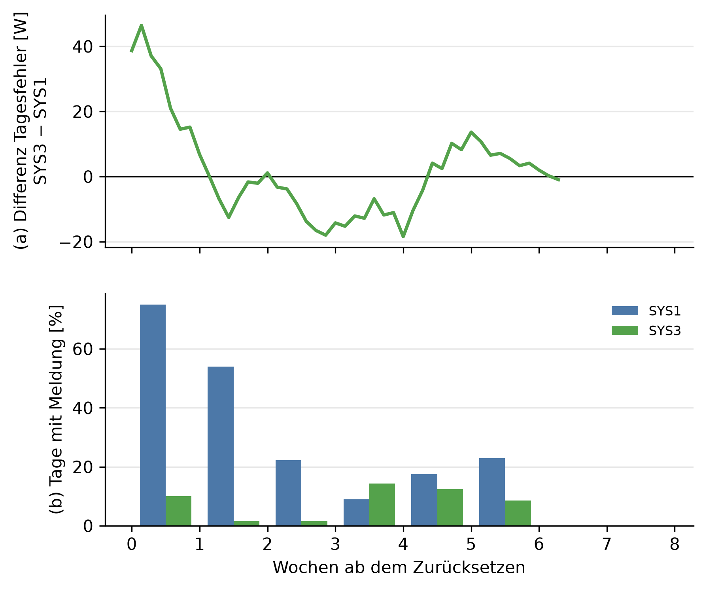

# E3: Nutzen der Adaption

## Setup

- Lauf: e3_007
- Stichtage: SF6: 02.12.2016, SF7: 13.01.2017, SF8: 20.02.2017
- Szenarien: ramp_28_strong, ramp_28_down_strong, scaled_strong, scaled_down_strong, jeweils ab dem Stichtag, dazu der Kontrolllauf
- Systeme: SYS1, SYS3
- Sprachmodell: ministral-3:8b, Prompt v30, ohne Kalender (CTX0)
- Fenster: 40 Tage vor und 60 Tage ab dem Stichtag
- Commit: f647560 (mit lokalen Änderungen)

## Kriterien der Teilfrage 3 aus E3

| Kriterium | Ziel | Ergebnis | erfüllt |
|---|---|---|---|
| Tagesfehler SYS3 minus SYS1 | < 0, belastbar | −0,9 W, 2 Standardfehler 6,9 W, nicht belastbar | nein |
| Meldungen SYS3 minus SYS1 | < 0 je 30 Tage | −7,9 | ja |

## Kennzahlen ab dem Zurücksetzen, SYS3 gegen SYS1

| Kennzahl | SYS1 | SYS3 |
|---|---|---|
| Fälle mit Zurücksetzen | 0 von 12 | 11 von 12 |
| Tagesfehler [W] | 90,9 | 90,0 |
| Differenz [W] | - | −0,9 |
| 2 Standardfehler [W] | - | 6,9 |
| gepaarte Tage | - | 347 |
| Differenz belastbar | - | nein |
| Meldungstage | 113 | 24 |
| Meldungen je 30 Tage | 10,1 | 2,1 |
| Differenz Meldungen | - | −7,9 |
| Zurücksetzen im Kontrolllauf | 0 | 0 |

## Tagesfehler und Meldungstage je Woche ab dem Zurücksetzen, alle Fälle

| Woche | Fälle | Tagesfehler SYS3 [W] | Tagesfehler SYS1 [W] | Differenz [W] | Meldungstage SYS1 | Meldungstage SYS3 |
|---:|---:|---:|---:|---:|---:|---:|
| 1 | 11 | 101,6 | 85,0 | 16,5 | 45 | 6 |
| 2 | 9 | 89,7 | 91,7 | −2,0 | 34 | 1 |
| 3 | 9 | 98,4 | 116,4 | −18,0 | 14 | 1 |
| 4 | 9 | 78,5 | 89,1 | −10,6 | 5 | 8 |
| 5 | 6 | 75,2 | 66,9 | 8,3 | 7 | 5 |
| 6 | 5 | 109,2 | 105,1 | 4,1 | 8 | 3 |
| 7 | 5 | 48,6 | 54,5 | −5,9 | 0 | 0 |
| 8 | 1 | 67,1 | 62,9 | 4,2 | 0 | 0 |

## Hinweise

- Tag = Entscheidungstag seit dem Stichtag, an Tag n wird Tag n−1 eingeordnet
- Fall = Stichtag × Szenario. Ein Fall geht in die Auswertung ein, wenn SYS3 die Historie zurücksetzt. Erkennung und Einordnung prüfen E1 und E2
- Tagesfehler: ab dem Tag des Zurücksetzens, denn die Prognose desselben Tages enthält es schon. SYS1 wird auf denselben Tagen gepaart und setzt nie zurück
- Meldungen: Tage nach dem Zurücksetzen, bei beiden Systemvarianten auf denselben Tagen. Als Meldung zählen peak, new_pattern, measurement_error
- Woche ab dem Zurücksetzen: Fälle mit spätem Zurücksetzen haben weniger Tage im Fenster und fallen in späteren Wochen heraus, die Spalte Fälle zeigt das
- Kontrolllauf über das ganze Fenster, jede Meldung dort ist unbegründet, jedes Zurücksetzen unnötig
- Das Kriterium zur Abwesenheit (Tagesfehler nach der Rückkehr) stammt aus den Läufen von E2
- Mehrlaufzeit: Laufzeit von SYS3 minus SYS1 je Szenario, geteilt durch die Aufrufe des Sprachmodells. Grobe Schätzung, die Zeit eines Aufrufs wird nicht einzeln gemessen
- belastbar: Betrag der Differenz größer als 2 Standardfehler der gepaarten Differenzen, grobe Faustregel

## Anhang

### Tagesfehler und Meldungstage je Woche ab dem Zurücksetzen, je Szenario

| Szenario | Woche | Fälle | Tagesfehler SYS3 [W] | Tagesfehler SYS1 [W] | Differenz [W] | Meldungstage SYS1 | Meldungstage SYS3 |
|---|---:|---:|---:|---:|---:|---:|---:|
| ramp_28_strong | 1 | 3 | 134,8 | 86,5 | 48,3 | 11 | 0 |
| ramp_28_strong | 2 | 3 | 144,1 | 148,6 | −4,5 | 11 | 1 |
| ramp_28_strong | 3 | 3 | 157,3 | 188,8 | −31,5 | 5 | 1 |
| ramp_28_strong | 4 | 3 | 106,2 | 107,7 | −1,5 | 5 | 1 |
| ramp_28_strong | 5 | 2 | 97,6 | 86,8 | 10,8 | 7 | 2 |
| ramp_28_strong | 6 | 2 | 122,8 | 119,6 | 3,2 | 8 | 2 |
| ramp_28_strong | 7 | 2 | 59,8 | 58,6 | 1,2 | 0 | 0 |
| ramp_28_down_strong | 1 | 3 | 72,4 | 94,1 | −21,7 | 14 | 2 |
| ramp_28_down_strong | 2 | 2 | 53,2 | 52,6 | 0,6 | 2 | 0 |
| ramp_28_down_strong | 3 | 2 | 50,4 | 51,0 | −0,6 | 0 | 0 |
| ramp_28_down_strong | 4 | 2 | 41,3 | 37,3 | 4,0 | 0 | 1 |
| ramp_28_down_strong | 5 | 1 | 69,0 | 70,3 | −1,4 | 0 | 0 |
| scaled_strong | 1 | 2 | 160,4 | 115,2 | 45,1 | 6 | 0 |
| scaled_strong | 2 | 1 | 57,1 | 62,0 | −5,0 | 7 | 0 |
| scaled_strong | 3 | 1 | 133,5 | 180,3 | −46,8 | 3 | 0 |
| scaled_strong | 4 | 1 | 127,7 | 207,1 | −79,5 | 0 | 6 |
| scaled_strong | 5 | 1 | 80,7 | 67,9 | 12,8 | 0 | 0 |
| scaled_strong | 6 | 1 | 144,7 | 131,2 | 13,4 | 0 | 0 |
| scaled_strong | 7 | 1 | 23,7 | 54,2 | −30,6 | 0 | 0 |
| scaled_down_strong | 1 | 3 | 66,8 | 61,0 | 5,8 | 14 | 4 |
| scaled_down_strong | 2 | 3 | 70,4 | 70,8 | −0,3 | 14 | 0 |
| scaled_down_strong | 3 | 3 | 59,7 | 66,2 | −6,4 | 6 | 0 |
| scaled_down_strong | 4 | 3 | 53,0 | 55,1 | −2,1 | 0 | 0 |
| scaled_down_strong | 5 | 2 | 52,3 | 45,2 | 7,1 | 0 | 3 |
| scaled_down_strong | 6 | 2 | 77,9 | 77,5 | 0,4 | 0 | 1 |
| scaled_down_strong | 7 | 2 | 57,2 | 52,2 | 5,0 | 0 | 0 |
| scaled_down_strong | 8 | 1 | 67,1 | 62,9 | 4,2 | 0 | 0 |

### Fälle je Stichtag und Szenario

| Stichtag | Szenario | Zurücksetzen an Tag | gepaarte Tage | Differenz Tagesfehler [W] | belastbar | Differenz Meldungen je 30 Tage |
|---|---|---:|---:|---:|---|---:|
| SF6 | ramp_28_strong | 17 | 44 | −6,0 | nein | −12,6 |
| SF6 | ramp_28_down_strong | 28 | 33 | −3,8 | nein | −6,6 |
| SF6 | scaled_strong | 58 | 3 | 115,2 | ja | 0,0 |
| SF6 | scaled_down_strong | 18 | 43 | −0,2 | nein | −5,7 |
| SF7 | ramp_28_strong | 16 | 45 | 1,9 | nein | −9,5 |
| SF7 | ramp_28_down_strong | 38 | 23 | −3,8 | nein | −4,1 |
| SF7 | scaled_strong | 14 | 47 | −16,6 | nein | −6,5 |
| SF7 | scaled_down_strong | 33 | 28 | −2,9 | nein | −4,4 |
| SF8 | ramp_28_strong | 35 | 26 | 23,5 | nein | −9,6 |
| SF8 | ramp_28_down_strong | 56 | 5 | −34,3 | nein | −22,5 |
| SF8 | scaled_strong | - | - | - | - | - |
| SF8 | scaled_down_strong | 11 | 50 | 3,5 | ja | −8,6 |

### Kontrolllauf: Meldungen und Zurücksetzen ohne Anlass

| Stichtag | System | Tage | Meldungstage | Zurücksetzen |
|---|---|---:|---:|---:|
| SF6 | SYS1 | 101 | 9 | 0 |
| SF6 | SYS3 | 101 | 9 | 0 |
| SF7 | SYS1 | 101 | 8 | 0 |
| SF7 | SYS3 | 101 | 8 | 0 |
| SF8 | SYS1 | 101 | 5 | 0 |
| SF8 | SYS3 | 101 | 5 | 0 |

### Laufzeit des Sprachmodells

| Stichtag | Szenario | Aufrufe | Ausfalltage | Mehrlaufzeit [s] | je Aufruf [s] |
|---|---|---:|---:|---:|---:|
| SF6 | Kontrolllauf | 36 | 0 | 690,2 | 19,2 |
| SF6 | ramp_28_strong | 41 | 0 | 734,4 | 17,9 |
| SF6 | ramp_28_down_strong | 32 | 0 | 588,0 | 18,4 |
| SF6 | scaled_strong | 55 | 0 | 1007,1 | 18,3 |
| SF6 | scaled_down_strong | 46 | 0 | 831,6 | 18,1 |
| SF7 | Kontrolllauf | 61 | 0 | 1137,2 | 18,6 |
| SF7 | ramp_28_strong | 40 | 0 | 737,4 | 18,4 |
| SF7 | ramp_28_down_strong | 35 | 0 | 652,4 | 18,6 |
| SF7 | scaled_strong | 49 | 0 | 914,1 | 18,7 |
| SF7 | scaled_down_strong | 37 | 0 | 697,9 | 18,9 |
| SF8 | Kontrolllauf | 55 | 0 | 1019,1 | 18,5 |
| SF8 | ramp_28_strong | 53 | 0 | 974,1 | 18,4 |
| SF8 | ramp_28_down_strong | 75 | 0 | 1375,3 | 18,3 |
| SF8 | scaled_strong | 79 | 0 | 1439,8 | 18,2 |
| SF8 | scaled_down_strong | 59 | 0 | 1076,2 | 18,2 |
| alle | alle | 753 | 0 | 13874,8 | 18,4 |
