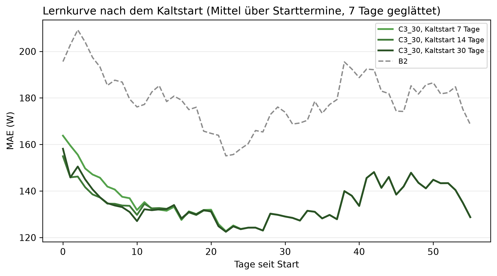

# E4 Kaltstart, Lauf e4_001

## Setup

- Starttermine: 2013-10-15, 2014-02-15, 2014-04-15, 2014-07-15
- Kaltstart: 7, 14, 30 Tage Historie vor dem Start
- Auswertung: 56 Tage ab Start, je Starttermin dieselben Kalendertage für alle Kaltstart-Längen
- Prognosemodell: C3_30
- Naive Referenz: B2
- Lernkurve: rückwärts gerichtetes Mittel über 7 Tage
- Commit: a3ddf39 (mit lokalen Änderungen)

## Kennzahlen

| Kennzahl | Wert | Bezug |
|---|---|---|
| Kaltstart 7 Tage: MAE über die Auswertung [W] | 134,9 | längster Kaltstart 133,9 W, B2 178,0 W |
| Kaltstart 7 Tage: Abstand zum längsten Kaltstart in Tag 0-6 [W] | 7,0 | gleiche Richtung 3/4 Starttermine |
| Kaltstart 7 Tage: spätester Break-even gegen B2 [Tag] | 1 | über alle Starttermine |

## C3_30 über alle Auswertungstage, Mittel über Starttermine

| Kaltstart [Tage] | MAE [W] | MAE B2 [W] | Skill ggü. B2 [%] | MAPE [%] | Abstand zum längsten Kaltstart [W] |
|---:|---:|---:|---:|---:|---:|
| 7 | 134,9 | 178,0 | 24,2 | 41,6 | 1,0 |
| 14 | 134,0 | 178,0 | 24,7 | 41,1 | 0,1 |
| 30 | 133,9 | 178,0 | 24,8 | 40,9 | 0,0 |

## Abstand zum längsten Kaltstart je Fenster und Starttermin [W], positiv = schlechter

| Kaltstart [Tage] | Tage seit Start | 2013-10-15 | 2014-02-15 | 2014-04-15 | 2014-07-15 | Mittel | gleiche Richtung |
|---:|---|---:|---:|---:|---:|---:|---|
| 7 | 0-6 | 6,8 | 2,0 | 23,9 | -4,9 | 7,0 | 3/4 |
| 7 | 7-13 | 1,0 | -8,6 | 0,7 | 6,5 | -0,1 | 1/4 |
| 7 | 14-27 | -0,7 | 0,8 | 0,5 | 1,1 | 0,4 | 3/4 |
| 7 | 28-55 | 0,0 | 0,0 | 0,0 | 0,0 | 0,0 | - |
| 14 | 0-6 | -0,9 | -3,7 | 6,2 | -2,6 | -0,3 | 3/4 |
| 14 | 7-13 | 0,8 | -4,9 | 3,6 | 2,9 | 0,6 | 3/4 |
| 14 | 14-27 | -0,0 | 0,4 | 0,1 | -0,0 | 0,1 | 2/4 |
| 14 | 28-55 | 0,0 | 0,0 | 0,0 | 0,0 | 0,0 | - |

## Break-even: erster Tag, an dem die Lernkurve unter B2 liegt

| Kaltstart [Tage] | 2013-10-15 | 2014-02-15 | 2014-04-15 | 2014-07-15 | Mittel |
|---:|---:|---:|---:|---:|---:|
| 7 | 1 | 0 | 1 | 0 | 0,5 |
| 14 | 0 | 0 | 1 | 0 | 0,2 |
| 30 | 0 | 0 | 1 | 0 | 0,2 |

## Hinweise

- Break-even leer = im ganzen Auswertungszeitraum nie unter der Referenz

