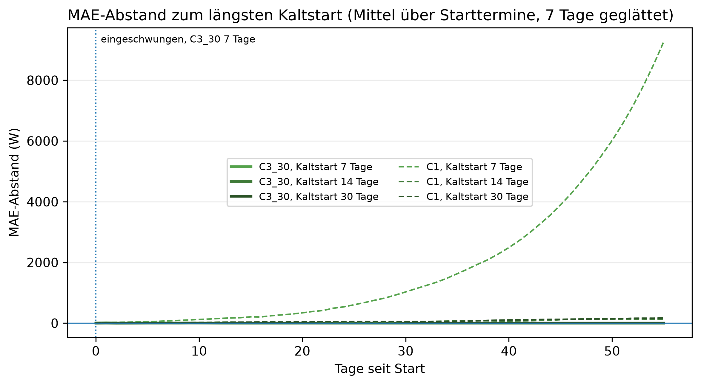
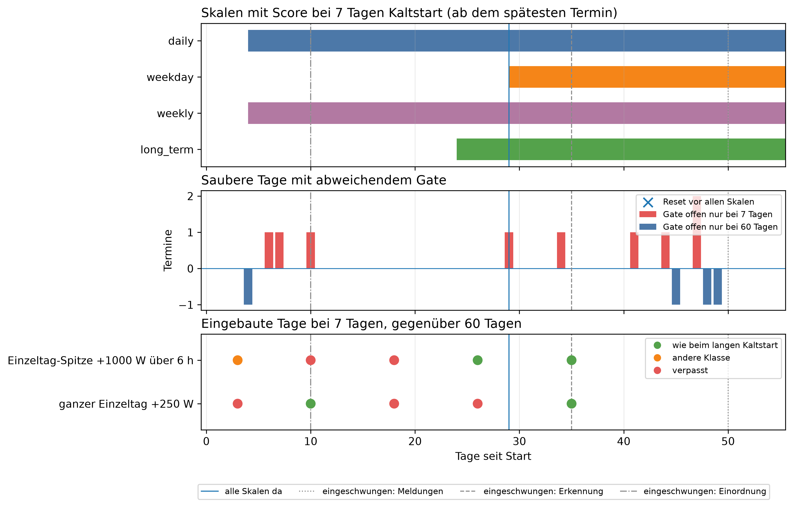

# E4 Kaltstart, Lauf e4_002

## Setup

- Starttermine: 2013-10-15, 2014-02-15, 2014-04-15, 2014-07-15 (train)
- Kaltstart: E4a 7, 14, 30, 60 Tage, E4b 7, 60 Tage, jeweils alle Tage am ersten Entscheidungstag, der erste eingeordnete Tag zählt mit
- Auswertung: 56 Tage ab Start, je Starttermin dieselben Kalendertage für alle Kaltstart-Längen
- Prognose (E4a): C3_30 täglich nachtrainiert, C1 nur auf den Starttagen, Baseline B2, Seed 42
- Kreislauf (E4b): SYS3 LLM, ministral-3:8b, Prompt v16, Temperatur 0, Adaption an
- Injektionen: Einzeltag-Spitze +1000 W über 6 h, ganzer Einzeltag +250 W, je Lauf eine, an Tag 3, 10, 18, 26, 35, eingeordnet am Tag danach
- Commit: 4f7078e

## Antwort auf TF1: funktioniert mit 7 Tagen: ja (keine Fehlfunktion, von Anfang an nutzbar, passt sich an)

| Kriterium | Prüfung | erfüllt | Wert |
|---|---|---|---:|
| keine Fehlfunktion | Resets, solange nicht alle Skalen einen Score haben | ja | 0,0 |
| von Anfang an nutzbar | Skill der Prognose gegenüber der Baseline in Woche 1 [%] | ja | 23,7 |
| von Anfang an nutzbar | erster Tag mit Gate-Skala, spätester Termin | ja | 4,0 |
| passt sich an | Einschwingtag Prognose | ja | 0,0 |
| passt sich an | Einschwingtag Meldungen, spätester Termin | ja | 50,0 |
| passt sich an | Einschwingtag Erkennung, spätester Termin und Art | ja | 35,0 |
| passt sich an | Einschwingtag Einordnung, spätester Termin und Art | ja | 10,0 |
| adaptiv gegen statisch | Anteil der Fenster ab Woche 2, in denen statisch an jedem Termin schlechter ist | nein | 0,8 |

## Resets in der Einschwingzeit

| Starttermin | Kaltstart [Tage] | Szenario | Injektionstag | eingeordneter Tag | Tag seit Start | Klasse | Skalen mit Score | anhaltend auffällige Skalen |
|---|---:|---|---:|---|---:|---|---:|---:|

## Preis bis zum Einschwingen: 7 gegenüber 60 Tagen Kaltstart, alle Termine

| Kennzahl | Wert | Bezug |
|---|---|---|
| Zusatz-MAE der Prognose [W], Tag 0-6 | 7,4 | bei 135,3 W mit langem Kaltstart (5,5 %) |
| Zusatz-MAE der Prognose [W], Tag 7-13 | -0,1 | bei 132,1 W mit langem Kaltstart (-0,1 %) |
| Zusatz-MAE der Prognose [W], Tag 14-27 | 0,4 | bei 127,5 W mit langem Kaltstart (0,3 %) |
| Zusatz-MAE der Prognose [W], Tag 28-55 | 0,0 | bei 137,2 W mit langem Kaltstart (0,0 %) |
| Meldetage nur mit kurzem Kaltstart | 9 | von 224 sauberen Tagen (4,0 %) |
| Meldetage nur mit langem Kaltstart | 4 | von 224 sauberen Tagen (1,8 %) |
| unknown-Tage, Tag 0-6 | 16 | von 28 sauberen Tagen (57,1 %) |
| verpasste Injektionen, ganzer Einzeltag +250 W | 5 | von 8, die der lange Kaltstart meldet (62,5 %) |
| verpasste Injektionen, Einzeltag-Spitze +1000 W über 6 h | 2 | von 20, die der lange Kaltstart meldet (10,0 %) |
| Injektionen mit anderer Klasse, ganzer Einzeltag +250 W | 0 | von 8, die der lange Kaltstart meldet (0,0 %) |
| Injektionen mit anderer Klasse, Einzeltag-Spitze +1000 W über 6 h | 1 | von 20, die der lange Kaltstart meldet (5,0 %) |
| Injektionen mit unknown statt Klasse, ganzer Einzeltag +250 W | 0 | von 8, die der lange Kaltstart meldet (0,0 %) |
| Injektionen mit unknown statt Klasse, Einzeltag-Spitze +1000 W über 6 h | 0 | von 20, die der lange Kaltstart meldet (0,0 %) |

## Hinweise

- Tag 0 = erster prognostizierter Tag, eingeordnet wird an ihm der letzte Tag der Start-Historie. Ein Injektionstag k wird am Tag k + 1 eingeordnet
- Einschwingtag leer: im letzten Fenster, am letzten Tag bzw. am letzten Injektionstag noch abweichend, also nicht eingeschwungen
- Einschwingtage Erkennung und Einordnung nur so fein wie die Injektionstage
- MAPE C3_30 mit 7 Tagen in Tag 28-55: 41,1 % (Proposal-Kriterium 10 %, hier kein Maßstab)
- Kontrolle Prognose im Kreislauf gegen Walk-Forward bis zum ersten Reset, soll 0 sein: größte Abweichung 7 Tage 0,0 W, 60 Tage 0,0 W
- belastbar: Betrag der Differenz größer als 2 Standardfehler der gepaarten Differenzen, grobe Faustregel
- Einschränkungen: ein Haushalt, wenige Termine, aufeinanderfolgende Tage sind nicht unabhängig (Standardfehler eher zu klein), LLM mit Temperatur 0 als deterministisch angenommen (Ollama auf GPU nicht garantiert bitgenau)

## Anhang

### Einschwingen Prognose: erster Tag des Fensters, ab dem der Abstand zu 60 Tagen im Rauschen liegt

| Modell | Kaltstart [Tage] | Einschwingtag |
|---|---:|---:|
| C1 | 7 | - |
| C1 | 14 | - |
| C1 | 30 | - |
| C3_30 | 7 | 0 |
| C3_30 | 14 | 0 |
| C3_30 | 30 | 0 |

### Einschwingen Meldungen je Termin: saubere Tage mit Gate offen nur bei 7 bzw. nur bei 60 Tagen

| Starttermin | nur bei 7 Tagen | nur bei 60 Tagen | Einschwingtag |
|---|---:|---:|---:|
| 2013-10-15 | 1 | 3 | 50 |
| 2014-02-15 | 6 | 0 | 48 |
| 2014-04-15 | 1 | 1 | 49 |
| 2014-07-15 | 1 | 0 | 11 |

### Einschwingen Erkennung und Einordnung je Termin: erster Injektionstag, ab dem alle späteren wie beim langen Kaltstart sind

| Starttermin | Szenario | Erkennung | Einordnung |
|---|---|---:|---:|
| 2013-10-15 | ganzer Einzeltag +250 W | 10 | 3 |
| 2013-10-15 | Einzeltag-Spitze +1000 W über 6 h | 3 | 10 |
| 2014-02-15 | ganzer Einzeltag +250 W | 35 | 3 |
| 2014-02-15 | Einzeltag-Spitze +1000 W über 6 h | 3 | 3 |
| 2014-04-15 | ganzer Einzeltag +250 W | 35 | 3 |
| 2014-04-15 | Einzeltag-Spitze +1000 W über 6 h | 26 | 3 |
| 2014-07-15 | ganzer Einzeltag +250 W | 10 | 3 |
| 2014-07-15 | Einzeltag-Spitze +1000 W über 6 h | 3 | 3 |

### MAE-Abstand zu 60 Tagen je Modell, gepaart über Termin und Tag, positiv = schlechter

| Modell | Kaltstart [Tage] | Tage seit Start | Differenz [W] | 2 Standardfehler [W] | Tage | Tage besser [%] | belastbar |
|---|---:|---|---:|---:|---:|---:|---|
| C1 | 7 | 0-6 | 58,2 | 23,8 | 27 | 11,1 | ja |
| C1 | 14 | 0-6 | 13,7 | 15,9 | 27 | 40,7 | nein |
| C1 | 30 | 0-6 | 10,9 | 12,5 | 27 | 25,9 | nein |
| C1 | 7 | 7-13 | 169,4 | 71,8 | 28 | 3,6 | ja |
| C1 | 14 | 7-13 | 35,6 | 14,4 | 28 | 10,7 | ja |
| C1 | 30 | 7-13 | 30,2 | 10,7 | 28 | 10,7 | ja |
| C1 | 7 | 14-27 | 555,0 | 249,8 | 55 | 14,5 | ja |
| C1 | 14 | 14-27 | 24,4 | 21,3 | 55 | 34,5 | ja |
| C1 | 30 | 14-27 | 47,3 | 18,8 | 55 | 21,8 | ja |
| C1 | 7 | 28-55 | 4633,9 | 1821,8 | 112 | 2,7 | ja |
| C1 | 14 | 28-55 | 103,2 | 24,1 | 112 | 9,8 | ja |
| C1 | 30 | 28-55 | 119,7 | 30,9 | 112 | 11,6 | ja |
| C3_30 | 7 | 0-6 | 7,4 | 9,1 | 27 | 40,7 | nein |
| C3_30 | 14 | 0-6 | -0,2 | 5,2 | 27 | 59,3 | nein |
| C3_30 | 30 | 0-6 | 0,0 | 0,0 | 27 | 0,0 | nein |
| C3_30 | 7 | 7-13 | -0,1 | 4,0 | 28 | 42,9 | nein |
| C3_30 | 14 | 7-13 | 0,6 | 2,3 | 28 | 42,9 | nein |
| C3_30 | 30 | 7-13 | 0,0 | 0,0 | 28 | 0,0 | nein |
| C3_30 | 7 | 14-27 | 0,4 | 1,1 | 55 | 32,7 | nein |
| C3_30 | 14 | 14-27 | 0,1 | 0,2 | 55 | 5,5 | nein |
| C3_30 | 30 | 14-27 | 0,0 | 0,0 | 55 | 0,0 | nein |
| C3_30 | 7 | 28-55 | 0,0 | 0,0 | 112 | 0,0 | nein |
| C3_30 | 14 | 28-55 | 0,0 | 0,0 | 112 | 0,0 | nein |
| C3_30 | 30 | 28-55 | 0,0 | 0,0 | 112 | 0,0 | nein |

### Meldetage und unknown an sauberen Tagen je Fenster

| Kaltstart [Tage] | Tage seit Start | Tage | Meldetage | unknown | Meldungen je 30 Tage | unknown je 30 Tage |
|---:|---|---:|---:|---:|---:|---:|
| 7 | 0-6 | 28 | 1 | 16 | 1,1 | 17,1 |
| 7 | 7-13 | 28 | 3 | 0 | 3,2 | 0,0 |
| 7 | 14-27 | 56 | 1 | 0 | 0,5 | 0,0 |
| 7 | 28-55 | 112 | 9 | 9 | 2,4 | 2,4 |
| 60 | 0-6 | 28 | 1 | 2 | 1,1 | 2,1 |
| 60 | 7-13 | 28 | 1 | 1 | 1,1 | 1,1 |
| 60 | 14-27 | 56 | 1 | 0 | 0,5 | 0,0 |
| 60 | 28-55 | 112 | 6 | 6 | 1,6 | 1,6 |

### Adaptiv gegen statisch: MAE statisch minus adaptiv je Termin [W], positiv = adaptiv besser

| Tage seit Start | Kaltstart [Tage] | Modell | 2013-10-15 | 2014-02-15 | 2014-04-15 | 2014-07-15 | Mittel | gleiche Richtung |
|---|---:|---|---:|---:|---:|---:|---:|---|
| 0-6 | 7 | C1 | 38,7 | 138,9 | 72,8 | 7,2 | 64,4 | 4/4 |
| 0-6 | 14 | C1 | 20,6 | 2,5 | 87,9 | 3,6 | 28,7 | 4/4 |
| 0-6 | 30 | C1 | 12,8 | 5,7 | 75,8 | 9,9 | 26,0 | 4/4 |
| 0-6 | 60 | C1 | 6,8 | 30,7 | 24,4 | -1,3 | 15,2 | 3/4 |
| 7-13 | 7 | C1 | 124,0 | 463,3 | 169,8 | 33,2 | 197,6 | 4/4 |
| 7-13 | 14 | C1 | 59,6 | 9,9 | 165,9 | 16,8 | 63,1 | 4/4 |
| 7-13 | 30 | C1 | 42,2 | 4,9 | 153,7 | 32,1 | 58,2 | 4/4 |
| 7-13 | 60 | C1 | 26,6 | -4,2 | 91,0 | -1,1 | 28,1 | 2/4 |
| 14-27 | 7 | C1 | 319,0 | 2038,5 | 196,5 | 38,9 | 648,2 | 4/4 |
| 14-27 | 14 | C1 | 147,5 | 12,6 | 196,7 | 8,5 | 91,3 | 4/4 |
| 14-27 | 30 | C1 | 91,0 | -1,9 | 189,8 | 175,2 | 113,5 | 3/4 |
| 14-27 | 60 | C1 | 53,2 | 32,3 | 142,8 | 42,6 | 67,7 | 4/4 |
| 28-55 | 7 | C1 | 986,9 | 17556,8 | 164,9 | 133,3 | 4710,5 | 4/4 |
| 28-55 | 14 | C1 | 357,7 | 93,7 | 164,9 | 102,9 | 179,8 | 4/4 |
| 28-55 | 30 | C1 | 185,5 | 57,0 | 163,9 | 378,7 | 196,3 | 4/4 |
| 28-55 | 60 | C1 | 91,8 | 44,9 | 145,0 | 24,7 | 76,6 | 4/4 |

### Prognose je Fenster: MAE, MAPE und Skill gegenüber der Baseline, Mittel über Termine

| Kaltstart [Tage] | Tage seit Start | Modell | MAE [W] | MAPE [%] | MAE Baseline [W] | Skill [%] |
|---:|---|---|---:|---:|---:|---:|
| 7 | 0-6 | B2 | 187,2 | 63,5 | 187,2 | 0,0 |
| 7 | 0-6 | C1 | 209,3 | 78,4 | 187,2 | -11,8 |
| 7 | 0-6 | C3_30 | 142,8 | 47,0 | 187,2 | 23,7 |
| 7 | 7-13 | B2 | 185,3 | 60,6 | 185,3 | 0,0 |
| 7 | 7-13 | C1 | 329,6 | 113,3 | 185,3 | -77,9 |
| 7 | 7-13 | C3_30 | 132,0 | 40,4 | 185,3 | 28,8 |
| 7 | 14-27 | B2 | 165,2 | 55,0 | 165,2 | 0,0 |
| 7 | 14-27 | C1 | 750,9 | 294,6 | 165,2 | -354,5 |
| 7 | 14-27 | C3_30 | 127,9 | 40,5 | 165,2 | 22,6 |
| 7 | 28-55 | B2 | 180,3 | 54,3 | 180,3 | 0,0 |
| 7 | 28-55 | C1 | 4847,7 | 1717,5 | 180,3 | -2588,5 |
| 7 | 28-55 | C3_30 | 137,2 | 41,1 | 180,3 | 23,9 |
| 14 | 0-6 | B2 | 187,2 | 63,5 | 187,2 | 0,0 |
| 14 | 0-6 | C1 | 164,8 | 51,0 | 187,2 | 12,0 |
| 14 | 0-6 | C3_30 | 135,2 | 42,4 | 187,2 | 27,8 |
| 14 | 7-13 | B2 | 185,3 | 60,6 | 185,3 | 0,0 |
| 14 | 7-13 | C1 | 195,7 | 58,8 | 185,3 | -5,6 |
| 14 | 7-13 | C3_30 | 132,7 | 40,6 | 185,3 | 28,4 |
| 14 | 14-27 | B2 | 165,2 | 55,0 | 165,2 | 0,0 |
| 14 | 14-27 | C1 | 220,3 | 77,2 | 165,2 | -33,4 |
| 14 | 14-27 | C3_30 | 127,6 | 40,6 | 165,2 | 22,8 |
| 14 | 28-55 | B2 | 180,3 | 54,3 | 180,3 | 0,0 |
| 14 | 28-55 | C1 | 317,1 | 106,1 | 180,3 | -75,8 |
| 14 | 28-55 | C3_30 | 137,2 | 41,1 | 180,3 | 23,9 |
| 30 | 0-6 | B2 | 187,2 | 63,5 | 187,2 | 0,0 |
| 30 | 0-6 | C1 | 162,0 | 52,3 | 187,2 | 13,5 |
| 30 | 0-6 | C3_30 | 135,3 | 41,7 | 187,2 | 27,7 |
| 30 | 7-13 | B2 | 185,3 | 60,6 | 185,3 | 0,0 |
| 30 | 7-13 | C1 | 190,3 | 63,3 | 185,3 | -2,7 |
| 30 | 7-13 | C3_30 | 132,1 | 39,9 | 185,3 | 28,7 |
| 30 | 14-27 | B2 | 165,2 | 55,0 | 165,2 | 0,0 |
| 30 | 14-27 | C1 | 243,1 | 98,7 | 165,2 | -47,2 |
| 30 | 14-27 | C3_30 | 127,5 | 40,6 | 165,2 | 22,8 |
| 30 | 28-55 | B2 | 180,3 | 54,3 | 180,3 | 0,0 |
| 30 | 28-55 | C1 | 333,5 | 128,3 | 180,3 | -85,0 |
| 30 | 28-55 | C3_30 | 137,2 | 41,1 | 180,3 | 23,9 |
| 60 | 0-6 | B2 | 187,2 | 63,5 | 187,2 | 0,0 |
| 60 | 0-6 | C1 | 151,1 | 50,3 | 187,2 | 19,3 |
| 60 | 0-6 | C3_30 | 135,3 | 41,7 | 187,2 | 27,7 |
| 60 | 7-13 | B2 | 185,3 | 60,6 | 185,3 | 0,0 |
| 60 | 7-13 | C1 | 160,2 | 52,5 | 185,3 | 13,6 |
| 60 | 7-13 | C3_30 | 132,1 | 39,9 | 185,3 | 28,7 |
| 60 | 14-27 | B2 | 165,2 | 55,0 | 165,2 | 0,0 |
| 60 | 14-27 | C1 | 195,8 | 77,2 | 165,2 | -18,6 |
| 60 | 14-27 | C3_30 | 127,5 | 40,6 | 165,2 | 22,8 |
| 60 | 28-55 | B2 | 180,3 | 54,3 | 180,3 | 0,0 |
| 60 | 28-55 | C1 | 213,8 | 81,1 | 180,3 | -18,6 |
| 60 | 28-55 | C3_30 | 137,2 | 41,1 | 180,3 | 23,9 |

### Kontrolle: erster Tag mit Score je Skala bei 7 Tagen, saubere Läufe, Historie = Kaltstart + Tag

| Kaltstart [Tage] | Skala | Termine | spätester Tag | Historie am spätesten Tag |
|---:|---|---:|---:|---:|
| 7 | daily | 4 | 4 | 11 |
| 7 | weekday | 4 | 29 | 36 |
| 7 | weekly | 4 | 4 | 11 |
| 7 | long_term | 4 | 24 | 31 |
| 7 | erste Gate-Skala | 4 | 4 | 11 |
| 7 | alle vier (Einschwingzeit) | 4 | 29 | 36 |
