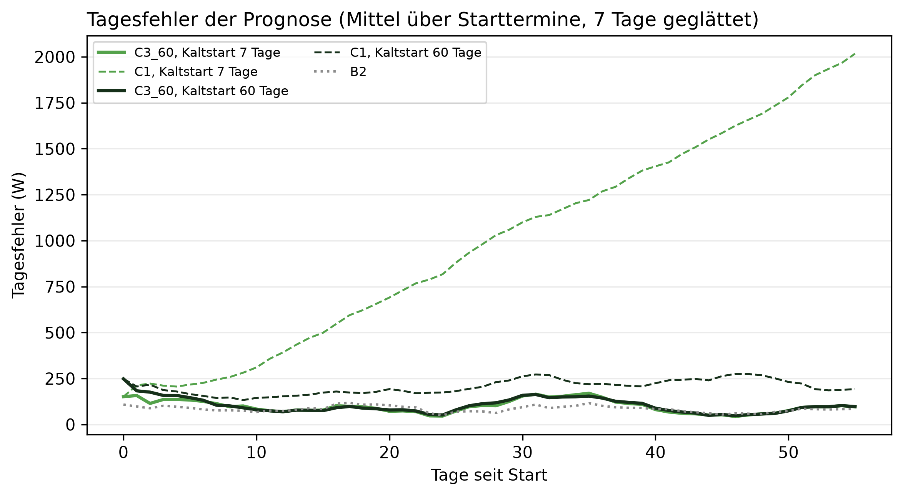

# E4 Kaltstart, Lauf e4_003

## Setup

- Starttermine: Standard-Cutover CO6 (2016-12-02), CO7 (2017-02-20) (test)
- Kaltstart: 7, 60 Tage, jeweils alle Tage am ersten Entscheidungstag, der erste eingeordnete Tag zählt mit
- Auswertung: 56 Tage ab Start in Wochen zu 7 Tagen, je Starttermin dieselben Kalendertage für alle Kaltstart-Längen
- Prognose (E4a): C3_60 täglich nachtrainiert, C1 nur auf den Starttagen, Baseline B2, Seed 42
- Kreislauf (E4b): SYS3 LLM, ministral-3:8b, Prompt v30, Temperatur 0, Adaption an
- Injektionen: Spitze +670 W über 6 h, ganzer Tag +190 W, je Lauf eine, an Tag 3, 10, 18, 26, 35, 43, 51, eingeordnet am Tag danach
- Commit: a75350d (mit lokalen Änderungen)

## Antwort auf TF4: funktioniert mit 7 Tagen: nein (Prognose, keine Fehlfunktion, Erkennung)

| Bedingung | Prüfung | erfüllt | Wert |
|---|---|---|---:|
| Prognose | Wochen, in denen der Tagesfehler belastbar über dem des langen Kaltstarts liegt | ja | 0,0 |
| Prognose | Tagesfehler gegenüber der Baseline in Woche 1 [W], höchstens 0 | nein | 43,7 |
| keine Fehlfunktion | Läufe, in denen nur der kurze Kaltstart zurücksetzt, über alle Tage | ja | 0,0 |
| Erkennung | Injektionen ab dem Tag mit weekday, die nur der lange Kaltstart erkennt | ja | 0,0 |

## Kennzahlen insgesamt: 7 gegenüber 60 Tagen Kaltstart, alle Termine

| Kennzahl | C3_60, Kaltstart 7 Tage | C3_60, Kaltstart 60 Tage (Referenz) |
|---|---|---|
| Prognosefehler gesamt [W] | 95,4 | 97,9 |
| Prognosefehler gegenüber C1 [W], negativ = besser | -988,1 | -106,5 |
| Prognosefehler gegenüber B2 [W], negativ = besser | 12,3 | 14,8 |
| Falschmeldungen: Tage, an denen nur der kurze Kaltstart meldet | 4 von 112 | - |
| Verpasste Meldungen: Tage, an denen nur der lange Kaltstart meldet | 7 von 112 | - |
| Anomalie erkannt: eingebaute Injektionen mit der erwarteten Klasse | 13 von 28 | 17 von 28 |
| Falsche new_pattern: Läufe mit Reset nur beim kurzen Kaltstart | 0 von 30 | - |

## Einpegeln: 7 gegenüber 60 Tagen Kaltstart je Woche nach Start

| Woche | Prognose C3_60: 7 minus 60 Tage [W] | belastbar | Falschmeldungen (nur bei 7 Tagen gemeldet) | Verpasste Meldungen (nur bei 60 Tagen gemeldet) | Anomalie erkannt, 7 Tage | Anomalie erkannt, 60 Tage | falsche new_pattern (nur bei 7 Tagen) |
|---|---|---|---:|---:|---|---|---:|
| 1 | -6,1 | nein | 1 | 0 | 0 von 4 | 3 von 4 | 0 |
| 2 | 1,3 | nein | 0 | 1 | 1 von 4 | 4 von 4 | 0 |
| 3 | -7,0 | nein | 0 | 3 | 0 von 4 | 2 von 4 | 0 |
| 4 | -10,1 | nein | 0 | 0 | 2 von 4 | 2 von 4 | 0 |
| 5 | 11,1 | nein | 0 | 2 | - | - | 0 |
| 6 | -8,6 | nein | 1 | 1 | 4 von 4 | 2 von 4 | 0 |
| 7 | 0,7 | nein | 2 | 0 | 4 von 4 | 3 von 4 | 0 |
| 8 | -1,1 | nein | 0 | 0 | 2 von 4 | 1 von 4 | 0 |
| gesamt | -2,5 | nein | 4 | 7 | 13 von 28 | 17 von 28 | 0 |

## Einschwingwoche: erste Woche, ab der es keine Abweichung mehr gibt

| Größe | eingeschwungen ab Woche |
|---|---:|
| Prognose | 1 |
| Meldungen | 8 |
| Erkennung | 4 |

## Hinweise

- Tag 0 = erster prognostizierter Tag, eingeordnet wird an ihm der letzte Tag der Start-Historie. Ein Injektionstag k wird am Tag k + 1 eingeordnet
- Als Meldung zählen die Klassen peak, new_pattern, measurement_error, low und unknown nicht. Falsch und verpasst sind Abweichungen vom langen Kaltstart am selben Tag im sauberen Lauf. Es sind echte Daten, eine Meldung nur beim kurzen Kaltstart kann also auch berechtigt sein
- Anomalie erkannt: am Tag nach dem Injektionstag ist die Klasse die erwartete, Wahrheit ist die eingebaute Injektion. Der lange Kaltstart erkennt selbst nur einen Teil
- Falsche new_pattern: Läufe, sauber und mit Injektion, in denen der kurze Kaltstart zurücksetzt und der lange am selben Tag nicht
- Einschwingwoche: Prognose nach der 2-Standardfehler-Regel, Meldungen und Resets nach jeder Abweichung, Erkennung nach jeder Injektion, die nur der lange Kaltstart erkennt. Erkennung ist nur bis zur letzten Injektionswoche belegt
- MAPE C3_60 mit 7 Tagen: 71,0 % (Proposal-Kriterium 10 %, hier kein Maßstab)
- Kontrolle Prognose im Kreislauf gegen Walk-Forward bis zum ersten Reset, soll 0 sein: größte Abweichung 7 Tage 0,0 W, 60 Tage 0,0 W
- belastbar: Betrag der Differenz größer als 2 Standardfehler der gepaarten Differenzen, grobe Faustregel
- Einschränkungen: ein Haushalt, wenige Termine, aufeinanderfolgende Tage sind nicht unabhängig (Standardfehler eher zu klein), LLM mit Temperatur 0 als deterministisch angenommen (Ollama auf GPU nicht garantiert bitgenau)

## Anhang

### Prognose je Woche nach Start: Tagesfehler C3_60 minus Vergleichsmodell [W], negativ = C3_60 besser

| Woche | 7 Tage: C3_60 minus C1 | 60 Tage: C3_60 minus C1 | 7 Tage: C3_60 minus B2 | 60 Tage: C3_60 minus B2 | C3_60: 7 Tage minus 60 Tage |
|---:|---:|---:|---:|---:|---:|
| 1 | -100,7 | -23,6 | 43,7 | 49,7 | -6,1 |
| 2 | -355,0 | -78,9 | -0,4 | -1,7 | 1,3 |
| 3 | -618,8 | -113,6 | -32,2 | -25,2 | -7,0 |
| 4 | -878,2 | -91,8 | 32,0 | 42,1 | -10,1 |
| 5 | -1041,6 | -73,9 | 60,3 | 49,2 | 11,1 |
| 6 | -1357,7 | -163,9 | -15,8 | -7,3 | -8,6 |
| 7 | -1632,5 | -210,4 | 0,7 | 0,1 | 0,7 |
| 8 | -1920,6 | -95,5 | 10,4 | 11,5 | -1,1 |

### Eingebaute Tage: ✓ = Klasse am Tag nach dem Injektionstag ist die erwartete, – = nicht

| Szenario | Injektionstag | 2016-12-02, 7 Tage | 2016-12-02, 60 Tage | 2017-02-20, 7 Tage | 2017-02-20, 60 Tage |
|---|---:|---|---|---|---|
| ganzer Tag +190 W | 3 | – | ✓ | – | ✓ |
| ganzer Tag +190 W | 10 | – | ✓ | – | ✓ |
| ganzer Tag +190 W | 18 | – | – | – | ✓ |
| ganzer Tag +190 W | 26 | – | – | ✓ | ✓ |
| ganzer Tag +190 W | 35 | ✓ | – | ✓ | ✓ |
| ganzer Tag +190 W | 43 | ✓ | – | ✓ | ✓ |
| ganzer Tag +190 W | 51 | ✓ | – | – | – |
| Spitze +670 W über 6 h | 3 | – | ✓ | – | – |
| Spitze +670 W über 6 h | 10 | – | ✓ | ✓ | ✓ |
| Spitze +670 W über 6 h | 18 | – | – | – | ✓ |
| Spitze +670 W über 6 h | 26 | – | – | ✓ | ✓ |
| Spitze +670 W über 6 h | 35 | ✓ | – | ✓ | ✓ |
| Spitze +670 W über 6 h | 43 | ✓ | ✓ | ✓ | ✓ |
| Spitze +670 W über 6 h | 51 | ✓ | ✓ | – | – |
