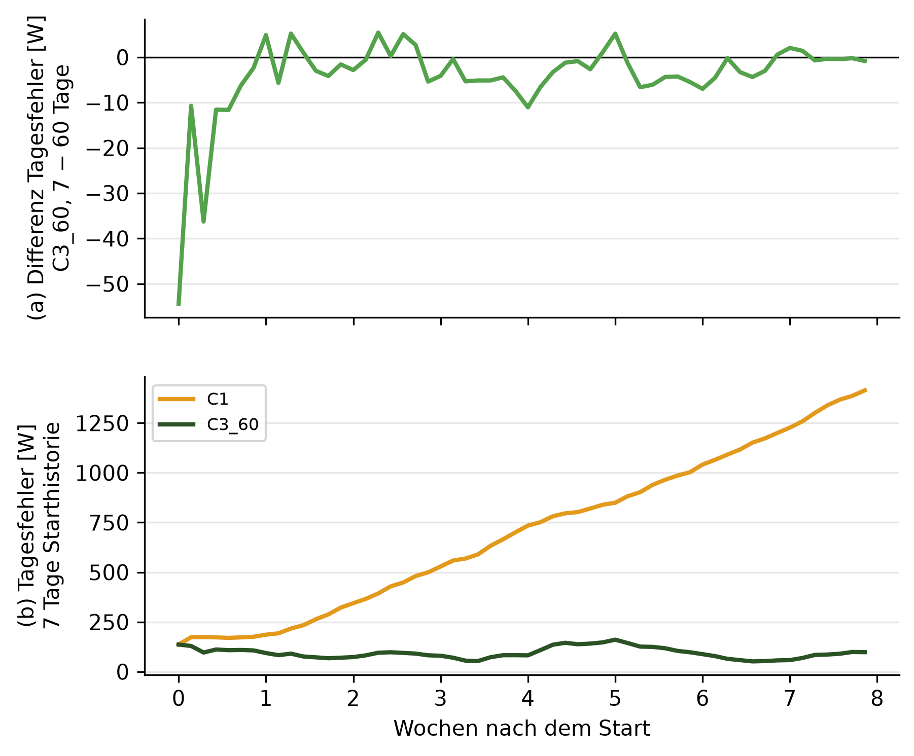
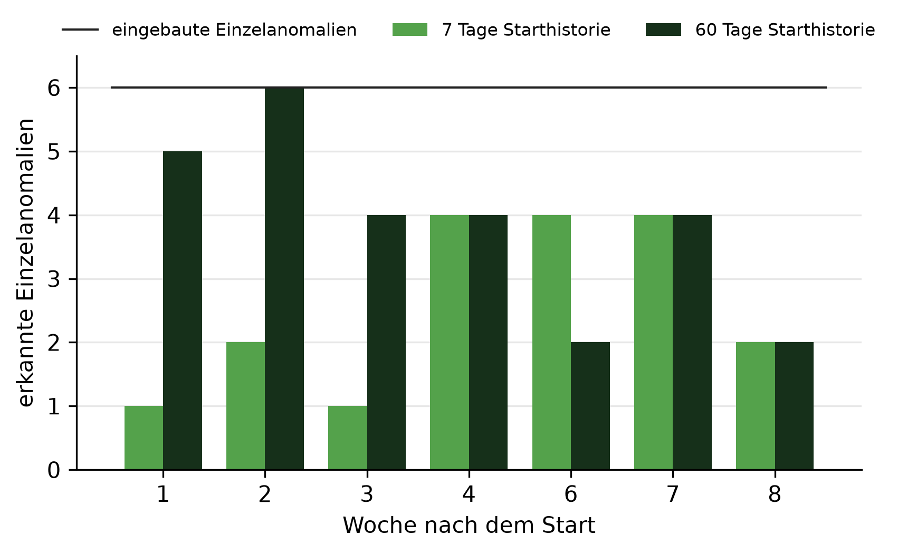

# E4: Preis einer Adaption

## Setup

- Lauf: e4_004
- Stichtage: SF6: 02.12.2016, SF7: 13.01.2017, SF8: 20.02.2017
- Szenarien: peak, level, dazu der Kontrolllauf
- Systeme: SYS3 mit Adaption
- Sprachmodell: ministral-3:8b, Prompt v30, ohne Kalender (CTX0)
- Einbautage: je Lauf ein Einbau an Tag 3, 10, 18, 26, 35, 43, 51
- Starthistorie: 7 und 60 Tage
- Auswertung: 56 Tage ab dem Start in Wochen zu 7 Tagen, je Stichtag dieselben Kalendertage für beide Starthistorien
- Prognosemodelle: C3_60 täglich nachtrainiert, C1 statisch, nur auf der Starthistorie trainiert
- Commit: abb4823

## Kriterien der Teilfrage 4

| Kriterium | Ziel | Ergebnis | erfüllt |
|---|---|---|---|
| Tagesfehler bei 7 Tagen belastbar höher | 0 Wochen | 0 von 8 | ja |
| zusätzliches Zurücksetzen | 0 Läufe | 13 von 45 | nein |
| Erkennungsrate, 7 bezogen auf 60 Tage | ≥ 90 % | 14 von 27 (52 %) | nein |
| Tagesfehler, C3_60 minus C1, 7 Tage | < 0, belastbar | −676,5 W, 2 Standardfehler 177,9 W, belastbar | ja |

## Kennzahlen über alle Starttermine, Starthistorie 7 gegen 60 Tage

| Kennzahl | 7 Tage | 60 Tage |
|---|---|---|
| Tagesfehler C3_60 [W] | 92,8 | 95,5 |
| Tagesfehler C3_60 minus C1 [W] | −676,5 | −121,1 |
| Erkannte Einzelanomalien (erwartete Klasse am Tag nach dem Einbau) | 18 von 42 | 27 von 42 |
| Tage im Kontrolllauf, an denen nur bei 7 Tagen gemeldet wird | 7 von 168 | - |
| Tage im Kontrolllauf, an denen nur bei 60 Tagen gemeldet wird | 10 von 168 | - |
| Läufe mit Zurücksetzen nur bei 7 Tagen | 13 von 45 | - |

## Starthistorie 7 gegen 60 Tage je Woche nach dem Start

| Woche | Differenz Tagesfehler [W] | belastbar | Meldung nur bei 7 | Meldung nur bei 60 | erkannt bei 7 | erkannt bei 60 | Zurücksetzen nur bei 7 |
|---|---|---|---:|---:|---|---|---:|
| 1 | −2,4 | nein | 1 | 2 | 1 von 6 | 5 von 6 | 0 |
| 2 | −1,6 | nein | 0 | 1 | 2 von 6 | 6 von 6 | 0 |
| 3 | −5,4 | nein | 0 | 3 | 1 von 6 | 4 von 6 | 0 |
| 4 | −7,4 | nein | 0 | 0 | 4 von 6 | 4 von 6 | 0 |
| 5 | 1,1 | nein | 0 | 2 | - | - | 0 |
| 6 | −5,5 | nein | 4 | 1 | 4 von 6 | 2 von 6 | 13 |
| 7 | 0,6 | nein | 2 | 0 | 4 von 6 | 4 von 6 | 0 |
| 8 | −0,8 | nein | 0 | 1 | 2 von 6 | 2 von 6 | 0 |
| gesamt | −2,7 | nein | 7 | 10 | 18 von 42 | 27 von 42 | 13 |

## Einschwingwoche: erste Woche, ab der es keine Abweichung mehr gibt

| Größe | ab Woche |
|---|---|
| Prognose | 1 |
| Meldungen | nicht eingeschwungen |
| Erkennung | nicht eingeschwungen |

## Hinweise

- Tag 0 = erster prognostizierter Tag, an ihm wird der letzte Tag der Starthistorie eingeordnet. Ein Einbau an Tag k wird an Tag k + 1 eingeordnet
- Als Meldung zählen die Klassen peak, new_pattern, measurement_error. Abweichende Meldungen werden im Kontrolllauf am selben Tag verglichen. Es sind echte Daten, eine Meldung nur bei 7 Tagen kann also berechtigt sein
- Erkennungsrate: von den Einzelanomalien, die bei 60 Tagen am Tag nach dem Einbau mit der erwarteten Klasse eingeordnet werden, der Anteil, den auch 7 Tage so einordnen, über alle Tage
- zusätzliches Zurücksetzen: Läufe, in denen bei 7 Tagen zurückgesetzt wird und bei 60 Tagen am selben Tag nicht, je Lauf einmal gezählt
- Einschwingwoche: Prognose nach der 2-Standardfehler-Regel, Meldungen nach jedem abweichenden Tag, Erkennung nach jeder Einzelanomalie, die nur die lange Starthistorie erkennt. Die Erkennung ist nur bis zur letzten Woche mit Einbau belegt
- belastbar: Betrag der Differenz größer als 2 Standardfehler der gepaarten Differenzen, grobe Faustregel
- Tagesfehler je Tag seit dem Start im Plot: Mittel über die Starttermine, über 7 Tage geglättet

## Anhang

### Tagesfehler C3_60 minus C1 je Woche nach dem Start [W], negativ = C3_60 besser

| Woche | 7 Tage | 60 Tage |
|---:|---:|---:|
| 1 | −68,4 | −15,0 |
| 2 | −251,8 | −56,1 |
| 3 | −417,1 | −86,8 |
| 4 | −617,7 | −102,2 |
| 5 | −692,0 | −157,4 |
| 6 | −905,5 | −159,6 |
| 7 | −1143,3 | −228,3 |
| 8 | −1316,1 | −163,2 |

### Zusätzliches Zurücksetzen nur bei 7 Tagen, je Lauf

| Starttermin | Szenario | Einbautag | Zurücksetzen am Tag | Skala |
|---|---|---:|---:|---|
| SF7 | peak | 10 | 35 | weekly |
| SF7 | peak | 18 | 35 | weekly |
| SF7 | peak | 26 | 35 | weekly |
| SF7 | level | 18 | 36 | weekly |
| SF7 | level | 26 | 36 | weekly |
| SF7 | Kontrolllauf | - | 37 | weekly |
| SF7 | peak | 35 | 37 | weekly |
| SF7 | peak | 43 | 37 | weekly |
| SF7 | peak | 51 | 37 | weekly |
| SF7 | level | 3 | 37 | weekly |
| SF7 | level | 35 | 37 | weekly |
| SF7 | level | 43 | 37 | weekly |
| SF7 | level | 51 | 37 | weekly |

### Eingebaute Einzelanomalien: ✓ = erwartete Klasse am Tag nach dem Einbau, – = nicht

| Szenario | Einbautag | SF6, 7 Tage | SF6, 60 Tage | SF7, 7 Tage | SF7, 60 Tage | SF8, 7 Tage | SF8, 60 Tage |
|---|---:|---|---|---|---|---|---|
| level | 3 | – | ✓ | – | ✓ | – | ✓ |
| level | 10 | – | ✓ | – | ✓ | – | ✓ |
| level | 18 | – | – | – | ✓ | – | ✓ |
| level | 26 | – | – | ✓ | ✓ | ✓ | ✓ |
| level | 35 | ✓ | – | – | – | ✓ | ✓ |
| level | 43 | ✓ | – | – | – | ✓ | ✓ |
| level | 51 | ✓ | – | – | – | – | – |
| peak | 3 | – | ✓ | ✓ | ✓ | – | – |
| peak | 10 | – | ✓ | ✓ | ✓ | ✓ | ✓ |
| peak | 18 | – | – | ✓ | ✓ | – | ✓ |
| peak | 26 | – | – | ✓ | ✓ | ✓ | ✓ |
| peak | 35 | ✓ | – | – | – | ✓ | ✓ |
| peak | 43 | ✓ | ✓ | – | ✓ | ✓ | ✓ |
| peak | 51 | ✓ | ✓ | – | ✓ | – | – |
