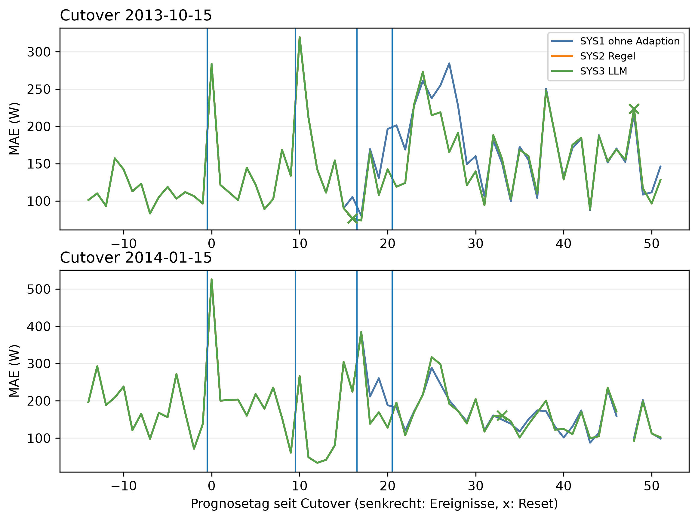

# E5 Dreiervergleich SYS1/SYS2/SYS3, Lauf e5_001

## Setup

- Cutover: 2013-10-15, 2014-01-15 (Tag 0, alle Tage und Daten in Ortszeit)
- Fenster: 14 Tage vor und 51 Tage ab Cutover
- Ereignislauf: 1: Einzeltag-Spitze +1000 W über 6 h, Tag 0; 2: Einzeltag-Spitze +1000 W über 6 h, Tag 10; 3: Festhänger über 12 h, Tag 17; 4: Dauerlast +200 W, Tag 21
- Systeme: SYS1 ohne Adaption, SYS2 Regel, SYS3 LLM
- LLM SYS3: ministral-3:8b, Prompt v20
- Kalender: keiner, wie CTX0
- Commit: bf10f9a

## Kennzahlen

| Kennzahl | Wert | Bezug |
|---|---|---|
| SYS1 ohne Adaption: erkannt (TF2, ≥ 90 %) | 5/6 | 83,3 % |
| SYS1 ohne Adaption: richtig eingeordnet (TF3, ≥ 80 %) | 7/7 | 100,0 % der erkannten |
| SYS2 Regel: erkannt (TF2, ≥ 90 %) | 5/6 | 83,3 % |
| SYS2 Regel: richtig eingeordnet (TF3, ≥ 80 %) | 7/7 | 100,0 % der erkannten |
| SYS3 LLM: erkannt (TF2, ≥ 90 %) | 5/6 | 83,3 % |
| SYS3 LLM: richtig eingeordnet (TF3, ≥ 80 %) | 7/7 | 100,0 % der erkannten |
| 2013-10-15: SYS2 besser als SYS1 | nein | MAE gegen SYS1 ab Dauerlast -12,2 W, 1 Resets bei Einzeltag-Ereignissen, 0 im Kontrolllauf |
| 2013-10-15: SYS3 gleichwertig zu SYS2 | ja | 0 Ereignisse nur SYS2 richtig, 0 Resets mehr im Kontrolllauf |
| 2013-10-15: SYS3 besser als SYS2 | nein | 0 Ereignisse nur SYS3 richtig |
| 2014-01-15: SYS2 besser als SYS1 | nein | MAE gegen SYS1 ab Dauerlast 2,4 W, 0 Resets bei Einzeltag-Ereignissen, 0 im Kontrolllauf |
| 2014-01-15: SYS3 gleichwertig zu SYS2 | ja | 0 Ereignisse nur SYS2 richtig, 0 Resets mehr im Kontrolllauf |
| 2014-01-15: SYS3 besser als SYS2 | nein | 0 Ereignisse nur SYS3 richtig |

## Erkennung (TF2) und erste Einordnung (TF3), gepoolt über Cutover und Ereignisse

| System | erwartet | erkannt (TF2) | erkannt [%] | richtig eingeordnet (TF3) | richtig [%] |
|---|---|---|---:|---|---:|
| SYS1 ohne Adaption | alle Ereignisse | 5/6 | 83,3 | 7/7 | 100,0 |
| SYS1 ohne Adaption | measurement_error | 0/0 | - | 2/2 | 100,0 |
| SYS1 ohne Adaption | new_pattern | 2/2 | 100,0 | 2/2 | 100,0 |
| SYS1 ohne Adaption | peak | 3/4 | 75,0 | 3/3 | 100,0 |
| SYS2 Regel | alle Ereignisse | 5/6 | 83,3 | 7/7 | 100,0 |
| SYS2 Regel | measurement_error | 0/0 | - | 2/2 | 100,0 |
| SYS2 Regel | new_pattern | 2/2 | 100,0 | 2/2 | 100,0 |
| SYS2 Regel | peak | 3/4 | 75,0 | 3/3 | 100,0 |
| SYS3 LLM | alle Ereignisse | 5/6 | 83,3 | 7/7 | 100,0 |
| SYS3 LLM | measurement_error | 0/0 | - | 2/2 | 100,0 |
| SYS3 LLM | new_pattern | 2/2 | 100,0 | 2/2 | 100,0 |
| SYS3 LLM | peak | 3/4 | 75,0 | 3/3 | 100,0 |

## Erste Einordnung je Ereignis

| Cutover | Ereignis | System | erwartet | bewertet an Tag | Klasse | richtig | Skala | Meldungen davor | Reset an Tag | Aktion passend | nach Trennung |
|---|---|---|---|---:|---|---|---|---:|---:|---|---|
| 2013-10-15 | 1: Einzeltag-Spitze +1000 W über 6 h, Tag 0 | SYS1 ohne Adaption | peak | 1 | peak | ja | weekday | - | - | ja | nein |
| 2013-10-15 | 1: Einzeltag-Spitze +1000 W über 6 h, Tag 0 | SYS2 Regel | peak | 1 | peak | ja | weekday | - | - | ja | nein |
| 2013-10-15 | 1: Einzeltag-Spitze +1000 W über 6 h, Tag 0 | SYS3 LLM | peak | 1 | peak | ja | weekday | - | - | ja | nein |
| 2013-10-15 | 2: Einzeltag-Spitze +1000 W über 6 h, Tag 10 | SYS1 ohne Adaption | peak | 11 | peak | ja | daily | - | - | ja | nein |
| 2013-10-15 | 2: Einzeltag-Spitze +1000 W über 6 h, Tag 10 | SYS2 Regel | peak | 11 | peak | ja | daily | - | 16 | nein | nein |
| 2013-10-15 | 2: Einzeltag-Spitze +1000 W über 6 h, Tag 10 | SYS3 LLM | peak | 11 | peak | ja | daily | - | 16 | nein | nein |
| 2013-10-15 | 3: Festhänger über 12 h, Tag 17 | SYS1 ohne Adaption | measurement_error | 18 | measurement_error | ja | weekday | - | - | ja | ja |
| 2013-10-15 | 3: Festhänger über 12 h, Tag 17 | SYS2 Regel | measurement_error | 18 | measurement_error | ja | daily | - | - | ja | ja |
| 2013-10-15 | 3: Festhänger über 12 h, Tag 17 | SYS3 LLM | measurement_error | 18 | measurement_error | ja | daily | - | - | ja | ja |
| 2013-10-15 | 4: Dauerlast +200 W, Tag 21 | SYS1 ohne Adaption | new_pattern | 28 | new_pattern | ja | weekday+long_term | 5 | - | nein | ja |
| 2013-10-15 | 4: Dauerlast +200 W, Tag 21 | SYS2 Regel | new_pattern | 48 | new_pattern | ja | weekly+long_term | 0 | 48 | ja | ja |
| 2013-10-15 | 4: Dauerlast +200 W, Tag 21 | SYS3 LLM | new_pattern | 48 | new_pattern | ja | weekly+long_term | 0 | 48 | ja | ja |
| 2014-01-15 | 1: Einzeltag-Spitze +1000 W über 6 h, Tag 0 | SYS1 ohne Adaption | peak | 1 | peak | ja | daily | - | - | ja | nein |
| 2014-01-15 | 1: Einzeltag-Spitze +1000 W über 6 h, Tag 0 | SYS2 Regel | peak | 1 | peak | ja | daily | - | - | ja | nein |
| 2014-01-15 | 1: Einzeltag-Spitze +1000 W über 6 h, Tag 0 | SYS3 LLM | peak | 1 | peak | ja | daily | - | - | ja | nein |
| 2014-01-15 | 2: Einzeltag-Spitze +1000 W über 6 h, Tag 10 | SYS1 ohne Adaption | peak | - | - | - | - | - | - | ja | nein |
| 2014-01-15 | 2: Einzeltag-Spitze +1000 W über 6 h, Tag 10 | SYS2 Regel | peak | - | - | - | - | - | - | ja | nein |
| 2014-01-15 | 2: Einzeltag-Spitze +1000 W über 6 h, Tag 10 | SYS3 LLM | peak | - | - | - | - | - | - | ja | nein |
| 2014-01-15 | 3: Festhänger über 12 h, Tag 17 | SYS1 ohne Adaption | measurement_error | 18 | measurement_error | ja | weekday | - | - | ja | nein |
| 2014-01-15 | 3: Festhänger über 12 h, Tag 17 | SYS2 Regel | measurement_error | 18 | measurement_error | ja | weekday | - | - | ja | nein |
| 2014-01-15 | 3: Festhänger über 12 h, Tag 17 | SYS3 LLM | measurement_error | 18 | measurement_error | ja | weekday | - | - | ja | nein |
| 2014-01-15 | 4: Dauerlast +200 W, Tag 21 | SYS1 ohne Adaption | new_pattern | 33 | new_pattern | ja | weekly+long_term | 0 | - | nein | ja |
| 2014-01-15 | 4: Dauerlast +200 W, Tag 21 | SYS2 Regel | new_pattern | 33 | new_pattern | ja | weekly+long_term | 0 | 33 | ja | ja |
| 2014-01-15 | 4: Dauerlast +200 W, Tag 21 | SYS3 LLM | new_pattern | 33 | new_pattern | ja | weekly+long_term | 0 | 33 | ja | ja |

## Prognose ab Dauerlast und im Kontrolllauf, gepaart gegen SYS1

| Cutover | Zeitraum | System | MAE [W] | MAPE [%] | Differenz [W] | 2 Standardfehler [W] | Tage | Tage besser [%] | belastbar | MAPE-Differenz zu SYS1 [%-Punkte] |
|---|---|---|---:|---:|---:|---:|---:|---:|---|---:|
| 2013-10-15 | Kontrolllauf ab Tag 0 | SYS1 ohne Adaption | 135,6 | 40,3 | - | - | - | - | - | - |
| 2013-10-15 | Kontrolllauf ab Tag 0 | SYS2 Regel | 135,6 | 40,3 | 0,0 | 0,0 | 52 | 0,0 | nein | 0,0 |
| 2013-10-15 | Kontrolllauf ab Tag 0 | SYS3 LLM | 135,6 | 40,3 | 0,0 | 0,0 | 52 | 0,0 | nein | 0,0 |
| 2013-10-15 | Ereignislauf ab Tag 21 | SYS1 ohne Adaption | 174,3 | 30,1 | - | - | - | - | - | - |
| 2013-10-15 | Ereignislauf ab Tag 21 | SYS2 Regel | 162,0 | 26,8 | -12,2 | 10,1 | 31 | 51,6 | ja | -3,3 |
| 2013-10-15 | Ereignislauf ab Tag 21 | SYS3 LLM | 162,0 | 26,8 | -12,2 | 10,1 | 31 | 51,6 | ja | -3,3 |
| 2014-01-15 | Kontrolllauf ab Tag 0 | SYS1 ohne Adaption | 153,2 | 47,3 | - | - | - | - | - | - |
| 2014-01-15 | Kontrolllauf ab Tag 0 | SYS2 Regel | 153,2 | 47,3 | 0,0 | 0,0 | 51 | 0,0 | nein | 0,0 |
| 2014-01-15 | Kontrolllauf ab Tag 0 | SYS3 LLM | 153,2 | 47,3 | 0,0 | 0,0 | 51 | 0,0 | nein | 0,0 |
| 2014-01-15 | Ereignislauf ab Tag 21 | SYS1 ohne Adaption | 159,3 | 26,7 | - | - | - | - | - | - |
| 2014-01-15 | Ereignislauf ab Tag 21 | SYS2 Regel | 161,6 | 27,4 | 2,4 | 5,6 | 30 | 56,7 | nein | 0,7 |
| 2014-01-15 | Ereignislauf ab Tag 21 | SYS3 LLM | 161,6 | 27,4 | 2,4 | 5,6 | 30 | 56,7 | nein | 0,7 |

## Meldungen nach der Erkennung der Dauerlast, sehend und blind

| Cutover | System | Tage | Anzahl | Meldungen | unknown |
|---|---|---|---:|---:|---:|
| 2013-10-15 | SYS1 ohne Adaption | sehend | 23 | 23 | 0 |
| 2013-10-15 | SYS2 Regel | blind | 3 | 0 | 0 |
| 2013-10-15 | SYS3 LLM | blind | 3 | 0 | 0 |
| 2014-01-15 | SYS1 ohne Adaption | blind | 1 | 0 | 0 |
| 2014-01-15 | SYS1 ohne Adaption | sehend | 17 | 17 | 0 |
| 2014-01-15 | SYS2 Regel | blind | 18 | 4 | 0 |
| 2014-01-15 | SYS3 LLM | blind | 18 | 4 | 0 |

## Kontrolllauf: Fehlalarme und unnötige Resets

| Cutover | System | Tage | Meldungen | unknown | Resets |
|---|---|---:|---:|---:|---:|
| 2013-10-15 | SYS1 ohne Adaption | 66 | 12 | 0 | 0 |
| 2013-10-15 | SYS2 Regel | 66 | 12 | 0 | 0 |
| 2013-10-15 | SYS3 LLM | 66 | 12 | 0 | 0 |
| 2014-01-15 | SYS1 ohne Adaption | 66 | 1 | 0 | 0 |
| 2014-01-15 | SYS2 Regel | 66 | 1 | 0 | 0 |
| 2014-01-15 | SYS3 LLM | 66 | 1 | 0 | 0 |

## Abweichungstage SYS2 gegen SYS3

| Cutover | Reihe | Tag | Datum | Ereignis | Klasse SYS2 | Klasse SYS3 | Aktion SYS2 | Aktion SYS3 | LLM-Ausfall |
|---|---|---:|---|---|---|---|---|---|---|

## Hinweise

- Tag = Entscheidungstag seit Cutover: an Tag n wird Tag n-1 eingeordnet, ein Ereignis an Tag s also ab Tag s+1
- bewertet an Tag: bei einer Spitze und beim Festhänger der eingeordnete Ereignistag, falls das Gate dort offen ist, bei der Dauerlast der erste Tag mit Drift oder new_pattern. Meldungen davor zählen als Meldungen, nicht als Einordnungsfehler. Ohne Bewertungstag gilt das Ereignis als nicht erkannt (TF2) und zählt nicht in TF3. Der Festhänger zählt nicht in TF2, das Flag öffnet das Gate per Aufbau
- nach Trennung: vor Beginn des Ereignisses hat schon ein System anders gehandelt (Reset), die Systeme entscheiden dann nicht mehr über denselben Zustand
- sehend = alle Einzeltag-Skalen (daily, weekday) haben einen Score, sonst blind
- Kontrolllauf über das ganze Fenster, auch die Tage vor dem Cutover. Jede Meldung dort ist ein Fehlalarm, jeder Reset unnötig
- belastbar: Betrag der Differenz größer als 2 Standardfehler der gepaarten Differenzen, grobe Faustregel

## Anhang

### Laufzeit und Kosten SYS3, nur beschreibend

| Cutover | Reihe | Tage | Regel je Tag [s] | LLM-Aufrufe | Ausfalltage | Mehrlaufzeit gegen Regel [s] | je Aufruf [s] |
|---|---|---:|---:|---:|---:|---:|---:|
| 2013-10-15 | Kontrolllauf | 66 | 0,1 | 12 | 0 | 246,7 | 20,6 |
| 2014-01-15 | Kontrolllauf | 66 | 0,1 | 2 | 0 | 58,2 | 29,1 |
| 2013-10-15 | Ereignislauf | 66 | 0,1 | 8 | 0 | 187,8 | 23,5 |
| 2014-01-15 | Ereignislauf | 66 | 0,1 | 8 | 0 | 171,2 | 21,4 |

### Antworten des LLM

**Kontrolllauf, Cutover 2013-10-15**

2013-10-13 (Entscheidungstag -1): SYS3 peak, Regel peak, Aktion none

- Erklärung: Gestern war der Stromverbrauch im Vergleich zum üblichen Wert für einen Dienstag um etwa **50 % höher**. Das System hat das bei seiner Prognose berücksichtigt.
- Empfehlung: Überprüfen Sie, ob gestern ungewöhnlich viel Strom verbraucht wurde – etwa durch längeres Nutzen von Heizung, Beleuchtung oder Geräten. Ein kurzer Stromspitzenverbrauch (z. B. durch einen neuen Großverbraucher) könnte auch die Ursache sein.
- Unsicherheit: Ob ein geplanter Aufenthalt im Ausland oder eine andere Abwesenheit den Verbrauch beeinflusst hat, lässt sich nicht prüfen.

2013-10-23 (Entscheidungstag 9): SYS3 peak, Regel peak, Aktion none

- Erklärung: Gestern war der Stromverbrauch im Vergleich zum üblichen Wert für einen Dienstag um etwa 42 % höher als sonst.
- Empfehlung: Überprüfen Sie, ob gestern ungewöhnlich viele Geräte gleichzeitig genutzt wurden oder ob neue Elektrogeräte im Einsatz waren. Auch ein ungewöhnliches Wetter (z. B. sehr kalt) könnte den Verbrauch erhöht haben.
- Unsicherheit: Ob es sich um einen einmaligen Anstieg handelt oder eine Veränderung beginnt, lässt sich erst nach weiteren Tagen erkennen.

2013-10-26 (Entscheidungstag 12): SYS3 peak, Regel peak, Aktion none

- Erklärung: Gestern war der Stromverbrauch im Vergleich zum üblichen Tagesverlauf ungewöhnlich hoch und auch die gesamte Menge lag um etwa 51 % über dem für einen Wochentag typischen Wert.
- Empfehlung: Überprüfen Sie, ob gestern ungewöhnlich viele Geräte gleichzeitig genutzt wurden oder ob neue Elektrogeräte im Einsatz waren. Auch die Heizung oder Beleuchtung könnten einen Einfluss gehabt haben.
- Unsicherheit: Ob ein geplanter Aufenthalt von Personen den Verbrauch beeinflusst hat, lässt sich nicht prüfen.

2013-10-31 (Entscheidungstag 17): SYS3 low, Regel low, Aktion none

- Erklärung: Gestern war der Stromverbrauch um etwa 40 % niedriger als an einem typischen Donnerstag. Seit dem 28. Oktober liegt er unter dem üblichen Niveau.
- Empfehlung: Überprüfen Sie, ob jemand länger weg war oder ob der Verbrauch durch äußere Umstände wie kälteres Wetter beeinflusst wurde. Da keine Kalendereinträge verfügbar sind, könnte auch ein technischer Grund vorliegen.
- Unsicherheit: Ob und warum der Verbrauch so niedrig ist, bleibt unklar.

2013-11-01 (Entscheidungstag 18): SYS3 low, Regel low, Aktion none

- Erklärung: Gestern war der Stromverbrauch um etwa 52 % niedriger als an einem typischen Wochentag. Seit dem 28. Oktober liegt er deutlich unter dem üblichen Niveau.
- Empfehlung: Überprüfen Sie, ob jemand länger weg war oder ob der Verbrauch durch äußere Umstände wie kälteres Wetter beeinflusst wurde. Da keine Kalendereinträge verfügbar sind, könnte auch ein technischer Grund vorliegen.
- Unsicherheit: Ob und warum der Verbrauch so niedrig ist, bleibt unklar.

2013-11-07 (Entscheidungstag 24): SYS3 peak, Regel peak, Aktion none

- Erklärung: Gestern war der Stromverbrauch im Vergleich zum üblichen Wert für einen Wochentag um etwa **46 % höher**. Dies ist ein ungewöhnlich hoher Wert für diesen Tag.
- Empfehlung: Überprüfen Sie, ob gestern ungewöhnliche Geräte oder Aktivitäten den Verbrauch erhöht haben könnten, zum Beispiel längeres Heizen, zusätzliche Beleuchtung oder Gäste. Da der Wert nur für einen Tag auffällig ist, könnte es sich auch um eine einmalige Ursache handeln.
- Unsicherheit: Ob ein geplanter Aufenthalt im Ausland oder eine andere Abwesenheit den Verbrauch beeinflusst hat, lässt sich nicht prüfen.

2013-11-12 (Entscheidungstag 29): SYS3 peak, Regel peak, Aktion none

- Erklärung: Gestern war der Stromverbrauch im Vergleich zum üblichen Tagesverlauf ungewöhnlich hoch und auch die durchschnittliche Menge für einen Dienstag lag um etwa 48 % über dem Normalwert. Dies hat sich seit gestern so gezeigt.
- Empfehlung: Überprüfen Sie, ob gestern ungewöhnlich viele Geräte gleichzeitig genutzt wurden oder ob neue Elektrogeräte im Einsatz waren. Auch die Heizung oder Beleuchtung könnten eine Rolle spielen.
- Unsicherheit: Ob ein geplanter Aufenthalt von Personen außerhalb des Haushalts den Verbrauch beeinflusst hat, lässt sich nicht prüfen.

2013-11-22 (Entscheidungstag 39): SYS3 peak, Regel peak, Aktion none

- Erklärung: Gestern war der Stromverbrauch im Vergleich zum üblichen Tagesverlauf ungewöhnlich hoch und auch die gesamte Menge lag um etwa 66 % über dem für diesen Wochentag Üblichen. Dies hat sich seit gestern bereits drei Tage am Stück so gezeigt.
- Empfehlung: Überprüfen Sie, ob gestern ungewöhnlich viele Geräte gleichzeitig genutzt wurden oder ob neue Elektrogeräte im Einsatz waren. Auch ein ungewöhnlich kalter Tag könnte den Verbrauch erhöht haben.
- Unsicherheit: Ob es sich um eine vorübergehende Veränderung handelt, lässt sich erst nach einigen Tagen beurteilen.

2013-11-23 (Entscheidungstag 40): SYS3 peak, Regel peak, Aktion none

- Erklärung: Gestern war der Stromverbrauch im Vergleich zu einem normalen Freitag um etwa 59 % höher als sonst. Das System hat das bei seiner Prognose berücksichtigt.
- Empfehlung: Überprüfen Sie, ob gestern ungewöhnlich viel Strom verbraucht wurde – etwa durch längeres Heizen, zusätzliche Geräte oder Gäste. Ein Blick auf die Verbrauchswerte der letzten Tage könnte helfen.
- Unsicherheit: Ob ein geplanter Urlaub oder eine Abwesenheit den Verbrauch beeinflusst hat, ist nicht bekannt.

2013-11-28 (Entscheidungstag 45): SYS3 peak, Regel peak, Aktion none

- Erklärung: Gestern war der Stromverbrauch im Vergleich zu einem normalen Donnerstag um etwa 81 % höher als sonst. Das System kann keine Ursache erkennen, da es sich nicht um ein neues Muster handelt.
- Empfehlung: Überprüfen Sie bitte, ob gestern ungewöhnlich viele Geräte gleichzeitig genutzt wurden oder ob neue Verbraucher wie Heizgeräte oder Beleuchtung hinzugekommen sind. Auch ein defekter Stromzähler könnte den Messwert beeinflusst haben.
- Unsicherheit: Ob es sich um einen einmaligen Ausreißer handelt, lässt sich erst nach weiteren Tagen beurteilen.

2013-11-30 (Entscheidungstag 47): SYS3 peak, Regel peak, Aktion none

- Erklärung: Gestern war der Stromverbrauch im Vergleich zum üblichen Wert für einen Freitag um etwa 53 % höher als sonst. Dies ist seit dem 28. November so.
- Empfehlung: Überprüfen Sie, ob gestern ungewöhnlich viel Strom verbraucht wurde – etwa durch längeres Heizen, zusätzliche Geräte oder Gäste. Falls nichts Auffälliges auffällt, könnte ein technischer Grund vorliegen.
- Unsicherheit: Ob es sich um eine vorübergehende Störung oder einen dauerhaften Anstieg handelt, ist noch unklar.

2013-12-02 (Entscheidungstag 49): SYS3 peak, Regel peak, Aktion none

- Erklärung: Gestern war der Verlauf des Tages ungewöhnlich, mit einem kurzen Spitzenverbrauch. Im Vergleich zur letzten Woche lag der Verbrauch um etwa 20 % höher.
- Empfehlung: Überprüfen Sie, ob gestern ungewöhnliche Geräte oder Aktivitäten im Haushalt waren, wie neue Elektrogeräte, längeres Kochen oder Heizungsnutzung. Da der Spitzenverbrauch nur einen Tag betraf, könnte es sich um eine einmalige Ursache handeln.
- Unsicherheit: Ob ein geplanter Aufenthalt außerhalb des Hauses den Verbrauch beeinflusst hat, lässt sich nicht prüfen.

**Ereignislauf, Cutover 2013-10-15**

2013-10-13 (Entscheidungstag -1): SYS3 peak, Regel peak, Aktion none

- Erklärung: Gestern war der Stromverbrauch im Vergleich zum üblichen Wert für einen Dienstag um etwa **50 % höher**. Das System hat das bei seiner Prognose berücksichtigt.
- Empfehlung: Überprüfen Sie, ob gestern ungewöhnlich viel Strom verbraucht wurde – etwa durch längeres Nutzen von Heizung, Beleuchtung oder Geräten. Ein kurzer Stromspitzenverbrauch (z. B. durch einen neuen Großverbraucher) könnte auch die Ursache sein.
- Unsicherheit: Ob ein geplanter Aufenthalt im Ausland oder eine andere Abwesenheit den Verbrauch beeinflusst hat, lässt sich nicht prüfen.

2013-10-15 (Entscheidungstag 1, Ereignis 1: Einzeltag-Spitze +1000 W über 6 h, Tag 0): SYS3 peak, Regel peak, Aktion none

- Erklärung: Gestern war der Stromverbrauch im Vergleich zum üblichen Tagesverlauf ungewöhnlich hoch und auch die gesamte Menge lag deutlich über dem Wochentagsdurchschnitt (+89 %). Der erhöhte Verbrauch begann bereits am 13. Oktober.
- Empfehlung: Überprüfen Sie, ob gestern ungewöhnlich viele Geräte gleichzeitig liefen oder ob neue Elektrogeräte im Einsatz waren. Auch ein längerer Aufenthalt von Gästen könnte den Verbrauch erhöht haben.
- Unsicherheit: Ob es sich um einen einmaligen Anstieg handelt oder eine Veränderung beginnt, lässt sich erst nach weiteren Tagen erkennen.

2013-10-23 (Entscheidungstag 9, Ereignis 1: Einzeltag-Spitze +1000 W über 6 h, Tag 0): SYS3 peak, Regel peak, Aktion none

- Erklärung: Gestern war der Stromverbrauch im Vergleich zum üblichen Wert für einen Dienstag um etwa 42 % höher als sonst.
- Empfehlung: Überprüfen Sie, ob gestern ungewöhnlich viele Geräte gleichzeitig genutzt wurden oder ob neue Elektrogeräte im Einsatz waren. Auch ein ungewöhnliches Wetter (z. B. sehr kalt) könnte den Verbrauch erhöht haben.
- Unsicherheit: Ob es sich um einen einmaligen Anstieg handelt oder eine Veränderung beginnt, lässt sich erst nach weiteren Tagen erkennen.

2013-10-25 (Entscheidungstag 11, Ereignis 2: Einzeltag-Spitze +1000 W über 6 h, Tag 10): SYS3 peak, Regel peak, Aktion none

- Erklärung: Gestern war der Stromverbrauch im Vergleich zum üblichen Tagesverlauf ungewöhnlich hoch und auch die gesamte Menge lag deutlich über dem Wochentagsdurchschnitt (+75 %). Der erhöhte Verbrauch begann bereits am 23. Oktober.
- Empfehlung: Überprüfen Sie, ob gestern ungewöhnlich viele Geräte gleichzeitig liefen oder ob neue Elektrogeräte im Einsatz waren. Auch die Heizung oder längeres Lichtnutzung könnten den Verbrauch erhöht haben.
- Unsicherheit: Ob ein geplanter Aufenthalt von Personen außerhalb des Haushalts den Verbrauch beeinflusst hat, lässt sich nicht prüfen.

2013-10-26 (Entscheidungstag 12, Ereignis 2: Einzeltag-Spitze +1000 W über 6 h, Tag 10): SYS3 peak, Regel peak, Aktion none

- Erklärung: Gestern war der Stromverbrauch im Vergleich zum üblichen Tagesverlauf ungewöhnlich hoch und auch die gesamte Menge lag um etwa 51 % über dem Wochentagsdurchschnitt der letzten Tage.
- Empfehlung: Überprüfen Sie, ob gestern ungewöhnlich viele Geräte gleichzeitig liefen oder ob neue Elektrogeräte im Einsatz waren. Auch die Heizung oder längeres Lichtnutzung könnten den Verbrauch erhöht haben.
- Unsicherheit: Ob ein geplanter Aufenthalt außerhalb des Hauses oder andere Faktoren eine Rolle spielen, ist nicht bekannt.

2013-10-30 (Entscheidungstag 16, Ereignis 2: Einzeltag-Spitze +1000 W über 6 h, Tag 10): SYS3 new_pattern, Regel new_pattern, Aktion advance_history_start

- Erklärung: Gestern war der Stromverbrauch im Vergleich zur letzten Woche um etwa 27 % niedriger und seit Anfang Oktober insgesamt um rund 14 % reduziert. Die Abweichung hält bereits mehrere Wochen an.
- Empfehlung: Überprüfen Sie, ob sich der Haushaltszusammensetzung oder die Nutzung von Geräten verändert hat – etwa durch Abwesenheit, neue Geräte oder geänderte Gewohnheiten. Da es sich um eine längerfristige Veränderung handelt, könnte auch ein technischer Grund wie eine veränderte Messung vorliegen.
- Unsicherheit: Ob und warum der Verbrauch gesunken ist, bleibt unklar.

2013-11-01 (Entscheidungstag 18, Ereignis 3: Festhänger über 12 h, Tag 17): SYS3 measurement_error, Regel measurement_error, Aktion exclude_window

- Erklärung: Der gemessene Wert von gestern ist nicht vertrauenswürdig.
- Empfehlung: Überprüfen Sie, ob der Zähler oder die Verbindung korrekt funktioniert. Das System berücksichtigt das bei seiner Prognose.
- Unsicherheit: Es liegen keine zuverlässigen Daten für den gestrigen Verbrauch vor.

2013-12-01 (Entscheidungstag 48, Ereignis 4: Dauerlast +200 W, Tag 21): SYS3 new_pattern, Regel new_pattern, Aktion advance_history_start

- Erklärung: Der Stromverbrauch war im Vergleich zum letzten Monat um etwa zwei Drittel niedriger und seit Anfang November so. Die letzte Woche lag er dagegen rund ein Viertel höher als sonst an Wochentagen.
- Empfehlung: Überprüfen Sie, ob sich der Stromverbrauch dauerhaft verändert hat – etwa durch weniger Heizung oder Beleuchtung im Winter. Prüfen Sie auch, ob Geräte oder die Zählermessung ungewöhnlich sind.
- Unsicherheit: Ob ein geplanter Urlaub oder eine Abwesenheit den Verbrauch beeinflusst haben könnte, lässt sich nicht prüfen.

**Kontrolllauf, Cutover 2014-01-15**

2014-03-01 (Entscheidungstag 46): SYS3 peak, Regel peak, Aktion none

- Erklärung: Gestern war der Verlauf des Tages ungewöhnlich, mit einem kurzen hohen Verbrauchsspitzen. Im Vergleich zum letzten Monat lag der Gesamtverbrauch um etwa 20 % höher.
- Empfehlung: Überprüfen Sie, ob gestern ungewöhnliche Geräte genutzt wurden oder jemand länger zu Hause war. Vielleicht hat sich auch die Heizung oder Beleuchtung verändert.
- Unsicherheit: Ob ein geplanter Aufenthalt im Ausland oder eine andere Abwesenheit den Verbrauch beeinflusst haben könnte, ist nicht bekannt.

2014-03-03 (Entscheidungstag 48): SYS3 measurement_error, Regel measurement_error, Aktion exclude_window

- Erklärung: Der gemessene Wert von gestern ist nicht vertrauenswürdig und kann daher keine Aussage über den tatsächlichen Verbrauch treffen.
- Empfehlung: Überprüfen Sie bitte, ob der Zähler oder die Verbindung korrekt funktioniert. Das System berücksichtigt das bei seiner Prognose nicht.
- Unsicherheit: Ob und wie sich der Verbrauch tatsächlich verändert hat, ist unklar.

**Ereignislauf, Cutover 2014-01-15**

2014-01-15 (Entscheidungstag 1, Ereignis 1: Einzeltag-Spitze +1000 W über 6 h, Tag 0): SYS3 peak, Regel peak, Aktion none

- Erklärung: Gestern war der Stromverbrauch im Vergleich zum üblichen Tagesverlauf ungewöhnlich hoch und auch die gesamte Menge lag deutlich über dem für einen Wochentag Üblichen (+91 %). Der Verlauf des Tages selbst war auffällig, etwa durch einen kurzen Spitzenverbrauch oder eine sehr ungleichmäßige Nutzung.
- Empfehlung: Überprüfen Sie, ob gestern ungewöhnliche Geräte oder Aktivitäten im Haushalt waren – etwa neue Elektrogeräte, längeres Arbeiten mit Heizung oder Beleuchtung, oder Gäste. Da es sich um einen einmaligen Tag handelt, könnte auch ein Messwertfehler vorliegen.
- Unsicherheit: Ob die Veränderung auf eine geplante Abwesenheit zurückzuführen ist, lässt sich nicht prüfen, da keine Kalenderdaten verfügbar sind.

2014-02-01 (Entscheidungstag 18, Ereignis 3: Festhänger über 12 h, Tag 17): SYS3 measurement_error, Regel measurement_error, Aktion exclude_window

- Erklärung: Der gemessene Wert von gestern ist nicht vertrauenswürdig und kann daher keine Rückschlüsse auf den tatsächlichen Verbrauch zulassen.
- Empfehlung: Überprüfen Sie bitte, ob der Zähler oder die Verbindung korrekt funktioniert. Das System berücksichtigt das bei seiner Prognose nicht.
- Unsicherheit: Ob und wie sich der Verbrauch tatsächlich verändert hat, ist unklar.

2014-02-16 (Entscheidungstag 33, Ereignis 4: Dauerlast +200 W, Tag 21): SYS3 new_pattern, Regel new_pattern, Aktion advance_history_start

- Erklärung: Gestern war der Stromverbrauch im Vergleich zur letzten Woche um etwa 71 % höher und seit dem 5. Februar überdurchschnittlich hoch. Seit Anfang Februar steigt er insgesamt um rund 22 %.
- Empfehlung: Überprüfen Sie, ob sich der Stromverbrauch durch neue Geräte, längere Nutzung von Heizung oder Beleuchtung oder andere Änderungen erhöht hat. Da es seit Anfang Februar so bleibt, könnte auch ein Messgerät oder eine Tarifänderung die Ursache sein.
- Unsicherheit: Ob ein geplanter Urlaub oder ein anderes Ereignis den Verbrauch beeinflusst hat, ist nicht bekannt.

2014-02-20 (Entscheidungstag 37, Ereignis 4: Dauerlast +200 W, Tag 21): SYS3 low, Regel low, Aktion none

- Erklärung: Gestern war der Verlauf des Tages ungewöhnlich flach, also weniger Strom verbraucht als sonst in den Stunden mit hohem Verbrauch.
- Empfehlung: Überprüfen Sie, ob jemand zu Hause war oder ein Gerät ungewöhnlich genutzt wurde. Vielleicht waren die Tage kürzer und es wurde weniger Strom verbraucht.
- Unsicherheit: Ob eine geplante Abwesenheit den Verbrauch erklärt, ist nicht bekannt.

2014-02-21 (Entscheidungstag 38, Ereignis 4: Dauerlast +200 W, Tag 21): SYS3 low, Regel low, Aktion none

- Erklärung: Gestern war der Verlauf des Tages ungewöhnlich flach, also weniger Strom verbraucht als sonst in den Stunden mit hohem Verbrauch.
- Empfehlung: Überprüfen Sie, ob jemand zu Hause war oder ein Gerät ungewöhnlich genutzt wurde. Vielleicht waren die Tage kürzer und es wurde weniger Strom verbraucht.
- Unsicherheit: Ob gestern tatsächlich weniger Verbrauch stattfand, lässt sich ohne Kalender nicht sicher sagen.

2014-03-01 (Entscheidungstag 46, Ereignis 4: Dauerlast +200 W, Tag 21): SYS3 peak, Regel peak, Aktion none

- Erklärung: Gestern war der Verlauf des Tages ungewöhnlich, mit einem kurzen Spitzenverbrauch. Im Vergleich zur letzten Woche lag der Verbrauch um etwa 5 % höher.
- Empfehlung: Überprüfen Sie, ob gestern etwas Ungewöhnliches passiert ist, z. B. ob jemand länger zu Hause war oder ein neues Gerät genutzt wurde.
- Unsicherheit: Ob es sich um einen einmaligen Vorfall handelt oder eine neue Gewohnheit, bleibt unklar.

2014-03-03 (Entscheidungstag 48, Ereignis 4: Dauerlast +200 W, Tag 21): SYS3 measurement_error, Regel measurement_error, Aktion exclude_window

- Erklärung: Der gemessene Wert von gestern ist nicht vertrauenswürdig und kann nicht ausgewertet werden.
- Empfehlung: Überprüfen Sie, ob der Zähler oder die Verbindung möglicherweise defekt sind oder neu angeschlossen wurde. Das System berücksichtigt das bei seiner Prognose.
- Unsicherheit: Ob und wie sich der Verbrauch tatsächlich verändert hat, bleibt unklar.

2014-03-04 (Entscheidungstag 49, Ereignis 4: Dauerlast +200 W, Tag 21): SYS3 low, Regel low, Aktion none

- Erklärung: Gestern war der Stromverbrauch insgesamt ungewöhnlich niedrig, da der Tagesverlauf sehr flach verlief. Über die letzten vier Tage hinweg lag er im Schnitt etwa 6 % unter dem üblichen Wert.
- Empfehlung: Überprüfen Sie, ob jemand länger als geplant weg war oder ob Geräte ungewöhnlich wenig genutzt wurden. Da die Abweichung bereits seit mehreren Tagen besteht, könnte auch ein technischer Grund vorliegen.
- Unsicherheit: Ob es einen geplanten Ausfall oder eine Absenz gab, ist nicht bekannt.

