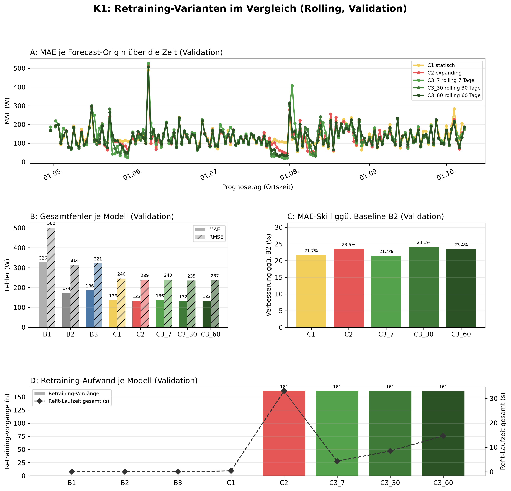
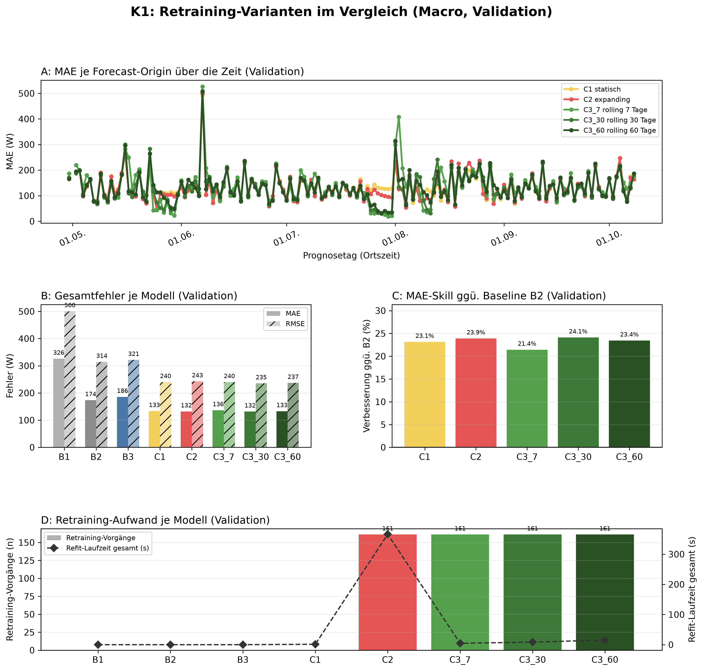

# K1 Retraining-Vergleich, Lauf k1_003

## Setup

- Split: validation, 2015-04-30 bis 2015-10-08, 162 Prognosetage (Ortszeit)
- Modus rolling: 60 Tage Historie vor Split-Start, wie der Online-Zyklus
- Modus macro: gesamte Historie vor Split-Start
- Naive Referenz: rolling B2, macro B2
- Prognose: 1 Tag ab lokaler Mitternacht, Intervall 80 %
- Konfiguration: forecast-model-0.1, Seed 42
- Commit: 5b0048b (mit lokalen Änderungen)

## Kennzahlen

| Kennzahl | Wert | Bezug |
|---|---|---|
| rolling: MAE bestes Modell C3_30 rolling 30 Tage [W] | 131,7 | B2 173,5 W |
| rolling: Skill der Prophet-Varianten ggü. B2 [%] | 24,1 | Spanne 21,4 bis 24,1 % |
| rolling: Varianten belastbar schlechter als das beste Modell | 0 | von 4 |
| macro: MAE bestes Modell C3_30 rolling 30 Tage [W] | 131,7 | B2 173,5 W |
| macro: Skill der Prophet-Varianten ggü. B2 [%] | 24,1 | Spanne 21,4 bis 24,1 % |
| macro: Varianten belastbar schlechter als das beste Modell | 0 | von 4 |

## Gesamtfehler rolling

| Modell | MAE [W] | RMSE [W] | MAPE [%] | Skill ggü. B2 [%] | Intervall-Abdeckung [%], Soll 80 | Refit-Zeit gesamt [s] |
|---|---:|---:|---:|---:|---:|---:|
| C3_30 rolling 30 Tage | 131,7 | 235,3 | 39,2 | 24,1 | 80,0 | 8,5 |
| C2 expanding | 132,8 | 238,5 | 39,5 | 23,5 | 82,6 | 33,1 |
| C3_60 rolling 60 Tage | 132,8 | 236,9 | 39,7 | 23,4 | 80,8 | 14,7 |
| C1 statisch | 135,9 | 245,5 | 38,6 | 21,7 | 83,2 | 0,4 |
| C3_7 rolling 7 Tage | 136,3 | 239,9 | 41,4 | 21,4 | 75,8 | 4,3 |
| B2 naiv, Vortag | 173,5 | 314,3 | 54,8 | - | - | 0,0 |
| B3 naiv, Vorwoche | 185,7 | 321,4 | 61,2 | - | - | 0,0 |
| B1 naiv, letzter Wert | 326,0 | 500,4 | 127,9 | - | - | 0,0 |

## Gesamtfehler macro

| Modell | MAE [W] | RMSE [W] | MAPE [%] | Skill ggü. B2 [%] | Intervall-Abdeckung [%], Soll 80 | Refit-Zeit gesamt [s] |
|---|---:|---:|---:|---:|---:|---:|
| C3_30 rolling 30 Tage | 131,7 | 235,3 | 39,2 | 24,1 | 80,2 | 8,5 |
| C2 expanding | 132,0 | 242,8 | 37,3 | 23,9 | 84,5 | 366,0 |
| C3_60 rolling 60 Tage | 132,8 | 236,9 | 39,7 | 23,4 | 81,0 | 15,3 |
| C1 statisch | 133,4 | 240,0 | 40,1 | 23,1 | 83,6 | 1,4 |
| C3_7 rolling 7 Tage | 136,3 | 239,9 | 41,4 | 21,4 | 75,8 | 4,5 |
| B2 naiv, Vortag | 173,5 | 314,3 | 54,8 | - | - | 0,0 |
| B3 naiv, Vorwoche | 185,7 | 321,4 | 61,2 | - | - | 0,0 |
| B1 naiv, letzter Wert | 326,0 | 500,4 | 127,9 | - | - | 0,0 |

## Abstand zum besten Prophet-Modell, gepaart je Origin

| Modus | Modell | Referenz | Differenz [W] | 2 Standardfehler [W] | Origins | Origins besser [%] | belastbar |
|---|---|---|---:|---:|---:|---:|---|
| rolling | C2 expanding | C3_30 rolling 30 Tage | 1,1 | 3,7 | 161 | 41,0 | nein |
| rolling | C3_60 rolling 60 Tage | C3_30 rolling 30 Tage | 1,2 | 2,6 | 161 | 41,6 | nein |
| rolling | C1 statisch | C3_30 rolling 30 Tage | 4,3 | 4,9 | 161 | 40,4 | nein |
| rolling | C3_7 rolling 7 Tage | C3_30 rolling 30 Tage | 4,7 | 5,3 | 161 | 45,3 | nein |
| macro | C2 expanding | C3_30 rolling 30 Tage | 0,4 | 4,4 | 161 | 50,3 | nein |
| macro | C3_60 rolling 60 Tage | C3_30 rolling 30 Tage | 1,2 | 2,6 | 161 | 41,6 | nein |
| macro | C1 statisch | C3_30 rolling 30 Tage | 1,7 | 5,1 | 161 | 51,6 | nein |
| macro | C3_7 rolling 7 Tage | C3_30 rolling 30 Tage | 4,7 | 5,3 | 161 | 45,3 | nein |

## Hinweise

- belastbar: Betrag der Differenz größer als 2 Standardfehler der gepaarten Differenzen, grobe Faustregel
- rolling: 25 von 3888 Zielstunden nicht bewertet (Messwert fehlt 24, imputiert 1)
- macro: 25 von 3888 Zielstunden nicht bewertet (Messwert fehlt 24, imputiert 1)

