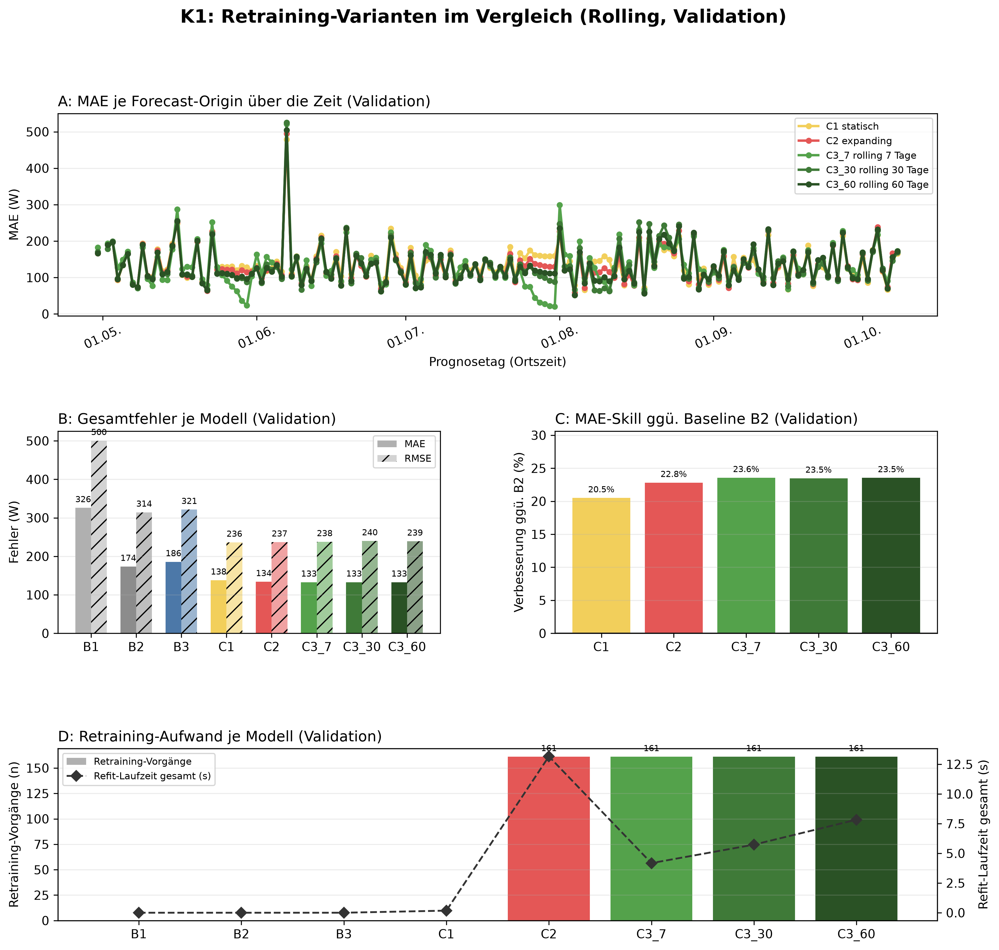
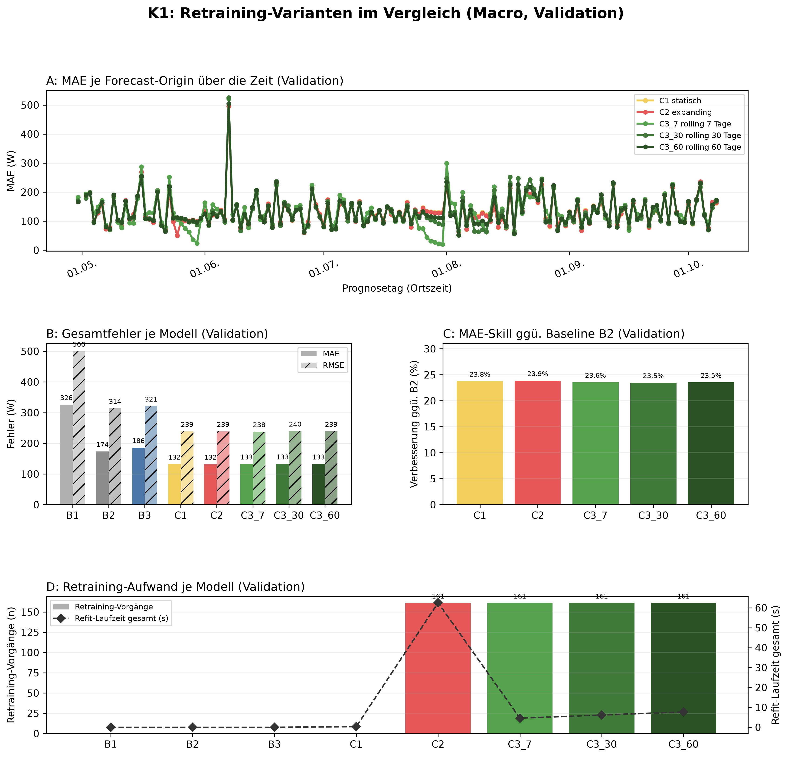

# K1 Retraining-Vergleich, Lauf k1_005

## Setup

- Split: validation, 2015-04-30 bis 2015-10-08, 162 Prognosetage (Ortszeit)
- Modus rolling: 60 Tage Historie vor Split-Start, wie der Online-Zyklus
- Modus macro: gesamte Historie vor Split-Start
- Naive Referenz: rolling B2, macro B2
- Prognose: 1 Tag ab lokaler Mitternacht, Intervall 80 %
- Konfiguration: forecast-model-0.1, Seed 42
- Commit: d22f039 (mit lokalen Änderungen)

## Kennzahlen

| Kennzahl | Wert | Bezug |
|---|---|---|
| rolling: MAE bestes Modell C3_7 rolling 7 Tage [W] | 132,6 | B2 173,5 W |
| rolling: Skill der Prophet-Varianten ggü. B2 [%] | 23,6 | Spanne 20,5 bis 23,6 % |
| rolling: Varianten belastbar schlechter als das beste Modell | 0 | von 4 |
| macro: MAE bestes Modell C2 expanding [W] | 132,1 | B2 173,5 W |
| macro: Skill der Prophet-Varianten ggü. B2 [%] | 23,9 | Spanne 23,5 bis 23,9 % |
| macro: Varianten belastbar schlechter als das beste Modell | 1 | von 4 |

## Gesamtfehler rolling

| Modell | MAE [W] | RMSE [W] | MAPE [%] | Tagesfehler MAE [W] | Tagesfehler MAPE [%] | Skill ggü. B2 [%] | Intervall-Abdeckung [%], Soll 80 | Refit-Zeit gesamt [s] |
|---|---:|---:|---:|---:|---:|---:|---:|---:|
| C3_7 rolling 7 Tage | 132,6 | 237,7 | 38,8 | 68,2 | 21,0 | 23,6 | 78,1 | 4,2 |
| C3_60 rolling 60 Tage | 132,7 | 239,1 | 39,1 | 77,0 | 24,8 | 23,5 | 82,8 | 7,8 |
| C3_30 rolling 30 Tage | 132,8 | 239,9 | 39,0 | 75,4 | 24,0 | 23,5 | 81,5 | 5,7 |
| C2 expanding | 133,9 | 236,7 | 41,8 | 70,4 | 23,8 | 22,8 | 82,9 | 13,2 |
| C1 statisch | 137,9 | 236,3 | 45,9 | 64,0 | 23,4 | 20,5 | 81,7 | 0,2 |
| B2 naiv, Vortag | 173,5 | 314,3 | 54,8 | 70,6 | 22,1 | - | - | 0,0 |
| B3 naiv, Vorwoche | 185,7 | 321,4 | 61,2 | 95,7 | 33,6 | - | - | 0,0 |
| B1 naiv, letzter Wert | 326,0 | 500,4 | 127,9 | 294,8 | 90,6 | - | - | 0,0 |

## Gesamtfehler macro

| Modell | MAE [W] | RMSE [W] | MAPE [%] | Tagesfehler MAE [W] | Tagesfehler MAPE [%] | Skill ggü. B2 [%] | Intervall-Abdeckung [%], Soll 80 | Refit-Zeit gesamt [s] |
|---|---:|---:|---:|---:|---:|---:|---:|---:|
| C2 expanding | 132,1 | 239,1 | 39,7 | 72,8 | 24,0 | 23,9 | 84,3 | 62,5 |
| C1 statisch | 132,3 | 239,2 | 39,9 | 72,1 | 23,8 | 23,8 | 84,2 | 0,3 |
| C3_7 rolling 7 Tage | 132,6 | 237,7 | 38,8 | 68,2 | 21,0 | 23,6 | 78,4 | 4,6 |
| C3_60 rolling 60 Tage | 132,7 | 239,1 | 39,1 | 77,0 | 24,8 | 23,5 | 82,8 | 7,7 |
| C3_30 rolling 30 Tage | 132,8 | 239,9 | 39,0 | 75,4 | 24,0 | 23,5 | 81,5 | 6,2 |
| B2 naiv, Vortag | 173,5 | 314,3 | 54,8 | 70,6 | 22,1 | - | - | 0,0 |
| B3 naiv, Vorwoche | 185,7 | 321,4 | 61,2 | 95,7 | 33,6 | - | - | 0,0 |
| B1 naiv, letzter Wert | 326,0 | 500,4 | 127,9 | 294,8 | 90,6 | - | - | 0,0 |

## Abstand zum besten Prophet-Modell, gepaart je Origin

| Modus | Modell | Referenz | Differenz [W] | 2 Standardfehler [W] | Origins | Origins besser [%] | belastbar |
|---|---|---|---:|---:|---:|---:|---|
| rolling | C3_60 rolling 60 Tage | C3_7 rolling 7 Tage | 0,0 | 3,9 | 161 | 52,2 | nein |
| rolling | C3_30 rolling 30 Tage | C3_7 rolling 7 Tage | 0,2 | 3,6 | 161 | 55,9 | nein |
| rolling | C2 expanding | C3_7 rolling 7 Tage | 1,3 | 4,6 | 161 | 57,8 | nein |
| rolling | C1 statisch | C3_7 rolling 7 Tage | 5,3 | 5,6 | 161 | 52,2 | nein |
| macro | C1 statisch | C2 expanding | 0,2 | 0,2 | 161 | 40,4 | ja |
| macro | C3_7 rolling 7 Tage | C2 expanding | 0,5 | 4,4 | 161 | 42,2 | nein |
| macro | C3_60 rolling 60 Tage | C2 expanding | 0,6 | 1,7 | 161 | 48,4 | nein |
| macro | C3_30 rolling 30 Tage | C2 expanding | 0,7 | 2,6 | 161 | 47,2 | nein |

## Hinweise

- belastbar: Betrag der Differenz größer als 2 Standardfehler der gepaarten Differenzen, grobe Faustregel
- Tagesfehler: Fehler des Tagesmittels (Mittel der 24 Prognosewerte gegen das Ist-Tagesmittel), nicht der Mittelwert der Stundenfehler
- rolling: Tagesfehler aus 160 von 162 Tagen (nur Tage mit lauter bewerteten Stunden)
- rolling: 25 von 3888 Zielstunden nicht bewertet (Messwert fehlt 24, imputiert 1)
- macro: Tagesfehler aus 160 von 162 Tagen (nur Tage mit lauter bewerteten Stunden)
- macro: 25 von 3888 Zielstunden nicht bewertet (Messwert fehlt 24, imputiert 1)

