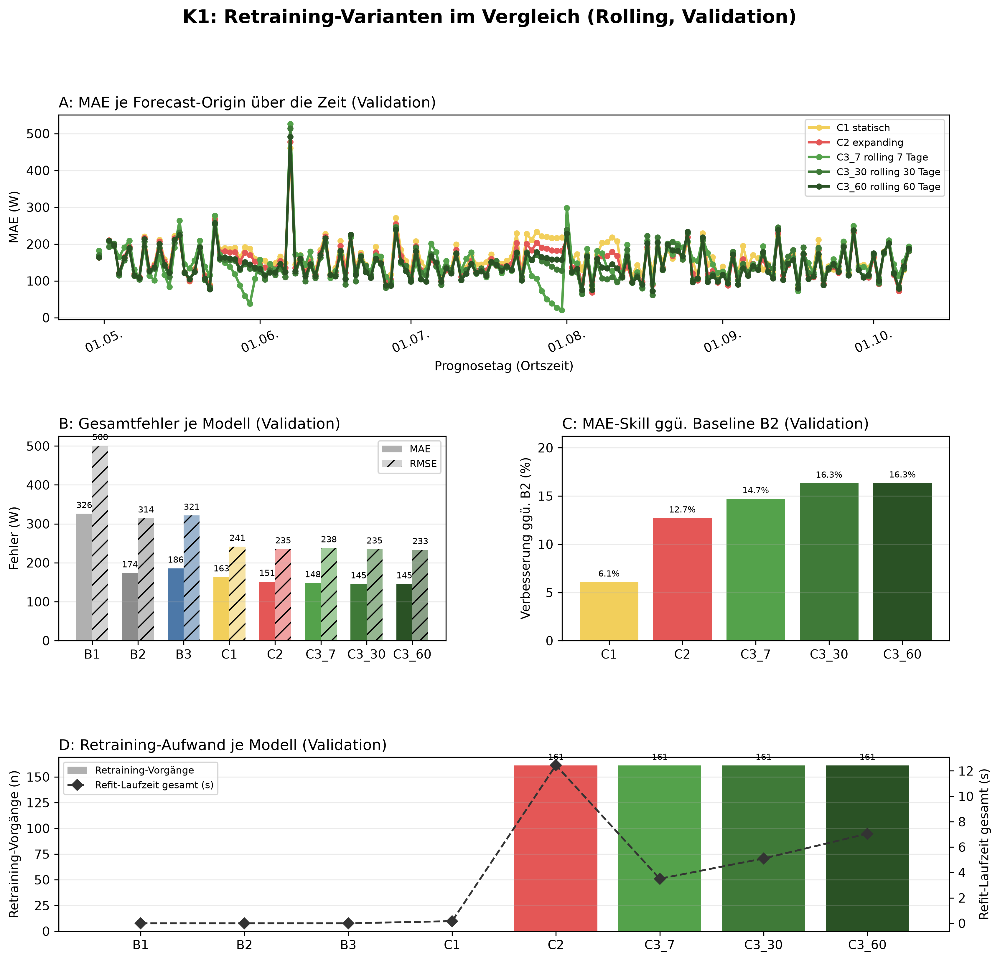
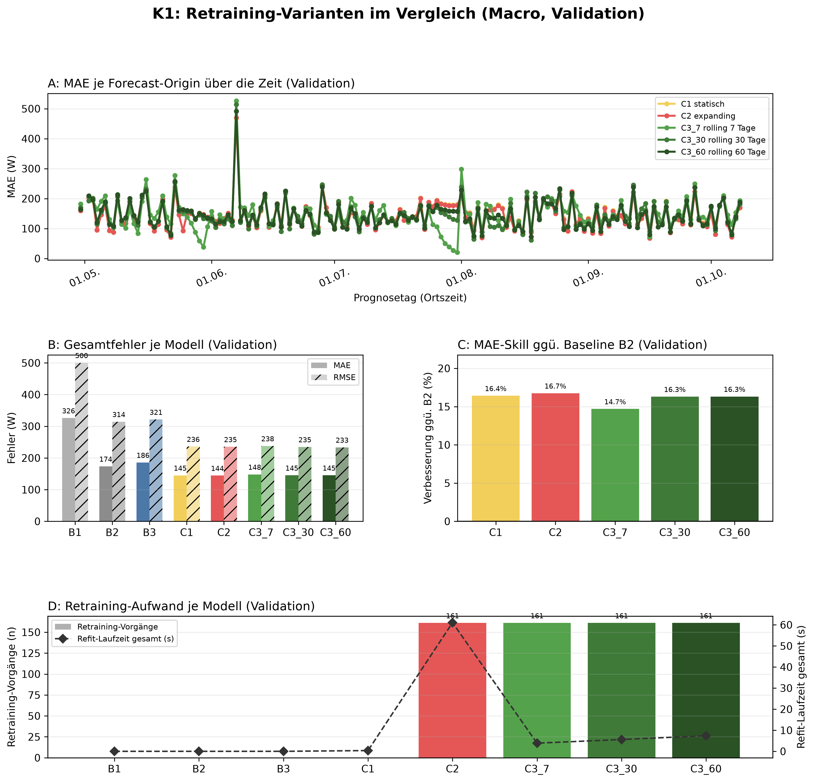

# K1 Retraining-Vergleich, Lauf k1_006

## Setup

- Split: validation, 2015-04-30 bis 2015-10-08, 162 Prognosetage (Ortszeit)
- Modus rolling: 60 Tage Historie vor Split-Start, wie der Online-Zyklus
- Modus macro: gesamte Historie vor Split-Start
- Naive Referenz: rolling B2, macro B2
- Prognose: 1 Tag ab lokaler Mitternacht, Intervall 80 %
- Konfiguration: forecast-model-0.1, Seed 42
- Commit: d22f039 (mit lokalen Änderungen)

## Kennzahlen

| Kennzahl | Wert | Bezug |
|---|---|---|
| rolling: MAE bestes Modell C3_60 rolling 60 Tage [W] | 145,2 | B2 173,5 W |
| rolling: Skill der Prophet-Varianten ggü. B2 [%] | 16,3 | Spanne 6,1 bis 16,3 % |
| rolling: Varianten belastbar schlechter als das beste Modell | 2 | von 4 |
| macro: MAE bestes Modell C2 expanding [W] | 144,5 | B2 173,5 W |
| macro: Skill der Prophet-Varianten ggü. B2 [%] | 16,7 | Spanne 14,7 bis 16,7 % |
| macro: Varianten belastbar schlechter als das beste Modell | 1 | von 4 |

## Gesamtfehler rolling

| Modell | MAE [W] | RMSE [W] | MAPE [%] | Tagesfehler MAE [W] | Tagesfehler MAPE [%] | Skill ggü. B2 [%] | Intervall-Abdeckung [%], Soll 80 | Refit-Zeit gesamt [s] |
|---|---:|---:|---:|---:|---:|---:|---:|---:|
| C3_60 rolling 60 Tage | 145,2 | 233,4 | 50,8 | 65,7 | 24,5 | 16,3 | 91,1 | 7,1 |
| C3_30 rolling 30 Tage | 145,2 | 234,7 | 50,3 | 66,0 | 24,0 | 16,3 | 90,3 | 5,1 |
| C3_7 rolling 7 Tage | 148,0 | 237,8 | 50,5 | 64,4 | 22,2 | 14,7 | 87,3 | 3,5 |
| C2 expanding | 151,5 | 234,9 | 55,8 | 68,3 | 27,1 | 12,7 | 91,8 | 12,4 |
| C1 statisch | 163,0 | 241,5 | 62,6 | 75,9 | 31,3 | 6,1 | 90,9 | 0,2 |
| B2 naiv, Vortag | 173,5 | 314,3 | 54,8 | 70,6 | 22,1 | - | - | 0,0 |
| B3 naiv, Vorwoche | 185,7 | 321,4 | 61,2 | 95,7 | 33,6 | - | - | 0,0 |
| B1 naiv, letzter Wert | 326,0 | 500,4 | 127,9 | 294,8 | 90,6 | - | - | 0,0 |

## Gesamtfehler macro

| Modell | MAE [W] | RMSE [W] | MAPE [%] | Tagesfehler MAE [W] | Tagesfehler MAPE [%] | Skill ggü. B2 [%] | Intervall-Abdeckung [%], Soll 80 | Refit-Zeit gesamt [s] |
|---|---:|---:|---:|---:|---:|---:|---:|---:|
| C2 expanding | 144,5 | 235,2 | 51,1 | 63,9 | 24,6 | 16,7 | 90,7 | 61,0 |
| C1 statisch | 145,0 | 235,9 | 51,4 | 63,9 | 24,7 | 16,4 | 90,6 | 0,4 |
| C3_60 rolling 60 Tage | 145,2 | 233,4 | 50,8 | 65,7 | 24,5 | 16,3 | 91,1 | 7,4 |
| C3_30 rolling 30 Tage | 145,2 | 234,7 | 50,3 | 66,0 | 24,0 | 16,3 | 90,2 | 5,6 |
| C3_7 rolling 7 Tage | 148,0 | 237,8 | 50,5 | 64,4 | 22,2 | 14,7 | 87,3 | 3,9 |
| B2 naiv, Vortag | 173,5 | 314,3 | 54,8 | 70,6 | 22,1 | - | - | 0,0 |
| B3 naiv, Vorwoche | 185,7 | 321,4 | 61,2 | 95,7 | 33,6 | - | - | 0,0 |
| B1 naiv, letzter Wert | 326,0 | 500,4 | 127,9 | 294,8 | 90,6 | - | - | 0,0 |

## Abstand zum besten Prophet-Modell, gepaart je Origin

| Modus | Modell | Referenz | Differenz [W] | 2 Standardfehler [W] | Origins | Origins besser [%] | belastbar |
|---|---|---|---:|---:|---:|---:|---|
| rolling | C3_30 rolling 30 Tage | C3_60 rolling 60 Tage | 0,0 | 1,8 | 161 | 55,3 | nein |
| rolling | C3_7 rolling 7 Tage | C3_60 rolling 60 Tage | 2,8 | 5,2 | 161 | 37,3 | nein |
| rolling | C2 expanding | C3_60 rolling 60 Tage | 6,3 | 1,8 | 161 | 25,5 | ja |
| rolling | C1 statisch | C3_60 rolling 60 Tage | 17,8 | 3,5 | 161 | 17,4 | ja |
| macro | C1 statisch | C2 expanding | 0,6 | 0,2 | 161 | 33,5 | ja |
| macro | C3_60 rolling 60 Tage | C2 expanding | 0,7 | 2,2 | 161 | 44,7 | nein |
| macro | C3_30 rolling 30 Tage | C2 expanding | 0,8 | 3,1 | 161 | 45,3 | nein |
| macro | C3_7 rolling 7 Tage | C2 expanding | 3,5 | 6,0 | 161 | 39,8 | nein |

## Hinweise

- belastbar: Betrag der Differenz größer als 2 Standardfehler der gepaarten Differenzen, grobe Faustregel
- Tagesfehler: Fehler des Tagesmittels (Mittel der 24 Prognosewerte gegen das Ist-Tagesmittel), nicht der Mittelwert der Stundenfehler
- rolling: Tagesfehler aus 160 von 162 Tagen (nur Tage mit lauter bewerteten Stunden)
- rolling: 25 von 3888 Zielstunden nicht bewertet (Messwert fehlt 24, imputiert 1)
- macro: Tagesfehler aus 160 von 162 Tagen (nur Tage mit lauter bewerteten Stunden)
- macro: 25 von 3888 Zielstunden nicht bewertet (Messwert fehlt 24, imputiert 1)

