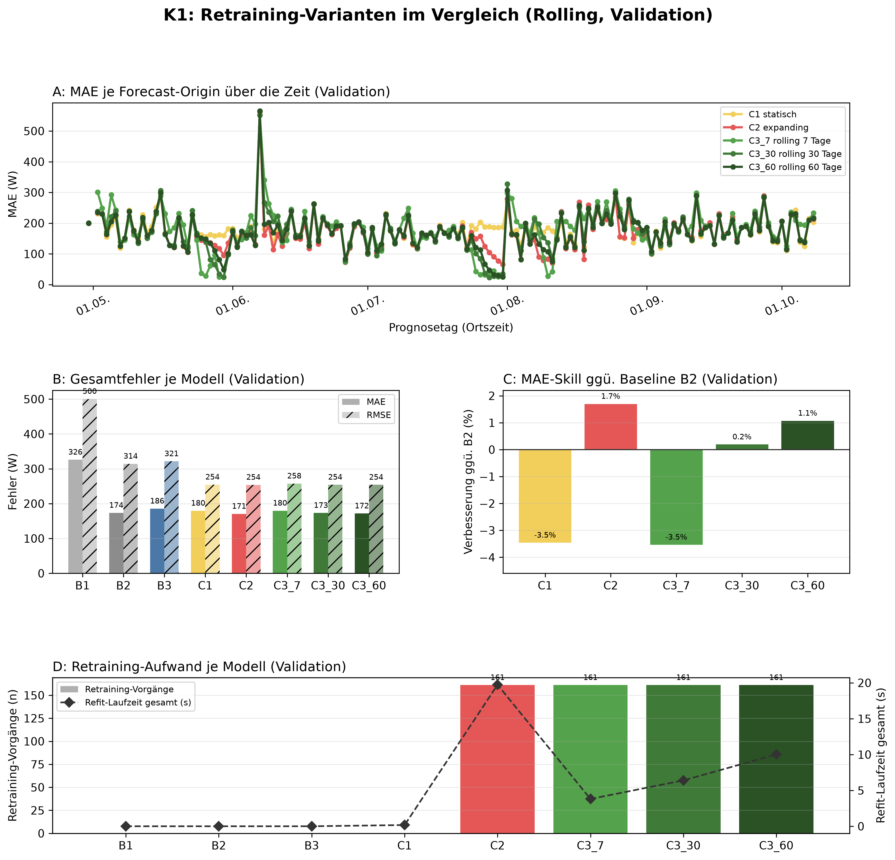
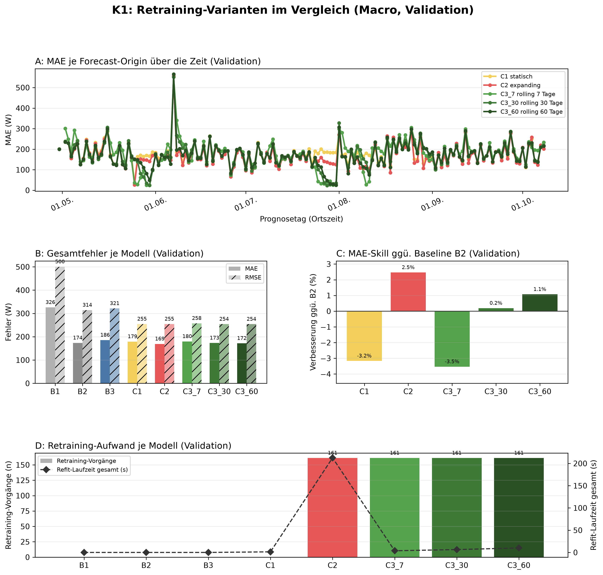

# K1 Retraining-Vergleich, Lauf k1_008

## Setup

- Split: validation, 2015-04-30 bis 2015-10-08, 162 Prognosetage (Ortszeit)
- Modus rolling: 60 Tage Historie vor Split-Start, wie der Online-Zyklus
- Modus macro: gesamte Historie vor Split-Start
- Naive Referenz: rolling B2, macro B2
- Prognose: 1 Tag ab lokaler Mitternacht, Intervall 80 %
- Konfiguration: forecast-model-0.1, Seed 42
- Commit: d22f039 (mit lokalen Änderungen)

## Kennzahlen

| Kennzahl | Wert | Bezug |
|---|---|---|
| rolling: MAE bestes Modell C2 expanding [W] | 170,6 | B2 173,5 W |
| rolling: Skill der Prophet-Varianten ggü. B2 [%] | 1,7 | Spanne -3,5 bis 1,7 % |
| rolling: Varianten belastbar schlechter als das beste Modell | 2 | von 4 |
| macro: MAE bestes Modell C2 expanding [W] | 169,2 | B2 173,5 W |
| macro: Skill der Prophet-Varianten ggü. B2 [%] | 2,5 | Spanne -3,5 bis 2,5 % |
| macro: Varianten belastbar schlechter als das beste Modell | 2 | von 4 |

## Gesamtfehler rolling

| Modell | MAE [W] | RMSE [W] | MAPE [%] | Tagesfehler MAE [W] | Tagesfehler MAPE [%] | Skill ggü. B2 [%] | Intervall-Abdeckung [%], Soll 80 | Refit-Zeit gesamt [s] |
|---|---:|---:|---:|---:|---:|---:|---:|---:|
| C2 expanding | 170,6 | 253,9 | 65,8 | 65,6 | 23,2 | 1,7 | 92,3 | 19,7 |
| C3_60 rolling 60 Tage | 171,7 | 254,0 | 66,6 | 65,0 | 22,7 | 1,1 | 91,6 | 10,0 |
| C3_30 rolling 30 Tage | 173,2 | 254,2 | 67,9 | 67,2 | 23,4 | 0,2 | 91,2 | 6,4 |
| B2 naiv, Vortag | 173,5 | 314,3 | 54,8 | 70,6 | 22,1 | - | - | 0,0 |
| C1 statisch | 179,5 | 254,5 | 73,4 | 67,0 | 26,5 | -3,5 | 93,1 | 0,2 |
| C3_7 rolling 7 Tage | 179,6 | 257,5 | 73,5 | 77,7 | 26,1 | -3,5 | 88,0 | 3,8 |
| B3 naiv, Vorwoche | 185,7 | 321,4 | 61,2 | 95,7 | 33,6 | - | - | 0,0 |
| B1 naiv, letzter Wert | 326,0 | 500,4 | 127,9 | 294,8 | 90,6 | - | - | 0,0 |

## Gesamtfehler macro

| Modell | MAE [W] | RMSE [W] | MAPE [%] | Tagesfehler MAE [W] | Tagesfehler MAPE [%] | Skill ggü. B2 [%] | Intervall-Abdeckung [%], Soll 80 | Refit-Zeit gesamt [s] |
|---|---:|---:|---:|---:|---:|---:|---:|---:|
| C2 expanding | 169,2 | 254,6 | 62,9 | 67,3 | 23,7 | 2,5 | 91,6 | 212,6 |
| C3_60 rolling 60 Tage | 171,7 | 254,0 | 66,6 | 65,0 | 22,7 | 1,1 | 91,7 | 10,1 |
| C3_30 rolling 30 Tage | 173,2 | 254,2 | 67,9 | 67,2 | 23,4 | 0,2 | 91,1 | 6,4 |
| B2 naiv, Vortag | 173,5 | 314,3 | 54,8 | 70,6 | 22,1 | - | - | 0,0 |
| C1 statisch | 179,0 | 254,6 | 72,7 | 67,6 | 26,4 | -3,2 | 92,2 | 1,4 |
| C3_7 rolling 7 Tage | 179,6 | 257,5 | 73,5 | 77,7 | 26,1 | -3,5 | 88,0 | 3,8 |
| B3 naiv, Vorwoche | 185,7 | 321,4 | 61,2 | 95,7 | 33,6 | - | - | 0,0 |
| B1 naiv, letzter Wert | 326,0 | 500,4 | 127,9 | 294,8 | 90,6 | - | - | 0,0 |

## Abstand zum besten Prophet-Modell, gepaart je Origin

| Modus | Modell | Referenz | Differenz [W] | 2 Standardfehler [W] | Origins | Origins besser [%] | belastbar |
|---|---|---|---:|---:|---:|---:|---|
| rolling | C3_60 rolling 60 Tage | C2 expanding | 1,1 | 2,7 | 161 | 42,9 | nein |
| rolling | C3_30 rolling 30 Tage | C2 expanding | 2,6 | 4,4 | 161 | 46,6 | nein |
| rolling | C1 statisch | C2 expanding | 8,9 | 4,0 | 161 | 37,3 | ja |
| rolling | C3_7 rolling 7 Tage | C2 expanding | 9,1 | 6,7 | 161 | 39,1 | ja |
| macro | C3_60 rolling 60 Tage | C2 expanding | 2,4 | 4,4 | 161 | 34,8 | nein |
| macro | C3_30 rolling 30 Tage | C2 expanding | 3,9 | 5,6 | 161 | 31,7 | nein |
| macro | C1 statisch | C2 expanding | 9,8 | 2,3 | 161 | 18,6 | ja |
| macro | C3_7 rolling 7 Tage | C2 expanding | 10,4 | 7,5 | 161 | 30,4 | ja |

## Hinweise

- belastbar: Betrag der Differenz größer als 2 Standardfehler der gepaarten Differenzen, grobe Faustregel
- Tagesfehler: Fehler des Tagesmittels (Mittel der 24 Prognosewerte gegen das Ist-Tagesmittel), nicht der Mittelwert der Stundenfehler
- rolling: Tagesfehler aus 160 von 162 Tagen (nur Tage mit lauter bewerteten Stunden)
- rolling: 25 von 3888 Zielstunden nicht bewertet (Messwert fehlt 24, imputiert 1)
- macro: Tagesfehler aus 160 von 162 Tagen (nur Tage mit lauter bewerteten Stunden)
- macro: 25 von 3888 Zielstunden nicht bewertet (Messwert fehlt 24, imputiert 1)

