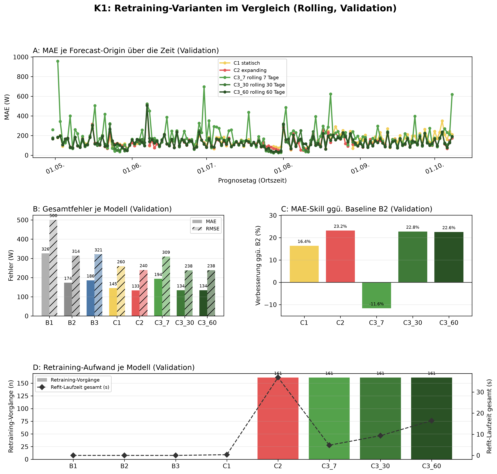
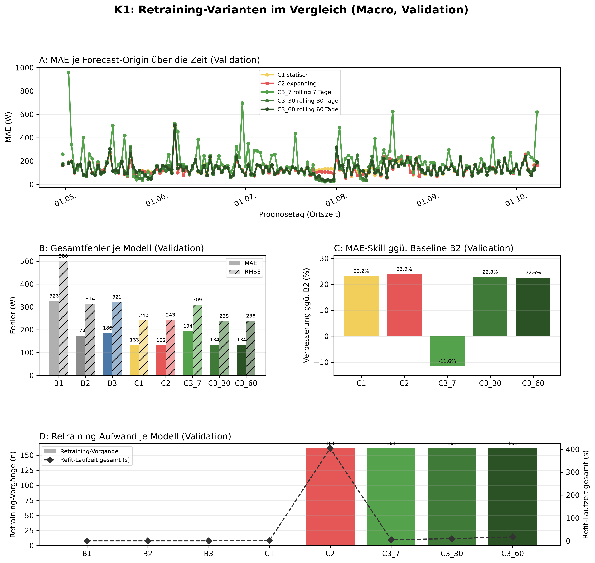

# K1 Retraining-Vergleich, Lauf k1_010

## Setup

- Split: validation, 2015-04-30 bis 2015-10-08, 162 Prognosetage (Ortszeit)
- Modus rolling: 60 Tage Historie vor Split-Start, wie der Online-Zyklus
- Modus macro: gesamte Historie vor Split-Start
- Naive Referenz: rolling B2, macro B2
- Prognose: 1 Tag ab lokaler Mitternacht, Intervall 80 %
- Konfiguration: forecast-model-0.1, Seed 42
- Commit: 6af2f64 (mit lokalen Änderungen)

## Kennzahlen

| Kennzahl | Wert | Bezug |
|---|---|---|
| rolling: MAE bestes Modell C2 expanding [W] | 133,3 | B2 173,5 W |
| rolling: Skill der Prophet-Varianten ggü. B2 [%] | 23,2 | Spanne -11,6 bis 23,2 % |
| rolling: Varianten belastbar schlechter als das beste Modell | 2 | von 4 |
| macro: MAE bestes Modell C2 expanding [W] | 132,0 | B2 173,5 W |
| macro: Skill der Prophet-Varianten ggü. B2 [%] | 23,9 | Spanne -11,6 bis 23,9 % |
| macro: Varianten belastbar schlechter als das beste Modell | 1 | von 4 |

## Gesamtfehler rolling

| Modell | MAE [W] | RMSE [W] | MAPE [%] | Tagesfehler MAE [W] | Tagesfehler MAPE [%] | Skill ggü. B2 [%] | Intervall-Abdeckung [%], Soll 80 | Refit-Zeit gesamt [s] |
|---|---:|---:|---:|---:|---:|---:|---:|---:|
| C2 expanding | 133,3 | 239,5 | 39,6 | 71,2 | 22,0 | 23,2 | 82,4 | 36,9 |
| C3_30 rolling 30 Tage | 134,0 | 237,8 | 40,3 | 70,3 | 21,6 | 22,8 | 78,5 | 9,3 |
| C3_60 rolling 60 Tage | 134,4 | 238,5 | 40,3 | 72,0 | 22,4 | 22,6 | 80,3 | 16,5 |
| C1 statisch | 145,1 | 259,7 | 38,4 | 111,8 | 33,4 | 16,4 | 77,4 | 0,3 |
| B2 naiv, Vortag | 173,5 | 314,3 | 54,8 | 70,6 | 22,1 | - | - | 0,0 |
| B3 naiv, Vorwoche | 185,7 | 321,4 | 61,2 | 95,7 | 33,6 | - | - | 0,0 |
| C3_7 rolling 7 Tage | 193,7 | 309,3 | 66,0 | 144,5 | 44,9 | -11,6 | 58,4 | 4,8 |
| B1 naiv, letzter Wert | 326,0 | 500,4 | 127,9 | 294,8 | 90,6 | - | - | 0,0 |

## Gesamtfehler macro

| Modell | MAE [W] | RMSE [W] | MAPE [%] | Tagesfehler MAE [W] | Tagesfehler MAPE [%] | Skill ggü. B2 [%] | Intervall-Abdeckung [%], Soll 80 | Refit-Zeit gesamt [s] |
|---|---:|---:|---:|---:|---:|---:|---:|---:|
| C2 expanding | 132,0 | 243,1 | 37,2 | 81,5 | 25,5 | 23,9 | 84,5 | 404,3 |
| C1 statisch | 133,3 | 240,4 | 40,0 | 74,2 | 24,4 | 23,2 | 83,7 | 1,6 |
| C3_30 rolling 30 Tage | 134,0 | 237,8 | 40,3 | 70,3 | 21,6 | 22,8 | 78,7 | 9,9 |
| C3_60 rolling 60 Tage | 134,4 | 238,5 | 40,3 | 72,0 | 22,4 | 22,6 | 80,4 | 17,4 |
| B2 naiv, Vortag | 173,5 | 314,3 | 54,8 | 70,6 | 22,1 | - | - | 0,0 |
| B3 naiv, Vorwoche | 185,7 | 321,4 | 61,2 | 95,7 | 33,6 | - | - | 0,0 |
| C3_7 rolling 7 Tage | 193,7 | 309,3 | 66,0 | 144,5 | 44,9 | -11,6 | 59,1 | 5,1 |
| B1 naiv, letzter Wert | 326,0 | 500,4 | 127,9 | 294,8 | 90,6 | - | - | 0,0 |

## Abstand zum besten Prophet-Modell, gepaart je Origin

| Modus | Modell | Referenz | Differenz [W] | 2 Standardfehler [W] | Origins | Origins besser [%] | belastbar |
|---|---|---|---:|---:|---:|---:|---|
| rolling | C3_30 rolling 30 Tage | C2 expanding | 0,7 | 4,7 | 161 | 54,7 | nein |
| rolling | C3_60 rolling 60 Tage | C2 expanding | 1,1 | 3,2 | 161 | 49,7 | nein |
| rolling | C1 statisch | C2 expanding | 11,8 | 4,4 | 161 | 36,6 | ja |
| rolling | C3_7 rolling 7 Tage | C2 expanding | 60,4 | 19,0 | 161 | 28,6 | ja |
| macro | C1 statisch | C2 expanding | 1,3 | 1,5 | 161 | 43,5 | nein |
| macro | C3_30 rolling 30 Tage | C2 expanding | 2,0 | 5,2 | 161 | 47,2 | nein |
| macro | C3_60 rolling 60 Tage | C2 expanding | 2,3 | 4,1 | 161 | 45,3 | nein |
| macro | C3_7 rolling 7 Tage | C2 expanding | 61,6 | 19,2 | 161 | 26,7 | ja |

## Hinweise

- belastbar: Betrag der Differenz größer als 2 Standardfehler der gepaarten Differenzen, grobe Faustregel
- Tagesfehler: Fehler des Tagesmittels (Mittel der 24 Prognosewerte gegen das Ist-Tagesmittel), nicht der Mittelwert der Stundenfehler
- rolling: Tagesfehler aus 160 von 162 Tagen (nur Tage mit lauter bewerteten Stunden)
- rolling: 25 von 3888 Zielstunden nicht bewertet (Messwert fehlt 24, imputiert 1)
- macro: Tagesfehler aus 160 von 162 Tagen (nur Tage mit lauter bewerteten Stunden)
- macro: 25 von 3888 Zielstunden nicht bewertet (Messwert fehlt 24, imputiert 1)

