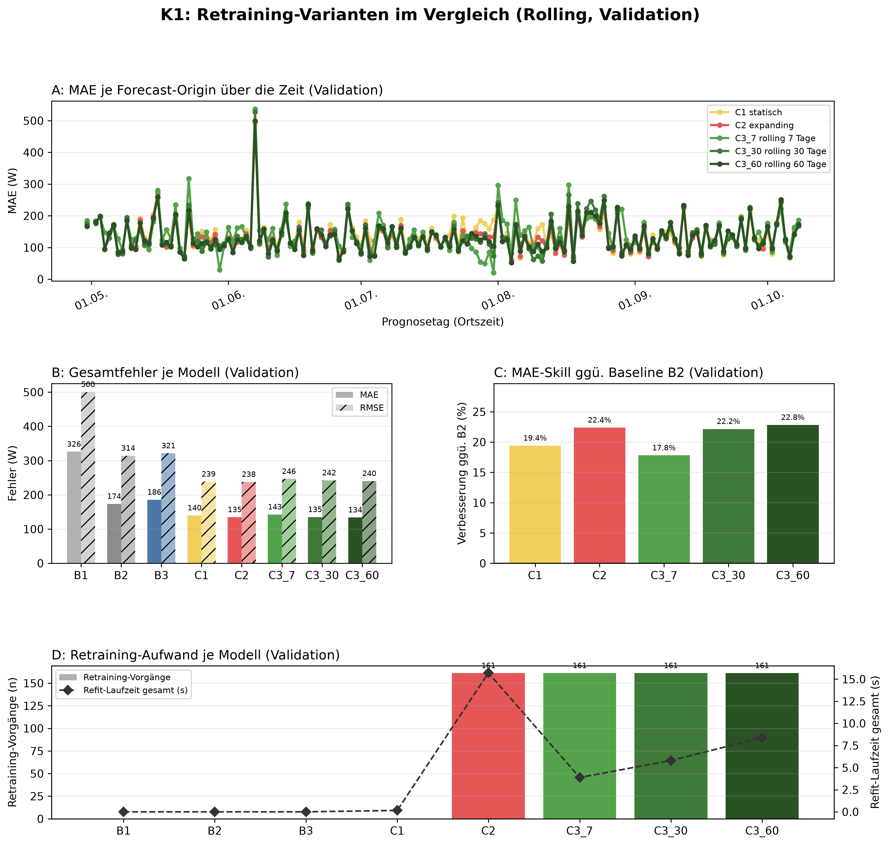
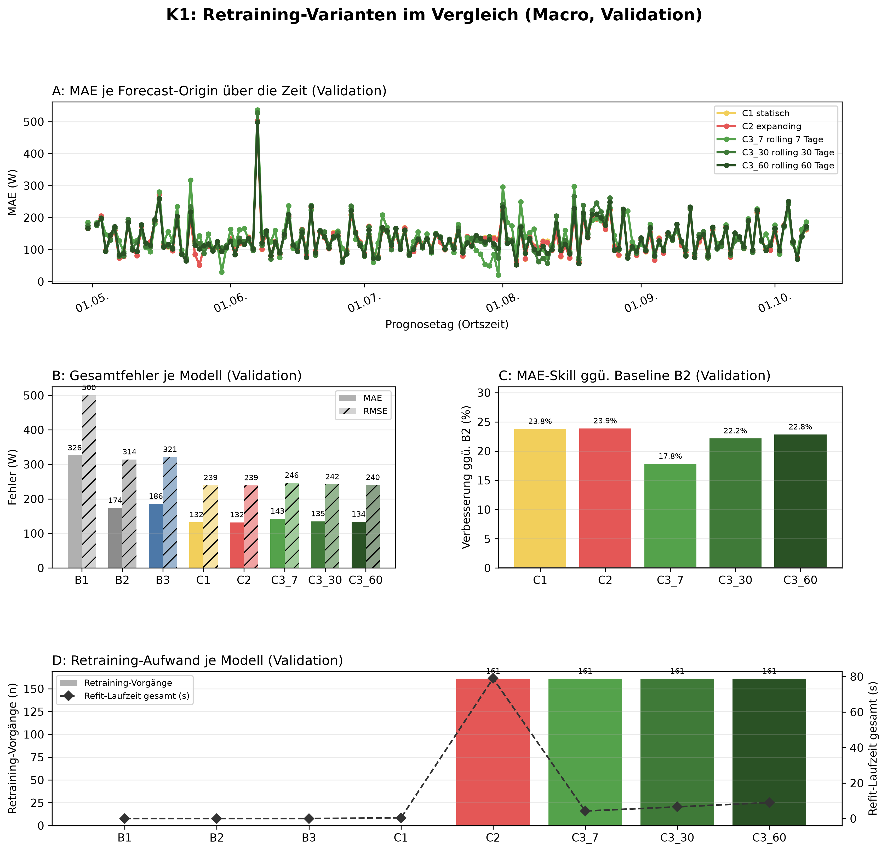

# K1 Retraining-Vergleich, Lauf k1_011

## Setup

- Split: validation, 2015-04-30 bis 2015-10-08, 162 Prognosetage (Ortszeit)
- Modus rolling: 60 Tage Historie vor Split-Start, wie der Online-Zyklus
- Modus macro: gesamte Historie vor Split-Start
- Naive Referenz: rolling B2, macro B2
- Prognose: 1 Tag ab lokaler Mitternacht, Intervall 80 %
- Konfiguration: forecast-model-0.1, Seed 42
- Commit: d236d6c (mit lokalen Änderungen)

## Kennzahlen

| Kennzahl | Wert | Bezug |
|---|---|---|
| rolling: MAE bestes Modell C3_60 rolling 60 Tage [W] | 133,9 | B2 173,5 W |
| rolling: Skill der Prophet-Varianten ggü. B2 [%] | 22,8 | Spanne 17,8 bis 22,8 % |
| rolling: Varianten belastbar schlechter als das beste Modell | 2 | von 4 |
| macro: MAE bestes Modell C2 expanding [W] | 132,1 | B2 173,5 W |
| macro: Skill der Prophet-Varianten ggü. B2 [%] | 23,9 | Spanne 17,8 bis 23,9 % |
| macro: Varianten belastbar schlechter als das beste Modell | 3 | von 4 |

## Gesamtfehler rolling

| Modell | MAE [W] | RMSE [W] | MAPE [%] | Tagesfehler MAE [W] | Tagesfehler MAPE [%] | Skill ggü. B2 [%] | Intervall-Abdeckung [%], Soll 80 | Refit-Zeit gesamt [s] |
|---|---:|---:|---:|---:|---:|---:|---:|---:|
| C3_60 rolling 60 Tage | 133,9 | 240,3 | 39,7 | 78,4 | 25,4 | 22,8 | 81,9 | 8,4 |
| C2 expanding | 134,7 | 237,8 | 42,1 | 71,3 | 24,2 | 22,4 | 82,4 | 15,7 |
| C3_30 rolling 30 Tage | 135,1 | 242,2 | 40,2 | 79,1 | 25,4 | 22,2 | 80,2 | 5,8 |
| C1 statisch | 139,8 | 238,5 | 46,5 | 66,8 | 24,3 | 19,4 | 81,0 | 0,2 |
| C3_7 rolling 7 Tage | 142,6 | 246,4 | 43,3 | 81,6 | 26,4 | 17,8 | 70,1 | 3,9 |
| B2 naiv, Vortag | 173,5 | 314,3 | 54,8 | 70,6 | 22,1 | - | - | 0,0 |
| B3 naiv, Vorwoche | 185,7 | 321,4 | 61,2 | 95,7 | 33,6 | - | - | 0,0 |
| B1 naiv, letzter Wert | 326,0 | 500,4 | 127,9 | 294,8 | 90,6 | - | - | 0,0 |

## Gesamtfehler macro

| Modell | MAE [W] | RMSE [W] | MAPE [%] | Tagesfehler MAE [W] | Tagesfehler MAPE [%] | Skill ggü. B2 [%] | Intervall-Abdeckung [%], Soll 80 | Refit-Zeit gesamt [s] |
|---|---:|---:|---:|---:|---:|---:|---:|---:|
| C2 expanding | 132,1 | 239,4 | 39,7 | 72,8 | 23,9 | 23,9 | 84,4 | 79,0 |
| C1 statisch | 132,3 | 239,5 | 39,8 | 72,1 | 23,8 | 23,8 | 84,5 | 0,4 |
| C3_60 rolling 60 Tage | 133,9 | 240,3 | 39,7 | 78,4 | 25,4 | 22,8 | 82,1 | 9,0 |
| C3_30 rolling 30 Tage | 135,1 | 242,2 | 40,2 | 79,1 | 25,4 | 22,2 | 80,2 | 6,6 |
| C3_7 rolling 7 Tage | 142,6 | 246,4 | 43,3 | 81,6 | 26,4 | 17,8 | 70,3 | 4,3 |
| B2 naiv, Vortag | 173,5 | 314,3 | 54,8 | 70,6 | 22,1 | - | - | 0,0 |
| B3 naiv, Vorwoche | 185,7 | 321,4 | 61,2 | 95,7 | 33,6 | - | - | 0,0 |
| B1 naiv, letzter Wert | 326,0 | 500,4 | 127,9 | 294,8 | 90,6 | - | - | 0,0 |

## Abstand zum besten Prophet-Modell, gepaart je Origin

| Modus | Modell | Referenz | Differenz [W] | 2 Standardfehler [W] | Origins | Origins besser [%] | belastbar |
|---|---|---|---:|---:|---:|---:|---|
| rolling | C2 expanding | C3_60 rolling 60 Tage | 0,8 | 1,6 | 161 | 49,7 | nein |
| rolling | C3_30 rolling 30 Tage | C3_60 rolling 60 Tage | 1,2 | 1,8 | 161 | 51,6 | nein |
| rolling | C1 statisch | C3_60 rolling 60 Tage | 5,9 | 3,3 | 161 | 43,5 | ja |
| rolling | C3_7 rolling 7 Tage | C3_60 rolling 60 Tage | 8,7 | 4,5 | 161 | 39,1 | ja |
| macro | C1 statisch | C2 expanding | 0,2 | 0,2 | 161 | 44,7 | nein |
| macro | C3_60 rolling 60 Tage | C2 expanding | 1,8 | 1,7 | 161 | 43,5 | ja |
| macro | C3_30 rolling 30 Tage | C2 expanding | 3,0 | 2,7 | 161 | 46,6 | ja |
| macro | C3_7 rolling 7 Tage | C2 expanding | 10,5 | 4,9 | 161 | 32,9 | ja |

## Hinweise

- belastbar: Betrag der Differenz größer als 2 Standardfehler der gepaarten Differenzen, grobe Faustregel
- Tagesfehler: Fehler des Tagesmittels (Mittel der 24 Prognosewerte gegen das Ist-Tagesmittel), nicht der Mittelwert der Stundenfehler
- rolling: Tagesfehler aus 160 von 162 Tagen (nur Tage mit lauter bewerteten Stunden)
- rolling: 25 von 3888 Zielstunden nicht bewertet (Messwert fehlt 24, imputiert 1)
- macro: Tagesfehler aus 160 von 162 Tagen (nur Tage mit lauter bewerteten Stunden)
- macro: 25 von 3888 Zielstunden nicht bewertet (Messwert fehlt 24, imputiert 1)

