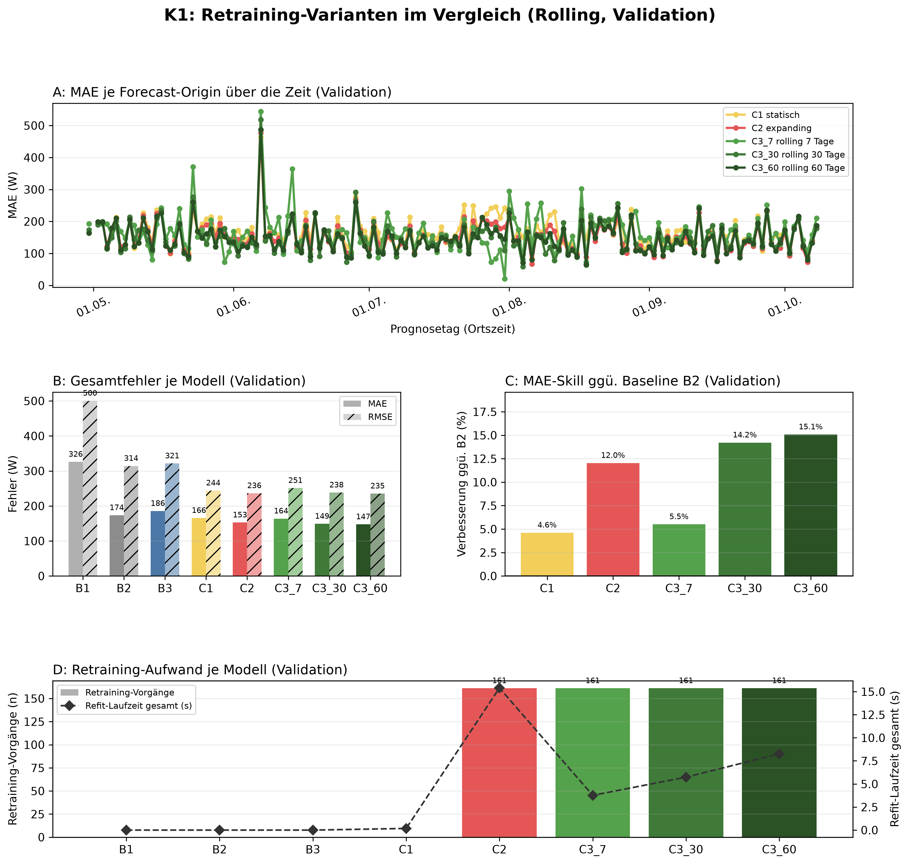
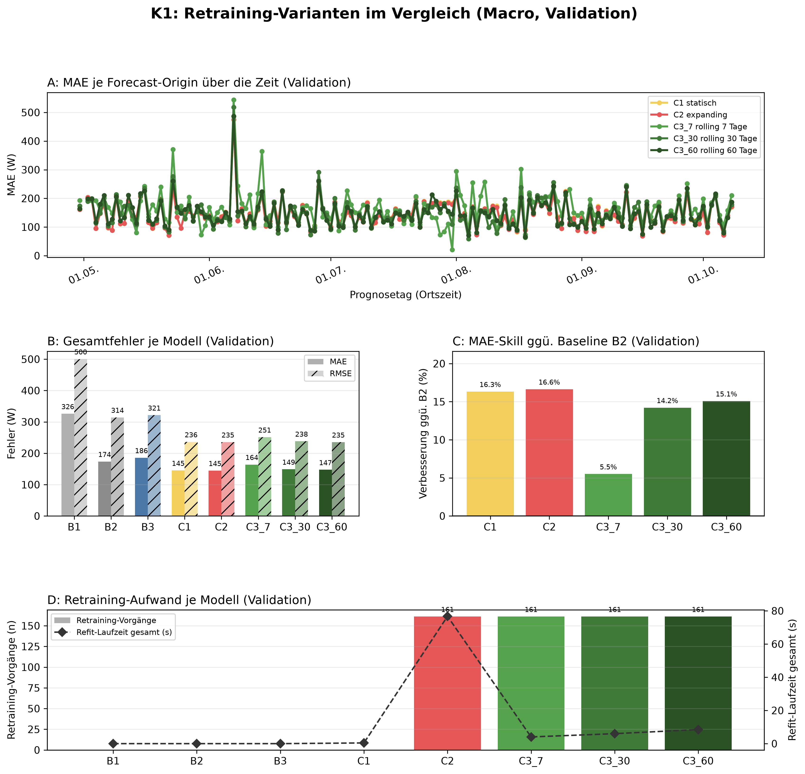

# K1 Retraining-Vergleich, Lauf k1_012

## Setup

- Split: validation, 2015-04-30 bis 2015-10-08, 162 Prognosetage (Ortszeit)
- Modus rolling: 60 Tage Historie vor Split-Start, wie der Online-Zyklus
- Modus macro: gesamte Historie vor Split-Start
- Naive Referenz: rolling B2, macro B2
- Prognose: 1 Tag ab lokaler Mitternacht, Intervall 80 %
- Konfiguration: forecast-model-0.1, Seed 42
- Commit: d236d6c (mit lokalen Änderungen)

## Kennzahlen

| Kennzahl | Wert | Bezug |
|---|---|---|
| rolling: MAE bestes Modell C3_60 rolling 60 Tage [W] | 147,4 | B2 173,5 W |
| rolling: Skill der Prophet-Varianten ggü. B2 [%] | 15,1 | Spanne 4,6 bis 15,1 % |
| rolling: Varianten belastbar schlechter als das beste Modell | 3 | von 4 |
| macro: MAE bestes Modell C2 expanding [W] | 144,6 | B2 173,5 W |
| macro: Skill der Prophet-Varianten ggü. B2 [%] | 16,6 | Spanne 5,5 bis 16,6 % |
| macro: Varianten belastbar schlechter als das beste Modell | 4 | von 4 |

## Gesamtfehler rolling

| Modell | MAE [W] | RMSE [W] | MAPE [%] | Tagesfehler MAE [W] | Tagesfehler MAPE [%] | Skill ggü. B2 [%] | Intervall-Abdeckung [%], Soll 80 | Refit-Zeit gesamt [s] |
|---|---:|---:|---:|---:|---:|---:|---:|---:|
| C3_60 rolling 60 Tage | 147,4 | 235,3 | 52,0 | 68,7 | 25,5 | 15,1 | 90,6 | 8,3 |
| C3_30 rolling 30 Tage | 148,9 | 238,2 | 52,3 | 69,9 | 25,4 | 14,2 | 89,4 | 5,7 |
| C2 expanding | 152,6 | 236,2 | 56,3 | 70,2 | 27,7 | 12,0 | 91,7 | 15,4 |
| C3_7 rolling 7 Tage | 164,0 | 251,2 | 58,6 | 83,6 | 29,0 | 5,5 | 82,0 | 3,8 |
| C1 statisch | 165,5 | 243,9 | 63,6 | 79,7 | 32,3 | 4,6 | 90,6 | 0,2 |
| B2 naiv, Vortag | 173,5 | 314,3 | 54,8 | 70,6 | 22,1 | - | - | 0,0 |
| B3 naiv, Vorwoche | 185,7 | 321,4 | 61,2 | 95,7 | 33,6 | - | - | 0,0 |
| B1 naiv, letzter Wert | 326,0 | 500,4 | 127,9 | 294,8 | 90,6 | - | - | 0,0 |

## Gesamtfehler macro

| Modell | MAE [W] | RMSE [W] | MAPE [%] | Tagesfehler MAE [W] | Tagesfehler MAPE [%] | Skill ggü. B2 [%] | Intervall-Abdeckung [%], Soll 80 | Refit-Zeit gesamt [s] |
|---|---:|---:|---:|---:|---:|---:|---:|---:|
| C2 expanding | 144,6 | 235,5 | 51,1 | 64,2 | 24,7 | 16,6 | 90,8 | 76,7 |
| C1 statisch | 145,2 | 236,2 | 51,4 | 64,2 | 24,8 | 16,3 | 90,5 | 0,4 |
| C3_60 rolling 60 Tage | 147,4 | 235,3 | 52,0 | 68,7 | 25,5 | 15,1 | 90,8 | 8,5 |
| C3_30 rolling 30 Tage | 148,9 | 238,2 | 52,3 | 69,9 | 25,4 | 14,2 | 89,5 | 6,0 |
| C3_7 rolling 7 Tage | 164,0 | 251,2 | 58,6 | 83,6 | 29,0 | 5,5 | 81,9 | 4,0 |
| B2 naiv, Vortag | 173,5 | 314,3 | 54,8 | 70,6 | 22,1 | - | - | 0,0 |
| B3 naiv, Vorwoche | 185,7 | 321,4 | 61,2 | 95,7 | 33,6 | - | - | 0,0 |
| B1 naiv, letzter Wert | 326,0 | 500,4 | 127,9 | 294,8 | 90,6 | - | - | 0,0 |

## Abstand zum besten Prophet-Modell, gepaart je Origin

| Modus | Modell | Referenz | Differenz [W] | 2 Standardfehler [W] | Origins | Origins besser [%] | belastbar |
|---|---|---|---:|---:|---:|---:|---|
| rolling | C3_30 rolling 30 Tage | C3_60 rolling 60 Tage | 1,5 | 2,4 | 161 | 47,8 | nein |
| rolling | C2 expanding | C3_60 rolling 60 Tage | 5,3 | 2,1 | 161 | 38,5 | ja |
| rolling | C3_7 rolling 7 Tage | C3_60 rolling 60 Tage | 16,6 | 6,0 | 161 | 29,2 | ja |
| rolling | C1 statisch | C3_60 rolling 60 Tage | 18,2 | 4,1 | 161 | 23,6 | ja |
| macro | C1 statisch | C2 expanding | 0,5 | 0,3 | 161 | 34,8 | ja |
| macro | C3_60 rolling 60 Tage | C2 expanding | 2,7 | 2,5 | 161 | 39,1 | ja |
| macro | C3_30 rolling 30 Tage | C2 expanding | 4,2 | 3,6 | 161 | 36,0 | ja |
| macro | C3_7 rolling 7 Tage | C2 expanding | 19,3 | 6,7 | 161 | 26,7 | ja |

## Hinweise

- belastbar: Betrag der Differenz größer als 2 Standardfehler der gepaarten Differenzen, grobe Faustregel
- Tagesfehler: Fehler des Tagesmittels (Mittel der 24 Prognosewerte gegen das Ist-Tagesmittel), nicht der Mittelwert der Stundenfehler
- rolling: Tagesfehler aus 160 von 162 Tagen (nur Tage mit lauter bewerteten Stunden)
- rolling: 25 von 3888 Zielstunden nicht bewertet (Messwert fehlt 24, imputiert 1)
- macro: Tagesfehler aus 160 von 162 Tagen (nur Tage mit lauter bewerteten Stunden)
- macro: 25 von 3888 Zielstunden nicht bewertet (Messwert fehlt 24, imputiert 1)

