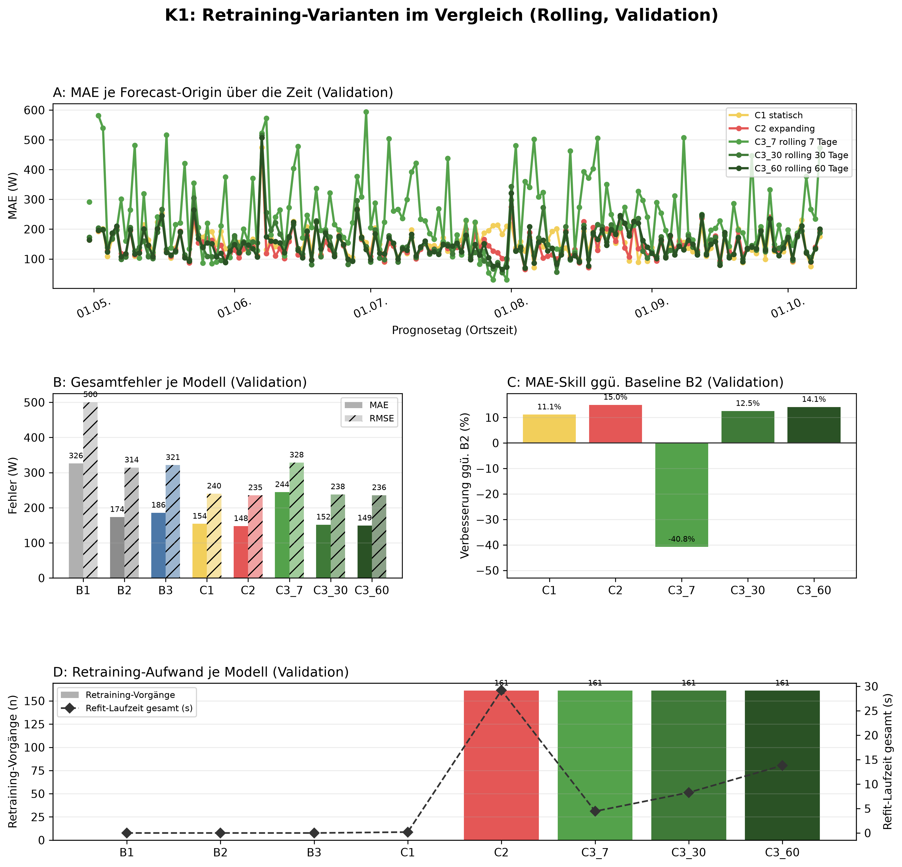
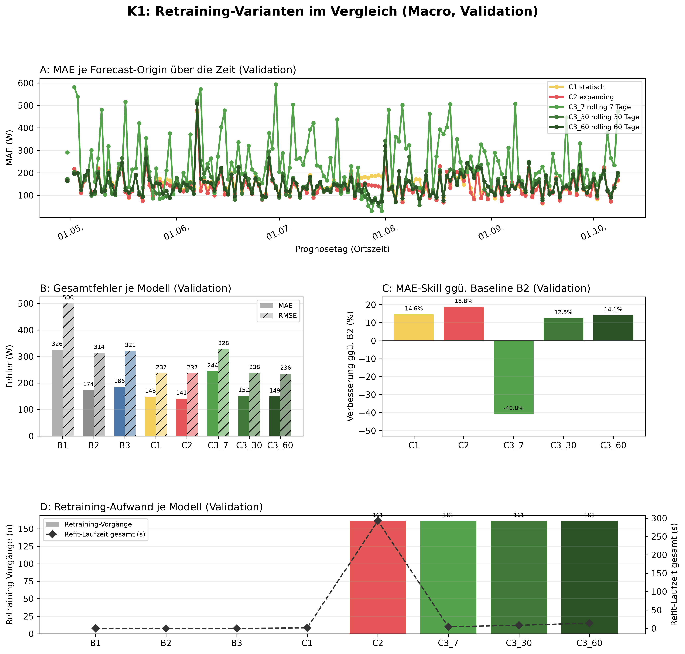

# K1 Retraining-Vergleich, Lauf k1_013

## Setup

- Split: validation, 2015-04-30 bis 2015-10-08, 162 Prognosetage (Ortszeit)
- Modus rolling: 60 Tage Historie vor Split-Start, wie der Online-Zyklus
- Modus macro: gesamte Historie vor Split-Start
- Naive Referenz: rolling B2, macro B2
- Prognose: 1 Tag ab lokaler Mitternacht, Intervall 80 %
- Konfiguration: forecast-model-0.1, Seed 42
- Commit: d236d6c (mit lokalen Änderungen)

## Kennzahlen

| Kennzahl | Wert | Bezug |
|---|---|---|
| rolling: MAE bestes Modell C2 expanding [W] | 147,5 | B2 173,5 W |
| rolling: Skill der Prophet-Varianten ggü. B2 [%] | 15,0 | Spanne -40,8 bis 15,0 % |
| rolling: Varianten belastbar schlechter als das beste Modell | 2 | von 4 |
| macro: MAE bestes Modell C2 expanding [W] | 140,9 | B2 173,5 W |
| macro: Skill der Prophet-Varianten ggü. B2 [%] | 18,8 | Spanne -40,8 bis 18,8 % |
| macro: Varianten belastbar schlechter als das beste Modell | 4 | von 4 |

## Gesamtfehler rolling

| Modell | MAE [W] | RMSE [W] | MAPE [%] | Tagesfehler MAE [W] | Tagesfehler MAPE [%] | Skill ggü. B2 [%] | Intervall-Abdeckung [%], Soll 80 | Refit-Zeit gesamt [s] |
|---|---:|---:|---:|---:|---:|---:|---:|---:|
| C2 expanding | 147,5 | 235,3 | 52,0 | 68,2 | 23,8 | 15,0 | 92,4 | 29,2 |
| C3_60 rolling 60 Tage | 149,0 | 235,5 | 53,0 | 69,0 | 23,7 | 14,1 | 90,4 | 13,8 |
| C3_30 rolling 30 Tage | 151,8 | 237,9 | 54,4 | 70,1 | 23,9 | 12,5 | 88,6 | 8,3 |
| C1 statisch | 154,2 | 240,0 | 56,2 | 69,9 | 27,1 | 11,1 | 91,5 | 0,2 |
| B2 naiv, Vortag | 173,5 | 314,3 | 54,8 | 70,6 | 22,1 | - | - | 0,0 |
| B3 naiv, Vorwoche | 185,7 | 321,4 | 61,2 | 95,7 | 33,6 | - | - | 0,0 |
| C3_7 rolling 7 Tage | 244,3 | 328,5 | 97,5 | 187,3 | 61,6 | -40,8 | 61,6 | 4,4 |
| B1 naiv, letzter Wert | 326,0 | 500,4 | 127,9 | 294,8 | 90,6 | - | - | 0,0 |

## Gesamtfehler macro

| Modell | MAE [W] | RMSE [W] | MAPE [%] | Tagesfehler MAE [W] | Tagesfehler MAPE [%] | Skill ggü. B2 [%] | Intervall-Abdeckung [%], Soll 80 | Refit-Zeit gesamt [s] |
|---|---:|---:|---:|---:|---:|---:|---:|---:|
| C2 expanding | 140,9 | 236,7 | 47,0 | 68,1 | 23,8 | 18,8 | 90,7 | 292,6 |
| C1 statisch | 148,2 | 237,4 | 53,2 | 67,9 | 26,2 | 14,6 | 89,9 | 1,5 |
| C3_60 rolling 60 Tage | 149,0 | 235,5 | 53,0 | 69,0 | 23,7 | 14,1 | 90,2 | 14,4 |
| C3_30 rolling 30 Tage | 151,8 | 237,9 | 54,4 | 70,1 | 23,9 | 12,5 | 88,6 | 8,5 |
| B2 naiv, Vortag | 173,5 | 314,3 | 54,8 | 70,6 | 22,1 | - | - | 0,0 |
| B3 naiv, Vorwoche | 185,7 | 321,4 | 61,2 | 95,7 | 33,6 | - | - | 0,0 |
| C3_7 rolling 7 Tage | 244,3 | 328,5 | 97,5 | 187,3 | 61,6 | -40,8 | 62,0 | 4,6 |
| B1 naiv, letzter Wert | 326,0 | 500,4 | 127,9 | 294,8 | 90,6 | - | - | 0,0 |

## Abstand zum besten Prophet-Modell, gepaart je Origin

| Modus | Modell | Referenz | Differenz [W] | 2 Standardfehler [W] | Origins | Origins besser [%] | belastbar |
|---|---|---|---:|---:|---:|---:|---|
| rolling | C3_60 rolling 60 Tage | C2 expanding | 1,5 | 3,2 | 161 | 49,7 | nein |
| rolling | C3_30 rolling 30 Tage | C2 expanding | 4,2 | 5,2 | 161 | 46,6 | nein |
| rolling | C1 statisch | C2 expanding | 6,6 | 4,1 | 161 | 39,8 | ja |
| rolling | C3_7 rolling 7 Tage | C2 expanding | 96,7 | 19,2 | 161 | 18,0 | ja |
| macro | C1 statisch | C2 expanding | 7,3 | 2,1 | 161 | 22,4 | ja |
| macro | C3_60 rolling 60 Tage | C2 expanding | 8,1 | 4,4 | 161 | 36,0 | ja |
| macro | C3_30 rolling 30 Tage | C2 expanding | 10,9 | 5,8 | 161 | 29,8 | ja |
| macro | C3_7 rolling 7 Tage | C2 expanding | 103,3 | 19,2 | 161 | 14,3 | ja |

## Hinweise

- belastbar: Betrag der Differenz größer als 2 Standardfehler der gepaarten Differenzen, grobe Faustregel
- Tagesfehler: Fehler des Tagesmittels (Mittel der 24 Prognosewerte gegen das Ist-Tagesmittel), nicht der Mittelwert der Stundenfehler
- rolling: Tagesfehler aus 160 von 162 Tagen (nur Tage mit lauter bewerteten Stunden)
- rolling: 25 von 3888 Zielstunden nicht bewertet (Messwert fehlt 24, imputiert 1)
- macro: Tagesfehler aus 160 von 162 Tagen (nur Tage mit lauter bewerteten Stunden)
- macro: 25 von 3888 Zielstunden nicht bewertet (Messwert fehlt 24, imputiert 1)

