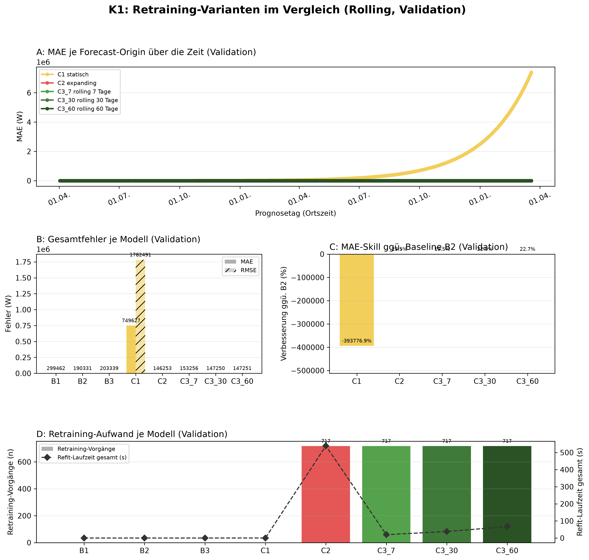
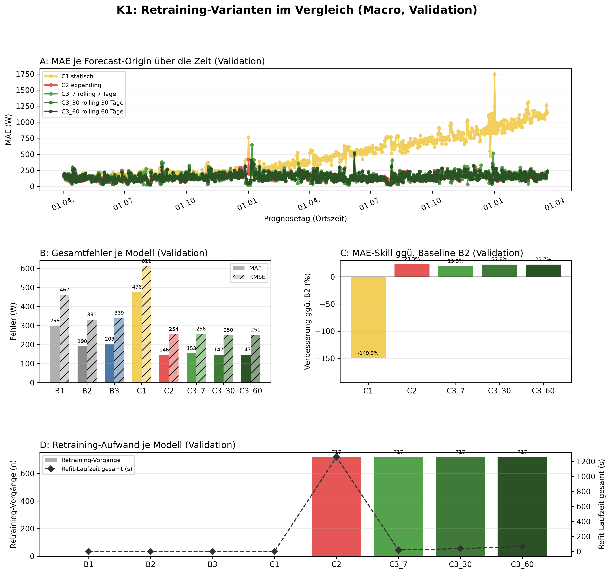

# K1 Retraining-Vergleich, Lauf k1_014

## Setup

- Split: validation, 2014-04-02 bis 2016-03-19, 718 Prognosetage (Ortszeit)
- Modus rolling: 60 Tage Historie vor Split-Start, wie der Online-Zyklus
- Modus macro: gesamte Historie vor Split-Start
- Naive Referenz: rolling B2, macro B2
- Prognose: 1 Tag ab lokaler Mitternacht, Intervall 80 %
- Konfiguration: forecast-model-0.1, Seed 42
- Commit: 2edc7d4 (mit lokalen Änderungen)

## Kennzahlen

| Kennzahl | Wert | Bezug |
|---|---|---|
| rolling: MAE bestes Modell C2 expanding [W] | 145,7 | B2 190,3 W |
| rolling: Skill der Prophet-Varianten ggü. B2 [%] | 23,5 | Spanne -393776,9 bis 23,5 % |
| rolling: Varianten belastbar schlechter als das beste Modell | 2 | von 4 |
| macro: MAE bestes Modell C2 expanding [W] | 145,9 | B2 190,3 W |
| macro: Skill der Prophet-Varianten ggü. B2 [%] | 23,3 | Spanne -149,9 bis 23,3 % |
| macro: Varianten belastbar schlechter als das beste Modell | 2 | von 4 |

## Gesamtfehler rolling

| Modell | MAE [W] | RMSE [W] | MAPE [%] | Tagesfehler MAE [W] | Tagesfehler MAPE [%] | Skill ggü. B2 [%] | Intervall-Abdeckung [%], Soll 80 | Refit-Zeit gesamt [s] |
|---|---:|---:|---:|---:|---:|---:|---:|---:|
| C2 expanding | 145,7 | 252,6 | 41,9 | 85,3 | 26,9 | 23,5 | 80,0 | 538,6 |
| C3_30 rolling 30 Tage | 146,8 | 249,5 | 42,5 | 77,0 | 22,8 | 22,9 | 77,7 | 38,1 |
| C3_60 rolling 60 Tage | 147,0 | 250,8 | 42,6 | 80,5 | 24,6 | 22,7 | 78,6 | 66,8 |
| C3_7 rolling 7 Tage | 153,2 | 256,0 | 44,9 | 80,3 | 23,3 | 19,5 | 73,0 | 19,7 |
| B2 naiv, Vortag | 190,3 | 331,0 | 57,0 | 77,7 | 23,3 | - | - | 0,0 |
| B3 naiv, Vorwoche | 202,7 | 339,3 | 64,6 | 100,0 | 35,3 | - | - | 0,0 |
| B1 naiv, letzter Wert | 299,1 | 461,6 | 103,9 | 262,2 | 74,2 | - | - | 0,0 |
| C1 statisch | 749627,2 | 1782491,4 | 260855,4 | 750485,6 | 214386,6 | -393776,9 | 3,7 | 0,2 |

## Gesamtfehler macro

| Modell | MAE [W] | RMSE [W] | MAPE [%] | Tagesfehler MAE [W] | Tagesfehler MAPE [%] | Skill ggü. B2 [%] | Intervall-Abdeckung [%], Soll 80 | Refit-Zeit gesamt [s] |
|---|---:|---:|---:|---:|---:|---:|---:|---:|
| C2 expanding | 145,9 | 254,0 | 41,6 | 87,1 | 27,3 | 23,3 | 80,7 | 1257,8 |
| C3_30 rolling 30 Tage | 146,8 | 249,5 | 42,5 | 77,0 | 22,8 | 22,9 | 77,7 | 38,1 |
| C3_60 rolling 60 Tage | 147,0 | 250,8 | 42,6 | 80,5 | 24,6 | 22,7 | 78,5 | 66,1 |
| C3_7 rolling 7 Tage | 153,2 | 256,0 | 44,9 | 80,3 | 23,3 | 19,5 | 72,9 | 19,7 |
| B2 naiv, Vortag | 190,3 | 331,0 | 57,0 | 77,7 | 23,3 | - | - | 0,0 |
| B3 naiv, Vorwoche | 202,7 | 339,3 | 64,6 | 100,0 | 35,3 | - | - | 0,0 |
| B1 naiv, letzter Wert | 299,1 | 461,6 | 103,9 | 262,2 | 74,2 | - | - | 0,0 |
| C1 statisch | 475,6 | 611,2 | 198,4 | 425,1 | 140,5 | -149,9 | 34,8 | 0,5 |

## Abstand zum besten Prophet-Modell, gepaart je Origin

| Modus | Modell | Referenz | Differenz [W] | 2 Standardfehler [W] | Origins | Origins besser [%] | belastbar |
|---|---|---|---:|---:|---:|---:|---|
| rolling | C3_30 rolling 30 Tage | C2 expanding | 1,1 | 2,8 | 716 | 45,4 | nein |
| rolling | C3_60 rolling 60 Tage | C2 expanding | 1,4 | 2,1 | 716 | 42,3 | nein |
| rolling | C3_7 rolling 7 Tage | C2 expanding | 7,5 | 4,1 | 716 | 39,7 | ja |
| rolling | C1 statisch | C2 expanding | 749434,3 | 111689,1 | 716 | 0,6 | ja |
| macro | C3_30 rolling 30 Tage | C2 expanding | 0,9 | 3,0 | 716 | 47,2 | nein |
| macro | C3_60 rolling 60 Tage | C2 expanding | 1,1 | 2,4 | 716 | 46,8 | nein |
| macro | C3_7 rolling 7 Tage | C2 expanding | 7,3 | 4,2 | 716 | 40,9 | ja |
| macro | C1 statisch | C2 expanding | 329,7 | 22,9 | 716 | 6,0 | ja |

## Hinweise

- belastbar: Betrag der Differenz größer als 2 Standardfehler der gepaarten Differenzen, grobe Faustregel
- Tagesfehler: Fehler des Tagesmittels (Mittel der 24 Prognosewerte gegen das Ist-Tagesmittel), nicht der Mittelwert der Stundenfehler
- rolling: Tagesfehler aus 715 von 718 Tagen (nur Tage mit lauter bewerteten Stunden)
- rolling: 49 von 17233 Zielstunden nicht bewertet (Messwert fehlt 48, imputiert 1)
- macro: Tagesfehler aus 715 von 718 Tagen (nur Tage mit lauter bewerteten Stunden)
- macro: 49 von 17233 Zielstunden nicht bewertet (Messwert fehlt 48, imputiert 1)

