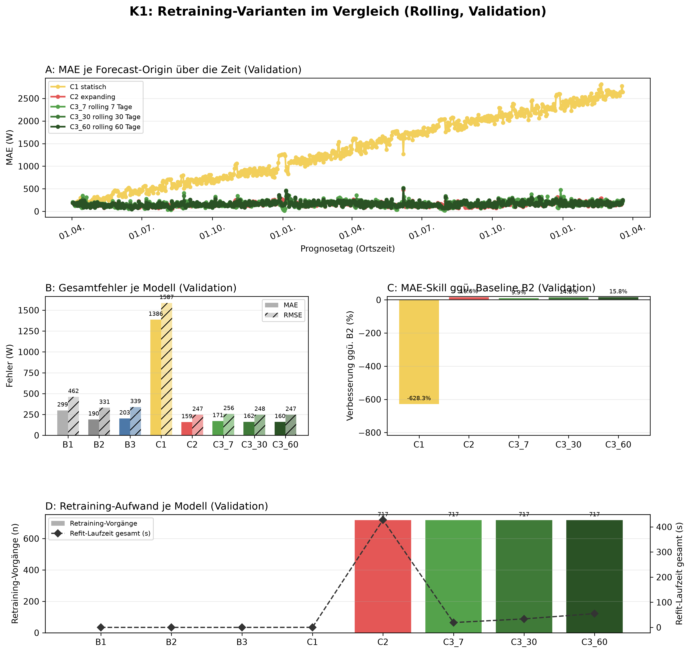
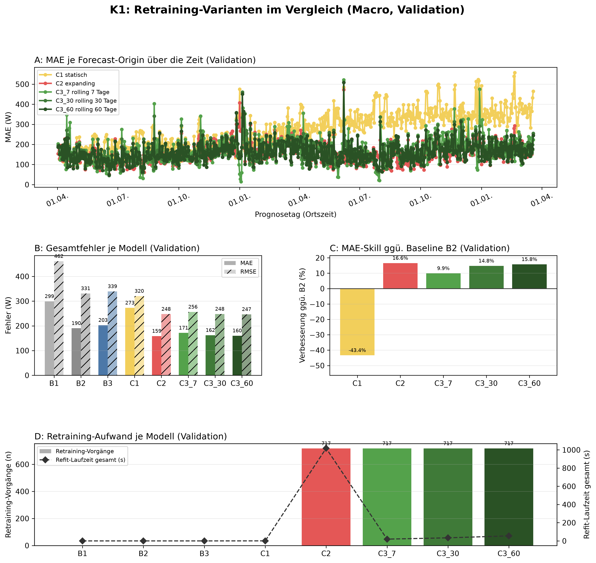

# K1 Retraining-Vergleich, Lauf k1_015

## Setup

- Split: validation, 2014-04-02 bis 2016-03-19, 718 Prognosetage (Ortszeit)
- Modus rolling: 60 Tage Historie vor Split-Start, wie der Online-Zyklus
- Modus macro: gesamte Historie vor Split-Start
- Naive Referenz: rolling B2, macro B2
- Prognose: 1 Tag ab lokaler Mitternacht, Intervall 80 %
- Konfiguration: forecast-model-0.1, Seed 42
- Commit: 2edc7d4 (mit lokalen Änderungen)

## Kennzahlen

| Kennzahl | Wert | Bezug |
|---|---|---|
| rolling: MAE bestes Modell C2 expanding [W] | 158,6 | B2 190,3 W |
| rolling: Skill der Prophet-Varianten ggü. B2 [%] | 16,6 | Spanne -628,3 bis 16,6 % |
| rolling: Varianten belastbar schlechter als das beste Modell | 3 | von 4 |
| macro: MAE bestes Modell C2 expanding [W] | 158,8 | B2 190,3 W |
| macro: Skill der Prophet-Varianten ggü. B2 [%] | 16,6 | Spanne -43,4 bis 16,6 % |
| macro: Varianten belastbar schlechter als das beste Modell | 3 | von 4 |

## Gesamtfehler rolling

| Modell | MAE [W] | RMSE [W] | MAPE [%] | Tagesfehler MAE [W] | Tagesfehler MAPE [%] | Skill ggü. B2 [%] | Intervall-Abdeckung [%], Soll 80 | Refit-Zeit gesamt [s] |
|---|---:|---:|---:|---:|---:|---:|---:|---:|
| C2 expanding | 158,6 | 247,0 | 54,7 | 70,7 | 26,2 | 16,6 | 87,7 | 427,5 |
| C3_60 rolling 60 Tage | 160,3 | 246,7 | 55,1 | 72,9 | 25,6 | 15,8 | 88,2 | 54,8 |
| C3_30 rolling 30 Tage | 162,2 | 248,0 | 55,8 | 74,6 | 25,6 | 14,8 | 87,4 | 33,8 |
| C3_7 rolling 7 Tage | 171,5 | 256,4 | 59,1 | 81,5 | 26,2 | 9,9 | 82,7 | 19,2 |
| B2 naiv, Vortag | 190,3 | 331,0 | 57,0 | 77,7 | 23,3 | - | - | 0,0 |
| B3 naiv, Vorwoche | 202,7 | 339,3 | 64,6 | 100,0 | 35,3 | - | - | 0,0 |
| B1 naiv, letzter Wert | 299,1 | 461,6 | 103,9 | 262,2 | 74,2 | - | - | 0,0 |
| C1 statisch | 1386,2 | 1587,0 | 612,8 | 1377,5 | 439,0 | -628,3 | 7,8 | 0,2 |

## Gesamtfehler macro

| Modell | MAE [W] | RMSE [W] | MAPE [%] | Tagesfehler MAE [W] | Tagesfehler MAPE [%] | Skill ggü. B2 [%] | Intervall-Abdeckung [%], Soll 80 | Refit-Zeit gesamt [s] |
|---|---:|---:|---:|---:|---:|---:|---:|---:|
| C2 expanding | 158,8 | 247,6 | 54,7 | 72,0 | 26,5 | 16,6 | 87,3 | 1017,7 |
| C3_60 rolling 60 Tage | 160,3 | 246,7 | 55,1 | 72,9 | 25,6 | 15,8 | 88,1 | 55,3 |
| C3_30 rolling 30 Tage | 162,2 | 248,0 | 55,8 | 74,6 | 25,6 | 14,8 | 87,4 | 33,9 |
| C3_7 rolling 7 Tage | 171,5 | 256,4 | 59,1 | 81,5 | 26,2 | 9,9 | 82,6 | 19,7 |
| B2 naiv, Vortag | 190,3 | 331,0 | 57,0 | 77,7 | 23,3 | - | - | 0,0 |
| B3 naiv, Vorwoche | 202,7 | 339,3 | 64,6 | 100,0 | 35,3 | - | - | 0,0 |
| C1 statisch | 272,8 | 320,4 | 121,7 | 189,4 | 69,6 | -43,4 | 52,4 | 0,6 |
| B1 naiv, letzter Wert | 299,1 | 461,6 | 103,9 | 262,2 | 74,2 | - | - | 0,0 |

## Abstand zum besten Prophet-Modell, gepaart je Origin

| Modus | Modell | Referenz | Differenz [W] | 2 Standardfehler [W] | Origins | Origins besser [%] | belastbar |
|---|---|---|---:|---:|---:|---:|---|
| rolling | C3_60 rolling 60 Tage | C2 expanding | 1,7 | 2,0 | 716 | 41,3 | nein |
| rolling | C3_30 rolling 30 Tage | C2 expanding | 3,6 | 2,5 | 716 | 41,3 | ja |
| rolling | C3_7 rolling 7 Tage | C2 expanding | 12,9 | 4,0 | 716 | 33,4 | ja |
| rolling | C1 statisch | C2 expanding | 1227,6 | 54,9 | 716 | 0,1 | ja |
| macro | C3_60 rolling 60 Tage | C2 expanding | 1,5 | 2,2 | 716 | 46,4 | nein |
| macro | C3_30 rolling 30 Tage | C2 expanding | 3,4 | 2,7 | 716 | 42,2 | ja |
| macro | C3_7 rolling 7 Tage | C2 expanding | 12,7 | 4,1 | 716 | 35,6 | ja |
| macro | C1 statisch | C2 expanding | 114,0 | 6,2 | 716 | 3,6 | ja |

## Hinweise

- belastbar: Betrag der Differenz größer als 2 Standardfehler der gepaarten Differenzen, grobe Faustregel
- Tagesfehler: Fehler des Tagesmittels (Mittel der 24 Prognosewerte gegen das Ist-Tagesmittel), nicht der Mittelwert der Stundenfehler
- rolling: Tagesfehler aus 715 von 718 Tagen (nur Tage mit lauter bewerteten Stunden)
- rolling: 49 von 17233 Zielstunden nicht bewertet (Messwert fehlt 48, imputiert 1)
- macro: Tagesfehler aus 715 von 718 Tagen (nur Tage mit lauter bewerteten Stunden)
- macro: 49 von 17233 Zielstunden nicht bewertet (Messwert fehlt 48, imputiert 1)

