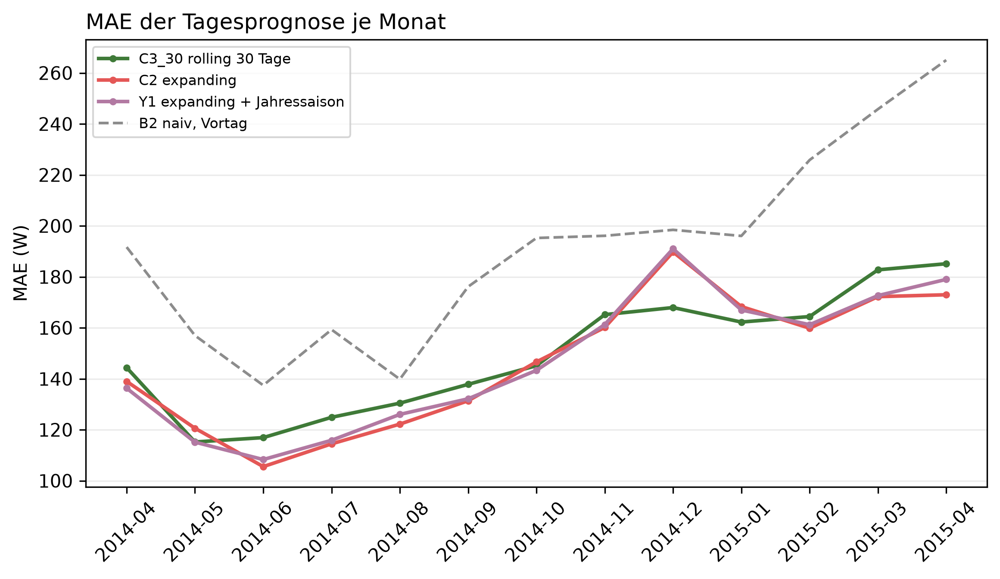

# K1 Prognose mit und ohne Jahressaisonalität, Lauf k1_season_002

## Setup

- Auswertung: 365 Tage ab 2014-04-02 (validation), je Tag eine 24-h-Prognose, Historie ab Datenbeginn
- Varianten: C3_30 rolling 30 Tage, C2 expanding, Y1 expanding + Jahressaison
- Naive Referenz: B2 naiv, Vortag
- Commit: 2edc7d4 (mit lokalen Änderungen)

## Kennzahlen

| Kennzahl | Wert | Bezug |
|---|---|---|
| Y1 − C2: MAE-Differenz über das Jahr [W] | 0,0 | negativ = Variante besser, belastbar nein |
| C2 − C3_30: MAE-Differenz über das Jahr [W] | -2,2 | negativ = Variante besser, belastbar nein |
| Y1 − C3_30: MAE-Differenz über das Jahr [W] | -2,2 | negativ = Variante besser, belastbar nein |

## MAE je Monat [W]

| Monat | C3_30 rolling 30 Tage | C2 expanding | Y1 expanding + Jahressaison | B2 naiv, Vortag |
|---|---:|---:|---:|---:|
| 2014-04 | 144,4 | 139,0 | 136,3 | 191,7 |
| 2014-05 | 115,2 | 120,6 | 115,1 | 157,0 |
| 2014-06 | 116,9 | 105,5 | 108,3 | 137,4 |
| 2014-07 | 124,9 | 114,5 | 115,9 | 159,3 |
| 2014-08 | 130,4 | 122,2 | 126,0 | 139,8 |
| 2014-09 | 137,8 | 131,4 | 132,2 | 176,1 |
| 2014-10 | 145,1 | 146,6 | 143,3 | 195,3 |
| 2014-11 | 165,2 | 160,1 | 161,3 | 196,1 |
| 2014-12 | 168,0 | 189,8 | 191,0 | 198,4 |
| 2015-01 | 162,3 | 168,3 | 167,0 | 196,1 |
| 2015-02 | 164,4 | 159,8 | 161,2 | 225,9 |
| 2015-03 | 182,8 | 172,2 | 172,6 | 245,8 |
| 2015-04 | 185,1 | 173,0 | 179,0 | 265,1 |
| Jahr | 146,5 | 144,3 | 144,4 | 184,9 |

## Gepaarte Differenzen über das Jahr, je Prognosetag

| Vergleich | Differenz [W] | 2 Standardfehler [W] | Tage | Tage besser [%] | belastbar |
|---|---:|---:|---:|---:|---|
| Y1 − C2 | 0,0 | 1,7 | 364 | 48,6 | nein |
| C2 − C3_30 | -2,2 | 4,8 | 364 | 55,5 | nein |
| Y1 − C3_30 | -2,2 | 4,1 | 364 | 54,1 | nein |

## Hinweise

- Y1 − C2 ist der Effekt der Jahressaisonalität allein, C2 − C3_30 der der längeren Historie
- Monat 2014-04 und 2015-04 sind je ein halber Monat
- belastbar: Betrag der Differenz größer als 2 Standardfehler der gepaarten Differenzen, grobe Faustregel

