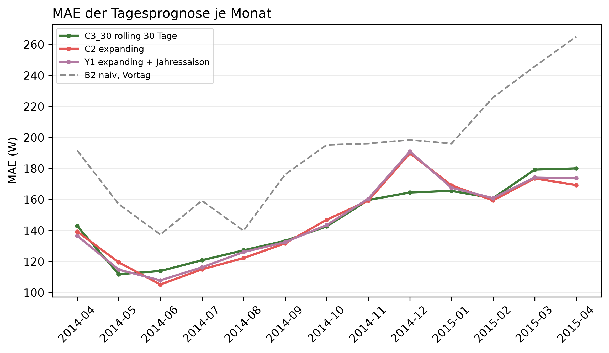

# K1 Prognose mit und ohne Jahressaisonalität, Lauf k1_season_003

## Setup

- Auswertung: 365 Tage ab 2014-04-02 (validation), je Tag eine 24-h-Prognose, Historie ab Datenbeginn
- Varianten: C3_30 rolling 30 Tage, C2 expanding, Y1 expanding + Jahressaison
- Naive Referenz: B2 naiv, Vortag
- Commit: 2edc7d4 (mit lokalen Änderungen)

## Kennzahlen

| Kennzahl | Wert | Bezug |
|---|---|---|
| Y1 − C2: MAE-Differenz über das Jahr [W] | 0,1 | negativ = Variante besser, belastbar nein |
| C2 − C3_30: MAE-Differenz über das Jahr [W] | 0,8 | negativ = Variante besser, belastbar nein |
| Y1 − C3_30: MAE-Differenz über das Jahr [W] | 0,8 | negativ = Variante besser, belastbar nein |

## MAE je Monat [W]

| Monat | C3_30 rolling 30 Tage | C2 expanding | Y1 expanding + Jahressaison | B2 naiv, Vortag |
|---|---:|---:|---:|---:|
| 2014-04 | 142,9 | 139,4 | 136,7 | 191,7 |
| 2014-05 | 111,8 | 119,5 | 114,8 | 157,0 |
| 2014-06 | 113,9 | 105,2 | 107,8 | 137,4 |
| 2014-07 | 120,8 | 114,9 | 116,2 | 159,3 |
| 2014-08 | 127,2 | 122,2 | 126,1 | 139,8 |
| 2014-09 | 133,3 | 131,7 | 132,5 | 176,1 |
| 2014-10 | 142,7 | 146,9 | 143,5 | 195,3 |
| 2014-11 | 159,7 | 159,3 | 160,5 | 196,1 |
| 2014-12 | 164,5 | 189,8 | 191,0 | 198,4 |
| 2015-01 | 165,5 | 169,1 | 167,6 | 196,1 |
| 2015-02 | 160,8 | 159,4 | 160,9 | 225,9 |
| 2015-03 | 179,3 | 173,6 | 174,3 | 245,8 |
| 2015-04 | 180,0 | 169,3 | 173,8 | 265,1 |
| Jahr | 143,6 | 144,4 | 144,5 | 184,9 |

## Gepaarte Differenzen über das Jahr, je Prognosetag

| Vergleich | Differenz [W] | 2 Standardfehler [W] | Tage | Tage besser [%] | belastbar |
|---|---:|---:|---:|---:|---|
| Y1 − C2 | 0,1 | 1,7 | 364 | 47,0 | nein |
| C2 − C3_30 | 0,8 | 4,7 | 364 | 51,4 | nein |
| Y1 − C3_30 | 0,8 | 4,0 | 364 | 50,8 | nein |

## Hinweise

- Y1 − C2 ist der Effekt der Jahressaisonalität allein, C2 − C3_30 der der längeren Historie
- Monat 2014-04 und 2015-04 sind je ein halber Monat
- belastbar: Betrag der Differenz größer als 2 Standardfehler der gepaarten Differenzen, grobe Faustregel

