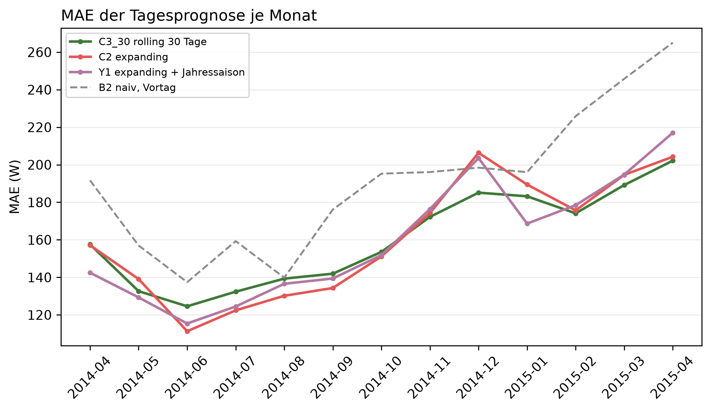

# K1 Prognose mit und ohne Jahressaisonalität, Lauf k1_season_004

## Setup

- Auswertung: 365 Tage ab 2014-04-02 (validation), je Tag eine 24-h-Prognose, Historie ab Datenbeginn
- Varianten: C3_30 rolling 30 Tage, C2 expanding, Y1 expanding + Jahressaison
- Naive Referenz: B2 naiv, Vortag
- Commit: 2edc7d4 (mit lokalen Änderungen)

## Kennzahlen

| Kennzahl | Wert | Bezug |
|---|---|---|
| Y1 − C2: MAE-Differenz über das Jahr [W] | -2,0 | negativ = Variante besser, belastbar ja |
| C2 − C3_30: MAE-Differenz über das Jahr [W] | 0,1 | negativ = Variante besser, belastbar nein |
| Y1 − C3_30: MAE-Differenz über das Jahr [W] | -2,0 | negativ = Variante besser, belastbar nein |

## MAE je Monat [W]

| Monat | C3_30 rolling 30 Tage | C2 expanding | Y1 expanding + Jahressaison | B2 naiv, Vortag |
|---|---:|---:|---:|---:|
| 2014-04 | 157,6 | 157,1 | 142,5 | 191,7 |
| 2014-05 | 132,6 | 139,1 | 129,3 | 157,0 |
| 2014-06 | 124,6 | 111,3 | 115,4 | 137,4 |
| 2014-07 | 132,4 | 122,4 | 124,5 | 159,3 |
| 2014-08 | 139,3 | 130,2 | 136,6 | 139,8 |
| 2014-09 | 141,9 | 134,3 | 139,4 | 176,1 |
| 2014-10 | 153,6 | 151,1 | 151,8 | 195,3 |
| 2014-11 | 172,2 | 174,3 | 176,4 | 196,1 |
| 2014-12 | 185,1 | 206,4 | 203,6 | 198,4 |
| 2015-01 | 183,2 | 189,5 | 168,7 | 196,1 |
| 2015-02 | 174,1 | 175,7 | 178,5 | 225,9 |
| 2015-03 | 189,2 | 194,6 | 194,8 | 245,8 |
| 2015-04 | 202,2 | 204,3 | 217,0 | 265,1 |
| Jahr | 157,3 | 157,4 | 155,3 | 184,9 |

## Gepaarte Differenzen über das Jahr, je Prognosetag

| Vergleich | Differenz [W] | 2 Standardfehler [W] | Tage | Tage besser [%] | belastbar |
|---|---:|---:|---:|---:|---|
| Y1 − C2 | -2,0 | 1,8 | 364 | 51,6 | ja |
| C2 − C3_30 | 0,1 | 4,1 | 364 | 49,7 | nein |
| Y1 − C3_30 | -2,0 | 3,7 | 364 | 52,7 | nein |

## Hinweise

- Y1 − C2 ist der Effekt der Jahressaisonalität allein, C2 − C3_30 der der längeren Historie
- Monat 2014-04 und 2015-04 sind je ein halber Monat
- belastbar: Betrag der Differenz größer als 2 Standardfehler der gepaarten Differenzen, grobe Faustregel

