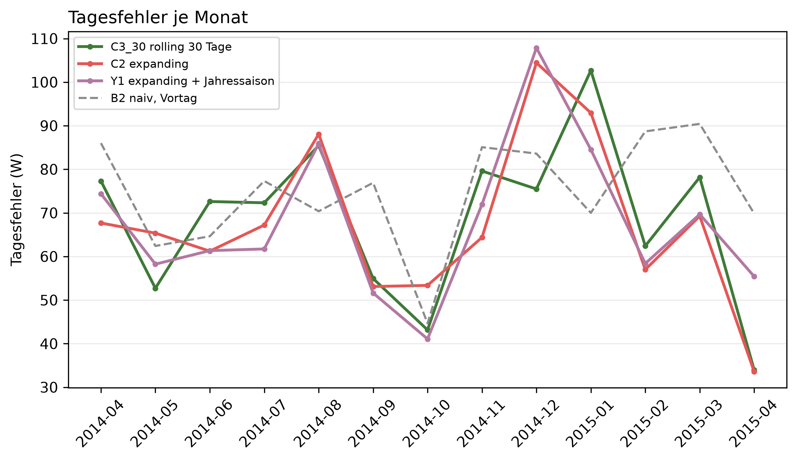

# K1 Prognose mit und ohne Jahressaisonalität, Lauf k1_season_005

## Setup

- Auswertung: 365 Tage ab 2014-04-02 (validation), je Tag eine 24-h-Prognose, Historie ab Datenbeginn
- Varianten: C3_30 rolling 30 Tage, C2 expanding, Y1 expanding + Jahressaison
- Naive Referenz: B2 naiv, Vortag
- Commit: 83b23e4 (mit lokalen Änderungen)

## Kennzahlen

| Kennzahl | Wert | Bezug |
|---|---|---|
| Y1 − C2: Differenz im Tagesfehler über das Jahr [W] | -1,5 | negativ = Variante besser, belastbar nein |
| C2 − C3_30: Differenz im Tagesfehler über das Jahr [W] | -0,9 | negativ = Variante besser, belastbar nein |
| Y1 − C3_30: Differenz im Tagesfehler über das Jahr [W] | -2,4 | negativ = Variante besser, belastbar nein |

## Tagesfehler je Monat [W]

| Monat | C3_30 rolling 30 Tage | C2 expanding | Y1 expanding + Jahressaison | B2 naiv, Vortag |
|---|---:|---:|---:|---:|
| 2014-04 | 77,3 | 67,7 | 74,4 | 86,0 |
| 2014-05 | 52,7 | 65,4 | 58,2 | 62,4 |
| 2014-06 | 72,6 | 61,2 | 61,3 | 64,6 |
| 2014-07 | 72,3 | 67,2 | 61,7 | 77,3 |
| 2014-08 | 85,5 | 88,1 | 85,9 | 70,4 |
| 2014-09 | 54,9 | 53,1 | 51,6 | 76,9 |
| 2014-10 | 43,1 | 53,4 | 41,1 | 44,7 |
| 2014-11 | 79,6 | 64,4 | 71,9 | 85,1 |
| 2014-12 | 75,5 | 104,4 | 107,9 | 83,6 |
| 2015-01 | 102,7 | 92,9 | 84,5 | 70,0 |
| 2015-02 | 62,4 | 57,0 | 58,4 | 88,7 |
| 2015-03 | 78,2 | 69,3 | 69,7 | 90,4 |
| 2015-04 | 34,0 | 33,6 | 55,4 | 69,9 |
| Jahr | 71,4 | 70,5 | 69,0 | 74,8 |

## Gepaarte Differenzen über das Jahr, je Prognosetag

| Vergleich | Differenz [W] | 2 Standardfehler [W] | Tage | Tage besser [%] | belastbar |
|---|---:|---:|---:|---:|---|
| Y1 − C2 | -1,5 | 3,5 | 364 | 54,9 | nein |
| C2 − C3_30 | -0,9 | 6,6 | 364 | 50,3 | nein |
| Y1 − C3_30 | -2,4 | 5,7 | 364 | 52,7 | nein |

## Hinweise

- Y1 − C2 ist der Effekt der Jahressaisonalität allein, C2 − C3_30 der der längeren Historie
- Monat 2014-04 und 2015-04 sind je ein halber Monat
- belastbar: Betrag der Differenz größer als 2 Standardfehler der gepaarten Differenzen, grobe Faustregel

