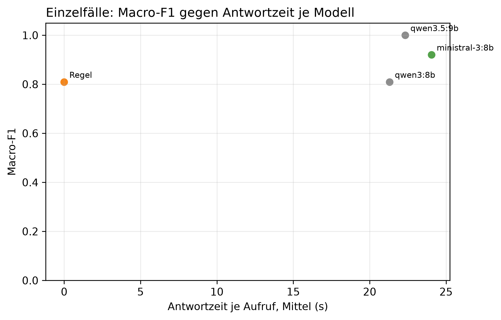

# K2 LLM-Klassifikation und Modellwahl, Läufe k2_001 / k2_seq_001

## Setup

- Läufe (Ebene 1 / Ebene 2): k2_001 / k2_seq_001
- Prompt (Ebene 1 / Ebene 2): v30 / v30
- Modelle: MDL1 qwen3:8b, MDL2 qwen3.5:9b, MDL5 ministral-3:8b
- LLM: temperature 0,0, höchstens 2 Versuche je Aufruf
- Ebene 1: 10 synthetische Fälle, je Modell 1 Aufruf je Fall, Regel (BASELINE) läuft mit
- Ebene 2: Standard-Szenarien, Cutover CO3 (2015-03-01), 40 Tage davor, 60 danach, jedes Modell als eigener Kreislauf wie SYS3 mit Adaption
- Ereignisse Ebene 2: control = keine Änderung, scaled_strong = Sprung +30 %, peak_strong = Spitze +1000 W über 6 h
- Produktivmodell SYS3: ministral-3:8b
- Commit (Ebene 1 / Ebene 2): 642e651 / 642e651 (mit lokalen Änderungen)
- Textprüfung: 9 Steuerungswörter, Zahlentoleranz 0,5, gerundet auf 10 erlaubt, Fensterzahlen aus dem Prompt 7, 28

## Kennzahlen

| Kennzahl | Wert | Bezug |
|---|---|---|
| Ebene 1: bestes Modell nach Macro-F1 | qwen3.5:9b | Macro-F1 1,00, Regel 0,81 |
| ministral-3:8b: Ebene 1 richtig | 9/10 | Regel 9/10 |
| ministral-3:8b: Antwortzeit je Aufruf im Mittel [s] | 24,0 | p95 42,1 s, Regel 0,0 s |
| ministral-3:8b: Ebene 2 Ereignis-Arten erkannt | 2/2 | Regel 2/2 |
| ministral-3:8b: Ebene 2 Tage mit anderer Klasse als die Regel | 2 | 2015-04-09 new_pattern statt normal; 2015-04-10 peak statt normal |
| ministral-3:8b: ungültige Antworten Ebene 1 | 0 | Ausfalltage Ebene 2: 0 |
| ministral-3:8b: Antworten mit Textverstoß (Ebene 1 / Ebene 2) | 1/10 / 0/92 | Steuerung oder Zahl, Datum, Uhrzeit nicht im State |
| ministral-3:8b: Antworten mit fehlenden Belegen (Ebene 1 / Ebene 2) | 1/10 / 1/92 | zitierte Belege passen nicht zur eigenen Klasse |

## Ebene 1: Modellvergleich auf den Einzelfällen

| ID | Modell | richtig | Macro-F1 | ungültig | Ø Versuche | Grounding | Ø s je Aufruf | p95 s |
|---|---|---|---:|---:|---:|---:|---:|---:|
| MDL2 | qwen3.5:9b | 10/10 | 1,0 | 0 | 1,1 | 0,8 | 22,3 | 41,3 |
| MDL5 | ministral-3:8b | 9/10 | 0,9 | 0 | 1,0 | 0,9 | 24,0 | 42,1 |
| BASELINE | Regel | 9/10 | 0,8 | 0 | 1,0 | - | 0,0 | 0,0 |
| MDL1 | qwen3:8b | 9/10 | 0,8 | 0 | 1,0 | 0,8 | 21,3 | 35,2 |

## Ebene 1: Antwort je Fall (✓ = richtig, sonst die Antwort, - = ungültig)

| Fall | erwartet | qwen3.5:9b | ministral-3:8b | Regel | qwen3:8b |
|---|---|---|---|---|---|
| absence_drift_down | absence | ✓ | ✓ | new_pattern | new_pattern |
| low_single_scale | low | ✓ | ✓ | ✓ | ✓ |
| measurement_error_missing_day | measurement_error | ✓ | ✓ | ✓ | ✓ |
| new_pattern | new_pattern | ✓ | ✓ | ✓ | ✓ |
| new_pattern_at_min_scales_boundary | new_pattern | ✓ | ✓ | ✓ | ✓ |
| new_pattern_drift_down | new_pattern | ✓ | ✓ | ✓ | ✓ |
| normal_single_sustained_scale | normal | ✓ | ✓ | ✓ | ✓ |
| normal_weekly_after_reset | normal | ✓ | new_pattern | ✓ | ✓ |
| peak | peak | ✓ | ✓ | ✓ | ✓ |
| peak_single_sustained_scale | peak | ✓ | ✓ | ✓ | ✓ |

## Automatische Textprüfung je Modell (Antworten mit Verstoß oder fehlenden Belegen)

| Modell | E1 Antworten | E1 mit Verstoß | E1 Belege fehlen | E2 Antworten | E2 mit Verstoß | E2 Belege fehlen |
|---|---:|---:|---:|---:|---:|---:|
| qwen3.5:9b | 10 | 2 | 1 | 41 | 0 | 0 |
| ministral-3:8b | 10 | 1 | 1 | 92 | 0 | 1 |
| qwen3:8b | 10 | 0 | 0 | 96 | 6 | 0 |

## Ebene 2: je Modell über alle Ereignis-Arten

| Modell | Ereignis-Arten erkannt | Tage anders als die Regel | Gate-Tage | Ausfalltage | Meldungen Kontrolle | unknown Kontrolle | Resets Kontrolle |
|---|---|---:|---:|---:|---:|---:|---:|
| qwen3.5:9b | 2/2 | 21 | 41 | 0 | 5 | 0 | 4 |
| ministral-3:8b | 2/2 | 2 | 92 | 0 | 2 | 0 | 1 |
| Regel | 2/2 | 0 | 96 | 0 | 0 | 0 | 0 |
| qwen3:8b | 2/2 | 13 | 96 | 0 | 0 | 0 | 0 |

## Ebene 2: Erkennung je Ereignis, Tag seit Cutover

| config | Ereignis | erwartet | Gate-Tage durch das Ereignis | davon richtig | erster richtiger Tag | Resets |
|---|---|---|---:|---:|---:|---:|
| BASELINE | Spitze +1000 W über 6 h | peak | 6 | 1 | 1 | 0 |
| BASELINE | Sprung +30 % | new_pattern | 13 | 1 | 22 | 1 |
| MDL1 | Spitze +1000 W über 6 h | peak | 6 | 1 | 1 | 0 |
| MDL1 | Sprung +30 % | new_pattern | 13 | 1 | 22 | 1 |
| MDL2 | Spitze +1000 W über 6 h | peak | 7 | 3 | 1 | 3 |
| MDL2 | Sprung +30 % | new_pattern | 7 | 4 | 7 | 4 |
| MDL5 | Spitze +1000 W über 6 h | peak | 10 | 1 | 1 | 0 |
| MDL5 | Sprung +30 % | new_pattern | 15 | 1 | 22 | 1 |

## Ebene 2: Tage, an denen ein Modell anders einordnet als die Regel

| Modell | analysierter Tag | Regel | Modell sagt | in Arten |
|---|---|---|---|---|
| qwen3:8b | 2015-01-26 | normal | low | control, scaled_strong, peak_strong |
| qwen3:8b | 2015-01-27 | normal | low | control, scaled_strong, peak_strong |
| qwen3:8b | 2015-03-15 | normal | low | scaled_strong |
| qwen3:8b | 2015-04-05 | normal | low | scaled_strong |
| qwen3:8b | 2015-04-06 | normal | low | scaled_strong |
| qwen3:8b | 2015-04-07 | normal | low | control, peak_strong |
| qwen3:8b | 2015-04-08 | normal | low | control, scaled_strong |
| qwen3:8b | 2015-04-09 | normal | low | control, scaled_strong, peak_strong |
| qwen3:8b | 2015-04-12 | normal | low | control, scaled_strong, peak_strong |
| qwen3:8b | 2015-04-24 | normal | low | peak_strong |
| qwen3:8b | 2015-04-25 | normal | low | peak_strong |
| qwen3:8b | 2015-04-26 | normal | low | peak_strong |
| qwen3:8b | 2015-04-28 | normal | low | peak_strong |
| qwen3.5:9b | 2015-01-26 | normal | new_pattern | control, scaled_strong, peak_strong |
| qwen3.5:9b | 2015-02-20 | normal | low | control, scaled_strong, peak_strong |
| qwen3.5:9b | 2015-02-23 | normal | peak | control, scaled_strong, peak_strong |
| qwen3.5:9b | 2015-03-02 | normal | peak | scaled_strong |
| qwen3.5:9b | 2015-03-06 | normal | new_pattern | peak_strong |
| qwen3.5:9b | 2015-03-07 | normal | new_pattern | scaled_strong |
| qwen3.5:9b | 2015-03-15 | low | new_pattern | control |
| qwen3.5:9b | 2015-03-15 | normal | low | scaled_strong |
| qwen3.5:9b | 2015-03-15 | low | normal | peak_strong |
| qwen3.5:9b | 2015-03-20 | normal | new_pattern | scaled_strong |
| qwen3.5:9b | 2015-03-22 | new_pattern | normal | scaled_strong |
| qwen3.5:9b | 2015-03-29 | normal | new_pattern | control |
| qwen3.5:9b | 2015-04-02 | low | normal | scaled_strong |
| qwen3.5:9b | 2015-04-03 | low | normal | scaled_strong |
| qwen3.5:9b | 2015-04-05 | low | normal | control |
| qwen3.5:9b | 2015-04-06 | low | normal | control |
| qwen3.5:9b | 2015-04-07 | normal | new_pattern | scaled_strong |
| qwen3.5:9b | 2015-04-08 | normal | peak | scaled_strong |
| qwen3.5:9b | 2015-04-08 | normal | new_pattern | peak_strong |
| qwen3.5:9b | 2015-04-09 | normal | peak | peak_strong |
| qwen3.5:9b | 2015-04-10 | normal | peak | peak_strong |
| qwen3.5:9b | 2015-04-11 | normal | new_pattern | control |
| qwen3.5:9b | 2015-04-11 | normal | peak | peak_strong |
| qwen3.5:9b | 2015-04-20 | normal | new_pattern | scaled_strong |
| qwen3.5:9b | 2015-04-22 | normal | new_pattern | peak_strong |
| ministral-3:8b | 2015-04-09 | normal | new_pattern | control |
| ministral-3:8b | 2015-04-10 | normal | peak | control |

## Hinweise

- Ebene 1 prüft, ob ein Modell die Regeln aus dem Prompt nachvollzieht. Der Prompt wurde auf denselben Fällen verbessert, die Quoten begründen deshalb nur die Modellwahl und belegen nicht das Ziel von 80 % richtiger Klassen (dafür E3)
- wenige Fälle: ein Fall sind mehrere Prozentpunkte, eine Klasse hängt teils an einem einzigen Fall
- Macro-F1: Mittel der F1-Werte über die Klassen, die als erwartete Klasse vorkommen
- Grounding: Anteil der für den Fall erwarteten Felder, die das Modell als Beleg zitiert. Die Regel zitiert keine
- Tag seit Cutover = Entscheidungstag: an Tag n meldet das System, eingeordnet ist dabei Tag n-1. Ab Cutover zählt deshalb erst ab Tag 1
- Ebene 2, erkannt: erwartete Klasse an einem Tag, an dem nur das Ereignis das Gate öffnet (gepaart mit dem Kontrolllauf desselben Modells)
- Ebene 2, anders als die Regel: gleiche Art und gleicher analysierter Tag, Regel gegen Modell. Nach einem Reset an verschiedenen Tagen laufen die Reihen auseinander, spätere Abweichungen können daraus folgen
- Antwortzeit: gemessen auf dem Rechner des Laufs, nur zum Vergleich der Modelle untereinander
- Textprüfung: Verstoß heißt, ein Steuerungswort oder eine Zahl, ein Datum oder eine Uhrzeit steht im Text, aber nicht im State des Falls. Zahlwörter („sechs Wochen“) findet sie nicht. Die Fensterlängen 7 und 28 aus der Skalenbeschreibung im Prompt gelten als erlaubt
- Fehlende Belege: der Prompt verlangt je Klasse bestimmte Pfade (new_pattern: sustained_drift, Streaks, peak/low: level, direction, absence: level, Kalendereintrag, measurement_error: Flag). Geprüft wird gegen die eigene Klasse des Modells, nicht gegen die erwartete. Ebene 1 wird nur für Läufe geprüft, die den State der Fälle in der Antwortdatei speichern, ältere Läufe haben in der Tabelle 0 Antworten
- Antworttexte und Auffälligkeiten der Textprüfung im Anhang, Antworten für alle Modelle in Ebene 1 und Ebene 2. Als CSV: answers_single.csv für Ebene 1, answers_sequence.csv für Ebene 2 nur vom Produktivmodell, result_text_findings.csv für die Auffälligkeiten

## Anhang

### Ebene 1: Precision, Recall und F1 je Klasse

| Modell | Klasse | Precision | Recall | F1 |
|---|---|---:|---:|---:|
| Regel | absence | 0,0 | 0,0 | 0,0 |
| Regel | low | 1,0 | 1,0 | 1,0 |
| Regel | measurement_error | 1,0 | 1,0 | 1,0 |
| Regel | new_pattern | 0,8 | 1,0 | 0,9 |
| Regel | normal | 1,0 | 1,0 | 1,0 |
| Regel | peak | 1,0 | 1,0 | 1,0 |
| qwen3:8b | absence | 0,0 | 0,0 | 0,0 |
| qwen3:8b | low | 1,0 | 1,0 | 1,0 |
| qwen3:8b | measurement_error | 1,0 | 1,0 | 1,0 |
| qwen3:8b | new_pattern | 0,8 | 1,0 | 0,9 |
| qwen3:8b | normal | 1,0 | 1,0 | 1,0 |
| qwen3:8b | peak | 1,0 | 1,0 | 1,0 |
| qwen3.5:9b | absence | 1,0 | 1,0 | 1,0 |
| qwen3.5:9b | low | 1,0 | 1,0 | 1,0 |
| qwen3.5:9b | measurement_error | 1,0 | 1,0 | 1,0 |
| qwen3.5:9b | new_pattern | 1,0 | 1,0 | 1,0 |
| qwen3.5:9b | normal | 1,0 | 1,0 | 1,0 |
| qwen3.5:9b | peak | 1,0 | 1,0 | 1,0 |
| ministral-3:8b | absence | 1,0 | 1,0 | 1,0 |
| ministral-3:8b | low | 1,0 | 1,0 | 1,0 |
| ministral-3:8b | measurement_error | 1,0 | 1,0 | 1,0 |
| ministral-3:8b | new_pattern | 0,8 | 1,0 | 0,9 |
| ministral-3:8b | normal | 1,0 | 0,5 | 0,7 |
| ministral-3:8b | peak | 1,0 | 1,0 | 1,0 |

### Ebene 1: Antworten der Modelle je Fall

**peak** (erwartet: peak)

- qwen3.5:9b: peak ✓
  - Erklärung: Gestern war der Stromverbrauch ungewöhnlich hoch, etwa 45 % mehr als sonst an diesem Wochentag.
  - Empfehlung: Überprüfen Sie, ob gestern besondere Aktivitäten wie ein langes Wochenende oder eine Party stattgefunden haben.
  - Unsicherheit: Die Bewertung könnte sich ändern, wenn es einen nicht im Kalender verzeichneten Ausfall gab.
- ministral-3:8b: peak ✓
  - Erklärung: Gestern war der Stromverbrauch um etwa 45 % höher als an einem normalen Dienstag dieser Woche. Das ist ungewöhnlich für einen einzelnen Tag.
  - Empfehlung: Überprüfen Sie, ob gestern ungewöhnliche Geräte oder Aktivitäten den Verbrauch erhöht haben könnten, z. B. längeres Nutzen von Heizungen oder elektrischen Geräten.
  - Unsicherheit: Ob der erhöhte Verbrauch auf eine geplante Veränderung im Haushalt zurückzuführen ist, kann erst nach mehreren Tagen mit ähnlichem Wert geklärt werden.
- qwen3:8b: peak ✓
  - Erklärung: Gestern war der Stromverbrauch deutlich höher als üblich, insbesondere im Vergleich zu einem normalen Werktag. Der Verbrauch lag um etwa 45 % über dem Erwarteten.
  - Empfehlung: Überprüfen Sie, ob in der Wohnung etwas anders war, wie z. B. eine längere Heizperiode oder ein vergessenes Gerät. Falls nichts auffällt, ist es wahrscheinlich ein Zufall.
  - Unsicherheit: Die Verbrauchssteigerung könnte auf einen kurzfristigen Effekt wie ein vergessenes elektrisches Gerät zurückgehen, der nicht im Kalender erfasst wurde.

**new_pattern** (erwartet: new_pattern)

- qwen3.5:9b: new_pattern ✓
  - Erklärung: Der Stromverbrauch war gestern ungewöhnlich hoch und ist seit dem 9. Dezember auf einem neuen, höheren Niveau gestiegen.
  - Empfehlung: Bitte prüfen Sie, ob sich im Haushalt etwas geändert hat, zum Beispiel durch längeres Verweilen zu Hause oder das Einschalten neuer Geräte.
  - Unsicherheit: Die Verfügbarkeit des Kalenders könnte die Einordnung beeinflussen, ist hier aber nicht entscheidend.
- ministral-3:8b: new_pattern ✓
  - Erklärung: Der Stromverbrauch war gestern deutlich höher als sonst – seit dem 9. Dezember liegt er im Schnitt um etwa 36 % über dem üblichen Wert für diese Tage in der Woche.
  - Empfehlung: Überprüfen Sie, ob sich der Stromverbrauch in den letzten Tagen tatsächlich erhöht hat und was dafür infrage kommen könnte – etwa neue Geräte oder längere Nutzung von Heizung oder Beleuchtung.
  - Unsicherheit: Ob die erhöhte Nutzung saisonal bedingt ist (z. B. durch kürzere Tage im Winter), lässt sich erst nach einigen Wochen abschätzen.
- qwen3:8b: new_pattern ✓
  - Erklärung: Gestern war der Stromverbrauch deutlich höher als üblich, insbesondere im Vergleich zur letzten Woche und den letzten vier Wochen. Der Verbrauch lag um etwa 36 % über dem üblichen Niveau der vergangenen Woche und um 22 % über dem üblichen Niveau der letzten vier Wochen.
  - Empfehlung: Überprüfen Sie, ob in der Wohnung etwas verändert wurde, wie z. B. neue Geräte oder eine Änderung der Nutzungsgewohnheiten. Falls nichts auffällt, könnte es sich um eine temporäre Erhöhung handeln.
  - Unsicherheit: Die genaue Ursache für den erhöhten Verbrauch ist nicht bekannt und könnte auf einen vorübergehenden Effekt zurückzuführen sein.

**low_single_scale** (erwartet: low)

- qwen3.5:9b: low ✓
  - Erklärung: Gestern war der Stromverbrauch ungewöhnlich niedrig, etwa 30 % unter dem für diesen Wochentag üblichen Wert.
  - Empfehlung: Überlegen Sie, ob gestern besondere Umstände wie ein früherer Schlafengehenzeitpunkt oder weniger Aktivitäten zu Hause vorlagen. Wenn nicht, ist der Verbrauch in Ordnung.
  - Unsicherheit: Die Bewertung könnte sich ändern, wenn ein Kalendereintrag verfügbar wäre, der eine Abwesenheit bestätigt.
- ministral-3:8b: low ✓
  - Erklärung: Gestern war der Stromverbrauch um etwa 30 % niedriger als an einem normalen Dienstag im Dezember.
  - Empfehlung: Da keine geplanten Abwesenheiten oder besondere Ereignisse vorlagen, prüfen Sie bitte, ob Geräte ausgeschaltet oder der Verbrauch sonst wie reduziert wurde.
  - Unsicherheit: Ob ein geplanter Urlaub oder eine andere Abwesenheit den Verbrauch beeinflusst hat, kann nicht geprüft werden, da keine Kalendereintragungen verfügbar sind.
- qwen3:8b: low ✓
  - Erklärung: Gestern war der Stromverbrauch um 30 % niedriger als üblich für einen Dienstag. Der Verbrauch war insgesamt niedriger, aber nicht so stark wie bei einem Fehlalarm.
  - Empfehlung: Überprüfen Sie, ob es in Ihrem Haushalt etwas gab, das den Verbrauch reduziert hat, wie weniger Licht oder eine geringere Nutzung von elektrischen Geräten.
  - Unsicherheit: Da keine Kalenderinformationen verfügbar waren, können wir nicht bestimmen, ob ein geplanter Abwesenheit der Grund für den niedrigen Verbrauch war.

**peak_single_sustained_scale** (erwartet: peak)

- qwen3.5:9b: peak ✓
  - Erklärung: Gestern war der Stromverbrauch ungewöhnlich hoch, etwa 40 % mehr als sonst an diesem Wochentag.
  - Empfehlung: Bitte prüfen Sie, ob gestern besondere Aktivitäten wie Gäste oder ein längeres Arbeiten zu Hause stattgefunden haben.
  - Unsicherheit: Die Bewertung könnte sich ändern, wenn der Kalender eine Abwesenheit am gestrigen Tag enthalten würde.
- ministral-3:8b: peak ✓
  - Erklärung: Gestern war der Stromverbrauch für einen Wochentag ungewöhnlich hoch, um etwa 40 % über dem üblichen Niveau. Dies ist ein einzelner Ausreißer und nicht Teil eines längerfristigen Musters.
  - Empfehlung: Überprüfen Sie, ob gestern ungewöhnlich viele Geräte gleichzeitig genutzt wurden oder ob ein neues Gerät in Betrieb genommen wurde.
  - Unsicherheit: Ob der erhöhte Verbrauch auf einen einmaligen Grund wie eine längere Nutzung von Heizung oder Beleuchtung zurückzuführen ist, kann nur durch Rückfrage geklärt werden.
- qwen3:8b: peak ✓
  - Erklärung: Gestern war der Stromverbrauch höher als üblich, insbesondere im Vergleich zu einem normalen Werktag. Der Verbrauch lag um etwa 40 % über dem Erwarteten.
  - Empfehlung: Überprüfen Sie, ob in der Wohnung etwas anders war, wie z. B. eine längere Heizperiode oder mehr Lichtverbrauch.
  - Unsicherheit: Die Verbrauchssteigerung könnte auf saisonale Veränderungen im Winter zurückgehen, die den Verbrauch normalerweise erhöhen.

**normal_single_sustained_scale** (erwartet: normal)

- qwen3.5:9b: normal ✓
  - Erklärung: Die Analyse zeigt, dass der Stromverbrauch gestern im üblichen Rahmen lag.
  - Empfehlung: Es ist nichts zu tun. Der Verbrauch entspricht dem normalen Muster für diesen Wochentag.
  - Unsicherheit: Die Bewertung stützt sich auf die aktuelle Analyse, die keine ungewöhnlichen Abweichungen feststellt.
- ministral-3:8b: normal ✓
  - Erklärung: Gestern war der Verbrauch für einen Dienstag ungewöhnlich hoch, aber die Abweichung hat sich nur über eine Woche gehalten und ist nicht nachhaltig.
  - Empfehlung: Da die Abweichung nur kurz anhielt, ist keine weitere Handlung nötig.
  - Unsicherheit: Ob der Verbrauch in den nächsten Tagen wieder normal bleibt, hängt davon ab, ob sich das Verhalten wiederholt.
- qwen3:8b: normal ✓
  - Erklärung: Gestern war der Stromverbrauch leicht höher als üblich, aber innerhalb des normalen Bereichs. Der Verbrauch lag um etwa 9 % über dem Durchschnitt der letzten Woche.
  - Empfehlung: Da der Verbrauch leicht erhöht war, können Sie prüfen, ob etwas im Haushalt anders lief, wie z. B. eine vergessene elektrische Geräte oder eine längere Nutzung von Heizung.
  - Unsicherheit: Die Daten zeigen einen leichten Anstieg, aber es gibt keine Hinweise auf eine dauerhafte Veränderung.

**normal_weekly_after_reset** (erwartet: normal)

- qwen3.5:9b: normal ✓
  - Erklärung: Die Analyse zeigt, dass der Stromverbrauch gestern im üblichen Rahmen lag.
  - Empfehlung: Es ist nichts zu tun. Der Verbrauch war normal.
  - Unsicherheit: Die Bewertung stützt sich auf die Analyse des vergangenen Tages.
- ministral-3:8b: new_pattern
  - Erklärung: Gestern war der Stromverbrauch im Vergleich zur letzten Woche um etwa ein Drittel niedriger, und das seit dem 9. Dezember so. Das könnte auf eine dauerhafte Veränderung hindeuten.
  - Empfehlung: Überprüfen Sie, ob sich der Stromverbrauch in den letzten Tagen tatsächlich so niedrig gehalten hat und ob es Gründe wie weniger Heizbedarf oder Abwesenheit gibt.
  - Unsicherheit: Ob die Kalenderdaten verfügbar sind, könnte die Einschätzung beeinflussen.
- qwen3:8b: normal ✓
  - Erklärung: Gestern war der Stromverbrauch leicht niedriger als üblich, aber das ist nicht ungewöhnlich. Der Verbrauch lag um etwa 10 % unter dem üblichen Niveau für einen Dienstag.
  - Empfehlung: Sie können nichts unternommen werden, da der Verbrauch nicht signifikant abweicht und keine besondere Ursache bekannt ist.
  - Unsicherheit: Die Kalenderdaten sind nicht verfügbar, sodass wir nicht prüfen können, ob ein geplanter Abwesenheit den Verbrauch beeinflusst hat.

**new_pattern_at_min_scales_boundary** (erwartet: new_pattern)

- qwen3.5:9b: new_pattern ✓
  - Erklärung: Der Stromverbrauch war gestern ungewöhnlich hoch und ist seit dem 10. Dezember auf einem neuen, höheren Niveau gestiegen.
  - Empfehlung: Bitte prüfen Sie, ob sich im Haushalt etwas geändert hat, zum Beispiel durch längeres Verweilen zu Hause oder das Einschalten neuer Geräte.
  - Unsicherheit: Die Verfügbarkeit des Kalenders könnte die Einordnung beeinflussen, falls ein Auszug geplant war.
- ministral-3:8b: new_pattern ✓
  - Erklärung: Der Stromverbrauch war gestern ungewöhnlich hoch und hat sich seit dem 10. Dezember auf Wochen- und Monatsbasis um jeweils etwa 30 % bzw. 16 % erhöht.
  - Empfehlung: Überprüfen Sie, ob sich der Stromverbrauch in den letzten Wochen verändert hat, z. B. durch neue Geräte oder längere Nutzung von Heizung oder Beleuchtung.
  - Unsicherheit: Ob die erhöhte Nutzung saisonal bedingt ist (z. B. durch kürzere Tage im Winter), kann erst nach einigen Wochen mit dem neuen Verbrauchsniveau beurteilt werden.
- qwen3:8b: new_pattern ✓
  - Erklärung: Gestern war der Stromverbrauch deutlich höher als üblich, insbesondere im Vergleich zur letzten Woche und den letzten vier Wochen. Der Verbrauch lag um etwa 30 % über dem üblichen Niveau.
  - Empfehlung: Überprüfen Sie, ob in der Wohnung etwas verändert wurde, wie Geräte oder Heizung. Falls nichts auffällt, ist es möglicherweise ein neuer Verbrauchsmuster.
  - Unsicherheit: Die genaue Ursache für den erhöhten Verbrauch bleibt unklar, da keine Kalenderinformationen vorliegen, die eine Abwesenheit erklären könnten.

**measurement_error_missing_day** (erwartet: measurement_error)

- qwen3.5:9b: measurement_error ✓
  - Erklärung: Die Messung von gestern ist nicht vertrauenswürdig, da der Wert unplausibel ist.
  - Empfehlung: Bitte überprüfen Sie die Geräte oder den Zählerstand, um sicherzustellen, dass keine Störung vorliegt.
  - Unsicherheit: Die Klassifizierung beruht auf der aktuellen Messung, die als unplausibel eingestuft wurde.
- ministral-3:8b: measurement_error ✓
  - Erklärung: Der gemessene Wert für gestern ist nicht vertrauenswürdig und kann keine Rückschlüsse auf den Verbrauch zulassen.
  - Empfehlung: Es gibt keinen zuverlässigen Wert, den Sie überprüfen können. Bitte prüfen Sie die Messgeräte oder kontaktieren Sie Ihren Stromanbieter.
  - Unsicherheit: Ob der Fehler nur für gestern aufgetreten ist oder länger anhält, kann nicht beurteilt werden.
- qwen3:8b: measurement_error ✓
  - Erklärung: Die Messung gestern ist nicht zuverlässig, sodass keine Aussage über den Stromverbrauch getroffen werden kann.
  - Empfehlung: Überprüfen Sie die Geräte oder kontaktieren Sie den Stromversorger, um sicherzustellen, dass die Messung korrekt ist.
  - Unsicherheit: Die genaue Ursache der fehlerhaften Messung ist unbekannt und könnte die Interpretation beeinflussen.

**new_pattern_drift_down** (erwartet: new_pattern)

- qwen3.5:9b: new_pattern ✓
  - Erklärung: Der Stromverbrauch ist seit dem 9. Dezember deutlich niedriger als sonst, was auf einen neuen Verbrauchsmuster hindeutet.
  - Empfehlung: Bitte prüfen Sie, ob sich Ihre Gewohnheiten oder die Nutzung bestimmter Geräte in den letzten Wochen geändert haben.
  - Unsicherheit: Die Verfügbarkeit des Kalenders könnte eine geplante Abwesenheit bestätigen, die den niedrigen Verbrauch erklärt.
- ministral-3:8b: new_pattern ✓
  - Erklärung: Der Stromverbrauch ist seit dem 9. Dezember um etwa 40 % niedriger als sonst in der Woche und seit dem 10. Dezember auch über vier Wochen hinweg. Gestern lag er im üblichen Bereich, aber die Abweichung hat sich nicht gebessert.
  - Empfehlung: Überprüfen Sie, ob Geräte oder Beleuchtung seit dem 9. Dezember weniger genutzt werden – etwa durch kürzere Aufenthalte im Haushalt oder geänderte Gewohnheiten.
  - Unsicherheit: Ob die Abweichung auf eine geplante Veränderung zurückzuführen ist, kann nur mit zusätzlichen Informationen geklärt werden.
- qwen3:8b: new_pattern ✓
  - Erklärung: Die Stromverbrauchsmuster der letzten Wochen und Monate zeigen einen deutlichen Rückgang, was auf eine veränderte Nutzung hinweist. Der Verbrauch war gestern niedriger als üblich.
  - Empfehlung: Überprüfen Sie, ob sich etwas in Ihrem Haushalt verändert hat, wie z.B. eine neue Technologie oder ein Verhalten, das den Stromverbrauch beeinflussen könnte.
  - Unsicherheit: Die genaue Ursache des Rückgangs ist nicht bekannt und könnte auf saisonale Veränderungen oder andere Faktoren zurückgehen.

**absence_drift_down** (erwartet: absence)

- qwen3.5:9b: absence ✓
  - Erklärung: Der Verbrauch war gestern niedriger, da Sie sich im Urlaub befanden.
  - Empfehlung: Es ist keine Überprüfung nötig, da die Abwesenheit im Kalender eingetragen ist.
  - Unsicherheit: Die Verfügbarkeit des Kalenders war gegeben.
- ministral-3:8b: absence ✓
  - Erklärung: Gestern war der Stromverbrauch ungewöhnlich niedrig, da Sie im Urlaub waren und die Daten vom 8. bis zum 21. Dezember abgedeckt sind.
  - Empfehlung: Da der Urlaub geplant war, ist dies kein Grund zur Sorge. Sie können prüfen, ob die Werte nach Ihrer Rückkehr wieder normal sind.
  - Unsicherheit: Die genaue Ursache des niedrigen Verbrauchs während des Urlaubs kann nur durch Rückmeldung nach der Rückkehr bestätigt werden.
- qwen3:8b: new_pattern
  - Erklärung: Die Stromverbrauchsmuster der letzten Wochen und Monate zeigen einen deutlichen Rückgang, was auf eine veränderte Nutzung hinweist. Der Verbrauch war gestern niedriger als üblich.
  - Empfehlung: Überprüfen Sie, ob sich etwas in Ihrem Haushalt verändert hat, wie z.B. eine neue Technologie oder ein Verhalten, das den Verbrauch beeinflussen könnte.
  - Unsicherheit: Die genaue Ursache des Rückgangs ist nicht bekannt und könnte auf saisonale Veränderungen oder andere Faktoren zurückgehen.

### Ebene 2: Antworten von qwen3.5:9b, ein Tag mit allen Arten, in denen derselbe Text kam

- 2015-01-24: normal (Arten: control, peak_strong, scaled_strong)
  - Erklärung: Die Stromverbrauchsdaten von gestern sind normal, auch wenn der Verbrauch im Vergleich zum langfristigen Durchschnitt leicht erhöht war.
  - Empfehlung: Es ist nichts zu tun. Der Verbrauch liegt innerhalb des üblichen Bereichs für diesen Wochentag.
  - Unsicherheit: Die Kalenderdaten waren nicht verfügbar, sodass eine geplante Abwesenheit nicht ausgeschlossen werden konnte.
- 2015-01-25: normal (Arten: control, peak_strong, scaled_strong)
  - Erklärung: Die Analyse zeigt, dass der Stromverbrauch gestern im üblichen Rahmen lag.
  - Empfehlung: Es ist nichts zu tun. Der Verbrauch entspricht dem normalen Muster.
  - Unsicherheit: Die Bewertung stützt sich auf die aktuelle Messung, da keine Kalenderdaten verfügbar sind.
- 2015-01-26: new_pattern (Arten: control, peak_strong, scaled_strong)
  - Erklärung: Der Stromverbrauch ist seit dem 19. Januar insgesamt niedriger als üblich.
  - Empfehlung: Bitte prüfen Sie, ob sich im Haushalt etwas geändert hat, zum Beispiel durch weniger Nutzung von Geräten oder eine andere Heizweise.
  - Unsicherheit: Die Bewertung könnte sich ändern, wenn der Kalender verfügbar wäre und eine Abwesenheit bestätigen würde.
- 2015-02-20: low (Arten: control, peak_strong, scaled_strong)
  - Erklärung: Die Stromverbrauchsdaten von gestern zeigen eine ungewöhnlich niedrige Nutzung, die etwa 30 % unter dem für diesen Wochentag üblichen Wert liegt.
  - Empfehlung: Da keine Kalenderdaten verfügbar sind, kann nicht ausgeschlossen werden, dass Sie unterwegs waren. Bitte prüfen Sie, ob dies der Fall war.
  - Unsicherheit: Die Verfügbarkeit von Kalendereinträgen wäre entscheidend, um zwischen einer geplanten Abwesenheit und einem anderen Verbrauchsmuster zu unterscheiden.
- 2015-02-23: peak (Arten: control, peak_strong, scaled_strong)
  - Erklärung: Gestern war der Stromverbrauch ungewöhnlich hoch, etwa 58 % mehr als für diesen Wochentag üblich.
  - Empfehlung: Bitte prüfen Sie, ob gestern besondere Aktivitäten wie Gäste oder ein längeres Arbeiten zu Hause stattgefunden haben.
  - Unsicherheit: Die Einschätzung könnte sich ändern, wenn der Kalender verfügbar wäre und eine Abwesenheit bestätigen würde.
- 2015-03-01: peak (Arten: peak_strong)
  - Erklärung: Gestern war der Stromverbrauch ungewöhnlich hoch, etwa 54 % mehr als sonst an diesem Wochentag.
  - Empfehlung: Überprüfen Sie, ob gestern besondere Aktivitäten wie ein langes Wochenende oder eine Party stattgefunden haben.
  - Unsicherheit: Ohne Kalender können wir nicht ausschließen, dass die Abwesenheit des Haushalts den Verbrauch beeinflusst hat.
- 2015-03-02: peak (Arten: scaled_strong)
  - Erklärung: Gestern war der Stromverbrauch ungewöhnlich hoch, etwa 65 % mehr als sonst an diesem Wochentag.
  - Empfehlung: Überprüfen Sie, ob gestern besondere Aktivitäten wie ein langes Wochenende oder eine Party stattgefunden haben.
  - Unsicherheit: Ohne Kalender können wir nicht ausschließen, dass die Abwesenheit des Haushalts den Verbrauch beeinflusst hat.
- 2015-03-05: peak (Arten: scaled_strong)
  - Erklärung: Gestern war der Stromverbrauch ungewöhnlich hoch, etwa 84 % mehr als sonst an einem Wochentag.
  - Empfehlung: Überprüfen Sie, ob gestern besondere Aktivitäten wie ein langes Wochenende oder eine Party stattgefunden haben.
  - Unsicherheit: Ohne Kalender können wir nicht ausschließen, dass die Abwesenheit des Haushalts den Verbrauch beeinflusst hat.
- 2015-03-06: new_pattern (Arten: peak_strong)
  - Erklärung: Der Stromverbrauch war in der vergangenen Woche insgesamt niedriger als üblich und diese Tendenz hält bereits seit dem 1. März an.
  - Empfehlung: Bitte prüfen Sie, ob in Ihrem Haushalt kürzlich Änderungen stattgefunden haben, die zu einem geringeren Verbrauch führen könnten.
  - Unsicherheit: Die Verfügbarkeit des Kalenders ist nicht gegeben, sodass geplante Abwesenheiten nicht ausgeschlossen werden können.
- 2015-03-07: new_pattern (Arten: scaled_strong)
  - Erklärung: Der Stromverbrauch ist seit dem 2. März ungewöhnlich niedrig geblieben.
  - Empfehlung: Bitte prüfen Sie, ob sich im Haushalt etwas geändert hat, zum Beispiel durch eine längere Abwesenheit oder ein verändertes Nutzungsverhalten.
  - Unsicherheit: Die Bewertung könnte sich ändern, wenn der Kalender verfügbar wäre und eine geplante Abwesenheit bestätigen würde.
- 2015-03-15: new_pattern (Arten: control)
  - Erklärung: Der Stromverbrauch war gestern ungewöhnlich niedrig, da er seit dem 9. März deutlich unter dem üblichen Niveau liegt.
  - Empfehlung: Bitte prüfen Sie, ob in Ihrem Haushalt ungewöhnliche Sparmaßnahmen getroffen wurden oder wenn Geräte länger als sonst ausgeschaltet waren.
  - Unsicherheit: Die Bewertung könnte sich ändern, sobald der Kalender verfügbar wird und eine Abwesenheit bestätigt werden kann.
- 2015-03-15: low (Arten: scaled_strong)
  - Erklärung: Gestern war der Stromverbrauch ungewöhnlich niedrig, etwa 14 % unter dem für diesen Wochentag üblichen Wert.
  - Empfehlung: Da keine Kalenderdaten verfügbar sind, kann nicht ausgeschlossen werden, dass Sie unterwegs waren. Bitte prüfen Sie, ob dies der Fall war.
  - Unsicherheit: Die Verfügbarkeit von Kalendereinträgen wäre entscheidend, um zwischen einem geplanten Auszug und einer anderen Ursache für den niedrigen Verbrauch zu unterscheiden.
- 2015-03-20: new_pattern (Arten: scaled_strong)
  - Erklärung: Der Stromverbrauch ist seit dem 15. März um etwa 7 % niedriger als üblich und hat sich auf diesem Niveau stabilisiert.
  - Empfehlung: Da der Kalender nicht verfügbar ist, kann ich keine geplanten Abwesenheiten ausschließen. Bitte prüfen Sie, ob die Familie kürzlich länger unterwegs war oder wenn sich das Nutzungsverhalten geändert hat.
  - Unsicherheit: Die Verfügbarkeit des Kalenders wäre entscheidend, um zu klären, ob eine geplante Abwesenheit den niedrigen Verbrauch erklärt.
- 2015-03-28: normal (Arten: control)
  - Erklärung: Die Analyse zeigt, dass der Stromverbrauch gestern im üblichen Rahmen lag.
  - Empfehlung: Es ist nichts zu tun. Der Verbrauch war normal.
  - Unsicherheit: Die Kalenderdaten waren nicht verfügbar, was eine Überprüfung durch den Haushalt unmöglich macht.
- 2015-03-29: new_pattern (Arten: control)
  - Erklärung: Der Stromverbrauch war in der vergangenen Woche deutlich höher als sonst, was auf einen neuen Verbrauchsmuster hindeutet.
  - Empfehlung: Bitte prüfen Sie, ob sich der Alltag in den letzten Tagen verändert hat, zum Beispiel durch längeres Arbeiten zu Hause oder häufigeres Kochen.
  - Unsicherheit: Die Einschätzung könnte sich ändern, wenn ein Kalendereintrag verfügbar wäre, der eine Abwesenheit erklärt.
- 2015-04-02: low (Arten: control)
  - Erklärung: Gestern war der Stromverbrauch ungewöhnlich niedrig.
  - Empfehlung: Da keine Kalenderdaten verfügbar sind, kann nicht ausgeschlossen werden, dass Sie abwesend waren. Bitte prüfen Sie, ob dies der Fall war.
  - Unsicherheit: Die Verfügbarkeit von Kalendereinträgen wäre entscheidend, um eine geplante Abwesenheit zu bestätigen.
- 2015-04-02: low (Arten: peak_strong)
  - Erklärung: Die Stromverbrauchsdaten von gestern zeigen eine ungewöhnlich niedrige Nutzung, die etwa 57 % unter dem für diesen Wochentag üblichen Wert liegt.
  - Empfehlung: Da keine Kalenderdaten verfügbar sind, kann nicht ausgeschlossen werden, dass Sie abwesend waren. Bitte prüfen Sie, ob die niedrige Nutzung auf eine Abwesenheit zurückzuführen ist.
  - Unsicherheit: Die Verfügbarkeit von Kalendereinträgen wäre entscheidend, um zwischen einer geplanten Abwesenheit und einem neuen Verbrauchsverhalten zu unterscheiden.
- 2015-04-03: low (Arten: control)
  - Erklärung: Gestern war der Stromverbrauch ungewöhnlich niedrig.
  - Empfehlung: Da keine Kalenderdaten verfügbar sind, kann nicht ausgeschlossen werden, dass Sie abwesend waren. Bitte prüfen Sie, ob dies der Fall war.
  - Unsicherheit: Die Verfügbarkeit von Kalendereinträgen wäre entscheidend, um eine geplante Abwesenheit zu bestätigen.
- 2015-04-03: low (Arten: peak_strong)
  - Erklärung: Gestern war der Stromverbrauch ungewöhnlich niedrig, etwa 63 % unter dem für diesen Wochentag üblichen Wert.
  - Empfehlung: Da keine Kalenderdaten verfügbar sind, kann nicht ausgeschlossen werden, dass Sie abwesend waren. Bitte prüfen Sie, ob dies der Fall war.
  - Unsicherheit: Die Verfügbarkeit von Kalendereinträgen wäre entscheidend, um zwischen einem geplanten Auszug und einer anderen Ursache für den niedrigen Verbrauch zu unterscheiden.
- 2015-04-04: low (Arten: control)
  - Erklärung: Gestern war der Stromverbrauch ungewöhnlich niedrig.
  - Empfehlung: Da keine Kalenderdaten verfügbar sind, kann nicht ausgeschlossen werden, dass Sie abwesend waren. Bitte prüfen Sie, ob dies der Fall war.
  - Unsicherheit: Die Verfügbarkeit von Kalendereinträgen wäre entscheidend, um eine geplante Abwesenheit zu bestätigen.
- 2015-04-04: low (Arten: peak_strong)
  - Erklärung: Gestern war der Stromverbrauch ungewöhnlich niedrig, etwa 67 % unter dem für diesen Wochentag üblichen Wert.
  - Empfehlung: Da keine Kalenderdaten verfügbar sind, kann nicht ausgeschlossen werden, dass Sie abwesend waren. Bitte prüfen Sie, ob dies der Fall war.
  - Unsicherheit: Die Verfügbarkeit von Kalendereinträgen wäre entscheidend, um zwischen einem geplanten Auszug und einer anderen Ursache für den niedrigen Verbrauch zu unterscheiden.
- 2015-04-05: low (Arten: peak_strong)
  - Erklärung: Gestern war der Stromverbrauch ungewöhnlich niedrig, etwa 66 % unter dem für diesen Wochentag üblichen Wert.
  - Empfehlung: Da keine Kalenderdaten verfügbar sind, kann nicht ausgeschlossen werden, dass Sie abwesend waren. Bitte prüfen Sie, ob dies der Fall war.
  - Unsicherheit: Die Verfügbarkeit von Kalendereinträgen wäre entscheidend, um zwischen einem geplanten Auszug und einer anderen Ursache für den niedrigen Verbrauch zu unterscheiden.
- 2015-04-07: new_pattern (Arten: scaled_strong)
  - Erklärung: Der Stromverbrauch war in der vergangenen Woche ungewöhnlich niedrig, was auf eine neue Verbrauchssituation hindeutet.
  - Empfehlung: Bitte prüfen Sie, ob sich im Haushalt etwas geändert hat, zum Beispiel durch weniger Nutzung von Geräten oder eine andere Heizweise.
  - Unsicherheit: Die Bewertung könnte sich ändern, wenn der Kalender verfügbar wäre und eine Abwesenheit bestätigen würde.
- 2015-04-08: new_pattern (Arten: peak_strong)
  - Erklärung: Der Stromverbrauch war in der vergangenen Woche deutlich niedriger als üblich und diese Tendenz hält an.
  - Empfehlung: Bitte prüfen Sie, ob in Ihrem Haushalt ungewöhnliche Sparmaßnahmen getroffen wurden oder wenn die Wetterbedingungen einen Einfluss hatten.
  - Unsicherheit: Die Verfügbarkeit des Kalenders ist nicht gegeben, sodass geplante Abwesenheiten nicht ausgeschlossen werden können.
- 2015-04-08: peak (Arten: scaled_strong)
  - Erklärung: Gestern war der Stromverbrauch ungewöhnlich hoch.
  - Empfehlung: Bitte prüfen Sie, ob gestern Geräte laufen ließen, die normalerweise nicht genutzt werden.
  - Unsicherheit: Ohne Kalender können wir keine geplanten Abwesenheiten ausschließen.
- 2015-04-09: peak (Arten: peak_strong)
  - Erklärung: Gestern war der Stromverbrauch ungewöhnlich hoch.
  - Empfehlung: Bitte prüfen Sie, ob gestern Geräte laufen gelassen wurden oder wenn die Heizung stärker genutzt wurde.
  - Unsicherheit: Ohne Kalender können wir nicht ausschließen, dass eine Abwesenheit vorlag.
- 2015-04-10: peak (Arten: peak_strong)
  - Erklärung: Gestern war der Stromverbrauch ungewöhnlich hoch.
  - Empfehlung: Bitte prüfen Sie, ob gestern besondere Aktivitäten stattgefunden haben, die den Verbrauch erhöht haben könnten.
  - Unsicherheit: Die Kalenderdaten waren nicht verfügbar.
- 2015-04-11: new_pattern (Arten: control)
  - Erklärung: Der Stromverbrauch war in der vergangenen Woche insgesamt niedriger als üblich, und diese Abweichung hält seit dem 6. April an.
  - Empfehlung: Da der Kalender nicht verfügbar ist, können wir nicht prüfen, ob Sie unterwegs waren. Bitte überprüfen Sie, ob die niedrigen Werte durch eine längere Abwesenheit oder andere Änderungen im Haushalt begründet sind.
  - Unsicherheit: Die Verfügbarkeit des Kalenders wäre entscheidend, um zwischen einer geplanten Abwesenheit und einem neuen Verbrauchsmuster zu unterscheiden.
- 2015-04-11: peak (Arten: peak_strong)
  - Erklärung: Gestern war der Stromverbrauch ungewöhnlich hoch.
  - Empfehlung: Bitte prüfen Sie, ob gestern Geräte laufen ließen, die normalerweise nicht genutzt werden.
  - Unsicherheit: Ohne Kalender können wir keine geplanten Abwesenheiten ausschließen.
- 2015-04-20: new_pattern (Arten: scaled_strong)
  - Erklärung: Der Stromverbrauch ist seit dem 15. April ungewöhnlich niedrig geblieben.
  - Empfehlung: Da der Kalender nicht verfügbar ist, kann ich keine geplanten Abwesenheiten ausschließen. Bitte prüfen Sie, ob die Familie in den letzten Tagen länger unterwegs war.
  - Unsicherheit: Die Verfügbarkeit des Kalenders wäre entscheidend, um zwischen einem neuen Verbrauchsmuster und einer geplanten Abwesenheit zu unterscheiden.
- 2015-04-22: new_pattern (Arten: peak_strong)
  - Erklärung: Der Stromverbrauch war in der vergangenen Woche deutlich höher als sonst, was auf einen neuen Verbrauchsmuster hindeutet.
  - Empfehlung: Bitte prüfen Sie, ob sich der Alltag in den letzten Tagen verändert hat, zum Beispiel durch längeres Arbeiten zu Hause oder häufigeres Kochen.
  - Unsicherheit: Die Einschätzung könnte sich ändern, wenn ein Kalender mit Einträgen verfügbar wäre.

### Ebene 2: Antworten von ministral-3:8b, ein Tag mit allen Arten, in denen derselbe Text kam

- 2015-01-24: normal (Arten: control, peak_strong, scaled_strong)
  - Erklärung: Gestern war der Verbrauch für einen Dienstag ungewöhnlich hoch, aber die Abweichung ist nur ein Tag und nicht nachhaltig.
  - Empfehlung: Da es sich um einen Einzeltag handelt und keine nachhaltige Veränderung vorliegt, ist nichts weiter zu tun. Sie können prüfen, ob gestern ungewöhnlich viel Strom verbraucht wurde, z.B. durch längeres Heizen oder Nutzung von Geräten.
  - Unsicherheit: Ob der Verbrauch gestern tatsächlich höher war, hängt davon ab, ob die Messung korrekt war und keine technischen Probleme vorlagen.
- 2015-01-25: normal (Arten: control, peak_strong, scaled_strong)
  - Erklärung: Gestern lag der Verbrauch im Vergleich zum üblichen Winterverlauf etwa 22 % niedriger als erwartet, aber die Abweichung ist nicht ungewöhnlich für diese Zeit des Jahres.
  - Empfehlung: Keine Maßnahmen nötig. Der Verbrauch ist im Rahmen der saisonalen Schwankungen.
  - Unsicherheit: Ob die Abweichung durch ungewöhnliches Wetter oder andere Faktoren verursacht wurde, kann nicht bestimmt werden.
- 2015-01-26: normal (Arten: control, peak_strong, scaled_strong)
  - Erklärung: Gestern war der Stromverbrauch um etwa 30 % niedriger als sonst an einem Dienstag, aber das ist nicht ungewöhnlich für diese Zeit des Jahres.
  - Empfehlung: Es gibt nichts zu überprüfen, da der Verbrauch im Winter oft niedriger ist als in anderen Jahreszeiten.
  - Unsicherheit: Ob die Kalenderdaten verfügbar wären, könnte den Blick auf geplante Abwesenheiten ermöglichen.
- 2015-01-27: normal (Arten: control, peak_strong, scaled_strong)
  - Erklärung: Gestern war der Stromverbrauch um etwa 15 % niedriger als sonst in den letzten vier Wochen, aber das ist nicht ungewöhnlich für diese Zeit des Jahres.
  - Empfehlung: Es gibt nichts zu überprüfen, da der Verbrauch im Rahmen liegt und die Abweichung mit der Jahreszeit übereinstimmen könnte.
  - Unsicherheit: Ob es sich um eine dauerhafte Veränderung handelt oder nur um saisonale Schwankungen, lässt sich erst nach einigen Wochen beobachten.
- 2015-01-28: normal (Arten: control, peak_strong, scaled_strong)
  - Erklärung: Gestern lag der Verbrauch im Vergleich zum üblichen Winterverlauf etwa 10 % niedriger, aber die Abweichung ist nicht ungewöhnlich für diese Zeit des Jahres.
  - Empfehlung: Keine Maßnahmen nötig. Der Verbrauch ist im Rahmen der saisonalen Schwankungen.
  - Unsicherheit: Ob die Abweichung auf einen konkreten Grund wie Wetter oder Geräte zurückzuführen ist, kann ohne weitere Daten nicht geklärt werden.
- 2015-02-18: normal (Arten: control, peak_strong, scaled_strong)
  - Erklärung: Gestern war der Stromverbrauch etwas höher als sonst, aber nicht ungewöhnlich für die letzten Wochen.
  - Empfehlung: Es gibt nichts zu beachten, da der Verbrauch im Rahmen liegt und keine ungewöhnlichen Geräte oder Aktivitäten bekannt sind.
  - Unsicherheit: Ob ein geplanter Urlaub oder besondere Umstände den Verbrauch beeinflusst haben, kann nicht geprüft werden, da kein Kalender verfügbar ist.
- 2015-02-19: normal (Arten: control, peak_strong, scaled_strong)
  - Erklärung: Gestern lag der Verbrauch im Vergleich zum üblichen Winterverlauf etwa 28 % höher als sonst, aber das ist nicht ungewöhnlich für diese Jahreszeit.
  - Empfehlung: Es gibt nichts zu überprüfen, da der erhöhte Verbrauch mit der Jahreszeit übereinstimmt.
  - Unsicherheit: Ob die Kalenderdaten verfügbar sind, könnte eine andere Einschätzung ermöglichen.
- 2015-02-20: normal (Arten: control, peak_strong, scaled_strong)
  - Erklärung: Gestern war der Verbrauch etwas niedriger als sonst, aber nicht ungewöhnlich für einen einzelnen Tag.
  - Empfehlung: Es gibt nichts zu überprüfen. Der Verbrauch liegt im üblichen Bereich und die Abweichung ist nur geringfügig.
  - Unsicherheit: Ob der Verbrauch in den nächsten Tagen wieder normal bleibt, hängt davon ab, ob sich das Wetter oder andere Gewohnheiten verändert haben.
- 2015-02-21: normal (Arten: control, peak_strong, scaled_strong)
  - Erklärung: Gestern lag der Verbrauch um etwa 22 % über dem üblichen Winterwert für diese Tageszeit, aber das ist nicht ungewöhnlich und bleibt ohne Folgen.
  - Empfehlung: Keine Maßnahmen nötig. Der erhöhte Verbrauch ist seit Anfang Februar so stabil, dass er als neue Normalität gilt.
  - Unsicherheit: Ob der Winterverbrauch tatsächlich höher liegt oder ob die Messung zufällig hoch war, lässt sich ohne weitere Daten nicht klären.
- 2015-02-22: normal (Arten: control, peak_strong, scaled_strong)
  - Erklärung: Gestern war der Stromverbrauch etwas höher als sonst, aber nicht ungewöhnlich für die letzten Wochen.
  - Empfehlung: Es gibt nichts zu beachten, da der Verbrauch im Rahmen liegt und keine ungewöhnlichen Geräte oder Aktivitäten bekannt sind.
  - Unsicherheit: Ob ein geplanter Aufenthalt außerhalb des Hauses den Verbrauch beeinflusst hat, kann nicht geprüft werden, da kein Kalender verfügbar ist.
- 2015-02-23: normal (Arten: control, peak_strong, scaled_strong)
  - Erklärung: Gestern war der Stromverbrauch im Vergleich zum üblichen Februar-Wochenende deutlich höher, aber die Abweichung ist nicht ungewöhnlich für diese Zeit des Jahres.
  - Empfehlung: Keine Maßnahmen nötig. Der erhöhte Verbrauch ist vor allem auf die kürzeren Tage im Februar zurückzuführen.
  - Unsicherheit: Ob der Verbrauch in den nächsten Tagen wieder sinkt, hängt davon ab, ob sich das Wetter oder die Nutzung von Heizung und Beleuchtung ändern.
- 2015-02-24: normal (Arten: control, peak_strong, scaled_strong)
  - Erklärung: Gestern war der Verbrauch etwas niedriger als sonst, aber das ist nicht ungewöhnlich und bleibt ohne Folgen.
  - Empfehlung: Nichts zu beachten. Der Verbrauch liegt im üblichen Bereich für diese Jahreszeit.
  - Unsicherheit: Ob der Verbrauch tatsächlich niedriger ist, kann nicht überprüft werden, da keine Kalendereinträge verfügbar sind.
- 2015-02-25: normal (Arten: control, peak_strong, scaled_strong)
  - Erklärung: Gestern war der Stromverbrauch im Vergleich zum üblichen Winterwert um etwa 12 % niedriger, aber die Abweichung ist nicht nachhaltig und liegt innerhalb der normalen Schwankungen.
  - Empfehlung: Es gibt keinen Grund zur Sorge, da der Verbrauch gestern im Rahmen lag und keine ungewöhnlichen Geräte oder Aktivitäten zu erwarten waren.
  - Unsicherheit: Ob die Abweichung durch eine geplante Abwesenheit oder andere Faktoren wie Wetterbedingungen verursacht wurde, kann nicht geprüft werden, da kein Kalender verfügbar ist.
- 2015-03-01: peak (Arten: peak_strong)
  - Erklärung: Gestern war der Stromverbrauch ungewöhnlich hoch, sowohl im Tagesverlauf als auch insgesamt für einen Wochentag. Der Verbrauch lag etwa 70 % über dem üblichen Wert für diesen Tag.
  - Empfehlung: Überprüfen Sie, ob gestern ungewöhnlich viele Geräte gleichzeitig genutzt wurden oder ob ein Gerät länger lief als sonst.
  - Unsicherheit: Ob der Verbrauch durch einen konkreten Grund wie Heizung oder Beleuchtung höher war, können wir nicht erkennen.
- 2015-03-05: peak (Arten: scaled_strong)
  - Erklärung: Gestern war der Stromverbrauch um etwa 76 % höher als an einem normalen Wochentag. Das ist ungewöhnlich für einen einzigen Tag.
  - Empfehlung: Überprüfen Sie, ob gestern ungewöhnliche Geräte oder Aktivitäten den Verbrauch erhöht haben könnten.
  - Unsicherheit: Ob der erhöhte Verbrauch auf einen einmaligen Grund zurückzuführen ist oder länger anhält, lässt sich ohne weitere Informationen nicht abschätzen.
- 2015-03-08: normal (Arten: scaled_strong)
  - Erklärung: Gestern war der Verbrauch etwas höher als sonst, aber nicht ungewöhnlich für die letzten Tage.
  - Empfehlung: Es gibt nichts zu beachten, da der Verbrauch im Rahmen liegt und keine ungewöhnlichen Geräte oder Aktivitäten bekannt sind.
  - Unsicherheit: Ob ein geplanter Aufenthalt außerhalb des Hauses den Verbrauch beeinflusst hat, kann nicht geprüft werden, da kein Kalender verfügbar ist.
- 2015-03-09: normal (Arten: scaled_strong)
  - Erklärung: Gestern war der Stromverbrauch für einen Dienstag ungewöhnlich hoch, aber die Abweichung hat sich nur über eine Woche gehalten und ist nicht nachhaltig.
  - Empfehlung: Da die Abweichung nur kurz anhielt, ist keine weitere Handlung nötig. Sie können prüfen, ob gestern ungewöhnlich viele Geräte gleichzeitig genutzt wurden oder ob ein Gerät länger lief als sonst.
  - Unsicherheit: Ob der erhöhte Verbrauch auf einen einmaligen Grund zurückzuführen war, lässt sich ohne den Kalender nicht sicher klären.
- 2015-03-10: normal (Arten: scaled_strong)
  - Erklärung: Gestern war der Stromverbrauch für einen Dienstag ungewöhnlich hoch, aber die Abweichung hat sich nur über eine Woche gehalten und ist nicht nachhaltig.
  - Empfehlung: Da die Abweichung nur kurz anhielt, ist keine weitere Handlung nötig. Sie können prüfen, ob der Verbrauch im Vergleich zu anderen Dienstagen in den letzten Wochen ungewöhnlich hoch war.
  - Unsicherheit: Ob es sich um eine einmalige Ausnahme oder einen neuen Muster handelt, lässt sich erst nach weiteren Tagen beurteilen.
- 2015-03-11: normal (Arten: scaled_strong)
  - Erklärung: Der Stromverbrauch war gestern im Vergleich zur Woche zuvor um etwa 25 % höher, aber die Abweichung ist nicht nachhaltig und liegt innerhalb der normalen Schwankungen.
  - Empfehlung: Es gibt keinen Grund zur Sorge, da der erhöhte Verbrauch nur eine vorübergehende Abweichung war.
  - Unsicherheit: Ob die Kalenderdaten verfügbar wären, könnte die Einschätzung beeinflussen, aber ohne sie ist keine Planung möglich.
- 2015-03-12: normal (Arten: scaled_strong)
  - Erklärung: Gestern war der Stromverbrauch für einen Dienstag ungewöhnlich hoch, aber die Abweichung hat sich nur über eine Woche gehalten und ist nicht nachhaltig.
  - Empfehlung: Da die Abweichung nur kurz anhielt, ist keine weitere Handlung nötig. Sie können prüfen, ob der Verbrauch im Vergleich zu anderen Dienstagen in den letzten Wochen ungewöhnlich hoch war.
  - Unsicherheit: Ob es sich um eine vorübergehende Erhöhung handelt oder ein neues Muster beginnt, lässt sich erst nach weiteren Tagen beurteilen.
- 2015-03-13: normal (Arten: scaled_strong)
  - Erklärung: Gestern war der Stromverbrauch im Vergleich zur Woche zuvor um etwa 24 % höher, aber das ist nicht ungewöhnlich für diese Zeit des Jahres.
  - Empfehlung: Keine Maßnahmen nötig, da der erhöhte Verbrauch mit der Jahreszeit übereinstimmt und keine ungewöhnlichen Geräte oder Aktivitäten bekannt sind.
  - Unsicherheit: Ob die höhere Nutzung auf den Frühling zurückzuführen ist oder andere Faktoren wie längere Tage oder Heizungsnutzung, kann ohne Kalender nicht genau bestimmt werden.
- 2015-03-14: normal (Arten: scaled_strong)
  - Erklärung: Gestern war der Stromverbrauch im Vergleich zum üblichen Wochenwert um etwa 18 % niedriger, aber die Abweichung ist nicht nachhaltig und liegt innerhalb der normalen Schwankungen.
  - Empfehlung: Es gibt keine Handlungsbedarf, da die Verbrauchswerte wieder im üblichen Bereich liegen und nichts auf eine Störung oder ungewöhnliche Nutzung hindeutet.
  - Unsicherheit: Da der Kalender nicht verfügbar war, kann ein geplanter Urlaub oder Ausfall von Geräten nicht ausgeschlossen werden.
- 2015-03-15: low (Arten: control)
  - Erklärung: Gestern war der Stromverbrauch um etwa 63 % niedriger als an einem normalen Wochentag. Das ist ungewöhnlich für diese Zeit des Jahres.
  - Empfehlung: Überprüfen Sie, ob gestern niemand zu Hause war oder ob Geräte ausgeschaltet waren. Ein ungewöhnlich niedriger Verbrauch kann auch auf ein technisches Problem hinweisen.
  - Unsicherheit: Da keine Kalendereinträge verfügbar sind, ist unklar, ob der niedrige Verbrauch geplant war.
- 2015-03-15: low (Arten: peak_strong)
  - Erklärung: Gestern war der Stromverbrauch um etwa 64 % niedriger als an einem normalen Wochentag. Das ist ungewöhnlich für diese Zeit des Jahres.
  - Empfehlung: Da kein Kalender verfügbar war, prüfen Sie bitte, ob gestern ungewöhnlich wenig Strom verbraucht wurde oder ob Geräte nicht wie gewohnt liefen.
  - Unsicherheit: Ob der Verbrauch tatsächlich niedriger war, hängt davon ab, ob ein Kalendereintrag fehlte oder ob die Messung korrekt war.
- 2015-03-15: normal (Arten: scaled_strong)
  - Erklärung: Gestern war der Verbrauch ungewöhnlich niedrig, aber nur für einen Tag und ohne erkennbaren Grund. Die letzten sieben Tage zusammen lagen jedoch leicht über dem üblichen Wert.
  - Empfehlung: Da der Verbrauch gestern nur kurz niedriger war und keine Abwesenheit vorlag, ist nichts weiter zu prüfen. Die leichte Erhöhung über die letzten sieben Tage zusammen könnte auf einen saisonalen Anstieg im Frühling hindeuten.
  - Unsicherheit: Ob es sich um eine vorübergehende Veränderung oder ein neues Muster handelt, lässt sich erst nach weiteren Tagen beurteilen.
- 2015-03-16: normal (Arten: scaled_strong)
  - Erklärung: Der Stromverbrauch war gestern im Vergleich zur Woche zuvor um etwa 13 % höher, aber die Abweichung ist nicht groß genug für eine Warnung.
  - Empfehlung: Es gibt keinen Grund zur Sorge, da der Verbrauch im Rahmen liegt und keine ungewöhnlichen Geräte oder Aktivitäten zu erwarten sind.
  - Unsicherheit: Ob die Abweichung auf einen konkreten Grund wie längere Nutzung von Heizung oder Beleuchtung zurückzuführen ist, kann nicht bestimmt werden.
- 2015-03-17: normal (Arten: scaled_strong)
  - Erklärung: Gestern war der Verbrauch für einen Wochentag ungewöhnlich hoch, aber die Abweichung ist nur kurzfristig und nicht nachhaltig.
  - Empfehlung: Es gibt keine Handlungsbedarf, da der erhöhte Verbrauch nur auf einen Tag beschränkt war und sich nicht wiederholt hat.
  - Unsicherheit: Ob die Abweichung durch ungewöhnliche Aktivitäten oder äußere Umstände wie Wetter verursacht wurde, kann ohne weitere Informationen nicht geklärt werden.
- 2015-03-18: normal (Arten: scaled_strong)
  - Erklärung: Gestern war der Stromverbrauch etwas höher als sonst an einem Dienstag, aber die Abweichung ist nicht ungewöhnlich für einen einzelnen Tag und bleibt im Rahmen des Üblichen.
  - Empfehlung: Es gibt keinen Grund zur Sorge, da der Verbrauch gestern im üblichen Bereich lag und keine ungewöhnlichen Geräte oder Aktivitäten zu erwarten sind.
  - Unsicherheit: Ob die Abweichung auf einen einzelnen Tag beschränkt bleibt oder sich fortsetzt, kann erst in den nächsten Tagen beurteilt werden.
- 2015-03-19: normal (Arten: scaled_strong)
  - Erklärung: Gestern war der Stromverbrauch etwas höher als sonst, aber nicht ungewöhnlich für die letzten Tage.
  - Empfehlung: Es gibt nichts zu beachten, da der Verbrauch im Rahmen liegt und sich die Situation nicht verändert hat.
  - Unsicherheit: Ob ein geplanter Urlaub oder eine andere Abwesenheit den Verbrauch beeinflusst haben könnte, lässt sich ohne Kalender nicht prüfen.
- 2015-03-22: new_pattern (Arten: scaled_strong)
  - Erklärung: Gestern war der Stromverbrauch im Vergleich zur letzten Woche um etwa 36 % höher und hat sich seit dem 3. März auf diesem Niveau gehalten. Die Abweichung ist bereits seit mehreren Wochen nachweisbar.
  - Empfehlung: Überprüfen Sie, ob sich der Stromverbrauch in den letzten Wochen verändert hat, zum Beispiel durch neue Geräte oder längere Nutzung von Heizung oder Beleuchtung.
  - Unsicherheit: Da keine Kalendereinträge verfügbar sind, kann nicht ausgeschlossen werden, dass ein geplanter Aufenthalt außerhalb des Hauses die Verbrauchsänderung beeinflusst.
- 2015-04-02: low (Arten: control)
  - Erklärung: Gestern war der Stromverbrauch um etwa 57 % niedriger als an einem normalen Dienstag. Das ist ungewöhnlich für einen solchen Tag.
  - Empfehlung: Überprüfen Sie, ob der Stromzähler oder ein Gerät wie ein Heizstab oder eine Waschmaschine nicht funktioniert hat. Ein Defekt könnte den niedrigen Verbrauch erklären.
  - Unsicherheit: Ob es sich um einen dauerhaften Zustand handelt, lässt sich erst nach mehreren Tagen mit ähnlichem Verbrauch klären.
- 2015-04-02: low (Arten: peak_strong)
  - Erklärung: Gestern war der Stromverbrauch um etwa 57 % niedriger als an einem normalen Dienstag. Das ist ungewöhnlich für einen solchen Tag.
  - Empfehlung: Überprüfen Sie, ob gestern der Stromzähler abgelesen oder ein Gerät defekt war. Ein ungewöhnlich niedriger Verbrauch kann auch auf einen technischen Defekt hindeuten.
  - Unsicherheit: Ob es sich um eine geplante Abwesenheit handelt, ist nicht bekannt, da keine Kalendereinträge verfügbar sind.
- 2015-04-02: low (Arten: scaled_strong)
  - Erklärung: Gestern war der Stromverbrauch insgesamt ungewöhnlich niedrig, da die Schwankungen im Tagesverlauf sehr gering waren.
  - Empfehlung: Überprüfen Sie, ob Geräte oder Beleuchtung ausgeschaltet wurden oder ob ungewöhnlich wenig Strom verbraucht wurde, z. B. durch weniger Heizbedarf bei wärmerem Wetter.
  - Unsicherheit: Ob ein geplanter Urlaub oder eine Abwesenheit den Verbrauch beeinflusst hat, kann nicht geprüft werden, da keine Kalendereintragungen verfügbar sind.
- 2015-04-03: low (Arten: control)
  - Erklärung: Gestern war der Stromverbrauch um etwa 64 % niedriger als an einem normalen Dienstag. Das ist ungewöhnlich für einen solchen Tag.
  - Empfehlung: Überprüfen Sie, ob gestern niemand zu Hause war oder ob Geräte ausgeschaltet waren. Ein längerer Urlaub oder ein ungewöhnliches Verhalten könnte der Grund sein.
  - Unsicherheit: Da keine Kalendereinträge verfügbar sind, kann nicht ausgeschlossen werden, dass die Abwesenheit geplant war.
- 2015-04-03: low (Arten: peak_strong)
  - Erklärung: Gestern war der Stromverbrauch um etwa zwei Drittel niedriger als an einem normalen Dienstag im April.
  - Empfehlung: Da kein Kalender verfügbar ist, prüfen Sie bitte, ob gestern ungewöhnlich wenig Strom verbraucht wurde – etwa durch längeres Fehlen oder besondere Umstände wie einen Stromausfall.
  - Unsicherheit: Ohne Kalender kann nicht ausgeschlossen werden, dass ein geplanter Ausweg den Verbrauch beeinflusst hat.
- 2015-04-03: low (Arten: scaled_strong)
  - Erklärung: Gestern war der Stromverbrauch ungewöhnlich niedrig, da die Last über den Tag sehr gleichmäßig verteilt war und insgesamt etwa 20 % unter dem üblichen Wochenendniveau lag.
  - Empfehlung: Überprüfen Sie, ob alle Geräte wie gewohnt genutzt wurden oder ob möglicherweise einige nicht eingeschaltet waren.
  - Unsicherheit: Da keine Kalenderdaten verfügbar sind, kann ein geplanter Urlaub oder eine Abwesenheit nicht ausgeschlossen werden.
- 2015-04-04: low (Arten: control)
  - Erklärung: Gestern war der Stromverbrauch um etwa zwei Drittel niedriger als an einem normalen Wochentag.
  - Empfehlung: Da kein Kalender verfügbar ist, prüfen Sie bitte, ob gestern ungewöhnlich wenig Strom verbraucht wurde – etwa durch längeres Fehlen oder besondere Umstände wie einen Stromausfall.
  - Unsicherheit: Ob der Verbrauch tatsächlich niedriger war, hängt davon ab, ob ein Kalender zur Verfügung steht.
- 2015-04-04: low (Arten: peak_strong)
  - Erklärung: Gestern war der Stromverbrauch um etwa zwei Drittel niedriger als an einem normalen Wochentag.
  - Empfehlung: Da keine Kalendereinträge vorliegen, prüfen Sie bitte, ob jemand zu Hause war oder ob Geräte ausgeschaltet wurden.
  - Unsicherheit: Ob ein geplanter Urlaub oder eine Abwesenheit den Verbrauch erklärt, kann nicht geprüft werden, da der Kalender nicht verfügbar ist.
- 2015-04-05: low (Arten: control)
  - Erklärung: Gestern war der Stromverbrauch um etwa zwei Drittel niedriger als an einem normalen Wochentag.
  - Empfehlung: Da kein Kalender verfügbar ist, können Sie prüfen, ob der Verbrauch über mehrere Tage ungewöhnlich niedrig war oder ob möglicherweise Geräte nicht wie gewohnt genutzt wurden.
  - Unsicherheit: Ob ein geplanter Urlaub oder eine andere Abwesenheit den Verbrauch beeinflusst hat, kann ohne Kalender nicht geprüft werden.
- 2015-04-05: low (Arten: peak_strong)
  - Erklärung: Gestern war der Stromverbrauch um etwa zwei Drittel niedriger als an einem normalen Wochentag.
  - Empfehlung: Da kein Kalender verfügbar ist, können Sie prüfen, ob gestern ungewöhnlich wenig Strom verbraucht wurde – etwa durch längeres Fehlen oder besondere Umstände wie einen Stromausfall.
  - Unsicherheit: Ob der Verbrauch tatsächlich niedriger war, hängt davon ab, ob die Messung vertrauenswürdig ist.
- 2015-04-05: normal (Arten: scaled_strong)
  - Erklärung: Der Verbrauch war gestern ungewöhnlich niedrig, aber die Abweichung ist nur eine Woche alt und hält nicht an.
  - Empfehlung: Da der Verbrauch sich wieder normalisiert hat, ist nichts weiter zu tun.
  - Unsicherheit: Ob die Abweichung durch einen technischen Grund oder eine geplante Abwesenheit verursacht wurde, kann nicht geklärt werden.
- 2015-04-06: low (Arten: control)
  - Erklärung: Gestern war der Stromverbrauch um etwa 58 % niedriger als an einem normalen Wochentag. Das ist ungewöhnlich für diese Zeit des Jahres.
  - Empfehlung: Überprüfen Sie, ob der Stromzähler oder ein Gerät wie die Heizung oder Warmwasserbereitung gestört ist. Ein ungewöhnlich niedriger Verbrauch kann auch auf einen technischen Defekt hindeuten.
  - Unsicherheit: Ob es sich um eine geplante Abwesenheit handelt, lässt sich ohne Kalender nicht feststellen.
- 2015-04-06: normal (Arten: scaled_strong)
  - Erklärung: Der Verbrauch war gestern im Vergleich zur Woche zuvor um etwa 45 % niedriger, aber das System erkennt keine dauerhafte Veränderung.
  - Empfehlung: Da der Verbrauch nur für eine Woche niedriger war und keine dauerhafte Veränderung vorliegt, ist nichts weiter zu tun.
  - Unsicherheit: Ob die Kalenderdaten verfügbar sind, kann den Ausschlag geben, ob es sich um einen geplanten Urlaub oder ein anderes Muster handelt.
- 2015-04-07: normal (Arten: control)
  - Erklärung: Gestern war der Verbrauch etwas niedriger als sonst, aber das ist nicht ungewöhnlich und bleibt ohne Folgen.
  - Empfehlung: Es gibt nichts zu beachten, da der Verbrauch nur kurzzeitig niedriger war und sich wieder normalisiert hat.
  - Unsicherheit: Ob die Kalenderdaten verfügbar sind, könnte den Ausblick auf geplante Abwesenheiten beeinflussen.
- 2015-04-07: normal (Arten: peak_strong)
  - Erklärung: Gestern war der Verbrauch etwas niedriger als sonst, aber die Abweichung ist nicht ungewöhnlich und hält nur seit wenigen Tagen an.
  - Empfehlung: Es gibt nichts zu tun, da die Abweichung nur kurzfristig ist und keine ungewöhnlichen Umstände vorliegen.
  - Unsicherheit: Ob der Verbrauch in den nächsten Tagen wieder normal wird, hängt davon ab, ob sich die Ursache für die aktuelle niedrigere Nutzung ändert.
- 2015-04-07: normal (Arten: scaled_strong)
  - Erklärung: Gestern war der Verbrauch im Vergleich zur Woche zuvor um etwa 46 % niedriger, aber das ist nicht ungewöhnlich für diese Zeit des Jahres.
  - Empfehlung: Da die Verbrauchswerte in den letzten Tagen bereits niedriger waren, ist keine weitere Handlung nötig.
  - Unsicherheit: Ob der Verbrauch im Frühling tatsächlich so niedrig bleibt, hängt davon ab, ob sich das Wetter oder andere Gewohnheiten ändern.
- 2015-04-08: normal (Arten: control)
  - Erklärung: Gestern war der Verbrauch im Vergleich zur Woche etwas niedriger, aber nicht ungewöhnlich für einen einzelnen Tag.
  - Empfehlung: Es gibt nichts Ungewöhnliches zu überprüfen, da der Verbrauch gestern im Rahmen lag.
  - Unsicherheit: Ob die Kalenderdaten verfügbar sind, ist nicht bekannt.
- 2015-04-08: normal (Arten: peak_strong)
  - Erklärung: Gestern war der Verbrauch etwas niedriger als sonst an Wochentagen, aber die Abweichung ist nicht ungewöhnlich und hält nur seit einer Woche an.
  - Empfehlung: Es gibt nichts zu überprüfen, da die Abweichung nur kurzfristig ist und keine ungewöhnlichen Geräte oder Aktivitäten vorliegen sollten.
  - Unsicherheit: Ob der Verbrauch in den nächsten Tagen wieder normal bleibt, hängt davon ab, ob sich die Nutzung nicht dauerhaft geändert hat.
- 2015-04-08: normal (Arten: scaled_strong)
  - Erklärung: Gestern war der Verbrauch ungewöhnlich niedrig, aber die Abweichung hat sich nur über eine Woche gehalten und ist nicht nachhaltig.
  - Empfehlung: Da die Abweichung nur kurz anhielt und keine nachhaltige Veränderung vorliegt, ist nichts weiter zu tun.
  - Unsicherheit: Ob der Verbrauch in den nächsten Tagen wieder normal bleibt, hängt davon ab, ob sich die Ursache für die niedrigere Nutzung erledigt hat.
- 2015-04-09: new_pattern (Arten: control)
  - Erklärung: Gestern war der Stromverbrauch um etwa 41 % niedriger als sonst an einem Dienstag, und diese niedrigere Nutzung hat sich seit dem 2. April über mehrere Tage gehalten.
  - Empfehlung: Da der Verbrauch seit längerem niedriger ist, prüfen Sie bitte, ob sich etwas am Haushalt geändert hat – etwa weniger Zeit zu Hause oder andere Gewohnheiten.
  - Unsicherheit: Ob die Kalenderdaten verfügbar sind, kann den Grund für die Veränderung beeinflussen.
- 2015-04-09: normal (Arten: peak_strong)
  - Erklärung: Gestern war der Stromverbrauch ungewöhnlich niedrig, aber nur für einen Tag und ohne dass Sie weg waren.
  - Empfehlung: Da der Verbrauch nur gestern niedriger war und keine Abwesenheit vorlag, ist das kein Grund zur Sorge.
  - Unsicherheit: Ob Sie tatsächlich weniger verbraucht haben oder ob die Messung nicht korrekt war, lässt sich ohne weitere Daten nicht klären.
- 2015-04-09: normal (Arten: scaled_strong)
  - Erklärung: Gestern war der Stromverbrauch ungewöhnlich niedrig, aber es gibt keine Hinweise auf einen dauerhaften Wandel oder eine Abwesenheit.
  - Empfehlung: Da der Verbrauch seit dem 30. März um etwa 42 % niedriger ist, prüfen Sie bitte, ob sich etwas am Haushalt geändert hat – zum Beispiel Geräte oder Gewohnheiten.
  - Unsicherheit: Ohne Kalender kann nicht ausgeschlossen werden, dass ein geplanter Urlaub die Ursache ist.
- 2015-04-10: peak (Arten: control)
  - Erklärung: Gestern war der Stromverbrauch über den Tag verteilt ungewöhnlich hoch, besonders kurzfristig. Das könnte auf einen hohen Bedarf zu einer bestimmten Uhrzeit hinweisen.
  - Empfehlung: Überprüfen Sie, ob gestern ein ungewöhnlich hoher Verbrauch zu einer bestimmten Uhrzeit aufgetreten ist. Vielleicht war z.B. eine Waschmaschine oder der Trockner länger in Betrieb.
  - Unsicherheit: Da keine Kalendereinträge verfügbar sind, kann nicht ausgeschlossen werden, dass ein geplanter Aufenthalt außerhalb des Hauses den Verbrauch beeinflusst hat.
- 2015-04-10: normal (Arten: peak_strong)
  - Erklärung: Gestern war der Verbrauch für einen Dienstag ungewöhnlich niedrig, aber die Abweichung hat sich nur über eine Woche gehalten und ist nicht nachhaltig.
  - Empfehlung: Da die Abweichung nur kurz anhielt und keine geplanten Abwesenheiten vorlagen, ist nichts weiter zu prüfen.
  - Unsicherheit: Ob der Verbrauch in den nächsten Tagen wieder normal bleibt, hängt davon ab, ob sich die Ursache für die vorübergehende Senkung wiederholt.
- 2015-04-10: normal (Arten: scaled_strong)
  - Erklärung: Gestern war der Stromverbrauch im Vergleich zur letzten Woche um etwa 32 % niedriger, aber dieser Wert ist nicht ungewöhnlich für einen einzelnen Tag.
  - Empfehlung: Da die Verbrauchswerte über mehrere Tage hinweg niedriger sind, prüfen Sie bitte, ob sich der Alltag in den letzten Tagen verändert hat oder ob Geräte nicht mehr genutzt werden.
  - Unsicherheit: Ob es sich um eine dauerhafte Veränderung handelt, lässt sich erst nach weiteren Tagen mit zuverlässigen Werten beurteilen.
- 2015-04-11: normal (Arten: peak_strong)
  - Erklärung: Gestern war der Verbrauch für einen Dienstag ungewöhnlich hoch, aber die Abweichung hat sich nur auf den letzten Tag beschränkt und ist nicht nachhaltig.
  - Empfehlung: Da es sich um eine einmalige Abweichung handelt, ist keine weitere Handlung nötig. Sie können prüfen, ob gestern ungewöhnlich viele Geräte gleichzeitig genutzt wurden oder ob ein Gerät länger lief als sonst.
  - Unsicherheit: Ob der Verbrauch gestern tatsächlich höher war, hängt davon ab, ob die Messwerte korrekt erfasst wurden.
- 2015-04-11: normal (Arten: scaled_strong)
  - Erklärung: Gestern war der Stromverbrauch im Vergleich zur letzten Woche um etwa 20 % niedriger, aber das ist nicht ungewöhnlich für diese Zeit des Jahres.
  - Empfehlung: Da die Verbrauchswerte in den letzten Tagen bereits niedriger waren, ist keine weitere Handlung nötig.
  - Unsicherheit: Ob der Stromverbrauch im Frühling tatsächlich sinkt, kann nicht überprüft werden, da kein Kalender verfügbar war.
- 2015-04-12: normal (Arten: peak_strong)
  - Erklärung: Gestern war der Stromverbrauch um etwa 40 % niedriger als an einem typischen Dienstag, aber die Abweichung ist nur kurzfristig und nicht nachhaltig.
  - Empfehlung: Da die Abweichung nur einen Tag betrifft und keine nachhaltige Veränderung vorliegt, ist nichts weiter zu tun.
  - Unsicherheit: Ob der Verbrauch gestern tatsächlich ungewöhnlich niedrig war, hängt davon ab, ob Sie Geräte oder Beleuchtung weniger genutzt haben als sonst.
- 2015-04-12: normal (Arten: scaled_strong)
  - Erklärung: Gestern war der Stromverbrauch etwas niedriger als sonst an einem Dienstag, aber nicht ungewöhnlich für einen einzelnen Tag.
  - Empfehlung: Es gibt nichts zu überprüfen, da der Verbrauch nur leicht unter dem üblichen Niveau lag und keine ungewöhnliche Ursache erkennbar ist.
  - Unsicherheit: Ob die niedrigere Nutzung auf einen kürzeren Aufenthalt im Haushalt oder andere Faktoren zurückzuführen ist, kann nicht bestimmt werden.
- 2015-04-13: normal (Arten: peak_strong)
  - Erklärung: Gestern war der Verbrauch für einen Dienstag ungewöhnlich hoch, aber die Abweichung ist nur ein Tag und nicht nachhaltig.
  - Empfehlung: Da es sich um einen Einzeltag handelt, ist keine weitere Handlung nötig. Sie können prüfen, ob gestern ungewöhnlich viele Geräte gleichzeitig genutzt wurden oder ob ein Gerät länger lief als sonst.
  - Unsicherheit: Ob der Verbrauch gestern tatsächlich höher war, hängt davon ab, ob die Kalenderdaten verfügbar gewesen wären.
- 2015-04-24: normal (Arten: peak_strong)
  - Erklärung: Gestern war der Stromverbrauch um etwa 17 % niedriger als im langfristigen Vergleich (seit dem 15. April). Da es sich aber nicht um eine anhaltende Veränderung handelt, ist dies kein Grund zur Sorge.
  - Empfehlung: Da keine ungewöhnlichen Ereignisse oder Geräteänderungen vorliegen, ist kein Handeln nötig. Prüfen Sie ggf., ob der Verbrauch im Frühling typisch für Ihre Gewohnheiten ist.
  - Unsicherheit: Ob es sich um eine vorübergehende Abweichung handelt, lässt sich erst nach einigen weiteren Tagen beurteilen.
- 2015-04-25: normal (Arten: peak_strong)
  - Erklärung: Gestern war der Stromverbrauch um etwa 18 % niedriger als sonst im April, aber das ist nicht ungewöhnlich für diese Zeit des Jahres.
  - Empfehlung: Es gibt nichts zu überprüfen, da der Verbrauch im Rahmen liegt und die Abweichung mit der Jahreszeit übereinstimmt.
  - Unsicherheit: Ob ein geplanter Urlaub oder eine andere Ursache den Verbrauch beeinflusst hat, kann nicht geprüft werden, da keine Kalendereintragungen verfügbar sind.
- 2015-04-26: normal (Arten: peak_strong)
  - Erklärung: Gestern war der Stromverbrauch um etwa 30 % niedriger als an einem typischen Dienstag, aber das ist nicht ungewöhnlich für diese Zeit des Jahres.
  - Empfehlung: Es gibt nichts zu überprüfen, da der Verbrauch im Rahmen liegt und die Abweichung mit der Jahreszeit übereinstimmt.
  - Unsicherheit: Ob Sie kürzer oder weniger Strom verbraucht haben, können wir nicht sagen, da keine Kalenderdaten vorliegen.
- 2015-04-27: normal (Arten: peak_strong)
  - Erklärung: Gestern lag der Verbrauch im Vergleich zum üblichen Tagesverlauf etwas höher, aber insgesamt war er nicht ungewöhnlich.
  - Empfehlung: Es gibt keine Hinweise auf ein Problem. Sie können prüfen, ob gestern ungewöhnliche Aktivitäten stattfanden, die den Verbrauch kurzfristig erhöht haben könnten.
  - Unsicherheit: Ob der Verbrauch tatsächlich normal war, hängt davon ab, ob es gestern ungewöhnlich viele Geräte oder längere Nutzung von Stromverbrauchern gab.
- 2015-04-28: normal (Arten: peak_strong)
  - Erklärung: Gestern war der Stromverbrauch um etwa 29 % niedriger als an einem typischen Dienstag dieser Woche, aber das ist nicht ungewöhnlich für die letzten Wochen.
  - Empfehlung: Es gibt nichts zu überprüfen, da der Verbrauch im Rahmen der letzten Wochen liegt und keine ungewöhnlichen Ereignisse vorlagen.
  - Unsicherheit: Ob ein geplanter Urlaub oder eine andere Abwesenheit den niedrigeren Verbrauch erklärt hätte, kann nicht geprüft werden, da kein Kalender verfügbar war.
- 2015-04-29: normal (Arten: peak_strong)
  - Erklärung: Gestern lag der Verbrauch im Vergleich zum üblichen Winterverlauf etwa 17 % niedriger, aber die Abweichung ist nicht neu und hat sich bereits seit Mitte April gehalten.
  - Empfehlung: Da die Abweichung bereits länger besteht und keine ungewöhnlichen Ereignisse vorlagen, ist nichts weiter zu prüfen. Der Verbrauch könnte sich im Frühling normalisiert haben.
  - Unsicherheit: Ob der aktuelle Wert tatsächlich dem neuen Normalverbrauch entspricht, hängt davon ab, ob sich der Verbrauch in den nächsten Tagen stabilisiert.

### Ebene 2: Antworten von qwen3:8b, ein Tag mit allen Arten, in denen derselbe Text kam

- 2015-01-24: normal (Arten: control, peak_strong, scaled_strong)
  - Erklärung: Gestern war der Stromverbrauch im Normalbereich, aber die langfristige Entwicklung zeigt einen leichten Rückgang von 25 % im Vergleich zu den letzten vier Wochen.
  - Empfehlung: Überprüfen Sie, ob sich etwas in Ihrem Haushalt geändert hat, das den Verbrauch beeinflussen könnte, wie z. B. eine neue Technologie oder weniger Nutzung von elektrischen Geräten.
  - Unsicherheit: Da keine Kalenderinformationen verfügbar sind, können wir nicht bestimmen, ob ein geplanter Abwesenheit der Grund für den Rückgang ist.
- 2015-01-25: normal (Arten: control, peak_strong, scaled_strong)
  - Erklärung: Gestern war der Stromverbrauch leicht höher als üblich, aber innerhalb des normalen Bereichs. Der Verbrauch lag um etwa 4 % über dem üblichen Niveau für einen Dienstag.
  - Empfehlung: Da der Verbrauch leicht höher war, können Sie prüfen, ob etwas im Haushalt anders lief, wie eine vergessene Geräte oder ein längerer Aufenthalt zu Hause.
  - Unsicherheit: Die Kalenderdaten sind nicht verfügbar, sodass wir nicht wissen, ob ein geplanter Abwesenheit den Verbrauch beeinflusst hat.
- 2015-01-26: low (Arten: control, peak_strong, scaled_strong)
  - Erklärung: Gestern war der Stromverbrauch niedriger als üblich, insbesondere im Vergleich zur langfristigen Durchschnittszeitraum. Der Verbrauch lag um etwa 19 % unter dem erwarteten Niveau.
  - Empfehlung: Überprüfen Sie, ob es in Ihrem Haushalt eine Veränderung gab, die den Stromverbrauch beeinflusst hat, wie z. B. weniger Nutzung von elektrischen Geräten oder eine geringere Beleuchtung.
  - Unsicherheit: Da keine Kalenderinformationen verfügbar sind, können wir nicht bestimmen, ob der niedrige Verbrauch auf einen geplanten Abwesenheitszeitraum zurückgeht.
- 2015-01-27: low (Arten: control, peak_strong, scaled_strong)
  - Erklärung: Gestern war der Stromverbrauch niedriger als üblich, insbesondere im Vergleich zur langfristigen Durchschnittszeitraum. Der Verbrauch lag um etwa 15 % unter dem erwarteten Niveau.
  - Empfehlung: Überprüfen Sie, ob es in Ihrem Haushalt eine Veränderung gab, die den Stromverbrauch beeinflusst hat, wie z. B. weniger Nutzung von elektrischen Geräten oder eine geringere Beleuchtung.
  - Unsicherheit: Da keine Kalenderinformationen verfügbar sind, können wir nicht bestimmen, ob der niedrige Verbrauch auf einen geplanten Abwesenheitszeitraum zurückgeht.
- 2015-01-28: normal (Arten: control, peak_strong, scaled_strong)
  - Erklärung: Gestern war der Stromverbrauch leicht höher als üblich, aber innerhalb des normalen Bereichs. Der Verbrauch lag um etwa 10 % über dem langfristigen Durchschnitt.
  - Empfehlung: Da der Verbrauch innerhalb des normalen Bereichs lag, ist nichts zu tun. Sie können den Verbrauch im Vergleich zu früheren Wochen prüfen, wenn sie möchten.
  - Unsicherheit: Die Kalenderdaten waren nicht verfügbar, sodass wir keine Informationen über geplante Abwesenheiten prüfen konnten.
- 2015-02-18: normal (Arten: control, peak_strong, scaled_strong)
  - Erklärung: Gestern war der Stromverbrauch leicht höher als üblich, aber innerhalb des normalen Bereichs. Der Verbrauch lag etwa 26 % über dem Durchschnitt der letzten vier Wochen.
  - Empfehlung: Da der Verbrauch leicht erhöht war, können Sie prüfen, ob etwas im Haushalt anders lief, wie z. B. eine vergessene elektrische Geräte oder eine längere Heizungsnutzung.
  - Unsicherheit: Die Kalenderdaten sind nicht verfügbar, sodass wir nicht wissen, ob ein geplanter Abwesenheit den Verbrauch beeinflusst hat.
- 2015-02-19: normal (Arten: control, peak_strong, scaled_strong)
  - Erklärung: Gestern war der Stromverbrauch leicht höher als üblich, aber innerhalb des normalen Bereichs. Der Verbrauch lag etwa 3 % über dem Durchschnitt für diese Zeit des Jahres.
  - Empfehlung: Da der Verbrauch leicht erhöht war, können Sie prüfen, ob etwas im Haushalt anders lief, wie eine neue Geräte Nutzung oder vergessene elektrische Geräte.
  - Unsicherheit: Die Kalenderdaten waren nicht verfügbar, sodass wir nicht wissen, ob ein geplanter Abwesenheit den Verbrauch beeinflusst hat.
- 2015-02-20: normal (Arten: control, peak_strong, scaled_strong)
  - Erklärung: Gestern war der Stromverbrauch leicht niedriger als üblich, aber das ist nicht ungewöhnlich. Der Verbrauch lag um etwa 2 % unter dem Durchschnitt der letzten Woche und um 26 % unter dem Durchschnitt der letzten vier Wochen.
  - Empfehlung: Da keine Kalenderinformationen vorliegen, können wir nicht sagen, ob ein geplanter Abwesenheit die Ursache ist. Prüfen Sie, ob etwas im Haushalt verändert wurde, das den Verbrauch beeinflussen könnte.
  - Unsicherheit: Die Kalenderdaten sind nicht verfügbar, sodass wir nicht wissen, ob eine geplante Abwesenheit den Verbrauch erklärt.
- 2015-02-21: normal (Arten: control, peak_strong, scaled_strong)
  - Erklärung: Gestern war der Stromverbrauch leicht höher als üblich, aber innerhalb des normalen Bereichs. Der Verbrauch lag etwa 2 % über dem Durchschnitt der vergangenen Woche und 22 % über dem Durchschnitt der letzten vier Wochen.
  - Empfehlung: Da der Verbrauch leicht erhöht war, können Sie prüfen, ob etwas im Haushalt anders lief, wie eine neue Geräte Nutzung oder vergessene elektrische Geräte.
  - Unsicherheit: Die Kalenderdaten sind nicht verfügbar, sodass wir keine geplanten Abwesenheiten überprüfen können.
- 2015-02-22: normal (Arten: control, peak_strong, scaled_strong)
  - Erklärung: Gestern war der Stromverbrauch leicht höher als üblich, aber innerhalb des normalen Bereichs. Der Verbrauch lag etwa 20 % über dem Durchschnitt der letzten vier Wochen.
  - Empfehlung: Da der Verbrauch leicht erhöht war, können Sie prüfen, ob etwas im Haushalt anders lief, wie eine neue Geräte Nutzung oder vergessene elektrische Geräte.
  - Unsicherheit: Die Kalenderdaten sind nicht verfügbar, sodass wir nicht wissen, ob ein geplanter Abwesenheit den Verbrauch beeinflusst hat.
- 2015-02-23: normal (Arten: control, peak_strong, scaled_strong)
  - Erklärung: Gestern war der Stromverbrauch leicht höher als üblich, aber innerhalb des normalen Bereichs. Der Verbrauch lag etwa 20 % über dem Durchschnitt der letzten vier Wochen.
  - Empfehlung: Da der Verbrauch leicht erhöht war, können Sie prüfen, ob etwas im Haushalt anders lief, wie eine neue Geräte Nutzung oder vergessene elektrische Geräte.
  - Unsicherheit: Die Kalenderdaten sind nicht verfügbar, sodass wir nicht wissen, ob ein geplanter Abwesenheit den Verbrauch beeinflusst hat.
- 2015-02-24: normal (Arten: control, peak_strong, scaled_strong)
  - Erklärung: Gestern war der Stromverbrauch leicht niedriger als üblich, aber das ist nicht ungewöhnlich. Der Verbrauch lag um etwa 13 % über dem Durchschnitt der letzten vier Wochen.
  - Empfehlung: Sie können nichts tun, da der Verbrauch innerhalb der erwarteten Grenzen lag und keine besondere Ursache bekannt ist.
  - Unsicherheit: Die Kalenderdaten sind nicht verfügbar, sodass wir nicht prüfen können, ob ein geplanter Abwesenheit den Verbrauch beeinflusst hat.
- 2015-02-25: normal (Arten: control, peak_strong, scaled_strong)
  - Erklärung: Gestern war der Stromverbrauch leicht niedriger als üblich, aber das ist nicht ungewöhnlich. Der Verbrauch lag um etwa 12 % unter dem Durchschnitt der letzten vier Wochen.
  - Empfehlung: Da keine besonderen Ereignisse bekannt sind, ist nichts zu tun. Sie können den Verbrauch anhand der üblichen Muster vergleichen.
  - Unsicherheit: Die Kalenderdaten waren nicht verfügbar, sodass eine Abwesenheit nicht überprüft werden konnte.
- 2015-03-01: peak (Arten: peak_strong)
  - Erklärung: Gestern war der Stromverbrauch höher als üblich, insbesondere am Tag und im Vergleich zu einem normalen Werktag. Der Verbrauch lag etwa 70 % über dem üblichen Niveau.
  - Empfehlung: Überprüfen Sie, ob etwas im Haushalt verändert wurde, wie eine neue Geräte oder ein längerer Aufenthalt zu Hause. Falls nichts auffällt, ist der Verbrauch möglicherweise auf einen vorübergehenden Effekt zurückzuführen.
  - Unsicherheit: Die Kalenderdaten sind nicht verfügbar, sodass wir nicht wissen, ob ein geplanter Abwesenheit oder eine besondere Situation den Verbrauch beeinflusst hat.
- 2015-03-05: peak (Arten: scaled_strong)
  - Erklärung: Gestern war der Stromverbrauch deutlich höher als üblich, insbesondere im Vergleich zu einem normalen Werktag. Der Verbrauch lag um etwa 76 % über dem Erwarteten.
  - Empfehlung: Überprüfen Sie, ob in der Wohnung etwas anders war, wie z. B. eine längere Heizungslaufzeit oder vergessene elektrische Geräte.
  - Unsicherheit: Da keine Kalenderinformationen vorliegen, können wir nicht sicher sagen, ob ein geplanter Absence den Verbrauch beeinflusst hat.
- 2015-03-08: normal (Arten: scaled_strong)
  - Erklärung: Gestern war der Stromverbrauch leicht höher als üblich, aber innerhalb des normalen Bereichs. Der tägliche Verbrauch lag um etwa 2 % über dem Durchschnitt für diese Zeit.
  - Empfehlung: Da der Verbrauch leicht erhöht war, können Sie prüfen, ob etwas im Haushalt anders lief, wie eine neue Geräte Nutzung oder vergessene elektrische Geräte.
  - Unsicherheit: Die Kalenderdaten sind nicht verfügbar, sodass wir nicht wissen, ob ein geplanter Abwesenheit den Verbrauch beeinflusst hat.
- 2015-03-09: normal (Arten: scaled_strong)
  - Erklärung: Gestern war der Stromverbrauch im Normalbereich, aber die tägliche Nutzung war höher als üblich. Der Verbrauch lag etwa 25 % über dem Durchschnitt der letzten Woche.
  - Empfehlung: Da der Verbrauch gestern im Normalbereich lag, ist nichts zu tun. Sie können den Verbrauch weiterhin beobachten, um sicherzustellen, dass er sich nicht langfristig verändert.
  - Unsicherheit: Die Kalenderdaten sind nicht verfügbar, sodass wir nicht prüfen können, ob ein geplanter Abwesenheit der Grund für den höheren Verbrauch war.
- 2015-03-10: normal (Arten: scaled_strong)
  - Erklärung: Gestern war der Stromverbrauch im Normalbereich, aber die tägliche Nutzung war höher als üblich. Der Verbrauch lag etwa 28 % über dem Durchschnitt für einen Dienstag.
  - Empfehlung: Sie können prüfen, ob es in der Woche etwas Besonderes gab, das den Verbrauch beeinflusst hat, wie ein längerer Aufenthalt zu Hause oder eine besondere Nutzung.
  - Unsicherheit: Da keine Kalenderinformationen verfügbar sind, können wir nicht sicher sagen, ob ein geplanter Abwesenheit der Grund für den höheren Verbrauch war.
- 2015-03-11: normal (Arten: scaled_strong)
  - Erklärung: Gestern war der Stromverbrauch im Normalbereich, aber die tägliche Nutzung war höher als üblich. Der Verbrauch lag etwa 25 % über dem Durchschnitt der letzten Woche.
  - Empfehlung: Sie können nichts unternommen werden, da der Verbrauch im Normalbereich bleibt. Prüfen Sie jedoch, ob sich etwas in Ihrem Haushalt verändert hat, falls Sie den Verbrauch anders erwartet haben.
  - Unsicherheit: Die Kalenderdaten sind nicht verfügbar, sodass wir keine geplanten Abwesenheiten überprüfen können.
- 2015-03-12: normal (Arten: scaled_strong)
  - Erklärung: Gestern war der Stromverbrauch im Normalbereich, aber die tägliche Nutzung war höher als üblich. Der Verbrauch lag etwa 19 % über dem Durchschnitt der letzten Woche.
  - Empfehlung: Da der Verbrauch im Normalbereich bleibt, ist nichts zu tun. Sie können den Verbrauch weiterhin beobachten, um sicherzustellen, dass er sich nicht verändert.
  - Unsicherheit: Die Kalenderdaten sind nicht verfügbar, sodass wir nicht prüfen können, ob ein geplanter Abwesenheit den Verbrauch beeinflusst hat.
- 2015-03-13: normal (Arten: scaled_strong)
  - Erklärung: Gestern war der Stromverbrauch im Normalbereich, aber die tägliche Nutzung war höher als üblich. Der Verbrauch lag etwa 24 % über dem Durchschnitt für diese Zeit des Jahres.
  - Empfehlung: Da der Verbrauch im Normalbereich bleibt, ist nichts zu tun. Sie können jedoch prüfen, ob sich etwas in Ihrem Haushalt verändert hat, das den Verbrauch beeinflussen könnte.
  - Unsicherheit: Die Kalenderdaten sind nicht verfügbar, sodass wir nicht wissen, ob ein geplanter Abwesenheit den Verbrauch beeinflusst hat.
- 2015-03-14: normal (Arten: scaled_strong)
  - Erklärung: Gestern war der Stromverbrauch leicht niedriger als üblich, aber das ist nicht ungewöhnlich. Der Verbrauch lag um etwa 18 % über dem Durchschnitt der letzten Woche.
  - Empfehlung: Sie können nichts tun, da der Verbrauch innerhalb der erwarteten Grenzen lag und keine besondere Ursache bekannt ist.
  - Unsicherheit: Die Kalenderdaten sind nicht verfügbar, sodass wir nicht prüfen können, ob ein geplanter Abwesenheit den Verbrauch beeinflusst hat.
- 2015-03-15: low (Arten: control)
  - Erklärung: Gestern war der Stromverbrauch deutlich niedriger als üblich, insbesondere im Vergleich zu einem normalen Werktag. Der Verbrauch lag um etwa 63 % unter dem erwarteten Wert.
  - Empfehlung: Überprüfen Sie, ob es in Ihrem Haushalt eine Veränderung gab, die den Verbrauch beeinflusst hat, wie z. B. weniger Nutzung von elektrischen Geräten oder ein fehlendes Gerät.
  - Unsicherheit: Da keine Kalenderinformationen verfügbar sind, können wir nicht bestimmen, ob der niedrige Verbrauch auf eine geplante Abwesenheit zurückgeht.
- 2015-03-15: low (Arten: peak_strong)
  - Erklärung: Gestern war der Stromverbrauch deutlich niedriger als üblich, insbesondere im Vergleich zu einem normalen Werktag. Der Verbrauch lag um etwa 64 % unter dem erwarteten Wert.
  - Empfehlung: Überprüfen Sie, ob es in Ihrem Haushalt eine Veränderung gab, die den Verbrauch beeinflusst hat, wie z. B. weniger Nutzung von elektrischen Geräten oder ein fehlendes Gerät.
  - Unsicherheit: Da keine Kalenderinformationen verfügbar sind, können wir nicht bestimmen, ob der niedrige Verbrauch auf eine geplante Abwesenheit zurückgeht.
- 2015-03-15: low (Arten: scaled_strong)
  - Erklärung: Gestern war der Stromverbrauch niedriger als üblich, insbesondere im Vergleich zur letzten Woche. Der Verbrauch lag um etwa 10 % unter dem üblichen Niveau.
  - Empfehlung: Überprüfen Sie, ob es in Ihrem Haushalt eine Veränderung gab, die den Verbrauch beeinflusst hat, wie z. B. weniger Nutzung von elektrischen Geräten oder ein längerer Zeitraum ohne Strom.
  - Unsicherheit: Da keine Kalenderinformationen verfügbar sind, können wir nicht bestimmen, ob der niedrige Verbrauch auf einen geplanten Abwesenheitszeitraum zurückgeht.
- 2015-03-16: normal (Arten: scaled_strong)
  - Erklärung: Gestern war der Stromverbrauch leicht höher als üblich, aber innerhalb des normalen Bereichs. Der tägliche Verbrauch lag um etwa 13 % über dem Durchschnitt der letzten Woche.
  - Empfehlung: Da der Verbrauch leicht erhöht war, können Sie prüfen, ob etwas im Haushalt anders lief, wie eine neue Geräte Nutzung oder vergessene elektrische Geräte.
  - Unsicherheit: Die Kalenderdaten sind nicht verfügbar, sodass wir nicht wissen, ob ein geplanter Abwesenheit den Verbrauch beeinflusst hat.
- 2015-03-17: normal (Arten: scaled_strong)
  - Erklärung: Gestern war der Stromverbrauch im Normalbereich, aber die Verbrauchsrate war höher als üblich. Der tägliche Verbrauch lag etwa 16 % über dem Durchschnitt der letzten vier Wochen.
  - Empfehlung: Sie können nichts unternommen werden, da der Verbrauch im Normalbereich bleibt. Prüfen Sie jedoch, ob sich etwas in Ihrem Haushalt verändert hat, das den Verbrauch beeinflussen könnte.
  - Unsicherheit: Die Verbrauchsdaten sind nicht vollständig überprüft, da keine Kalenderinformationen zur Verfügung standen.
- 2015-03-18: normal (Arten: scaled_strong)
  - Erklärung: Gestern war der Stromverbrauch im Normalbereich, aber die Verbrauchsrate war höher als üblich. Der tägliche Verbrauch lag etwa 19 % über dem Durchschnitt der letzten Woche.
  - Empfehlung: Sie können nichts unternommen werden, da der Verbrauch im Normalbereich bleibt. Prüfen Sie jedoch, ob sich etwas in Ihrem Haushalt verändert hat, das den Verbrauch beeinflussen könnte.
  - Unsicherheit: Die Verbrauchsdaten sind nicht vollständig überprüft, da keine Kalenderinformationen zur Verfügung standen.
- 2015-03-19: normal (Arten: scaled_strong)
  - Erklärung: Gestern war der Stromverbrauch leicht höher als üblich, aber innerhalb des normalen Bereichs. Der Verbrauch lag etwa 17 % über dem Durchschnitt für diese Woche.
  - Empfehlung: Da der Verbrauch leicht erhöht war, können Sie prüfen, ob etwas im Haushalt anders lief, wie z. B. eine vergessene Geräte oder ein längerer Aufenthalt zu Hause.
  - Unsicherheit: Die Kalenderdaten sind nicht verfügbar, sodass wir nicht wissen, ob ein geplanter Abwesenheit den Verbrauch beeinflusst hat.
- 2015-03-22: new_pattern (Arten: scaled_strong)
  - Erklärung: Die Stromverbrauchsmuster der letzten Wochen und Monate haben sich verändert, und es wird erwartet, dass dieser Trend anhält. Der Verbrauch war gestern höher als üblich.
  - Empfehlung: Überprüfen Sie, ob sich etwas in Ihrem Haushalt verändert hat, wie neue Geräte oder Verhaltensweisen. Falls nichts auffällt, ist es wahrscheinlich ein neues Muster.
  - Unsicherheit: Die Verbrauchsmuster könnten durch saisonale Veränderungen oder andere Faktoren beeinflusst werden, die wir nicht erkennen können.
- 2015-04-02: low (Arten: control, peak_strong)
  - Erklärung: Gestern war der Stromverbrauch deutlich niedriger als üblich, insbesondere im Vergleich zu einem normalen Werktag. Der Verbrauch lag um etwa 57 % unter dem erwarteten Wert.
  - Empfehlung: Überprüfen Sie, ob in Ihrem Haushalt etwas verändert wurde, das den Verbrauch beeinflussen könnte, wie z. B. eine fehlende Heizung oder ein abgeschaltetes Gerät.
  - Unsicherheit: Da keine Kalenderinformationen verfügbar sind, können wir nicht bestimmen, ob der niedrige Verbrauch auf einen geplanten Abwesenheitszeitraum zurückgeht.
- 2015-04-02: low (Arten: scaled_strong)
  - Erklärung: Gestern war der Stromverbrauch niedriger als üblich, vor allem in den frühen Morgenstunden. Der Verbrauch war flacher als gewöhnlich, was auf eine geringere Nutzung von elektrischen Geräten hinweisen könnte.
  - Empfehlung: Überprüfen Sie, ob es in Ihrem Haushalt einen Verbrauchsspitzenpunkt gab oder ob Geräte länger als üblich ausgeschaltet waren.
  - Unsicherheit: Da keine Kalenderinformationen vorliegen, können wir nicht bestimmen, ob ein geplanter Abwesenheit die geringere Stromnutzung verursacht hat.
- 2015-04-03: low (Arten: control, peak_strong)
  - Erklärung: Gestern war der Stromverbrauch deutlich niedriger als üblich, insbesondere im Vergleich zu einem normalen Werktag. Der Verbrauch lag um etwa 64 % unter dem erwarteten Wert.
  - Empfehlung: Überprüfen Sie, ob in Ihrem Haushalt etwas verändert wurde, das den Verbrauch beeinflussen könnte, wie z. B. eine fehlende Heizung oder ein abgeschaltetes Gerät.
  - Unsicherheit: Da keine Kalenderinformationen verfügbar sind, können wir nicht bestimmen, ob der niedrige Verbrauch auf einen geplanten Abwesenheitszeitraum zurückgeht.
- 2015-04-03: low (Arten: scaled_strong)
  - Erklärung: Gestern war der Stromverbrauch niedriger als üblich, vor allem in den frühen Morgenstunden. Der Tag verlief mit einer flacheren Kurve als gewöhnlich.
  - Empfehlung: Überprüfen Sie, ob es im Haushalt eine Veränderung gab, die den Verbrauch beeinflusst hat, wie z. B. weniger Nutzung von elektrischen Geräten.
  - Unsicherheit: Die Kalenderdaten sind nicht verfügbar, sodass wir nicht wissen, ob ein geplanter Abwesenheit der Grund für den niedrigen Verbrauch ist.
- 2015-04-04: low (Arten: control)
  - Erklärung: Gestern war der Stromverbrauch deutlich niedriger als üblich, insbesondere im Vergleich zu einem normalen Werktag. Der Verbrauch lag um etwa 66 % unter dem erwarteten Wert.
  - Empfehlung: Überprüfen Sie, ob in Ihrem Haushalt etwas verändert wurde, das den Verbrauch beeinflussen könnte, wie z. B. eine fehlende Heizung oder ein abgeschaltetes Gerät.
  - Unsicherheit: Da keine Kalenderinformationen verfügbar sind, können wir nicht bestimmen, ob der niedrige Verbrauch auf einen geplanten Abwesenheitszeitraum zurückgeht.
- 2015-04-04: low (Arten: peak_strong)
  - Erklärung: Gestern war der Stromverbrauch deutlich niedriger als üblich, insbesondere im Vergleich zu einem normalen Werktag. Der Verbrauch lag um etwa 66 % unter dem erwarteten Wert.
  - Empfehlung: Überprüfen Sie, ob es in Ihrem Haushalt eine Veränderung gab, die den Verbrauch beeinflusst hat, wie z. B. weniger Nutzung von elektrischen Geräten oder ein fehlendes Gerät.
  - Unsicherheit: Da keine Kalenderinformationen verfügbar sind, können wir nicht bestimmen, ob der niedrige Verbrauch auf eine geplante Abwesenheit zurückgeht.
- 2015-04-05: low (Arten: control)
  - Erklärung: Gestern war der Stromverbrauch deutlich niedriger als üblich, insbesondere im Vergleich zu einem normalen Werktag. Der Verbrauch lag um etwa 63 % unter dem erwarteten Wert.
  - Empfehlung: Überprüfen Sie, ob in Ihrem Haushalt etwas verändert wurde, das den Verbrauch beeinflussen könnte, wie z. B. eine fehlende Heizung oder ein abgeschaltetes Gerät.
  - Unsicherheit: Da keine Kalenderinformationen verfügbar sind, können wir nicht bestimmen, ob der niedrige Verbrauch auf einen geplanten Abwesenheitszeitraum zurückgeht.
- 2015-04-05: low (Arten: peak_strong)
  - Erklärung: Gestern war der Stromverbrauch deutlich niedriger als üblich, insbesondere im Vergleich zu einem normalen Werktag. Der Verbrauch lag um etwa 64 % unter dem erwarteten Wert.
  - Empfehlung: Überprüfen Sie, ob in Ihrem Haushalt etwas verändert wurde, das den Verbrauch beeinflussen könnte, wie z. B. eine fehlende Heizung oder ein abgeschaltetes Gerät.
  - Unsicherheit: Da keine Kalenderinformationen verfügbar sind, können wir nicht bestimmen, ob der niedrige Verbrauch auf einen geplanten Abwesenheitszeitraum zurückgeht.
- 2015-04-05: low (Arten: scaled_strong)
  - Erklärung: Gestern war der Stromverbrauch niedriger als üblich, insbesondere im Vergleich zur letzten Woche. Der Verbrauch lag um etwa 41 % unter dem normalen Niveau.
  - Empfehlung: Überprüfen Sie, ob in Ihrem Haushalt etwas verändert wurde, das den Stromverbrauch beeinflussen könnte, wie z. B. eine fehlende Heizung oder ein abgeschaltetes Gerät.
  - Unsicherheit: Da keine Kalenderinformationen verfügbar sind, können wir nicht bestimmen, ob der niedrige Verbrauch auf einen geplanten Abwesenheitszeitraum zurückgeht.
- 2015-04-06: low (Arten: control)
  - Erklärung: Gestern war der Stromverbrauch deutlich niedriger als üblich, insbesondere im Vergleich zu einem normalen Werktag. Der Verbrauch lag um etwa 58 % unter dem erwarteten Wert.
  - Empfehlung: Überprüfen Sie, ob in Ihrem Haushalt etwas verändert wurde, das den Verbrauch beeinflussen könnte, wie z. B. eine fehlende Heizung oder ein abgeschaltetes Gerät.
  - Unsicherheit: Da keine Kalenderinformationen verfügbar sind, können wir nicht bestimmen, ob der niedrige Verbrauch auf einen geplanten Abwesenheitszeitraum zurückgeht.
- 2015-04-06: low (Arten: scaled_strong)
  - Erklärung: Gestern war der Stromverbrauch niedriger als üblich, insbesondere im Vergleich zur letzten Woche. Der Verbrauch lag um etwa 45 % unter dem normalen Niveau.
  - Empfehlung: Überprüfen Sie, ob in Ihrem Haushalt etwas verändert wurde, das den Stromverbrauch beeinflussen könnte, wie z. B. eine fehlende Heizung oder ein abgeschaltetes Gerät.
  - Unsicherheit: Da keine Kalenderinformationen verfügbar sind, können wir nicht bestimmen, ob der niedrige Verbrauch auf einen geplanten Abwesenheitszeitraum zurückgeht.
- 2015-04-07: low (Arten: control)
  - Erklärung: Gestern war der Stromverbrauch niedriger als üblich, insbesondere im Vergleich zur letzten Woche. Der Verbrauch lag um etwa 45 % unter dem üblichen Niveau.
  - Empfehlung: Überprüfen Sie, ob in der Wohnung etwas verändert wurde, das den Stromverbrauch beeinflussen könnte, wie eine fehlende Heizung oder ein abgeschalteter Geräte.
  - Unsicherheit: Da keine Kalenderinformationen verfügbar sind, können wir nicht bestimmen, ob ein geplanter Abwesenheit der Grund für den niedrigen Verbrauch ist.
- 2015-04-07: low (Arten: peak_strong)
  - Erklärung: Gestern war der Stromverbrauch niedriger als üblich, insbesondere im Vergleich zur letzten Woche. Der Verbrauch lag um etwa 14 % unter dem erwarteten Niveau.
  - Empfehlung: Überprüfen Sie, ob es in Ihrem Haushalt eine Veränderung gab, die den Verbrauch beeinflusst hat, wie z. B. weniger Nutzung von elektrischen Geräten oder ein längerer Zeitraum ohne Heizung.
  - Unsicherheit: Da keine Kalenderinformationen verfügbar sind, können wir nicht bestimmen, ob der niedrige Verbrauch auf eine geplante Abwesenheit zurückgeht.
- 2015-04-07: normal (Arten: scaled_strong)
  - Erklärung: Gestern war der Stromverbrauch im Vergleich zur üblichen Woche um 46 % niedriger, aber das ist nicht ungewöhnlich. Der Verbrauch war nicht über den gesamten Tag gestiegen oder gesunken.
  - Empfehlung: Überprüfen Sie, ob sich etwas in Ihrem Haushalt verändert hat, wie z. B. eine Absence oder ein technisches Problem.
  - Unsicherheit: Da keine Kalenderinformationen verfügbar sind, können wir nicht sicher sagen, ob der niedrigere Verbrauch auf einen geplanten Ausflug zurückgeht.
- 2015-04-08: low (Arten: control)
  - Erklärung: Gestern war der Stromverbrauch niedriger als üblich, insbesondere im Vergleich zur letzten Woche. Der Verbrauch lag um etwa 44 % unter dem üblichen Niveau.
  - Empfehlung: Überprüfen Sie, ob in der Woche vorher ein Ereignis stattgefunden hat, das den Verbrauch beeinflusst hat, wie eine Abwesenheit oder eine Änderung im Haushalt.
  - Unsicherheit: Da keine Kalenderinformationen verfügbar waren, können wir nicht bestätigen, ob eine geplante Abwesenheit den Verbrauch beeinflusst hat.
- 2015-04-08: normal (Arten: peak_strong)
  - Erklärung: Gestern war der Stromverbrauch im Normalbereich, aber die wöchentliche Verbrauchsrate war um 45 % niedriger als üblich. Dies könnte auf eine Veränderung im Haushalt oder im Verhalten hinweisen.
  - Empfehlung: Überprüfen Sie, ob sich etwas im Haushalt verändert hat, wie z. B. die Nutzung von Geräten oder das Verhalten der Bewohner.
  - Unsicherheit: Die Verbrauchsdaten sind nicht vollständig, da keine Kalenderinformationen zur Verfügung standen.
- 2015-04-08: low (Arten: scaled_strong)
  - Erklärung: Gestern war der Stromverbrauch niedriger als üblich, insbesondere im Vergleich zur letzten Woche. Der Verbrauch lag um etwa 46 % unter dem normalen Niveau.
  - Empfehlung: Überprüfen Sie, ob in Ihrem Haushalt etwas verändert wurde, das den Stromverbrauch beeinflussen könnte, wie z. B. eine Abschaltung von Geräten oder ein Verhalten im Haushalt.
  - Unsicherheit: Da keine Kalenderinformationen verfügbar sind, können wir nicht bestimmen, ob der niedrige Verbrauch auf einen geplanten Abwesenheitszeitraum zurückgeht.
- 2015-04-09: low (Arten: control)
  - Erklärung: Gestern war der Stromverbrauch niedriger als üblich, insbesondere im Vergleich zur letzten Woche. Der Verbrauch lag um etwa 41 % unter dem üblichen Niveau.
  - Empfehlung: Überprüfen Sie, ob es in Ihrem Haushalt eine Veränderung gab, die den Verbrauch beeinflusst hat, wie z. B. weniger Nutzung von elektrischen Geräten oder ein längerer Zeitraum ohne Strom.
  - Unsicherheit: Da keine Kalenderinformationen verfügbar sind, können wir nicht bestimmen, ob der niedrige Verbrauch auf einen geplanten Abwesenheitszeitraum zurückgeht.
- 2015-04-09: low (Arten: peak_strong)
  - Erklärung: Gestern war der Stromverbrauch niedriger als üblich, insbesondere im Vergleich zur letzten Woche und dem langen Zeitraum. Der Verbrauch lag um etwa 42 % unter dem üblichen Niveau der letzten Woche.
  - Empfehlung: Überprüfen Sie, ob es in Ihrem Haushalt eine Absence gab oder ob etwas im Haushalt geändert wurde, das den Verbrauch beeinflusst hat.
  - Unsicherheit: Da keine Kalenderinformationen verfügbar sind, können wir nicht bestimmen, ob der niedrige Verbrauch auf einen geplanten Abwesenheitszeitraum zurückgeht.
- 2015-04-09: low (Arten: scaled_strong)
  - Erklärung: Gestern war der Stromverbrauch niedriger als üblich, insbesondere im Vergleich zur letzten Woche. Der Verbrauch lag um etwa 42 % unter dem normalen Niveau.
  - Empfehlung: Überprüfen Sie, ob in Ihrem Haushalt etwas verändert wurde, das den Stromverbrauch beeinflussen könnte, wie z. B. eine fehlende Heizung oder ein abgeschaltetes Gerät.
  - Unsicherheit: Da keine Kalenderinformationen verfügbar sind, können wir nicht bestimmen, ob der niedrige Verbrauch auf einen geplanten Abwesenheitszeitraum zurückgeht.
- 2015-04-10: normal (Arten: control)
  - Erklärung: Gestern war der Stromverbrauch im Normalbereich, aber die wöchentliche Durchschnittsverbrauchsrate war um 32 % niedriger als üblich.
  - Empfehlung: Überprüfen Sie, ob sich etwas in Ihrem Haushalt verändert hat, das den Verbrauch beeinflussen könnte.
  - Unsicherheit: Die Kalenderdaten sind nicht verfügbar, sodass wir nicht wissen, ob ein geplanter Abwesenheit der Grund für den niedrigeren Verbrauch ist.
- 2015-04-10: normal (Arten: peak_strong)
  - Erklärung: Gestern war der Stromverbrauch im Normalbereich, aber die tägliche Verbrauchsstruktur war ungewöhnlich. Der Verbrauch war leicht höher als üblich für einen Donnerstag.
  - Empfehlung: Überprüfen Sie, ob es in Ihrem Haushalt etwas gab, das den Verbrauch beeinflusst hat, wie ein neues Gerät oder eine Änderung im Alltag.
  - Unsicherheit: Die Verbrauchsstruktur war ungewöhnlich, aber der Gesamtverbrauch lag im Normalbereich.
- 2015-04-10: normal (Arten: scaled_strong)
  - Erklärung: Gestern war der Stromverbrauch im Vergleich zur üblichen Woche um 32 % niedriger, aber das ist nicht ungewöhnlich. Der Verbrauch war über mehrere Tage hinweg reduziert.
  - Empfehlung: Überprüfen Sie, ob es in Ihrem Haushalt eine Änderung gab, die den Verbrauch beeinflusst hat, wie z. B. weniger Nutzung von elektrischen Geräten.
  - Unsicherheit: Da keine Kalenderinformationen verfügbar waren, können wir nicht bestätigen, ob der niedrigere Verbrauch auf einen geplanten Abwesenheitszeitraum zurückgeht.
- 2015-04-11: normal (Arten: control)
  - Erklärung: Gestern war der Stromverbrauch im Normalbereich, aber die tägliche Nutzung war um 21 % höher als üblich. Der wöchentliche Durchschnitt lag um 20 % unter dem üblichen Niveau.
  - Empfehlung: Überprüfen Sie, ob sich etwas im Haushalt geändert hat, wie z. B. eine neue Geräte oder ein Verhalten, das den Verbrauch beeinflussen könnte.
  - Unsicherheit: Da keine Kalenderinformationen verfügbar sind, können wir nicht bestimmen, ob der Verbrauch auf einen geplanten Abwesenheit zurückgeht.
- 2015-04-11: normal (Arten: peak_strong)
  - Erklärung: Gestern war der Stromverbrauch im Normalbereich, aber die Verbrauchsrate war niedriger als üblich für diese Woche. Der Verbrauch lag um etwa 21 % unter dem üblichen Niveau dieser Woche.
  - Empfehlung: Da der Verbrauch niedriger war als üblich, können Sie prüfen, ob etwas im Haushalt verändert wurde, wie z. B. die Nutzung von elektrischen Geräten oder eine geringere Heizung. Falls nichts verändert wurde, ist es wahrscheinlich ein normales Verhalten.
  - Unsicherheit: Die genaue Ursache für den niedrigeren Verbrauch ist nicht bekannt und könnte auf saisonale Veränderungen oder andere Faktoren zurückgehen.
- 2015-04-11: normal (Arten: scaled_strong)
  - Erklärung: Gestern war der Stromverbrauch im Normalbereich, aber die wöchentliche Durchschnittsverbrauchsrate war um etwa 19 % niedriger als üblich.
  - Empfehlung: Überprüfen Sie, ob sich etwas in Ihrem Haushalt verändert hat, das den Verbrauch beeinflussen könnte.
  - Unsicherheit: Da keine Kalenderinformationen verfügbar sind, können wir nicht bestimmen, ob ein geplanter Abwesenheit der Grund für den niedrigeren Verbrauch ist.
- 2015-04-12: low (Arten: control)
  - Erklärung: Gestern war der Stromverbrauch niedriger als üblich, insbesondere im Vergleich zur letzten Woche. Der Verbrauch lag um etwa 15 % unter dem üblichen Niveau.
  - Empfehlung: Überprüfen Sie, ob es in Ihrem Haushalt eine Veränderung gab, die den Verbrauch beeinflusst hat, wie z. B. weniger Nutzung von elektrischen Geräten oder ein längerer Zeitraum ohne Strom.
  - Unsicherheit: Da keine Kalenderinformationen verfügbar sind, können wir nicht bestimmen, ob der niedrige Verbrauch auf einen geplanten Abwesenheitszeitraum zurückgeht.
- 2015-04-12: low (Arten: peak_strong)
  - Erklärung: Gestern war der Stromverbrauch niedriger als üblich, insbesondere im Vergleich zur letzten Woche und dem langen Zeitraum. Der Verbrauch lag um etwa 16 % unter dem üblichen Niveau.
  - Empfehlung: Überprüfen Sie, ob es in Ihrem Haushalt eine Veränderung gab, die den Stromverbrauch beeinflusst hat, wie z. B. weniger Nutzung von elektrischen Geräten oder ein längerer Zeitraum ohne Heizung.
  - Unsicherheit: Da keine Kalenderinformationen verfügbar sind, können wir nicht bestimmen, ob der niedrige Verbrauch auf eine geplante Abwesenheit zurückgeht.
- 2015-04-12: low (Arten: scaled_strong)
  - Erklärung: Gestern war der Stromverbrauch niedriger als üblich, insbesondere im Vergleich zur letzten Woche. Der Verbrauch lag um etwa 14 % unter dem normalen Niveau.
  - Empfehlung: Überprüfen Sie, ob in Ihrem Haushalt etwas verändert wurde, das den Stromverbrauch beeinflussen könnte, wie z. B. eine fehlende Heizung oder ein abgeschaltetes Gerät.
  - Unsicherheit: Da keine Kalenderinformationen verfügbar sind, können wir nicht bestimmen, ob der niedrige Verbrauch auf einen geplanten Abwesenheitszeitraum zurückgeht.
- 2015-04-13: normal (Arten: control)
  - Erklärung: Gestern war der Stromverbrauch im Normalbereich, aber die tägliche Nutzung war um 48 % höher als üblich. Der wöchentliche Durchschnitt lag leicht unter dem üblichen Niveau.
  - Empfehlung: Überprüfen Sie, ob sich etwas im Haushalt geändert hat, das den Verbrauch beeinflussen könnte, wie neue Geräte oder veränderte Gewohnheiten.
  - Unsicherheit: Die Kalenderdaten sind nicht verfügbar, sodass wir keine Absenz oder Feiertage berücksichtigen können.
- 2015-04-13: normal (Arten: peak_strong)
  - Erklärung: Gestern war der Stromverbrauch im Normalbereich, aber die tägliche Nutzung war um 48 % höher als üblich. Der wöchentliche Durchschnitt lag um 2 % unter dem üblichen Niveau.
  - Empfehlung: Überprüfen Sie, ob sich etwas im Haushalt geändert hat, das den Verbrauch beeinflussen könnte, wie eine neue Geräte oder ein längerer Aufenthalt zu Hause.
  - Unsicherheit: Die Kalenderdaten sind nicht verfügbar, sodass wir keine Absenz oder Feiertage berücksichtigen können.
- 2015-04-24: low (Arten: peak_strong)
  - Erklärung: Gestern war der Stromverbrauch niedriger als üblich, insbesondere im Vergleich zur langfristigen Durchschnittszeitraum. Der Verbrauch lag um etwa 17 % unter dem erwarteten Niveau.
  - Empfehlung: Überprüfen Sie, ob es in Ihrem Haushalt eine Veränderung gab, die den Stromverbrauch beeinflusst hat, wie z. B. weniger Nutzung von elektrischen Geräten oder ein längerer Zeitraum ohne Heizung.
  - Unsicherheit: Da keine Kalenderinformationen verfügbar sind, können wir nicht bestimmen, ob der niedrige Verbrauch auf eine geplante Abwesenheit zurückgeht.
- 2015-04-25: low (Arten: peak_strong)
  - Erklärung: Gestern war der Stromverbrauch niedriger als üblich, insbesondere im Vergleich zur langfristigen Durchschnittszeitraum. Der Verbrauch lag um etwa 18 % unter dem erwarteten Niveau.
  - Empfehlung: Überprüfen Sie, ob es in Ihrem Haushalt eine Veränderung gab, die den Verbrauch beeinflusst hat, wie z. B. weniger Nutzung von elektrischen Geräten oder ein längerer Zeitraum ohne Strom.
  - Unsicherheit: Da keine Kalenderinformationen verfügbar sind, können wir nicht bestimmen, ob der niedrige Verbrauch auf eine geplante Abwesenheit zurückgeht.
- 2015-04-26: low (Arten: peak_strong)
  - Erklärung: Gestern war der Stromverbrauch niedriger als üblich, insbesondere im Vergleich zur langfristigen Durchschnittszeitraum. Der Verbrauch lag um etwa 19 % unter dem erwarteten Niveau.
  - Empfehlung: Überprüfen Sie, ob es in Ihrem Haushalt eine Veränderung gab, die den Verbrauch beeinflusst hat, wie z. B. weniger Nutzung von elektrischen Geräten oder ein längerer Zeitraum ohne Strom.
  - Unsicherheit: Da keine Kalenderinformationen verfügbar sind, können wir nicht bestimmen, ob der niedrige Verbrauch auf einen geplanten Abwesenheitszeitraum zurückgeht.
- 2015-04-27: normal (Arten: peak_strong)
  - Erklärung: Gestern war der Stromverbrauch im Normalbereich, aber die langfristige Entwicklung zeigt einen leichten Rückgang von 16 %. Dies könnte auf saisonale Veränderungen oder andere Einflüsse zurückzuführen sein.
  - Empfehlung: Sie können prüfen, ob sich der Verbrauch in den letzten Wochen verändert hat oder ob externe Faktoren wie Wetter oder Nutzungsmuster eine Rolle spielen.
  - Unsicherheit: Die genaue Ursache des Rückgangs ist unsicher, da keine Kalenderinformationen vorliegen und saisonale Einflüsse nicht vollständig erfasst werden können.
- 2015-04-28: low (Arten: peak_strong)
  - Erklärung: Gestern war der Stromverbrauch niedriger als üblich, insbesondere im Vergleich zur langfristigen Durchschnittszeitraum. Der Verbrauch lag um etwa 18 % unter dem erwarteten Niveau.
  - Empfehlung: Überprüfen Sie, ob es in Ihrem Haushalt eine Veränderung gab, die den Verbrauch beeinflusst hat, wie z. B. weniger Nutzung von elektrischen Geräten oder ein längerer Zeitraum ohne Strom.
  - Unsicherheit: Da keine Kalenderinformationen verfügbar sind, können wir nicht bestimmen, ob der niedrige Verbrauch auf einen geplanten Abwesenheitszeitraum zurückgeht.
- 2015-04-29: normal (Arten: control, peak_strong)
  - Erklärung: Gestern war der Stromverbrauch leicht höher als üblich, aber innerhalb des normalen Bereichs. Der Verbrauch lag um etwa 2 % über dem üblichen Niveau für einen Donnerstag.
  - Empfehlung: Da der Verbrauch leicht höher war, können Sie prüfen, ob etwas im Haushalt anders lief, wie z. B. ein vergessenes Gerät oder eine längere Heizungsnutzung.
  - Unsicherheit: Die Kalenderdaten sind nicht verfügbar, sodass wir nicht wissen, ob ein geplanter Abwesenheitstag den Verbrauch beeinflusst hat.

### Auffälligkeiten der Textprüfung

| Ebene | Modell | Fall oder Tag | Verstoß | fehlende Belege |
|---|---|---|---|---|
| Ebene 2 | ministral-3:8b | 2015-04-02 scaled_strong |  | anomaly.direction |
| Ebene 2 | qwen3:8b | 2015-02-19 control | number: 3 |  |
| Ebene 2 | qwen3:8b | 2015-02-19 peak_strong | number: 3 |  |
| Ebene 2 | qwen3:8b | 2015-02-19 scaled_strong | number: 3 |  |
| Ebene 2 | qwen3:8b | 2015-04-08 scaled_strong | control: abschalt |  |
| Ebene 2 | qwen3:8b | 2015-04-29 control | number: 2 |  |
| Ebene 2 | qwen3:8b | 2015-04-29 peak_strong | number: 2 |  |
| Ebene 1 | qwen3.5:9b | absence_drift_down |  | context.events.<index>.title |
| Ebene 1 | qwen3.5:9b | new_pattern | control: einschalt |  |
| Ebene 1 | qwen3.5:9b | new_pattern_at_min_scales_boundary | control: einschalt |  |
| Ebene 1 | ministral-3:8b | absence_drift_down | number: 21. Dezember | context.events.<index>.title |
