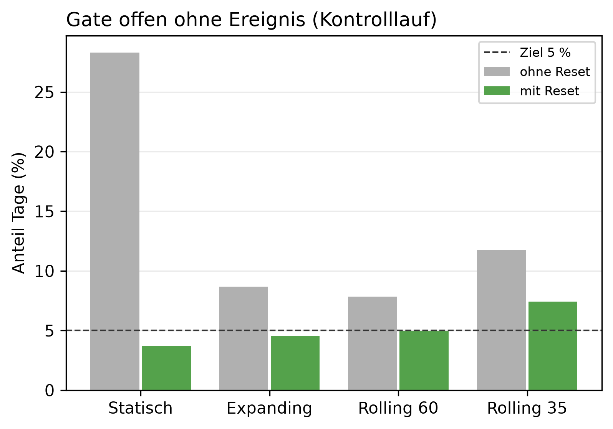

# K2 Referenzfenster und Schwellen der Anomalieerkennung, Lauf k2_002

## Setup

- Cutover: 2013-10-15, 2014-01-15, 2014-04-15, 2014-07-15
- Zeitraum je Cutover: Kaltstart, 60 Tage Überwachung vor dem Cutover, 60 Tage danach
- Ereignisse ab Cutover: Dauerlast +30 W, Dauerlast +50 W, Dauerlast +100 W, Dauerlast +200 W, Einzeltag-Spitze +3 kWh, jeweils gepaart mit unverändertem Kontrolllauf
- Modi: ohne Reset = nur Detektor, darauf wird kalibriert (nur keine Änderung, Dauerlast +100 W). Mit Reset = Betrieb mit Regel wie SYS2, alle Ereignisse
- Schwellen im Lauf (Gate / weekly / long_term): 2,6 / 1,25 / 1
- Produktiv-Referenzfenster: Rolling 60
- Commit: 3bef76f (mit lokalen Änderungen)

## Kennzahlen

| Kennzahl | Wert | Bezug |
|---|---|---|
| Kalibrierung: bestes Referenzfenster bei höchstens 5 % Einzeltag-Alarmen | Rolling 60 | Gate-Schwelle 2,6, im Leave-one-out 4/4 Durchgänge vorn |
| Rolling 60: kalibrierte Schwellen (Gate / weekly / long_term) | 2,6 / 1,25 / 1 | im Lauf 2,6 / 1,25 / 1 |
| Rolling 60: Gate offen ohne Ereignis, mit Reset [%] | 5,0 | ohne Reset 7,9 %, Ziel 5 % |
| Rolling 60: Einzeltag-Spitze +3 kWh erkannt, mit Reset | 1/4 | Skala daily |
| Rolling 60: Dauerlast +100 W erkannt, mit Reset | 3/4 | Skala weekly+long_term |
| Rolling 60: Dauerlast +200 W erkannt, mit Reset | 4/4 | Skala weekly+long_term |
| Rolling 60: Dauerlast +30 W erkannt, mit Reset | 1/4 | Skala weekly+long_term |
| Rolling 60: Dauerlast +50 W erkannt, mit Reset | 3/4 | Skala weekly+long_term |

## Ohne Ereignis: Kontrolllauf über das ganze Fenster, Mittel über Cutover

| Referenzfenster | Gate offen ohne Reset [%] | Gate offen mit Reset [%] | davon Einzeltag mit Reset [%] | Resets je Fenster |
|---|---:|---:|---:|---:|
| Statisch | 28,3 | 3,7 | 2,7 | 1,2 |
| Expanding | 8,7 | 4,5 | 3,5 | 1,5 |
| Rolling 60 | 7,9 | 5,0 | 3,7 | 1,5 |
| Rolling 35 | 11,8 | 7,4 | 6,4 | 1,5 |

## Kalibrierung: Arbeitspunkt je Referenzfenster bei gleicher Fehlalarmrate, ohne Reset

| Rang | Referenzfenster | Gate-Schwelle | Streak-Schwelle weekly | Streak-Schwelle long_term | Einzeltag-Alarme Kontrolle [%] | falsche new_pattern je Fenster | Stufe erkannt | Erkennungstag im Mittel |
|---:|---|---|---|---|---:|---:|---|---:|
| 3 | Statisch | 2,7 | 2,5 | 5 | 5,0 | 0,5 | 3/4 | 18,0 |
| 2 | Expanding | 2,6 | 1,25 | 1,5 | 3,9 | 1,0 | 4/4 | 13,8 |
| 1 | Rolling 60 | 2,6 | 1,25 | 1 | 3,7 | 1,0 | 4/4 | 11,5 |
| 4 | Rolling 35 | 3,8 | 1,75 | 2,5 | 3,9 | 0,8 | 2/4 | 5,5 |

## Kalibrierung: Leave-one-cutover-out, auf den übrigen Cutovern gewählt und auf dem zurückgehaltenen geprüft

| zurückgehaltener Cutover | Referenzfenster | Gate-Schwelle | Streak-Schwelle weekly | Streak-Schwelle long_term | Einzeltag-Alarme zurückgehalten [%] | falsche new_pattern zurückgehalten | Erkennungstag zurückgehalten |
|---|---|---|---|---|---:|---:|---:|
| 2013-10-15 | Rolling 60 | 2,6 | 1,25 | 1 | 2,6 | 1 | 5 |
| 2014-01-15 | Rolling 60 | 2,5 | 1,25 | 1 | 9,6 | 1 | 25 |
| 2014-04-15 | Rolling 60 | 2,6 | 1,25 | 1 | 3,5 | 1 | 13 |
| 2014-07-15 | Rolling 60 | 2,6 | 1,25 | 1 | 1,7 | 1 | 3 |

## Erkennung je Ereignis im Betrieb mit Reset, Tag seit Cutover je Cutover

| Referenzfenster | Ereignis | 2013-10-15 | 2014-01-15 | 2014-04-15 | 2014-07-15 | Mittel erkannter | erkannt | Skala bei Erkennung |
|---|---|---:|---:|---:|---:|---:|---|---|
| Statisch | Dauerlast +30 W | 44 | - | - | 13 | 28,5 | 2/4 | weekly+long_term |
| Statisch | Dauerlast +50 W | - | - | - | 13 | 13,0 | 1/4 | weekly+long_term |
| Statisch | Dauerlast +100 W | - | - | 13 | 8 | 10,5 | 2/4 | weekly+long_term |
| Statisch | Dauerlast +200 W | - | 27 | 10 | 8 | 15,0 | 3/4 | weekly+long_term |
| Statisch | Einzeltag-Spitze +3 kWh | 1 | 1 | - | - | 1,0 | 2/4 | daily |
| Expanding | Dauerlast +30 W | 6 | - | 50 | - | 28,0 | 2/4 | weekly+long_term |
| Expanding | Dauerlast +50 W | 6 | - | - | 13 | 9,5 | 2/4 | weekly+long_term |
| Expanding | Dauerlast +100 W | 6 | - | - | 8 | 7,0 | 2/4 | weekly+long_term |
| Expanding | Dauerlast +200 W | 6 | 27 | 10 | 8 | 12,8 | 4/4 | weekly+long_term |
| Expanding | Einzeltag-Spitze +3 kWh | - | 1 | - | - | 1,0 | 1/4 | daily |
| Rolling 60 | Dauerlast +30 W | 5 | - | - | - | 5,0 | 1/4 | weekly+long_term |
| Rolling 60 | Dauerlast +50 W | 5 | - | 50 | 13 | 22,7 | 3/4 | weekly+long_term |
| Rolling 60 | Dauerlast +100 W | 6 | - | 12 | 8 | 8,7 | 3/4 | weekly+long_term |
| Rolling 60 | Dauerlast +200 W | 6 | 27 | 10 | 8 | 12,8 | 4/4 | weekly+long_term |
| Rolling 60 | Einzeltag-Spitze +3 kWh | - | 1 | - | - | 1,0 | 1/4 | daily |
| Rolling 35 | Dauerlast +30 W | 5 | - | - | - | 5,0 | 1/4 | weekly+long_term |
| Rolling 35 | Dauerlast +50 W | 6 | - | - | 13 | 9,5 | 2/4 | weekly+long_term |
| Rolling 35 | Dauerlast +100 W | 6 | 29 | 49 | 8 | 23,0 | 4/4 | weekly+long_term |
| Rolling 35 | Dauerlast +200 W | 6 | 26 | 10 | 8 | 12,5 | 4/4 | weekly+long_term |
| Rolling 35 | Einzeltag-Spitze +3 kWh | - | 1 | - | - | 1,0 | 1/4 | daily |

## Hinweise

- Tag seit Cutover = Entscheidungstag: an Tag n meldet das System, eingeordnet ist dabei Tag n-1. Ab Cutover zählt deshalb erst ab Tag 1
- Kalibrierung: je Referenzfenster die niedrigste Gate-Schwelle mit höchstens 5 % Einzeltag-Alarmen im Kontrolllauf, dann die Streak-Schwellen mit höchstens 1 falschen new_pattern je Fenster und möglichst vielen, frühen Erkennungen. Offline auf den Läufen ohne Reset, im Kreislauf hinge jeder Reset selbst an den Schwellen
- mit Reset läuft mit den Schwellen im Lauf (Aufbau). Weichen die kalibrierten Schwellen des Produktivfensters davon ab, Config anpassen und K2 neu laufen lassen, erst dann zeigt der Kreislauf die kalibrierten Schwellen
- erkannt, im Betrieb mit Reset: dauerhafte Änderung = erster Reset (new_pattern) nach dem Cutover, den der Kontrolllauf am selben Tag nicht hat. Einzeltag-Spitze = Alarm am Ereignistag, den der Kontrolllauf nicht hat. Ohne Reset steht die Erkennung der Stufe in der Kalibrierung
- Skala bei Erkennung: bei new_pattern die Skalen mit Streak, bei der Spitze die Gate-Skala mit dem höchsten Score

## Anhang

### Kalibrierung: Arbeitspunkte je Cutover

| Referenzfenster | Rang | Gate-Schwelle | Streak-Schwelle weekly | Streak-Schwelle long_term | Cutover | Einzeltag-Alarme Kontrolle [%] | falsche new_pattern je Fenster | Erkennungstag |
|---|---:|---|---|---|---|---:|---:|---:|
| Statisch | 3 | 2,7 | 2,5 | 5 | 2013-10-15 | 7,0 | 1 | 7 |
| Statisch | 3 | 2,7 | 2,5 | 5 | 2014-01-15 | 6,1 | 1 | 10 |
| Statisch | 3 | 2,7 | 2,5 | 5 | 2014-04-15 | 0,0 | 0 | - |
| Statisch | 3 | 2,7 | 2,5 | 5 | 2014-07-15 | 7,0 | 0 | 37 |
| Expanding | 2 | 2,6 | 1,25 | 1,5 | 2013-10-15 | 5,2 | 1 | 6 |
| Expanding | 2 | 2,6 | 1,25 | 1,5 | 2014-01-15 | 8,7 | 1 | 27 |
| Expanding | 2 | 2,6 | 1,25 | 1,5 | 2014-04-15 | 0,9 | 1 | 13 |
| Expanding | 2 | 2,6 | 1,25 | 1,5 | 2014-07-15 | 0,9 | 1 | 9 |
| Rolling 60 | 1 | 2,6 | 1,25 | 1 | 2013-10-15 | 2,6 | 1 | 5 |
| Rolling 60 | 1 | 2,6 | 1,25 | 1 | 2014-01-15 | 7,0 | 1 | 25 |
| Rolling 60 | 1 | 2,6 | 1,25 | 1 | 2014-04-15 | 3,5 | 1 | 13 |
| Rolling 60 | 1 | 2,6 | 1,25 | 1 | 2014-07-15 | 1,7 | 1 | 3 |
| Rolling 35 | 4 | 3,8 | 1,75 | 2,5 | 2013-10-15 | 1,7 | 0 | 3 |
| Rolling 35 | 4 | 3,8 | 1,75 | 2,5 | 2014-01-15 | 9,6 | 1 | - |
| Rolling 35 | 4 | 3,8 | 1,75 | 2,5 | 2014-04-15 | 1,7 | 1 | - |
| Rolling 35 | 4 | 3,8 | 1,75 | 2,5 | 2014-07-15 | 2,6 | 1 | 8 |
