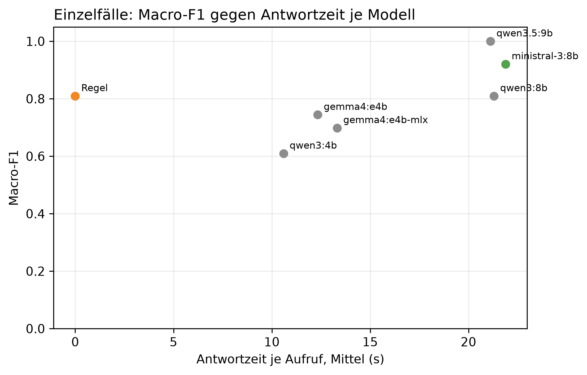

# K2 LLM-Klassifikation und Modellwahl, Läufe k2_002 / k2_seq_002

## Setup

- Läufe (Ebene 1 / Ebene 2): k2_002 / k2_seq_002
- Prompt (Ebene 1 / Ebene 2): v30 / v30
- Modelle: MDL0 qwen3:4b, MDL1 qwen3:8b, MDL2 qwen3.5:9b, MDL3 gemma4:e4b, MDL4 gemma4:e4b-mlx, MDL5 ministral-3:8b
- LLM: temperature 0,0, höchstens 2 Versuche je Aufruf
- Ebene 1: 10 synthetische Fälle, je Modell 1 Aufruf je Fall, Regel (BASELINE) läuft mit
- Ebene 2: Standard-Szenarien, Cutover CO2 (2015-02-12), 40 Tage davor, 60 danach, jedes Modell als eigener Kreislauf wie SYS3 mit Adaption
- Ereignisse Ebene 2: control = keine Änderung, scaled_strong = Sprung +30 %, peak_strong = Spitze +1000 W über 6 h
- Produktivmodell SYS3: ministral-3:8b
- Commit (Ebene 1 / Ebene 2): 8d36067 / 8d36067 (mit lokalen Änderungen)
- Textprüfung: 9 Steuerungswörter, Zahlentoleranz 0,5, gerundet auf 10 erlaubt, Fensterzahlen aus dem Prompt 7, 28

## Kennzahlen

| Kennzahl | Wert | Bezug |
|---|---|---|
| Ebene 1: bestes Modell nach Macro-F1 | qwen3.5:9b | Macro-F1 1,00, Regel 0,81 |
| ministral-3:8b: Ebene 1 richtig | 9/10 | Regel 9/10 |
| ministral-3:8b: Antwortzeit je Aufruf im Mittel [s] | 21,9 | p95 39,1 s, Regel 0,0 s |
| ministral-3:8b: Ebene 2 Ereignis-Arten erkannt | 1/2 | Regel 1/2 |
| ministral-3:8b: Ebene 2 Tage mit anderer Klasse als die Regel | 2 | 2015-04-09 new_pattern statt normal; 2015-04-10 peak statt normal |
| ministral-3:8b: ungültige Antworten Ebene 1 | 0 | Ausfalltage Ebene 2: 0 |
| ministral-3:8b: Antworten mit Textverstoß (Ebene 1 / Ebene 2) | 1/10 / 0/89 | Steuerung oder Zahl, Datum, Uhrzeit nicht im State |
| ministral-3:8b: Antworten mit fehlenden Belegen (Ebene 1 / Ebene 2) | 1/10 / 0/89 | zitierte Belege passen nicht zur eigenen Klasse |

## Ebene 1: Modellvergleich auf den Einzelfällen

| ID | Modell | richtig | Macro-F1 | ungültig | Ø Versuche | Grounding | Ø s je Aufruf | p95 s |
|---|---|---|---:|---:|---:|---:|---:|---:|
| MDL2 | qwen3.5:9b | 10/10 | 1,0 | 0 | 1,1 | 0,8 | 21,1 | 39,4 |
| MDL5 | ministral-3:8b | 9/10 | 0,9 | 0 | 1,0 | 0,9 | 21,9 | 39,1 |
| BASELINE | Regel | 9/10 | 0,8 | 0 | 1,0 | - | 0,0 | 0,0 |
| MDL1 | qwen3:8b | 9/10 | 0,8 | 0 | 1,0 | 0,8 | 21,3 | 38,1 |
| MDL3 | gemma4:e4b | 8/10 | 0,7 | 0 | 1,0 | 0,7 | 12,3 | 22,6 |
| MDL4 | gemma4:e4b-mlx | 8/10 | 0,7 | 0 | 1,0 | 0,8 | 13,3 | 19,7 |
| MDL0 | qwen3:4b | 8/10 | 0,6 | 0 | 1,0 | 0,8 | 10,6 | 19,0 |

## Ebene 1: Antwort je Fall (✓ = richtig, sonst die Antwort, - = ungültig)

| Fall | erwartet | qwen3.5:9b | ministral-3:8b | Regel | qwen3:8b | gemma4:e4b | gemma4:e4b-mlx | qwen3:4b |
|---|---|---|---|---|---|---|---|---|
| absence_drift_down | absence | ✓ | ✓ | new_pattern | new_pattern | new_pattern | new_pattern | new_pattern |
| low_single_scale | low | ✓ | ✓ | ✓ | ✓ | ✓ | ✓ | normal |
| measurement_error_missing_day | measurement_error | ✓ | ✓ | ✓ | ✓ | ✓ | ✓ | ✓ |
| new_pattern | new_pattern | ✓ | ✓ | ✓ | ✓ | peak | ✓ | ✓ |
| new_pattern_at_min_scales_boundary | new_pattern | ✓ | ✓ | ✓ | ✓ | ✓ | ✓ | ✓ |
| new_pattern_drift_down | new_pattern | ✓ | ✓ | ✓ | ✓ | ✓ | ✓ | ✓ |
| normal_single_sustained_scale | normal | ✓ | ✓ | ✓ | ✓ | ✓ | ✓ | ✓ |
| normal_weekly_after_reset | normal | ✓ | new_pattern | ✓ | ✓ | ✓ | low | ✓ |
| peak | peak | ✓ | ✓ | ✓ | ✓ | ✓ | ✓ | ✓ |
| peak_single_sustained_scale | peak | ✓ | ✓ | ✓ | ✓ | ✓ | ✓ | ✓ |

## Automatische Textprüfung je Modell (Antworten mit Verstoß oder fehlenden Belegen)

| Modell | E1 Antworten | E1 mit Verstoß | E1 Belege fehlen | E2 Antworten | E2 mit Verstoß | E2 Belege fehlen |
|---|---:|---:|---:|---:|---:|---:|
| qwen3.5:9b | 10 | 2 | 1 | 43 | 0 | 0 |
| ministral-3:8b | 10 | 1 | 1 | 89 | 0 | 0 |
| qwen3:8b | 10 | 0 | 0 | 93 | 2 | 0 |
| gemma4:e4b | 10 | 0 | 0 | 93 | 2 | 0 |
| gemma4:e4b-mlx | 10 | 0 | 0 | 90 | 3 | 0 |
| qwen3:4b | 10 | 0 | 1 | 93 | 0 | 5 |

## Ebene 2: je Modell über alle Ereignis-Arten

| Modell | Ereignis-Arten erkannt | Tage anders als die Regel | Gate-Tage | Ausfalltage | Meldungen Kontrolle | unknown Kontrolle | Resets Kontrolle |
|---|---|---:|---:|---:|---:|---:|---:|
| qwen3.5:9b | 2/2 | 16 | 43 | 0 | 8 | 0 | 5 |
| ministral-3:8b | 1/2 | 2 | 89 | 0 | 2 | 0 | 1 |
| Regel | 1/2 | 0 | 93 | 0 | 0 | 0 | 0 |
| qwen3:8b | 1/2 | 11 | 93 | 0 | 0 | 0 | 0 |
| gemma4:e4b | 1/2 | 2 | 93 | 0 | 0 | 0 | 0 |
| gemma4:e4b-mlx | 2/2 | 20 | 90 | 0 | 0 | 0 | 0 |
| qwen3:4b | 0/2 | 5 | 93 | 0 | 0 | 0 | 0 |

## Ebene 2: Erkennung je Ereignis, Tag seit Cutover

| config | Ereignis | erwartet | Gate-Tage durch das Ereignis | davon richtig | erster richtiger Tag | Resets |
|---|---|---|---:|---:|---:|---:|
| BASELINE | Spitze +1000 W über 6 h | peak | 2 | 1 | 1 | 0 |
| BASELINE | Sprung +30 % | new_pattern | 5 | 0 | - | 1 |
| MDL0 | Spitze +1000 W über 6 h | peak | 2 | 0 | - | 0 |
| MDL0 | Sprung +30 % | new_pattern | 5 | 0 | - | 1 |
| MDL1 | Spitze +1000 W über 6 h | peak | 2 | 1 | 1 | 0 |
| MDL1 | Sprung +30 % | new_pattern | 5 | 0 | - | 1 |
| MDL2 | Spitze +1000 W über 6 h | peak | 6 | 1 | 1 | 3 |
| MDL2 | Sprung +30 % | new_pattern | 1 | 1 | 6 | 3 |
| MDL3 | Spitze +1000 W über 6 h | peak | 2 | 1 | 1 | 0 |
| MDL3 | Sprung +30 % | new_pattern | 5 | 0 | - | 1 |
| MDL4 | Spitze +1000 W über 6 h | peak | 2 | 1 | 1 | 0 |
| MDL4 | Sprung +30 % | new_pattern | 6 | 1 | 38 | 2 |
| MDL5 | Spitze +1000 W über 6 h | peak | 4 | 1 | 1 | 0 |
| MDL5 | Sprung +30 % | new_pattern | 5 | 0 | - | 2 |

## Ebene 2: Tage, an denen ein Modell anders einordnet als die Regel

| Modell | analysierter Tag | Regel | Modell sagt | in Arten |
|---|---|---|---|---|
| qwen3:4b | 2015-02-12 | peak | normal | peak_strong |
| qwen3:4b | 2015-04-02 | low | normal | control, peak_strong |
| qwen3:4b | 2015-04-03 | low | normal | control, scaled_strong |
| qwen3:4b | 2015-04-04 | low | normal | control, scaled_strong, peak_strong |
| qwen3:4b | 2015-04-05 | low | normal | control, peak_strong |
| qwen3:8b | 2015-01-21 | normal | low | control, scaled_strong, peak_strong |
| qwen3:8b | 2015-01-22 | normal | low | control, scaled_strong, peak_strong |
| qwen3:8b | 2015-01-26 | normal | low | control, scaled_strong, peak_strong |
| qwen3:8b | 2015-01-27 | normal | low | control, scaled_strong, peak_strong |
| qwen3:8b | 2015-02-25 | normal | low | peak_strong |
| qwen3:8b | 2015-03-19 | normal | low | scaled_strong |
| qwen3:8b | 2015-03-20 | normal | low | scaled_strong |
| qwen3:8b | 2015-04-07 | normal | low | control, peak_strong |
| qwen3:8b | 2015-04-08 | normal | low | control, scaled_strong |
| qwen3:8b | 2015-04-09 | normal | low | control, scaled_strong, peak_strong |
| qwen3:8b | 2015-04-12 | normal | low | control, scaled_strong, peak_strong |
| qwen3.5:9b | 2015-01-21 | normal | new_pattern | control, scaled_strong, peak_strong |
| qwen3.5:9b | 2015-02-03 | normal | new_pattern | control, scaled_strong, peak_strong |
| qwen3.5:9b | 2015-02-17 | normal | new_pattern | scaled_strong |
| qwen3.5:9b | 2015-02-19 | normal | new_pattern | control |
| qwen3.5:9b | 2015-02-20 | new_pattern | normal | scaled_strong |
| qwen3.5:9b | 2015-03-15 | low | new_pattern | peak_strong |
| qwen3.5:9b | 2015-03-19 | normal | new_pattern | control, scaled_strong |
| qwen3.5:9b | 2015-03-29 | normal | new_pattern | peak_strong |
| qwen3.5:9b | 2015-04-02 | low | normal | control, scaled_strong |
| qwen3.5:9b | 2015-04-03 | low | normal | control, scaled_strong |
| qwen3.5:9b | 2015-04-04 | low | normal | control, scaled_strong, peak_strong |
| qwen3.5:9b | 2015-04-05 | low | normal | control, peak_strong |
| qwen3.5:9b | 2015-04-08 | normal | new_pattern | control, scaled_strong |
| qwen3.5:9b | 2015-04-09 | normal | peak | control, scaled_strong |
| qwen3.5:9b | 2015-04-10 | normal | peak | control, scaled_strong |
| qwen3.5:9b | 2015-04-11 | normal | peak | control, scaled_strong |
| qwen3.5:9b | 2015-04-11 | normal | new_pattern | peak_strong |
| gemma4:e4b | 2015-04-09 | normal | low | control, scaled_strong, peak_strong |
| gemma4:e4b | 2015-04-12 | normal | low | control, scaled_strong |
| gemma4:e4b-mlx | 2015-01-21 | normal | low | control, scaled_strong, peak_strong |
| gemma4:e4b-mlx | 2015-01-22 | normal | low | control, scaled_strong, peak_strong |
| gemma4:e4b-mlx | 2015-01-26 | normal | low | control, scaled_strong, peak_strong |
| gemma4:e4b-mlx | 2015-01-27 | normal | low | control, scaled_strong, peak_strong |
| gemma4:e4b-mlx | 2015-02-18 | normal | new_pattern | scaled_strong |
| gemma4:e4b-mlx | 2015-02-20 | normal | low | control, peak_strong |
| gemma4:e4b-mlx | 2015-02-20 | new_pattern | normal | scaled_strong |
| gemma4:e4b-mlx | 2015-02-24 | normal | low | control |
| gemma4:e4b-mlx | 2015-03-19 | normal | low | scaled_strong |
| gemma4:e4b-mlx | 2015-03-20 | normal | low | scaled_strong |
| gemma4:e4b-mlx | 2015-03-21 | normal | new_pattern | scaled_strong |
| gemma4:e4b-mlx | 2015-04-02 | low | normal | scaled_strong |
| gemma4:e4b-mlx | 2015-04-03 | low | normal | scaled_strong |
| gemma4:e4b-mlx | 2015-04-04 | low | normal | scaled_strong |
| gemma4:e4b-mlx | 2015-04-06 | normal | low | scaled_strong |
| gemma4:e4b-mlx | 2015-04-07 | normal | low | control, scaled_strong, peak_strong |
| gemma4:e4b-mlx | 2015-04-08 | normal | low | scaled_strong |
| gemma4:e4b-mlx | 2015-04-09 | normal | low | control, scaled_strong, peak_strong |
| gemma4:e4b-mlx | 2015-04-10 | normal | low | scaled_strong |
| gemma4:e4b-mlx | 2015-04-11 | normal | low | scaled_strong |
| gemma4:e4b-mlx | 2015-04-12 | normal | low | control, scaled_strong, peak_strong |
| ministral-3:8b | 2015-04-09 | normal | new_pattern | control, scaled_strong |
| ministral-3:8b | 2015-04-10 | normal | peak | control, scaled_strong |

## Hinweise

- Ebene 1 prüft, ob ein Modell die Regeln aus dem Prompt nachvollzieht. Der Prompt wurde auf denselben Fällen verbessert, die Quoten begründen deshalb nur die Modellwahl und belegen nicht das Ziel von 80 % richtiger Klassen (dafür E3)
- wenige Fälle: ein Fall sind mehrere Prozentpunkte, eine Klasse hängt teils an einem einzigen Fall
- Macro-F1: Mittel der F1-Werte über die Klassen, die als erwartete Klasse vorkommen
- Grounding: Anteil der für den Fall erwarteten Felder, die das Modell als Beleg zitiert. Die Regel zitiert keine
- Tag seit Cutover = Entscheidungstag: an Tag n meldet das System, eingeordnet ist dabei Tag n-1. Ab Cutover zählt deshalb erst ab Tag 1
- Ebene 2, erkannt: erwartete Klasse an einem Tag, an dem nur das Ereignis das Gate öffnet (gepaart mit dem Kontrolllauf desselben Modells)
- Ebene 2, anders als die Regel: gleiche Art und gleicher analysierter Tag, Regel gegen Modell. Nach einem Reset an verschiedenen Tagen laufen die Reihen auseinander, spätere Abweichungen können daraus folgen
- Antwortzeit: gemessen auf dem Rechner des Laufs, nur zum Vergleich der Modelle untereinander
- Textprüfung: Verstoß heißt, ein Steuerungswort oder eine Zahl, ein Datum oder eine Uhrzeit steht im Text, aber nicht im State des Falls. Zahlwörter („sechs Wochen“) findet sie nicht. Die Fensterlängen 7 und 28 aus der Skalenbeschreibung im Prompt gelten als erlaubt
- Fehlende Belege: der Prompt verlangt je Klasse bestimmte Pfade (new_pattern: sustained_drift, Streaks, peak/low: level, direction, absence: level, Kalendereintrag, measurement_error: Flag). Geprüft wird gegen die eigene Klasse des Modells, nicht gegen die erwartete. Ebene 1 wird nur für Läufe geprüft, die den State der Fälle in der Antwortdatei speichern, ältere Läufe haben in der Tabelle 0 Antworten
- Antworttexte und Auffälligkeiten der Textprüfung im Anhang, Antworten für alle Modelle in Ebene 1 und Ebene 2. Als CSV: answers_single.csv für Ebene 1, answers_sequence.csv für Ebene 2 nur vom Produktivmodell, result_text_findings.csv für die Auffälligkeiten

## Anhang

### Ebene 1: Precision, Recall und F1 je Klasse

| Modell | Klasse | Precision | Recall | F1 |
|---|---|---:|---:|---:|
| Regel | absence | 0,0 | 0,0 | 0,0 |
| Regel | low | 1,0 | 1,0 | 1,0 |
| Regel | measurement_error | 1,0 | 1,0 | 1,0 |
| Regel | new_pattern | 0,8 | 1,0 | 0,9 |
| Regel | normal | 1,0 | 1,0 | 1,0 |
| Regel | peak | 1,0 | 1,0 | 1,0 |
| qwen3:4b | absence | 0,0 | 0,0 | 0,0 |
| qwen3:4b | low | 0,0 | 0,0 | 0,0 |
| qwen3:4b | measurement_error | 1,0 | 1,0 | 1,0 |
| qwen3:4b | new_pattern | 0,8 | 1,0 | 0,9 |
| qwen3:4b | normal | 0,7 | 1,0 | 0,8 |
| qwen3:4b | peak | 1,0 | 1,0 | 1,0 |
| qwen3:8b | absence | 0,0 | 0,0 | 0,0 |
| qwen3:8b | low | 1,0 | 1,0 | 1,0 |
| qwen3:8b | measurement_error | 1,0 | 1,0 | 1,0 |
| qwen3:8b | new_pattern | 0,8 | 1,0 | 0,9 |
| qwen3:8b | normal | 1,0 | 1,0 | 1,0 |
| qwen3:8b | peak | 1,0 | 1,0 | 1,0 |
| qwen3.5:9b | absence | 1,0 | 1,0 | 1,0 |
| qwen3.5:9b | low | 1,0 | 1,0 | 1,0 |
| qwen3.5:9b | measurement_error | 1,0 | 1,0 | 1,0 |
| qwen3.5:9b | new_pattern | 1,0 | 1,0 | 1,0 |
| qwen3.5:9b | normal | 1,0 | 1,0 | 1,0 |
| qwen3.5:9b | peak | 1,0 | 1,0 | 1,0 |
| gemma4:e4b | absence | 0,0 | 0,0 | 0,0 |
| gemma4:e4b | low | 1,0 | 1,0 | 1,0 |
| gemma4:e4b | measurement_error | 1,0 | 1,0 | 1,0 |
| gemma4:e4b | new_pattern | 0,7 | 0,7 | 0,7 |
| gemma4:e4b | normal | 1,0 | 1,0 | 1,0 |
| gemma4:e4b | peak | 0,7 | 1,0 | 0,8 |
| gemma4:e4b-mlx | absence | 0,0 | 0,0 | 0,0 |
| gemma4:e4b-mlx | low | 0,5 | 1,0 | 0,7 |
| gemma4:e4b-mlx | measurement_error | 1,0 | 1,0 | 1,0 |
| gemma4:e4b-mlx | new_pattern | 0,8 | 1,0 | 0,9 |
| gemma4:e4b-mlx | normal | 1,0 | 0,5 | 0,7 |
| gemma4:e4b-mlx | peak | 1,0 | 1,0 | 1,0 |
| ministral-3:8b | absence | 1,0 | 1,0 | 1,0 |
| ministral-3:8b | low | 1,0 | 1,0 | 1,0 |
| ministral-3:8b | measurement_error | 1,0 | 1,0 | 1,0 |
| ministral-3:8b | new_pattern | 0,8 | 1,0 | 0,9 |
| ministral-3:8b | normal | 1,0 | 0,5 | 0,7 |
| ministral-3:8b | peak | 1,0 | 1,0 | 1,0 |

### Ebene 1: Antworten der Modelle je Fall

**peak** (erwartet: peak)

- qwen3.5:9b: peak ✓
  - Erklärung: Gestern war der Stromverbrauch ungewöhnlich hoch, etwa 45 % mehr als sonst an diesem Wochentag.
  - Empfehlung: Überprüfen Sie, ob gestern besondere Aktivitäten wie ein langes Wochenende oder eine Party stattgefunden haben.
  - Unsicherheit: Die Bewertung könnte sich ändern, wenn es einen nicht im Kalender verzeichneten Ausfall gab.
- ministral-3:8b: peak ✓
  - Erklärung: Gestern war der Stromverbrauch um etwa 45 % höher als an einem normalen Dienstag dieser Woche. Das ist ungewöhnlich für einen einzelnen Tag.
  - Empfehlung: Überprüfen Sie, ob gestern ungewöhnliche Geräte oder Aktivitäten den Verbrauch erhöht haben könnten, z. B. längeres Nutzen von Heizungen oder elektrischen Geräten.
  - Unsicherheit: Ob der erhöhte Verbrauch auf eine geplante Veränderung im Haushalt zurückzuführen ist, kann erst nach mehreren Tagen mit ähnlichem Wert geklärt werden.
- qwen3:8b: peak ✓
  - Erklärung: Gestern war der Stromverbrauch deutlich höher als üblich, insbesondere im Vergleich zu einem normalen Werktag. Der Verbrauch lag um etwa 45 % über dem Erwarteten.
  - Empfehlung: Überprüfen Sie, ob in der Wohnung etwas anders war, wie z. B. eine längere Heizperiode oder ein vergessenes Gerät. Falls nichts auffällt, ist es wahrscheinlich ein Zufall.
  - Unsicherheit: Die Verbrauchssteigerung könnte auf einen kurzfristigen Effekt wie ein vergessenes elektrisches Gerät zurückgehen, der nicht im Kalender erfasst wurde.
- gemma4:e4b: peak ✓
  - Erklärung: Ihr Stromverbrauch gestern war ungewöhnlich hoch, was besonders im Vergleich zu normalen Wochentagen der Fall ist. Dies könnte auf einen besonderen Verbrauch an diesem Tag zurückzuführen sein.
  - Empfehlung: Überprüfen Sie, ob an diesem Tag ungewöhnlich viel elektrische Energie verbraucht wurde, zum Beispiel durch zusätzliche Beleuchtung oder Geräte.
  - Unsicherheit: Die Bewertung basiert auf dem Vergleich mit dem normalen Verbrauch für diesen Wochentag.
- gemma4:e4b-mlx: peak ✓
  - Erklärung: Der Stromverbrauch gestern war ungewöhnlich hoch, was sich im Vergleich zum üblichen Niveau dieses Wochentags um 45 Prozent erhöhte.
  - Empfehlung: Da keine weiteren Informationen vorliegen, ist es schwer zu sagen, woran der höhere Verbrauch liegt; Sie könnten prüfen, ob ungewöhnlich viel Energie verbraucht wurde.
  - Unsicherheit: Es ist unbekannt, ob dieser hohe Verbrauch ein einmaliges Ereignis war oder Teil eines anhaltenden Trends.
- qwen3:4b: peak ✓
  - Erklärung: Gestern war die Stromverbrauch stark höher als normal, was sich auf den gesamten Tag über einen Zeitraum von 45 % auswirkt.
  - Empfehlung: Überprüfen Sie, ob es heute Abend einen besonders hohen Stromverbrauch gab, wie z. B. bei der Nutzung von Heizung oder elektronischen Geräten.
  - Unsicherheit: Die genaue Ursache kann nicht mit den verfügbaren Daten bestimmt werden.

**new_pattern** (erwartet: new_pattern)

- qwen3.5:9b: new_pattern ✓
  - Erklärung: Der Stromverbrauch war gestern ungewöhnlich hoch und ist seit dem 9. Dezember auf einem neuen, höheren Niveau gestiegen.
  - Empfehlung: Bitte prüfen Sie, ob sich im Haushalt etwas geändert hat, zum Beispiel durch längeres Verweilen zu Hause oder das Einschalten neuer Geräte.
  - Unsicherheit: Die Verfügbarkeit des Kalenders könnte die Einordnung beeinflussen, ist hier aber nicht entscheidend.
- ministral-3:8b: new_pattern ✓
  - Erklärung: Der Stromverbrauch war gestern deutlich höher als sonst – seit dem 9. Dezember liegt er im Schnitt um etwa 36 % über dem üblichen Wert für diese Tage in der Woche.
  - Empfehlung: Überprüfen Sie, ob sich der Stromverbrauch in den letzten Tagen tatsächlich erhöht hat und was dafür infrage kommen könnte – etwa neue Geräte oder längere Nutzung von Heizung oder Beleuchtung.
  - Unsicherheit: Ob die erhöhte Nutzung saisonal bedingt ist (z. B. durch kürzere Tage im Winter), lässt sich erst nach einigen Wochen abschätzen.
- qwen3:8b: new_pattern ✓
  - Erklärung: Gestern war der Stromverbrauch deutlich höher als üblich, insbesondere im Vergleich zur letzten Woche und den letzten vier Wochen. Der Verbrauch lag um etwa 36 % über dem üblichen Niveau der vergangenen Woche und um 22 % über dem üblichen Niveau der letzten vier Wochen.
  - Empfehlung: Überprüfen Sie, ob in der Wohnung etwas verändert wurde, wie z. B. neue Geräte oder eine Änderung der Nutzungsgewohnheiten. Falls nichts auffällt, könnte es sich um eine temporäre Erhöhung handeln.
  - Unsicherheit: Die genaue Ursache für den erhöhten Verbrauch ist nicht bekannt und könnte auf einen vorübergehenden Effekt zurückzuführen sein.
- gemma4:e4b: peak
  - Erklärung: Ihr Stromverbrauch gestern war ungewöhnlich hoch, was besonders im Vergleich zu normalen Wochentagen der Fall ist. Dies könnte auf eine erhöhte Nutzung von elektrischen Geräten hindeuten.
  - Empfehlung: Überprüfen Sie, ob an diesem Tag ungewöhnlich viel Strom verbraucht wurde, zum Beispiel durch zusätzliche Heizung oder Beleuchtung.
  - Unsicherheit: Die Analyse basiert auf dem Vergleich mit historischen Daten; die genaue Ursache für den Anstieg ist nicht ersichtlich.
- gemma4:e4b-mlx: new_pattern ✓
  - Erklärung: Der Stromverbrauch war an diesem Tag ungewöhnlich hoch, und dieser erhöhte Trend hält seit längerer Zeit an. Dies deutet auf eine anhaltende Veränderung im Verbrauchsmuster hin.
  - Empfehlung: Da die Ursache für diesen anhaltenden Trend unbekannt ist, können Sie prüfen, ob sich in Ihrem Haushalt kürzlich neue Geräte oder Gewohnheiten etabliert haben.
  - Unsicherheit: Es ist nicht ersichtlich, ob der aktuelle Verbrauch im Vergleich zu früheren Perioden noch weiter ansteigen könnte.
- qwen3:4b: new_pattern ✓
  - Erklärung: Gestern war die Stromverbrauch stark höher als normal, um 36 % mehr als im Durchschnitt für diese Woche.
  - Empfehlung: Überprüfen Sie, ob es in Ihrem Haus eine neue Nutzungsmuster gab, wie zum Beispiel mehr als gewöhnlich viele Geräte gleichzeitig eingeschaltet oder eine längere Zeit im Haus verbracht wurde.
  - Unsicherheit: Die genaue Ursache ist nicht bekannt, aber die Stromverbrauch bleibt höher als normal.

**low_single_scale** (erwartet: low)

- qwen3.5:9b: low ✓
  - Erklärung: Gestern war der Stromverbrauch ungewöhnlich niedrig, etwa 30 % unter dem für diesen Wochentag üblichen Wert.
  - Empfehlung: Überlegen Sie, ob gestern besondere Umstände wie ein früherer Schlafengehenzeitpunkt oder weniger Aktivitäten zu Hause vorlagen. Wenn nicht, ist der Verbrauch in Ordnung.
  - Unsicherheit: Die Bewertung könnte sich ändern, wenn ein Kalendereintrag verfügbar wäre, der eine Abwesenheit bestätigt.
- ministral-3:8b: low ✓
  - Erklärung: Gestern war der Stromverbrauch um etwa 30 % niedriger als an einem normalen Dienstag im Dezember.
  - Empfehlung: Da keine geplanten Abwesenheiten oder besondere Ereignisse vorlagen, prüfen Sie bitte, ob Geräte ausgeschaltet oder der Verbrauch sonst wie reduziert wurde.
  - Unsicherheit: Ob ein geplanter Urlaub oder eine andere Abwesenheit den Verbrauch beeinflusst hat, kann nicht geprüft werden, da keine Kalendereintragungen verfügbar sind.
- qwen3:8b: low ✓
  - Erklärung: Gestern war der Stromverbrauch um 30 % niedriger als üblich für einen Dienstag. Der Verbrauch war insgesamt niedriger, aber nicht so stark wie bei einem Fehlalarm.
  - Empfehlung: Überprüfen Sie, ob es in Ihrem Haushalt etwas gab, das den Verbrauch reduziert hat, wie weniger Licht oder eine geringere Nutzung von elektrischen Geräten.
  - Unsicherheit: Da keine Kalenderinformationen verfügbar waren, können wir nicht bestimmen, ob ein geplanter Abwesenheit der Grund für den niedrigen Verbrauch war.
- gemma4:e4b: low ✓
  - Erklärung: Ihr Stromverbrauch gestern war niedriger als üblich, was auf einen Rückgang von etwa 30 Prozent im Vergleich zu normalen Wochentagen hindeutet. Dies könnte darauf zurückzuführen sein, dass Sie weniger Energie verbraucht haben.
  - Empfehlung: Da keine spezifischen Ereignisse vorliegen und der Rückgang nicht durch einen bekannten Abwesenheitsgrund erklärt werden kann, ist momentan nichts zu überprüfen. Achten Sie auf ähnliche Muster in den nächsten Tagen.
  - Unsicherheit: Die Bewertung basiert nur auf dem Vergleich mit dem normalen Wochentagsprofil, da keine längerfristigen oder wöchentlichen Vergleiche vorliegen.
- gemma4:e4b-mlx: low ✓
  - Erklärung: Der Stromverbrauch gestern war niedriger als für diesen Wochentag üblich, mit einer Abweichung von 30 Prozent.
  - Empfehlung: Da keine weiteren Informationen vorliegen, ist es schwer zu sagen, woran das liegt; prüfen Sie, ob sich im Haushalt etwas geändert hat.
  - Unsicherheit: Es sind keine weiteren historischen Daten verfügbar, um die Ursache dieser Abweichung genauer einordnen zu können.
- qwen3:4b: normal
  - Erklärung: Gestern war die Stromverbrauch normal, da die tägliche Verbrauchsvariabilität nicht außergewöhnlich war.
  - Empfehlung: Keine Handlung erforderlich, da gestern der normale Stromverbrauch war.
  - Unsicherheit: Keine besonderen Umstände, die den Verbrauch heute beeinfligen.

**peak_single_sustained_scale** (erwartet: peak)

- qwen3.5:9b: peak ✓
  - Erklärung: Gestern war der Stromverbrauch ungewöhnlich hoch, etwa 40 % mehr als sonst an diesem Wochentag.
  - Empfehlung: Bitte prüfen Sie, ob gestern besondere Aktivitäten wie Gäste oder ein längeres Arbeiten zu Hause stattgefunden haben.
  - Unsicherheit: Die Bewertung könnte sich ändern, wenn der Kalender eine Abwesenheit am gestrigen Tag enthalten würde.
- ministral-3:8b: peak ✓
  - Erklärung: Gestern war der Stromverbrauch für einen Wochentag ungewöhnlich hoch, um etwa 40 % über dem üblichen Niveau. Dies ist ein einzelner Ausreißer und nicht Teil eines längerfristigen Musters.
  - Empfehlung: Überprüfen Sie, ob gestern ungewöhnlich viele Geräte gleichzeitig genutzt wurden oder ob ein neues Gerät in Betrieb genommen wurde.
  - Unsicherheit: Ob der erhöhte Verbrauch auf einen einmaligen Grund wie eine längere Nutzung von Heizung oder Beleuchtung zurückzuführen ist, kann nur durch Rückfrage geklärt werden.
- qwen3:8b: peak ✓
  - Erklärung: Gestern war der Stromverbrauch höher als üblich, insbesondere im Vergleich zu einem normalen Werktag. Der Verbrauch lag um etwa 40 % über dem Erwarteten.
  - Empfehlung: Überprüfen Sie, ob in der Wohnung etwas anders war, wie z. B. eine längere Heizperiode oder mehr Lichtverbrauch.
  - Unsicherheit: Die Verbrauchssteigerung könnte auf saisonale Veränderungen im Winter zurückgehen, die den Verbrauch normalerweise erhöhen.
- gemma4:e4b: peak ✓
  - Erklärung: Ihr Stromverbrauch gestern war ungewöhnlich hoch. Dies ist besonders auffällig, da der Verbrauch an diesem Wochentag um 40 Prozent höher war als üblich.
  - Empfehlung: Überprüfen Sie, ob größere Geräte wie beispielsweise Heizungen oder Trockner ungewöhnlich lange liefen könnten.
  - Unsicherheit: Die Beurteilung des Tagesverlaufs ist nicht möglich, da nur die Gesamtverbrauchswerte vorliegen.
- gemma4:e4b-mlx: peak ✓
  - Erklärung: Der Stromverbrauch gestern war ungewöhnlich hoch, was sich im Vergleich zu diesem Wochentag um 40 Prozent mehr als normal zeigt. Dies deutet auf eine erhöhte Nutzung hin, möglicherweise durch die dunkleren Abende im Winter.
  - Empfehlung: Überprüfen Sie, ob an diesem Tag ungewöhnlich viel Energie verbraucht wurde, zum Beispiel durch besondere Aktivitäten im Haushalt.
  - Unsicherheit: Es ist nicht bekannt, ob dieser erhöhte Verbrauch ein einmaliges Ereignis oder Teil eines länger andauernden Trends ist.
- qwen3:4b: peak ✓
  - Erklärung: Gestern war die Stromverbrauch stark höher als normal, was sich auf den gesamten Tag über einen Zeitraum von 6 Tagen ausbreitete.
  - Empfehlung: Überprüfen Sie, ob es in Ihrem Haus heute Abend oder morgen früh einen Anblick von Geräten gab, der besonders viel Strom verbrauchte.
  - Unsicherheit: Die genaue Ursache für den hohen Verbrauch ist nicht bekannt, aber die Zeit von gestern war bereits höher als normal.

**normal_single_sustained_scale** (erwartet: normal)

- qwen3.5:9b: normal ✓
  - Erklärung: Die Analyse zeigt, dass der Stromverbrauch gestern im üblichen Rahmen lag.
  - Empfehlung: Es ist nichts zu tun. Der Verbrauch entspricht dem normalen Muster für diesen Wochentag.
  - Unsicherheit: Die Bewertung stützt sich auf die aktuelle Analyse, die keine ungewöhnlichen Abweichungen feststellt.
- ministral-3:8b: normal ✓
  - Erklärung: Gestern war der Verbrauch für einen Dienstag ungewöhnlich hoch, aber die Abweichung hat sich nur über eine Woche gehalten und ist nicht nachhaltig.
  - Empfehlung: Da die Abweichung nur kurz anhielt, ist keine weitere Handlung nötig.
  - Unsicherheit: Ob der Verbrauch in den nächsten Tagen wieder normal bleibt, hängt davon ab, ob sich das Verhalten wiederholt.
- qwen3:8b: normal ✓
  - Erklärung: Gestern war der Stromverbrauch leicht höher als üblich, aber innerhalb des normalen Bereichs. Der Verbrauch lag um etwa 9 % über dem Durchschnitt der letzten Woche.
  - Empfehlung: Da der Verbrauch leicht erhöht war, können Sie prüfen, ob etwas im Haushalt anders lief, wie z. B. eine vergessene elektrische Geräte oder eine längere Nutzung von Heizung.
  - Unsicherheit: Die Daten zeigen einen leichten Anstieg, aber es gibt keine Hinweise auf eine dauerhafte Veränderung.
- gemma4:e4b: normal ✓
  - Erklärung: Ihr Stromverbrauch gestern war im Rahmen dessen, was für diesen Wochentag normal ist. Allerdings lagen die Werte der letzten sieben Tage und der letzten vier Wochen leicht über dem üblichen Niveau.
  - Empfehlung: Da keine auffälligen Abweichungen vorliegen, müssen Sie nichts überprüfen. Die leichte Steigerung könnte mit der Jahreszeit zusammenhängen, da es im Dezember dunkler wird und man mehr Zeit drinnen verbringt.
  - Unsicherheit: Die Bewertung des Verbrauchs hängt von den historischen Durchschnittswerten ab, die hier als Basis dienen.
- gemma4:e4b-mlx: normal ✓
  - Erklärung: Der Verbrauch gestern war im Rahmen dessen, was für diesen Wochentag normal ist. Es gab keine Hinweise auf eine ungewöhnliche Abweichung.
  - Empfehlung: Es ist kein Handeln nötig, da die Datenlage keine Auffälligkeiten zeigt.
  - Unsicherheit: Obwohl der Verbrauch leicht über dem Durchschnitt der letzten Woche lag, gibt es keine weiteren Hinweise auf eine anhaltende Veränderung.
- qwen3:4b: normal ✓
  - Erklärung: Gestern war die Stromverbrauch normal, obwohl es einen kurzen Anstieg gab.
  - Empfehlung: Keine Handlung erforderlich, da gestern der normale Verbrauch war.
  - Unsicherheit: Keine weiteren Informationen zur Verfügung, um die Verbrauchsänderung zu bestätigen.

**normal_weekly_after_reset** (erwartet: normal)

- qwen3.5:9b: normal ✓
  - Erklärung: Die Analyse zeigt, dass der Stromverbrauch gestern im üblichen Rahmen lag.
  - Empfehlung: Es ist nichts zu tun. Der Verbrauch war normal.
  - Unsicherheit: Die Bewertung stützt sich auf die Analyse des vergangenen Tages.
- ministral-3:8b: new_pattern
  - Erklärung: Gestern war der Stromverbrauch im Vergleich zur letzten Woche um etwa ein Drittel niedriger, und das seit dem 9. Dezember so. Das könnte auf eine dauerhafte Veränderung hindeuten.
  - Empfehlung: Überprüfen Sie, ob sich der Stromverbrauch in den letzten Tagen tatsächlich so niedrig gehalten hat und ob es Gründe wie weniger Heizbedarf oder Abwesenheit gibt.
  - Unsicherheit: Ob die Kalenderdaten verfügbar sind, könnte die Einschätzung beeinflussen.
- qwen3:8b: normal ✓
  - Erklärung: Gestern war der Stromverbrauch leicht niedriger als üblich, aber das ist nicht ungewöhnlich. Der Verbrauch lag um etwa 10 % unter dem üblichen Niveau für einen Dienstag.
  - Empfehlung: Sie können nichts unternommen werden, da der Verbrauch nicht signifikant abweicht und keine besondere Ursache bekannt ist.
  - Unsicherheit: Die Kalenderdaten sind nicht verfügbar, sodass wir nicht prüfen können, ob ein geplanter Abwesenheit den Verbrauch beeinflusst hat.
- gemma4:e4b: normal ✓
  - Erklärung: Ihr Stromverbrauch gestern war im Rahmen dessen, was für diesen Wochentag normal ist. Obwohl der Verbrauch in den letzten sieben Tagen etwas höher war als gewöhnlich, deutet dies nicht auf ein ungewöhnliches Muster hin.
  - Empfehlung: Es gibt keinen Grund zur Sorge; die aktuellen Verbrauchsdaten sind im normalen Bereich.
  - Unsicherheit: Die Verfügbarkeit des Kalenders war eingeschränkt, weshalb keine Informationen zu geplanten Abwesenheiten vorliegen.
- gemma4:e4b-mlx: low
  - Erklärung: Der Verbrauch gestern war niedriger als erwartet, was sich im Vergleich zu den letzten sieben Tagen um 32 Prozent höher zeigt.
  - Empfehlung: Da keine weiteren Informationen vorliegen, ist es schwer zu sagen, woran das liegt; Sie könnten prüfen, ob sich im Haushalt etwas geändert hat.
  - Unsicherheit: Es ist nicht bekannt, ob dieser niedrige Verbrauch ein anhaltender Trend ist, da die langfristigen Daten fehlen.
- qwen3:4b: normal ✓
  - Erklärung: Gestern war die Stromverbrauch etwas geringer als üblich, aber das liegt nicht an einer Abwesenheit oder einem langfristigen Muster.
  - Empfehlung: Keine Handlung erforderlich, da die geringere Verbrauchsmuster nur kurzfristig war und keine Abwesenheit vorliegt.
  - Unsicherheit: Die genaue Ursache für den geringeren Verbrauch ist nicht bekannt, könnte aber z.B. durch eine kürzere Zeit im Haus oder Wintertage sein.

**new_pattern_at_min_scales_boundary** (erwartet: new_pattern)

- qwen3.5:9b: new_pattern ✓
  - Erklärung: Der Stromverbrauch ist seit dem 10. Dezember deutlich höher als sonst, was auf eine neue Verbrauchssituation hindeutet.
  - Empfehlung: Bitte prüfen Sie, ob sich im Haushalt etwas geändert hat, zum Beispiel durch längeres Verweilen zu Hause oder das Einschalten neuer Geräte.
  - Unsicherheit: Die Verfügbarkeit des Kalenders könnte die Einordnung beeinflussen, ist hier jedoch nicht entscheidend.
- ministral-3:8b: new_pattern ✓
  - Erklärung: Gestern war der Stromverbrauch im Vergleich zur letzten Woche um etwa 30 % höher und liegt seit dem 10. Dezember auf diesem erhöhten Niveau. Das ist ungewöhnlich für diese Zeit des Jahres.
  - Empfehlung: Überprüfen Sie, ob sich der Stromverbrauch in den letzten Wochen verändert hat, zum Beispiel durch neue Geräte oder längere Nutzung von Heizung oder Beleuchtung.
  - Unsicherheit: Ob die erhöhte Nutzung auf eine geplante Veränderung zurückzuführen ist, können wir erst nach weiteren Tagen mit ähnlichem Verbrauch beurteilen.
- qwen3:8b: new_pattern ✓
  - Erklärung: Die Stromverbrauchsmuster der letzten Wochen und Monate zeigen einen stetigen Anstieg, was auf eine neue Norm hinweist. Der Verbrauch war gestern höher als üblich.
  - Empfehlung: Überprüfen Sie, ob sich in Ihrem Haushalt etwas geändert hat, das den Verbrauch beeinflussen könnte, wie neue Geräte oder häufigere Nutzung.
  - Unsicherheit: Die Erkennung einer neuen Norm basiert auf langfristigen Daten, die möglicherweise nicht vollständig berücksichtigt werden.
- gemma4:e4b: new_pattern ✓
  - Erklärung: Ihr Stromverbrauch lag gestern über dem üblichen Niveau, was auf einen anhaltend höheren Verbrauch hindeutet. Dies könnte durch saisonale Faktoren wie die dunkler werdenden Abende im Winter bedingt sein.
  - Empfehlung: Überprüfen Sie, ob sich Ihr Verbrauch in den letzten Tagen konstant auf diesem höheren Niveau eingependelt hat.
  - Unsicherheit: Die genaue Ursache für diesen anhaltend höheren Verbrauch lässt sich anhand der vorliegenden Daten nicht bestimmen.
- gemma4:e4b-mlx: new_pattern ✓
  - Erklärung: Die Stromverbrauchsdaten zeigen eine anhaltend höhere Nutzung im Vergleich zu den letzten Wochen und Monaten, was auf einen länger andauernden Trend hindeutet.
  - Empfehlung: Da der Grund für diese anhaltende Veränderung unbekannt ist, sollten Sie prüfen, ob sich im Haushalt etwas geändert hat, was den Verbrauch beeinflussen könnte.
  - Unsicherheit: Die genaue Ursache dieser länger andauernden Abweichung kann anhand der vorliegenden Daten nicht bestimmt werden.
- qwen3:4b: new_pattern ✓
  - Erklärung: Gestern war die Stromverbrauch etwas höher als normal, aber die Abweichung ist seit mehreren Tagen beständig.
  - Empfehlung: Überprüfen Sie, ob es in Ihrem Haus mehr als üblich viele Geräte gleichzeitig eingeschaltet waren, besonders im Winter.
  - Unsicherheit: Die Abweichung könnte durch eine vorherige Heizungsanlage oder einen Wintersportveranstaltung verursacht sein.

**measurement_error_missing_day** (erwartet: measurement_error)

- qwen3.5:9b: measurement_error ✓
  - Erklärung: Die Messung von gestern ist nicht vertrauenswürdig, da der Wert unplausibel ist.
  - Empfehlung: Bitte überprüfen Sie die Geräte oder den Zählerstand, um sicherzustellen, dass keine Störung vorliegt.
  - Unsicherheit: Die Klassifizierung beruht auf der aktuellen Messung, die als unplausibel eingestuft wurde.
- ministral-3:8b: measurement_error ✓
  - Erklärung: Der gemessene Wert für gestern ist nicht vertrauenswürdig und kann keine Rückschlüsse auf den Verbrauch zulassen.
  - Empfehlung: Es gibt keinen zuverlässigen Wert, den Sie überprüfen können. Bitte prüfen Sie die Messgeräte oder kontaktieren Sie Ihren Stromanbieter.
  - Unsicherheit: Ob der Fehler nur für gestern aufgetreten ist oder länger anhält, kann nicht beurteilt werden.
- qwen3:8b: measurement_error ✓
  - Erklärung: Die Messung gestern ist nicht zuverlässig, sodass keine Aussage über den Stromverbrauch getroffen werden kann.
  - Empfehlung: Überprüfen Sie die Geräte oder kontaktieren Sie den Stromversorger, um sicherzustellen, dass die Messung korrekt ist.
  - Unsicherheit: Die genaue Ursache der fehlerhaften Messung ist unbekannt und könnte die Interpretation beeinflussen.
- gemma4:e4b: measurement_error ✓
  - Erklärung: Die Messung für gestern ist als ungültig markiert, weshalb keine Aussage über Ihren Verbrauch getroffen werden kann.
  - Empfehlung: Aufgrund der unzuverlässigen Messwerte können wir momentan keine Empfehlungen geben. Bitte warten Sie auf eine neue, verlässliche Messung.
  - Unsicherheit: Die Gültigkeit der aktuellen Messung ist das wichtigste Kriterium für die Beurteilung des Verbrauchs.
- gemma4:e4b-mlx: measurement_error ✓
  - Erklärung: Die Messung der Stromaufnahme von gestern ist als ungültig eingestuft worden.
  - Empfehlung: Es gibt keine weiteren Empfehlungen, da die Daten nicht verlässlich sind.
  - Unsicherheit: Keine weiteren Informationen sind verfügbar, um eine genauere Einschätzung zu treffen.
- qwen3:4b: measurement_error ✓
  - Erklärung: Gestern ist eine ungültige Messung aufgetreten, daher kann keine Aussage über den Verbrauch getroffen werden.
  - Empfehlung: Bitte prüfen Sie, ob die Stromabrechnung für gestern korrekt ist und ob es einen Fehler bei der Messung gab.
  - Unsicherheit: Die Messung war ungültig, daher gibt es keine zuverlässigen Daten.

**new_pattern_drift_down** (erwartet: new_pattern)

- qwen3.5:9b: new_pattern ✓
  - Erklärung: Der Stromverbrauch ist seit dem 9. Dezember deutlich niedriger als sonst, was auf einen neuen Verbrauchsmuster hindeutet.
  - Empfehlung: Bitte prüfen Sie, ob sich Ihre Gewohnheiten oder die Nutzung bestimmter Geräte in den letzten Wochen geändert haben.
  - Unsicherheit: Die Verfügbarkeit des Kalenders könnte eine geplante Abwesenheit bestätigen, die den niedrigen Verbrauch erklärt.
- ministral-3:8b: new_pattern ✓
  - Erklärung: Der Stromverbrauch ist seit dem 9. Dezember um etwa 40 % niedriger als sonst in der Woche und seit dem 10. Dezember auch über vier Wochen hinweg. Gestern lag er im üblichen Bereich, aber die Abweichung hat sich nicht gebessert.
  - Empfehlung: Überprüfen Sie, ob Geräte oder Beleuchtung seit dem 9. Dezember weniger genutzt werden – etwa durch kürzere Aufenthalte im Haushalt oder geänderte Gewohnheiten.
  - Unsicherheit: Ob die Abweichung auf eine geplante Veränderung zurückzuführen ist, kann nur mit zusätzlichen Informationen geklärt werden.
- qwen3:8b: new_pattern ✓
  - Erklärung: Die Stromverbrauchsmuster der letzten Wochen und Monate zeigen einen deutlichen Rückgang, was auf eine veränderte Nutzung hinweist. Der Verbrauch war gestern niedriger als üblich.
  - Empfehlung: Überprüfen Sie, ob sich etwas in Ihrem Haushalt verändert hat, wie z.B. eine neue Technologie oder ein Verhalten, das den Stromverbrauch beeinflussen könnte.
  - Unsicherheit: Die genaue Ursache des Rückgangs ist nicht bekannt und könnte auf saisonale Veränderungen oder andere Faktoren zurückgehen.
- gemma4:e4b: new_pattern ✓
  - Erklärung: Ihr Stromverbrauch zeigt seit mehreren Tagen einen anhaltenden Unterschied zu den üblichen Werten, was auf eine veränderte Grundlast hindeuten könnte. Dies ist ein Muster, das beobachtet wurde, aber die genaue Ursache bleibt unklar.
  - Empfehlung: Überprüfen Sie, ob sich im Haushalt kürzlich größere Geräte dauerhaft eingeschaltet haben oder ob sich Verhaltensmuster geändert haben, die den Verbrauch beeinflussen könnten.
  - Unsicherheit: Die genaue Ursache für diesen anhaltenden Unterschied ist unbekannt, da nur der Gesamtverbrauch betrachtet werden kann.
- gemma4:e4b-mlx: new_pattern ✓
  - Erklärung: Die Nutzung ist über mehrere Tage hinweg ungewöhnlich verändert, was sich in einem deutlichen Rückgang im Vergleich zur letzten Woche und im Vergleich zu den letzten vier Wochen zeigt.
  - Empfehlung: Da die Ursache dieser anhaltenden Veränderung unbekannt ist, können Sie prüfen, ob sich in Ihrem Haushalt etwas geändert hat, was den Verbrauch beeinflussen könnte.
  - Unsicherheit: Die genaue Ursache der anhaltenden Abweichung lässt sich mit den vorliegenden Daten nicht bestimmen.
- qwen3:4b: new_pattern ✓
  - Erklärung: Gestern war die Stromverbrauchsdifferenz im Vergleich zu den letzten Wochen deutlich niedriger, aber das Muster hat sich seit dem 9. Dezember stabilisiert.
  - Empfehlung: Überprüfen Sie, ob es in Ihrem Haus seit dem 9. Dezember eine neue Gewohnheit gibt, z.B. weniger Stromverbrauch durch geringere Beleuchtung oder weniger Nutzung von Heizungen.
  - Unsicherheit: Die genaue Ursache für den niedrigeren Verbrauch ist nicht bekannt, könnte aber mit der Zeit von Jahr zu Jahr variieren.

**absence_drift_down** (erwartet: absence)

- qwen3.5:9b: absence ✓
  - Erklärung: Der Verbrauch war gestern niedriger, da Sie sich im Urlaub befanden.
  - Empfehlung: Es ist keine Überprüfung nötig, da die Abwesenheit im Kalender eingetragen ist.
  - Unsicherheit: Die Verfügbarkeit des Kalenders war gegeben.
- ministral-3:8b: absence ✓
  - Erklärung: Gestern war der Stromverbrauch ungewöhnlich niedrig, da Sie im Urlaub waren und die Daten vom 8. bis zum 21. Dezember abgedeckt sind.
  - Empfehlung: Da der Urlaub geplant war, ist dies kein Grund zur Sorge. Sie können prüfen, ob die Werte nach Ihrer Rückkehr wieder normal sind.
  - Unsicherheit: Die genaue Ursache des niedrigen Verbrauchs während des Urlaubs kann nur durch Rückmeldung nach der Rückkehr bestätigt werden.
- qwen3:8b: new_pattern
  - Erklärung: Die Stromverbrauchsmuster der letzten Wochen und Monate zeigen einen deutlichen Rückgang, was auf eine veränderte Nutzung hinweist. Der Verbrauch war gestern niedriger als üblich.
  - Empfehlung: Überprüfen Sie, ob sich etwas in Ihrem Haushalt verändert hat, wie z.B. eine neue Technologie oder ein Verhalten, das den Verbrauch beeinflussen könnte.
  - Unsicherheit: Die genaue Ursache des Rückgangs ist nicht bekannt und könnte auf saisonale Veränderungen oder andere Faktoren zurückgehen.
- gemma4:e4b: new_pattern
  - Erklärung: Ihr Stromverbrauch war gestern ungewöhnlich hoch im Vergleich zu den letzten Wochen und Monaten. Dies deutet auf einen anhaltend höheren Verbrauch hin, der möglicherweise durch saisonale Faktoren wie die dunkler werdenden Abende bedingt ist.
  - Empfehlung: Überprüfen Sie, ob sich Ihr Verhalten oder die Nutzung bestimmter Geräte im Vergleich zu normalen Zeiten geändert hat.
  - Unsicherheit: Die genaue Ursache für diesen anhaltenden höheren Verbrauch lässt sich anhand der vorliegenden Daten nicht bestimmen.
- gemma4:e4b-mlx: new_pattern
  - Erklärung: Die Nutzung zeigt eine anhaltende Abweichung im Vergleich zu den letzten sieben und vier Wochen, was auf einen längerfristigen Wandel hindeutet. Dies ist kein einmaliger Ausschlag, sondern ein anhaltender Trend.
  - Empfehlung: Da die Ursache dieser anhaltenden Veränderung unbekannt ist, können Sie prüfen, ob sich im Haushalt etwas geändert hat, was den Verbrauch beeinflussen könnte.
  - Unsicherheit: Die genaue Ursache der anhaltenden Abweichung bleibt unklar, da nur die Gesamtverbrauchsdaten vorliegen.
- qwen3:4b: new_pattern
  - Erklärung: Gestern war die Stromverbrauchsdifferenz im Vergleich zu den letzten Wochen deutlich niedriger, aber die Abweichung bleibt bestehen.
  - Empfehlung: Überprüfen Sie, ob die Abweichung durch eine fehlende Heizung oder einen anderen Verbrauchseinfluss verursacht wurde.
  - Unsicherheit: Die genaue Ursache der niedrigeren Stromverbrauchsdifferenz ist nicht bekannt.

### Ebene 2: Antworten von qwen3.5:9b, ein Tag mit allen Arten, in denen derselbe Text kam

- 2015-01-07: normal (Arten: control, peak_strong, scaled_strong)
  - Erklärung: Die Analyse zeigt, dass der Stromverbrauch gestern im üblichen Rahmen lag.
  - Empfehlung: Es ist nichts zu tun. Der Verbrauch war normal.
  - Unsicherheit: Die Kalenderdaten waren nicht verfügbar, sodass eine geplante Abwesenheit nicht ausgeschlossen werden konnte.
- 2015-01-08: normal (Arten: control, peak_strong, scaled_strong)
  - Erklärung: Die Analyse zeigt, dass der Stromverbrauch gestern im üblichen Rahmen lag.
  - Empfehlung: Es ist nichts zu tun. Der Verbrauch war normal.
  - Unsicherheit: Die Kalenderdaten waren nicht verfügbar, sodass eine geplante Abwesenheit nicht ausgeschlossen werden kann.
- 2015-01-19: normal (Arten: control, peak_strong, scaled_strong)
  - Erklärung: Die Stromverbrauchsdaten von gestern sind normal, auch wenn der Verbrauch im Vergleich zum langfristigen Durchschnitt leicht niedriger liegt.
  - Empfehlung: Es ist nichts zu tun. Der geringfügige Rückgang des Verbrauchs ist nicht ungewöhnlich und erfordert keine Überprüfung.
  - Unsicherheit: Die Bewertung könnte sich ändern, wenn der Kalender verfügbar wäre, um geplante Abwesenheiten auszuschließen.
- 2015-01-20: normal (Arten: control, peak_strong, scaled_strong)
  - Erklärung: Die Analyse zeigt, dass der Stromverbrauch gestern im üblichen Rahmen lag.
  - Empfehlung: Es ist nichts zu tun. Der Verbrauch entspricht dem normalen Muster.
  - Unsicherheit: Die Bewertung stützt sich auf die aktuelle Messung, da keine Kalenderdaten verfügbar sind.
- 2015-01-21: new_pattern (Arten: control, peak_strong, scaled_strong)
  - Erklärung: Der Stromverbrauch ist seit dem 14. Januar deutlich niedriger als sonst, was auf ein neues Verbrauchsmuster hindeutet.
  - Empfehlung: Bitte prüfen Sie, ob sich Ihre Gewohnheiten in den letzten Tagen geändert haben oder wenn Geräte länger ausgeschaltet waren.
  - Unsicherheit: Die Verfügbarkeit des Kalenders ist nicht gegeben, sodass geplante Abwesenheiten nicht ausgeschlossen werden können.
- 2015-02-03: new_pattern (Arten: control, peak_strong, scaled_strong)
  - Erklärung: Der Stromverbrauch war in der vergangenen Woche insgesamt etwa 18 % höher als üblich und diese Erhöhung hält seit dem 29. Januar an.
  - Empfehlung: Bitte prüfen Sie, ob sich im Haushalt etwas geändert hat, zum Beispiel durch längeres Verbleiben zu Hause oder eine höhere Nutzung von Geräten.
  - Unsicherheit: Die fehlende Kalenderinformation verhindert die Prüfung, ob eine Abwesenheit den Verbrauch erklärt.
- 2015-02-12: peak (Arten: peak_strong)
  - Erklärung: Gestern war der Stromverbrauch ungewöhnlich hoch, da die Abweichung von der üblichen Höhe für diesen Wochentag signifikant ist.
  - Empfehlung: Bitte prüfen Sie, ob gestern besondere Aktivitäten stattgefunden haben, die den Verbrauch erhöht haben könnten.
  - Unsicherheit: Die Verfügbarkeit des Kalenders ist nicht gegeben, sodass geplante Abwesenheiten nicht ausgeschlossen werden können.
- 2015-02-17: new_pattern (Arten: scaled_strong)
  - Erklärung: Der Stromverbrauch war in der vergangenen Woche insgesamt etwa 15 % niedriger als üblich und diese Abweichung hält seit dem 12. Februar an.
  - Empfehlung: Da der Kalender nicht verfügbar ist, kann eine Abwesenheit ausgeschlossen werden. Bitte prüfen Sie, ob in Ihrem Haushalt keine Geräte unbeabsichtigt länger laufen oder die Heizung weniger stark genutzt wurde.
  - Unsicherheit: Die Einschätzung hängt davon ab, ob ein Kalendereintrag vorliegt, der besagt, dass das Haus während dieser Zeit verlassen war.
- 2015-02-18: normal (Arten: peak_strong)
  - Erklärung: Die Analyse zeigt, dass der Stromverbrauch gestern im üblichen Rahmen lag.
  - Empfehlung: Es ist nichts zu tun. Der Verbrauch war normal.
  - Unsicherheit: Da keine Kalenderdaten verfügbar sind, können wir nicht ausschließen, dass Sie abwesend waren.
- 2015-02-19: new_pattern (Arten: control)
  - Erklärung: Der Stromverbrauch war in der vergangenen Woche insgesamt niedriger als üblich und diese Tendenz hält an.
  - Empfehlung: Bitte prüfen Sie, ob in Ihrem Haushalt kürzlich Änderungen stattgefunden haben, die zu einem geringeren Verbrauch führen könnten.
  - Unsicherheit: Die Verfügbarkeit des Kalenders ist nicht gegeben, sodass geplante Abwesenheiten nicht ausgeschlossen werden können.
- 2015-03-15: low (Arten: control, scaled_strong)
  - Erklärung: Gestern war der Stromverbrauch ungewöhnlich niedrig, etwa 65 % unter dem für diesen Wochentag üblichen Wert.
  - Empfehlung: Da keine Kalenderdaten verfügbar sind, kann nicht ausgeschlossen werden, dass Sie unterwegs waren. Bitte prüfen Sie, ob dies der Fall war.
  - Unsicherheit: Die Verfügbarkeit von Kalendereinträgen wäre entscheidend, um zwischen einem geplanten Auszug und einer anderen Ursache für den niedrigen Verbrauch zu unterscheiden.
- 2015-03-15: new_pattern (Arten: peak_strong)
  - Erklärung: Die Stromverbrauchsdaten zeigen seit dem 9. März eine anhaltende Abweichung von mehreren Tagen, was auf ein neues Verbrauchsverhalten hindeutet.
  - Empfehlung: Bitte prüfen Sie, ob sich im Haushalt etwas geändert hat, zum Beispiel durch eine neue Gewohnheit oder ein verändertes Nutzungsverhalten.
  - Unsicherheit: Die Verfügbarkeit des Kalenders ist nicht gegeben, sodass geplante Abwesenheiten nicht ausgeschlossen werden können.
- 2015-03-17: normal (Arten: control)
  - Erklärung: Die Analyse zeigt, dass der Stromverbrauch gestern im üblichen Rahmen lag.
  - Empfehlung: Es ist nichts zu tun. Der Verbrauch war normal.
  - Unsicherheit: Die Kalenderdaten waren nicht verfügbar, sodass eine geplante Abwesenheit nicht ausgeschlossen werden konnte.
- 2015-03-18: normal (Arten: control, scaled_strong)
  - Erklärung: Die Analyse zeigt, dass der Stromverbrauch gestern im üblichen Rahmen lag.
  - Empfehlung: Es ist nichts zu tun. Der Verbrauch war normal.
  - Unsicherheit: Die Kalenderdaten waren nicht verfügbar, was eine Überprüfung durch den Haushalt unmöglich macht.
- 2015-03-19: new_pattern (Arten: control)
  - Erklärung: Der Stromverbrauch ist seit dem 12. März niedriger als üblich und hat sich auf diesem Niveau stabilisiert.
  - Empfehlung: Bitte prüfen Sie, ob sich Ihre Gewohnheiten oder der Heizbedarf in den letzten Tagen geändert haben.
  - Unsicherheit: Die Verfügbarkeit des Kalenders ist nicht gegeben, sodass geplante Abwesenheiten nicht ausgeschlossen werden können.
- 2015-03-19: new_pattern (Arten: scaled_strong)
  - Erklärung: Der Stromverbrauch ist seit dem 12. März niedriger als sonst, was auf ein neues Muster hindeutet.
  - Empfehlung: Bitte prüfen Sie, ob sich Ihre Gewohnheiten oder der Heizbedarf in den letzten Tagen geändert haben.
  - Unsicherheit: Die Verfügbarkeit des Kalenders ist nicht gegeben, sodass geplante Abwesenheiten nicht ausgeschlossen werden können.
- 2015-03-28: normal (Arten: peak_strong)
  - Erklärung: Die Analyse zeigt, dass der Stromverbrauch gestern im üblichen Rahmen lag.
  - Empfehlung: Es ist nichts zu tun. Der Verbrauch war normal.
  - Unsicherheit: Die Kalenderdaten waren nicht verfügbar, was eine Überprüfung durch den Haushalt unmöglich macht.
- 2015-03-29: new_pattern (Arten: peak_strong)
  - Erklärung: Der Stromverbrauch war in der vergangenen Woche deutlich höher als sonst, was auf einen neuen Verbrauchsmuster hindeutet.
  - Empfehlung: Bitte prüfen Sie, ob sich der Alltag in den letzten Tagen verändert hat, zum Beispiel durch längeres Arbeiten zu Hause oder häufigeres Kochen.
  - Unsicherheit: Die Einschätzung könnte sich ändern, wenn ein Kalendereintrag verfügbar wäre, der eine Abwesenheit erklärt.
- 2015-04-02: low (Arten: peak_strong)
  - Erklärung: Gestern war der Stromverbrauch ungewöhnlich niedrig.
  - Empfehlung: Da keine Kalenderdaten verfügbar sind, kann nicht ausgeschlossen werden, dass Sie abwesend waren. Bitte prüfen Sie, ob dies der Fall war.
  - Unsicherheit: Die Verfügbarkeit von Kalendereinträgen wäre entscheidend, um eine geplante Abwesenheit zu bestätigen.
- 2015-04-03: low (Arten: peak_strong)
  - Erklärung: Gestern war der Stromverbrauch ungewöhnlich niedrig.
  - Empfehlung: Da keine Kalenderdaten verfügbar sind, kann nicht ausgeschlossen werden, dass Sie abwesend waren. Bitte prüfen Sie, ob dies der Fall war.
  - Unsicherheit: Die Verfügbarkeit von Kalendereinträgen wäre entscheidend, um eine geplante Abwesenheit zu bestätigen.
- 2015-04-08: new_pattern (Arten: control, scaled_strong)
  - Erklärung: Der Stromverbrauch war in der vergangenen Woche deutlich niedriger als üblich, was auf einen neuen Verbrauchsmuster hindeutet.
  - Empfehlung: Bitte prüfen Sie, ob in Ihrem Haushalt ungewöhnliche Sparmaßnahmen getroffen wurden oder wenn Geräte länger ausgeschaltet waren.
  - Unsicherheit: Die Bewertung könnte sich ändern, sobald der Kalender verfügbar wird und eine Abwesenheit bestätigt werden kann.
- 2015-04-09: peak (Arten: control, scaled_strong)
  - Erklärung: Gestern war der Stromverbrauch ungewöhnlich hoch.
  - Empfehlung: Bitte prüfen Sie, ob gestern Geräte laufen gelassen wurden oder wenn die Heizung stärker genutzt wurde.
  - Unsicherheit: Ohne Kalender können wir nicht ausschließen, dass eine Abwesenheit vorlag.
- 2015-04-10: peak (Arten: control, scaled_strong)
  - Erklärung: Gestern war der Stromverbrauch ungewöhnlich hoch.
  - Empfehlung: Bitte prüfen Sie, ob gestern besondere Aktivitäten stattgefunden haben, die den Verbrauch erhöht haben könnten.
  - Unsicherheit: Die Kalenderdaten waren nicht verfügbar.
- 2015-04-11: peak (Arten: control, scaled_strong)
  - Erklärung: Gestern war der Stromverbrauch ungewöhnlich hoch.
  - Empfehlung: Bitte prüfen Sie, ob gestern Geräte laufen ließen, die normalerweise nicht genutzt werden.
  - Unsicherheit: Ohne Kalender können wir keine geplanten Abwesenheiten ausschließen.
- 2015-04-11: new_pattern (Arten: peak_strong)
  - Erklärung: Der Stromverbrauch war in der vergangenen Woche insgesamt niedriger als üblich, und diese Abweichung hält seit dem 6. April an.
  - Empfehlung: Da der Kalender nicht verfügbar ist, können wir nicht prüfen, ob Sie unterwegs waren. Bitte überprüfen Sie, ob die niedrigen Werte durch eine längere Abwesenheit oder andere Änderungen im Haushalt begründet sind.
  - Unsicherheit: Die Verfügbarkeit des Kalenders wäre entscheidend, um zwischen einer geplanten Abwesenheit und einem neuen Verbrauchsmuster zu unterscheiden.

### Ebene 2: Antworten von ministral-3:8b, ein Tag mit allen Arten, in denen derselbe Text kam

- 2015-01-07: normal (Arten: control, peak_strong, scaled_strong)
  - Erklärung: Gestern war der Verbrauch für einen Wochentag ungewöhnlich hoch, aber die Abweichung hat sich nicht über mehrere Tage gehalten.
  - Empfehlung: Da der Verbrauch gestern nur kurzzeitig erhöht war, ist keine weitere Handlung nötig.
  - Unsicherheit: Ob die Abweichung durch ungewöhnliche Aktivitäten oder äußere Umstände wie Kälte verursacht wurde, kann nicht bestimmt werden.
- 2015-01-08: normal (Arten: control, peak_strong, scaled_strong)
  - Erklärung: Gestern war der Verbrauch für einen Wochentag ungewöhnlich hoch, aber die Abweichung hat sich nicht über mehrere Tage gehalten.
  - Empfehlung: Es gibt nichts zu tun, da der erhöhte Verbrauch nur einen Tag betraf und keine weiteren Hinweise auf ein Problem vorliegen.
  - Unsicherheit: Ob die Abweichung durch ungewöhnliche Aktivitäten oder äußere Umstände wie Kälte verursacht wurde, kann nicht bestimmt werden.
- 2015-01-19: normal (Arten: control, peak_strong, scaled_strong)
  - Erklärung: Der Verbrauch gestern lag im üblichen Bereich, obwohl die letzten vier Wochen insgesamt etwa 27 % niedriger waren als sonst.
  - Empfehlung: Da der Verbrauch gestern normal war, ist nichts zu überprüfen. Die niedrigere Gesamtverbrauch in den letzten Wochen könnte mit dem Wetter oder einem anderen Faktor zusammenhängen – das lässt sich nicht ohne weitere Informationen klären.
  - Unsicherheit: Ob die niedrigeren Werte seit Mitte Januar tatsächlich anhalten, hängt davon ab, ob der Verbrauch heute wieder im üblichen Bereich liegt.
- 2015-01-20: normal (Arten: control, peak_strong, scaled_strong)
  - Erklärung: Gestern war der Verbrauch im Vergleich zum üblichen Winterverlauf ungewöhnlich niedrig, aber die Abweichung ist nicht nachhaltig und liegt innerhalb der normalen Schwankungen.
  - Empfehlung: Es gibt keine Handlungsbedarf, da der Verbrauch gestern im Rahmen lag und die Abweichung nur kurzfristig war.
  - Unsicherheit: Ob der Verbrauch in den nächsten Tagen wieder normal ansteigt, hängt davon ab, ob sich das Wetter oder andere Faktoren wie Heizungsnutzung verändert haben.
- 2015-01-21: normal (Arten: control, peak_strong, scaled_strong)
  - Erklärung: Gestern war der Stromverbrauch um etwa 25 % niedriger als sonst im Januar, aber das ist nicht ungewöhnlich für diese Jahreszeit.
  - Empfehlung: Da der Verbrauch seit Mitte Januar um etwa 30 % niedriger liegt, prüfen Sie bitte, ob sich etwas am Haushalt geändert hat – zum Beispiel weniger Heizung oder Beleuchtung durch längere Tageslichtstunden im Januar.
  - Unsicherheit: Ob die Kalenderdaten verfügbar sind, ist nicht bekannt.
- 2015-01-22: normal (Arten: control, peak_strong, scaled_strong)
  - Erklärung: Gestern war der Stromverbrauch um etwa 26 % niedriger als sonst im Januar, aber das ist nicht ungewöhnlich für diese Jahreszeit.
  - Empfehlung: Es gibt nichts zu überprüfen, da der Verbrauch im Januar typischerweise sinkt und die Abweichung nicht ungewöhnlich ist.
  - Unsicherheit: Ob Sie kürzer oder weniger Strom verbraucht haben, können wir ohne Kalender nicht sicher sagen.
- 2015-01-23: normal (Arten: control, peak_strong, scaled_strong)
  - Erklärung: Gestern lag der Verbrauch im Vergleich zum üblichen Winterverlauf etwa 29 % niedriger, was auf eine ungewöhnlich geringe Nutzung hindeutet.
  - Empfehlung: Da der Verbrauch seit Mitte Januar ungewöhnlich niedrig bleibt, prüfen Sie bitte, ob Geräte oder Heizung außer Betrieb sind oder ob jemand im Haushalt weniger Strom verbraucht als sonst.
  - Unsicherheit: Ob die Kalenderdaten verfügbar wären, könnte den Grund für die Veränderung bestätigen.
- 2015-01-24: normal (Arten: control, peak_strong, scaled_strong)
  - Erklärung: Gestern lag der Verbrauch um etwa 22 % über dem üblichen Wert für einen Dienstag, aber die Abweichung ist nicht nachhaltig und betrifft nur diesen Tag.
  - Empfehlung: Es gibt keinen Grund zur Sorge, da der erhöhte Verbrauch nur ein einmaliger Ausreißer war. Prüfen Sie ggf., ob gestern ungewöhnlich viele Geräte gleichzeitig genutzt wurden.
  - Unsicherheit: Ob die Abweichung durch einen besonderen Anlass wie Gäste oder Wetterbedingungen verursacht wurde, kann nicht überprüft werden.
- 2015-01-25: normal (Arten: control, peak_strong, scaled_strong)
  - Erklärung: Gestern lag der Verbrauch im Vergleich zum üblichen Winterverlauf etwa 22 % niedriger als erwartet, was auf eine ungewöhnlich milde Witterung hindeuten könnte.
  - Empfehlung: Da der Verbrauch gestern im Rahmen des Üblichen lag und keine ungewöhnlichen Ereignisse vorlagen, ist nichts weiter zu beachten. Die milde Witterung könnte jedoch ein Grund für den niedrigeren Winterverbrauch sein.
  - Unsicherheit: Ob die gemessene Abweichung tatsächlich auf eine ungewöhnlich milde Witterung zurückzuführen ist, lässt sich ohne weitere Daten nicht sicher bestätigen.
- 2015-01-26: normal (Arten: control, peak_strong, scaled_strong)
  - Erklärung: Gestern war der Stromverbrauch um etwa 30 % niedriger als sonst an einem Dienstag, aber das ist nicht ungewöhnlich für diese Zeit des Jahres.
  - Empfehlung: Es gibt nichts zu überprüfen, da der Verbrauch im Winter oft niedriger ist als in anderen Jahreszeiten.
  - Unsicherheit: Ob die kalte Jahreszeit den Verbrauch tatsächlich so stark beeinflusst, hängt davon ab, wie viel Sie zu Hause heizen und welche Geräte Sie nutzen.
- 2015-01-27: normal (Arten: control, peak_strong, scaled_strong)
  - Erklärung: Gestern war der Stromverbrauch um etwa 5 % niedriger als sonst an einem Dienstag, aber das ist nicht ungewöhnlich und bleibt im üblichen Bereich.
  - Empfehlung: Es gibt nichts zu beachten, da der Verbrauch im üblichen Rahmen liegt und keine ungewöhnliche Veränderung vorliegt.
  - Unsicherheit: Ob ein geplanter Urlaub oder eine andere Abwesenheit den Verbrauch beeinflusst hat, kann nicht geprüft werden, da kein Kalender verfügbar ist.
- 2015-01-28: normal (Arten: control, peak_strong, scaled_strong)
  - Erklärung: Gestern lag der Verbrauch im Vergleich zum üblichen Winterverlauf etwa 10 % niedriger, aber die Abweichung ist nicht ungewöhnlich für diese Zeit des Jahres.
  - Empfehlung: Keine Maßnahmen nötig. Der Verbrauch ist im Rahmen der saisonalen Schwankungen.
  - Unsicherheit: Ob die Abweichung auf einen konkreten Grund wie Wetter oder Geräte zurückzuführen ist, kann ohne weitere Daten nicht geklärt werden.
- 2015-02-12: peak (Arten: peak_strong)
  - Erklärung: Gestern war der Stromverbrauch ungewöhnlich hoch, sowohl im Tagesverlauf als auch insgesamt für einen Dienstag. Der Verbrauch lag etwa 106 % über dem üblichen Wert für diesen Wochentag.
  - Empfehlung: Überprüfen Sie, ob gestern ungewöhnlich viele Geräte gleichzeitig genutzt wurden oder ob es technische Gründe gab, die den Verbrauch erhöht haben könnten.
  - Unsicherheit: Da keine Kalendereinträge verfügbar sind, kann nicht ausgeschlossen werden, dass ein geplanter Aufenthalt im Ausland oder eine andere Abwesenheit den Vergleich erschwert.
- 2015-02-18: normal (Arten: control)
  - Erklärung: Gestern war der Stromverbrauch etwas höher als sonst, aber nicht ungewöhnlich für die letzten Wochen.
  - Empfehlung: Es gibt nichts zu beachten, da der Verbrauch im Rahmen liegt und keine ungewöhnlichen Geräte oder Aktivitäten bekannt sind.
  - Unsicherheit: Ob ein geplanter Urlaub oder besondere Umstände den Verbrauch beeinflusst haben, kann nicht geprüft werden, da kein Kalender verfügbar ist.
- 2015-02-18: normal (Arten: peak_strong)
  - Erklärung: Gestern war der Stromverbrauch im Vergleich zum üblichen Februar-Wochenende um etwa 20 % höher, aber das ist nicht ungewöhnlich für diese Zeit des Jahres.
  - Empfehlung: Es gibt nichts Ungewöhnliches zu beachten, da der erhöhte Verbrauch mit der Jahreszeit übereinstimmt. Sie können prüfen, ob die Heizung oder Beleuchtung wie gewohnt genutzt wurde.
  - Unsicherheit: Ob ein geplanter Aufenthalt im Ausland den Verbrauch beeinflusst hat, kann nicht geprüft werden, da keine Kalenderdaten verfügbar sind.
- 2015-02-18: normal (Arten: scaled_strong)
  - Erklärung: Gestern war der Stromverbrauch zwar ungewöhnlich hoch, aber die Abweichung hat sich bereits seit mehreren Tagen abgezeichnet und ist nicht neu.
  - Empfehlung: Da die Abweichung bereits länger besteht, ist keine weitere Handlung nötig. Sie können prüfen, ob sich der Verbrauch in den letzten Tagen stabilisiert hat.
  - Unsicherheit: Ob es sich um eine dauerhafte Veränderung handelt, lässt sich erst nach weiteren Beobachtungen beurteilen.
- 2015-02-19: normal (Arten: control)
  - Erklärung: Gestern lag der Verbrauch im Vergleich zum üblichen Winterverlauf etwa 28 % höher als sonst, aber das ist nicht ungewöhnlich für diese Jahreszeit.
  - Empfehlung: Es gibt nichts zu überprüfen, da der erhöhte Verbrauch mit der Jahreszeit übereinstimmt.
  - Unsicherheit: Ob die Kalenderdaten verfügbar sind, könnte eine andere Einschätzung ermöglichen.
- 2015-02-19: normal (Arten: peak_strong)
  - Erklärung: Gestern lag der Verbrauch im Vergleich zum üblichen Winterverlauf etwa 31 % höher als sonst in dieser Zeit, aber die Abweichung ist nicht neu oder ungewöhnlich für den Februar.
  - Empfehlung: Es gibt keine Hinweise auf ungewöhnlichen Verbrauch oder technische Probleme. Sie können beruhigt bleiben, da die Abweichung bereits länger besteht und typisch für den Winter sein könnte.
  - Unsicherheit: Ob der erhöhte Verbrauch tatsächlich saisonal bedingt ist, hängt davon ab, ob Sie im Februar regelmäßig höhere Werte als jetzt hatten.
- 2015-02-19: normal (Arten: scaled_strong)
  - Erklärung: Gestern war der Stromverbrauch zwar ungewöhnlich hoch, aber die Abweichung hat sich bereits seit mehreren Tagen abgezeichnet und ist nicht neu.
  - Empfehlung: Da der Verbrauch gestern im üblichen Rahmen lag und sich die höhere Nutzung bereits länger zeigt, ist keine weitere Handlung nötig. Sie können prüfen, ob sich Ihr Nutzungsverhalten in den letzten Tagen verändert hat.
  - Unsicherheit: Ob es sich um eine dauerhafte Veränderung handelt, lässt sich erst nach weiteren Tagen beobachten.
- 2015-02-20: normal (Arten: control)
  - Erklärung: Gestern war der Stromverbrauch etwas niedriger als sonst, aber nicht ungewöhnlich für einen einzelnen Tag.
  - Empfehlung: Es gibt nichts zu überprüfen, da der Verbrauch im Rahmen liegt und keine ungewöhnlichen Umstände vorlagen.
  - Unsicherheit: Ob ein geplanter Urlaub oder eine andere Abwesenheit den niedrigeren Verbrauch erklärt hätte, kann nicht geprüft werden, da kein Kalender verfügbar war.
- 2015-02-20: normal (Arten: peak_strong)
  - Erklärung: Gestern war der Verbrauch etwas niedriger als sonst, aber nicht ungewöhnlich für einen einzelnen Tag.
  - Empfehlung: Es gibt nichts zu überprüfen, da der Verbrauch gestern im üblichen Rahmen lag.
  - Unsicherheit: Ob ein geplanter Urlaub oder eine andere Abwesenheit den niedrigeren Verbrauch erklärt hätte, ist nicht bekannt.
- 2015-02-20: new_pattern (Arten: scaled_strong)
  - Erklärung: Gestern war der Stromverbrauch im Vergleich zur letzten Woche um etwa 27 % höher und seit dem 15. Februar überdurchschnittlich hoch. Die erhöhte Nutzung hält bereits seit mehreren Wochen an.
  - Empfehlung: Überprüfen Sie, ob sich der Stromverbrauch in den letzten Wochen verändert hat, zum Beispiel durch neue Geräte oder längere Nutzung von Heizung oder Beleuchtung.
  - Unsicherheit: Da keine Kalendereinträge verfügbar sind, kann nicht ausgeschlossen werden, dass ein geplanter Aufenthalt außerhalb des Hauses die Verbrauchsänderung beeinflusst.
- 2015-02-21: normal (Arten: control)
  - Erklärung: Gestern lag der Verbrauch um etwa 22 % über dem üblichen Winterwert für diese Tageszeit, aber das ist nicht ungewöhnlich und bleibt ohne Folgen.
  - Empfehlung: Keine Maßnahmen nötig. Der erhöhte Verbrauch ist seit Anfang Februar so stabil, dass er als neue Normalität gilt.
  - Unsicherheit: Ob der Winterverbrauch tatsächlich höher liegt oder ob die Messung zufällig hoch war, lässt sich ohne weitere Daten nicht klären.
- 2015-02-21: normal (Arten: peak_strong)
  - Erklärung: Gestern lag der Verbrauch um etwa 24 % über dem langfristigen Durchschnitt, aber das ist nicht ungewöhnlich für diesen Zeitraum im Februar.
  - Empfehlung: Keine Maßnahmen nötig. Der erhöhte Verbrauch ist seit dem 13. Februar stabil, aber es gibt keine Hinweise auf ein Problem.
  - Unsicherheit: Ob der Verbrauch tatsächlich höher ist oder ob die Messung korrekt war, kann nicht überprüft werden, da kein Kalender verfügbar ist.
- 2015-02-22: normal (Arten: control)
  - Erklärung: Gestern war der Stromverbrauch etwas höher als sonst, aber nicht ungewöhnlich für die letzten Wochen.
  - Empfehlung: Es gibt nichts zu beachten, da der Verbrauch im Rahmen liegt und keine ungewöhnlichen Geräte oder Aktivitäten bekannt sind.
  - Unsicherheit: Ob ein geplanter Aufenthalt außerhalb des Hauses den Verbrauch beeinflusst hat, kann nicht geprüft werden, da kein Kalender verfügbar ist.
- 2015-02-22: normal (Arten: peak_strong)
  - Erklärung: Gestern lag der Verbrauch um etwa 22 % über dem langfristigen Durchschnitt seit dem 13. Februar, aber die Abweichung ist nicht nachhaltig und gilt als normal.
  - Empfehlung: Es ist nichts zu tun, da die Abweichung nicht nachhaltig ist und keine ungewöhnlichen Geräte oder Aktivitäten vorlagen.
  - Unsicherheit: Ob der Verbrauch tatsächlich höher war, hängt davon ab, ob ein Kalender zur Verfügung steht, um geplante Abwesenheiten zu prüfen.
- 2015-02-23: normal (Arten: control)
  - Erklärung: Gestern war der Stromverbrauch im Vergleich zum üblichen Februar-Wochenende deutlich höher, aber die Abweichung ist nicht ungewöhnlich für diese Zeit des Jahres.
  - Empfehlung: Keine Maßnahmen nötig. Der erhöhte Verbrauch ist vor allem auf die kürzeren Tage im Februar zurückzuführen.
  - Unsicherheit: Ob der Verbrauch in den nächsten Tagen wieder sinkt, hängt davon ab, ob sich das Wetter oder die Nutzung von Heizung und Beleuchtung ändern.
- 2015-02-23: normal (Arten: peak_strong)
  - Erklärung: Gestern war der Verbrauch zwar etwas höher als sonst, aber nicht ungewöhnlich für die letzten Wochen.
  - Empfehlung: Es gibt nichts zu beachten, da der Verbrauch im Rahmen liegt und keine ungewöhnlichen Geräte oder Aktivitäten bekannt sind.
  - Unsicherheit: Ob ein geplanter Aufenthalt außerhalb des Hauses den Verbrauch beeinflusst hat, kann nicht geprüft werden, da kein Kalender verfügbar ist.
- 2015-02-24: normal (Arten: control)
  - Erklärung: Gestern war der Stromverbrauch etwas niedriger als sonst, aber nicht ungewöhnlich für einen einzelnen Tag.
  - Empfehlung: Es gibt nichts zu überprüfen, da es sich um eine normale Abweichung handelt. Die Verbrauchswerte sind nicht auffällig niedrig oder hoch.
  - Unsicherheit: Da der Kalender nicht verfügbar ist, kann keine geplante Abwesenheit ausgeschlossen werden.
- 2015-02-24: normal (Arten: peak_strong)
  - Erklärung: Gestern war der Verbrauch etwas niedriger als sonst an Wochentagen, aber das ist nicht ungewöhnlich und bleibt im Rahmen des Üblichen.
  - Empfehlung: Es gibt nichts zu überprüfen, da der Verbrauch im üblichen Bereich liegt und keine ungewöhnlichen Veränderungen vorliegen.
  - Unsicherheit: Ob ein geplanter Urlaub oder eine andere Abwesenheit den niedrigeren Verbrauch erklärt hätte, kann nicht geprüft werden, da kein Kalender verfügbar ist.
- 2015-02-25: normal (Arten: control)
  - Erklärung: Gestern war der Stromverbrauch im Vergleich zum üblichen Winterwert um etwa 12 % niedriger, aber die Abweichung ist nicht nachhaltig und liegt innerhalb der normalen Schwankungen.
  - Empfehlung: Es gibt keinen Grund zur Sorge, da der Verbrauch gestern im Rahmen lag und keine ungewöhnlichen Geräte oder Aktivitäten zu erwarten waren.
  - Unsicherheit: Ob die Abweichung durch eine geplante Abwesenheit oder andere Faktoren wie Wetterbedingungen verursacht wurde, kann nicht geprüft werden, da kein Kalender verfügbar ist.
- 2015-02-25: normal (Arten: peak_strong)
  - Erklärung: Gestern war der Stromverbrauch um etwa 12 % niedriger als an einem typischen Dienstag dieser Zeit, aber das ist nicht ungewöhnlich und bleibt im Rahmen.
  - Empfehlung: Es gibt nichts zu überprüfen, da der Verbrauch im üblichen Bereich liegt und keine ungewöhnliche Abweichung vorliegt.
  - Unsicherheit: Ob ein geplanter Urlaub oder eine andere Ursache für den niedrigeren Verbrauch verantwortlich ist, kann nicht geprüft werden, da kein Kalender verfügbar war.
- 2015-02-26: normal (Arten: peak_strong)
  - Erklärung: Gestern war der Stromverbrauch etwas höher als sonst, aber nicht ungewöhnlich für die letzten Wochen.
  - Empfehlung: Es gibt nichts zu beachten, da der Verbrauch im Rahmen liegt und keine ungewöhnlichen Geräte oder Aktivitäten bekannt sind.
  - Unsicherheit: Ob ein geplanter Aufenthalt außerhalb des Hauses den Verbrauch beeinflusst hat, kann nicht geprüft werden, da kein Kalender verfügbar ist.
- 2015-03-15: low (Arten: control, peak_strong)
  - Erklärung: Gestern war der Stromverbrauch um etwa 63 % niedriger als an einem normalen Wochentag. Das ist ungewöhnlich für diese Zeit des Jahres.
  - Empfehlung: Überprüfen Sie, ob gestern niemand zu Hause war oder ob Geräte ausgeschaltet waren. Ein ungewöhnlich niedriger Verbrauch kann auch auf ein technisches Problem hinweisen.
  - Unsicherheit: Da keine Kalendereinträge verfügbar sind, ist unklar, ob der niedrige Verbrauch geplant war.
- 2015-03-15: low (Arten: scaled_strong)
  - Erklärung: Gestern war der Stromverbrauch um etwa 65 % niedriger als an einem normalen Wochentag. Seit dem 12. März liegt die wöchentliche Durchschnittsmenge um rund 14 % unter dem üblichen Wert.
  - Empfehlung: Da kein Kalender verfügbar ist, können Sie prüfen, ob der Verbrauch seit dem 12. März tatsächlich niedriger war als sonst – etwa durch einen Blick auf die Stromzählerstände oder eine Rückmeldung von Familienmitgliedern.
  - Unsicherheit: Ob es sich um ein geplantes Fernbleiben handelt, lässt sich ohne Kalender nicht feststellen.
- 2015-03-17: normal (Arten: scaled_strong)
  - Erklärung: Gestern war der Stromverbrauch für einen Dienstag ungewöhnlich hoch, aber die Abweichung hat sich nur auf den letzten Tag beschränkt und ist nicht nachhaltig.
  - Empfehlung: Da der erhöhte Verbrauch nur gestern auftrat und keine nachhaltige Veränderung vorliegt, ist nichts weiter zu tun.
  - Unsicherheit: Ob die Abweichung durch ungewöhnliche Aktivitäten oder äußere Umstände wie Wetter verursacht wurde, kann nicht bestimmt werden.
- 2015-03-18: normal (Arten: scaled_strong)
  - Erklärung: Gestern war der Stromverbrauch für einen Dienstag ungewöhnlich hoch, aber die Abweichung hat sich nur auf den letzten Tag beschränkt und ist nicht nachhaltig.
  - Empfehlung: Da der erhöhte Verbrauch nur gestern auftrat und keine nachhaltige Veränderung vorliegt, ist nichts weiter zu tun.
  - Unsicherheit: Ob die Abweichung durch ungewöhnliche Aktivitäten oder äußere Umstände wie Wetter verursacht wurde, kann nicht bestimmt werden.
- 2015-03-19: normal (Arten: scaled_strong)
  - Erklärung: Gestern war der Stromverbrauch etwas niedriger als sonst, aber nicht ungewöhnlich für einen einzelnen Tag.
  - Empfehlung: Es gibt nichts zu überprüfen, da der Verbrauch im Rahmen liegt und keine ungewöhnlichen Umstände vorlagen.
  - Unsicherheit: Ob ein geplanter Urlaub oder eine Abwesenheit den niedrigeren Verbrauch erklären könnte, lässt sich ohne Kalendereinträge nicht klären.
- 2015-03-20: normal (Arten: scaled_strong)
  - Erklärung: Gestern war der Stromverbrauch im Vergleich zur Woche etwas niedriger, aber nicht ungewöhnlich für einen einzelnen Tag.
  - Empfehlung: Es gibt nichts Ungewöhnliches zu beachten, da der Verbrauch nur leicht unter dem üblichen Wochenwert liegt und keine weiteren Hinweise auf eine Störung vorliegen.
  - Unsicherheit: Ob die Kalenderdaten verfügbar wären, könnte den Blick auf geplante Abwesenheiten ermöglichen.
- 2015-03-21: normal (Arten: scaled_strong)
  - Erklärung: Gestern war der Stromverbrauch für einen Wochentag ungewöhnlich hoch, aber die Abweichung ist nur kurzfristig und nicht nachhaltig.
  - Empfehlung: Da die Abweichung nur einen Tag betrifft und keine nachhaltige Veränderung vorliegt, ist kein Handeln nötig.
  - Unsicherheit: Ob der erhöhte Verbrauch durch ungewöhnliche Aktivitäten oder äußere Umstände wie Wetter verursacht wurde, kann nicht bestimmt werden.
- 2015-04-02: low (Arten: control, peak_strong)
  - Erklärung: Gestern war der Stromverbrauch um etwa 57 % niedriger als an einem normalen Dienstag. Das ist ungewöhnlich für einen solchen Tag.
  - Empfehlung: Überprüfen Sie, ob der Stromzähler oder ein Gerät wie ein Heizstab oder eine Waschmaschine nicht funktioniert hat. Ein Defekt könnte den niedrigen Verbrauch erklären.
  - Unsicherheit: Ob es sich um einen dauerhaften Zustand handelt, lässt sich erst nach mehreren Tagen mit ähnlichem Verbrauch klären.
- 2015-04-02: low (Arten: scaled_strong)
  - Erklärung: Gestern war der Stromverbrauch um etwa 57 % niedriger als an einem typischen Dienstag. Das ist ungewöhnlich für einen solchen Tag.
  - Empfehlung: Überprüfen Sie, ob der Stromzähler oder ein Gerät wie ein Heizungsregler ausgeschaltet war. Ein längerer Ausfall von Geräten könnte den Verbrauch so stark senken.
  - Unsicherheit: Ob es sich um einen geplanten Urlaub oder eine technische Störung handelt, kann nicht geprüft werden, da keine Kalendereintragungen verfügbar sind.
- 2015-04-03: low (Arten: control)
  - Erklärung: Gestern war der Stromverbrauch um etwa 64 % niedriger als an einem normalen Dienstag. Das ist ungewöhnlich für einen solchen Tag.
  - Empfehlung: Überprüfen Sie, ob gestern niemand zu Hause war oder ob Geräte ausgeschaltet waren. Ein längerer Urlaub oder ein ungewöhnliches Verhalten könnte der Grund sein.
  - Unsicherheit: Da keine Kalendereinträge verfügbar sind, kann nicht ausgeschlossen werden, dass die Abwesenheit geplant war.
- 2015-04-03: low (Arten: peak_strong)
  - Erklärung: Gestern war der Stromverbrauch um etwa zwei Drittel niedriger als an einem normalen Dienstag im April.
  - Empfehlung: Da kein Kalender verfügbar ist, prüfen Sie bitte, ob gestern ungewöhnlich wenig Strom verbraucht wurde – etwa durch längeres Fehlen oder besondere Umstände wie einen Stromausfall.
  - Unsicherheit: Ohne Kalender kann nicht ausgeschlossen werden, dass ein geplanter Ausweg den Verbrauch beeinflusst hat.
- 2015-04-03: low (Arten: scaled_strong)
  - Erklärung: Gestern war der Stromverbrauch um etwa 60 % niedriger als an einem normalen Wochentag.
  - Empfehlung: Da kein Kalender verfügbar ist, prüfen Sie bitte, ob gestern ungewöhnlich wenig Strom verbraucht wurde oder ob Geräte nicht wie gewohnt liefen.
  - Unsicherheit: Ob der Verbrauch tatsächlich niedriger war, hängt davon ab, ob ein Kalendereintrag fehlt, der den geringeren Verbrauch erklärt.
- 2015-04-04: low (Arten: control)
  - Erklärung: Gestern war der Stromverbrauch um etwa zwei Drittel niedriger als an einem normalen Wochentag.
  - Empfehlung: Da kein Kalender verfügbar ist, prüfen Sie bitte, ob gestern ungewöhnlich wenig Strom verbraucht wurde – etwa durch längeres Fehlen oder besondere Umstände wie einen Stromausfall.
  - Unsicherheit: Ohne Kalender kann nicht ausgeschlossen werden, dass ein geplanter Ausweg den Verbrauch beeinflusst hat.
- 2015-04-04: low (Arten: peak_strong)
  - Erklärung: Gestern war der Stromverbrauch um etwa zwei Drittel niedriger als an einem normalen Wochentag.
  - Empfehlung: Da keine Kalendereinträge vorliegen, prüfen Sie bitte, ob jemand zu Hause war oder ob Geräte ausgeschaltet wurden.
  - Unsicherheit: Ob ein geplanter Urlaub oder eine Abwesenheit den Verbrauch erklärt, kann nicht geprüft werden, da der Kalender nicht verfügbar ist.
- 2015-04-04: low (Arten: scaled_strong)
  - Erklärung: Gestern war der Stromverbrauch um etwa zwei Drittel niedriger als an einem normalen Dienstag im April.
  - Empfehlung: Da kein Kalender verfügbar ist, prüfen Sie bitte, ob gestern ungewöhnlich wenig Strom verbraucht wurde – etwa durch längeres Fehlen oder besondere Umstände wie einen Stromausfall.
  - Unsicherheit: Ohne Kalender kann nicht ausgeschlossen werden, dass ein geplanter Ausweg den Verbrauch beeinflusst hat.
- 2015-04-05: low (Arten: control)
  - Erklärung: Gestern war der Stromverbrauch um etwa zwei Drittel niedriger als an einem normalen Wochentag.
  - Empfehlung: Da kein Kalender verfügbar ist, können Sie prüfen, ob der Verbrauch über mehrere Tage ungewöhnlich niedrig war oder ob möglicherweise Geräte nicht wie gewohnt genutzt wurden.
  - Unsicherheit: Ob ein geplanter Urlaub oder eine andere Abwesenheit den Verbrauch beeinflusst hat, kann ohne Kalender nicht geprüft werden.
- 2015-04-05: low (Arten: peak_strong)
  - Erklärung: Gestern war der Stromverbrauch um etwa zwei Drittel niedriger als an einem normalen Wochentag.
  - Empfehlung: Da kein Kalender verfügbar ist, können Sie prüfen, ob gestern ungewöhnlich wenig Strom verbraucht wurde – etwa durch längeres Fehlen oder besondere Umstände wie einen Stromausfall.
  - Unsicherheit: Ob der Verbrauch tatsächlich niedriger war, hängt davon ab, ob ein Kalender zur Verfügung steht.
- 2015-04-07: normal (Arten: control)
  - Erklärung: Gestern war der Verbrauch etwas niedriger als sonst, aber das ist nicht ungewöhnlich und bleibt ohne Folgen.
  - Empfehlung: Es gibt nichts zu beachten, da der Verbrauch nur kurzzeitig niedriger war und sich wieder normalisiert hat.
  - Unsicherheit: Ob die Kalenderdaten verfügbar sind, könnte den Ausblick auf geplante Abwesenheiten beeinflussen.
- 2015-04-07: normal (Arten: peak_strong)
  - Erklärung: Gestern war der Verbrauch etwas niedriger als sonst, aber die Abweichung ist nicht ungewöhnlich und hält nur seit wenigen Tagen an.
  - Empfehlung: Es gibt nichts zu tun, da die Abweichung nur kurzfristig ist und keine ungewöhnlichen Umstände vorliegen.
  - Unsicherheit: Ob der Verbrauch in den nächsten Tagen wieder normal wird, hängt davon ab, ob sich die Ursache für die aktuelle niedrigere Nutzung ändert.
- 2015-04-08: normal (Arten: control)
  - Erklärung: Gestern war der Verbrauch im Vergleich zur Woche etwas niedriger, aber nicht ungewöhnlich für einen einzelnen Tag.
  - Empfehlung: Es gibt nichts Ungewöhnliches zu überprüfen, da der Verbrauch gestern im Rahmen lag.
  - Unsicherheit: Ob die Kalenderdaten verfügbar sind, ist nicht bekannt.
- 2015-04-08: normal (Arten: peak_strong)
  - Erklärung: Gestern war der Verbrauch etwas niedriger als sonst an Wochentagen, aber die Abweichung ist nicht ungewöhnlich und hält nur seit einer Woche an.
  - Empfehlung: Es gibt nichts zu überprüfen, da die Abweichung nur kurzfristig ist und keine ungewöhnlichen Geräte oder Aktivitäten vorliegen sollten.
  - Unsicherheit: Ob der Verbrauch in den nächsten Tagen wieder normal bleibt, hängt davon ab, ob sich die Nutzung nicht dauerhaft geändert hat.
- 2015-04-08: normal (Arten: scaled_strong)
  - Erklärung: Gestern war der Verbrauch etwas niedriger als sonst, aber die Abweichung ist nicht ungewöhnlich und hält nur seit wenigen Tagen an.
  - Empfehlung: Es gibt nichts zu tun, da die Abweichung nur kurzfristig ist und keine ungewöhnlichen Geräte oder Aktivitäten vorliegen sollten.
  - Unsicherheit: Ob der Verbrauch in den nächsten Tagen wieder normal wird, hängt davon ab, ob sich die Ursache für die niedrigere Nutzung ändert.
- 2015-04-09: new_pattern (Arten: control)
  - Erklärung: Gestern war der Stromverbrauch um etwa 41 % niedriger als sonst an einem Dienstag, und diese niedrigere Nutzung hat sich seit dem 2. April über mehrere Tage gehalten.
  - Empfehlung: Da der Verbrauch seit längerem niedriger ist, prüfen Sie bitte, ob sich etwas am Haushalt geändert hat – etwa weniger Zeit zu Hause oder andere Gewohnheiten.
  - Unsicherheit: Ob die Kalenderdaten verfügbar sind, kann den Grund für die Veränderung beeinflussen.
- 2015-04-09: normal (Arten: peak_strong)
  - Erklärung: Gestern war der Stromverbrauch ungewöhnlich niedrig, aber die Abweichung ist nur auf einen kurzen Zeitraum beschränkt und hat sich bereits wieder normalisiert.
  - Empfehlung: Da die Abweichung nur kurz anhielt und keine weiteren Hinweise auf ein Problem vorliegen, ist keine weitere Handlung nötig.
  - Unsicherheit: Ob der Verbrauch gestern tatsächlich niedriger war oder ob es sich um eine Messwertschwankung handelte, kann nicht sicher beurteilt werden.
- 2015-04-09: new_pattern (Arten: scaled_strong)
  - Erklärung: Gestern war der Stromverbrauch um etwa 40 % niedriger als sonst an einem Dienstag, und diese niedrigere Nutzung hat sich seit dem 3. April über mehrere Tage gehalten.
  - Empfehlung: Überprüfen Sie, ob der Stromzähler oder ein Gerät wie ein Heizstab oder eine Warmwasserboiler defekt ist, da die Verbrauchssenkung ungewöhnlich lang anhält.
  - Unsicherheit: Ob es sich um einen technischen Defekt handelt, kann nur durch manuelle Kontrolle festgestellt werden.
- 2015-04-10: peak (Arten: control, scaled_strong)
  - Erklärung: Gestern war der Stromverbrauch über den Tag verteilt ungewöhnlich hoch, besonders kurzfristig. Das könnte auf einen hohen Bedarf zu einer bestimmten Uhrzeit hinweisen.
  - Empfehlung: Überprüfen Sie, ob gestern ein ungewöhnlich hoher Verbrauch zu einer bestimmten Uhrzeit aufgetreten ist. Vielleicht war z.B. eine Waschmaschine oder der Trockner länger in Betrieb.
  - Unsicherheit: Da keine Kalendereinträge verfügbar sind, kann nicht ausgeschlossen werden, dass ein geplanter Aufenthalt außerhalb des Hauses den Verbrauch beeinflusst hat.
- 2015-04-10: normal (Arten: peak_strong)
  - Erklärung: Gestern war der Verbrauch für einen Dienstag ungewöhnlich niedrig, aber die Abweichung hat sich nur über eine Woche gehalten und ist nicht nachhaltig.
  - Empfehlung: Da die Abweichung nur kurz anhielt und keine weiteren Hinweise auf ein Problem vorliegen, ist nichts weiter zu tun.
  - Unsicherheit: Ob der Verbrauch in den nächsten Tagen wieder normal bleibt, hängt davon ab, ob sich die Ursache für die vorübergehende Senkung wiederholt.
- 2015-04-11: normal (Arten: peak_strong)
  - Erklärung: Gestern war der Verbrauch für einen Dienstag ungewöhnlich hoch, aber die Abweichung hat sich nur auf den letzten Tag beschränkt und ist nicht nachhaltig.
  - Empfehlung: Da es sich um eine einmalige Abweichung handelt, ist keine weitere Handlung nötig. Sie können prüfen, ob gestern ungewöhnlich viele Geräte gleichzeitig genutzt wurden oder ob ein Gerät länger lief als sonst.
  - Unsicherheit: Ob der Verbrauch gestern tatsächlich höher war, hängt davon ab, ob die Kalenderdaten verfügbar gewesen wären.
- 2015-04-12: normal (Arten: peak_strong)
  - Erklärung: Gestern war der Stromverbrauch um etwa 37 % niedriger als an einem typischen Dienstag, aber die Abweichung hat sich nur über eine Woche gehalten und ist nicht nachhaltig.
  - Empfehlung: Da die Abweichung nur kurz anhielt und keine nachhaltige Veränderung vorliegt, ist nichts weiter zu tun.
  - Unsicherheit: Ob der Verbrauch gestern tatsächlich niedriger war oder ob es ein Messfehler war, kann nicht überprüft werden, da kein Kalender verfügbar ist.

### Ebene 2: Antworten von qwen3:8b, ein Tag mit allen Arten, in denen derselbe Text kam

- 2015-01-07: normal (Arten: control, peak_strong, scaled_strong)
  - Erklärung: Gestern war der Stromverbrauch im Normalbereich, aber die tägliche Verbrauchsstruktur war ungewöhnlich. Der Verbrauch war leicht niedriger als üblich für diese Woche.
  - Empfehlung: Überprüfen Sie, ob sich etwas im Haushalt geändert hat, das den Verbrauch beeinflussen könnte, wie z. B. eine neue Geräte oder ein anderer Nutzungsgewohnheit.
  - Unsicherheit: Die Kalenderdaten sind nicht verfügbar, sodass wir nicht wissen, ob ein geplanter Abwesenheit den Verbrauch beeinflusst hat.
- 2015-01-08: normal (Arten: control, peak_strong, scaled_strong)
  - Erklärung: Gestern war der Stromverbrauch im Normalbereich, aber die tägliche Verbrauchsstruktur war anders als üblich. Der Verbrauch war leicht niedriger als der übliche Wert für einen Dienstag.
  - Empfehlung: Überprüfen Sie, ob sich etwas im Haushalt geändert hat, wie z. B. eine neue Geräte oder ein Verhalten, das den Verbrauch beeinflussen könnte.
  - Unsicherheit: Die Kalenderdaten sind nicht verfügbar, sodass wir nicht wissen, ob ein geplanter Abwesenheit den Verbrauch beeinflusst hat.
- 2015-01-19: normal (Arten: control, peak_strong, scaled_strong)
  - Erklärung: Gestern war der Stromverbrauch im Normalbereich, aber die langfristige Entwicklung zeigt einen stetigen Rückgang von 27 % im Vergleich zur gleichen Periode des Vorjahres.
  - Empfehlung: Überprüfen Sie, ob sich etwas in Ihrem Haushalt verändert hat, das den Verbrauch beeinflussen könnte, wie z. B. eine neue Technologie oder ein längerer Zeitraum ohne Nutzung.
  - Unsicherheit: Die langfristige Entwicklung basiert auf Daten aus dem Vorjahr und kann durch saisonale oder gesellschaftliche Veränderungen beeinflusst sein.
- 2015-01-20: normal (Arten: control, peak_strong, scaled_strong)
  - Erklärung: Gestern war der Stromverbrauch im Normalbereich, aber die langfristige Entwicklung zeigt einen stetigen Rückgang von 29 %. Dies könnte auf saisonale Veränderungen oder andere Einflüsse zurückzuführen sein.
  - Empfehlung: Überprüfen Sie, ob sich etwas in Ihrem Haushalt verändert hat, das den Stromverbrauch beeinflussen könnte, wie z. B. eine neue Technologie oder ein Verhalten im Winter.
  - Unsicherheit: Die genaue Ursache des Rückgangs ist unsicher, da keine Kalenderinformationen vorliegen und saisonale Einflüsse nicht vollständig erfasst werden können.
- 2015-01-21: low (Arten: control, peak_strong, scaled_strong)
  - Erklärung: Gestern war der Stromverbrauch niedriger als üblich, insbesondere im Vergleich zur langfristigen Durchschnittszeitraum. Der Verbrauch lag um etwa 30 % unter dem erwarteten Niveau.
  - Empfehlung: Überprüfen Sie, ob es in Ihrem Haushalt eine Veränderung gab, die den Stromverbrauch beeinflusst hat, wie z. B. weniger Nutzung von elektrischen Geräten oder ein längerer Zeitraum ohne Heizung.
  - Unsicherheit: Da keine Kalenderinformationen verfügbar sind, können wir nicht bestimmen, ob der niedrige Verbrauch auf eine geplante Abwesenheit zurückgeht.
- 2015-01-22: low (Arten: control, peak_strong, scaled_strong)
  - Erklärung: Gestern war der Stromverbrauch niedriger als üblich, insbesondere im Vergleich zur langfristigen Durchschnittszeitraum. Der Verbrauch lag um etwa 31 % unter dem erwarteten Niveau.
  - Empfehlung: Überprüfen Sie, ob es in Ihrem Haushalt eine Veränderung gab, die den Stromverbrauch beeinflusst hat, wie z. B. weniger Nutzung von elektrischen Geräten oder eine geringere Beleuchtung.
  - Unsicherheit: Da keine Kalenderinformationen verfügbar sind, können wir nicht bestimmen, ob der niedrige Verbrauch auf einen geplanten Abwesenheitszeitraum zurückgeht.
- 2015-01-23: normal (Arten: control, peak_strong, scaled_strong)
  - Erklärung: Gestern war der Stromverbrauch leicht höher als üblich, aber innerhalb des normalen Bereichs. Der Verbrauch lag um etwa 12 % über dem üblichen Montag.
  - Empfehlung: Da der Verbrauch leicht höher war, können Sie prüfen, ob etwas im Haushalt anders lief, wie ein vergessenes Gerät oder eine längere Beleuchtung.
  - Unsicherheit: Die Kalenderdaten sind nicht verfügbar, sodass wir nicht wissen, ob ein geplanter Abwesenheit den Verbrauch beeinflusst hat.
- 2015-01-24: normal (Arten: control, peak_strong, scaled_strong)
  - Erklärung: Gestern war der Stromverbrauch im Normalbereich, aber die langfristige Entwicklung zeigt einen leichten Rückgang von etwa 25 % im Vergleich zur gleichen Periode des Vorjahres.
  - Empfehlung: Da keine Kalenderinformationen vorliegen, können wir nicht prüfen, ob ein geplanter Abwesenheit die geringere Nutzung erklärt. Überprüfen Sie, ob es in Ihrem Haushalt Veränderungen gab, die den Verbrauch beeinflusst haben könnten.
  - Unsicherheit: Die langfristige Entwicklung ist nicht vollständig bekannt, da wir keine Kalenderdaten zur Verfügung haben, um geplante Abwesenheiten zu überprüfen.
- 2015-01-25: normal (Arten: control, peak_strong, scaled_strong)
  - Erklärung: Gestern war der Stromverbrauch leicht höher als üblich, aber innerhalb des normalen Bereichs. Der Verbrauch lag um etwa 22 % unter dem langfristigen Durchschnitt.
  - Empfehlung: Da der Verbrauch innerhalb des normalen Bereichs lag, ist nichts zu tun. Sie können den Verbrauch anhand ihrer Gewohnheiten überprüfen, falls sie etwas auffälliges bemerken.
  - Unsicherheit: Die Kalenderdaten waren nicht verfügbar, sodass eine geplante Abwesenheit nicht überprüft werden konnte.
- 2015-01-26: low (Arten: control, peak_strong, scaled_strong)
  - Erklärung: Gestern war der Stromverbrauch niedriger als üblich, insbesondere im Vergleich zur langfristigen Durchschnittszeitraum. Der Verbrauch lag um etwa 19 % unter dem erwarteten Niveau.
  - Empfehlung: Überprüfen Sie, ob es in Ihrem Haushalt eine Veränderung gab, die den Stromverbrauch beeinflusst hat, wie z. B. weniger Nutzung von elektrischen Geräten oder eine geringere Beleuchtung.
  - Unsicherheit: Da keine Kalenderinformationen verfügbar sind, können wir nicht bestimmen, ob der niedrige Verbrauch auf einen geplanten Abwesenheitszeitraum zurückgeht.
- 2015-01-27: low (Arten: control, peak_strong, scaled_strong)
  - Erklärung: Gestern war der Stromverbrauch niedriger als üblich, insbesondere im Vergleich zur langfristigen Durchschnittszeitraum. Der Verbrauch lag um etwa 15 % unter dem erwarteten Niveau.
  - Empfehlung: Überprüfen Sie, ob es in Ihrem Haushalt eine Veränderung gab, die den Stromverbrauch beeinflusst hat, wie z. B. weniger Nutzung von elektrischen Geräten oder eine geringere Heizung. Falls nichts verändert wurde, könnte es sich um eine zufällige Abweichung handeln.
  - Unsicherheit: Da keine Kalenderinformationen verfügbar sind, können wir nicht bestimmen, ob ein geplanter Abwesenheit die niedrige Stromverbrauchszahl erklären könnte.
- 2015-01-28: normal (Arten: control, peak_strong, scaled_strong)
  - Erklärung: Gestern war der Stromverbrauch leicht höher als üblich, aber innerhalb des normalen Bereichs. Der Verbrauch lag um etwa 10 % über dem langfristigen Durchschnitt.
  - Empfehlung: Da der Verbrauch leicht höher war, können Sie prüfen, ob etwas im Haushalt anders lief. Falls Sie sich an etwas erinnern, das gestern anders war, können Sie dies mit dem üblichen Verbrauch vergleichen.
  - Unsicherheit: Die Kalenderdaten sind nicht verfügbar, sodass wir nicht wissen, ob ein geplanter Abwesenheit den Verbrauch beeinflusst hat.
- 2015-02-12: peak (Arten: peak_strong)
  - Erklärung: Gestern war der Stromverbrauch höher als üblich, insbesondere am Tag und im Vergleich zu einem normalen Werktag. Der Verbrauch lag etwa 106 % über dem üblichen Niveau.
  - Empfehlung: Überprüfen Sie, ob es im Haushalt einen Moment gab, in dem besonders viel Strom verbraucht wurde, wie zum Beispiel eine längere Heizung oder ein vergessenes Gerät.
  - Unsicherheit: Da keine Kalenderinformationen vorliegen, können wir nicht sicher sagen, ob der Verbrauch durch einen geplanten Absence verursacht wurde.
- 2015-02-18: normal (Arten: control)
  - Erklärung: Gestern war der Stromverbrauch leicht höher als üblich, aber innerhalb des normalen Bereichs. Der Verbrauch lag etwa 26 % über dem Durchschnitt der letzten vier Wochen.
  - Empfehlung: Da der Verbrauch leicht erhöht war, können Sie prüfen, ob etwas im Haushalt anders lief, wie z. B. eine vergessene elektrische Geräte oder eine längere Heizungsnutzung.
  - Unsicherheit: Die Kalenderdaten sind nicht verfügbar, sodass wir nicht wissen, ob ein geplanter Abwesenheit den Verbrauch beeinflusst hat.
- 2015-02-18: normal (Arten: peak_strong)
  - Erklärung: Gestern war der Stromverbrauch leicht höher als üblich, aber innerhalb des normalen Bereichs. Der Verbrauch lag etwa 15 % über dem Durchschnitt der letzten Woche und 29 % über dem Durchschnitt der letzten vier Wochen.
  - Empfehlung: Da der Verbrauch leicht höher war, können Sie prüfen, ob etwas im Haushalt anders lief. Falls Sie sich an etwas erinnern, das gestern anders war, können Sie dies mit dem üblichen Verbrauch vergleichen.
  - Unsicherheit: Die Kalenderdaten sind nicht verfügbar, sodass wir nicht wissen, ob ein geplanter Abwesenheit den Verbrauch beeinflusst hat.
- 2015-02-18: normal (Arten: scaled_strong)
  - Erklärung: Gestern war der Stromverbrauch im Normalbereich, aber die Verbrauchsrate war höher als üblich. Der tägliche Verbrauch lag etwa 37 % über dem Durchschnitt der letzten Woche.
  - Empfehlung: Sie können nichts unternommen werden, da der Verbrauch gestern im Normalbereich lag. Falls Sie sich dennoch Sorgen machen, prüfen Sie, ob es in Ihrem Haushalt eine Änderung gab, die den Verbrauch beeinflusst hat.
  - Unsicherheit: Die Verbrauchsdaten sind nicht vollständig überprüft, da keine Kalenderinformationen zur Verfügung standen.
- 2015-02-19: normal (Arten: control)
  - Erklärung: Gestern war der Stromverbrauch leicht höher als üblich, aber innerhalb des normalen Bereichs. Der Verbrauch lag etwa 3 % über dem Durchschnitt für diese Zeit des Jahres.
  - Empfehlung: Da der Verbrauch leicht erhöht war, können Sie prüfen, ob etwas im Haushalt anders lief, wie eine neue Geräte Nutzung oder vergessene elektrische Geräte.
  - Unsicherheit: Die Kalenderdaten waren nicht verfügbar, sodass wir nicht wissen, ob ein geplanter Abwesenheit den Verbrauch beeinflusst hat.
- 2015-02-19: normal (Arten: peak_strong)
  - Erklärung: Gestern war der Stromverbrauch leicht höher als üblich, aber innerhalb des normalen Bereichs. Der Verbrauch lag etwa 31 % über dem Durchschnitt der letzten vier Wochen.
  - Empfehlung: Da der Verbrauch innerhalb des normalen Bereichs lag, ist nichts zu tun. Sie können den Verbrauch weiterhin beobachten, wenn sie möchten.
  - Unsicherheit: Die Kalenderdaten waren nicht verfügbar, sodass wir keine Informationen über geplante Abwesenheiten prüfen konnten.
- 2015-02-19: normal (Arten: scaled_strong)
  - Erklärung: Gestern war der Stromverbrauch im Normalbereich, aber die Verbrauchsrate war höher als üblich. Der tägliche Verbrauch lag etwa 32 % über dem Durchschnitt der letzten Woche.
  - Empfehlung: Sie können nichts unternommen werden, da der Verbrauch gestern im Normalbereich lag. Falls Sie sich dennoch Sorgen machen, prüfen Sie, ob es in Ihrem Haushalt eine Änderung gab, die den Verbrauch beeinflusst hat.
  - Unsicherheit: Die Verbrauchsdaten sind nicht vollständig überprüft, da keine Kalenderinformationen zur Verfügung standen.
- 2015-02-20: normal (Arten: control)
  - Erklärung: Gestern war der Stromverbrauch leicht niedriger als üblich, aber das ist nicht ungewöhnlich. Der Verbrauch lag um etwa 2 % unter dem Durchschnitt der letzten Woche und um 26 % unter dem Durchschnitt der letzten vier Wochen.
  - Empfehlung: Da keine Kalenderinformationen vorliegen, können wir nicht sagen, ob ein geplanter Abwesenheit die Ursache ist. Prüfen Sie, ob etwas im Haushalt verändert wurde, das den Verbrauch beeinflussen könnte.
  - Unsicherheit: Die Kalenderdaten sind nicht verfügbar, sodass wir nicht wissen, ob eine geplante Abwesenheit den Verbrauch erklärt.
- 2015-02-20: normal (Arten: peak_strong)
  - Erklärung: Gestern war der Stromverbrauch leicht niedriger als üblich, aber das ist nicht ungewöhnlich. Der Verbrauch lag um etwa 3 % unter dem Durchschnitt der letzten vier Wochen.
  - Empfehlung: Sie können nichts tun, da der Verbrauch in dieser Zeit normal ist. Falls Sie sich dennoch Sorgen machen, prüfen Sie, ob etwas im Haushalt geändert wurde.
  - Unsicherheit: Die Kalenderdaten sind nicht verfügbar, sodass wir nicht wissen, ob ein geplanter Abwesenheit der Grund für den niedrigeren Verbrauch sein könnte.
- 2015-02-20: new_pattern (Arten: scaled_strong)
  - Erklärung: Die Stromverbrauchsmuster der letzten Wochen und Monate zeigen einen deutlichen Anstieg, was auf eine neue, anhaltende Veränderung hinweist. Der Verbrauch war gestern höher als üblich.
  - Empfehlung: Überprüfen Sie, ob sich etwas in Ihrem Haushalt verändert hat, wie neue Geräte oder Verhaltensweisen. Falls nichts bekannt ist, bleibt alles wie gehabt.
  - Unsicherheit: Die genaue Ursache der Veränderung ist unbekannt und könnte durch externe Faktoren wie Wetter oder Nutzungsmuster beeinflusst sein.
- 2015-02-21: normal (Arten: control)
  - Erklärung: Gestern war der Stromverbrauch leicht höher als üblich, aber innerhalb des normalen Bereichs. Der Verbrauch lag etwa 2 % über dem Durchschnitt der vergangenen Woche und 22 % über dem Durchschnitt der letzten vier Wochen.
  - Empfehlung: Da der Verbrauch leicht erhöht war, können Sie prüfen, ob etwas im Haushalt anders lief, wie eine neue Geräte Nutzung oder vergessene elektrische Geräte.
  - Unsicherheit: Die Kalenderdaten sind nicht verfügbar, sodass wir keine geplanten Abwesenheiten überprüfen können.
- 2015-02-21: normal (Arten: peak_strong)
  - Erklärung: Gestern war der Stromverbrauch leicht höher als üblich, aber innerhalb des normalen Bereichs. Der Verbrauch lag etwa 24 % über dem Durchschnitt der letzten vier Wochen.
  - Empfehlung: Da der Verbrauch leicht erhöht war, können Sie prüfen, ob etwas im Haushalt anders lief, wie eine neue Geräte Nutzung oder vergessene elektrische Geräte.
  - Unsicherheit: Die Kalenderdaten sind nicht verfügbar, sodass wir nicht wissen, ob ein geplanter Abwesenheit den Verbrauch beeinflusst hat.
- 2015-02-22: normal (Arten: control)
  - Erklärung: Gestern war der Stromverbrauch leicht höher als üblich, aber innerhalb des normalen Bereichs. Der Verbrauch lag um etwa 20 % über dem Durchschnitt der letzten vier Wochen.
  - Empfehlung: Da der Verbrauch leicht erhöht war, können Sie prüfen, ob etwas im Haushalt anders lief, wie z. B. eine vergessene elektrische Geräte oder eine längere Heizungsnutzung.
  - Unsicherheit: Die Kalenderdaten sind nicht verfügbar, sodass wir nicht wissen, ob ein geplanter Abwesenheit den Verbrauch beeinflusst hat.
- 2015-02-22: normal (Arten: peak_strong)
  - Erklärung: Gestern war der Stromverbrauch leicht höher als üblich, aber innerhalb des normalen Bereichs. Der Verbrauch lag etwa 22 % über dem Durchschnitt der letzten vier Wochen.
  - Empfehlung: Da der Verbrauch leicht erhöht war, können Sie prüfen, ob etwas im Haushalt anders lief, wie eine neue Geräte Nutzung oder vergessene elektrische Geräte.
  - Unsicherheit: Die Kalenderdaten sind nicht verfügbar, sodass wir nicht wissen, ob ein geplanter Abwesenheit den Verbrauch beeinflusst hat.
- 2015-02-23: normal (Arten: control)
  - Erklärung: Gestern war der Stromverbrauch leicht höher als üblich, aber innerhalb des normalen Bereichs. Der Verbrauch lag etwa 20 % über dem Durchschnitt der letzten vier Wochen.
  - Empfehlung: Da der Verbrauch leicht erhöht war, können Sie prüfen, ob etwas im Haushalt anders lief, wie eine neue Geräte Nutzung oder vergessene elektrische Geräte.
  - Unsicherheit: Die Kalenderdaten sind nicht verfügbar, sodass wir nicht wissen, ob ein geplanter Abwesenheit den Verbrauch beeinflusst hat.
- 2015-02-23: normal (Arten: peak_strong)
  - Erklärung: Gestern war der Stromverbrauch leicht höher als üblich, aber innerhalb des normalen Bereichs. Der Verbrauch lag etwa 10 % über dem Durchschnitt für eine Woche dieser Zeit des Jahres.
  - Empfehlung: Da der Verbrauch leicht erhöht war, können Sie prüfen, ob etwas im Haushalt anders lief, wie eine neue Geräte Nutzung oder vergessene elektrische Geräte.
  - Unsicherheit: Die Kalenderdaten waren nicht verfügbar, sodass wir nicht wissen, ob ein geplanter Abwesenheit den Verbrauch beeinflusst hat.
- 2015-02-24: normal (Arten: control)
  - Erklärung: Gestern war der Stromverbrauch leicht niedriger als üblich, aber das ist nicht ungewöhnlich. Der Verbrauch lag um etwa 13 % über dem Durchschnitt der letzten vier Wochen.
  - Empfehlung: Sie können nichts tun, da der Verbrauch innerhalb der erwarteten Grenzen lag und keine besondere Ursache bekannt ist.
  - Unsicherheit: Die Kalenderdaten sind nicht verfügbar, sodass wir nicht prüfen können, ob ein geplanter Abwesenheit den Verbrauch beeinflusst hat.
- 2015-02-24: normal (Arten: peak_strong)
  - Erklärung: Gestern war der Stromverbrauch leicht niedriger als üblich, aber das ist nicht ungewöhnlich. Der Verbrauch lag um etwa 13 % unter dem üblichen Niveau für einen Dienstag.
  - Empfehlung: Da keine besonderen Ereignisse vorliegen, ist nichts zu tun. Sie können den Verbrauch anhand der üblichen Muster vergleichen.
  - Unsicherheit: Die Kalenderdaten sind nicht verfügbar, sodass wir nicht prüfen können, ob ein geplanter Abwesenheit die niedrige Nutzung erklären könnte.
- 2015-02-25: normal (Arten: control)
  - Erklärung: Gestern war der Stromverbrauch leicht niedriger als üblich, aber das ist nicht ungewöhnlich. Der Verbrauch lag um etwa 12 % unter dem Durchschnitt der letzten vier Wochen.
  - Empfehlung: Da keine besonderen Ereignisse bekannt sind, ist nichts zu tun. Sie können den Verbrauch anhand der üblichen Muster vergleichen.
  - Unsicherheit: Die Kalenderdaten waren nicht verfügbar, sodass eine Abwesenheit nicht überprüft werden konnte.
- 2015-02-25: low (Arten: peak_strong)
  - Erklärung: Gestern war der Stromverbrauch niedriger als üblich, insbesondere im Vergleich zur langfristigen Durchschnittszeitraum. Der Verbrauch lag um etwa 14 % unter dem erwarteten Niveau.
  - Empfehlung: Überprüfen Sie, ob es in Ihrem Haushalt eine Veränderung gab, die den Verbrauch beeinflusst hat, wie z. B. weniger Nutzung von elektrischen Geräten oder ein längerer Zeitraum ohne Heizung.
  - Unsicherheit: Da keine Kalenderinformationen verfügbar sind, können wir nicht bestimmen, ob der niedrige Verbrauch auf eine geplante Abwesenheit zurückgeht.
- 2015-02-26: normal (Arten: peak_strong)
  - Erklärung: Gestern war der Stromverbrauch leicht höher als üblich, aber innerhalb des normalen Bereichs. Der Verbrauch lag etwa 13 % über dem Durchschnitt der letzten vier Wochen.
  - Empfehlung: Da der Verbrauch leicht erhöht war, können Sie prüfen, ob etwas im Haushalt anders lief, wie eine neue Geräte Nutzung oder vergessene elektrische Geräte.
  - Unsicherheit: Die Kalenderdaten sind nicht verfügbar, sodass wir nicht wissen, ob ein geplanter Abwesenheit den Verbrauch beeinflusst hat.
- 2015-03-15: low (Arten: control, peak_strong)
  - Erklärung: Gestern war der Stromverbrauch deutlich niedriger als üblich, insbesondere im Vergleich zu einem normalen Werktag. Der Verbrauch lag um etwa 63 % unter dem erwarteten Wert.
  - Empfehlung: Überprüfen Sie, ob es in Ihrem Haushalt eine Veränderung gab, die den Verbrauch beeinflusst hat, wie z. B. weniger Nutzung von elektrischen Geräten oder ein fehlendes Gerät.
  - Unsicherheit: Da keine Kalenderinformationen verfügbar sind, können wir nicht bestimmen, ob der niedrige Verbrauch auf eine geplante Abwesenheit zurückgeht.
- 2015-03-15: low (Arten: scaled_strong)
  - Erklärung: Gestern war der Stromverbrauch deutlich niedriger als üblich für einen Dienstag, was auf eine geringere Nutzung hinweist.
  - Empfehlung: Überprüfen Sie, ob es in Ihrem Haushalt eine Veränderung gab, die den Verbrauch beeinflusst hat, wie z. B. weniger Nutzung von elektrischen Geräten.
  - Unsicherheit: Da keine Kalenderinformationen verfügbar sind, können wir nicht bestimmen, ob der niedrige Verbrauch auf einen geplanten Abwesenheitszeitraum zurückgeht.
- 2015-03-17: normal (Arten: scaled_strong)
  - Erklärung: Gestern war der Stromverbrauch im Normalbereich, aber die wöchentliche Durchschnittsverbrauchsrate war um etwa 10 % niedriger als üblich. Dies könnte auf eine geringfügige Veränderung in der Nutzung hinweisen, die sich aber nicht als auffällig erweist.
  - Empfehlung: Sie können prüfen, ob in der Woche vorher eine Veränderung im Nutzungsmuster stattgefunden hat, etwa durch mehr oder weniger Nutzung von elektrischen Geräten.
  - Unsicherheit: Da keine Kalenderinformationen verfügbar sind, können wir nicht bestimmen, ob ein geplanter Abwesenheit die geringfügige Reduktion erklären könnte.
- 2015-03-18: normal (Arten: scaled_strong)
  - Erklärung: Gestern war der Stromverbrauch im Normalbereich, aber die wöchentliche Durchschnittsverbrauchsrate war um etwa 5 % niedriger als üblich.
  - Empfehlung: Überprüfen Sie, ob sich etwas in Ihrem Haushalt verändert hat, das den Verbrauch beeinflussen könnte.
  - Unsicherheit: Da keine Kalenderinformationen verfügbar sind, können wir nicht bestimmen, ob ein geplanter Abwesenheit der Grund für den niedrigeren Verbrauch ist.
- 2015-03-19: low (Arten: scaled_strong)
  - Erklärung: Gestern war der Stromverbrauch niedriger als üblich, insbesondere im Vergleich zur letzten Woche. Der Verbrauch lag um etwa 6 % unter dem normalen Niveau.
  - Empfehlung: Überprüfen Sie, ob in der Wohnung etwas verändert wurde, das den Stromverbrauch beeinflussen könnte, wie z. B. eine Abschaltung von Geräten oder ein Verhalten im Haushalt.
  - Unsicherheit: Da keine Kalenderinformationen vorliegen, können wir nicht bestimmen, ob der niedrige Verbrauch auf einen geplanten Abwesenheitszeitraum zurückgeht.
- 2015-03-20: low (Arten: scaled_strong)
  - Erklärung: Gestern war der Stromverbrauch niedriger als üblich, insbesondere im Vergleich zur letzten Woche. Der Verbrauch lag um etwa 10 % unter dem normalen Niveau.
  - Empfehlung: Überprüfen Sie, ob es in Ihrem Haushalt eine Veränderung gab, die den Stromverbrauch beeinflusst hat, wie z. B. weniger Nutzung von elektrischen Geräten oder ein längerer Zeitraum ohne Heizung.
  - Unsicherheit: Da keine Kalenderinformationen verfügbar sind, können wir nicht bestimmen, ob der niedrige Verbrauch auf eine geplante Abwesenheit zurückgeht.
- 2015-03-21: normal (Arten: scaled_strong)
  - Erklärung: Gestern war der Stromverbrauch im Normalbereich, aber die tägliche Verbrauchsstruktur war anders als üblich. Der Verbrauch war leicht höher als der übliche Mittwoch.
  - Empfehlung: Überprüfen Sie, ob sich etwas im Haushalt verändert hat, besonders wenn mehrere Tage hintereinander ein ähnlicher Verlauf auftritt.
  - Unsicherheit: Die Kalenderdaten sind nicht verfügbar, sodass wir nicht wissen, ob eine geplante Abwesenheit den Verbrauch beeinflusst hat.
- 2015-04-02: low (Arten: control, peak_strong)
  - Erklärung: Gestern war der Stromverbrauch deutlich niedriger als üblich, insbesondere im Vergleich zu einem normalen Werktag. Der Verbrauch lag um etwa 57 % unter dem erwarteten Wert.
  - Empfehlung: Überprüfen Sie, ob in Ihrem Haushalt etwas verändert wurde, das den Verbrauch beeinflussen könnte, wie z. B. eine fehlende Heizung oder ein abgeschaltetes Gerät.
  - Unsicherheit: Da keine Kalenderinformationen verfügbar sind, können wir nicht bestimmen, ob der niedrige Verbrauch auf einen geplanten Abwesenheitszeitraum zurückgeht.
- 2015-04-02: low (Arten: scaled_strong)
  - Erklärung: Gestern war der Stromverbrauch deutlich niedriger als üblich, insbesondere für einen Dienstag. Der Verbrauch lag um etwa 57 % unter dem erwarteten Wert.
  - Empfehlung: Überprüfen Sie, ob es in Ihrem Haushalt eine Veränderung gab, die den Verbrauch beeinflusst hat, wie z. B. weniger Nutzung von elektrischen Geräten oder ein fehlendes Gerät.
  - Unsicherheit: Da keine Kalenderinformationen verfügbar sind, können wir nicht bestimmen, ob der niedrige Verbrauch auf eine geplante Abwesenheit zurückgeht.
- 2015-04-03: low (Arten: control, peak_strong)
  - Erklärung: Gestern war der Stromverbrauch deutlich niedriger als üblich, insbesondere im Vergleich zu einem normalen Werktag. Der Verbrauch lag um etwa 64 % unter dem erwarteten Wert.
  - Empfehlung: Überprüfen Sie, ob in Ihrem Haushalt etwas verändert wurde, das den Verbrauch beeinflussen könnte, wie z. B. eine fehlende Heizung oder ein abgeschaltetes Gerät.
  - Unsicherheit: Da keine Kalenderinformationen verfügbar sind, können wir nicht bestimmen, ob der niedrige Verbrauch auf einen geplanten Abwesenheitszeitraum zurückgeht.
- 2015-04-03: low (Arten: scaled_strong)
  - Erklärung: Gestern war der Stromverbrauch deutlich niedriger als üblich, insbesondere im Vergleich zu einem normalen Werktag. Der Verbrauch lag um etwa 60 % unter dem erwarteten Wert.
  - Empfehlung: Überprüfen Sie, ob in Ihrem Haushalt etwas verändert wurde, das den Verbrauch beeinflussen könnte, wie z. B. eine fehlende Heizung oder ein abgeschaltetes Gerät.
  - Unsicherheit: Da keine Kalenderinformationen verfügbar sind, können wir nicht bestimmen, ob der niedrige Verbrauch auf einen geplanten Abwesenheitszeitraum zurückgeht.
- 2015-04-04: low (Arten: control)
  - Erklärung: Gestern war der Stromverbrauch deutlich niedriger als üblich, insbesondere im Vergleich zu einem normalen Werktag. Der Verbrauch lag um etwa 66 % unter dem erwarteten Wert.
  - Empfehlung: Überprüfen Sie, ob in Ihrem Haushalt etwas verändert wurde, das den Verbrauch beeinflussen könnte, wie z. B. eine fehlende Heizung oder ein abgeschaltetes Gerät.
  - Unsicherheit: Da keine Kalenderinformationen verfügbar sind, können wir nicht bestimmen, ob der niedrige Verbrauch auf einen geplanten Abwesenheitszeitraum zurückgeht.
- 2015-04-04: low (Arten: peak_strong)
  - Erklärung: Gestern war der Stromverbrauch deutlich niedriger als üblich, insbesondere im Vergleich zu einem normalen Werktag. Der Verbrauch lag um etwa 66 % unter dem erwarteten Wert.
  - Empfehlung: Überprüfen Sie, ob es in Ihrem Haushalt eine Veränderung gab, die den Verbrauch beeinflusst hat, wie z. B. weniger Nutzung von elektrischen Geräten oder ein fehlendes Gerät.
  - Unsicherheit: Da keine Kalenderinformationen verfügbar sind, können wir nicht bestimmen, ob der niedrige Verbrauch auf eine geplante Abwesenheit zurückgeht.
- 2015-04-04: low (Arten: scaled_strong)
  - Erklärung: Gestern war der Stromverbrauch deutlich niedriger als üblich, insbesondere im Vergleich zu einem normalen Werktag. Der Verbrauch lag um etwa 67 % unter dem erwarteten Wert.
  - Empfehlung: Überprüfen Sie, ob in Ihrem Haushalt etwas verändert wurde, das den Verbrauch beeinflussen könnte, wie z. B. eine fehlende Heizung oder ein abgeschaltetes Gerät.
  - Unsicherheit: Da keine Kalenderinformationen verfügbar sind, können wir nicht bestimmen, ob der niedrige Verbrauch auf einen geplanten Abwesenheitszeitraum zurückgeht.
- 2015-04-05: low (Arten: control, peak_strong)
  - Erklärung: Gestern war der Stromverbrauch deutlich niedriger als üblich, insbesondere im Vergleich zu einem normalen Werktag. Der Verbrauch lag um etwa 63 % unter dem erwarteten Wert.
  - Empfehlung: Überprüfen Sie, ob in Ihrem Haushalt etwas verändert wurde, das den Verbrauch beeinflussen könnte, wie z. B. eine fehlende Heizung oder ein abgeschaltetes Gerät.
  - Unsicherheit: Da keine Kalenderinformationen verfügbar sind, können wir nicht bestimmen, ob der niedrige Verbrauch auf einen geplanten Abwesenheitszeitraum zurückgeht.
- 2015-04-07: low (Arten: control)
  - Erklärung: Gestern war der Stromverbrauch niedriger als üblich, insbesondere im Vergleich zur letzten Woche. Der Verbrauch lag um etwa 45 % unter dem üblichen Niveau.
  - Empfehlung: Überprüfen Sie, ob in der Wohnung etwas verändert wurde, das den Stromverbrauch beeinflussen könnte, wie eine fehlende Heizung oder ein abgeschalteter Geräte.
  - Unsicherheit: Da keine Kalenderinformationen verfügbar sind, können wir nicht bestimmen, ob ein geplanter Abwesenheit der Grund für den niedrigen Verbrauch ist.
- 2015-04-07: low (Arten: peak_strong)
  - Erklärung: Gestern war der Stromverbrauch niedriger als üblich, insbesondere im Vergleich zur letzten Woche. Der Verbrauch lag um etwa 14 % unter dem erwarteten Niveau.
  - Empfehlung: Überprüfen Sie, ob es in Ihrem Haushalt eine Veränderung gab, die den Verbrauch beeinflusst hat, wie z. B. weniger Nutzung von elektrischen Geräten oder ein längerer Zeitraum ohne Heizung.
  - Unsicherheit: Da keine Kalenderinformationen verfügbar sind, können wir nicht bestimmen, ob der niedrige Verbrauch auf eine geplante Abwesenheit zurückgeht.
- 2015-04-08: low (Arten: control)
  - Erklärung: Gestern war der Stromverbrauch niedriger als üblich, insbesondere im Vergleich zur letzten Woche. Der Verbrauch lag um etwa 44 % unter dem üblichen Niveau.
  - Empfehlung: Überprüfen Sie, ob in der Woche vorher ein Ereignis stattgefunden hat, das den Verbrauch beeinflusst hat, wie eine Abwesenheit oder eine Änderung im Haushalt.
  - Unsicherheit: Da keine Kalenderinformationen verfügbar waren, können wir nicht bestätigen, ob eine geplante Abwesenheit den Verbrauch beeinflusst hat.
- 2015-04-08: normal (Arten: peak_strong)
  - Erklärung: Gestern war der Stromverbrauch im Normalbereich, aber die wöchentliche Verbrauchsrate war um 45 % niedriger als üblich. Dies könnte auf eine Veränderung im Haushalt oder im Verhalten hinweisen.
  - Empfehlung: Überprüfen Sie, ob sich etwas im Haushalt verändert hat, wie z. B. die Nutzung von Geräten oder das Verhalten der Bewohner.
  - Unsicherheit: Die Verbrauchsdaten sind nicht vollständig, da keine Kalenderinformationen zur Verfügung standen.
- 2015-04-08: low (Arten: scaled_strong)
  - Erklärung: Gestern war der Stromverbrauch niedriger als üblich, insbesondere im Vergleich zur letzten Woche. Der Verbrauch lag um etwa 44 % unter dem üblichen Niveau.
  - Empfehlung: Überprüfen Sie, ob es in Ihrem Haushalt eine Veränderung gab, die den Stromverbrauch beeinflusst hat, wie z. B. weniger Nutzung von elektrischen Geräten oder ein längerer Zeitraum ohne Heizung.
  - Unsicherheit: Da keine Kalenderinformationen verfügbar sind, können wir nicht bestimmen, ob der niedrige Verbrauch auf eine geplante Abwesenheit zurückgeht.
- 2015-04-09: low (Arten: control)
  - Erklärung: Gestern war der Stromverbrauch niedriger als üblich, insbesondere im Vergleich zur letzten Woche. Der Verbrauch lag um etwa 41 % unter dem üblichen Niveau.
  - Empfehlung: Überprüfen Sie, ob es in Ihrem Haushalt eine Veränderung gab, die den Verbrauch beeinflusst hat, wie z. B. weniger Nutzung von elektrischen Geräten oder ein längerer Zeitraum ohne Strom.
  - Unsicherheit: Da keine Kalenderinformationen verfügbar sind, können wir nicht bestimmen, ob der niedrige Verbrauch auf einen geplanten Abwesenheitszeitraum zurückgeht.
- 2015-04-09: low (Arten: peak_strong)
  - Erklärung: Gestern war der Stromverbrauch niedriger als üblich, insbesondere im Vergleich zur letzten Woche. Der Verbrauch lag um etwa 42 % unter dem üblichen Niveau.
  - Empfehlung: Überprüfen Sie, ob es in Ihrem Haushalt eine Veränderung gab, die den Verbrauch beeinflusst hat, wie z. B. weniger Nutzung von elektrischen Geräten oder ein längerer Zeitraum ohne Strom.
  - Unsicherheit: Da keine Kalenderinformationen verfügbar sind, können wir nicht bestimmen, ob der niedrige Verbrauch auf einen geplanten Abwesenheitszeitraum zurückgeht.
- 2015-04-09: low (Arten: scaled_strong)
  - Erklärung: Gestern war der Stromverbrauch niedriger als üblich, insbesondere im Vergleich zur letzten Woche. Der Verbrauch lag um etwa 40 % unter dem üblichen Niveau.
  - Empfehlung: Überprüfen Sie, ob es in Ihrem Haushalt eine Veränderung gab, die den Verbrauch beeinflusst hat, wie z. B. weniger Nutzung von elektrischen Geräten oder ein längerer Zeitraum ohne Strom.
  - Unsicherheit: Da keine Kalenderinformationen verfügbar sind, können wir nicht bestimmen, ob der niedrige Verbrauch auf einen geplanten Abwesenheitszeitraum zurückgeht.
- 2015-04-10: normal (Arten: control)
  - Erklärung: Gestern war der Stromverbrauch im Normalbereich, aber die wöchentliche Durchschnittsverbrauchsrate war um 32 % niedriger als üblich.
  - Empfehlung: Überprüfen Sie, ob sich etwas in Ihrem Haushalt verändert hat, das den Verbrauch beeinflussen könnte.
  - Unsicherheit: Die Kalenderdaten sind nicht verfügbar, sodass wir nicht wissen, ob ein geplanter Abwesenheit der Grund für den niedrigeren Verbrauch ist.
- 2015-04-10: normal (Arten: peak_strong)
  - Erklärung: Gestern war der Stromverbrauch im Normalbereich, aber die wöchentliche Durchschnittsverbrauchsrate war um 32 % niedriger als üblich.
  - Empfehlung: Überprüfen Sie, ob sich etwas in Ihrem Haushalt verändert hat, das den Verbrauch beeinflussen könnte.
  - Unsicherheit: Die Verbrauchsdaten sind nicht vollständig, da keine Kalenderinformationen zur Verfügung standen.
- 2015-04-10: normal (Arten: scaled_strong)
  - Erklärung: Gestern war der Stromverbrauch im Normalbereich, aber die wöchentliche Durchschnittsverbrauchsrate war um 31 % niedriger als üblich.
  - Empfehlung: Überprüfen Sie, ob sich etwas in Ihrem Haushalt verändert hat, das den Verbrauch beeinflussen könnte.
  - Unsicherheit: Die Verbrauchsdaten sind nicht vollständig, da keine Kalenderinformationen zur Verfügung standen.
- 2015-04-11: normal (Arten: control)
  - Erklärung: Gestern war der Stromverbrauch im Normalbereich, aber die tägliche Nutzung war um 21 % höher als üblich. Der wöchentliche Durchschnitt lag um 20 % unter dem üblichen Niveau.
  - Empfehlung: Überprüfen Sie, ob sich etwas im Haushalt geändert hat, wie z. B. eine neue Geräte oder ein Verhalten, das den Verbrauch beeinflussen könnte.
  - Unsicherheit: Da keine Kalenderinformationen verfügbar sind, können wir nicht bestimmen, ob der Verbrauch auf einen geplanten Abwesenheit zurückgeht.
- 2015-04-11: normal (Arten: peak_strong)
  - Erklärung: Gestern war der Stromverbrauch im Normalbereich, aber die tägliche Nutzung war um 21 % höher als üblich. Der Verbrauch der letzten Woche war um 20 % niedriger als normal.
  - Empfehlung: Überprüfen Sie, ob sich etwas im Haushalt geändert hat, das den Verbrauch beeinflussen könnte, wie neue Geräte oder veränderte Gewohnheiten.
  - Unsicherheit: Da keine Kalenderinformationen verfügbar sind, können wir nicht bestimmen, ob ein geplanter Abwesenheit der Grund für den niedrigeren Verbrauch war.
- 2015-04-11: normal (Arten: scaled_strong)
  - Erklärung: Gestern war der Stromverbrauch im Normalbereich, aber die tägliche Nutzung war um 21 % höher als üblich. Der wöchentliche Durchschnitt lag um 19 % unter dem üblichen Niveau.
  - Empfehlung: Überprüfen Sie, ob sich etwas im Haushalt geändert hat, das den Verbrauch beeinflussen könnte, wie eine neue Geräte oder ein längerer Aufenthalt zu Hause.
  - Unsicherheit: Da keine Kalenderinformationen verfügbar sind, können wir nicht bestimmen, ob der Verbrauch auf einen geplanten Abwesenheit zurückgeht.
- 2015-04-12: low (Arten: control, scaled_strong)
  - Erklärung: Gestern war der Stromverbrauch niedriger als üblich, insbesondere im Vergleich zur letzten Woche. Der Verbrauch lag um etwa 15 % unter dem üblichen Niveau.
  - Empfehlung: Überprüfen Sie, ob es in Ihrem Haushalt eine Veränderung gab, die den Verbrauch beeinflusst hat, wie z. B. weniger Nutzung von elektrischen Geräten oder ein längerer Zeitraum ohne Strom.
  - Unsicherheit: Da keine Kalenderinformationen verfügbar sind, können wir nicht bestimmen, ob der niedrige Verbrauch auf einen geplanten Abwesenheitszeitraum zurückgeht.
- 2015-04-12: low (Arten: peak_strong)
  - Erklärung: Gestern war der Stromverbrauch niedriger als üblich, insbesondere im Vergleich zur letzten Woche. Der Verbrauch lag um etwa 16 % unter dem üblichen Niveau.
  - Empfehlung: Überprüfen Sie, ob es in Ihrem Haushalt eine Veränderung gab, die den Verbrauch beeinflusst hat, wie z. B. weniger Nutzung von elektrischen Geräten oder ein längerer Zeitraum ohne Strom.
  - Unsicherheit: Da keine Kalenderinformationen verfügbar sind, können wir nicht bestimmen, ob der niedrige Verbrauch auf einen geplanten Abwesenheitszeitraum zurückgeht.

### Ebene 2: Antworten von gemma4:e4b, ein Tag mit allen Arten, in denen derselbe Text kam

- 2015-01-07: normal (Arten: control, peak_strong, scaled_strong)
  - Erklärung: Ihr Stromverbrauch gestern war im Verhältnis zu normalen Wochentagen etwas höher, was auf einen Anstieg von rund 37 Prozent hindeutet. Dies könnte durch die Jahreszeit oder andere Faktoren bedingt sein.
  - Empfehlung: Da keine auffälligen Muster erkennbar sind und kein Kalender verfügbar ist, müssen Sie nichts überprüfen.
  - Unsicherheit: Die Bewertung des Tagesverlaufs war nicht ungewöhnlich, aber die Vergleiche mit der letzten Woche und dem Langzeitdurchschnitt zeigen Abweichungen.
- 2015-01-08: normal (Arten: control, peak_strong, scaled_strong)
  - Erklärung: Ihr Stromverbrauch gestern war im Rahmen dessen, was für diesen Wochentag normal ist. Obwohl der Verbrauch an diesem Tag etwas höher war als üblich und die letzten sieben Tage insgesamt etwas unter dem Durchschnitt lagen, deutet nichts auf ein ungewöhnliches Muster hin.
  - Empfehlung: Es gibt keinen Grund zur Sorge; beobachten Sie einfach weiter.
  - Unsicherheit: Da keine Informationen über Ihre Abwesenheit vorliegen, kann ich keine Aussage darüber treffen, ob eine planmäßige Reduzierung des Verbrauchs zu erwarten war.
- 2015-01-19: normal (Arten: control, peak_strong, scaled_strong)
  - Erklärung: Ihr Stromverbrauch gestern war im Rahmen dessen, was für diesen Wochentag normal ist. Obwohl der Verbrauch in den letzten vier Wochen insgesamt etwas niedriger war, gibt es keinen Grund zur Sorge.
  - Empfehlung: Da keine Auffälligkeiten vorliegen und Sie keine spezifischen Änderungen bemerkt haben, müssen Sie nichts überprüfen.
  - Unsicherheit: Die Verfügbarkeit von Kalendereinträgen ist unbekannt und könnte die Beurteilung eines geplanten Abwesens beeinflussen.
- 2015-01-20: normal (Arten: control, peak_strong, scaled_strong)
  - Erklärung: Ihr Stromverbrauch gestern war im Rahmen dessen, was für diesen Wochentag normal ist. Obwohl der Verbrauch in den letzten vier Wochen insgesamt etwas niedriger war, gibt es keinen Grund zur Sorge.
  - Empfehlung: Da keine Auffälligkeiten vorliegen, müssen Sie nichts überprüfen. Die geringfügige Abweichung über einen längeren Zeitraum ist nicht besorgniserregend.
  - Unsicherheit: Die Verfügbarkeit von Kalendereinträgen fehlt, was die Prüfung auf einen geplanten Abwesenheitszustand unmöglich macht.
- 2015-01-21: normal (Arten: control, peak_strong, scaled_strong)
  - Erklärung: Ihr Stromverbrauch gestern war im Rahmen dessen, was für diesen Wochentag normal ist. Obwohl der Verbrauch im Vergleich zu den letzten vier Wochen etwas niedriger war, deutet dies nicht auf ein ungewöhnliches Muster hin.
  - Empfehlung: Da keine auffälligen Veränderungen vorliegen und Sie keinen Kalendereintrag für eine Abwesenheit haben, müssen Sie nichts überprüfen.
  - Unsicherheit: Die Verfügbarkeit von Kalenderdaten ist unbekannt, was bei der Beurteilung einer möglichen Abwesenheit ein limitierender Faktor ist.
- 2015-01-22: normal (Arten: control, peak_strong, scaled_strong)
  - Erklärung: Ihr Stromverbrauch gestern war im Rahmen dessen, was für diesen Wochentag normal ist. Obwohl der Verbrauch im Vergleich zu den letzten vier Wochen etwas niedriger war, deutet dies nicht auf ein ungewöhnliches Muster hin.
  - Empfehlung: Da keine auffälligen Veränderungen vorliegen und Sie keinen Kalendereintrag für eine Abwesenheit haben, müssen Sie nichts überprüfen.
  - Unsicherheit: Die Verfügbarkeit von Kalenderdaten ist unbekannt, was bei der Beurteilung einer geplanten Abwesenheit ein limitierender Faktor sein kann.
- 2015-01-23: normal (Arten: control, peak_strong, scaled_strong)
  - Erklärung: Ihr Stromverbrauch gestern war im Verhältnis zu den üblichen Wochentagswerten etwas höher, aber die allgemeinen Muster zeigen keine Auffälligkeiten.
  - Empfehlung: Da keine auffälligen Veränderungen erkennbar sind und Sie keinen Kalendereintrag für eine Abwesenheit haben, müssen Sie nichts überprüfen.
  - Unsicherheit: Die Verfügbarkeit von Kalenderdaten ist unbekannt, was bei der Beurteilung einer möglichen Abwesenheit ein limitierender Faktor ist.
- 2015-01-24: normal (Arten: control, peak_strong, scaled_strong)
  - Erklärung: Ihr Stromverbrauch gestern war im Rahmen dessen, was für diesen Wochentag normal ist. Obwohl der Verbrauch an diesem Tag etwas höher war als üblich und die letzten vier Wochen insgesamt etwas niedriger waren, gibt es keine Anzeichen für ein ungewöhnliches Muster.
  - Empfehlung: Da keine Auffälligkeiten vorliegen, müssen Sie nichts überprüfen.
  - Unsicherheit: Die Verfügbarkeit von Kalendereinträgen ist unbekannt und könnte die Beurteilung eines geplanten Abwesens beeinflussen.
- 2015-01-25: normal (Arten: control, peak_strong, scaled_strong)
  - Erklärung: Ihr Stromverbrauch gestern war im Rahmen dessen, was für diesen Wochentag normal ist. Obwohl der Verbrauch im Vergleich zu den letzten vier Wochen etwas höher war, deutet dies nicht auf ein ungewöhnliches Muster hin.
  - Empfehlung: Da keine auffälligen Veränderungen vorliegen und Sie keinen Kalendereintrag für eine Abwesenheit haben, müssen Sie nichts überprüfen.
  - Unsicherheit: Die Bewertung basiert auf dem allgemeinen Tagesverlauf, da keine spezifischen Muster über mehrere Tage hinweg erkennbar sind.
- 2015-01-26: normal (Arten: control, peak_strong, scaled_strong)
  - Erklärung: Ihr Stromverbrauch gestern war im Rahmen dessen, was für diesen Wochentag normal ist. Obwohl der Verbrauch im Vergleich zu den letzten vier Wochen etwas niedriger war, deutet dies nicht auf ein ungewöhnliches Muster hin.
  - Empfehlung: Da keine auffälligen Veränderungen vorliegen und Sie keinen Kalendereintrag für eine Abwesenheit haben, müssen Sie nichts überprüfen.
  - Unsicherheit: Die Verfügbarkeit von Kalenderdaten ist unbekannt, was bei der Beurteilung einer geplanten Abwesenheit ein limitierender Faktor sein kann.
- 2015-01-27: normal (Arten: control, peak_strong, scaled_strong)
  - Erklärung: Ihr Stromverbrauch gestern war im Rahmen dessen, was für diesen Wochentag normal ist. Obwohl der Verbrauch in den letzten vier Wochen tendenziell niedriger war, deutet dies nicht auf ein aktuelles Problem hin.
  - Empfehlung: Da keine auffälligen Veränderungen vorliegen und Sie keinen Kalendereintrag für eine Abwesenheit haben, müssen Sie nichts überprüfen.
  - Unsicherheit: Die Verfügbarkeit von Kalenderdaten ist unbekannt, was bei der Beurteilung einer möglichen Abwesenheit ein limitierender Faktor ist.
- 2015-01-28: normal (Arten: control, peak_strong, scaled_strong)
  - Erklärung: Ihr Stromverbrauch gestern war im Rahmen dessen, was für diesen Wochentag normal ist. Obwohl der Verbrauch etwas höher war als üblich und die letzten vier Wochen einen leichten Rückgang zeigen, deutet nichts auf ein ungewöhnliches Muster hin.
  - Empfehlung: Es gibt keinen Grund zur Sorge; Sie müssen nichts überprüfen.
  - Unsicherheit: Die Verfügbarkeit von Kalendereinträgen ist unbekannt und könnte die Beurteilung eines geplanten Abwesens beeinflussen.
- 2015-02-12: peak (Arten: peak_strong)
  - Erklärung: Ihr Stromverbrauch gestern war ungewöhnlich hoch, was sich sowohl an dem Tagesverlauf als auch im Vergleich zu normalen Wochentagen so gezeigt hat. Dies könnte auf einen erhöhten Verbrauch von elektrischen Geräten hindeuten.
  - Empfehlung: Überprüfen Sie, ob an diesem Tag ungewöhnlich viel elektrische Geräte liefen oder ob etwas Neues im Haushalt betrieben wurde.
  - Unsicherheit: Die Analyse stützt sich nur auf den Gesamtverbrauch und berücksichtigt keine Informationen über Ihren Energieverbrauch zu bestimmten Tageszeiten.
- 2015-02-18: normal (Arten: control)
  - Erklärung: Ihr Stromverbrauch gestern war im Rahmen dessen, was für diesen Wochentag normal ist. Obwohl der Verbrauch etwas höher war als üblich, deutet dies nicht auf ein ungewöhnliches Muster hin.
  - Empfehlung: Da keine auffälligen Veränderungen vorliegen, müssen Sie nichts überprüfen. Die leichte Steigerung könnte mit dem Übergang in die dunklere Jahreszeit zusammenhängen.
  - Unsicherheit: Die Verfügbarkeit von Kalendereinträgen ist unbekannt und könnte bei der Beurteilung eines möglichen Abwesens wichtig sein.
- 2015-02-18: normal (Arten: peak_strong)
  - Erklärung: Ihr Stromverbrauch gestern war im Verhältnis zu den üblichen Werten für diesen Wochentag etwas höher und auch im Vergleich zu den letzten vier Wochen erhöht. Dies könnte auf eine allgemeine Nutzung des Haushalts zurückzuführen sein.
  - Empfehlung: Da keine auffälligen Muster vorliegen, müssen Sie nichts überprüfen. Die leichte Erhöhung könnte durch die Jahreszeit oder andere Faktoren bedingt sein.
  - Unsicherheit: Die Verfügbarkeit von Kalendereinträgen fehlt, was bei der Beurteilung eines möglichen Abwesens nicht berücksichtigt werden konnte.
- 2015-02-18: normal (Arten: scaled_strong)
  - Erklärung: Ihr Stromverbrauch gestern war im Rahmen dessen, was für diesen Wochentag normal ist. Obwohl der Verbrauch in den letzten Wochen und Monaten tendenziell höher war als gewöhnlich, deutet dies nicht auf ein akutes Problem hin.
  - Empfehlung: Da keine auffälligen Abweichungen vorliegen, müssen Sie nichts überprüfen.
  - Unsicherheit: Die Verfügbarkeit von Kalendereinträgen ist unbekannt und könnte die Beurteilung eines geplanten Wegfalls beeinflussen.
- 2015-02-19: normal (Arten: control)
  - Erklärung: Ihr Stromverbrauch gestern war im Rahmen dessen, was für diesen Wochentag normal ist. Obwohl der Verbrauch im Vergleich zu den letzten vier Wochen etwas höher war, deutet dies nicht auf ein ungewöhnliches Muster hin.
  - Empfehlung: Da keine auffälligen Veränderungen vorliegen und Sie keinen Kalendereintrag für eine Abwesenheit haben, müssen Sie nichts überprüfen.
  - Unsicherheit: Die Bewertung des Verbrauchs hängt von der Verfügbarkeit zukünftiger Daten ab.
- 2015-02-19: normal (Arten: peak_strong)
  - Erklärung: Ihr Stromverbrauch gestern war im Rahmen dessen, was für diesen Wochentag normal ist. Obwohl der Verbrauch im Vergleich zu den letzten vier Wochen etwas höher war, deutet dies nicht auf ein ungewöhnliches Muster hin.
  - Empfehlung: Da keine auffälligen Veränderungen vorliegen und Sie keinen Kalendereintrag für eine Abwesenheit haben, müssen Sie nichts überprüfen.
  - Unsicherheit: Die Bewertung des Verbrauchs basiert nur auf den verfügbaren historischen Daten, da keine Kalenderinformationen vorlagen.
- 2015-02-19: normal (Arten: scaled_strong)
  - Erklärung: Ihr Stromverbrauch gestern war im Rahmen dessen, was für diesen Wochentag normal ist. Obwohl der Verbrauch in den letzten Wochen und Monaten höher war als gewöhnlich, deutet dies nicht auf ein anhaltendes Problem hin.
  - Empfehlung: Da keine auffälligen Veränderungen vorliegen, müssen Sie nichts überprüfen.
  - Unsicherheit: Die Verfügbarkeit von Kalendereinträgen ist unbekannt und könnte die Beurteilung eines geplanten Abwesens beeinflussen.
- 2015-02-20: normal (Arten: control, peak_strong)
  - Erklärung: Ihr Stromverbrauch gestern war im Rahmen dessen, was für diesen Wochentag normal ist. Obwohl der Verbrauch im Vergleich zu den letzten vier Wochen etwas niedriger war, deutet dies nicht auf ein ungewöhnliches Muster hin.
  - Empfehlung: Da keine auffälligen Veränderungen vorliegen und Sie keinen Kalendereintrag für eine Abwesenheit haben, müssen Sie nichts überprüfen.
  - Unsicherheit: Die Verfügbarkeit von Kalenderdaten ist unbekannt, was bei der Beurteilung einer geplanten Abwesenheit ein limitierender Faktor sein kann.
- 2015-02-20: new_pattern (Arten: scaled_strong)
  - Erklärung: Ihr Stromverbrauch lag gestern über dem üblichen Niveau, was auf einen anhaltend höheren Verbrauch hindeutet. Dies könnte durch saisonale Faktoren wie die dunkler werdenden Abende im Winter bedingt sein.
  - Empfehlung: Da der Verbrauch über mehrere Tage hinweg erhöht ist, sollten Sie prüfen, ob sich im Haushalt neue Geräte eingeschaltet haben oder ob andere Verbräuche zugenommen haben.
  - Unsicherheit: Die Bewertung des Verbrauchs hängt von den langfristigen und wöchentlichen Durchschnittswerten ab.
- 2015-02-21: normal (Arten: control)
  - Erklärung: Ihr Stromverbrauch gestern war im Rahmen dessen, was für diesen Wochentag normal ist. Obwohl der Verbrauch etwas höher war als üblich, deutet dies nicht auf ein ungewöhnliches Muster hin.
  - Empfehlung: Da keine Auffälligkeiten vorliegen und Sie keinen Kalendereintrag haben, gibt es nichts Spezielles zu überprüfen.
  - Unsicherheit: Die Verfügbarkeit von historischen Daten für die Wochen- und Langzeitbetrachtung ist gegeben.
- 2015-02-21: normal (Arten: peak_strong)
  - Erklärung: Ihr Stromverbrauch gestern war im Rahmen dessen, was für diesen Wochentag normal ist. Obwohl der Verbrauch im Vergleich zu den letzten vier Wochen etwas höher war, deutet dies nicht auf ein ungewöhnliches Muster hin.
  - Empfehlung: Da keine auffälligen Veränderungen vorliegen und Sie keinen Kalendereintrag für eine Abwesenheit haben, müssen Sie nichts überprüfen.
  - Unsicherheit: Die Bewertung des Verbrauchs basiert nur auf den verfügbaren historischen Daten, da keine Kalenderinformationen vorlagen.
- 2015-02-22: normal (Arten: control)
  - Erklärung: Ihr Stromverbrauch gestern war im Rahmen dessen, was für diesen Wochentag normal ist. Obwohl der Verbrauch etwas höher war als üblich und die Werte der letzten vier Wochen einen Anstieg von rund 20 Prozent zeigen, deutet dies nicht auf ein ungewöhnliches Muster hin.
  - Empfehlung: Da keine auffälligen Abweichungen vorliegen, müssen Sie nichts überprüfen.
  - Unsicherheit: Die Verfügbarkeit von Kalendereinträgen ist unbekannt und könnte die Beurteilung eines geplanten Fehlens beeinflussen.
- 2015-02-22: normal (Arten: peak_strong)
  - Erklärung: Ihr Stromverbrauch gestern war im Rahmen dessen, was für diesen Wochentag normal ist. Obwohl der Verbrauch etwas höher war als üblich und die Werte der letzten vier Wochen einen Anstieg von rund 22 Prozent zeigen, deutet dies nicht auf ein ungewöhnliches Muster hin.
  - Empfehlung: Da keine auffälligen Abweichungen vorliegen, müssen Sie nichts überprüfen.
  - Unsicherheit: Die Verfügbarkeit von Kalendereinträgen ist unbekannt und könnte die Beurteilung eines geplanten Fehlens beeinflussen.
- 2015-02-23: normal (Arten: control)
  - Erklärung: Ihr Stromverbrauch gestern war im Rahmen dessen, was für diesen Wochentag normal ist. Obwohl der Verbrauch etwas höher war als üblich und die Werte der letzten vier Wochen einen Anstieg von rund 20 Prozent zeigen, deutet dies nicht auf ein ungewöhnliches Muster hin.
  - Empfehlung: Da keine auffälligen Abweichungen vorliegen, müssen Sie nichts überprüfen.
  - Unsicherheit: Die Verfügbarkeit von Kalendereinträgen ist unbekannt und könnte die Beurteilung eines geplanten Fehlens beeinflussen.
- 2015-02-23: normal (Arten: peak_strong)
  - Erklärung: Ihr Stromverbrauch gestern war im Verhältnis zu den üblichen Werten für diesen Wochentag etwas höher. Dies könnte auf eine ungewöhnlich warme oder dunkle Zeit des Jahres zurückzuführen sein, was in der britischen Jahreszeit möglich ist.
  - Empfehlung: Da keine auffälligen Muster erkennbar sind und Sie keinen Kalendereintrag für einen Ausfall haben, müssen Sie nichts überprüfen.
  - Unsicherheit: Die Bewertung des Tages hängt von der Verfügbarkeit von historischen Daten ab, da keine Kalendereinträge vorliegen.
- 2015-02-24: normal (Arten: control)
  - Erklärung: Ihr Stromverbrauch gestern war im Rahmen dessen, was für diesen Wochentag normal ist. Obwohl der Verbrauch im Vergleich zu den letzten vier Wochen etwas niedriger war, deutet dies nicht auf ein ungewöhnliches Muster hin.
  - Empfehlung: Da keine auffälligen Veränderungen vorliegen und Sie keinen Kalendereintrag für eine Abwesenheit haben, müssen Sie nichts überprüfen.
  - Unsicherheit: Die Verfügbarkeit von Kalenderdaten ist unbekannt, was bei der Beurteilung einer möglichen Abwesenheit ein limitierender Faktor ist.
- 2015-02-24: normal (Arten: peak_strong)
  - Erklärung: Ihr Stromverbrauch gestern war im Rahmen dessen, was für diesen Wochentag normal ist. Obwohl der Verbrauch im Vergleich zu den letzten vier Wochen etwas niedriger war, deutet dies nicht auf ein ungewöhnliches Muster hin.
  - Empfehlung: Da keine auffälligen Veränderungen vorliegen und Sie keinen Kalendereintrag für eine Abwesenheit haben, müssen Sie nichts überprüfen.
  - Unsicherheit: Die Verfügbarkeit von Kalenderdaten ist unbekannt, was bei der Beurteilung einer geplanten Abwesenheit ein limitierender Faktor sein kann.
- 2015-02-25: normal (Arten: control, peak_strong)
  - Erklärung: Ihr Stromverbrauch gestern war im Rahmen dessen, was für diesen Wochentag normal ist. Obwohl der Verbrauch im Vergleich zu den letzten vier Wochen etwas niedriger war, deutet dies nicht auf ein ungewöhnliches Muster hin.
  - Empfehlung: Da keine auffälligen Veränderungen vorliegen und Sie keinen Kalendereintrag für eine Abwesenheit haben, müssen Sie nichts überprüfen.
  - Unsicherheit: Die Bewertung des Verbrauchs hängt von der Verfügbarkeit von historischen Daten ab, die hier nicht vollständig ersichtlich sind.
- 2015-02-26: normal (Arten: peak_strong)
  - Erklärung: Ihr Stromverbrauch gestern war im Rahmen dessen, was für diesen Wochentag normal ist. Obwohl der Verbrauch etwas höher war als üblich und die Werte der letzten vier Wochen einen Anstieg von rund 13 Prozent zeigen, deutet dies nicht auf ein ungewöhnliches Muster hin.
  - Empfehlung: Da keine auffälligen Abweichungen vorliegen, müssen Sie nichts überprüfen.
  - Unsicherheit: Die Verfügbarkeit von Kalendereinträgen ist unbekannt und könnte die Beurteilung eines geplanten Fehlens beeinflussen.
- 2015-03-15: low (Arten: control)
  - Erklärung: Ihr Stromverbrauch gestern war merklich niedriger als gewöhnlich, was auf einen Rückgang von über 62 Prozent im Vergleich zu normalen Wochentagen hindeutet. Dies könnte darauf zurückzuführen sein, dass Sie weniger Energie verbraucht haben.
  - Empfehlung: Da keine Informationen über Ihre Abwesenheit vorliegen, ist es schwer zu sagen, woran der Rückgang liegt; prüfen Sie, ob sich Ihr Verbrauch im Vergleich zu ähnlichen Tagen in der Vergangenheit verändert hat.
  - Unsicherheit: Die Bewertung basiert nur auf dem Vergleich mit normalen Wochentagen und berücksichtigt keine weiteren Faktoren wie das Wetter oder Ihre Gewohnheiten.
- 2015-03-15: low (Arten: peak_strong)
  - Erklärung: Ihr Stromverbrauch gestern war merklich niedriger als gewöhnlich, was auf einen Rückgang von über 62 Prozent im Vergleich zu normalen Wochentagen hindeutet. Dies könnte darauf zurückzuführen sein, dass Sie weniger Energie verbraucht haben.
  - Empfehlung: Da keine spezifischen Ereignisse vorliegen, ist kein sofortiges Handeln nötig; beobachten Sie einfach, ob dieser niedrigere Verbrauch anhalten sollte.
  - Unsicherheit: Die Bewertung basiert nur auf dem Vergleich mit normalen Wochentagen, da keine Informationen über Ihre Abwesenheit vorliegen.
- 2015-03-15: low (Arten: scaled_strong)
  - Erklärung: Ihr Stromverbrauch gestern war merklich niedriger als gewöhnlich, was auf einen Rückgang von rund 65 Prozent im Vergleich zu normalen Wochentagen hindeutet. Dies könnte darauf zurückzuführen sein, dass Sie das Haus weniger genutzt haben.
  - Empfehlung: Da keine Informationen über Ihre Abwesenheit vorliegen, ist es schwer zu sagen, woran der Rückgang liegt; prüfen Sie, ob sich Ihr Verbrauch in den nächsten Tagen wieder normalisiert.
  - Unsicherheit: Die Verfügbarkeit von Kalendereinträgen war nicht gegeben, weshalb keine geplanten Abwesenheiten berücksichtigt werden konnten.
- 2015-03-17: normal (Arten: scaled_strong)
  - Erklärung: Ihr Stromverbrauch gestern war im Rahmen dessen, was für diesen Wochentag normal ist. Obwohl der Verbrauch in den letzten sieben Tagen etwas niedriger war als gewöhnlich, deutet dies nicht auf ein ungewöhnliches Muster hin.
  - Empfehlung: Da keine auffälligen Veränderungen vorliegen und Sie keinen Kalendereintrag für eine Abwesenheit haben, müssen Sie nichts überprüfen.
  - Unsicherheit: Die Verfügbarkeit von Kalenderdaten ist unbekannt, was bei der Beurteilung einer möglichen Abwesenheit ein limitierender Faktor ist.
- 2015-03-18: normal (Arten: scaled_strong)
  - Erklärung: Ihr Stromverbrauch gestern war im Verhältnis zu normalen Wochentagen etwas höher, was auf einen Anstieg von fast 29 Prozent hindeutet. Dies könnte durch ungewöhnlich viel Nutzung von elektrischen Geräten bedingt sein.
  - Empfehlung: Da keine weiteren Informationen vorliegen, ist kein unmittelbares Handeln nötig; beobachten Sie einfach, ob dieser höhere Verbrauch anhalten bleibt.
  - Unsicherheit: Die Bewertung des Tages basiert auf dem Vergleich mit dem Durchschnitt ähnlicher Wochentage, aber es fehlen weitere Vergleiche, um eine tiefere Analyse zu ermöglichen.
- 2015-03-19: normal (Arten: scaled_strong)
  - Erklärung: Ihr Stromverbrauch gestern lag etwas niedriger als der übliche Wert für diesen Wochentag, was auf einen Rückgang von rund 11 Prozent hindeutet. Da keine weiteren auffälligen Muster vorliegen, ist dies wahrscheinlich im normalen Rahmen.
  - Empfehlung: Da die Abweichung nur bei einem einzigen Vergleichswert sichtbar ist und kein langfristiger Trend erkennbar ist, müssen Sie nichts überprüfen.
  - Unsicherheit: Die Verfügbarkeit von Kalendereinträgen war nicht gegeben, was eine Beurteilung eines geplanten Fehlens unmöglich macht.
- 2015-03-20: normal (Arten: scaled_strong)
  - Erklärung: Ihr Stromverbrauch gestern war im Rahmen dessen, was für diesen Wochentag normal ist. Obwohl der Verbrauch in den letzten sieben Tagen etwas niedriger war als gewöhnlich, deutet dies nicht auf ein ungewöhnliches Muster hin.
  - Empfehlung: Da keine auffälligen Veränderungen vorliegen und Sie keinen Kalendereintrag für eine Abwesenheit haben, müssen Sie nichts überprüfen.
  - Unsicherheit: Die Verfügbarkeit von Kalenderdaten ist unbekannt, was bei der Beurteilung einer geplanten Abwesenheit ein limitierender Faktor sein kann.
- 2015-03-21: normal (Arten: scaled_strong)
  - Erklärung: Ihr Stromverbrauch gestern war im Rahmen dessen, was für diesen Wochentag normal ist. Obwohl der Verbrauch etwas höher war als gewöhnlich, deutet dies nicht auf ein ungewöhnliches Muster hin.
  - Empfehlung: Da keine auffälligen Veränderungen vorliegen und Sie keinen Kalendereintrag für eine Abwesenheit haben, müssen Sie nichts überprüfen.
  - Unsicherheit: Die Verfügbarkeit von Kalenderdaten ist nicht gegeben, was bei der Beurteilung einer möglichen Abwesenheit ein limitierender Faktor ist.
- 2015-04-02: low (Arten: control)
  - Erklärung: Ihr Stromverbrauch gestern war niedriger als gewöhnlich, was auf einen Rückgang von rund 57 Prozent im Vergleich zu einem normalen Wochentag hindeutet. Dies könnte mit dem Jahreszeitzyklus zusammenhängen, da die Tage im April noch relativ lang sind.
  - Empfehlung: Da keine festen Ereignisse vorliegen und der Verbrauch niedriger ist, sollten Sie prüfen, ob kürzlich größere Geräte weniger genutzt wurden.
  - Unsicherheit: Die Bewertung basiert auf dem Vergleich mit einem normalen Wochentag, aber es liegen keine Informationen über Ihre Abwesenheit vor.
- 2015-04-02: low (Arten: peak_strong)
  - Erklärung: Ihr Stromverbrauch gestern war niedriger als gewöhnlich, was auf einen Rückgang von rund 57 Prozent im Vergleich zu normalen Wochentagen hindeutet. Dies könnte mit dem Jahreszeitzyklus zusammenhängen, da die Tage im April noch relativ lang sind.
  - Empfehlung: Da keine festen Ereignisse vorliegen und der Verbrauch niedriger ist, sollten Sie prüfen, ob kürzlich größere Geräte weniger genutzt wurden.
  - Unsicherheit: Die Bewertung basiert auf dem Vergleich mit normalen Wochentagen, da keine weiteren Informationen zur Verbrauchscharakteristik vorliegen.
- 2015-04-02: low (Arten: scaled_strong)
  - Erklärung: Ihr Stromverbrauch gestern war merklich niedriger als gewöhnlich, was auf einen Rückgang von fast 57 Prozent im Vergleich zu normalen Wochentagen hindeutet. Dies könnte darauf zurückzuführen sein, dass Sie das Haus weniger genutzt haben oder andere Faktoren eine Rolle gespielt haben.
  - Empfehlung: Da keine Informationen über Ihre Abwesenheit vorliegen, ist es schwer zu sagen, woran der Rückgang lag; Sie könnten prüfen, ob sich Ihr Verbrauch in den nächsten Tagen normalisiert.
  - Unsicherheit: Die Bewertung basiert nur auf dem Vergleich mit normalen Wochentagen, da keine historischen Daten für die letzte Woche oder vier Wochen zur Verfügung standen.
- 2015-04-03: low (Arten: control)
  - Erklärung: Ihr Stromverbrauch gestern war merklich niedriger als gewöhnlich, was auf einen Rückgang von über 64 Prozent im Vergleich zu normalen Wochentagen hindeutet. Dies könnte darauf zurückzuführen sein, dass Sie das Haus weniger genutzt haben oder andere Faktoren eine Rolle gespielt haben.
  - Empfehlung: Da keine festen Ereignisse vorliegen, ist kein sofortiges Handeln nötig; beobachten Sie einfach die nächsten Tage, um ein Muster zu erkennen.
  - Unsicherheit: Die Bewertung basiert nur auf dem Vergleich mit normalen Wochentagen und berücksichtigt keine Informationen über Ihre tatsächliche Nutzung des Hauses.
- 2015-04-03: low (Arten: peak_strong)
  - Erklärung: Ihr Stromverbrauch gestern war merklich niedriger als gewöhnlich, was auf einen Rückgang von über 64 Prozent im Vergleich zu normalen Wochentagen hindeutet. Dies könnte darauf zurückzuführen sein, dass Sie das Haus weniger genutzt haben oder andere Faktoren eine Rolle gespielt haben.
  - Empfehlung: Da keine festen Ereignisse vorliegen und die Datenlage begrenzt ist, ist momentan kein unmittelbares Handeln nötig. Beobachten Sie einfach, ob dieser niedrigere Verbrauch an den nächsten Tagen anhält.
  - Unsicherheit: Die Bewertung basiert nur auf dem Vergleich mit normalen Wochentagen, da keine historischen Vergleiche über längere Zeiträume vorliegen.
- 2015-04-03: low (Arten: scaled_strong)
  - Erklärung: Ihr Stromverbrauch gestern war merklich niedriger als gewöhnlich, was auf einen Rückgang von über 60 Prozent im Vergleich zu normalen Wochentagen hindeutet. Dies könnte darauf zurückzuführen sein, dass Sie das Haus weniger genutzt haben oder andere Faktoren eine Rolle gespielt haben.
  - Empfehlung: Da keine festen Ereignisse vorliegen, ist kein sofortiges Handeln nötig; beobachten Sie einfach die nächsten Tage, um ein Muster zu erkennen.
  - Unsicherheit: Die Bewertung basiert nur auf dem Vergleich mit normalen Wochentagen und berücksichtigt keine Informationen über Ihre tatsächliche Nutzung des Hauses.
- 2015-04-04: low (Arten: control)
  - Erklärung: Ihr Stromverbrauch gestern war merklich niedriger als gewöhnlich, was auf einen Rückgang von rund 66 Prozent im Vergleich zu normalen Wochentagen hindeutet. Dies könnte darauf zurückzuführen sein, dass Sie das Haus weniger genutzt haben.
  - Empfehlung: Da keine festen Ereignisse vorliegen und der Verbrauch niedriger war, sollten Sie prüfen, ob sich Ihr Nutzungsmuster geändert hat oder ob ein Gerät ungewöhnlich wenig Strom verbraucht hat.
  - Unsicherheit: Die Bewertung basiert auf dem Vergleich mit dem normalen Wochentagsprofil, da keine weiteren Informationen zur Abwesenheit vorliegen.
- 2015-04-04: low (Arten: peak_strong)
  - Erklärung: Ihr Stromverbrauch gestern war merklich niedriger als gewöhnlich, was auf einen Rückgang von rund 66 Prozent im Vergleich zu normalen Wochentagen hindeutet. Dies könnte darauf zurückzuführen sein, dass Sie das Haus weniger genutzt haben oder andere Faktoren eine Rolle gespielt haben.
  - Empfehlung: Da keine festen Ereignisse vorliegen, ist kein sofortiges Handeln nötig; beobachten Sie einfach die nächsten Tage, um ein Muster zu erkennen.
  - Unsicherheit: Die Bewertung basiert nur auf dem Vergleich mit normalen Wochentagen und berücksichtigt keine Informationen über Ihre tatsächliche Nutzung des Hauses.
- 2015-04-04: low (Arten: scaled_strong)
  - Erklärung: Ihr Stromverbrauch gestern war merklich niedriger als gewöhnlich, was auf einen Rückgang von rund 67 Prozent im Vergleich zu normalen Wochentagen hindeutet. Dies könnte mit dem Wetter oder Ihrem sonstigen Tagesablauf zusammenhängen.
  - Empfehlung: Da keine festen Ereignisse vorliegen, ist kein sofortiges Handeln nötig; Sie können beobachten, ob dieser niedrigere Verbrauch an den nächsten Tagen anhält.
  - Unsicherheit: Die Bewertung basiert nur auf dem Vergleich mit normalen Wochentagen, da keine historischen Daten für die letzte Woche oder vier Wochen zur Verfügung stehen.
- 2015-04-05: low (Arten: control)
  - Erklärung: Ihr Stromverbrauch gestern war merklich niedriger als gewöhnlich, was auf einen Rückgang von über 63 Prozent im Vergleich zu normalen Wochentagen hindeutet. Dies könnte darauf zurückzuführen sein, dass Sie das Haus weniger genutzt haben oder andere Faktoren eine Rolle gespielt haben.
  - Empfehlung: Da keine spezifischen Ereignisse vorliegen, ist kein sofortiges Handeln nötig; beobachten Sie einfach die nächsten Tage, um ein Muster zu erkennen.
  - Unsicherheit: Die Bewertung basiert nur auf dem Vergleich mit normalen Wochentagen und berücksichtigt keine Informationen über Ihre tatsächliche Nutzung des Hauses.
- 2015-04-05: low (Arten: peak_strong)
  - Erklärung: Ihr Stromverbrauch gestern war merklich niedriger als gewöhnlich, was auf einen Rückgang von rund 63 Prozent im Vergleich zu normalen Wochentagen hindeutet. Dies könnte darauf zurückzuführen sein, dass Sie das Haus weniger genutzt haben.
  - Empfehlung: Da keine festen Ereignisse vorliegen, ist kein sofortiges Handeln nötig; beobachten Sie einfach, ob dieser niedrigere Verbrauch ein neuer Normalzustand wird.
  - Unsicherheit: Die Bewertung basiert nur auf dem Vergleich mit normalen Wochentagen, da keine weiteren Informationen über Ihren Alltag vorliegen.
- 2015-04-07: normal (Arten: control, peak_strong)
  - Erklärung: Ihr Stromverbrauch gestern war im Rahmen dessen, was für diesen Wochentag normal ist. Obwohl der Verbrauch in den letzten sieben Tagen und über die letzten vier Wochen etwas niedriger war, deutet dies nicht auf ein ungewöhnliches Muster hin.
  - Empfehlung: Da keine auffälligen Veränderungen vorliegen, müssen Sie nichts überprüfen.
  - Unsicherheit: Die Verfügbarkeit von Kalendereinträgen ist unbekannt und könnte die Beurteilung eines geplanten Abwesens beeinflussen.
- 2015-04-08: normal (Arten: control)
  - Erklärung: Ihr Stromverbrauch gestern war im Rahmen dessen, was für diesen Wochentag normal ist. Obwohl der Verbrauch in den letzten sieben Tagen etwas niedriger war als gewöhnlich, deutet dies nicht auf ein dauerhaftes Muster hin.
  - Empfehlung: Da keine auffälligen Veränderungen vorliegen und Sie keinen Kalendereintrag für eine Abwesenheit haben, müssen Sie nichts überprüfen.
  - Unsicherheit: Die Verfügbarkeit von Kalenderdaten ist unbekannt, was bei der Beurteilung einer möglichen Abwesenheit ein limitierender Faktor ist.
- 2015-04-08: normal (Arten: peak_strong)
  - Erklärung: Ihr Stromverbrauch gestern war im Rahmen dessen, was für diesen Wochentag normal ist. Obwohl der Verbrauch in den letzten sieben Tagen etwas niedriger war als gewöhnlich, deutet dies nicht auf ein Problem hin.
  - Empfehlung: Da keine auffälligen Veränderungen vorliegen und Sie keinen Kalendereintrag für eine Abwesenheit haben, müssen Sie nichts überprüfen.
  - Unsicherheit: Die Verfügbarkeit von Kalenderdaten ist unbekannt, was bei der Beurteilung einer möglichen Abwesenheit ein limitierender Faktor ist.
- 2015-04-08: normal (Arten: scaled_strong)
  - Erklärung: Ihr Stromverbrauch gestern war im Rahmen dessen, was für diesen Wochentag normal ist. Obwohl der Verbrauch in den letzten sieben Tagen durchschnittlich um rund 44 Prozent niedriger war als gewöhnlich, deutet dies nicht auf ein anhaltendes Problem hin.
  - Empfehlung: Da keine auffälligen Veränderungen vorliegen und Sie keinen Kalendereintrag für eine Abwesenheit haben, müssen Sie nichts überprüfen.
  - Unsicherheit: Die Verfügbarkeit von Kalenderdaten ist unbekannt, was bei der Beurteilung einer möglichen Abwesenheit ein limitierender Faktor ist.
- 2015-04-09: low (Arten: control)
  - Erklärung: Ihr Stromverbrauch gestern war niedriger als gewöhnlich, insbesondere im Vergleich zu den letzten sieben Tagen, wo er um rund 41 Prozent weniger verbraucht wurde. Dies könnte auf eine ungewohnte Nutzung von elektrischen Geräten zurückzuführen sein.
  - Empfehlung: Da keine Informationen über Ihre Abwesenheit vorliegen, ist es schwer zu sagen, woran der Rückgang liegt; Sie könnten prüfen, ob sich Ihr Verbrauch im Vergleich zu ähnlichen Tagen in der Vergangenheit verändert hat.
  - Unsicherheit: Die Verfügbarkeit von Kalendereinträgen fehlt, was die Beurteilung einer geplanten Abwesenheit unmöglich macht.
- 2015-04-09: low (Arten: peak_strong)
  - Erklärung: Ihr Stromverbrauch gestern war niedriger als gewöhnlich, insbesondere im Vergleich zu den letzten sieben Tagen, wo er um rund 42 Prozent weniger verbraucht wurde. Dies könnte auf eine ungewohnte Nutzung von elektrischen Geräten zurückzuführen sein.
  - Empfehlung: Da keine spezifischen Ereignisse vorliegen, prüfen Sie, ob sich Ihr Verbrauch im Vergleich zu ähnlichen Tagen in der Vergangenheit verändert hat.
  - Unsicherheit: Die Bewertung des Verbrauchs basiert auf dem Vergleich mit den letzten sieben Tagen und den letzten vier Wochen.
- 2015-04-09: low (Arten: scaled_strong)
  - Erklärung: Ihr Stromverbrauch gestern war niedriger als gewöhnlich, insbesondere im Vergleich zu den letzten sieben Tagen, wo er um rund 40 Prozent weniger verbraucht wurde. Dies könnte auf eine ungewohnte Nutzung von elektrischen Geräten zurückzuführen sein.
  - Empfehlung: Da keine festen Ereignisse vorliegen, prüfen Sie bitte, ob sich Ihr Verbrauch im Vergleich zu ähnlichen Tagen in der Vergangenheit verändert hat.
  - Unsicherheit: Die Bewertung des Verbrauchs basiert auf dem Vergleich mit den letzten sieben Tagen, und die Verfügbarkeit von Kalendereinträgen ist unbekannt.
- 2015-04-10: normal (Arten: control)
  - Erklärung: Ihr Stromverbrauch gestern war im Verhältnis zu normalen Wochentagen etwas höher, was auf einen Anstieg von rund 12 Prozent hindeutet. Dies könnte durch ungewöhnlich viel Nutzung an diesem Tag bedingt sein.
  - Empfehlung: Da keine auffälligen Muster über mehrere Tage hinweg erkennbar sind und kein Kalenderhinweis vorliegt, ist momentan nichts zu überprüfen.
  - Unsicherheit: Die Bewertung des Tages basiert auf dem Vergleich mit dem Durchschnitt dieses Wochentags, aber es fehlen Informationen über Ihren normalen Verbrauch.
- 2015-04-10: normal (Arten: peak_strong)
  - Erklärung: Ihr Stromverbrauch gestern war im Verhältnis zu normalen Wochentagen etwas höher, aber die allgemeinen Muster zeigen keine anhaltende Abweichung.
  - Empfehlung: Da keine auffälligen Muster erkennbar sind und Sie keinen Kalendereintrag für eine Abwesenheit haben, ist kein unmittelbares Handeln nötig.
  - Unsicherheit: Die Verfügbarkeit von Kalenderdaten fehlt, was die Beurteilung einer geplanten Abwesenheit unmöglich macht.
- 2015-04-10: normal (Arten: scaled_strong)
  - Erklärung: Ihr Stromverbrauch gestern war im Verhältnis zu normalen Wochentagen etwas höher, was auf einen Anstieg von etwa 15 Prozent hindeutet. Dies könnte durch ungewöhnlich viel Nutzung an diesem Tag bedingt sein.
  - Empfehlung: Da keine auffälligen Muster erkennbar sind und kein Kalenderhinweis vorliegt, ist momentan nichts zu überprüfen. Beachten Sie lediglich, dass der Verbrauch gestern etwas höher war als gewöhnlich für diesen Wochentag.
  - Unsicherheit: Die Bewertung des Verbrauchs hängt stark von den historischen Daten ab, da keine Informationen über Ihre Abwesenheit oder besondere Ereignisse vorliegen.
- 2015-04-11: normal (Arten: control, scaled_strong)
  - Erklärung: Ihr Stromverbrauch gestern war im Verhältnis zu normalen Wochentagen etwas höher, was auf einen Anstieg von rund 21 Prozent hindeutet. Dies könnte durch saisonale Faktoren wie die dunkler werdenden Abende im Frühling bedingt sein.
  - Empfehlung: Da keine auffälligen Muster erkennbar sind und kein Kalender verfügbar ist, müssen Sie nichts überprüfen.
  - Unsicherheit: Die Bewertung des Tages hängt von der Verfügbarkeit weiterer Daten ab.
- 2015-04-11: normal (Arten: peak_strong)
  - Erklärung: Ihr Stromverbrauch gestern war im Verhältnis zu normalen Wochentagen etwas höher, was auf einen Anstieg von rund 21 Prozent hindeutet. Dies könnte durch saisonale Faktoren wie die dunkler werdenden Abende im Frühling bedingt sein.
  - Empfehlung: Da keine auffälligen Muster erkennbar sind und kein besonderer Grund für eine Überprüfung vorliegt, müssen Sie nichts überprüfen.
  - Unsicherheit: Die Bewertung des Tages basiert auf dem Vergleich mit dem Durchschnitt ähnlicher Wochentage, da keine weiteren Informationen zur Verfügung stehen.
- 2015-04-12: low (Arten: control)
  - Erklärung: Ihr Stromverbrauch gestern war niedriger als gewöhnlich, insbesondere im Vergleich zu den letzten sieben Tagen. Dies könnte auf eine ungewohnte Nutzung von elektrischen Geräten zurückzuführen sein.
  - Empfehlung: Da keine spezifischen Ereignisse vorliegen, sollten Sie prüfen, ob sich Ihr Verbrauch im Vergleich zu ähnlichen Tagen in der Vergangenheit verändert hat.
  - Unsicherheit: Die Bewertung basiert auf dem Vergleich mit den letzten sieben Tagen, und die Verfügbarkeit von Kalendereinträgen ist unbekannt.
- 2015-04-12: normal (Arten: peak_strong)
  - Erklärung: Ihr Stromverbrauch gestern war im Verhältnis zu normalen Wochentagen etwas niedriger, was auf einen Rückgang von rund 37 Prozent hindeutet. Dies ist jedoch kein ungewöhnlicher Zustand, da keine längerfristige Abweichung feststellbar ist.
  - Empfehlung: Da keine auffälligen Muster vorliegen und Sie keinen Kalendereintrag für einen Ausfall haben, müssen Sie nichts überprüfen.
  - Unsicherheit: Die Verfügbarkeit von Kalenderdaten könnte die Beurteilung eines geplanten Fehlens beeinflussen.
- 2015-04-12: low (Arten: scaled_strong)
  - Erklärung: Ihr Stromverbrauch gestern war niedriger als gewöhnlich, insbesondere im Vergleich zu den letzten sieben Tagen. Dies könnte auf eine ungewohnte Nutzung von elektrischen Geräten zurückzuführen sein.
  - Empfehlung: Überprüfen Sie, ob sich in Ihrem Haushalt kürzlich etwas geändert hat, das den Verbrauch beeinflusst haben könnte, wie zum Beispiel weniger Nutzung von Heizung oder Haushaltsgeräten.
  - Unsicherheit: Da keine Informationen über Ihre Abwesenheit vorliegen, kann ich nicht feststellen, ob der niedrige Verbrauch durch einen geplanten Aufenthalt außerhalb des Hauses erklärt werden kann.

### Ebene 2: Antworten von gemma4:e4b-mlx, ein Tag mit allen Arten, in denen derselbe Text kam

- 2015-01-07: normal (Arten: control, peak_strong)
  - Erklärung: Die Messwerte deuten keinen relevanten ungewöhnlichen Zustand an, obwohl die Abweichung der letzten Woche höher war als normal.
  - Empfehlung: Es ist kein Handeln nötig, da keine klaren Hinweise auf eine anhaltende Veränderung vorliegen.
  - Unsicherheit: Die Verfügbarkeit von Kalendereinträgen fehlt, was eine Beurteilung von Abwesenheiten unmöglich macht.
- 2015-01-07: normal (Arten: scaled_strong)
  - Erklärung: Die Messwerte deuten keinen relevanten ungewöhnlichen Zustand an, obwohl die Abweichung der letzten Woche höher war als normal.
  - Empfehlung: Es ist kein Handeln nötig, da keine klaren Hinweise auf eine anhaltende Veränderung vorliegen.
  - Unsicherheit: Die Verfügbarkeit von Kalendereinträgen ist nicht gegeben, was eine Beurteilung von Abwesenheiten ausschließt.
- 2015-01-08: normal (Arten: control)
  - Erklärung: Die Messwerte deuten auf keinen ungewöhnlichen Verbrauch gestern hin. Obwohl der Verbrauch im Vergleich zum letzten Wochendurchschnitt etwas höher war, ist dies kein auffälliges Muster.
  - Empfehlung: Es gibt keinen Grund zur Sorge; Sie können die aktuelle Situation so beibehalten.
  - Unsicherheit: Die Verfügbarkeit von Kalendereinträgen ist nicht gegeben, was eine Beurteilung einer Abwesenheit ausschließt.
- 2015-01-08: normal (Arten: peak_strong)
  - Erklärung: Die Messwerte deuten auf keinen relevanten ungewöhnlichen Zustand hin, obwohl der Verbrauch im Vergleich zum üblichen Niveau für diesen Wochentag etwas höher war.
  - Empfehlung: Es ist kein Handeln notwendig, da keine klaren Hinweise auf eine Abweichung vorliegen.
  - Unsicherheit: Die Verfügbarkeit von Kalendereinträgen ist nicht gegeben, was eine Beurteilung einer Abwesenheit ausschließt.
- 2015-01-08: normal (Arten: scaled_strong)
  - Erklärung: Die Messwerte deuten auf keinen ungewöhnlichen Verbrauch gestern hin. Obwohl der Verbrauch im Vergleich zum üblichen Niveau dieser Wochentage etwas höher war, ist dies kein auffälliges Muster.
  - Empfehlung: Es gibt keinen Grund zur Sorge; die Daten reichen nicht aus, um eine Ursache für den geringfügigen Unterschied festzustellen.
  - Unsicherheit: Die Verfügbarkeit von Kalendereinträgen ist unbekannt, was eine Beurteilung einer Abwesenheit ausschließt.
- 2015-01-19: normal (Arten: control, peak_strong)
  - Erklärung: Die Messwerte deuten auf keinen relevanten ungewöhnlichen Zustand hin, obwohl der Verbrauch im Vergleich zu früheren Perioden etwas niedriger war.
  - Empfehlung: Es ist kein Handeln notwendig, da keine klaren Hinweise auf eine Abweichung vorliegen.
  - Unsicherheit: Die Verfügbarkeit von Kalendereinträgen ist nicht gegeben, was eine Beurteilung einer Abwesenheit ausschließt.
- 2015-01-19: normal (Arten: scaled_strong)
  - Erklärung: Die Messwerte deuten auf keinen relevanten ungewöhnlichen Zustand hin, obwohl der Verbrauch im Vergleich zu früheren Perioden etwas niedriger war.
  - Empfehlung: Es ist kein Handeln nötig, da keine klaren Hinweise auf eine Abweichung vorliegen.
  - Unsicherheit: Die Verfügbarkeit von Kalendereinträgen ist nicht gegeben, was eine Beurteilung einer Abwesenheit ausschließt.
- 2015-01-20: normal (Arten: control)
  - Erklärung: Der Verbrauch gestern war im Verhältnis zu den letzten vier Wochen etwas niedriger, aber dies ist kein ungewöhnlicher Ausschlag.
  - Empfehlung: Es gibt keinen Grund zur Sorge, da keine weiteren Hinweise auf eine Abweichung vorliegen.
  - Unsicherheit: Die Verfügbarkeit von Kalendereinträgen ist nicht gegeben, was eine Beurteilung von einem geplanten Aufenthalt ausschließt.
- 2015-01-20: normal (Arten: peak_strong)
  - Erklärung: Die Messwerte deuten auf keinen relevanten ungewöhnlichen Zustand hin, obwohl der Verbrauch im Vergleich zu früheren Perioden etwas niedriger war.
  - Empfehlung: Es ist kein Handeln notwendig, da keine klaren Hinweise auf eine Abweichung vorliegen.
  - Unsicherheit: Die Verfügbarkeit von Kalendereinträgen zur Beurteilung einer Abwesenheit ist nicht gegeben.
- 2015-01-20: normal (Arten: scaled_strong)
  - Erklärung: Der Verbrauch gestern war im Verhältnis zu den letzten vier Wochen etwas niedriger, aber dies ist kein ungewöhnlicher Zustand.
  - Empfehlung: Es gibt keinen Grund zur Sorge, da keine weiteren Hinweise auf eine Abweichung vorliegen.
  - Unsicherheit: Die Verfügbarkeit von Kalendereinträgen ist nicht gegeben, was eine Beurteilung einer Abwesenheit ausschließt.
- 2015-01-21: low (Arten: control)
  - Erklärung: Der Verbrauch gestern war niedriger als erwartet, was sich über die letzten vier Wochen zieht. Dies könnte auf eine allgemeine Veränderung im Energieverbrauch hindeuten.
  - Empfehlung: Da keine weiteren Informationen über Ihren Haushalt vorliegen, können wir keine spezifischen Prüfpunkte nennen; beobachten Sie einfach weiter.
  - Unsicherheit: Die verfügbaren Daten erlauben keine Aussage darüber, ob dieser niedrige Verbrauch durch einen geplanten Aufenthalt außerhalb des Hauses bedingt ist.
- 2015-01-21: low (Arten: peak_strong)
  - Erklärung: Der Verbrauch gestern war niedriger als erwartet, was sich über den längeren Zeitraum zeigt. Es ist möglich, dass dies mit der Jahreszeit zusammenhängt, da die Tage kürzer werden.
  - Empfehlung: Da keine weiteren Informationen über Ihren Haushalt vorliegen, können wir keine spezifischen Prüfpunkte nennen.
  - Unsicherheit: Die verfügbaren Daten erlauben keine Aussage darüber, ob der niedrige Verbrauch durch eine Abwesenheit erklärt werden könnte.
- 2015-01-21: low (Arten: scaled_strong)
  - Erklärung: Der Verbrauch gestern war niedriger als erwartet, was sich über den letzten vier Wochen zieht. Dies könnte auf eine allgemeine Veränderung im Energieverbrauch hindeuten.
  - Empfehlung: Da keine weiteren Informationen über Ihren Haushalt vorliegen, können wir keine spezifischen Prüfpunkte nennen; beobachten Sie einfach weiter.
  - Unsicherheit: Die verfügbaren Daten erlauben keine Aussage darüber, ob dieser niedrige Verbrauch durch einen geplanten Aufenthalt außerhalb des Hauses bedingt ist.
- 2015-01-22: low (Arten: control)
  - Erklärung: Der Verbrauch gestern war niedriger als erwartet, was sich über den längeren Zeitraum zeigt. Dies könnte auf eine allgemeine Veränderung im Haushalt hindeuten.
  - Empfehlung: Da keine weiteren Informationen über den Verbrauch vorliegen, ist momentan nichts auszuschließen, aber es gibt keinen direkten Anhaltspunkt für eine Ursache.
  - Unsicherheit: Die verfügbaren Daten erlauben keine Aussage darüber, ob der niedrige Verbrauch durch einen bestimmten Grund verursacht wurde.
- 2015-01-22: low (Arten: peak_strong)
  - Erklärung: Der Verbrauch gestern war niedriger als erwartet, was sich über den längeren Zeitraum zeigt. Dies könnte auf eine allgemeine Veränderung im Haushalt hindeuten.
  - Empfehlung: Da keine weiteren Informationen über den Verbrauch vorliegen, ist momentan nichts zu überprüfen.
  - Unsicherheit: Die verfügbaren Daten erlauben keine Aussage darüber, ob der niedrige Verbrauch durch eine geplante Abwesenheit erklärt werden könnte.
- 2015-01-22: low (Arten: scaled_strong)
  - Erklärung: Der Verbrauch gestern war niedriger als erwartet, was sich über den längeren Zeitraum zeigt. Dies könnte auf eine allgemeine Veränderung im Haushalt hindeuten.
  - Empfehlung: Da keine weiteren Informationen über den Verbrauch vorliegen, ist momentan nichts zu prüfen.
  - Unsicherheit: Die verfügbaren Daten erlauben keine Aussage darüber, ob der niedrige Verbrauch durch eine geplante Abwesenheit erklärt werden könnte.
- 2015-01-23: normal (Arten: control)
  - Erklärung: Die Gesamtanzeige von gestern war nicht ungewöhnlich, obwohl der Verbrauch im Vergleich zum langjährigen Durchschnitt etwas niedriger war. Es gibt keine Hinweise auf eine anhaltende Veränderung.
  - Empfehlung: Es ist kein Handeln notwendig, da die Datenlage keine Auffälligkeiten zeigt.
  - Unsicherheit: Die Verfügbarkeit von Kalendereinträgen ist nicht gegeben, was eine Beurteilung von Abwesenheiten ausschließt.
- 2015-01-23: normal (Arten: peak_strong)
  - Erklärung: Die Messwerte deuten auf keinen relevanten ungewöhnlichen Zustand hin, obwohl der Verbrauch an diesem Tag etwas höher war als gewöhnlich.
  - Empfehlung: Es ist kein Handeln notwendig, da keine klaren Hinweise auf eine Abweichung vorliegen.
  - Unsicherheit: Die Verfügbarkeit von Kalendereinträgen ist nicht gegeben, was eine Beurteilung einer Abwesenheit ausschließt.
- 2015-01-23: normal (Arten: scaled_strong)
  - Erklärung: Die Gesamtanzeige von gestern war nicht ungewöhnlich, obwohl der Verbrauch im Vergleich zum langjährigen Durchschnitt etwas niedriger war. Es gibt keine Hinweise auf eine besondere Situation.
  - Empfehlung: Es ist kein Handeln notwendig, da die Datenlage keine Auffälligkeiten zeigt.
  - Unsicherheit: Die Verfügbarkeit von Kalendereinträgen ist nicht gegeben, was eine Beurteilung von Abwesenheiten ausschließt.
- 2015-01-24: normal (Arten: control)
  - Erklärung: Die Messwerte deuten auf keinen ungewöhnlichen Verbrauch gestern hin. Obwohl der Verbrauch im Vergleich zum Langzeitdurchschnitt etwas niedriger war, gibt es keine weiteren Hinweise auf eine Abweichung.
  - Empfehlung: Es ist kein Handeln notwendig, da die verfügbaren Daten keine Auffälligkeiten zeigen.
  - Unsicherheit: Die Verfügbarkeit von Kalendereinträgen ist nicht gegeben, was eine Beurteilung einer Abwesenheit ausschließt.
- 2015-01-24: normal (Arten: peak_strong, scaled_strong)
  - Erklärung: Die Messwerte deuten auf keinen ungewöhnlichen Verbrauch gestern hin. Obwohl der Verbrauch im Vergleich zum Langzeitdurchschnitt etwas niedriger war, ist dies kein Grund zur Sorge.
  - Empfehlung: Es gibt keinen ersichtlichen Grund für eine Überprüfung des Verbrauchs.
  - Unsicherheit: Die Verfügbarkeit von Kalendereinträgen ist nicht gegeben, was eine Beurteilung einer Abwesenheit ausschließt.
- 2015-01-25: normal (Arten: control)
  - Erklärung: Der Verbrauch gestern war insgesamt normal, obwohl der Wert für diesen Wochentag leicht höher als üblich war. Die längerfristige Entwicklung zeigt einen leichten Rückgang im Vergleich zu den letzten vier Wochen.
  - Empfehlung: Es gibt keinen ersichtlichen Grund zur Sorge, da keine auffälligen Muster vorliegen; Sie können die Nutzung so beibehalten.
  - Unsicherheit: Die Verfügbarkeit von Kalendereinträgen ist nicht gegeben, weshalb eine Abwesenheit ausgeschlossen werden kann.
- 2015-01-25: normal (Arten: peak_strong)
  - Erklärung: Der Verbrauch gestern war im Verhältnis zu den üblichen Werten für diesen Wochentag leicht höher, aber die Gesamtentwicklung über einen längeren Zeitraum ist niedriger als normal.
  - Empfehlung: Es gibt keinen Hinweis auf eine notwendige Überprüfung der Verbrauchsgewohnheiten.
  - Unsicherheit: Die langfristige Entwicklung ist niedriger als normal, aber es liegen keine Informationen über Ihren Aufenthalt vor, um dies zu bewerten.
- 2015-01-25: normal (Arten: scaled_strong)
  - Erklärung: Der Verbrauch gestern war im Verhältnis zu den üblichen Werten für diesen Wochentag leicht höher, aber die Gesamtentwicklung über einen längeren Zeitraum ist niedriger als normal.
  - Empfehlung: Es gibt keinen Hinweis auf eine notwendige Überprüfung der Verbrauchsgewohnheiten.
  - Unsicherheit: Die langfristige Entwicklung ist niedriger als normal, aber es liegen keine Informationen über Ihre Abwesenheit vor.
- 2015-01-26: low (Arten: control)
  - Erklärung: Der Verbrauch gestern war niedriger als erwartet, was sich über einen längeren Zeitraum zeigt. Es ist möglich, dass dies mit der Jahreszeit zusammenhängt, da die Tage kürzer werden.
  - Empfehlung: Da keine weiteren Informationen über Ihren Haushalt vorliegen, können wir keine spezifischen Prüfpunkte nennen.
  - Unsicherheit: Die langfristige Abweichung ist bekannt, aber es gibt keine Kalendereinträge, um eine Abwesenheit auszuschließen.
- 2015-01-26: low (Arten: peak_strong, scaled_strong)
  - Erklärung: Der Verbrauch gestern war niedriger als erwartet, was sich über einen längeren Zeitraum zeigt. Es ist möglich, dass dies mit der Jahreszeit zusammenhängt, da die Tage kürzer werden.
  - Empfehlung: Da keine weiteren Informationen über Ihren Haushalt vorliegen, können wir keine spezifischen Prüfpunkte nennen.
  - Unsicherheit: Die verfügbaren Daten erlauben keine Aussage darüber, ob der niedrige Verbrauch durch eine Abwesenheit erklärt werden könnte.
- 2015-01-27: low (Arten: control, peak_strong)
  - Erklärung: Der Verbrauch gestern war niedriger als erwartet, was sich über den letzten vier Wochen zieht. Dies könnte auf eine allgemeine Veränderung im Haushalt hindeuten.
  - Empfehlung: Da keine weiteren Informationen vorliegen, können Sie prüfen, ob sich die Gewohnheiten im Haushalt kürzlich geändert haben.
  - Unsicherheit: Es ist nicht bekannt, ob der Verbrauch durch eine geplante Abwesenheit beeinflusst wurde, da keine Kalendereinträge verfügbar sind.
- 2015-01-27: low (Arten: scaled_strong)
  - Erklärung: Der Verbrauch gestern war niedriger als erwartet, was sich über den letzten vier Wochen zieht. Dies könnte auf eine allgemeine Veränderung im Haushalt hindeuten.
  - Empfehlung: Da keine weiteren Informationen über den Verbrauch vorliegen, können Sie nicht feststellen, ob eine Ursache besteht.
  - Unsicherheit: Die verfügbaren Daten erlauben keine Aussage darüber, ob der niedrige Verbrauch durch einen geplanten Aufenthalt außerhalb des Hauses bedingt ist.
- 2015-01-28: normal (Arten: control, peak_strong)
  - Erklärung: Der Verbrauch gestern war im Verhältnis zu den üblichen Werten für diesen Wochentag leicht höher, aber dies ist kein auffälliges Ereignis.
  - Empfehlung: Es gibt keinen Grund zur Sorge; die Daten reichen nicht aus, um eine andere Ursache festzustellen.
  - Unsicherheit: Die langfristige Entwicklung zeigt einen leichten Rückgang, aber dies ist kein anhaltender Trend.
- 2015-01-28: normal (Arten: scaled_strong)
  - Erklärung: Der Verbrauch gestern war im Rahmen dessen, was man für diesen Wochentag erwarten kann.
  - Empfehlung: Es gibt keinen Hinweis auf etwas Besonderes, das Sie überprüfen müssten.
  - Unsicherheit: Die langfristige Entwicklung zeigt eine leichte Abweichung von -11 Prozent, aber dies ist nicht anhaltend genug für eine besondere Meldung.
- 2015-02-12: peak (Arten: peak_strong)
  - Erklärung: Der Stromverbrauch gestern war ungewöhnlich hoch, sowohl im Vergleich zu normalen Wochentagen als auch insgesamt in der letzten Woche. Dies könnte auf eine erhöhte Nutzung von Geräten zurückzuführen sein.
  - Empfehlung: Überprüfen Sie, ob in Ihrem Haushalt ungewöhnlich viel elektrische Energie verbraucht wurde, zum Beispiel durch besondere Heiz- oder Beleuchtungsbedürfnisse.
  - Unsicherheit: Da keine weiteren Informationen über den Verbrauch vorliegen, kann nicht beurteilt werden, ob der Anstieg anhält.
- 2015-02-18: normal (Arten: control)
  - Erklärung: Der Verbrauch gestern war im Verhältnis zu den üblichen Werten nicht ungewöhnlich.
  - Empfehlung: Es gibt keinen Hinweis auf etwas, das Sie überprüfen müssten.
  - Unsicherheit: Obwohl der langfristige Durchschnitt höher ist als normal, deutet die aktuelle Tagesleistung nicht auf eine Abweichung hin.
- 2015-02-18: normal (Arten: peak_strong)
  - Erklärung: Der Verbrauch gestern war nicht ungewöhnlich, obwohl der Wert für die ganze Woche und den letzten Monat etwas höher war als üblich.
  - Empfehlung: Es ist kein Handeln nötig, da keine klaren Hinweise auf eine Abweichung vorliegen.
  - Unsicherheit: Da keine Kalendereinträge vorliegen, kann keine Aussage über einen möglichen Ausfall getroffen werden.
- 2015-02-18: new_pattern (Arten: scaled_strong)
  - Erklärung: Der Verbrauch war in den letzten Wochen und Monaten durchweg höher als gewöhnlich, was auf eine anhaltende Veränderung hindeutet. Es gibt keinen klaren Grund dafür, da keine besonderen Ereignisse erfasst wurden.
  - Empfehlung: Da keine weiteren Informationen vorliegen, können Sie nicht feststellen, woran die erhöhte Nutzung liegt; beobachten Sie einfach weiter.
  - Unsicherheit: Die verfügbaren Daten erlauben keine Aussage über mögliche Abweichungen durch besondere Ereignisse.
- 2015-02-19: normal (Arten: control)
  - Erklärung: Der Verbrauch gestern war im Verhältnis zu den üblichen Werten nicht auffällig.
  - Empfehlung: Es gibt keinen Hinweis auf etwas, das Sie überprüfen müssten.
  - Unsicherheit: Obwohl der langfristige Durchschnitt höher ist als normal, gibt es keine weiteren Informationen, um dies genauer zu beurteilen.
- 2015-02-19: normal (Arten: peak_strong)
  - Erklärung: Der Verbrauch gestern war insgesamt normal, obwohl der Wert für die ganze Woche etwas höher als gewöhnlich war. Es gibt keine Hinweise auf eine ungewöhnliche Abweichung, die eine besondere Beachtung erfordern würde.
  - Empfehlung: Es ist kein Handeln notwendig, da die Datenlage keine Auffälligkeiten zeigt.
  - Unsicherheit: Die Verfügbarkeit von Kalendereinträgen ist nicht gegeben, was eine Beurteilung von Abwesenheiten ausschließt.
- 2015-02-20: low (Arten: control)
  - Erklärung: Der Verbrauch gestern war niedriger als erwartet, was sich im Vergleich zum Langzeitdurchschnitt um etwa 26 Prozent unterscheidet. Dies könnte auf eine Veränderung in Ihrem Haushalt hindeuten.
  - Empfehlung: Da keine weiteren Informationen über Ihren Alltag vorliegen, können wir keinen konkreten Grund nennen; prüfen Sie, ob sich im Haushalt etwas geändert hat.
  - Unsicherheit: Die verfügbaren Daten erlauben keine Aussage darüber, ob der Verbrauch durch einen geplanten Aufenthalt außerhalb des Hauses beeinflusst wurde.
- 2015-02-20: low (Arten: peak_strong)
  - Erklärung: Der Verbrauch gestern war niedriger als erwartet, was sich im Vergleich zum langjährigen Durchschnitt um etwa 29 Prozent niederschlägt. Dies ist ein Einzelfall und kein anhaltender Trend.
  - Empfehlung: Da keine weiteren Informationen über Ihren Haushalt vorliegen, können wir keinen konkreten Anhaltspunkt nennen; beobachten Sie einfach weiter.
  - Unsicherheit: Die Veränderung im Vergleich zur letzten Woche ist gering, aber die langfristige Abweichung ist mit etwa 29 Prozent beachtlich.
- 2015-02-21: normal (Arten: control)
  - Erklärung: Der Verbrauch gestern war im Verhältnis zu den letzten vier Wochen etwas höher, aber dies ist nicht als ungewöhnlich einzustufen.
  - Empfehlung: Es gibt keinen Hinweis auf eine notwendige Überprüfung der Verbrauchsdaten.
  - Unsicherheit: Die Verfügbarkeit von Kalendereinträgen ist nicht gegeben, was eine Beurteilung von Abwesenheiten ausschließt.
- 2015-02-21: normal (Arten: peak_strong)
  - Erklärung: Der Verbrauch gestern war im Verhältnis zu den letzten vier Wochen etwas höher, aber dies ist kein auffälliges Muster.
  - Empfehlung: Es gibt keinen Hinweis auf eine notwendige Überprüfung der Verbrauchsdaten.
  - Unsicherheit: Die Verfügbarkeit von Kalendereinträgen ist nicht gegeben, was eine Beurteilung von Abwesenheiten ausschließt.
- 2015-02-22: normal (Arten: control)
  - Erklärung: Der Verbrauch gestern war im Verhältnis zu den üblichen Werten nicht ungewöhnlich.
  - Empfehlung: Es gibt keinen Hinweis auf etwas, das Sie überprüfen müssten.
  - Unsicherheit: Die verfügbaren Daten reichen nicht aus, um eine stärkere Beurteilung abzugeben.
- 2015-02-22: normal (Arten: peak_strong)
  - Erklärung: Der Verbrauch gestern war im Verhältnis zu den üblichen Werten für diesen Wochentag etwas höher, aber es gibt keinen Hinweis auf eine anhaltende Abweichung.
  - Empfehlung: Es ist kein Handeln nötig, da keine ungewöhnlichen Muster erkennbar sind und keine Kalendereinträge vorliegen.
  - Unsicherheit: Die langfristige Abweichung ist seit dem 13. Februar vorhanden, aber dies allein reicht nicht für eine besondere Warnung.
- 2015-02-23: normal (Arten: control)
  - Erklärung: Der Verbrauch gestern war nicht ungewöhnlich, obwohl der Wert für die ganze Woche etwas höher als gewohnt war. Es gibt keine Hinweise auf eine besondere Situation.
  - Empfehlung: Es ist kein Handeln nötig, da die Datenlage keine Auffälligkeiten zeigt.
  - Unsicherheit: Die Verfügbarkeit von Kalendereinträgen ist nicht gegeben, was eine Beurteilung von Abwesenheiten ausschließt.
- 2015-02-23: normal (Arten: peak_strong)
  - Erklärung: Der Verbrauch gestern war insgesamt normal, obwohl der Wert für den Wochentag etwas höher als gewöhnlich war. Es gibt keine Hinweise auf eine anhaltende Abweichung.
  - Empfehlung: Es ist kein Handeln notwendig, da die Datenlage keine ungewöhnlichen Muster zeigt.
  - Unsicherheit: Da keine Kalendereinträge vorliegen, kann keine Abwesenheit festgestellt werden.
- 2015-02-24: low (Arten: control)
  - Erklärung: Der Verbrauch gestern war niedriger als erwartet, was sich im Vergleich zum langjährigen Durchschnitt um etwa 16 Prozent unterscheidet. Dies ist ein Einzelfall und kein anhaltender Trend.
  - Empfehlung: Es ist nicht ersichtlich, woran der geringere Verbrauch gelegen haben könnte; Sie können dies bei Ihrem normalen Haushaltsbetrieb überprüfen.
  - Unsicherheit: Die verfügbaren Informationen reichen nicht aus, um festzustellen, ob dieser niedrige Wert durch eine Abwesenheit erklärt werden kann.
- 2015-02-24: normal (Arten: peak_strong)
  - Erklärung: Die Messwerte deuten auf keinen relevanten ungewöhnlichen Zustand hin, obwohl der Verbrauch im Vergleich zum langjährigen Durchschnitt etwas niedriger war.
  - Empfehlung: Es ist kein Handeln notwendig, da keine klaren Hinweise auf eine Abweichung vorliegen.
  - Unsicherheit: Die Verfügbarkeit von Kalendereinträgen ist nicht gegeben, was eine Beurteilung einer geplanten Abwesenheit ausschließt.
- 2015-02-25: normal (Arten: control)
  - Erklärung: Die Messwerte deuten auf keinen relevanten ungewöhnlichen Zustand hin, obwohl der Verbrauch im Vergleich zum langjährigen Durchschnitt etwas niedriger war.
  - Empfehlung: Es ist kein Handeln notwendig, da keine klaren Hinweise auf eine Abweichung vorliegen.
  - Unsicherheit: Die Verfügbarkeit von Kalendereinträgen zur Beurteilung einer Abwesenheit ist nicht gegeben.
- 2015-02-25: normal (Arten: peak_strong)
  - Erklärung: Die Messwerte deuten auf keinen relevanten ungewöhnlichen Zustand hin, obwohl der Verbrauch im Vergleich zum langjährigen Durchschnitt etwas niedriger war.
  - Empfehlung: Es ist kein Handeln notwendig, da keine klaren Hinweise auf eine Abweichung vorliegen.
  - Unsicherheit: Die Verfügbarkeit von Kalendereinträgen ist nicht gegeben, was eine Beurteilung einer geplanten Abwesenheit ausschließt.
- 2015-02-26: normal (Arten: peak_strong)
  - Erklärung: Der Verbrauch gestern war im Rahmen dessen, was man für diesen Wochentag erwarten würde.
  - Empfehlung: Es gibt keinen Hinweis auf eine notwendige Überprüfung der Verbrauchsdaten.
  - Unsicherheit: Obwohl der Verbrauch über den letzten 28 Tagen höher war, deutet die aktuelle Tagesleistung nicht auf eine anhaltende Veränderung hin.
- 2015-03-15: low (Arten: control, peak_strong)
  - Erklärung: Der Stromverbrauch gestern war niedriger als für diesen Wochentag üblich, mit einer Abweichung von über 62 Prozent.
  - Empfehlung: Da keine weiteren Informationen vorliegen, ist es schwer zu sagen, woran das liegt; prüfen Sie, ob sich im Haushalt etwas geändert hat.
  - Unsicherheit: Es ist nicht bekannt, ob dieser niedrige Verbrauch ein anhaltender Trend ist, da keine längerfristigen Muster festgestellt wurden.
- 2015-03-15: low (Arten: scaled_strong)
  - Erklärung: Der Stromverbrauch gestern war niedriger als für diesen Wochentag üblich, mit einer Abweichung von etwa 65 Prozent. Da keine Informationen über Ihre Anwesenheit vorliegen, kann dies nicht durch einen geplanten Aufenthalt erklärt werden.
  - Empfehlung: Überprüfen Sie, ob sich im Haushalt etwas geändert hat, was den Verbrauch beeinflussen könnte, wie zum Beispiel ungewöhnliche Nutzung von Geräten.
  - Unsicherheit: Es sind keine Informationen über Ihre geplanten Aktivitäten vorhanden, was eine genaue Beurteilung erschwert.
- 2015-03-17: normal (Arten: scaled_strong)
  - Erklärung: Der Verbrauch gestern war nicht ungewöhnlich, obwohl der Wert für die Woche etwas höher als normal war. Es gibt keine weiteren Hinweise auf eine Abweichung.
  - Empfehlung: Es ist kein Handeln nötig, da keine klaren Auffälligkeiten vorliegen.
  - Unsicherheit: Die langfristige Entwicklung des Verbrauchs konnte nicht beurteilt werden, da die notwendigen Daten fehlen.
- 2015-03-18: normal (Arten: scaled_strong)
  - Erklärung: Die Gesamtverbrauchsdaten zeigen keine auffälligen Abweichungen für gestern.
  - Empfehlung: Es gibt keinen ersichtlichen Grund zur Sorge, da keine relevanten Ereignisse oder anhaltenden Muster vorliegen.
  - Unsicherheit: Die langfristige Verbrauchsbasis ist unbekannt, was eine genauere Beurteilung erschweren könnte.
- 2015-03-19: low (Arten: scaled_strong)
  - Erklärung: Der Verbrauch gestern war niedriger als erwartet, was sich über die letzte Woche zieht. Dies könnte auf eine allgemeine Veränderung im Haushalt hindeuten.
  - Empfehlung: Da keine weiteren Informationen vorliegen, können Sie prüfen, ob sich der Verbrauch in den letzten Tagen verändert hat.
  - Unsicherheit: Es ist nicht bekannt, ob diese Abweichung anhält, da keine längerfristigen Daten verfügbar sind.
- 2015-03-20: low (Arten: scaled_strong)
  - Erklärung: Der Verbrauch gestern war niedriger als erwartet, was sich über die letzte Woche zieht. Dies könnte auf eine allgemeine Veränderung im Haushalt hindeuten.
  - Empfehlung: Da keine weiteren Informationen vorliegen, können Sie prüfen, ob sich der Verbrauch in den letzten Tagen verändert hat.
  - Unsicherheit: Es ist nicht bekannt, ob diese Abweichung anhält, da keine längerfristigen Daten zur Verfügung stehen.
- 2015-03-21: new_pattern (Arten: scaled_strong)
  - Erklärung: Der Verbrauch gestern war höher als üblich, was sich über die letzte Woche zieht. Dies deutet auf einen anhaltenden Trend hin, der noch nicht vollständig geklärt ist.
  - Empfehlung: Da keine weiteren Informationen über Ihren Haushalt vorliegen, können wir die Ursache nicht eingrenzen; beobachten Sie weiter.
  - Unsicherheit: Es ist unklar, ob dieser Trend anhält, da keine langfristigen Daten zur Verfügung stehen.
- 2015-04-02: low (Arten: control, peak_strong)
  - Erklärung: Der Stromverbrauch gestern war niedriger als für diesen Wochentag üblich, mit einer Abweichung von fast 57 Prozent.
  - Empfehlung: Da keine weiteren Informationen vorliegen, ist es schwer zu sagen, woran das liegt; prüfen Sie, ob sich im Haushalt etwas geändert hat.
  - Unsicherheit: Es ist nicht bekannt, ob dieser niedrige Verbrauch ein anhaltender Trend ist, da keine historischen Daten für die längerfristige Betrachtung verfügbar sind.
- 2015-04-03: low (Arten: control)
  - Erklärung: Der Verbrauch gestern war niedriger als für diesen Wochentag üblich, mit einer Abweichung von etwa 64 Prozent. Dies ist ein Einzelfall und kein anhaltender Trend.
  - Empfehlung: Da keine weiteren Informationen über Ihren Haushalt vorliegen, können wir keinen spezifischen Grund nennen; prüfen Sie, ob sich im Vergleich zu früheren Tagen etwas verändert hat.
  - Unsicherheit: Es ist nicht bekannt, ob der Verbrauch insgesamt niedriger ist als in den letzten vier Wochen.
- 2015-04-03: low (Arten: peak_strong)
  - Erklärung: Der Verbrauch gestern war niedriger als für diesen Wochentag üblich, mit einer Abweichung von etwa 64 Prozent. Dies ist ein Einzelfall und deutet nicht auf einen länger andauernden Trend hin.
  - Empfehlung: Da keine weiteren Informationen über Ihren Haushalt vorliegen, können wir keinen spezifischen Grund nennen; prüfen Sie, ob sich im Vergleich zu früheren Tagen etwas verändert hat.
  - Unsicherheit: Es ist nicht bekannt, ob dieser niedrige Verbrauch durch eine Veränderung der Gewohnheiten oder durch andere Faktoren verursacht wurde.
- 2015-04-04: low (Arten: control)
  - Erklärung: Der Verbrauch gestern war niedriger als für diesen Wochentag üblich, mit einer Abweichung von fast 67 Prozent. Dies ist ein Einzeltag und deutet nicht auf einen länger andauernden Trend hin.
  - Empfehlung: Da keine weiteren Informationen vorliegen, können Sie keinen konkreten Grund nennen; prüfen Sie, ob sich im Haushalt etwas geändert hat.
  - Unsicherheit: Es ist nicht bekannt, ob der Verbrauch insgesamt niedriger ist als in den letzten vier Wochen.
- 2015-04-04: low (Arten: peak_strong)
  - Erklärung: Der Verbrauch gestern war niedriger als für diesen Wochentag üblich, mit einer Abweichung von etwa 66 Prozent. Dies ist ein Einzelfall und kein anhaltender Trend.
  - Empfehlung: Da keine weiteren Informationen über Ihren Haushalt vorliegen, können wir keinen spezifischen Grund nennen; prüfen Sie, ob sich im Vergleich zu früheren Tagen etwas geändert hat.
  - Unsicherheit: Es ist nicht ersichtlich, ob dieser niedrige Verbrauch durch eine geplante Abwesenheit erklärt werden könnte, da keine Kalendereinträge vorhanden sind.
- 2015-04-05: low (Arten: control)
  - Erklärung: Der Stromverbrauch gestern war niedriger als für diesen Wochentag üblich, mit einer Abweichung von etwa 63 Prozent.
  - Empfehlung: Da keine weiteren Informationen vorliegen, ist es schwer zu sagen, woran das liegt; prüfen Sie, ob sich im Haushalt etwas geändert hat.
  - Unsicherheit: Es ist nicht bekannt, ob dieser niedrige Verbrauch ein anhaltender Trend ist, da keine längerfristigen Muster festgestellt wurden.
- 2015-04-05: low (Arten: peak_strong)
  - Erklärung: Der Stromverbrauch gestern war niedriger als für diesen Wochentag üblich, mit einer Abweichung von etwa 63 Prozent.
  - Empfehlung: Da keine weiteren Informationen vorliegen, ist es schwer zu sagen, woran das liegt; prüfen Sie, ob sich im Haushalt etwas geändert hat.
  - Unsicherheit: Es ist nicht bekannt, ob dieser niedrige Verbrauch ein anhaltender Trend ist, da keine historischen Daten für die langfristige Betrachtung verfügbar sind.
- 2015-04-06: low (Arten: scaled_strong)
  - Erklärung: Der Verbrauch gestern war niedriger als erwartet, was sich über die letzte Woche zieht.
  - Empfehlung: Da keine weiteren Informationen zur Nutzung vorliegen, können Sie nicht feststellen, ob der niedrige Verbrauch durch eine bestimmte Gewohnheit oder einen saisonalen Wandel bedingt ist.
  - Unsicherheit: Es ist unklar, ob dieser Trend anhält, da keine langfristigen Daten zur Beurteilung vorhanden sind.
- 2015-04-07: low (Arten: control)
  - Erklärung: Der Verbrauch gestern war niedriger als erwartet, insbesondere im Vergleich zur letzten Woche mit einem Rückgang von fast 45 Prozent. Dies ist ein Einzeltag und kein anhaltender Trend.
  - Empfehlung: Da keine weiteren Informationen über Ihren Haushalt vorliegen, können wir keinen spezifischen Grund nennen; prüfen Sie, ob sich Gewohnheiten oder die Jahreszeit (z.B. längere Tage) auf den Verbrauch ausgewirkt haben könnten.
  - Unsicherheit: Es ist nicht ersichtlich, ob dieser niedrige Wert durch eine geplante Abwesenheit erklärt werden könnte, da keine Kalendereinträge vorliegen.
- 2015-04-07: low (Arten: peak_strong)
  - Erklärung: Der Verbrauch gestern war niedriger als erwartet, insbesondere im Vergleich zu den letzten sieben Tagen mit einem Rückgang von über 45 Prozent. Dies ist ein Einzeltagseffekt und kein anhaltender Trend.
  - Empfehlung: Da keine weiteren Informationen zur Nutzung vorliegen, können Sie nicht beurteilen, ob der niedrige Verbrauch durch besondere Umstände erklärt werden kann.
  - Unsicherheit: Es ist unklar, ob dieser Rückgang ein einmaliges Ereignis oder der Beginn einer Veränderung ist, da keine historischen Daten für eine längere Betrachtung verfügbar sind.
- 2015-04-07: low (Arten: scaled_strong)
  - Erklärung: Der Verbrauch gestern war niedriger als üblich, was sich über die letzte Woche zieht. Dies könnte auf eine allgemeine Veränderung im Haushalt hindeuten.
  - Empfehlung: Da keine weiteren Informationen vorliegen, können Sie nicht feststellen, woran der niedrige Verbrauch liegt; es könnte an saisonalen Einflüssen liegen.
  - Unsicherheit: Es ist unklar, ob dieser Trend anhält, da keine längerfristigen Daten zur Verfügung stehen.
- 2015-04-08: normal (Arten: control)
  - Erklärung: Die Messwerte deuten auf keinen ungewöhnlichen Verbrauch gestern hin. Obwohl der Verbrauch im Vergleich zum letzten sieben Tagen etwas höher war, ist dies kein Grund zur Sorge.
  - Empfehlung: Es gibt keine Hinweise, die eine Überprüfung erfordern.
  - Unsicherheit: Die Verfügbarkeit von Kalendereinträgen ist nicht gegeben, was eine Beurteilung von Abwesenheiten ausschließt.
- 2015-04-08: normal (Arten: peak_strong)
  - Erklärung: Die Messwerte deuten auf keinen relevanten ungewöhnlichen Zustand hin, obwohl die Wochendurchschnittsleistung etwas niedriger war als üblich.
  - Empfehlung: Es gibt keinen Grund zur Sorge, da keine weiteren Hinweise auf eine Abweichung vorliegen.
  - Unsicherheit: Da keine Kalendereinträge vorhanden sind, kann keine Aussage über einen geplanten Aufenthalt getroffen werden.
- 2015-04-08: low (Arten: scaled_strong)
  - Erklärung: Der Verbrauch gestern war niedriger als üblich, was sich über die letzte Woche zieht. Dies könnte auf eine allgemeine Veränderung im Haushalt hindeuten.
  - Empfehlung: Da keine weiteren Informationen vorliegen, können Sie prüfen, ob sich der Verbrauch in den letzten Tagen verändert hat.
  - Unsicherheit: Es ist nicht bekannt, ob diese Abweichung anhält, da keine längerfristigen Daten verfügbar sind.
- 2015-04-09: low (Arten: control)
  - Erklärung: Der Verbrauch gestern war niedriger als erwartet, was sich über die letzte Woche zieht. Dies könnte auf eine allgemeine Veränderung im Energieverbrauch hindeuten.
  - Empfehlung: Da keine weiteren Informationen über Ihren Haushalt vorliegen, können wir keine spezifischen Prüfpunkte nennen; beobachten Sie einfach weiter.
  - Unsicherheit: Es ist nicht bekannt, ob diese Abweichung anhält, da keine Kalendereinträge zur Verfügung standen.
- 2015-04-09: low (Arten: peak_strong)
  - Erklärung: Der Verbrauch gestern war niedriger als erwartet, was sich über die letzte Woche und den letzten Monat zieht.
  - Empfehlung: Da keine Informationen über Ihre Abwesenheit vorliegen, können wir keine Aussage darüber treffen, ob der niedrige Verbrauch durch eine Reise bedingt ist.
  - Unsicherheit: Es ist unklar, ob dieser Trend anhält, da keine weiteren historischen Daten zur Beurteilung des langfristigen Verhaltens vorliegen.
- 2015-04-09: low (Arten: scaled_strong)
  - Erklärung: Der Verbrauch gestern war niedriger als üblich, was sich über die letzte Woche zieht. Dies könnte auf eine allgemeine Veränderung im Haushalt hindeuten.
  - Empfehlung: Da keine weiteren Informationen vorliegen, können Sie prüfen, ob sich der Verbrauch in den letzten Tagen verändert hat.
  - Unsicherheit: Es ist nicht bekannt, ob diese Abweichung anhält, da keine längerfristigen Daten zur Verfügung stehen.
- 2015-04-10: normal (Arten: control)
  - Erklärung: Der Verbrauch gestern war insgesamt normal, obwohl der Wert für den Wochentag etwas höher als üblich war.
  - Empfehlung: Es gibt keinen Hinweis auf eine notwendige Überprüfung des Verbrauchs.
  - Unsicherheit: Die verfügbaren Daten reichen nicht aus, um festzustellen, ob der Verbrauch im Vergleich zu früheren Wochen oder Monaten ungewöhnlich ist.
- 2015-04-10: normal (Arten: peak_strong)
  - Erklärung: Der Verbrauch gestern war insgesamt normal, obwohl der Wert für den Wochentag etwas höher als üblich war. Die Schwankung über die letzten sieben Tage war jedoch deutlich niedriger als gewöhnlich.
  - Empfehlung: Es gibt keinen Hinweis auf eine notwendige Überprüfung der Verbrauchswerte.
  - Unsicherheit: Die langfristige Entwicklung des Verbrauchs konnte nicht beurteilt werden, da keine Daten für die letzten vier Wochen vorliegen.
- 2015-04-10: low (Arten: scaled_strong)
  - Erklärung: Der Verbrauch gestern war niedriger als üblich, was sich über die letzte Woche zieht. Dies könnte auf eine allgemeine Veränderung im Haushalt hindeuten.
  - Empfehlung: Da keine weiteren Informationen vorliegen, können Sie nicht feststellen, woran der geringere Verbrauch liegt.
  - Unsicherheit: Es ist unbekannt, ob dieser Trend anhält, da keine längerfristigen Daten zur Verfügung stehen.
- 2015-04-11: normal (Arten: control)
  - Erklärung: Der Verbrauch gestern war insgesamt normal, obwohl der Wert für den Wochentag etwas höher als üblich war.
  - Empfehlung: Es gibt keinen Hinweis auf eine notwendige Überprüfung des Verbrauchs.
  - Unsicherheit: Die Verfügbarkeit von Kalendereinträgen ist nicht gegeben, was eine Beurteilung von Abwesenheiten ausschließt.
- 2015-04-11: normal (Arten: peak_strong)
  - Erklärung: Die Gesamtverbrauchsdaten deuten auf keinen relevanten ungewöhnlichen Zustand hin, obwohl der Verbrauch im Vergleich zum üblichen Niveau dieser Wochentage etwas höher war.
  - Empfehlung: Es ist kein Handeln notwendig, da keine klaren Hinweise auf eine Abweichung vorliegen.
  - Unsicherheit: Da keine weiteren Informationen über den Verbrauch vorliegen, kann nicht beurteilt werden, ob die leichte Steigerung durch normale Schwankungen erklärt werden kann.
- 2015-04-11: low (Arten: scaled_strong)
  - Erklärung: Der Verbrauch gestern war niedriger als üblich, was sich über die letzte Woche zieht. Dies könnte auf eine allgemeine Veränderung im Haushalt hindeuten.
  - Empfehlung: Da keine weiteren Informationen vorliegen, können Sie nicht feststellen, woran der niedrige Verbrauch liegt; es könnte an den Gewohnheiten oder der Jahreszeit liegen.
  - Unsicherheit: Es ist unklar, ob dieser Trend anhält, da keine langfristigen Daten zur Verfügung stehen.
- 2015-04-12: low (Arten: control)
  - Erklärung: Der Verbrauch gestern war niedriger als erwartet, was sich über die letzte Woche zieht. Dies könnte auf eine allgemeine Veränderung im Energieverbrauch hindeuten.
  - Empfehlung: Da keine weiteren Informationen vorliegen, können Sie nicht feststellen, woran der niedrige Verbrauch liegt; es könnte an Gewohnheiten oder der Jahreszeit liegen.
  - Unsicherheit: Die langfristige Entwicklung des Verbrauchs ist noch nicht ausreichend beurteilt, da die Datenbasis begrenzt ist.
- 2015-04-12: low (Arten: peak_strong)
  - Erklärung: Der Verbrauch gestern war niedriger als erwartet, was sich über die letzte Woche zieht. Dies könnte auf eine allgemeine Veränderung im Haushalt hindeuten.
  - Empfehlung: Da keine weiteren Informationen vorliegen, ist es schwer zu sagen, wo Sie nachsehen sollten; prüfen Sie, ob sich im Haushalt etwas geändert hat.
  - Unsicherheit: Die verfügbaren Daten reichen nicht aus, um festzustellen, ob diese Abweichung anhält.
- 2015-04-12: low (Arten: scaled_strong)
  - Erklärung: Der Verbrauch gestern war niedriger als erwartet, was sich über die letzte Woche zieht. Dies könnte auf eine allgemeine Veränderung im Haushalt hindeuten.
  - Empfehlung: Da keine weiteren Informationen über den Verbrauch vorliegen, können Sie nicht feststellen, woran das liegt; es könnte an der Jahreszeit liegen.
  - Unsicherheit: Es ist unklar, ob dieser niedrige Wert ein einmaliges Ereignis oder ein anhaltender Trend ist, da keine historischen Daten für den langfristigen Vergleich verfügbar sind.

### Ebene 2: Antworten von qwen3:4b, ein Tag mit allen Arten, in denen derselbe Text kam

- 2015-01-07: normal (Arten: control, peak_strong, scaled_strong)
  - Erklärung: Gestern war die Stromverbrauch normal, obwohl es einen leichten Anstieg gab.
  - Empfehlung: Keine Handlung erforderlich, da gestern der normale Verbrauch war.
  - Unsicherheit: Keine zusätzlichen Informationen zur Verfügung, da keine Kalender-Einträge vorliegen.
- 2015-01-08: normal (Arten: control, peak_strong, scaled_strong)
  - Erklärung: Gestern war die Stromverbrauch normal, obwohl er etwas höher war als gewöhnlich.
  - Empfehlung: Keine Handlung erforderlich, da gestern der normale Verbrauch war.
  - Unsicherheit: Keine zusätzlichen Informationen zur Verfügung, da keine Kalender-Einträge vorhanden sind.
- 2015-01-19: normal (Arten: control, peak_strong, scaled_strong)
  - Erklärung: Gestern war die Stromverbrauch normal, obwohl es einen geringen Abweichung von der gewöhnlichen Tagesweise gab.
  - Empfehlung: Keine Handlung erforderlich, da gestern normal war.
  - Unsicherheit: Keine zusätzliche Information zur Verfügung, da keine Kalender-Einträge vorliegen.
- 2015-01-20: normal (Arten: control, peak_strong, scaled_strong)
  - Erklärung: Gestern war die Stromverbrauch normal, obwohl es einen geringen Abweichung von der gewöhnlichen Tagesweise gab.
  - Empfehlung: Keine Handlung erforderlich, da gestern der normalen Stromverbrauch entsprach.
  - Unsicherheit: Keine zusätzlichen Informationen zur Verfügung, da keine Kalender-Einträge vorliegen.
- 2015-01-21: normal (Arten: control, peak_strong, scaled_strong)
  - Erklärung: Gestern war die Stromverbrauch normal, aber um 25 % weniger als gewöhnlich.
  - Empfehlung: Keine Handlung erforderlich, da gestern normal war.
  - Unsicherheit: Keine zusätzlichen Informationen zur Verfügung, da keine Kalenderdaten vorliegen.
- 2015-01-22: normal (Arten: control, peak_strong, scaled_strong)
  - Erklärung: Gestern war die Stromverbrauch normal, aber etwas weniger als gewöhnlich.
  - Empfehlung: Keine Handlung erforderlich, da gestern der normale Verbrauch war.
  - Unsicherheit: Keine zusätzlichen Informationen zur Verfügung, da keine Kalender-Einträge vorliegen.
- 2015-01-23: normal (Arten: control, peak_strong, scaled_strong)
  - Erklärung: Gestern war die Stromverbrauch normal, der Tag lag etwas höher als gewöhnlich.
  - Empfehlung: Keine Handlung erforderlich, da gestern der normaler Stromverbrauch war.
  - Unsicherheit: Keine zusätzlichen Informationen zur Verfügung, da keine Kalender-Einträge vorhanden sind.
- 2015-01-24: normal (Arten: control, peak_strong, scaled_strong)
  - Erklärung: Gestern war die Stromverbrauch normal, der Tag lag etwas höher als gewöhnlich.
  - Empfehlung: Keine Handlung erforderlich, da gestern der normaler Stromverbrauch war.
  - Unsicherheit: Keine zusätzlichen Informationen zur Verfügung, da keine Kalender-Einträge vorhanden sind.
- 2015-01-25: normal (Arten: control, peak_strong, scaled_strong)
  - Erklärung: Gestern war die Stromverbrauch normal, der Tag lag etwas höher als gewöhnlich.
  - Empfehlung: Keine Handlung erforderlich, da gestern der normaler Stromverbrauch war.
  - Unsicherheit: Keine zusätzlichen Informationen zur Verfügung, da keine Kalender-Einträge vorhanden sind.
- 2015-01-26: normal (Arten: control, peak_strong, scaled_strong)
  - Erklärung: Gestern war die Stromverbrauch normal, aber weniger als gewöhnlich.
  - Empfehlung: Keine Handlung erforderlich, da gestern der normale Verbrauch war.
  - Unsicherheit: Keine zusätzlichen Informationen zur Verfügung, da keine Kalender-Einträge vorliegen.
- 2015-01-27: normal (Arten: control, peak_strong, scaled_strong)
  - Erklärung: Gestern war die Stromverbrauch etwas weniger als normal, aber das ist nicht ein besonderes Ereignis.
  - Empfehlung: Keine Handlung erforderlich, da gestern nur leicht weniger Strom verbraucht wurde als üblich.
  - Unsicherheit: Keine zusätzlichen Informationen zur Verfügung, da keine Kalender-Einträge vorliegen.
- 2015-01-28: normal (Arten: control, peak_strong, scaled_strong)
  - Erklärung: Gestern war die Stromverbrauch normal, der Tag lag etwas höher als gewöhnlich.
  - Empfehlung: Keine Handlung erforderlich, da gestern der normaler Stromverbrauch war.
  - Unsicherheit: Keine zusätzlichen Informationen zur Verfügung, da keine Kalender-Einträge vorhanden sind.
- 2015-02-12: normal (Arten: peak_strong)
  - Erklärung: Gestern war die Stromverbrauch normal, da die tägliche Veränderung des Tages (z.B. kurze Spitzen) und der Wochentag nicht außergewöhnlich waren.
  - Empfehlung: Keine Handlung erforderlich, da gestern normal war.
  - Unsicherheit: Keine zusätzlichen Informationen zur Verfügung, da keine Kalender-Einträge vorhanden sind.
- 2015-02-18: normal (Arten: control, peak_strong)
  - Erklärung: Gestern war die Stromverbrauch normal, der Wert lag etwas höher als gewöhnlich.
  - Empfehlung: Keine Handlung erforderlich, da gestern der normaler Stromverbrauch war.
  - Unsicherheit: Keine zusätzlichen Informationen zur Verfügung, da keine Kalender-Einträge vorhanden sind.
- 2015-02-18: normal (Arten: scaled_strong)
  - Erklärung: Gestern war die Stromverbrauch normal, obwohl der Tag etwas höher war als gewöhnlich.
  - Empfehlung: Keine Handlung erforderlich, da gestern ein normaler Verbrauch war.
  - Unsicherheit: Keine zusätzlichen Informationen zur Verfügung, da keine Kalender-Einträge vorhanden sind.
- 2015-02-19: normal (Arten: control, peak_strong)
  - Erklärung: Gestern war die Stromverbrauch normal, der Wert lag etwas höher als gewöhnlich.
  - Empfehlung: Keine Handlung erforderlich, da gestern der normaler Stromverbrauch war.
  - Unsicherheit: Keine zusätzlichen Informationen zur Verfügung, da keine Kalender-Einträge vorhanden sind.
- 2015-02-19: normal (Arten: scaled_strong)
  - Erklärung: Gestern war die Stromverbrauch normal, der Tag lag etwas höher als gewöhnlich.
  - Empfehlung: Keine Handlung erforderlich, da gestern ein normaler Tag war.
  - Unsicherheit: Keine zusätzlichen Informationen zur Verfügung, da keine Kalender-Einträge vorhanden sind.
- 2015-02-20: normal (Arten: control)
  - Erklärung: Gestern war die Stromverbrauch normal, aber etwas weniger als gewöhnlich.
  - Empfehlung: Keine Handlung erforderlich, da gestern der normale Verbrauch war.
  - Unsicherheit: Keine zusätzlichen Informationen zur Verfügung, da keine Kalender-Einträge vorhanden sind.
- 2015-02-20: normal (Arten: peak_strong)
  - Erklärung: Gestern war die Stromverbrauch normal, aber der Verbrauch war etwas geringer als gewöhnlich.
  - Empfehlung: Keine Handlung erforderlich, da der geringere Verbrauch normalerweise im Februar aufgrund kälterer Wetterbedingungen oder weniger Lichtzeit auftreten kann.
  - Unsicherheit: Die genaue Ursache des geringen Verbrauchs ist nicht bekannt, aber die Zeit von Februar passt zu einer geringeren Stromverbrauchsmuster.
- 2015-02-20: new_pattern (Arten: scaled_strong)
  - Erklärung: Gestern war die Stromverbrauch etwas höher als gewöhnlich, aber die Abweichung ist seit einigen Tagen beständig.
  - Empfehlung: Überprüfen Sie, ob es in Ihrem Haus mehr Stromverbrauch durch Heizung oder Beleuchtung gab, besonders nachts.
  - Unsicherheit: Keine Kalenderinformationen verfügbar, um Abwesenheit zu bestätigen.
- 2015-02-21: normal (Arten: control, peak_strong)
  - Erklärung: Gestern war die Stromverbrauch normal, der Wert lag etwas höher als gewöhnlich.
  - Empfehlung: Keine Handlung erforderlich, da gestern der normaler Stromverbrauch war.
  - Unsicherheit: Keine zusätzlichen Informationen zur Verfügung, da keine Kalender-Einträge vorhanden sind.
- 2015-02-22: normal (Arten: control)
  - Erklärung: Gestern war die Stromverbrauch normal, der Wert lag 14 % über dem üblichen Tagesniveau.
  - Empfehlung: Keine Handlung erforderlich, da gestern der normale Verbrauch war.
  - Unsicherheit: Keine zusätzlichen Informationen zur Verfügung, da keine Kalenderdaten vorliegen.
- 2015-02-22: normal (Arten: peak_strong)
  - Erklärung: Gestern war die Stromverbrauch normal, der Wert lag etwas höher als gewöhnlich.
  - Empfehlung: Keine Handlung erforderlich, da gestern der normaler Stromverbrauch war.
  - Unsicherheit: Keine zusätzlichen Informationen zur Verfügung, da keine Kalender-Einträge vorhanden sind.
- 2015-02-23: normal (Arten: control)
  - Erklärung: Gestern war die Stromverbrauch normal, der Wert lag 53 % höher als üblich für den Tag.
  - Empfehlung: Keine Handlung erforderlich, da gestern der normale Verbrauch war.
  - Unsicherheit: Keine zusätzlichen Informationen zur Verfügung, da keine Kalender-Einträge vorhanden sind.
- 2015-02-23: normal (Arten: peak_strong)
  - Erklärung: Gestern war die Stromverbrauch normal, der Wert lag 53 % höher als üblich für den Tag.
  - Empfehlung: Keine Handlung erforderlich, da gestern der normale Verbrauch war.
  - Unsicherheit: Keine zusätzlichen Informationen zur Verfügung, da keine Kalenderdaten vorliegen.
- 2015-02-24: normal (Arten: control)
  - Erklärung: Gestern war die Stromverbrauch normal, aber es gab eine leichte Abnahme im Vergleich zu den letzten 28 Tagen.
  - Empfehlung: Keine Handlung erforderlich, da die Abnahme im Vergleich zu den letzten 28 Tagen normal ist.
  - Unsicherheit: Keine Kalenderinformationen verfügbar, um eine mögliche Abwesenheit zu prüfen.
- 2015-02-24: normal (Arten: peak_strong)
  - Erklärung: Gestern war die Stromverbrauch normal, aber etwas weniger als gewöhnlich.
  - Empfehlung: Keine Handlung erforderlich, da gestern der normale Verbrauch war.
  - Unsicherheit: Keine zusätzlichen Informationen zur Verfügung, da keine Kalender-Einträge vorliegen.
- 2015-02-25: normal (Arten: control)
  - Erklärung: Gestern war die Stromverbrauch normal, aber es gab eine leichte Abnahme im Vergleich zu den letzten 28 Tagen.
  - Empfehlung: Keine Handlung erforderlich, da die Abnahme im Vergleich zu den letzten 28 Tagen normal ist.
  - Unsicherheit: Keine Kalenderinformationen verfügbar, um eine mögliche Abwesenheit zu prüfen.
- 2015-02-25: normal (Arten: peak_strong)
  - Erklärung: Gestern war die Stromverbrauch normal, aber etwas weniger als gewöhnlich.
  - Empfehlung: Keine Handlung erforderlich, da gestern der normale Verbrauch war.
  - Unsicherheit: Keine zusätzlichen Informationen zur Verfügung, da keine Kalender-Einträge vorliegen.
- 2015-02-26: normal (Arten: peak_strong)
  - Erklärung: Gestern war die Stromverbrauch normal, der Wert lag 23 % über dem üblichen Tagesniveau.
  - Empfehlung: Keine Handlung erforderlich, da gestern der normale Stromverbrauch war.
  - Unsicherheit: Keine zusätzlichen Informationen zur Verfügung, da keine Kalenderdaten vorliegen.
- 2015-03-15: low (Arten: control, peak_strong)
  - Erklärung: Gestern war die Stromverbrauchsdauer deutlich niedriger als gewöhnlich, um etwa 63 % weniger.
  - Empfehlung: Überprüfen Sie, ob es im Haus eine Veränderung gab, wie zum Beispiel ein Ausgang oder eine längere Abwesenheit.
  - Unsicherheit: Keine Kalender-Einträge zur Abwesenheit wurden gefunden.
- 2015-03-15: low (Arten: scaled_strong)
  - Erklärung: Gestern war die Stromverbrauchsdauer deutlich niedriger als normal, um etwa 65 % weniger.
  - Empfehlung: Überprüfen Sie, ob es im Haus eine Veränderung gab, wie zum Beispiel ein Ausgang oder eine längere Abwesenheit.
  - Unsicherheit: Keine Kalender-Einträge verfügbar, um die Abwesenheit zu bestätigen.
- 2015-03-17: normal (Arten: scaled_strong)
  - Erklärung: Gestern war die Stromverbrauch normal, obwohl es einen leichten Anstieg gab.
  - Empfehlung: Keine Handlung erforderlich, da gestern der normale Verbrauch war.
  - Unsicherheit: Keine zusätzlichen Informationen zur Verfügung, da keine Kalender-Einträge vorliegen.
- 2015-03-18: normal (Arten: scaled_strong)
  - Erklärung: Gestern war die Stromverbrauch normal, der Wert lag etwas höher als gewöhnlich.
  - Empfehlung: Keine Handlung erforderlich, da gestern ein normaler Tag war.
  - Unsicherheit: Keine weiteren Informationen zur Stromverbrauchsmuster verfügbar.
- 2015-03-19: normal (Arten: scaled_strong)
  - Erklärung: Gestern war die Stromverbrauch normal, aber es gab eine leichte Abnahme im Vergleich zu den letzten Wochen.
  - Empfehlung: Keine Handlung erforderlich, da die Abnahme im Vergleich zu den letzten Wochen nur kurzfristig war und keine spezifischen Gründe für eine Veränderung bekannt sind.
  - Unsicherheit: Die genaue Ursache der leichten Abnahme ist nicht bekannt, aber sie könnte mit dem Wetter oder der Zeit von Jahr im Zusammenhang stehen.
- 2015-03-20: normal (Arten: scaled_strong)
  - Erklärung: Gestern war die Stromverbrauch normal, aber es gab eine leichte Abnahme im Vergleich zu den letzten Wochen.
  - Empfehlung: Keine Handlung erforderlich, da die Abnahme im Vergleich zu den letzten Wochen normal ist.
  - Unsicherheit: Keine Kalenderinformationen verfügbar, um eine mögliche Abwesenheit zu prüfen.
- 2015-03-21: normal (Arten: scaled_strong)
  - Erklärung: Gestern war die Stromverbrauch normal, der Tag lag etwas höher als gewöhnlich.
  - Empfehlung: Keine Handlung erforderlich, da gestern ein normaler Verbrauch war.
  - Unsicherheit: Keine zusätzlichen Informationen zur Verfügung, da keine Kalender-Einträge vorliegen.
- 2015-04-02: normal (Arten: control)
  - Erklärung: Gestern war die Stromverbrauch normal, da die tägliche Zahlung von 56,8 % unter der gewöhnlichen Nutzung lag, aber dies nicht als dauerhafter Trend oder fehlende Abwesenheit interpretiert wurde.
  - Empfehlung: Keine Handlung erforderlich, da die geringe Stromverbrauch nur für einen Tag gilt und keine dauerhaften Veränderungen vorliegen.
  - Unsicherheit: Keine Kalenderinformationen verfügbar, um Abwesenheit zu bestätigen.
- 2015-04-02: normal (Arten: peak_strong)
  - Erklärung: Gestern war die Stromverbrauch normal, da die tägliche Verbrauchsvariabilität nicht signifikant von der gewöhnlichen Abweichung abwich.
  - Empfehlung: Keine Handlung erforderlich, da gestern kein ungewöhnlicher Verbrauch festgestellt wurde.
  - Unsicherheit: Keine zusätzlichen Informationen zur Verfügung, da keine Kalender-Einträge vorliegen.
- 2015-04-02: low (Arten: scaled_strong)
  - Erklärung: Gestern war die Stromverbrauch um 57 % niedriger als üblich.
  - Empfehlung: Überprüfen Sie, ob Sie gestern Abend oder nachts weniger Licht eingeschaltet haben, da die Stromverbrauch stark abgesunken ist.
  - Unsicherheit: Keine Kalender-Einträge verfügbar, um zu bestätigen, dass Sie nicht zu Hause waren.
- 2015-04-03: normal (Arten: control)
  - Erklärung: Gestern war die Stromverbrauch normal, da die tägliche Verbrauchsvariabilität nicht außerordentlich war.
  - Empfehlung: Keine Handlung erforderlich, da gestern der normale Stromverbrauch war.
  - Unsicherheit: Keine zusätzlichen Informationen zur Verfügung, da keine Kalender-Einträge vorhanden sind.
- 2015-04-03: low (Arten: peak_strong)
  - Erklärung: Gestern war die Stromverbrauchsdauer deutlich niedriger als gewöhnlich, um etwa 64 % weniger.
  - Empfehlung: Überprüfen Sie, ob es im Haus eine Veränderung gab, wie zum Beispiel ein Ausgang oder eine längere Abwesenheit.
  - Unsicherheit: Keine Kalender-Einträge zur Abwesenheit wurden gefunden.
- 2015-04-03: normal (Arten: scaled_strong)
  - Erklärung: Gestern war die Stromverbrauch normal, da die tägliche Verbrauchsvariabilität nicht signifikant von der gewöhnlichen Abweichung abwich.
  - Empfehlung: Keine Handlung erforderlich, da gestern kein ungewöhnlicher Verbrauch festgestellt wurde.
  - Unsicherheit: Keine zusätzlichen Informationen zur Verfügung, da keine Kalender-Einträge vorliegen.
- 2015-04-04: normal (Arten: control, peak_strong)
  - Erklärung: Gestern war die Stromverbrauch normal, da die tägliche Verbrauchsvariabilität nicht außergewöhnlich war und der gesamte Tag im Vergleich zu anderen Tagen keine signifikante Abweichung zeigte.
  - Empfehlung: Keine Handlung erforderlich, da gestern kein besonderer Verbrauchseinfluss wie Ferien oder Feiertage vorherrschte und die Stromverbrauchsdaten normal waren.
  - Unsicherheit: Keine verlässlichen Kalenderangaben zur Identifizierung von Abwesenheit.
- 2015-04-04: normal (Arten: scaled_strong)
  - Erklärung: Gestern war die Stromverbrauch normal, da die tägliche Zahlung im Bereich der üblichen Werte lag.
  - Empfehlung: Keine Handlung erforderlich, da gestern kein ungewöhnlicher Verbrauch war.
  - Unsicherheit: Keine zusätzlichen Informationen zur Verfügung, da keine Kalender-Einträge vorliegen.
- 2015-04-05: normal (Arten: control, peak_strong)
  - Erklärung: Gestern war die Stromverbrauch normal, da die tägliche Verbrauchsvariabilität nicht außergewöhnlich war.
  - Empfehlung: Keine Handlung erforderlich, da gestern der normale Stromverbrauch war.
  - Unsicherheit: Keine zusätzlichen Informationen zur Verfügung, da keine Kalender-Einträge vorhanden sind.
- 2015-04-07: normal (Arten: control)
  - Erklärung: Gestern war die Stromverbrauch normal, aber es gab eine leichte Abnahme im Vergleich zur gewöhnlichen Tagesweise.
  - Empfehlung: Keine Handlung erforderlich, da gestern der normale Stromverbrauch war.
  - Unsicherheit: Keine zusätzliche Information zur Verfügung, da keine Kalender-Einträge vorliegen.
- 2015-04-07: normal (Arten: peak_strong)
  - Erklärung: Gestern war die Stromverbrauch normal, aber es gab eine leichte Abnahme im Vergleich zu den letzten Wochen.
  - Empfehlung: Keine Handlung erforderlich, da die Abnahme im Vergleich zu den letzten Wochen nur kurzfristig war und keine kalenderbasierten Gründe vorliegen.
  - Unsicherheit: Die genaue Ursache der geringen Abnahme ist nicht bekannt, aber sie könnte durch eine kurze Veränderung in der täglichen Nutzung oder saisonale Faktoren wie die Wetterbedingungen sein.
- 2015-04-08: normal (Arten: control, peak_strong)
  - Erklärung: Gestern war die Stromverbrauch normal, obwohl es einen leichten Anstieg gab.
  - Empfehlung: Keine Handlung erforderlich, da gestern der normale Verbrauch war.
  - Unsicherheit: Keine zusätzlichen Informationen zur Verfügung, da keine Kalender-Einträge vorhanden sind.
- 2015-04-08: normal (Arten: scaled_strong)
  - Erklärung: Gestern war die Stromverbrauch normal, der Wert lag etwas unter dem gewöhnlichen Niveau.
  - Empfehlung: Keine Handlung erforderlich, da gestern ein normaler Tag war.
  - Unsicherheit: Keine zusätzliche Information zur Verfügung, da keine Kalender-Einträge vorliegen.
- 2015-04-09: normal (Arten: control, peak_strong, scaled_strong)
  - Erklärung: Gestern war die Stromverbrauch normal, aber es gab eine leichte Abnahme im Vergleich zu den letzten Tagen.
  - Empfehlung: Keine Handlung erforderlich, da die Abnahme im Vergleich zu den letzten Tagen normal ist.
  - Unsicherheit: Keine Kalenderinformationen verfügbar, um eine mögliche Abwesenheit zu prüfen.
- 2015-04-10: normal (Arten: control, peak_strong, scaled_strong)
  - Erklärung: Gestern war die Stromverbrauch normal, obwohl es einen leichten Anstieg gab.
  - Empfehlung: Keine Handlung erforderlich, da gestern der normale Verbrauch war.
  - Unsicherheit: Keine zusätzlichen Informationen zur Verfügung, da keine Kalender-Einträge vorhanden sind.
- 2015-04-11: normal (Arten: control)
  - Erklärung: Gestern war die Stromverbrauch normal, der Tag lag etwas höher als gewöhnlich.
  - Empfehlung: Keine Handlung erforderlich, da gestern ein normaler Tag war.
  - Unsicherheit: Keine zusätzlichen Informationen zur Verfügung, da keine Kalender-Einträge vorliegen.
- 2015-04-11: normal (Arten: peak_strong)
  - Erklärung: Gestern war die Stromverbrauch normal, der Tag lag etwas höher als gewöhnlich.
  - Empfehlung: Keine Handlung erforderlich, da gestern der normaler Stromverbrauch war.
  - Unsicherheit: Keine zusätzlichen Informationen zur Verfügung, da keine Kalender-Einträge vorhanden sind.
- 2015-04-11: normal (Arten: scaled_strong)
  - Erklärung: Gestern war die Stromverbrauch normal, der Tag lag etwas höher als gewöhnlich.
  - Empfehlung: Keine Handlung erforderlich, da gestern der normalerweise erwartete Stromverbrauch war.
  - Unsicherheit: Keine zusätzlichen Informationen zur Verfügung, da keine Kalender-Einträge vorhanden sind.
- 2015-04-12: normal (Arten: control)
  - Erklärung: Gestern war die Stromverbrauch normal, aber der Wert lag etwas unter dem gewöhnlichen Niveau.
  - Empfehlung: Keine Handlung erforderlich, da gestern ein normaler Tag war.
  - Unsicherheit: Keine zusätzliche Information zur Verfügung, da keine Kalender-Einträge vorliegen.
- 2015-04-12: normal (Arten: peak_strong)
  - Erklärung: Gestern war die Stromverbrauch normal, aber es gab eine leichte Abnahme im Vergleich zu den letzten Wochen.
  - Empfehlung: Keine Handlung erforderlich, da die Abnahme im Vergleich zu den letzten Wochen normal ist.
  - Unsicherheit: Keine zusätzlichen Informationen zur Verfügung, da keine Kalender-Einträge vorhanden sind.
- 2015-04-12: normal (Arten: scaled_strong)
  - Erklärung: Gestern war die Stromverbrauch normal, aber der Wert lag etwas unter dem gewöhnlichen Niveau.
  - Empfehlung: Keine Handlung erforderlich, da gestern ein normaler Tag war.
  - Unsicherheit: Keine zusätzliche Information zur Verfügung, da keine Kalender-Einträge vorhanden sind.

### Auffälligkeiten der Textprüfung

| Ebene | Modell | Fall oder Tag | Verstoß | fehlende Belege |
|---|---|---|---|---|
| Ebene 2 | qwen3:8b | 2015-02-19 control | number: 3 |  |
| Ebene 2 | qwen3:8b | 2015-03-19 scaled_strong | control: abschalt |  |
| Ebene 2 | gemma4:e4b | 2015-03-15 control | number: 62 |  |
| Ebene 2 | gemma4:e4b | 2015-03-15 peak_strong | number: 62 |  |
| Ebene 2 | gemma4:e4b-mlx | 2015-03-15 control | number: 62 |  |
| Ebene 2 | gemma4:e4b-mlx | 2015-03-15 peak_strong | number: 62 |  |
| Ebene 2 | gemma4:e4b-mlx | 2015-04-04 control | number: 67 |  |
| Ebene 2 | qwen3:4b | 2015-02-20 scaled_strong |  | anomaly.scale_anomaly_streak_days.long_term |
| Ebene 2 | qwen3:4b | 2015-03-15 control |  | anomaly.direction; anomaly.level |
| Ebene 2 | qwen3:4b | 2015-03-15 peak_strong |  | anomaly.direction; anomaly.level |
| Ebene 2 | qwen3:4b | 2015-04-02 scaled_strong |  | anomaly.direction; anomaly.level |
| Ebene 2 | qwen3:4b | 2015-04-03 peak_strong |  | anomaly.direction; anomaly.level |
| Ebene 1 | qwen3.5:9b | absence_drift_down |  | context.events.<index>.title |
| Ebene 1 | qwen3.5:9b | new_pattern | control: einschalt |  |
| Ebene 1 | qwen3.5:9b | new_pattern_at_min_scales_boundary | control: einschalt |  |
| Ebene 1 | ministral-3:8b | absence_drift_down | number: 21. Dezember | context.events.<index>.title |
| Ebene 1 | qwen3:4b | new_pattern |  | anomaly.scale_anomaly_streak_days.long_term |
