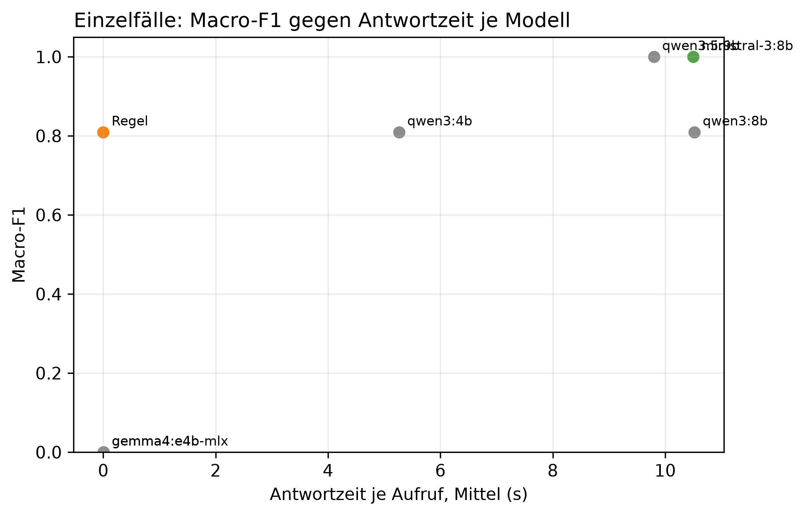

# K2 LLM-Klassifikation und Modellwahl, Läufe k2_003 / k2_seq_003

## Setup

- Läufe (Ebene 1 / Ebene 2): k2_003 / k2_seq_003
- Prompt (Ebene 1 / Ebene 2): v30 / v30
- Modelle: MDL0 qwen3:4b, MDL1 qwen3:8b, MDL2 qwen3.5:9b, MDL3 gemma4:e4b, MDL4 gemma4:e4b-mlx, MDL5 ministral-3:8b
- LLM: temperature 0,0, höchstens 2 Versuche je Aufruf
- Ebene 1: 10 synthetische Fälle, je Modell 1 Aufruf je Fall, Regel (BASELINE) läuft mit
- Ebene 2: Standard-Szenarien, Cutover CO2 (2015-02-12), 40 Tage davor, 60 danach, jedes Modell als eigener Kreislauf wie SYS3 mit Adaption
- Ereignisse Ebene 2: control = keine Änderung, scaled_strong = Sprung +30 %, peak_strong = Spitze +1000 W über 6 h
- Produktivmodell SYS3: ministral-3:8b
- Commit (Ebene 1 / Ebene 2): a46b8ad / 9c0e1d6
- Textprüfung: 9 Steuerungswörter, Zahlentoleranz 0,5, gerundet auf 10 erlaubt, Fensterzahlen aus dem Prompt 7, 28

## Kennzahlen

| Kennzahl | Wert | Bezug |
|---|---|---|
| Ebene 1: bestes Modell nach Macro-F1 | qwen3.5:9b | Macro-F1 1,00, Regel 0,81 |
| ministral-3:8b: Ebene 1 richtig | 10/10 | Regel 9/10 |
| ministral-3:8b: Antwortzeit je Aufruf im Mittel [s] | 10,5 | p95 18,7 s, Regel 0,0 s |
| ministral-3:8b: Ebene 2 Ereignis-Arten erkannt | 1/2 | Regel 1/2 |
| ministral-3:8b: Ebene 2 Tage mit anderer Klasse als die Regel | 4 | 2015-04-07 new_pattern statt normal; 2015-04-08 peak statt normal; 2015-04-09 peak statt normal; 2015-04-09 new_pattern statt normal; 2015-04-10 peak statt normal |
| ministral-3:8b: ungültige Antworten Ebene 1 | 0 | Ausfalltage Ebene 2: 0 |
| ministral-3:8b: Antworten mit Textverstoß (Ebene 1 / Ebene 2) | 1/10 / 0/105 | Steuerung oder Zahl, Datum, Uhrzeit nicht im State |
| ministral-3:8b: Antworten mit fehlenden Belegen (Ebene 1 / Ebene 2) | 1/10 / 0/105 | zitierte Belege passen nicht zur eigenen Klasse |

## Ebene 1: Modellvergleich auf den Einzelfällen

| ID | Modell | richtig | Macro-F1 | ungültig | Ø Versuche | Grounding | Ø s je Aufruf | p95 s |
|---|---|---|---:|---:|---:|---:|---:|---:|
| MDL2 | qwen3.5:9b | 10/10 | 1,0 | 0 | 1,0 | 0,8 | 9,8 | 17,3 |
| MDL5 | ministral-3:8b | 10/10 | 1,0 | 0 | 1,0 | 0,9 | 10,5 | 18,7 |
| BASELINE | Regel | 9/10 | 0,8 | 0 | 1,0 | - | 0,0 | 0,0 |
| MDL0 | qwen3:4b | 9/10 | 0,8 | 0 | 1,0 | 0,8 | 5,3 | 9,4 |
| MDL1 | qwen3:8b | 9/10 | 0,8 | 0 | 1,0 | 0,9 | 10,5 | 17,8 |
| MDL3 | gemma4:e4b | 0/10 | 0,0 | 10 | 2,0 | - | 0,0 | 0,0 |
| MDL4 | gemma4:e4b-mlx | 0/10 | 0,0 | 10 | 2,0 | - | 0,0 | 0,0 |

## Ebene 1: Antwort je Fall (✓ = richtig, sonst die Antwort, - = ungültig)

| Fall | erwartet | qwen3.5:9b | ministral-3:8b | Regel | qwen3:4b | qwen3:8b | gemma4:e4b | gemma4:e4b-mlx |
|---|---|---|---|---|---|---|---|---|
| absence_drift_down | absence | ✓ | ✓ | new_pattern | new_pattern | new_pattern | - | - |
| low_single_scale | low | ✓ | ✓ | ✓ | ✓ | ✓ | - | - |
| measurement_error_missing_day | measurement_error | ✓ | ✓ | ✓ | ✓ | ✓ | - | - |
| new_pattern | new_pattern | ✓ | ✓ | ✓ | ✓ | ✓ | - | - |
| new_pattern_at_min_scales_boundary | new_pattern | ✓ | ✓ | ✓ | ✓ | ✓ | - | - |
| new_pattern_drift_down | new_pattern | ✓ | ✓ | ✓ | ✓ | ✓ | - | - |
| normal_single_sustained_scale | normal | ✓ | ✓ | ✓ | ✓ | ✓ | - | - |
| normal_weekly_after_reset | normal | ✓ | ✓ | ✓ | ✓ | ✓ | - | - |
| peak | peak | ✓ | ✓ | ✓ | ✓ | ✓ | - | - |
| peak_single_sustained_scale | peak | ✓ | ✓ | ✓ | ✓ | ✓ | - | - |

## Automatische Textprüfung je Modell (Antworten mit Verstoß oder fehlenden Belegen)

| Modell | E1 Antworten | E1 mit Verstoß | E1 Belege fehlen | E2 Antworten | E2 mit Verstoß | E2 Belege fehlen |
|---|---:|---:|---:|---:|---:|---:|
| qwen3.5:9b | 10 | 2 | 1 | 74 | 0 | 0 |
| ministral-3:8b | 10 | 1 | 1 | 105 | 0 | 0 |
| qwen3:4b | 10 | 0 | 4 | 110 | 4 | 43 |
| qwen3:8b | 10 | 0 | 0 | 110 | 2 | 0 |
| gemma4:e4b | 0 | 0 | 0 | 110 | 2 | 0 |
| gemma4:e4b-mlx | 0 | 0 | 0 | 115 | 3 | 4 |

## Ebene 2: je Modell über alle Ereignis-Arten

| Modell | Ereignis-Arten erkannt | Tage anders als die Regel | Gate-Tage | Ausfalltage | Meldungen Kontrolle | unknown Kontrolle | Resets Kontrolle |
|---|---|---:|---:|---:|---:|---:|---:|
| qwen3.5:9b | 2/2 | 15 | 74 | 0 | 11 | 0 | 5 |
| ministral-3:8b | 1/2 | 4 | 105 | 0 | 3 | 0 | 1 |
| Regel | 1/2 | 0 | 110 | 0 | 0 | 0 | 0 |
| qwen3:4b | 1/2 | 6 | 110 | 0 | 0 | 0 | 0 |
| qwen3:8b | 1/2 | 13 | 110 | 0 | 0 | 0 | 0 |
| gemma4:e4b | 1/2 | 5 | 110 | 0 | 0 | 0 | 0 |
| gemma4:e4b-mlx | 1/2 | 13 | 115 | 0 | 1 | 0 | 1 |

## Ebene 2: Erkennung je Ereignis, Tag seit Cutover

| config | Ereignis | erwartet | Gate-Tage durch das Ereignis | davon richtig | erster richtiger Tag | Resets |
|---|---|---|---:|---:|---:|---:|
| BASELINE | Spitze +1000 W über 6 h | peak | 2 | 1 | 1 | 0 |
| BASELINE | Sprung +30 % | new_pattern | 6 | 0 | - | 1 |
| MDL0 | Spitze +1000 W über 6 h | peak | 2 | 1 | 1 | 0 |
| MDL0 | Sprung +30 % | new_pattern | 6 | 0 | - | 1 |
| MDL1 | Spitze +1000 W über 6 h | peak | 2 | 1 | 1 | 0 |
| MDL1 | Sprung +30 % | new_pattern | 6 | 0 | - | 1 |
| MDL2 | Spitze +1000 W über 6 h | peak | 3 | 1 | 1 | 2 |
| MDL2 | Sprung +30 % | new_pattern | 1 | 1 | 6 | 3 |
| MDL3 | Spitze +1000 W über 6 h | peak | 2 | 1 | 1 | 0 |
| MDL3 | Sprung +30 % | new_pattern | 6 | 0 | - | 1 |
| MDL4 | Spitze +1000 W über 6 h | peak | 5 | 1 | 1 | 0 |
| MDL4 | Sprung +30 % | new_pattern | 1 | 0 | - | 1 |
| MDL5 | Spitze +1000 W über 6 h | peak | 5 | 1 | 1 | 0 |
| MDL5 | Sprung +30 % | new_pattern | 7 | 0 | - | 2 |

## Ebene 2: Tage, an denen ein Modell anders einordnet als die Regel

| Modell | analysierter Tag | Regel | Modell sagt | in Arten |
|---|---|---|---|---|
| qwen3:4b | 2015-01-21 | normal | low | control, scaled_strong, peak_strong |
| qwen3:4b | 2015-01-22 | normal | low | control, scaled_strong, peak_strong |
| qwen3:4b | 2015-01-26 | normal | low | control, scaled_strong, peak_strong |
| qwen3:4b | 2015-01-27 | normal | low | control, scaled_strong, peak_strong |
| qwen3:4b | 2015-02-20 | normal | low | control, peak_strong |
| qwen3:4b | 2015-04-09 | normal | low | peak_strong |
| qwen3:8b | 2015-01-19 | normal | low | control, scaled_strong, peak_strong |
| qwen3:8b | 2015-01-21 | normal | low | control, scaled_strong, peak_strong |
| qwen3:8b | 2015-01-22 | normal | low | control, scaled_strong, peak_strong |
| qwen3:8b | 2015-01-26 | normal | low | control, scaled_strong, peak_strong |
| qwen3:8b | 2015-01-27 | normal | low | control, scaled_strong, peak_strong |
| qwen3:8b | 2015-02-20 | normal | low | control, peak_strong |
| qwen3:8b | 2015-02-25 | normal | low | control, peak_strong |
| qwen3:8b | 2015-03-19 | normal | low | scaled_strong |
| qwen3:8b | 2015-03-20 | normal | low | scaled_strong |
| qwen3:8b | 2015-04-07 | normal | low | control, peak_strong |
| qwen3:8b | 2015-04-08 | normal | low | scaled_strong |
| qwen3:8b | 2015-04-09 | normal | low | control, scaled_strong, peak_strong |
| qwen3:8b | 2015-04-12 | normal | low | control, scaled_strong |
| qwen3.5:9b | 2015-01-07 | normal | peak | control, scaled_strong, peak_strong |
| qwen3.5:9b | 2015-01-08 | normal | peak | control, scaled_strong, peak_strong |
| qwen3.5:9b | 2015-01-21 | normal | new_pattern | control, scaled_strong, peak_strong |
| qwen3.5:9b | 2015-02-03 | normal | new_pattern | control, scaled_strong, peak_strong |
| qwen3.5:9b | 2015-02-05 | normal | low | control, scaled_strong, peak_strong |
| qwen3.5:9b | 2015-02-12 | peak | normal | scaled_strong |
| qwen3.5:9b | 2015-02-17 | normal | new_pattern | scaled_strong |
| qwen3.5:9b | 2015-02-20 | normal | new_pattern | control |
| qwen3.5:9b | 2015-02-20 | new_pattern | normal | scaled_strong |
| qwen3.5:9b | 2015-03-17 | normal | peak | control |
| qwen3.5:9b | 2015-03-17 | peak | normal | scaled_strong |
| qwen3.5:9b | 2015-03-19 | normal | new_pattern | control, scaled_strong, peak_strong |
| qwen3.5:9b | 2015-04-06 | low | normal | control, scaled_strong, peak_strong |
| qwen3.5:9b | 2015-04-08 | normal | new_pattern | control, scaled_strong, peak_strong |
| qwen3.5:9b | 2015-04-09 | normal | peak | control, scaled_strong, peak_strong |
| qwen3.5:9b | 2015-04-10 | normal | peak | control, scaled_strong, peak_strong |
| qwen3.5:9b | 2015-04-11 | normal | peak | control, scaled_strong, peak_strong |
| gemma4:e4b | 2015-01-22 | normal | low | control, scaled_strong, peak_strong |
| gemma4:e4b | 2015-02-19 | normal | peak | scaled_strong |
| gemma4:e4b | 2015-03-21 | normal | peak | scaled_strong |
| gemma4:e4b | 2015-04-07 | normal | low | control, peak_strong |
| gemma4:e4b | 2015-04-09 | normal | low | control, scaled_strong, peak_strong |
| gemma4:e4b-mlx | 2015-01-21 | normal | low | control, scaled_strong, peak_strong |
| gemma4:e4b-mlx | 2015-01-22 | normal | low | control, scaled_strong, peak_strong |
| gemma4:e4b-mlx | 2015-01-26 | normal | low | control, scaled_strong, peak_strong |
| gemma4:e4b-mlx | 2015-01-27 | normal | low | control, scaled_strong, peak_strong |
| gemma4:e4b-mlx | 2015-02-20 | normal | low | control, peak_strong |
| gemma4:e4b-mlx | 2015-02-23 | normal | new_pattern | control |
| gemma4:e4b-mlx | 2015-03-19 | normal | low | control |
| gemma4:e4b-mlx | 2015-03-20 | normal | low | control |
| gemma4:e4b-mlx | 2015-03-30 | normal | low | control |
| gemma4:e4b-mlx | 2015-04-07 | normal | low | peak_strong |
| gemma4:e4b-mlx | 2015-04-08 | normal | low | control, scaled_strong |
| gemma4:e4b-mlx | 2015-04-09 | normal | low | control, scaled_strong, peak_strong |
| gemma4:e4b-mlx | 2015-04-12 | normal | low | control, scaled_strong, peak_strong |
| ministral-3:8b | 2015-04-07 | normal | new_pattern | control |
| ministral-3:8b | 2015-04-08 | normal | peak | control |
| ministral-3:8b | 2015-04-09 | normal | peak | control |
| ministral-3:8b | 2015-04-09 | normal | new_pattern | scaled_strong |
| ministral-3:8b | 2015-04-10 | normal | peak | scaled_strong |

## Hinweise

- Ebene 1 prüft, ob ein Modell die Regeln aus dem Prompt nachvollzieht. Der Prompt wurde auf denselben Fällen verbessert, die Quoten begründen deshalb nur die Modellwahl und belegen nicht das Ziel von 80 % richtiger Klassen (dafür E3)
- wenige Fälle: ein Fall sind mehrere Prozentpunkte, eine Klasse hängt teils an einem einzigen Fall
- Macro-F1: Mittel der F1-Werte über die Klassen, die als erwartete Klasse vorkommen
- Grounding: Anteil der für den Fall erwarteten Felder, die das Modell als Beleg zitiert. Die Regel zitiert keine
- Tag seit Cutover = Entscheidungstag: an Tag n meldet das System, eingeordnet ist dabei Tag n-1. Ab Cutover zählt deshalb erst ab Tag 1
- Ebene 2, erkannt: erwartete Klasse an einem Tag, an dem nur das Ereignis das Gate öffnet (gepaart mit dem Kontrolllauf desselben Modells)
- Ebene 2, anders als die Regel: gleiche Art und gleicher analysierter Tag, Regel gegen Modell. Nach einem Reset an verschiedenen Tagen laufen die Reihen auseinander, spätere Abweichungen können daraus folgen
- Antwortzeit: gemessen auf dem Rechner des Laufs, nur zum Vergleich der Modelle untereinander
- Textprüfung: Verstoß heißt, ein Steuerungswort oder eine Zahl, ein Datum oder eine Uhrzeit steht im Text, aber nicht im State des Falls. Zahlwörter („sechs Wochen“) findet sie nicht. Die Fensterlängen 7 und 28 aus der Skalenbeschreibung im Prompt gelten als erlaubt
- Fehlende Belege: der Prompt verlangt je Klasse bestimmte Pfade (new_pattern: sustained_drift, Streaks, peak/low: level, direction, absence: level, Kalendereintrag, measurement_error: Flag). Geprüft wird gegen die eigene Klasse des Modells, nicht gegen die erwartete. Ebene 1 wird nur für Läufe geprüft, die den State der Fälle in der Antwortdatei speichern, ältere Läufe haben in der Tabelle 0 Antworten
- Antworttexte und Auffälligkeiten der Textprüfung im Anhang, Antworten für alle Modelle in Ebene 1 und Ebene 2. Als CSV: answers_single.csv für Ebene 1, answers_sequence.csv für Ebene 2 nur vom Produktivmodell, result_text_findings.csv für die Auffälligkeiten

## Anhang

### Ebene 1: Precision, Recall und F1 je Klasse

| Modell | Klasse | Precision | Recall | F1 |
|---|---|---:|---:|---:|
| Regel | absence | 0,0 | 0,0 | 0,0 |
| Regel | low | 1,0 | 1,0 | 1,0 |
| Regel | measurement_error | 1,0 | 1,0 | 1,0 |
| Regel | new_pattern | 0,8 | 1,0 | 0,9 |
| Regel | normal | 1,0 | 1,0 | 1,0 |
| Regel | peak | 1,0 | 1,0 | 1,0 |
| qwen3:4b | absence | 0,0 | 0,0 | 0,0 |
| qwen3:4b | low | 1,0 | 1,0 | 1,0 |
| qwen3:4b | measurement_error | 1,0 | 1,0 | 1,0 |
| qwen3:4b | new_pattern | 0,8 | 1,0 | 0,9 |
| qwen3:4b | normal | 1,0 | 1,0 | 1,0 |
| qwen3:4b | peak | 1,0 | 1,0 | 1,0 |
| qwen3:8b | absence | 0,0 | 0,0 | 0,0 |
| qwen3:8b | low | 1,0 | 1,0 | 1,0 |
| qwen3:8b | measurement_error | 1,0 | 1,0 | 1,0 |
| qwen3:8b | new_pattern | 0,8 | 1,0 | 0,9 |
| qwen3:8b | normal | 1,0 | 1,0 | 1,0 |
| qwen3:8b | peak | 1,0 | 1,0 | 1,0 |
| qwen3.5:9b | absence | 1,0 | 1,0 | 1,0 |
| qwen3.5:9b | low | 1,0 | 1,0 | 1,0 |
| qwen3.5:9b | measurement_error | 1,0 | 1,0 | 1,0 |
| qwen3.5:9b | new_pattern | 1,0 | 1,0 | 1,0 |
| qwen3.5:9b | normal | 1,0 | 1,0 | 1,0 |
| qwen3.5:9b | peak | 1,0 | 1,0 | 1,0 |
| gemma4:e4b | absence | 0,0 | 0,0 | 0,0 |
| gemma4:e4b | low | 0,0 | 0,0 | 0,0 |
| gemma4:e4b | measurement_error | 0,0 | 0,0 | 0,0 |
| gemma4:e4b | new_pattern | 0,0 | 0,0 | 0,0 |
| gemma4:e4b | normal | 0,0 | 0,0 | 0,0 |
| gemma4:e4b | peak | 0,0 | 0,0 | 0,0 |
| gemma4:e4b-mlx | absence | 0,0 | 0,0 | 0,0 |
| gemma4:e4b-mlx | low | 0,0 | 0,0 | 0,0 |
| gemma4:e4b-mlx | measurement_error | 0,0 | 0,0 | 0,0 |
| gemma4:e4b-mlx | new_pattern | 0,0 | 0,0 | 0,0 |
| gemma4:e4b-mlx | normal | 0,0 | 0,0 | 0,0 |
| gemma4:e4b-mlx | peak | 0,0 | 0,0 | 0,0 |
| ministral-3:8b | absence | 1,0 | 1,0 | 1,0 |
| ministral-3:8b | low | 1,0 | 1,0 | 1,0 |
| ministral-3:8b | measurement_error | 1,0 | 1,0 | 1,0 |
| ministral-3:8b | new_pattern | 1,0 | 1,0 | 1,0 |
| ministral-3:8b | normal | 1,0 | 1,0 | 1,0 |
| ministral-3:8b | peak | 1,0 | 1,0 | 1,0 |

### Ebene 1: Antworten der Modelle je Fall

**peak** (erwartet: peak)

- qwen3.5:9b: peak ✓
  - Erklärung: Gestern war der Stromverbrauch ungewöhnlich hoch, etwa 45 % mehr als sonst an diesem Wochentag.
  - Empfehlung: Überprüfen Sie, ob gestern besondere Aktivitäten wie ein langes Wochenende oder eine Party stattgefunden haben.
  - Unsicherheit: Die Bewertung hängt davon ab, ob der hohe Verbrauch durch einen einmaligen Ereignis oder eine dauerhafte Änderung verursacht wurde.
- ministral-3:8b: peak ✓
  - Erklärung: Gestern war der Stromverbrauch um etwa 45 % höher als an einem normalen Wochentag. Das ist ungewöhnlich für diesen Tag.
  - Empfehlung: Überprüfen Sie, ob gestern ungewöhnliche Geräte oder Aktivitäten den Verbrauch erhöht haben könnten.
  - Unsicherheit: Ob der erhöhte Verbrauch auf eine geplante Aktivität zurückzuführen ist, hängt davon ab, was in Ihrem Haushalt am 15. Dezember stattgefunden hat.
- qwen3:4b: peak ✓
  - Erklärung: Gestern war die Stromverbrauch höher als normal, um etwa 45 % mehr als gewöhnlich.
  - Empfehlung: Überprüfen Sie, ob es heute Abend oder morgen früh einen besonders hohen Stromverbrauch gab, z. B. durch Heizung oder Geräte.
  - Unsicherheit: Keine zusätzlichen Informationen zur Zeit des Verbrauchs verfügbar.
- qwen3:8b: peak ✓
  - Erklärung: Gestern war der Stromverbrauch deutlich höher als üblich für einen Dienstag, um 45 % über dem Normalwert. Der Verbrauch war insgesamt gestiegen, aber nicht während des Tages stark schwankend.
  - Empfehlung: Überprüfen Sie, ob in der Wohnung etwas laufend war oder ob Geräte vergessen wurden. Falls nichts auffällt, ist es wahrscheinlich ein Zufall.
  - Unsicherheit: Die Verbrauchssteigerung könnte auf eine kurzfristige Nutzung von elektrischen Geräten zurückgehen, die nicht in den Kalender eingetragen ist.
- gemma4:e4b: ungültig (LLM returned no valid output after 2 attempt(s).)
- gemma4:e4b-mlx: ungültig (LLM returned no valid output after 2 attempt(s).)

**new_pattern** (erwartet: new_pattern)

- qwen3.5:9b: new_pattern ✓
  - Erklärung: Der Stromverbrauch war gestern ungewöhnlich hoch und ist seit dem 9. Dezember auf einem neuen, höheren Niveau gestiegen.
  - Empfehlung: Bitte prüfen Sie, ob sich im Haushalt etwas geändert hat, zum Beispiel durch längeres Verweilen zu Hause oder das Einschalten neuer Geräte.
  - Unsicherheit: Die Bewertung könnte sich ändern, wenn der hohe Verbrauch nur vorübergehend war und nicht über mehrere Wochen anhält.
- ministral-3:8b: new_pattern ✓
  - Erklärung: Gestern war der Stromverbrauch um etwa 38 % höher als an einem normalen Wochentag. Seit dem 9. Dezember liegt die Verbrauchsmenge über den üblichen Werten und hat sich seitdem nicht mehr normalisiert.
  - Empfehlung: Überprüfen Sie, ob sich der Stromverbrauch in den letzten Wochen durch neue Geräte oder längere Nutzung von Elektrogeräten erhöht hat. Ein Vergleich mit dem Verbrauch vor Weihnachten könnte helfen.
  - Unsicherheit: Ob die erhöhte Verbrauchsmenge auf eine dauerhafte Veränderung zurückzuführen ist, hängt davon ab, ob sich der Stromverbrauch in den kommenden Tagen wieder normalisiert.
- qwen3:4b: new_pattern ✓
  - Erklärung: Gestern war die Stromverbrauch höher als gewöhnlich, um etwa 38 % mehr.
  - Empfehlung: Überprüfen Sie, ob es in Ihrem Haus eine neue Nutzungsmuster gab, wie zum Beispiel mehr Licht oder Heizung.
  - Unsicherheit: Die genaue Ursache ist nicht bekannt, aber die Stromverbrauch bleibt höher als gewöhnlich.
- qwen3:8b: new_pattern ✓
  - Erklärung: Gestern war der Stromverbrauch deutlich höher als üblich, insbesondere im Vergleich zur letzten Woche und den letzten vier Wochen. Der Verbrauch lag um etwa 36 % über dem üblichen Niveau der letzten Woche und um 22 % über dem üblichen Niveau der letzten vier Wochen.
  - Empfehlung: Überprüfen Sie, ob in der Wohnung etwas verändert wurde, wie z. B. neue Geräte oder eine Änderung im Nutzungsmuster. Falls nichts auffällt, könnte es sich um eine vorübergehende Veränderung handeln.
  - Unsicherheit: Die genaue Ursache für den erhöhten Verbrauch ist nicht bekannt und könnte auf einen temporären Effekt zurückzuführen sein.
- gemma4:e4b: ungültig (LLM returned no valid output after 2 attempt(s).)
- gemma4:e4b-mlx: ungültig (LLM returned no valid output after 2 attempt(s).)

**low_single_scale** (erwartet: low)

- qwen3.5:9b: low ✓
  - Erklärung: Gestern war der Stromverbrauch ungewöhnlich niedrig, etwa 30 % unter dem für diesen Wochentag üblichen Wert.
  - Empfehlung: Überlegen Sie, ob Sie gestern weniger zu Hause waren oder bestimmte Geräte nicht genutzt haben. Wenn dies nicht der Fall ist, prüfen Sie, ob sich Ihre Gewohnheiten in den letzten Tagen geändert haben.
  - Unsicherheit: Die Bewertung könnte sich ändern, wenn ein Kalendereintrag verfügbar wäre, der belegt, dass das Haushalt am gestrigen Tag abwesend war.
- ministral-3:8b: low ✓
  - Erklärung: Gestern war der Stromverbrauch um etwa 30 % niedriger als an einem typischen Wochentag.
  - Empfehlung: Überprüfen Sie, ob gestern ungewöhnlich wenig Strom verbraucht wurde – etwa durch Abwesenheit oder besondere Umstände wie eine längere Reise oder einen Ausfall von Geräten.
  - Unsicherheit: Da keine Kalenderdaten verfügbar sind, kann nicht ausgeschlossen werden, dass ein geplanter Aufenthalt außerhalb des Hauses den Verbrauch beeinflusst hat.
- qwen3:4b: low ✓
  - Erklärung: Gestern haben Sie weniger Strom verbraucht als normal, um etwa 30 %.
  - Empfehlung: Überprüfen Sie, ob es im Haus eine Veränderung gab, wie zum Beispiel ein ausgeschaltetes Gerät oder eine längere Zeit ohne Stromverbrauch.
  - Unsicherheit: Keine Kalenderinformationen verfügbar, um zu bestätigen, ob die geringe Verbrauchsmenge auf einen Urlaub oder eine Feiertag zurückzuführen ist.
- qwen3:8b: low ✓
  - Erklärung: Gestern war der Stromverbrauch um 30 % niedriger als üblich für einen Dienstag. Der Verbrauch war insgesamt niedriger, aber es gab keine Hinweise darauf, dass die Familie abwesend war.
  - Empfehlung: Überprüfen Sie, ob etwas im Haushalt verändert wurde, das den Verbrauch beeinflussen könnte, wie eine fehlende Heizung oder ein abgeschaltetes Gerät.
  - Unsicherheit: Da keine Kalenderinformationen verfügbar waren, können wir nicht bestätigen, ob die Abwesenheit der Familie den Verbrauch erklären würde.
- gemma4:e4b: ungültig (LLM returned no valid output after 2 attempt(s).)
- gemma4:e4b-mlx: ungültig (LLM returned no valid output after 2 attempt(s).)

**peak_single_sustained_scale** (erwartet: peak)

- qwen3.5:9b: peak ✓
  - Erklärung: Gestern war der Stromverbrauch ungewöhnlich hoch, etwa 40 % mehr als sonst an diesem Wochentag.
  - Empfehlung: Überprüfen Sie, ob gestern besondere Aktivitäten wie ein langes Wochenende oder eine Party stattgefunden haben.
  - Unsicherheit: Die Bewertung könnte sich ändern, wenn der Kalender weitere Einträge enthalten würde.
- ministral-3:8b: peak ✓
  - Erklärung: Gestern war der Stromverbrauch für einen Wochentag ungewöhnlich hoch, um etwa 40 % mehr als sonst an einem solchen Tag.
  - Empfehlung: Überprüfen Sie, ob gestern ungewöhnlich viele Geräte gleichzeitig genutzt wurden oder ob es einen Grund für erhöhten Verbrauch gab, z. B. Heizungsprobleme oder längere Nutzung von Elektrogeräten.
  - Unsicherheit: Ob der erhöhte Verbrauch auf eine einmalige Ursache zurückzuführen ist oder länger anhält, hängt davon ab, ob sich die Werte in den nächsten Tagen normalisieren.
- qwen3:4b: peak ✓
  - Erklärung: Gestern war die Stromverbrauch höher als normal, um etwa 40 % mehr als gewöhnlich.
  - Empfehlung: Überprüfen Sie, ob es heute Abend oder morgen früh einen besonders hohen Stromverbrauch gab, z. B. durch Heizung oder Geräte.
  - Unsicherheit: Keine zusätzlichen Informationen zur Zeit des Tages verfügbar.
- qwen3:8b: peak ✓
  - Erklärung: Gestern war der Stromverbrauch höher als üblich, insbesondere im Vergleich zum üblichen Verbrauch an einem Werktag. Der Verbrauch lag um 40 % über dem Erwarteten.
  - Empfehlung: Überprüfen Sie, ob in der Wohnung etwas laufend war oder ob Geräte vergessen wurden. Falls Sie sich ansonsten an Ihre Gewohnheiten erinnern können, können Sie dies auch berücksichtigen.
  - Unsicherheit: Die Verbrauchsdaten sind nicht vollständig überprüft, da die Messung möglicherweise ungenau war.
- gemma4:e4b: ungültig (LLM returned no valid output after 2 attempt(s).)
- gemma4:e4b-mlx: ungültig (LLM returned no valid output after 2 attempt(s).)

**normal_single_sustained_scale** (erwartet: normal)

- qwen3.5:9b: normal ✓
  - Erklärung: Die Stromverbrauchsdaten von gestern sind normal, auch wenn der Verbrauch leicht über dem üblichen Niveau lag.
  - Empfehlung: Es ist nichts zu tun. Der leichte Anstieg entspricht den normalen Schwankungen.
  - Unsicherheit: Die Bewertung könnte sich ändern, wenn der Verbrauch über die nächsten Tage weiterhin deutlich über dem Durchschnitt bleibt.
- ministral-3:8b: normal ✓
  - Erklärung: Gestern war der Stromverbrauch etwas höher als sonst an einem Dienstag, aber nicht ungewöhnlich für die letzten Tage.
  - Empfehlung: Es gibt nichts zu beachten, da der Verbrauch im Rahmen liegt und keine ungewöhnlichen Geräte oder Aktivitäten bekannt sind.
  - Unsicherheit: Ob die leicht erhöhte Nutzung auf eine geplante Aktivität zurückzuführen ist, kann nur durch Rückfrage nach dem Tagesablauf geklärt werden.
- qwen3:4b: normal ✓
  - Erklärung: Gestern war die Stromverbrauch normal, obwohl es einen leichten Anstieg gab.
  - Empfehlung: Keine Handlung erforderlich, da gestern der normale Verbrauch war.
  - Unsicherheit: Keine weiteren Informationen zur Verfügung, um die Verbrauchsänderung zu bestätigen.
- qwen3:8b: normal ✓
  - Erklärung: Gestern war der Stromverbrauch leicht höher als üblich, aber innerhalb des normalen Bereichs. Der Verbrauch lag um 9 % über dem Durchschnitt der letzten Woche.
  - Empfehlung: Da der Verbrauch leicht erhöht war, können Sie prüfen, ob etwas im Haushalt anders lief, wie z. B. eine vergessene Geräte oder ein längerer Aufenthalt zu Hause.
  - Unsicherheit: Die Daten zeigen einen leichten Anstieg, aber es gibt keine Hinweise auf eine signifikante Veränderung.
- gemma4:e4b: ungültig (LLM returned no valid output after 2 attempt(s).)
- gemma4:e4b-mlx: ungültig (LLM returned no valid output after 2 attempt(s).)

**normal_weekly_after_reset** (erwartet: normal)

- qwen3.5:9b: normal ✓
  - Erklärung: Die Analyse zeigt, dass der Stromverbrauch gestern im üblichen Rahmen lag.
  - Empfehlung: Es ist nichts zu tun. Der Verbrauch war normal.
  - Unsicherheit: Die Bewertung stützt sich auf die aktuelle Analyse, da keine Kalenderdaten verfügbar sind.
- ministral-3:8b: normal ✓
  - Erklärung: Gestern war der Stromverbrauch im Vergleich zur Woche etwas niedriger, aber nicht ungewöhnlich für einen einzelnen Tag.
  - Empfehlung: Es gibt nichts Ungewöhnliches zu überprüfen, da der Verbrauch gestern im üblichen Rahmen lag.
  - Unsicherheit: Ob die Kalenderdaten korrekt sind, kann nicht geprüft werden, da keine Kalenderquelle verfügbar war.
- qwen3:4b: normal ✓
  - Erklärung: Gestern war die Stromverbrauch etwas geringer als üblich, aber das liegt nicht an einer Abwesenheit oder einem langfristigen Muster.
  - Empfehlung: Keine Handlung erforderlich, da gestern nur kurz geringer Stromverbrauch war und keine Abwesenheit vorherrschte.
  - Unsicherheit: Keine Abwesenheit im Kalender, aber die Kalendereinträge sind nicht verfügbar.
- qwen3:8b: normal ✓
  - Erklärung: Gestern war der Stromverbrauch leicht niedriger als üblich, aber das ist nicht ungewöhnlich. Der Verbrauch war in der Woche um 32 % höher als im Durchschnitt.
  - Empfehlung: Sie können nichts tun, da der Verbrauch in dieser Woche höher war als üblich und das nicht auf einen Fehler oder eine Abwesenheit hinweist.
  - Unsicherheit: Die Kalenderdaten sind nicht verfügbar, sodass wir nicht prüfen können, ob ein geplanter Ausfall den Verbrauch beeinflusst hat.
- gemma4:e4b: ungültig (LLM returned no valid output after 2 attempt(s).)
- gemma4:e4b-mlx: ungültig (LLM returned no valid output after 2 attempt(s).)

**new_pattern_at_min_scales_boundary** (erwartet: new_pattern)

- qwen3.5:9b: new_pattern ✓
  - Erklärung: Der Stromverbrauch war gestern ungewöhnlich hoch und ist seit dem 10. Dezember auf einem neuen, höheren Niveau gestiegen.
  - Empfehlung: Bitte prüfen Sie, ob sich im Haushalt etwas geändert hat, zum Beispiel durch längeres Verweilen zu Hause oder das Einschalten neuer Geräte.
  - Unsicherheit: Die Bewertung könnte sich ändern, wenn der hohe Verbrauch nur vorübergehend war und nicht über mehrere Wochen anhält.
- ministral-3:8b: new_pattern ✓
  - Erklärung: Gestern war der Stromverbrauch um etwa 35 % höher als an einem normalen Wochentag. Seit dem 10. Dezember liegt die durchschnittliche Verbrauchsmenge über den letzten Wochen und vier Wochen im Vergleich zur üblichen Menge deutlich erhöht.
  - Empfehlung: Überprüfen Sie, ob sich der Stromverbrauch in den letzten Wochen erhöht hat oder ob neue Geräte oder Veränderungen im Haushalt aufgetreten sind.
  - Unsicherheit: Die genaue Ursache für die erhöhte Verbrauchsmenge ist ohne weitere Informationen nicht klar.
- qwen3:4b: new_pattern ✓
  - Erklärung: Gestern war die Stromverbrauch höher als normal, um etwa 35 % mehr als gewöhnlich.
  - Empfehlung: Überprüfen Sie, ob es in Ihrem Haus eine neue Nutzungsmuster gab, wie zum Beispiel mehrere Geräte gleichzeitig eingeschaltet oder eine längere Wärmebedarf.
  - Unsicherheit: Die genaue Ursache ist nicht bekannt, aber die Stromverbrauch bleibt höher als normal.
- qwen3:8b: new_pattern ✓
  - Erklärung: Gestern war der Stromverbrauch deutlich höher als üblich, insbesondere im Vergleich zur letzten Woche und den letzten vier Wochen. Der Verbrauch lag um etwa 30 % über dem üblichen Niveau.
  - Empfehlung: Überprüfen Sie, ob in der Wohnung etwas verändert wurde, wie Geräte oder Heizung. Falls nichts auffällt, könnte es sich um eine neue Norm handeln.
  - Unsicherheit: Die Verbrauchssteigerung könnte auf saisonale Veränderungen im Winter zurückgehen, was die Ursache nicht vollständig erklären kann.
- gemma4:e4b: ungültig (LLM returned no valid output after 2 attempt(s).)
- gemma4:e4b-mlx: ungültig (LLM returned no valid output after 2 attempt(s).)

**measurement_error_missing_day** (erwartet: measurement_error)

- qwen3.5:9b: measurement_error ✓
  - Erklärung: Die Messung für gestern ist nicht vertrauenswürdig, da der Wert unplausibel ist.
  - Empfehlung: Bitte überprüfen Sie die Stromzähleranzeige oder das Messgerät, um sicherzustellen, dass die Werte korrekt erfasst werden.
  - Unsicherheit: Die Zuverlässigkeit der aktuellen Messung ist die einzige Unsicherheit, da keine anderen Daten verfügbar sind.
- ministral-3:8b: measurement_error ✓
  - Erklärung: Der gemessene Wert für gestern ist nicht vertrauenswürdig und kann keine Rückschlüsse auf den Verbrauch zulassen.
  - Empfehlung: Es gibt nichts zu überprüfen, da der Messwert nicht auszuwerten ist. Prüfen Sie ggf. die Funktion des Zählers oder der Messgeräte.
  - Unsicherheit: Ob und wann ein neuer Wert gemessen wird, hängt von der Ursache des Fehlers ab.
- qwen3:4b: measurement_error ✓
  - Erklärung: Gestern ist eine ungültige Messung aufgetreten, daher kann keine Aussage über den Verbrauch getroffen werden.
  - Empfehlung: Es gibt keine zuverlässigen Daten, um etwas zu tun. Bitte prüfen Sie, ob die Messung korrekt war.
  - Unsicherheit: Die Messung ist ungültig, daher kann keine weitere Information ermittelt werden.
- qwen3:8b: measurement_error ✓
  - Erklärung: Die Messung gestern ist nicht zuverlässig, sodass keine Aussage über den Stromverbrauch getroffen werden kann.
  - Empfehlung: Überprüfen Sie die Geräte und Steckdosen, um sicherzustellen, dass nichts ungewöhnlich läuft. Falls Sie den Verbrauch selbst beobachten können, teilen Sie uns dies mit.
  - Unsicherheit: Die genaue Ursache der fehlerhaften Messung ist unbekannt und könnte die Interpretation beeinflussen.
- gemma4:e4b: ungültig (LLM returned no valid output after 2 attempt(s).)
- gemma4:e4b-mlx: ungültig (LLM returned no valid output after 2 attempt(s).)

**new_pattern_drift_down** (erwartet: new_pattern)

- qwen3.5:9b: new_pattern ✓
  - Erklärung: Der Stromverbrauch ist seit dem 9. Dezember deutlich niedriger als sonst, was auf einen neuen Verbrauchsmuster hindeutet.
  - Empfehlung: Bitte prüfen Sie, ob sich im Haushalt etwas geändert hat, zum Beispiel durch weniger Nutzung von Geräten oder eine andere Heizweise.
  - Unsicherheit: Die Bewertung könnte sich ändern, wenn ein Kalendereintrag vorliegt, der besagt, dass das Haus in dieser Zeit nicht bewohnt war.
- ministral-3:8b: new_pattern ✓
  - Erklärung: Gestern war der Stromverbrauch ungewöhnlich niedrig und hat sich seit dem 9. Dezember auf diesem Niveau gehalten. Die letzten vier Wochen zusammen verbrauchten Sie etwa ein Viertel weniger als sonst.
  - Empfehlung: Überprüfen Sie, ob der Stromzähler oder ein Gerät wie ein Heizstab defekt ist, da die Verbrauchswerte seit Wochen ungewöhnlich niedrig sind.
  - Unsicherheit: Ob der Zähler korrekt misst, können Sie nur durch einen Vergleich mit dem letzten bekannten normalen Verbrauch prüfen.
- qwen3:4b: new_pattern ✓
  - Erklärung: Gestern war die Stromverbrauchsdauer etwas höher als gewöhnlich, aber die Abweichung ist seit mehreren Tagen beständig.
  - Empfehlung: Überprüfen Sie, ob es in Ihrem Haus mehr Stromverbrauch durch Heizung oder Beleuchtung gab, da die Abweichung seit einigen Tagen beständig ist.
  - Unsicherheit: Die genaue Ursache der gestrigen höhere Verbrauch bleibt unbekannt.
- qwen3:8b: new_pattern ✓
  - Erklärung: Die Stromverbrauchsmuster der letzten Wochen und Monate zeigen einen deutlichen Rückgang, was auf eine veränderte Nutzung hinweist. Der Verbrauch war gestern niedriger als üblich.
  - Empfehlung: Überprüfen Sie, ob sich etwas in Ihrem Haushalt verändert hat, wie z.B. eine neue Technologie oder ein Verhalten, das den Stromverbrauch beeinflussen könnte.
  - Unsicherheit: Die genaue Ursache des Verbrauchsspiegels ist nicht bekannt und könnte durch externe Faktoren wie Wetter oder Nutzungsmuster beeinflusst sein.
- gemma4:e4b: ungültig (LLM returned no valid output after 2 attempt(s).)
- gemma4:e4b-mlx: ungültig (LLM returned no valid output after 2 attempt(s).)

**absence_drift_down** (erwartet: absence)

- qwen3.5:9b: absence ✓
  - Erklärung: Der Verbrauch war gestern niedriger, da Sie sich im Zeitraum vom 8. bis 22. Dezember nicht in der Wohnung befanden.
  - Empfehlung: Es ist keine Überprüfung nötig, da die Abwesenheit den niedrigen Verbrauch erklärt.
  - Unsicherheit: Die Verfügbarkeit des Kalenders war gegeben.
- ministral-3:8b: absence ✓
  - Erklärung: Gestern war der Stromverbrauch ungewöhnlich niedrig, da Sie im Urlaub waren und die Daten vom 8. bis zum 21. Dezember abgedeckt sind.
  - Empfehlung: Da der Urlaub geplant war, ist nichts weiter zu prüfen. Der Verbrauch wird nach Ihrer Rückkehr wieder steigen.
  - Unsicherheit: Ob die gemessenen Werte während des Urlaubs korrekt sind, kann erst nach Ihrer Rückkehr überprüft werden.
- qwen3:4b: new_pattern
  - Erklärung: Gestern war die Stromverbrauchsdauer etwas höher als gewöhnlich, aber die Abweichung ist seit mehreren Tagen beständig.
  - Empfehlung: Überprüfen Sie, ob es in Ihrem Haus mehr als gewöhnlich viele Geräte gleichzeitig eingeschaltet waren.
  - Unsicherheit: Die Abweichung könnte durch eine längere Heizungsperiode oder weniger Sonnenlicht verursacht sein.
- qwen3:8b: new_pattern
  - Erklärung: Die Stromverbrauchsmuster der letzten Wochen und Monate zeigen einen deutlichen Rückgang, was auf eine veränderte Nutzung hinweist. Der Verbrauch war gestern niedriger als üblich.
  - Empfehlung: Überprüfen Sie, ob sich etwas in Ihrem Haushalt verändert hat, wie z.B. eine neue Technologie oder ein Verhalten, das den Verbrauch beeinflussen könnte.
  - Unsicherheit: Die genaue Ursache des Verbrauchsspiegels ist unbekannt und könnte auf saisonale Veränderungen oder andere Faktoren zurückgehen.
- gemma4:e4b: ungültig (LLM returned no valid output after 2 attempt(s).)
- gemma4:e4b-mlx: ungültig (LLM returned no valid output after 2 attempt(s).)

### Ebene 2: Antworten von qwen3.5:9b, ein Tag mit allen Arten, in denen derselbe Text kam

- 2015-01-02: low (Arten: control, peak_strong, scaled_strong)
  - Erklärung: Gestern war der Stromverbrauch ungewöhnlich niedrig, etwa 62 % unter dem für diesen Wochentag üblichen Wert.
  - Empfehlung: Da kein Kalender verfügbar ist, kann nicht ausgeschlossen werden, dass Sie unterwegs waren. Bitte prüfen Sie, ob dies der Fall war.
  - Unsicherheit: Die Verfügbarkeit des Kalenders wäre entscheidend, um eine Abwesenheit zu bestätigen.
- 2015-01-03: low (Arten: control, peak_strong, scaled_strong)
  - Erklärung: Gestern war der Stromverbrauch ungewöhnlich niedrig, etwa 64 % unter dem für diesen Wochentag üblichen Wert.
  - Empfehlung: Da kein Kalender verfügbar ist, kann nicht ausgeschlossen werden, dass Sie unterwegs waren. Prüfen Sie, ob dies der Fall war.
  - Unsicherheit: Die Verfügbarkeit eines Kalenders wäre entscheidend, um eine Abwesenheit zu bestätigen.
- 2015-01-04: low (Arten: control, peak_strong, scaled_strong)
  - Erklärung: Gestern war der Stromverbrauch ungewöhnlich niedrig, etwa 53 % unter dem für diesen Wochentag üblichen Wert.
  - Empfehlung: Da kein Kalender verfügbar ist, kann nicht ausgeschlossen werden, dass Sie unterwegs waren. Bitte prüfen Sie, ob dies der Fall war.
  - Unsicherheit: Die Verfügbarkeit eines Kalenders wäre entscheidend, um eine Abwesenheit zu bestätigen.
- 2015-01-07: peak (Arten: control, peak_strong, scaled_strong)
  - Erklärung: Gestern war der Stromverbrauch ungewöhnlich hoch, etwa 37 % mehr als sonst an einem Wochentag.
  - Empfehlung: Bitte prüfen Sie, ob gestern besondere Aktivitäten stattgefunden haben, die den Verbrauch erhöht haben könnten.
  - Unsicherheit: Die Bewertung könnte sich ändern, wenn der Kalender verfügbar wäre und eine Abwesenheit bestätigen würde.
- 2015-01-08: peak (Arten: control, peak_strong, scaled_strong)
  - Erklärung: Gestern war der Stromverbrauch ungewöhnlich hoch, etwa 34 % mehr als für diesen Wochentag üblich.
  - Empfehlung: Bitte prüfen Sie, ob gestern besondere Aktivitäten stattgefunden haben, die den Verbrauch erhöht haben könnten.
  - Unsicherheit: Die Bewertung könnte sich ändern, wenn der Kalender verfügbar wäre und eine Abwesenheit bestätigen würde.
- 2015-01-19: normal (Arten: control, peak_strong, scaled_strong)
  - Erklärung: Die Stromverbrauchsdaten von gestern sind normal, auch wenn die Werte im Vergleich zum langfristigen Durchschnitt leicht niedriger liegen.
  - Empfehlung: Es ist nichts zu tun. Die niedrigeren Werte sind eine normale Schwankung und kein Grund zur Sorge.
  - Unsicherheit: Die Kalenderdaten waren nicht verfügbar, sodass keine geplanten Abwesenheiten geprüft werden konnten.
- 2015-01-20: normal (Arten: control, peak_strong, scaled_strong)
  - Erklärung: Die Analyse zeigt, dass der Stromverbrauch gestern im üblichen Rahmen lag.
  - Empfehlung: Es ist nichts zu tun. Der Verbrauch entspricht dem gewohnten Muster.
  - Unsicherheit: Die Bewertung stützt sich auf die verfügbaren Messwerte, da keine Kalenderdaten vorliegen.
- 2015-01-21: new_pattern (Arten: control, peak_strong, scaled_strong)
  - Erklärung: Der Stromverbrauch ist seit dem 14. Januar deutlich niedriger als sonst, was auf einen neuen Verbrauchsmuster hindeutet.
  - Empfehlung: Bitte prüfen Sie, ob in Ihrem Haushalt ungewöhnliche Sparmaßnahmen getroffen wurden oder wenn Geräte länger ausgeschaltet bleiben.
  - Unsicherheit: Die Bewertung könnte sich ändern, sobald der Kalender verfügbar wird und eine Abwesenheit bestätigt werden kann.
- 2015-02-03: new_pattern (Arten: control, peak_strong, scaled_strong)
  - Erklärung: Der Stromverbrauch war in der vergangenen Woche deutlich höher als sonst, was auf einen neuen Verbrauchsmuster hindeutet.
  - Empfehlung: Bitte prüfen Sie, ob sich Ihre Gewohnheiten in den letzten Tagen geändert haben oder wenn Geräte länger laufen als üblich.
  - Unsicherheit: Die Bewertung könnte sich ändern, sobald der Kalender verfügbar wird und eine Abwesenheit bestätigt werden kann.
- 2015-02-05: low (Arten: control, peak_strong, scaled_strong)
  - Erklärung: Gestern war der Stromverbrauch ungewöhnlich niedrig.
  - Empfehlung: Da keine Kalenderdaten verfügbar sind, kann nicht ausgeschlossen werden, dass Sie unterwegs waren. Bitte prüfen Sie, ob dies der Fall war.
  - Unsicherheit: Die Verfügbarkeit von Kalendereinträgen wäre entscheidend für die Einordnung des niedrigen Verbrauchs.
- 2015-02-12: peak (Arten: peak_strong)
  - Erklärung: Gestern war der Stromverbrauch ungewöhnlich hoch.
  - Empfehlung: Bitte prüfen Sie, ob gestern besondere Aktivitäten stattgefunden haben, die den Verbrauch erhöht haben könnten.
  - Unsicherheit: Die Kalenderdaten waren nicht verfügbar.
- 2015-02-17: new_pattern (Arten: scaled_strong)
  - Erklärung: Der Stromverbrauch ist seit dem 12. Februar ungewöhnlich niedrig geblieben.
  - Empfehlung: Da keine Kalenderdaten verfügbar sind, kann nicht ausgeschlossen werden, dass Sie unterwegs waren. Prüfen Sie, ob dies der Fall ist.
  - Unsicherheit: Die Verfügbarkeit von Kalendereinträgen wäre entscheidend, um eine Abwesenheit zu bestätigen.
- 2015-02-18: normal (Arten: peak_strong)
  - Erklärung: Die Analyse zeigt, dass der Stromverbrauch gestern im üblichen Rahmen lag.
  - Empfehlung: Es ist nichts zu tun. Der Verbrauch entspricht dem gewohnten Muster.
  - Unsicherheit: Da keine Kalenderdaten verfügbar sind, können geplante Abwesenheiten nicht überprüft werden.
- 2015-02-19: normal (Arten: control)
  - Erklärung: Die Stromverbrauchsdaten von gestern sind normal, auch wenn der Verbrauch leicht unter dem üblichen Niveau lag.
  - Empfehlung: Es ist nichts zu tun. Der leicht reduzierte Verbrauch wird durch die fehlenden Kalenderdaten nicht als Abwesenheit bestätigt, bleibt aber im Rahmen des Normalbereichs.
  - Unsicherheit: Die Bewertung könnte sich ändern, wenn ein Kalendereintrag verfügbar wäre, der belegt, dass das Haus in dieser Zeit nicht besetzt war.
- 2015-02-20: new_pattern (Arten: control)
  - Erklärung: Der Stromverbrauch war in der vergangenen Woche insgesamt etwa 13 % niedriger als üblich und diese Abweichung hält seit dem 14. Februar an.
  - Empfehlung: Da der Kalender nicht verfügbar ist, kann ich nicht prüfen, ob Sie unterwegs waren. Bitte überprüfen Sie, ob die niedrigen Werte durch eine längere Abwesenheit oder andere Veränderungen im Haushalt erklärt werden können.
  - Unsicherheit: Die Verfügbarkeit des Kalenders wäre entscheidend, um zu klären, ob die reduzierte Nutzung auf eine geplante Abwesenheit zurückzuführen ist.
- 2015-03-14: low (Arten: control)
  - Erklärung: Gestern war der Stromverbrauch ungewöhnlich niedrig, etwa 48 % unter dem für diesen Wochentag üblichen Wert.
  - Empfehlung: Da keine Kalenderdaten verfügbar sind, kann nicht ausgeschlossen werden, dass Sie unterwegs waren. Bitte prüfen Sie, ob dies der Fall war.
  - Unsicherheit: Die Verfügbarkeit von Kalendereinträgen wäre entscheidend, um eine Abwesenheit zu bestätigen.
- 2015-03-14: low (Arten: peak_strong)
  - Erklärung: Gestern war der Stromverbrauch ungewöhnlich niedrig, etwa 50 % unter dem für diesen Wochentag üblichen Wert.
  - Empfehlung: Da keine Kalenderdaten verfügbar sind, kann nicht ausgeschlossen werden, dass Sie unterwegs waren. Bitte prüfen Sie, ob dies der Fall war.
  - Unsicherheit: Die Verfügbarkeit von Kalendereinträgen wäre entscheidend, um eine Abwesenheit zu bestätigen.
- 2015-03-14: low (Arten: scaled_strong)
  - Erklärung: Gestern war der Stromverbrauch ungewöhnlich niedrig, etwa 48 % unter dem für diesen Wochentag üblichen Wert.
  - Empfehlung: Da wir keine Kalenderdaten haben, können wir nicht prüfen, ob Sie unterwegs waren. Bitte überprüfen Sie, ob die Familie den ganzen Tag über abwesend war.
  - Unsicherheit: Die Verfügbarkeit eines Kalenders wäre entscheidend, um eine Abwesenheit als Ursache auszuschließen.
- 2015-03-15: low (Arten: control, peak_strong, scaled_strong)
  - Erklärung: Gestern war der Stromverbrauch ungewöhnlich niedrig, etwa 65 % unter dem für diesen Wochentag üblichen Wert.
  - Empfehlung: Da keine Kalenderdaten verfügbar sind, kann nicht ausgeschlossen werden, dass Sie unterwegs waren. Bitte prüfen Sie, ob dies der Fall war.
  - Unsicherheit: Die Verfügbarkeit von Kalendereinträgen wäre entscheidend, um eine Abwesenheit zu bestätigen.
- 2015-03-16: normal (Arten: peak_strong)
  - Erklärung: Die Analyse zeigt, dass der Stromverbrauch gestern im üblichen Rahmen lag.
  - Empfehlung: Es ist nichts zu tun. Der Verbrauch war normal.
  - Unsicherheit: Die Kalenderdaten waren nicht verfügbar, was eine Überprüfung durch den Haushalt unmöglich macht.
- 2015-03-17: peak (Arten: control)
  - Erklärung: Gestern war der Stromverbrauch ungewöhnlich hoch, etwa 35 % mehr als für diesen Wochentag üblich.
  - Empfehlung: Überprüfen Sie, ob gestern besondere Aktivitäten wie ein langes Wochenende oder eine Party stattgefunden haben.
  - Unsicherheit: Ohne Kalender können wir nicht ausschließen, dass die Abwesenheit des Haushalts den Verbrauch beeinflusst hat.
- 2015-03-17: normal (Arten: peak_strong)
  - Erklärung: Die Analyse zeigt, dass der Stromverbrauch gestern im üblichen Rahmen lag.
  - Empfehlung: Es ist nichts zu tun. Der Verbrauch war normal.
  - Unsicherheit: Die Kalenderdaten waren nicht verfügbar, was eine Überprüfung von Abwesenheiten verhindert.
- 2015-03-18: normal (Arten: control, peak_strong, scaled_strong)
  - Erklärung: Die Analyse zeigt, dass der Stromverbrauch gestern im üblichen Rahmen lag.
  - Empfehlung: Es ist nichts zu tun. Der Verbrauch war normal.
  - Unsicherheit: Die Kalenderdaten waren nicht verfügbar, was eine Überprüfung durch den Haushalt unmöglich macht.
- 2015-03-19: new_pattern (Arten: control)
  - Erklärung: Der Stromverbrauch ist seit dem 12. März niedriger als üblich und hat sich über die letzte Woche hinweg stabilisiert.
  - Empfehlung: Bitte prüfen Sie, ob sich Ihre Gewohnheiten in den letzten Tagen geändert haben oder wenn ein Gerät weniger genutzt wurde.
  - Unsicherheit: Die Bewertung könnte sich ändern, sobald der Kalender verfügbar wird und eine Abwesenheit bestätigt werden kann.
- 2015-03-19: new_pattern (Arten: peak_strong)
  - Erklärung: Der Stromverbrauch ist seit dem 9. März niedriger als üblich und hat sich über die letzte Woche hinweg so gehalten.
  - Empfehlung: Bitte prüfen Sie, ob in Ihrem Haushalt kürzlich Geräte ausgetauscht wurden oder wenn die Nutzung von Geräten wie Heizung oder Beleuchtung sich verändert hat.
  - Unsicherheit: Die Bewertung könnte sich ändern, sobald der Kalender verfügbar wird und eine Abwesenheit bestätigt werden kann.
- 2015-03-19: new_pattern (Arten: scaled_strong)
  - Erklärung: Der Stromverbrauch ist seit dem 12. März ungewöhnlich niedrig geblieben und hat sich auf einem neuen, niedrigeren Niveau eingependelt.
  - Empfehlung: Bitte prüfen Sie, ob sich Ihre Gewohnheiten oder der Heizbedarf in den letzten Tagen verändert haben.
  - Unsicherheit: Die Bewertung könnte sich ändern, wenn ein Kalendereintrag verfügbar wäre, der eine Abwesenheit bestätigt.
- 2015-04-02: low (Arten: control, peak_strong, scaled_strong)
  - Erklärung: Gestern war der Stromverbrauch ungewöhnlich niedrig, etwa sieben Prozent unter dem für diesen Wochentag üblichen Wert.
  - Empfehlung: Da keine Kalenderdaten verfügbar sind, kann nicht ausgeschlossen werden, dass Sie unterwegs waren. Bitte prüfen Sie, ob dies der Fall war.
  - Unsicherheit: Die Verfügbarkeit von Kalendereinträgen wäre entscheidend, um eine Abwesenheit zu bestätigen.
- 2015-04-03: low (Arten: control, peak_strong, scaled_strong)
  - Erklärung: Gestern war der Stromverbrauch ungewöhnlich niedrig, etwa 17 % unter dem für diesen Wochentag üblichen Wert.
  - Empfehlung: Da keine Kalenderdaten verfügbar sind, kann nicht ausgeschlossen werden, dass Sie unterwegs waren. Bitte prüfen Sie, ob dies der Fall war.
  - Unsicherheit: Die Verfügbarkeit von Kalendereinträgen wäre entscheidend, um eine Abwesenheit zu bestätigen.
- 2015-04-04: low (Arten: control, peak_strong)
  - Erklärung: Gestern war der Stromverbrauch ungewöhnlich niedrig, etwa 28 % unter dem für diesen Wochentag üblichen Wert.
  - Empfehlung: Da keine Kalenderdaten verfügbar sind, kann nicht ausgeschlossen werden, dass Sie abwesend waren. Bitte prüfen Sie, ob dies der Fall war.
  - Unsicherheit: Die Verfügbarkeit von Kalendereinträgen wäre entscheidend, um eine Abwesenheit zu bestätigen.
- 2015-04-04: low (Arten: scaled_strong)
  - Erklärung: Die Stromverbrauchsdaten von gestern zeigen eine ungewöhnlich niedrige Leistung, die etwa 28 % unter dem üblichen Wert für diese Wochentage liegt.
  - Empfehlung: Da keine Kalenderdaten verfügbar sind, kann nicht ausgeschlossen werden, dass Sie abwesend waren. Bitte prüfen Sie, ob die niedrigen Werte auf einer geplanten Abwesenheit oder einem ungewöhnlich sparsamen Verhalten zurückzuführen sind.
  - Unsicherheit: Die Verfügbarkeit von Kalendereinträgen wäre entscheidend, um zwischen einer tatsächlichen Verbrauchsänderung und einer Abwesenheit zu unterscheiden.
- 2015-04-05: low (Arten: control, peak_strong, scaled_strong)
  - Erklärung: Gestern war der Stromverbrauch ungewöhnlich niedrig, etwa 40 % unter dem für diesen Wochentag üblichen Wert.
  - Empfehlung: Da keine Kalenderdaten verfügbar sind, kann nicht ausgeschlossen werden, dass Sie unterwegs waren. Bitte prüfen Sie, ob dies der Fall war.
  - Unsicherheit: Die Verfügbarkeit von Kalendereinträgen wäre entscheidend, um eine Abwesenheit zu bestätigen.
- 2015-04-08: new_pattern (Arten: control, peak_strong, scaled_strong)
  - Erklärung: Der Stromverbrauch war in der vergangenen Woche deutlich niedriger als üblich, was auf einen neuen Verbrauchsmuster hindeutet.
  - Empfehlung: Bitte prüfen Sie, ob in Ihrem Haushalt ungewöhnliche Sparmaßnahmen getroffen wurden oder wenn Geräte länger ausgeschaltet waren.
  - Unsicherheit: Die Bewertung könnte sich ändern, sobald der Kalender verfügbar wird und eine Abwesenheit bestätigt werden kann.
- 2015-04-09: peak (Arten: control, peak_strong, scaled_strong)
  - Erklärung: Gestern war der Stromverbrauch ungewöhnlich hoch.
  - Empfehlung: Bitte prüfen Sie, ob gestern Geräte laufen gelassen wurden oder wenn die Heizung stärker genutzt wurde.
  - Unsicherheit: Ohne Kalender können wir nicht ausschließen, dass eine Abwesenheit vorlag.
- 2015-04-10: peak (Arten: control, peak_strong, scaled_strong)
  - Erklärung: Gestern war der Stromverbrauch ungewöhnlich hoch.
  - Empfehlung: Bitte prüfen Sie, ob gestern besondere Aktivitäten stattgefunden haben, die den Verbrauch erhöht haben könnten.
  - Unsicherheit: Die Kalenderdaten waren nicht verfügbar.
- 2015-04-11: peak (Arten: control, peak_strong, scaled_strong)
  - Erklärung: Gestern war der Stromverbrauch ungewöhnlich hoch.
  - Empfehlung: Bitte prüfen Sie, ob gestern Geräte laufen gelassen wurden oder wenn die Heizung stärker genutzt wurde.
  - Unsicherheit: Ohne Kalenderdaten können wir nicht ausschließen, dass eine Abwesenheit vorlag.

### Ebene 2: Antworten von ministral-3:8b, ein Tag mit allen Arten, in denen derselbe Text kam

- 2015-01-02: low (Arten: control, peak_strong, scaled_strong)
  - Erklärung: Gestern war der Stromverbrauch um etwa 62 % niedriger als an einem typischen Wochentag und der Tagesverlauf ungewöhnlich flach. Das könnte auf einen längeren Ausfall oder eine Störung zurückgehen.
  - Empfehlung: Überprüfen Sie, ob gestern ein längerer Stromausfall oder eine Störung aufgetreten ist. Falls nicht, prüfen Sie, ob Geräte oder Beleuchtung ungewöhnlich lange ausgeschaltet waren.
  - Unsicherheit: Da keine Kalenderdaten verfügbar sind, kann nicht ausgeschlossen werden, dass gestern ein geplanter Ausfall stattfand.
- 2015-01-03: low (Arten: control, peak_strong, scaled_strong)
  - Erklärung: Gestern war der Stromverbrauch um etwa 60 % niedriger als an einem normalen Wochentag und der Tagesverlauf ungewöhnlich flach. Das könnte auf einen längeren Ausfall oder eine Störung zurückgehen.
  - Empfehlung: Überprüfen Sie, ob gestern der Strom tatsächlich nicht verfügbar war oder ein Gerät ausgefallen ist. Ein längerer Ausfall könnte die Ursache sein.
  - Unsicherheit: Ob es sich um einen geplanten Ausfall handelt, kann ohne Kalender nicht geprüft werden.
- 2015-01-04: low (Arten: control, peak_strong, scaled_strong)
  - Erklärung: Gestern war der Stromverbrauch um etwa 53 % niedriger als an einem typischen Wochentag im Januar.
  - Empfehlung: Da kein Kalender verfügbar war, um eine Abwesenheit zu bestätigen, prüfen Sie bitte, ob gestern niemand zu Hause war oder ob ein Gerät nicht wie üblich genutzt wurde.
  - Unsicherheit: Ob die Stromverbrauchsmessung korrekt ist, kann ohne weitere Daten nicht überprüft werden.
- 2015-01-07: normal (Arten: control, peak_strong, scaled_strong)
  - Erklärung: Der Verbrauch von gestern lag zwar über dem üblichen Wert für einen Dienstag, aber die Abweichung war nicht ungewöhnlich und hat sich bereits wieder normalisiert.
  - Empfehlung: Es ist nichts weiter zu tun, da der erhöhte Verbrauch nur ein kurzes Zwischenhoch war und sich nicht wiederholt hat.
  - Unsicherheit: Ob die Abweichung durch ungewöhnliche Aktivitäten oder äußere Umstände wie Kälteeinbruch verursacht wurde, kann ohne weitere Informationen nicht geklärt werden.
- 2015-01-08: normal (Arten: control, peak_strong, scaled_strong)
  - Erklärung: Gestern lag der Verbrauch für einen Dienstag um etwa ein Drittel höher als üblich, aber die Abweichung ist nicht ungewöhnlich und hat sich bereits wieder normalisiert.
  - Empfehlung: Es ist nichts zu tun, da der erhöhte Verbrauch nur ein einzelnes Mal aufgetreten ist und sich bereits wieder normalisiert hat.
  - Unsicherheit: Ob die Abweichung durch ungewöhnliche Aktivitäten oder äußere Umstände wie Kälte verursacht wurde, kann nicht bestimmt werden.
- 2015-01-19: normal (Arten: control, peak_strong, scaled_strong)
  - Erklärung: Der Verbrauch gestern lag im üblichen Bereich, obwohl die letzten vier Wochen insgesamt etwa 27 % niedriger waren als sonst.
  - Empfehlung: Es ist nichts zu tun, da der Verbrauch gestern normal war. Die niedrigere Gesamtverbrauch über die letzten Wochen könnte mit dem Wetter oder einem kürzeren Zeitraum im Januar zusammenhängen.
  - Unsicherheit: Ob die niedrigere Verbrauch in den letzten vier Wochen tatsächlich anhält, hängt davon ab, ob sich der Verbrauch in den kommenden Tagen wieder normalisiert.
- 2015-01-20: normal (Arten: control, peak_strong, scaled_strong)
  - Erklärung: Gestern war der Stromverbrauch im Vergleich zu den letzten vier Wochen ungewöhnlich niedrig, aber es gibt keine Hinweise auf ein neues Muster oder eine Störung.
  - Empfehlung: Da der Verbrauch seit Mitte Januar um etwa 29 % niedriger liegt, prüfen Sie bitte, ob sich die Gewohnheiten oder Umstände in Ihrem Haushalt verändert haben könnten (z. B. weniger Heizung, weniger Geräte im Einsatz).
  - Unsicherheit: Ob der Verbrauch dauerhaft niedrig bleibt, hängt davon ab, ob sich die Ursache für den Rückgang nicht wieder normalisiert.
- 2015-01-21: normal (Arten: control, peak_strong, scaled_strong)
  - Erklärung: Der Verbrauch lag gestern im üblichen Bereich, obwohl die letzten vier Wochen insgesamt etwa 30 % niedriger waren als sonst.
  - Empfehlung: Da der Verbrauch gestern normal war, ist nichts zu überprüfen. Die niedrigere Gesamtmenge der letzten vier Wochen könnte mit weniger Heizbedarf im Januar zusammenhängen.
  - Unsicherheit: Ob die niedrige Verbrauchsmenge der letzten vier Wochen tatsächlich auf einen geringeren Bedarf oder eine andere Ursache zurückzuführen ist, lässt sich ohne Kalendereinträge nicht klären.
- 2015-01-22: normal (Arten: control, peak_strong, scaled_strong)
  - Erklärung: Gestern war der Stromverbrauch im Vergleich zum üblichen Winterverbrauch um etwa ein Drittel niedriger als erwartet, aber es gab keine ungewöhnliche Abweichung am Tag selbst.
  - Empfehlung: Da der Verbrauch seit Mitte Januar ungewöhnlich niedrig bleibt, prüfen Sie bitte, ob sich etwas am Haushalt geändert hat – etwa weniger Heizung oder Beleuchtung durch längere Tageslichtzeiten im Januar.
  - Unsicherheit: Ob die Abweichung auf einen konkreten Grund zurückzuführen ist, lässt sich ohne Kalendereintrag nicht sicher klären.
- 2015-01-23: normal (Arten: control, peak_strong, scaled_strong)
  - Erklärung: Gestern war der Stromverbrauch für einen Dienstag etwas höher als sonst, aber nicht ungewöhnlich hoch. Die Abweichung ist nur ein kurzer Anstieg ohne weitere Auffälligkeiten.
  - Empfehlung: Es gibt keine Handlungsbedarf. Der Verbrauch liegt im üblichen Bereich, auch wenn er gestern etwas höher war.
  - Unsicherheit: Ob der höhere Verbrauch auf einen konkreten Grund wie längeres Heizen oder Beleuchtung zurückzuführen ist, kann nicht überprüft werden.
- 2015-01-24: normal (Arten: control, peak_strong, scaled_strong)
  - Erklärung: Der Verbrauch von gestern lag zwar über dem üblichen Wert für einen Dienstag, aber die Abweichung war nicht ungewöhnlich und hat sich in den letzten Tagen nicht wiederholt.
  - Empfehlung: Es gibt keine Handlungsbedarf, da der Verbrauch gestern im Rahmen lag und sich die Werte stabilisiert haben.
  - Unsicherheit: Ob ein geplanter Urlaub oder eine andere Abwesenheit den Verbrauch beeinflusst hat, kann nicht geprüft werden, da kein Kalender verfügbar war.
- 2015-01-25: normal (Arten: control, peak_strong, scaled_strong)
  - Erklärung: Gestern lag der Verbrauch im Vergleich zum üblichen Winterverlauf etwa 22 % niedriger als erwartet, was auf eine ungewöhnlich geringe Nutzung hindeutet.
  - Empfehlung: Da der Verbrauch seit Mitte Januar ungewöhnlich niedrig bleibt, prüfen Sie bitte, ob Geräte oder Heizung außer Betrieb sind oder ob die Beleuchtung reduziert wurde.
  - Unsicherheit: Ob ein geplanter Urlaub oder eine technische Veränderung im Haushalt vorliegt, kann nicht geprüft werden, da keine Kalendereintragungen verfügbar sind.
- 2015-01-26: normal (Arten: control, peak_strong, scaled_strong)
  - Erklärung: Der Verbrauch lag gestern im üblichen Bereich, aber die letzten vier Wochen waren insgesamt etwa 19 % niedriger als sonst.
  - Empfehlung: Da der Verbrauch gestern normal war, ist nichts zu überprüfen. Die niedrigere Gesamtmenge der letzten vier Wochen könnte mit weniger Heizbedarf im Januar zusammenhängen – prüfen Sie, ob sich die Nutzung von Heizung oder Warmwasser verändert hat.
  - Unsicherheit: Ob die Verbrauchsminderung auf einen konkreten Grund zurückzuführen ist, lässt sich ohne Kalendereintrag nicht abschätzen.
- 2015-01-27: normal (Arten: control, peak_strong, scaled_strong)
  - Erklärung: Gestern lag der Verbrauch um etwa 15 % unter dem üblichen Winterwert, aber es gab keine ungewöhnliche Abweichung am Tag selbst.
  - Empfehlung: Da der Verbrauch seit Mitte Januar niedriger ist, prüfen Sie bitte, ob sich etwas am Haushalt geändert hat – etwa weniger Heizung oder kürzere Gerätenutzung.
  - Unsicherheit: Ob die Abweichung auf einen geplanten Urlaub zurückzuführen ist, kann nicht geprüft werden, da der Kalender nicht verfügbar war.
- 2015-01-28: normal (Arten: control, peak_strong, scaled_strong)
  - Erklärung: Gestern lag der Verbrauch im Vergleich zum üblichen Winterverlauf etwa 10 % niedriger, aber die Abweichung ist nicht ungewöhnlich für diese Zeit des Jahres.
  - Empfehlung: Keine Maßnahmen nötig. Der Verbrauch ist im Rahmen der saisonalen Schwankungen.
  - Unsicherheit: Ob die Abweichung durch kürzere Tage oder andere Faktoren wie Wetter oder Heizungsverhalten verursacht wurde, kann nicht bestimmt werden.
- 2015-02-12: peak (Arten: peak_strong)
  - Erklärung: Gestern war der Stromverbrauch sowohl über den Tag verteilt als auch insgesamt ungewöhnlich hoch – um etwa 110 % des üblichen Werts für einen Dienstag und um 22 % mehr als in der letzten Woche.
  - Empfehlung: Überprüfen Sie, ob gestern ungewöhnlich viele Geräte gleichzeitig genutzt wurden oder ob es längere Zeit sehr kalt war.
  - Unsicherheit: Ob ein geplanter Urlaub oder eine andere Abwesenheit den Verbrauch gesenkt hat, kann nicht geprüft werden, da der Kalender nicht verfügbar ist.
- 2015-02-12: peak (Arten: scaled_strong)
  - Erklärung: Gestern war der Stromverbrauch sowohl über den Tag verteilt als auch insgesamt um etwa 80 % höher als an einem normalen Dienstag. Das ist ungewöhnlich für diese Zeit des Jahres.
  - Empfehlung: Überprüfen Sie, ob gestern ungewöhnliche Geräte oder Aktivitäten den Verbrauch erhöht haben könnten, z. B. Heizungsprobleme oder längeres Nutzen von Elektrogeräten.
  - Unsicherheit: Da keine Kalenderdaten verfügbar sind, kann nicht ausgeschlossen werden, dass ein geplanter Aufenthalt außerhalb des Hauses die Messung beeinflusst hat.
- 2015-02-18: normal (Arten: control)
  - Erklärung: Gestern war der Stromverbrauch im Vergleich zum üblichen Februarwert um etwa 26 % höher, aber dieser Wert ist nicht ungewöhnlich für die letzten Wochen.
  - Empfehlung: Es gibt keine Handlungsbedarf, da der erhöhte Verbrauch seit Wochen besteht und kein ungewöhnliches Muster zeigt.
  - Unsicherheit: Ob die höhere Nutzung auf einen neuen Gewohnheitsverlauf oder äußere Umstände wie Wetter zurückzuführen ist, kann nicht bestimmt werden.
- 2015-02-18: normal (Arten: peak_strong)
  - Erklärung: Gestern lag der Verbrauch im Vergleich zum üblichen Winterverlauf etwa 29 % höher als sonst, aber es gab keine ungewöhnliche Abweichung am Tag selbst.
  - Empfehlung: Da der Verbrauch seit Mitte Februar ungewöhnlich hoch ist, prüfen Sie bitte, ob sich die Nutzung von Heizung oder Beleuchtung verändert hat.
  - Unsicherheit: Ob es einen Grund für den erhöhten Verbrauch gibt, können wir nicht einschätzen, da keine Kalenderdaten verfügbar sind.
- 2015-02-18: normal (Arten: scaled_strong)
  - Erklärung: Gestern war der Stromverbrauch wie üblich, aber die letzten Wochen waren ungewöhnlich hoch.
  - Empfehlung: Es gibt nichts zu überprüfen, da der Verbrauch gestern im üblichen Rahmen lag.
  - Unsicherheit: Ob die ungewöhnlich hohen Werte der letzten Wochen auf einen neuen Verbrauchsverlauf oder eine andere Ursache zurückgehen, kann nicht beurteilt werden.
- 2015-02-19: normal (Arten: control)
  - Erklärung: Gestern lag der Verbrauch im Vergleich zum üblichen Winterverlauf etwa 28 % höher als sonst, aber es gab keine ungewöhnliche Abweichung am Tag selbst.
  - Empfehlung: Da der Verbrauch seit Mitte Februar ungewöhnlich hoch ist, prüfen Sie bitte, ob sich die Nutzung von Heizung oder Beleuchtung verändert hat.
  - Unsicherheit: Ob ein geplanter Urlaub oder eine andere Abwesenheit den Verbrauch beeinflusst haben könnte, lässt sich ohne Kalender nicht klären.
- 2015-02-19: normal (Arten: peak_strong)
  - Erklärung: Gestern lag der Verbrauch im Vergleich zum üblichen Winterverlauf etwa 30 % höher als sonst, aber es gab keine ungewöhnliche Abweichung am Tag selbst.
  - Empfehlung: Da der Verbrauch seit Mitte Februar ungewöhnlich hoch ist, prüfen Sie bitte, ob sich die Nutzung von Heizung oder Beleuchtung verändert hat.
  - Unsicherheit: Ob es sich um eine dauerhafte Veränderung handelt, lässt sich erst nach weiteren Tagen mit einem stabileren Wert beurteilen.
- 2015-02-19: normal (Arten: scaled_strong)
  - Erklärung: Gestern war der Stromverbrauch im Vergleich zum üblichen Februarwert um etwa 40 % höher, aber dieser Wert ist nicht ungewöhnlich für die letzten Wochen.
  - Empfehlung: Da der erhöhte Verbrauch bereits seit mehreren Wochen anhält, gibt es keinen Grund zur Sorge. Überprüfen Sie ggf., ob sich die Nutzung von Heizung oder Beleuchtung im Winter verändert hat.
  - Unsicherheit: Ob der höhere Verbrauch auf eine dauerhafte Veränderung zurückzuführen ist, kann erst nach weiteren Tagen mit zuverlässigen Daten beurteilt werden.
- 2015-02-20: normal (Arten: control)
  - Erklärung: Gestern war der Stromverbrauch etwas niedriger als sonst an einem Freitag, aber nicht ungewöhnlich für einen einzelnen Tag.
  - Empfehlung: Es gibt nichts Ungewöhnliches zu beachten. Der Verbrauch liegt im üblichen Bereich, auch wenn er aktuell etwas niedriger ist als sonst an einem Freitag.
  - Unsicherheit: Ob der Verbrauch tatsächlich niedriger bleibt oder nur kurzzeitig war, lässt sich erst in den nächsten Tagen beurteilen.
- 2015-02-20: normal (Arten: peak_strong)
  - Erklärung: Gestern war der Stromverbrauch im Vergleich zum üblichen Februarwert um etwa 29 % niedriger, aber dieser Wert bezieht sich auf die letzten vier Wochen insgesamt und nicht auf den einzelnen Tag.
  - Empfehlung: Da der Verbrauch gestern nicht ungewöhnlich war und keine Hinweise auf eine Abwesenheit vorliegen, ist nichts weiter zu prüfen. Der niedrigere Wert über die letzten vier Wochen könnte mit dem Wetter oder anderen Faktoren zusammenhängen.
  - Unsicherheit: Ob der gemessene Wert korrekt ist, kann nicht geprüft werden, da keine Kalendereinträge verfügbar sind.
- 2015-02-20: new_pattern (Arten: scaled_strong)
  - Erklärung: Gestern war der Stromverbrauch im Vergleich zu den letzten Wochen ungewöhnlich hoch, und dieser Trend hält seit Mitte Februar an. Die Werte liegen etwa 27 % über dem üblichen Wochenwert und sogar um 37 % über dem langfristigen Durchschnitt.
  - Empfehlung: Überprüfen Sie, ob sich der Stromverbrauch in den letzten Wochen verändert hat, zum Beispiel durch neue Geräte oder längere Nutzung von Heizung oder Beleuchtung. Die ungewöhnlich hohen Werte könnten auch auf eine Veränderung im Haushalt zurückzuführen sein.
  - Unsicherheit: Da keine Kalenderdaten verfügbar sind, kann nicht ausgeschlossen werden, dass ein geplanter Aufenthalt außerhalb des Hauses die Verbrauchswerte beeinflusst hat.
- 2015-02-21: normal (Arten: control)
  - Erklärung: Gestern lag der Verbrauch um etwa 22 % über dem üblichen Winterwert für diese Tageszeit, aber es handelt sich nicht um eine neue Entwicklung.
  - Empfehlung: Da der erhöhte Verbrauch seit Anfang Februar besteht, gibt es nichts Neues zu prüfen. Ein Blick auf die Heizung oder den Warmwasserverbrauch könnte helfen, aber Sie wissen bereits, ob sich daran etwas geändert hat.
  - Unsicherheit: Ob der Winterverbrauch tatsächlich höher ist als sonst, hängt davon ab, ob die gemessenen Werte seit Anfang Februar zuverlässig sind.
- 2015-02-21: normal (Arten: peak_strong)
  - Erklärung: Gestern lag der Stromverbrauch im Vergleich zum üblichen Winterwert etwa 24 % höher, aber es gab keine ungewöhnliche Abweichung am Tag selbst oder in den letzten sieben Tagen.
  - Empfehlung: Es gibt keine Hinweise auf ungewöhnlichen Verbrauch. Sie können prüfen, ob sich der Winterverlauf oder die Nutzung von Heizung oder Beleuchtung verändert hat.
  - Unsicherheit: Ob ein geplanter Urlaub oder eine andere Abwesenheit den Verbrauch beeinflusst haben könnte, lässt sich ohne Kalender nicht klären.
- 2015-02-22: normal (Arten: control)
  - Erklärung: Der Stromverbrauch lag gestern im üblichen Bereich, aber die letzten vier Wochen waren insgesamt etwa 20 % höher als sonst.
  - Empfehlung: Es gibt nichts Ungewöhnliches zu beachten, da der Verbrauch gestern normal war. Die höhere Nutzung über vier Wochen könnte auf längere Tage im Februar oder mehr Zeit drinnen hindeuten – das ist aber kein Grund zur Sorge.
  - Unsicherheit: Ob die erhöhte Nutzung seit dem 13. Februar tatsächlich anhält, kann nicht geprüft werden, da der Kalender nicht verfügbar war.
- 2015-02-22: normal (Arten: peak_strong)
  - Erklärung: Der Verbrauch lag gestern im üblichen Bereich, aber die letzten vier Wochen waren insgesamt etwa 22 % höher als sonst.
  - Empfehlung: Es gibt nichts Ungewöhnliches zu beachten, da der Verbrauch gestern normal war. Die erhöhte Nutzung über vier Wochen könnte auf längere Nutzung von Heizung oder Beleuchtung im Winter hindeuten – das ist aber kein Grund zur Sorge.
  - Unsicherheit: Ob die höhere Nutzung seit dem 13. Februar tatsächlich anhält, kann nicht geprüft werden, da der Kalender nicht verfügbar war.
- 2015-02-23: normal (Arten: control)
  - Erklärung: Gestern war der Stromverbrauch im Vergleich zum üblichen Februarwert um etwa 20 % höher, aber das ist nicht ungewöhnlich für diese Jahreszeit.
  - Empfehlung: Es gibt keinen Grund zur Sorge, da der erhöhte Verbrauch seit Anfang Februar besteht und typisch für den Winter sein könnte. Sie können prüfen, ob sich die Heizung oder Beleuchtung im Vergleich zu anderen Februartagen verändert hat.
  - Unsicherheit: Ob der höhere Verbrauch auf eine Veränderung in Ihrem Haushalt zurückzuführen ist, lässt sich ohne Kalendereintrag nicht abschließend klären.
- 2015-02-23: normal (Arten: peak_strong)
  - Erklärung: Gestern war der Stromverbrauch im Vergleich zum üblichen Februarwert um etwa 22 % höher, aber dies ist nicht ungewöhnlich für die letzten Wochen.
  - Empfehlung: Es gibt keine Handlungsbedarf, da der erhöhte Verbrauch seit Anfang Februar besteht und sich nicht verändert hat.
  - Unsicherheit: Ob die Kalenderdaten verfügbar wären, könnte den Blick auf geplante Abwesenheiten ermöglichen.
- 2015-02-24: normal (Arten: control)
  - Erklärung: Gestern war der Stromverbrauch im Vergleich zum üblichen Februarwert um etwa 13 % niedriger, aber die Abweichung ist nicht nachhaltig und liegt innerhalb der normalen Schwankungen.
  - Empfehlung: Es gibt keine Handlungsbedarf, da der Verbrauch gestern im Rahmen lag und die Abweichung nicht auf ein Problem hindeutet. Sie können prüfen, ob sich Ihr Stromverbrauch in den letzten Tagen insgesamt normal anfühlt.
  - Unsicherheit: Da kein Kalender verfügbar war, kann nicht ausgeschlossen werden, dass ein geplanter Urlaub oder eine Abwesenheit die Verbrauchswerte beeinflusst hat.
- 2015-02-24: normal (Arten: peak_strong)
  - Erklärung: Gestern war der Stromverbrauch im Vergleich zum üblichen Februarwert um etwa 13 % niedriger, aber dieser Wert liegt noch innerhalb des normalen Bereichs für die letzten vier Wochen.
  - Empfehlung: Es gibt keinen Grund zur Sorge, da der Verbrauch gestern noch im üblichen Rahmen lag. Sie können prüfen, ob sich Ihr Verhalten oder die Nutzung bestimmter Geräte in den letzten Wochen verändert hat.
  - Unsicherheit: Da keine Kalenderdaten verfügbar sind, kann nicht ausgeschlossen werden, dass ein geplanter Urlaub oder eine Abwesenheit den Verbrauch beeinflusst haben könnte.
- 2015-02-25: normal (Arten: control)
  - Erklärung: Der Verbrauch gestern lag im üblichen Bereich, aber die letzten vier Wochen waren insgesamt etwa 12 % niedriger als sonst.
  - Empfehlung: Es gibt nichts Ungewöhnliches zu beachten, da der Verbrauch gestern normal war. Die niedrigere Gesamtmenge der letzten vier Wochen könnte mit weniger Heizbedarf im Februar zusammenhängen.
  - Unsicherheit: Ob die niedrigere Verbrauchsmenze der letzten vier Wochen tatsächlich anhält oder nur ein kurzes Phänomen ist, lässt sich erst nach weiteren Tagen beurteilen.
- 2015-02-25: normal (Arten: peak_strong)
  - Erklärung: Der Verbrauch gestern lag um etwa 14 % unter dem üblichen Winterverbrauch der letzten vier Wochen, aber es gab keine ungewöhnliche Abweichung am Tag selbst.
  - Empfehlung: Da der Verbrauch seit Mitte Februar niedriger ist, prüfen Sie bitte, ob sich etwas am Haushalt geändert hat (z. B. weniger Heizung oder Beleuchtung).
  - Unsicherheit: Ob die Abweichung durch einen geplanten Urlaub oder eine andere Veränderung im Haushalt verursacht wurde, kann nicht geprüft werden, da keine Kalendereintragungen verfügbar sind.
- 2015-02-26: normal (Arten: peak_strong)
  - Erklärung: Der Verbrauch lag gestern im üblichen Bereich, aber die letzten vier Wochen waren insgesamt etwa 13 % höher als sonst.
  - Empfehlung: Es gibt nichts Ungewöhnliches zu beachten, da der Verbrauch gestern normal war. Die leicht erhöhte Nutzung über die letzten vier Wochen könnte mit dem Winter oder längeren Tagen zusammenhängen.
  - Unsicherheit: Ob es sich um eine dauerhafte Veränderung handelt, lässt sich erst nach weiteren Tagen beurteilen.
- 2015-03-14: low (Arten: control)
  - Erklärung: Gestern war der Stromverbrauch um etwa die Hälfte niedriger als an einem normalen Wochentag.
  - Empfehlung: Da kein Kalender verfügbar war, prüfen Sie bitte, ob gestern niemand zu Hause war oder ob ein ungewöhnliches Ereignis stattfand, das den Verbrauch stark reduziert haben könnte.
  - Unsicherheit: Ob es sich um einen Ausreißer handelt oder eine neue Situation, hängt davon ab, ob der niedrige Verbrauch auch heute und morgen so bleibt.
- 2015-03-14: low (Arten: peak_strong)
  - Erklärung: Gestern war der Stromverbrauch um etwa die Hälfte niedriger als an einem normalen Wochentag.
  - Empfehlung: Da kein Kalender verfügbar war, um eine Abwesenheit zu bestätigen, prüfen Sie bitte, ob gestern ungewöhnlich wenig Strom verbraucht wurde. Möglicherweise waren Geräte ausgeschaltet oder es gab einen technischen Grund wie ein Stromausfall.
  - Unsicherheit: Ob der Verbrauch tatsächlich niedriger war, hängt davon ab, ob die Kalenderdaten verfügbar gewesen wären.
- 2015-03-14: low (Arten: scaled_strong)
  - Erklärung: Gestern war der Stromverbrauch um etwa 48 % niedriger als an einem typischen Wochentag im März.
  - Empfehlung: Da kein Kalender verfügbar war, um eine Abwesenheit zu bestätigen, prüfen Sie bitte, ob gestern niemand zu Hause war oder ob ungewöhnlich wenig Strom verbraucht wurde.
  - Unsicherheit: Ob es sich um einen Messfehler oder ein tatsächliches Muster handelt, lässt sich ohne Kalender nicht sicher klären.
- 2015-03-15: low (Arten: control)
  - Erklärung: Gestern war der Stromverbrauch um etwa 63 % niedriger als an einem typischen Wochentag im März.
  - Empfehlung: Da kein Kalender verfügbar war, um eine Abwesenheit zu bestätigen, prüfen Sie bitte, ob gestern niemand zu Hause war oder ob der Verbrauch ungewöhnlich niedrig war.
  - Unsicherheit: Ob es sich um einen Messfehler handelt oder ob die Stromzähler nicht korrekt abgelesen wurden, ist unklar.
- 2015-03-15: low (Arten: peak_strong)
  - Erklärung: Gestern war der Stromverbrauch um etwa 63 % niedriger als an einem typischen Wochentag. Das ist ungewöhnlich für diese Zeit des Jahres.
  - Empfehlung: Da kein Kalender verfügbar war, prüfen Sie bitte, ob gestern niemand zu Hause war oder ob ein ungewöhnliches Ereignis stattfand, das den Verbrauch stark reduziert haben könnte.
  - Unsicherheit: Ob es einen Grund für die starke Abweichung gibt, hängt davon ab, ob der Stromverbrauch tatsächlich so niedrig war wie gemessen.
- 2015-03-15: low (Arten: scaled_strong)
  - Erklärung: Gestern war der Stromverbrauch ungewöhnlich niedrig, sowohl über den Tag verteilt als auch im Vergleich zu einem normalen Dienstag. Der Verbrauch lag etwa 65 % unter dem üblichen Wert für einen Dienstag.
  - Empfehlung: Da kein Kalender verfügbar ist, um eine Abwesenheit zu bestätigen, prüfen Sie bitte, ob gestern ungewöhnlich wenig Strom verbraucht wurde. Möglicherweise waren Geräte ausgeschaltet oder es gab andere Gründe wie weniger Nutzung von Haushaltsgeräten.
  - Unsicherheit: Ob die niedrige Verbrauchsmuster auf eine geplante Abwesenheit zurückzuführen ist, kann nicht geprüft werden, da der Kalender nicht verfügbar war.
- 2015-03-17: peak (Arten: scaled_strong)
  - Erklärung: Gestern war der Stromverbrauch für einen Wochentag ungewöhnlich hoch, um etwa 35 % mehr als sonst an einem Dienstag.
  - Empfehlung: Überprüfen Sie, ob gestern ungewöhnlich viele Geräte gleichzeitig genutzt wurden oder ob neue Verbraucher im Haushalt hinzugekommen sind.
  - Unsicherheit: Ob der erhöhte Verbrauch auf einen einmaligen Grund wie ein Fest oder eine besondere Aktivität zurückzuführen ist, lässt sich ohne Kalendereinträge nicht abschließen.
- 2015-03-18: normal (Arten: scaled_strong)
  - Erklärung: Gestern lag der Verbrauch für einen Dienstag um etwa 29 % über dem üblichen Wert, aber die Abweichung ist nicht nachhaltig und betrifft nur diesen Tag.
  - Empfehlung: Es gibt keine Handlungsbedarf, da der erhöhte Verbrauch nur ein einzelner Tag war und sich nicht wiederholt hat.
  - Unsicherheit: Ob es einen Grund für den höheren Verbrauch gab, kann ohne Kalenderdaten nicht geklärt werden.
- 2015-03-19: normal (Arten: scaled_strong)
  - Erklärung: Gestern war der Stromverbrauch etwas niedriger als sonst an einem Donnerstag, aber nicht ungewöhnlich für einen einzelnen Tag.
  - Empfehlung: Es gibt nichts zu überprüfen, da der Verbrauch im üblichen Rahmen liegt.
  - Unsicherheit: Ob ein geplanter Urlaub oder eine Abwesenheit den niedrigeren Verbrauch erklären könnte, lässt sich nicht prüfen, da keine Kalendereintragungen verfügbar sind.
- 2015-03-20: normal (Arten: scaled_strong)
  - Erklärung: Gestern war der Stromverbrauch etwas niedriger als sonst an einem Donnerstag, aber nicht ungewöhnlich für einen einzelnen Tag.
  - Empfehlung: Es gibt nichts zu beachten, da der Verbrauch im Rahmen liegt und keine ungewöhnlichen Umstände vorliegen.
  - Unsicherheit: Ob ein geplanter Urlaub oder eine Abwesenheit den niedrigeren Verbrauch erklären könnte, lässt sich nicht prüfen, da kein Kalender verfügbar war.
- 2015-03-21: normal (Arten: scaled_strong)
  - Erklärung: Gestern war der Stromverbrauch für einen Dienstag ungewöhnlich hoch, aber nur um etwa 43 % über dem üblichen Wert. Dies ist ein einzelner Tag und kein anhaltender Trend.
  - Empfehlung: Da es sich um einen einzelnen hohen Wert handelt und keine anhaltende Veränderung vorliegt, ist nichts weiter zu tun. Überprüfen Sie ggf., ob gestern ungewöhnlich viele Geräte gleichzeitig genutzt wurden oder ob ein neues Gerät hinzugekommen ist.
  - Unsicherheit: Ob der hohe Verbrauch durch eine einmalige Nutzung von Geräten oder einen anderen Grund verursacht wurde, kann nicht sicher bestimmt werden.
- 2015-04-02: low (Arten: control, peak_strong)
  - Erklärung: Gestern war der Stromverbrauch um etwa 57 % niedriger als an einem typischen Dienstag und der Tagesverlauf ungewöhnlich flach. Dies könnte auf einen längeren Ausfall einzelner Geräte oder eine vorübergehende Reduzierung des Verbrauchs hindeuten.
  - Empfehlung: Überprüfen Sie, ob Geräte oder Systeme wie Heizung, Warmwasserbereitung oder Beleuchtung gestört waren oder ob jemand den Verbrauch bewusst reduziert hat.
  - Unsicherheit: Da keine Kalenderdaten verfügbar sind, kann nicht ausgeschlossen werden, dass ein geplanter Ausfall oder eine Abwesenheit vorlag.
- 2015-04-02: low (Arten: scaled_strong)
  - Erklärung: Gestern war der Stromverbrauch um etwa 57 % niedriger als an einem typischen Dienstag und der Tagesverlauf ungewöhnlich flach. Das könnte auf einen längeren Ausfall von Geräten oder eine vorübergehende Unterbrechung hindeuten.
  - Empfehlung: Überprüfen Sie, ob gestern Geräte ausgefallen sind oder es zu einer längeren Stromunterbrechung kam. Ein längerer Ausfall von Heizung oder Warmwasser könnte den Unterschied erklären.
  - Unsicherheit: Da keine Kalenderdaten verfügbar sind, kann nicht ausgeschlossen werden, dass ein geplanter Urlaub oder eine Abwesenheit die Ursache ist.
- 2015-04-03: low (Arten: control)
  - Erklärung: Gestern war der Stromverbrauch um etwa zwei Drittel niedriger als sonst an einem Donnerstag und der Tagesverlauf ungewöhnlich flach. Das könnte auf einen längeren Ausfall von Geräten oder eine vorübergehende Unterbrechung des Stroms hindeuten.
  - Empfehlung: Überprüfen Sie, ob es gestern zu einem längeren Stromausfall oder einer Störung gekommen ist. Falls nicht, prüfen Sie, ob Geräte wie Heizung oder Warmwasserbereiter abgeschaltet waren.
  - Unsicherheit: Da keine Kalenderdaten verfügbar sind, kann ein längerer Ausfall von Personen nicht ausgeschlossen werden.
- 2015-04-03: low (Arten: peak_strong)
  - Erklärung: Gestern war der Stromverbrauch um etwa zwei Drittel niedriger als sonst an einem Donnerstag und der Tagesverlauf ungewöhnlich flach. Das könnte auf einen längeren Ausfall von Geräten oder eine unüblich kurze Nutzung zurückgehen.
  - Empfehlung: Überprüfen Sie, ob gestern ungewöhnlich wenig Strom verbraucht wurde – etwa durch längeres Fehlen von Personen oder einen technischen Ausfall. Prüfen Sie auch, ob der Verbrauch in den letzten Tagen ähnlich niedrig war.
  - Unsicherheit: Da keine Kalenderdaten verfügbar sind, kann nicht ausgeschlossen werden, dass ein geplanter Aufenthalt außerhalb des Hauses die Ursache ist.
- 2015-04-03: low (Arten: scaled_strong)
  - Erklärung: Gestern war der Stromverbrauch um etwa 60 % niedriger als an einem normalen Dienstag und der Tagesverlauf ungewöhnlich flach. Das könnte auf einen längeren Ausfall eines Geräts oder eine vorübergehende Reduzierung des Verbrauchs hindeuten.
  - Empfehlung: Überprüfen Sie, ob ein größeres Gerät wie der Kühlschrank oder die Heizungspumpe gestört war oder ob jemand den Strom bewusst reduziert hat.
  - Unsicherheit: Da keine Kalenderdaten verfügbar sind, kann nicht ausgeschlossen werden, dass ein geplanter Ausfall oder eine Abwesenheit vorlag.
- 2015-04-04: low (Arten: control, peak_strong)
  - Erklärung: Gestern war der Stromverbrauch um etwa zwei Drittel niedriger als sonst an einem Donnerstag und der Tagesverlauf ungewöhnlich flach. Das könnte auf einen längeren Ausfall von Geräten oder eine vorübergehende Unterbrechung des Stroms hindeuten.
  - Empfehlung: Überprüfen Sie, ob es gestern zu einem längeren Stromausfall oder einer Störung gekommen ist. Falls nicht, prüfen Sie, ob Geräte wie Heizung oder Warmwasserbereiter abgeschaltet waren.
  - Unsicherheit: Da keine Kalenderdaten verfügbar sind, kann ein geplanter Ausflug oder Urlaub nicht ausgeschlossen werden.
- 2015-04-04: low (Arten: scaled_strong)
  - Erklärung: Gestern war der Stromverbrauch ungewöhnlich niedrig, sowohl über den Tag verteilt als auch im Vergleich zu einem normalen Dienstag. Der Verbrauch lag etwa zwei Drittel unter dem üblichen Wert für einen Dienstag.
  - Empfehlung: Da kein Kalender verfügbar ist, prüfen Sie bitte, ob gestern ungewöhnlich wenig Strom verbraucht wurde. Möglicherweise waren Geräte ausgeschaltet oder es gab einen technischen Grund wie eine Störung.
  - Unsicherheit: Ob der niedrige Verbrauch auf einen Ausfall oder eine Absenz zurückzuführen ist, kann ohne Kalender nicht sicher beurteilt werden.
- 2015-04-05: low (Arten: control, peak_strong)
  - Erklärung: Gestern war der Stromverbrauch um etwa zwei Drittel niedriger als an einem normalen Dienstag im April.
  - Empfehlung: Da kein Kalender verfügbar war, um eine Abwesenheit zu prüfen, überprüfen Sie bitte, ob der Verbrauch ungewöhnlich niedrig war oder ob möglicherweise Geräte ausgeschaltet waren.
  - Unsicherheit: Ob es sich um einen Messfehler handelt oder ob die Stromverbräuche tatsächlich so niedrig waren, lässt sich ohne Kalender nicht sicher klären.
- 2015-04-05: low (Arten: scaled_strong)
  - Erklärung: Gestern war der Stromverbrauch um etwa zwei Drittel niedriger als sonst an einem Dienstag und der Tagesverlauf ungewöhnlich flach. Das könnte auf einen längeren Ausfall von Geräten oder eine vorübergehende Unterbrechung des Stroms hindeuten.
  - Empfehlung: Überprüfen Sie, ob es gestern zu einem längeren Stromausfall oder einer Störung gekommen ist. Falls nicht, prüfen Sie, ob Geräte wie Heizung oder Warmwasserbereiter abgeschaltet waren.
  - Unsicherheit: Da keine Kalenderdaten verfügbar sind, kann ein längerer Ausfall von Personen nicht ausgeschlossen werden.
- 2015-04-06: low (Arten: control)
  - Erklärung: Gestern war der Stromverbrauch um etwa 58 % niedriger als an einem typischen Dienstag dieser Woche.
  - Empfehlung: Überprüfen Sie, ob der Stromzähler oder ein Unterbrecher ausgeschaltet war, da die Verbrauchswerte ungewöhnlich niedrig sind.
  - Unsicherheit: Ob es sich um einen Messfehler handelt, kann nicht geprüft werden, da keine Kalenderdaten verfügbar sind.
- 2015-04-06: low (Arten: peak_strong)
  - Erklärung: Gestern war der Stromverbrauch um etwa 58 % niedriger als an einem typischen Dienstag dieser Woche.
  - Empfehlung: Überprüfen Sie, ob der Stromzähler oder ein Unterbrecher ausgeschaltet war, da die Verbrauchswerte ungewöhnlich niedrig sind.
  - Unsicherheit: Ob es sich um einen Messfehler handelt, kann nicht geprüft werden.
- 2015-04-06: low (Arten: scaled_strong)
  - Erklärung: Gestern war der Stromverbrauch ungewöhnlich niedrig, sowohl über den Tag verteilt als auch im Vergleich zu einem normalen Dienstag. Der Verbrauch lag etwa um die Hälfte unter dem üblichen Wert für einen Dienstag.
  - Empfehlung: Da kein Kalender verfügbar ist, prüfen Sie bitte, ob jemand zu Hause war oder ob Geräte wie Heizung oder Beleuchtung ungewöhnlich wenig genutzt wurden. Ein Vergleich mit ähnlichen Tagen in der Vergangenheit könnte helfen.
  - Unsicherheit: Ob ein geplanter Urlaub oder eine andere Abwesenheit den niedrigen Verbrauch erklärt, kann nicht geprüft werden, da keine Kalenderdaten verfügbar sind.
- 2015-04-07: new_pattern (Arten: control)
  - Erklärung: Der Stromverbrauch war in den letzten sieben Tagen um etwa 45 % niedriger als sonst, seit dem 2. April. Das ist ungewöhnlich und könnte auf eine dauerhafte Veränderung hinweisen.
  - Empfehlung: Überprüfen Sie, ob sich der Stromverbrauch tatsächlich dauerhaft reduziert hat oder ob ein Gerät nicht mehr läuft. Prüfen Sie z. B., ob Heizung, Warmwasser oder Beleuchtung anders eingestellt wurden.
  - Unsicherheit: Da keine Kalenderdaten verfügbar sind, kann nicht ausgeschlossen werden, dass eine Abwesenheit den Verbrauch beeinflusst hat.
- 2015-04-07: normal (Arten: peak_strong)
  - Erklärung: Gestern war der Stromverbrauch etwas niedriger als sonst, aber nicht ungewöhnlich für einen einzelnen Tag.
  - Empfehlung: Es gibt nichts zu überprüfen, da der Verbrauch gestern im üblichen Rahmen lag.
  - Unsicherheit: Ob ein geplanter Urlaub oder eine andere Abwesenheit den niedrigeren Verbrauch erklärt hätte, kann nicht geprüft werden, da keine Kalendereintragungen verfügbar sind.
- 2015-04-08: peak (Arten: control)
  - Erklärung: Gestern war der Stromverbrauch über den Tag verteilt ungewöhnlich hoch, mit einem kurzen Spitzenwert oder einer sehr ungleichmäßigen Verteilung.
  - Empfehlung: Überprüfen Sie, ob gestern ungewöhnliche Geräte genutzt oder neue Geräte eingeschaltet wurden.
  - Unsicherheit: Ob der Verbrauch durch einen konkreten Vorfall wie eine Reparatur oder ein neues Gerät verursacht wurde, kann nur mit Ihren eigenen Aufzeichnungen überprüft werden.
- 2015-04-08: normal (Arten: peak_strong)
  - Erklärung: Gestern war der Stromverbrauch etwas niedriger als sonst an einem Dienstag, aber nicht ungewöhnlich für einen einzelnen Tag.
  - Empfehlung: Es gibt nichts Ungewöhnliches zu überprüfen, da der Verbrauch gestern im üblichen Rahmen lag.
  - Unsicherheit: Ob ein geplanter Urlaub oder eine Abwesenheit den niedrigeren Verbrauch erklären könnte, lässt sich nicht prüfen, da keine Kalendereintragungen verfügbar sind.
- 2015-04-08: normal (Arten: scaled_strong)
  - Erklärung: Der Verbrauch lag gestern im üblichen Bereich, aber die letzten sieben Tage zusammen waren etwa 44 % niedriger als sonst.
  - Empfehlung: Da die Abweichung nur eine Woche anhält und keine ungewöhnlichen Ereignisse vorlagen, ist nichts weiter zu prüfen.
  - Unsicherheit: Ob der Verbrauch in den nächsten Tagen wieder normal wird, hängt davon ab, ob sich die Ursache für die niedrigere Nutzung geändert hat.
- 2015-04-09: peak (Arten: control)
  - Erklärung: Gestern war der Stromverbrauch über den Tag verteilt ungewöhnlich hoch, mit einem kurzen Spitzenwert. Das ist nicht typisch für einen Dienstag.
  - Empfehlung: Überprüfen Sie, ob gestern ungewöhnlich viele Geräte gleichzeitig genutzt wurden oder ob ein neues Gerät in Betrieb genommen wurde.
  - Unsicherheit: Ob der Stromverbrauch tatsächlich höher war als sonst, kann nicht überprüft werden, da keine Kalenderdaten verfügbar sind.
- 2015-04-09: normal (Arten: peak_strong)
  - Erklärung: Gestern war der Stromverbrauch ungewöhnlich niedrig, aber es gibt keine Hinweise auf einen dauerhaften Wandel oder eine Abwesenheit.
  - Empfehlung: Da der Verbrauch nur für einen Tag ungewöhnlich niedrig war und keine Abwesenheit vorliegt, ist nichts weiter zu prüfen.
  - Unsicherheit: Ob die Kalenderdaten verfügbar wären, könnte den Befund ändern.
- 2015-04-09: new_pattern (Arten: scaled_strong)
  - Erklärung: Der Stromverbrauch war in den letzten sieben Tagen um etwa 40 % niedriger als sonst, und dieser Trend hält seit dem 3. April an.
  - Empfehlung: Überprüfen Sie, ob der Verbrauch seit dem 3. April tatsächlich niedriger ist und was dafür eine mögliche Ursache sein könnte, z. B. weniger Stromverbrauch durch Abwesenheit oder geänderte Gewohnheiten.
  - Unsicherheit: Da keine Kalenderdaten verfügbar sind, kann nicht ausgeschlossen werden, dass ein geplanter Aufenthalt außerhalb des Hauses den Verbrauch beeinflusst hat.
- 2015-04-10: normal (Arten: peak_strong)
  - Erklärung: Gestern war der Verbrauch für einen Dienstag ungewöhnlich niedrig, aber die Abweichung ist nur ein Tag und nicht nachhaltig.
  - Empfehlung: Da es keine Hinweise auf eine Abwesenheit gibt und die Verbrauchswerte sonst stabil sind, ist nichts weiter zu prüfen.
  - Unsicherheit: Ob der niedrigere Wert durch ungewöhnliche Umstände wie Wetter oder Gerätewartung verursacht wurde, kann nicht beurteilt werden.
- 2015-04-10: peak (Arten: scaled_strong)
  - Erklärung: Gestern war der Stromverbrauch über den Tag verteilt ungewöhnlich hoch, mit einem kurzen Spitzenwert oder einer sehr ungleichmäßigen Verteilung.
  - Empfehlung: Überprüfen Sie, ob gestern ungewöhnliche Geräte genutzt wurden oder ob ein Gerät länger als sonst in Betrieb war.
  - Unsicherheit: Ob der Verbrauch durch einen konkreten Vorfall wie eine längere Nutzung von Heizung oder Beleuchtung verursacht wurde, ist ohne weitere Daten nicht sicher zu bestimmen.
- 2015-04-11: normal (Arten: peak_strong)
  - Erklärung: Gestern war der Verbrauch für einen Dienstag ungewöhnlich hoch, aber nur um etwa 21 %. Das ist kein neuer Trend, da die Abweichung bereits seit dem 2. April nachlässt.
  - Empfehlung: Es gibt nichts zu tun, da der erhöhte Verbrauch nur ein einzelnes Mal auftrat und sich bereits wieder normalisiert hat.
  - Unsicherheit: Ob es einen konkreten Grund für den höheren Verbrauch gab, können Sie selbst prüfen, indem Sie die Geräte oder Aktivitäten des Vortags überprüfen.
- 2015-04-12: normal (Arten: peak_strong)
  - Erklärung: Gestern war der Stromverbrauch um etwa 37 % niedriger als an einem typischen Dienstag, aber es gibt keine Hinweise auf ein neues Muster oder eine Störung.
  - Empfehlung: Da der Verbrauch nur an einem Tag ungewöhnlich niedrig war und keine Geräte oder Abwesenheit bekannt sind, ist das kein Grund zur Sorge.
  - Unsicherheit: Ob die Kalenderdaten fehlen, könnte eine geplante Abwesenheit erklären, aber ohne diese Information bleibt es unklar.

### Ebene 2: Antworten von qwen3:4b, ein Tag mit allen Arten, in denen derselbe Text kam

- 2015-01-02: low (Arten: control, peak_strong, scaled_strong)
  - Erklärung: Gestern war die Stromverbrauchsdauer deutlich niedriger als normal, etwa 62 % weniger als gewöhnlich.
  - Empfehlung: Überprüfen Sie, ob es im Haus eine Veränderung gab, wie zum Beispiel ein Ausgang oder eine längere Abwesenheit.
  - Unsicherheit: Keine Kalenderinformationen verfügbar, um die Abwesenheit zu bestätigen.
- 2015-01-03: low (Arten: control, peak_strong, scaled_strong)
  - Erklärung: Gestern war die Stromverbrauchsdauer deutlich niedriger als normal, etwa 59 % weniger als gewöhnlich.
  - Empfehlung: Überprüfen Sie, ob es im Haus eine Veränderung gab, wie zum Beispiel ein Ausgang oder eine längere Abwesenheit.
  - Unsicherheit: Keine Kalenderinformationen verfügbar, um die Abwesenheit zu bestätigen.
- 2015-01-04: low (Arten: control, peak_strong, scaled_strong)
  - Erklärung: Gestern war die Stromverbrauchsdauer deutlich niedriger als normal, um etwa 53 % weniger.
  - Empfehlung: Überprüfen Sie, ob es im Haus eine Veränderung gab, wie zum Beispiel ein Ausgang oder eine längere Abwesenheit.
  - Unsicherheit: Keine Kalenderinformationen verfügbar, um die Abwesenheit zu bestätigen.
- 2015-01-07: normal (Arten: control, peak_strong, scaled_strong)
  - Erklärung: Gestern war die Stromverbrauch normal, obwohl der Wert etwas höher lag als gewöhnlich.
  - Empfehlung: Keine Handlung erforderlich, da gestern ein normaler Tag war.
  - Unsicherheit: Keine zusätzlichen Informationen zur Verfügung, da keine Kalender-Einträge vorliegen.
- 2015-01-08: normal (Arten: control, peak_strong, scaled_strong)
  - Erklärung: Gestern war die Stromverbrauch normal, obwohl er etwas höher war als gewöhnlich.
  - Empfehlung: Keine Handlung erforderlich, da gestern der normale Verbrauch war.
  - Unsicherheit: Keine zusätzlichen Informationen zur Verfügung, da keine Kalender-Einträge vorliegen.
- 2015-01-19: normal (Arten: control, peak_strong, scaled_strong)
  - Erklärung: Gestern war die Stromverbrauch normal, obwohl es leicht weniger als üblich war.
  - Empfehlung: Keine Handlung erforderlich, da gestern der normale Verbrauch war.
  - Unsicherheit: Keine zusätzlichen Informationen zur Verfügung, da keine Kalender-Einträge vorliegen.
- 2015-01-20: normal (Arten: control, peak_strong, scaled_strong)
  - Erklärung: Gestern war die Stromverbrauch normal, der Wert lag etwas unter dem gewöhnlichen Niveau für den Tag.
  - Empfehlung: Keine Handlung erforderlich, da gestern ein normaler Verbrauch war.
  - Unsicherheit: Keine weiteren Informationen zur Verfügung, da keine Kalender-Einträge vorliegen.
- 2015-01-21: low (Arten: control, peak_strong, scaled_strong)
  - Erklärung: Gestern war die Stromverbrauch weniger als normal, um etwa 25 % niedriger.
  - Empfehlung: Überprüfen Sie, ob es eine Feiertag oder Wintersaison ist, die den Verbrauch reduziert.
  - Unsicherheit: Keine Kalenderinformationen verfügbar, um zu bestätigen, ob ein Feiertag vorliegt.
- 2015-01-22: low (Arten: control, peak_strong, scaled_strong)
  - Erklärung: Gestern war die Stromverbrauch weniger als normal, um etwa 26 % niedriger.
  - Empfehlung: Überprüfen Sie, ob es im Haus eine Veränderung gab, die den Stromverbrauch reduziert hat, wie zum Beispiel ein Feuerwehrauto oder eine Wintersaison.
  - Unsicherheit: Keine Kalenderinformationen verfügbar, um zu bestätigen, ob die geringere Verbrauch auf einen Urlaub oder eine Saisonänderung zurückzuführen ist.
- 2015-01-23: normal (Arten: control, peak_strong, scaled_strong)
  - Erklärung: Gestern war die Stromverbrauch normal, der Wert lag etwas höher als gewöhnlich.
  - Empfehlung: Keine Handlung erforderlich, da gestern der normale Stromverbrauch war.
  - Unsicherheit: Keine zusätzlichen Informationen zur Verfügung, da keine Kalenderdaten vorliegen.
- 2015-01-24: normal (Arten: control, peak_strong, scaled_strong)
  - Erklärung: Gestern war die Stromverbrauch normal, der Wert lag etwas höher als gewöhnlich.
  - Empfehlung: Keine Handlung erforderlich, da gestern der normale Stromverbrauch war.
  - Unsicherheit: Keine zusätzlichen Informationen zur Verfügung, da keine Kalender-Einträge vorliegen.
- 2015-01-25: normal (Arten: control, peak_strong, scaled_strong)
  - Erklärung: Gestern war die Stromverbrauch normal, der Wert lag etwas höher als gewöhnlich.
  - Empfehlung: Keine Handlung erforderlich, da gestern der normale Stromverbrauch war.
  - Unsicherheit: Keine zusätzlichen Informationen zur Verfügung, da keine Kalenderdaten vorliegen.
- 2015-01-26: low (Arten: control, peak_strong, scaled_strong)
  - Erklärung: Gestern war die Stromverbrauch weniger als normal, um etwa 29 % niedriger.
  - Empfehlung: Überprüfen Sie, ob es im Haus eine Veränderung gab, wie zum Beispiel ein ausgeschaltetes Gerät oder eine fehlende Nutzung.
  - Unsicherheit: Keine Kalender-Einträge zur Verfügung, um zu bestätigen, ob die geringere Verbrauch auf einen Ausgang der Familie beruht.
- 2015-01-27: low (Arten: control, peak_strong, scaled_strong)
  - Erklärung: Gestern war die Stromverbrauch etwas weniger als normal, um etwa 5 % weniger.
  - Empfehlung: Überprüfen Sie, ob es im Haus eine Veränderung gab, die den Stromverbrauch reduziert hat, wie zum Beispiel ein langer Winterschlaf oder weniger Beleuchtung.
  - Unsicherheit: Keine Kalender-Einträge zur Verfügung, um zu bestätigen, ob das Wochenende ausfällt.
- 2015-01-28: normal (Arten: control, peak_strong, scaled_strong)
  - Erklärung: Gestern war die Stromverbrauch normal, der Wert lag etwas höher als gewöhnlich.
  - Empfehlung: Keine Handlung erforderlich, da gestern der normale Stromverbrauch war.
  - Unsicherheit: Keine zusätzlichen Informationen zur Verfügung, da keine Kalenderdaten vorliegen.
- 2015-02-12: peak (Arten: peak_strong)
  - Erklärung: Gestern war die Stromverbrauch stark ansteigend, was sich auf den gesamten Tag übertrug.
  - Empfehlung: Überprüfen Sie, ob es im Haus eine Geräte oder Programme gab, die gestern besonders stark verbrauchten.
  - Unsicherheit: Keine zusätzlichen Informationen zur Zeit des Verbrauchs verfügbar.
- 2015-02-12: peak (Arten: scaled_strong)
  - Erklärung: Gestern war die Stromverbrauch stark ansteigend, was für den Tag typisch ist.
  - Empfehlung: Überprüfen Sie, ob es heute Abend einen besonders hohen Stromverbrauch gab, z. B. durch Heizung oder Geräte.
  - Unsicherheit: Keine Kalenderinformationen verfügbar, um zu bestätigen, ob die Veränderung auf eine fehlende Absence zurückzuführen ist.
- 2015-02-18: normal (Arten: control)
  - Erklärung: Gestern war die Stromverbrauch normal, obwohl es einen leichten Anstieg gab.
  - Empfehlung: Keine Handlung erforderlich, da gestern der normale Verbrauch war.
  - Unsicherheit: Keine zusätzlichen Informationen zur Verfügung, da keine Kalender-Einträge vorliegen.
- 2015-02-18: normal (Arten: peak_strong)
  - Erklärung: Gestern war die Stromverbrauch normal, obwohl es einen leichten Anstieg gab.
  - Empfehlung: Keine Handlung erforderlich, da gestern der normale Verbrauch war.
  - Unsicherheit: Keine zusätzlichen Informationen zur Verfügung, da keine Kalenderdaten vorliegen.
- 2015-02-18: normal (Arten: scaled_strong)
  - Erklärung: Gestern war die Stromverbrauch normal, obwohl die letzte Woche etwas höher war.
  - Empfehlung: Keine Handlung erforderlich, da gestern der normale Verbrauch war.
  - Unsicherheit: Keine zusätzlichen Informationen zur Verfügung, da keine Kalender-Einträge vorliegen.
- 2015-02-19: normal (Arten: control)
  - Erklärung: Gestern war die Stromverbrauch normal, der Wert lag etwas höher als gewöhnlich.
  - Empfehlung: Keine Handlung erforderlich, da gestern ein normaler Verbrauch war.
  - Unsicherheit: Keine zusätzlichen Informationen zur Verfügung, da keine Kalender-Einträge vorliegen.
- 2015-02-19: normal (Arten: peak_strong)
  - Erklärung: Gestern war die Stromverbrauch normal, der Wert lag etwas höher als gewöhnlich.
  - Empfehlung: Keine Handlung erforderlich, da gestern der normale Stromverbrauch war.
  - Unsicherheit: Keine zusätzlichen Informationen zur Verfügung, da keine Kalender-Einträge vorliegen.
- 2015-02-19: normal (Arten: scaled_strong)
  - Erklärung: Gestern war die Stromverbrauch normal, obwohl der Wert etwas höher lag als gewöhnlich.
  - Empfehlung: Keine Handlung erforderlich, da gestern ein normaler Tag war.
  - Unsicherheit: Keine zusätzlichen Informationen zur Verfügung, da keine Kalenderdaten vorliegen.
- 2015-02-20: low (Arten: control, peak_strong)
  - Erklärung: Gestern war die Stromverbrauch weniger als üblich, um etwa 15 %.
  - Empfehlung: Überprüfen Sie, ob es im Haus eine Veranstaltung oder Feiertag gab, der den Stromverbrauch reduziert hat.
  - Unsicherheit: Keine Kalenderinformationen verfügbar, um zu bestätigen, ob die geringere Verbrauchsmenge auf einen Feiertag zurückzuführen ist.
- 2015-02-20: new_pattern (Arten: scaled_strong)
  - Erklärung: Gestern war die Stromverbrauch etwas höher als gewöhnlich, und diese Veränderung hat sich über mehrere Tage hinweg fortgesetzt.
  - Empfehlung: Überprüfen Sie, ob es in Ihrem Haus mehr Stromverbrauch durch Heizung oder Beleuchtung gab, da die Temperatur im Winter oft höher ist.
  - Unsicherheit: Keine Kalenderinformationen verfügbar, um zu bestätigen, ob die Familie weg war.
- 2015-02-21: normal (Arten: control)
  - Erklärung: Gestern war die Stromverbrauch normal, der Wert lag etwas höher als gewöhnlich.
  - Empfehlung: Keine Handlung erforderlich, da gestern ein normaler Tag war.
  - Unsicherheit: Keine weiteren Informationen zur Verfügung, da keine Kalenderdaten vorliegen.
- 2015-02-21: normal (Arten: peak_strong)
  - Erklärung: Gestern war die Stromverbrauch normal, der Wert lag etwas höher als gewöhnlich.
  - Empfehlung: Keine Handlung erforderlich, da gestern ein normaler Tag war.
  - Unsicherheit: Keine weiteren Informationen zur Verfügung, da keine Kalender-Einträge vorliegen.
- 2015-02-22: normal (Arten: control, peak_strong)
  - Erklärung: Gestern war die Stromverbrauch normal, der Wert lag etwas höher als gewöhnlich.
  - Empfehlung: Keine Handlung erforderlich, da gestern ein normaler Tag war.
  - Unsicherheit: Keine weiteren Informationen zur Verfügung, da keine Kalenderdaten vorliegen.
- 2015-02-23: normal (Arten: control, peak_strong)
  - Erklärung: Gestern war die Stromverbrauch normal, der Wert lag etwas höher als gewöhnlich.
  - Empfehlung: Keine Handlung erforderlich, da gestern ein normaler Tag war.
  - Unsicherheit: Keine weiteren Informationen zur Verfügung, da keine Kalenderdaten vorliegen.
- 2015-02-24: normal (Arten: control, peak_strong)
  - Erklärung: Gestern war die Stromverbrauch normal, aber es gab eine leichte Abnahme im Vergleich zu den letzten Wochen.
  - Empfehlung: Keine Handlung erforderlich, da die Abnahme im Vergleich zu den letzten Wochen normal ist.
  - Unsicherheit: Die genaue Ursache der leichten Abnahme ist nicht bekannt.
- 2015-02-25: normal (Arten: control, peak_strong)
  - Erklärung: Gestern war die Stromverbrauch normal, aber es gab eine leichte Abnahme im Vergleich zu den letzten Wochen.
  - Empfehlung: Keine Handlung erforderlich, da die Stromverbrauch normal war.
  - Unsicherheit: Keine zusätzlichen Informationen zur Verfügung, da keine Kalender-Einträge vorhanden sind.
- 2015-02-26: normal (Arten: peak_strong)
  - Erklärung: Gestern war die Stromverbrauch normal, der Wert lag etwas höher als gewöhnlich.
  - Empfehlung: Keine Handlung erforderlich, da gestern ein normaler Tag war.
  - Unsicherheit: Keine weiteren Informationen zur Verfügung, da keine Kalenderdaten vorliegen.
- 2015-03-14: low (Arten: control, peak_strong)
  - Erklärung: Gestern war die Stromverbrauchsdauer weniger als halb so hoch wie normal, aber es gab keine Gründe für eine Abwesenheit.
  - Empfehlung: Überprüfen Sie, ob jemand im Haus war oder ob es ein Feiertag war, da die Stromverbrauchsdauer stark abgesunken ist.
  - Unsicherheit: Keine Kalenderinformationen verfügbar, um Abwesenheit zu bestätigen.
- 2015-03-14: low (Arten: scaled_strong)
  - Erklärung: Gestern war die Stromverbrauchsdifferenz deutlich niedriger als normal, um etwa 48 Prozent weniger.
  - Empfehlung: Überprüfen Sie, ob es im Haus eine Veränderung gab, wie zum Beispiel ein Ausgang oder eine längere Abwesenheit.
  - Unsicherheit: Keine Kalenderinformationen verfügbar, um die Abwesenheit zu bestätigen.
- 2015-03-15: low (Arten: control, peak_strong)
  - Erklärung: Gestern war die Stromverbrauchsdauer deutlich niedriger als normal, um etwa 63 % weniger.
  - Empfehlung: Überprüfen Sie, ob es im Haus eine Veränderung gab, wie zum Beispiel ein Ausgang oder eine längere Abwesenheit.
  - Unsicherheit: Keine Kalenderinformationen verfügbar, um die Abwesenheit zu bestätigen.
- 2015-03-15: low (Arten: scaled_strong)
  - Erklärung: Gestern war die Stromverbrauchsdauer deutlich niedriger als normal, etwa 64 % weniger als gewöhnlich.
  - Empfehlung: Überprüfen Sie, ob es im Haus eine Veränderung gab, wie zum Beispiel ein Ausgang oder eine längere Abwesenheit.
  - Unsicherheit: Keine Kalenderinformationen verfügbar, um die Abwesenheit zu bestätigen.
- 2015-03-17: peak (Arten: scaled_strong)
  - Erklärung: Gestern war die Stromverbrauch höher als normal, um etwa 35 % mehr.
  - Empfehlung: Überprüfen Sie, ob es heute Abend oder morgen früh einen besonders hohen Stromverbrauch gab, z. B. durch Heizung oder Geräte.
  - Unsicherheit: Keine Kalenderinformationen verfügbar, um zu bestätigen, ob die Erhöhung auf eine spezifische Veranstaltung zurückgeht.
- 2015-03-18: normal (Arten: scaled_strong)
  - Erklärung: Gestern war die Stromverbrauch normal, der Wert lag etwas höher als gewöhnlich.
  - Empfehlung: Keine Handlung erforderlich, da gestern ein normaler Tag war.
  - Unsicherheit: Keine weiteren Informationen zur Verfügung, da keine Kalender-Einträge vorliegen.
- 2015-03-19: normal (Arten: scaled_strong)
  - Erklärung: Gestern war die Stromverbrauch normal, der Wert lag etwas unter dem gewöhnlichen Niveau.
  - Empfehlung: Keine Handlung erforderlich, da gestern ein normaler Tag war.
  - Unsicherheit: Keine weiteren Informationen zur Verfügung, da keine Kalender-Einträge vorliegen.
- 2015-03-20: normal (Arten: scaled_strong)
  - Erklärung: Gestern war die Stromverbrauch normal, der Wert lag etwas unter dem gewöhnlichen Niveau.
  - Empfehlung: Keine Handlung erforderlich, da gestern ein normaler Tag war.
  - Unsicherheit: Keine zusätzliche Information verfügbar, da keine Kalenderdaten vorliegen.
- 2015-03-21: normal (Arten: scaled_strong)
  - Erklärung: Gestern war die Stromverbrauch normal, der Wert lag etwas höher als gewöhnlich.
  - Empfehlung: Keine Handlung erforderlich, da gestern ein normaler Tag war.
  - Unsicherheit: Keine weiteren Informationen zur Stromverbrauchsmuster verfügbar.
- 2015-04-02: low (Arten: control, peak_strong)
  - Erklärung: Gestern war die Stromverbrauchsdauer deutlich niedriger als normal, etwa 57 % weniger als gewöhnlich.
  - Empfehlung: Überprüfen Sie, ob es im Haus eine Veränderung gab, wie zum Beispiel ein Ausgang oder eine längere Abwesenheit.
  - Unsicherheit: Keine Kalenderinformationen verfügbar, um die Abwesenheit zu bestätigen.
- 2015-04-02: low (Arten: scaled_strong)
  - Erklärung: Gestern war die Stromverbrauchsdauer deutlich niedriger als gewöhnlich, etwa 57 % weniger.
  - Empfehlung: Überprüfen Sie, ob es im Haus eine Veränderung gab, wie zum Beispiel ein Ausgang oder eine längere Abwesenheit.
  - Unsicherheit: Keine Kalenderinformationen verfügbar, um die Abwesenheit zu bestätigen.
- 2015-04-03: low (Arten: control)
  - Erklärung: Gestern war die Stromverbrauchsdauer deutlich niedriger als normal, etwa 64 % weniger als gewöhnlich.
  - Empfehlung: Überprüfen Sie, ob es im Haus eine Veränderung gab, wie zum Beispiel ein Ausgang oder eine längere Abwesenheit.
  - Unsicherheit: Keine Kalenderinformationen verfügbar, um die Abwesenheit zu bestätigen.
- 2015-04-03: low (Arten: peak_strong)
  - Erklärung: Gestern war die Stromverbrauchsdauer deutlich niedriger als normal, etwa 64 % weniger als gewöhnlich.
  - Empfehlung: Überprüfen Sie, ob jemand im Haus war oder ob es ein Feiertag war, da die Stromverbrauchsdauer normalerweise im April niedriger ist.
  - Unsicherheit: Keine Kalenderinformationen verfügbar, um zu bestätigen, ob es ein Feiertag war.
- 2015-04-03: low (Arten: scaled_strong)
  - Erklärung: Gestern war die Stromverbrauch weniger als normal, um etwa 60 % niedriger.
  - Empfehlung: Überprüfen Sie, ob jemand im Haus war oder ob es ein Feiertag war, da der Verbrauch stark gesunken ist.
  - Unsicherheit: Keine Kalenderinformationen verfügbar, um zu bestätigen, ob die Senkung auf einen Urlaub oder eine fehlende Person zurückzuführen ist.
- 2015-04-04: low (Arten: control)
  - Erklärung: Gestern war die Stromverbrauchsdauer deutlich niedriger als normal, etwa 66 Prozent weniger als gewöhnlich.
  - Empfehlung: Überprüfen Sie, ob es im Haus eine Veränderung gab, wie zum Beispiel ein Ausgang oder eine längere Abwesenheit.
  - Unsicherheit: Keine Kalenderinformationen verfügbar, um die Abwesenheit zu bestätigen.
- 2015-04-04: low (Arten: peak_strong)
  - Erklärung: Gestern war die Stromverbrauchsdauer deutlich niedriger als normal, etwa 66 Prozent weniger als gewöhnlich.
  - Empfehlung: Überprüfen Sie, ob jemand im Haus war oder ob es zu einer Sonderaktion wie einem Feiertag kam, da die Stromverbrauchsdauer in der Regel im April niedriger ist.
  - Unsicherheit: Keine Kalenderinformationen verfügbar, um sicherzustellen, dass das Haus leer war.
- 2015-04-04: low (Arten: scaled_strong)
  - Erklärung: Gestern war die Stromverbrauchsdauer deutlich niedriger als normal, etwa 67 % weniger als gewöhnlich.
  - Empfehlung: Überprüfen Sie, ob es im Haus eine Veränderung gab, wie zum Beispiel ein Ausgang oder eine längere Abwesenheit.
  - Unsicherheit: Keine Kalenderinformationen verfügbar, um die Abwesenheit zu bestätigen.
- 2015-04-05: low (Arten: control, peak_strong)
  - Erklärung: Gestern war die Stromverbrauchsdauer deutlich niedriger als normal, um etwa 63 Prozent weniger.
  - Empfehlung: Überprüfen Sie, ob es im Haus eine Veränderung gab, wie zum Beispiel ein Ausgang oder eine längere Abwesenheit.
  - Unsicherheit: Keine Kalenderinformationen verfügbar, um die Abwesenheit zu bestätigen.
- 2015-04-05: low (Arten: scaled_strong)
  - Erklärung: Gestern war die Stromverbrauchsdauer deutlich niedriger als normal, etwa 63 % weniger als gewöhnlich.
  - Empfehlung: Überprüfen Sie, ob jemand im Haus war oder ob es zu einer Feiertag oder Wetterbedingungen kam, die den Verbrauch reduziert haben.
  - Unsicherheit: Keine Kalenderinformationen verfügbar, um sicherzustellen, dass niemand im Haus war.
- 2015-04-06: low (Arten: control, peak_strong)
  - Erklärung: Gestern war die Stromverbrauchsdauer weniger als die gewöhnliche, um etwa 58 % niedriger.
  - Empfehlung: Überprüfen Sie, ob es im Haus eine Veränderung gab, die den Stromverbrauch reduziert hat, wie zum Beispiel ein Ausgang aus dem Haus oder eine längere Zeit ohne Nutzung von Geräten.
  - Unsicherheit: Keine Kalenderinformationen verfügbar, um zu bestätigen, ob das Haus leer war.
- 2015-04-06: low (Arten: scaled_strong)
  - Erklärung: Gestern war die Stromverbrauchsdauer deutlich niedriger als normal, etwa 59 % weniger als gewöhnlich.
  - Empfehlung: Prüfen Sie, ob jemand im Haus war oder ob es zu einer Feiertagstages (z. B. Ostern) kam, da die Stromverbrauchsdauer in der Zeit von April oft niedriger ist.
  - Unsicherheit: Keine Kalenderinformationen verfügbar, um sicherzustellen, dass das Haus leer war.
- 2015-04-07: normal (Arten: control)
  - Erklärung: Gestern war die Stromverbrauch normal, aber es gab eine leichte Abnahme im Vergleich zu den letzten Wochen.
  - Empfehlung: Keine Handlung erforderlich, da die Abnahme im Vergleich zu den letzten Wochen normal ist.
  - Unsicherheit: Keine zusätzlichen Informationen zur Verfügung, da keine Kalender-Einträge vorliegen.
- 2015-04-07: normal (Arten: peak_strong)
  - Erklärung: Gestern war die Stromverbrauch normal, aber es gab eine leichte Abnahme im Vergleich zu den letzten Wochen.
  - Empfehlung: Keine Handlung erforderlich, da die Abnahme im Vergleich zu den letzten Wochen normal ist.
  - Unsicherheit: Keine Kalenderinformationen verfügbar, um eine mögliche Abwesenheit zu prüfen.
- 2015-04-08: normal (Arten: control)
  - Erklärung: Gestern war die Stromverbrauch normal, obwohl es einen leichten Anstieg im Vergleich zur gewöhnlichen Woche gab.
  - Empfehlung: Keine Handlung erforderlich, da gestern der normale Stromverbrauch war.
  - Unsicherheit: Keine zusätzlichen Informationen zur Verfügung, da keine Kalender-Einträge vorliegen.
- 2015-04-08: normal (Arten: peak_strong)
  - Erklärung: Gestern war die Stromverbrauch normal, obwohl die tägliche Verbrauchsvariabilität etwas höher war.
  - Empfehlung: Keine Handlung erforderlich, da gestern der normale Verbrauch war.
  - Unsicherheit: Keine zusätzlichen Informationen zur Verfügung, da keine Kalenderdaten vorliegen.
- 2015-04-08: normal (Arten: scaled_strong)
  - Erklärung: Gestern war die Stromverbrauch normal, obwohl es leicht weniger als üblich war.
  - Empfehlung: Keine Handlung erforderlich, da gestern der normale Verbrauch war.
  - Unsicherheit: Keine zusätzlichen Informationen zur Verfügung, da keine Kalender-Einträge vorliegen.
- 2015-04-09: normal (Arten: control, scaled_strong)
  - Erklärung: Gestern war die Stromverbrauch normal, aber der Wert lag etwas unter dem gewöhnlichen Niveau.
  - Empfehlung: Keine Handlung erforderlich, da gestern ein normaler Tag war.
  - Unsicherheit: Keine zusätzliche Information verfügbar, da keine Kalenderdaten vorliegen.
- 2015-04-09: low (Arten: peak_strong)
  - Erklärung: Gestern war die Stromverbrauch weniger als üblich, um etwa 34 %.
  - Empfehlung: Überprüfen Sie, ob es im Haus eine Veränderung gab, wie zum Beispiel ein ausgeschaltetes Gerät oder eine fehlende Nutzung.
  - Unsicherheit: Keine Kalender-Einträge zur Verfügung, um zu bestätigen, ob die geringere Verbrauch auf einen Ausgang der Familie beruht.
- 2015-04-10: normal (Arten: control, scaled_strong)
  - Erklärung: Gestern war die Stromverbrauch normal, der Wert lag etwas höher als gewöhnlich.
  - Empfehlung: Keine Handlung erforderlich, da gestern ein normaler Tag war.
  - Unsicherheit: Keine weiteren Informationen zur Verfügung, da keine Kalenderdaten vorliegen.
- 2015-04-10: normal (Arten: peak_strong)
  - Erklärung: Gestern war die Stromverbrauch normal, obwohl es einen geringen Anstieg im Vergleich zur gewöhnlichen Woche gab.
  - Empfehlung: Keine Handlung erforderlich, da die Verbrauchsmuster normal sind.
  - Unsicherheit: Keine zusätzlichen Informationen zur Verfügung, da keine Kalenderdaten vorliegen.
- 2015-04-11: normal (Arten: control, scaled_strong)
  - Erklärung: Gestern war die Stromverbrauch normal, der Tag lag etwas höher als gewöhnlich.
  - Empfehlung: Keine Handlung erforderlich, da gestern normal war.
  - Unsicherheit: Keine zusätzlichen Informationen zur Verfügung, da keine Kalenderdaten vorliegen.
- 2015-04-11: normal (Arten: peak_strong)
  - Erklärung: Gestern war die Stromverbrauch normal, der Tag lag etwas höher als gewöhnlich.
  - Empfehlung: Keine Handlung erforderlich, da gestern der normaler Stromverbrauch war.
  - Unsicherheit: Keine zusätzlichen Informationen zur Verfügung, da keine Kalenderdaten vorliegen.
- 2015-04-12: normal (Arten: control, scaled_strong)
  - Erklärung: Gestern war die Stromverbrauch normal, aber der Wert lag etwas unter dem gewöhnlichen Niveau.
  - Empfehlung: Keine Handlung erforderlich, da gestern ein normaler Tag war.
  - Unsicherheit: Keine zusätzliche Information verfügbar, da keine Kalenderdaten vorliegen.
- 2015-04-12: normal (Arten: peak_strong)
  - Erklärung: Gestern war die Stromverbrauch normal, aber es gab eine leichte Abnahme im Vergleich zu den letzten Wochen.
  - Empfehlung: Keine Handlung erforderlich, da die Abnahme im Vergleich zu den letzten Wochen normal ist.
  - Unsicherheit: Keine zusätzlichen Informationen zur Verfügung, da keine Kalender-Einträge vorliegen.

### Ebene 2: Antworten von qwen3:8b, ein Tag mit allen Arten, in denen derselbe Text kam

- 2015-01-02: low (Arten: control, peak_strong, scaled_strong)
  - Erklärung: Gestern war der Stromverbrauch deutlich niedriger als üblich, sowohl im Verlauf des Tages als auch im Vergleich zu einem normalen Werktag. Der Verbrauch lag um etwa 62 % unter dem erwarteten Wert.
  - Empfehlung: Überprüfen Sie, ob es im Haushalt eine Änderung gab, die den Verbrauch beeinflusst hat, wie z. B. weniger Nutzung von elektrischen Geräten oder ein fehlendes Gerät.
  - Unsicherheit: Da keine Kalenderinformationen verfügbar waren, können wir nicht bestätigen, ob der niedrige Verbrauch auf eine Abwesenheit zurückgeht.
- 2015-01-03: low (Arten: control, peak_strong, scaled_strong)
  - Erklärung: Gestern war der Stromverbrauch deutlich niedriger als üblich, sowohl im Verlauf des Tages als auch im Vergleich zu einem normalen Werktag. Der Verbrauch lag um etwa 60 % unter dem üblichen Niveau.
  - Empfehlung: Überprüfen Sie, ob es in Ihrem Haushalt eine Veränderung gab, die den Verbrauch beeinflusst hat, wie z. B. weniger Nutzung von elektrischen Geräten oder ein längerer Zeitraum ohne Strom.
  - Unsicherheit: Da keine Kalenderinformationen verfügbar waren, können wir nicht bestätigen, ob der niedrige Verbrauch auf eine geplante Abwesenheit zurückgeht.
- 2015-01-04: low (Arten: control, peak_strong, scaled_strong)
  - Erklärung: Gestern war der Stromverbrauch deutlich niedriger als üblich, insbesondere im Vergleich zu einem normalen Wochenende. Der Verbrauch lag um etwa 53 % unter dem erwarteten Wert.
  - Empfehlung: Überprüfen Sie, ob es im Haushalt eine Absence gab oder ob etwas mit der Stromversorgung nicht in Ordnung war. Falls nichts Besonderes passierte, ist der Verbrauch wahrscheinlich normal.
  - Unsicherheit: Da keine Kalenderinformationen verfügbar waren, können wir nicht bestätigen, ob ein geplanter Abwesenheit den niedrigen Verbrauch verursacht hat.
- 2015-01-07: normal (Arten: control, peak_strong, scaled_strong)
  - Erklärung: Gestern war der Stromverbrauch im Normalbereich, aber die tägliche Nutzung war höher als üblich. Der Verbrauch lag um 25 % über dem Durchschnitt der vergangenen Woche.
  - Empfehlung: Überprüfen Sie, ob sich etwas im Haushalt geändert hat, wie z. B. neue Geräte oder häufigere Nutzung.
  - Unsicherheit: Die Kalenderdaten sind nicht verfügbar, sodass wir keine Absenz oder Feiertage berücksichtigen können.
- 2015-01-08: normal (Arten: control, peak_strong, scaled_strong)
  - Erklärung: Gestern war der Stromverbrauch im Normalbereich, aber die tägliche Nutzung war höher als üblich. Der Verbrauch lag um etwa 8 % unter dem Durchschnitt der letzten vier Wochen.
  - Empfehlung: Sie können nichts besonderes tun, da der Verbrauch im Normalbereich bleibt. Falls Sie sich dennoch unsicher sind, prüfen Sie, ob etwas im Haushalt geändert wurde.
  - Unsicherheit: Die genaue Ursache für den leicht erhöhten Verbrauch gestern ist nicht bekannt und könnte auf tägliche Nutzungsmuster zurückzuführen sein.
- 2015-01-19: low (Arten: control, peak_strong, scaled_strong)
  - Erklärung: Gestern war der Stromverbrauch niedriger als üblich, insbesondere im Vergleich zur langfristigen Durchschnittszeitraum. Der Verbrauch lag um etwa 27 % unter dem erwarteten Niveau.
  - Empfehlung: Überprüfen Sie, ob es in Ihrem Haushalt eine Absence gab oder ob etwas im Haushalt geändert wurde, das den Verbrauch beeinflusst hat.
  - Unsicherheit: Die Kalenderdaten sind nicht verfügbar, sodass wir nicht sicher sein können, ob ein geplanter Abwesenheit der Grund für den niedrigen Verbrauch war.
- 2015-01-20: normal (Arten: control, peak_strong, scaled_strong)
  - Erklärung: Gestern war der Stromverbrauch im Normalbereich, aber die langfristige Entwicklung zeigt einen Rückgang von etwa 29 %. Dies könnte auf saisonale Veränderungen oder andere Einflüsse zurückgehen.
  - Empfehlung: Überprüfen Sie, ob sich etwas in Ihrem Haushalt verändert hat, das den Verbrauch beeinflussen könnte, wie z. B. eine neue Geräte oder ein anderer Nutzungsgewohnheit.
  - Unsicherheit: Die langfristige Entwicklung ist nicht vollständig bekannt und könnte durch externe Faktoren wie Wetter oder Verhaltensänderungen verursacht werden.
- 2015-01-21: low (Arten: control, peak_strong, scaled_strong)
  - Erklärung: Gestern war der Stromverbrauch niedriger als üblich, insbesondere im Vergleich zur langfristigen Durchschnittszeitraum. Der Verbrauch lag um etwa 30 % unter dem erwarteten Niveau.
  - Empfehlung: Überprüfen Sie, ob es in Ihrem Haushalt eine Veränderung gab, die den Stromverbrauch beeinflusst hat, wie z. B. weniger Nutzung von elektrischen Geräten oder eine geringere Anwesenheit.
  - Unsicherheit: Da keine Kalenderinformationen verfügbar sind, können wir nicht bestätigen, ob ein geplanter Abwesenheitszeitraum den Verbrauch beeinflusst hat.
- 2015-01-22: low (Arten: control, peak_strong, scaled_strong)
  - Erklärung: Gestern war der Stromverbrauch niedriger als üblich, insbesondere im Vergleich zur langfristigen Durchschnittszeitraum. Der Verbrauch lag um etwa 31 % unter dem erwarteten Niveau.
  - Empfehlung: Überprüfen Sie, ob es in Ihrem Haushalt eine Veränderung gab, die den Stromverbrauch beeinflusst hat, wie z. B. weniger Nutzung von elektrischen Geräten oder eine geringere Anwesenheit.
  - Unsicherheit: Da keine Kalenderinformationen verfügbar sind, können wir nicht bestätigen, ob ein geplanter Abwesenheitszeitraum den Verbrauch beeinflusst hat.
- 2015-01-23: normal (Arten: control, peak_strong, scaled_strong)
  - Erklärung: Gestern war der Stromverbrauch im Normalbereich, aber die langfristige Entwicklung zeigt einen Rückgang von 29 % im Vergleich zur gleichen Periode des Vorjahres.
  - Empfehlung: Überprüfen Sie, ob sich etwas in Ihrem Haushalt verändert hat, das den Verbrauch beeinflussen könnte, wie z. B. eine neue Geräte oder ein Verhalten im Winter.
  - Unsicherheit: Die langfristige Entwicklung basiert auf Daten aus dem Vorjahr und kann durch saisonale Unterschiede beeinflusst werden.
- 2015-01-24: normal (Arten: control, peak_strong, scaled_strong)
  - Erklärung: Gestern war der Stromverbrauch im Normalbereich, aber die langfristige Entwicklung zeigt einen Rückgang von etwa 25 % im Vergleich zur gleichen Periode des Vorjahres.
  - Empfehlung: Überprüfen Sie, ob sich etwas in Ihrem Haushalt verändert hat, das den Verbrauch beeinflussen könnte, wie z. B. eine neue Geräte oder ein Verhalten im Winter.
  - Unsicherheit: Die langfristige Entwicklung basiert auf Daten aus dem Vorjahr und kann durch saisonale Unterschiede beeinflusst werden.
- 2015-01-25: normal (Arten: control, peak_strong, scaled_strong)
  - Erklärung: Gestern war der Stromverbrauch im Normalbereich, aber die langfristige Entwicklung zeigt einen leichten Rückgang von 22 % gegenüber dem Durchschnitt der letzten vier Wochen.
  - Empfehlung: Überprüfen Sie, ob sich etwas in Ihrem Haushalt geändert hat, das den Verbrauch beeinflussen könnte, wie z. B. eine neue Geräte oder ein verändertes Nutzungsmuster.
  - Unsicherheit: Die langfristige Entwicklung basiert auf Daten aus der letzten vier Wochen, die möglicherweise nicht vollständig repräsentativ sind.
- 2015-01-26: low (Arten: control, peak_strong, scaled_strong)
  - Erklärung: Gestern war der Stromverbrauch niedriger als üblich, insbesondere im Vergleich zur langfristigen Durchschnittszeitraum. Der Verbrauch lag um etwa 19 % unter dem erwarteten Niveau.
  - Empfehlung: Überprüfen Sie, ob es in Ihrem Haushalt eine Veränderung gab, die den Stromverbrauch beeinflusst hat, wie z. B. weniger Nutzung von elektrischen Geräten oder eine geringere Anwesenheit.
  - Unsicherheit: Da keine Kalenderinformationen verfügbar sind, können wir nicht bestätigen, ob ein geplanter Abwesenheitszeitraum den Verbrauch beeinflusst hat.
- 2015-01-27: low (Arten: control, peak_strong, scaled_strong)
  - Erklärung: Gestern war der Stromverbrauch niedriger als üblich, insbesondere im Vergleich zur langfristigen Durchschnittszeitraum. Der Verbrauch lag um etwa 15 % unter dem erwarteten Niveau.
  - Empfehlung: Überprüfen Sie, ob es in Ihrem Haushalt eine Veränderung gab, die den Stromverbrauch beeinflusst hat, wie z. B. weniger Nutzung von elektrischen Geräten oder eine geringere Anwesenheit.
  - Unsicherheit: Da keine Kalenderinformationen verfügbar sind, können wir nicht bestätigen, ob ein geplanter Abwesenheitszeitraum den Verbrauch beeinflusst hat.
- 2015-01-28: normal (Arten: control, peak_strong, scaled_strong)
  - Erklärung: Gestern war der Stromverbrauch im Normalbereich, aber die langfristige Entwicklung zeigt einen leichten Rückgang von etwa 10 % im Vergleich zu den letzten vier Wochen.
  - Empfehlung: Sie können prüfen, ob sich der Verbrauch in den letzten Wochen verändert hat, besonders im Winter, wenn mehr Licht und Heizung genutzt werden.
  - Unsicherheit: Die langfristige Entwicklung könnte durch saisonale Veränderungen wie kälteres Wetter oder weniger Nutzung von elektrischen Geräten erklärt werden.
- 2015-02-12: peak (Arten: peak_strong)
  - Erklärung: Gestern war der Stromverbrauch höher als üblich, insbesondere am Tag und im Vergleich zu einem normalen Werktag. Der Verbrauch lag etwa 106 % über dem üblichen Niveau.
  - Empfehlung: Überprüfen Sie, ob es im Haushalt einen Moment gab, in dem besonders viel Strom verbraucht wurde, beispielsweise durch eine elektrische Geräte oder eine Heizung.
  - Unsicherheit: Da keine Kalenderinformationen verfügbar sind, können wir nicht bestimmen, ob ein geplanter Abwesenheit den Verbrauch beeinflusst hat.
- 2015-02-12: peak (Arten: scaled_strong)
  - Erklärung: Gestern war der Stromverbrauch deutlich höher als üblich, sowohl im Verlauf des Tages als auch im Vergleich zu einem normalen Werktag. Der Verbrauch lag um etwa 80 % über dem üblichen Niveau.
  - Empfehlung: Überprüfen Sie, ob in der Wohnung etwas anders war, wie z. B. eine längere Heizungslaufzeit oder ein vergessenes Gerät. Falls nichts auffällt, ist es wahrscheinlich ein Zufall.
  - Unsicherheit: Die genaue Ursache für den hohen Verbrauch bleibt unklar, da keine Kalenderinformationen zur Verfügung standen.
- 2015-02-18: normal (Arten: control)
  - Erklärung: Gestern war der Stromverbrauch leicht höher als üblich, aber innerhalb des normalen Bereichs. Der Verbrauch lag etwa 26 % über dem Durchschnitt der letzten vier Wochen.
  - Empfehlung: Da der Verbrauch leicht erhöht war, können Sie prüfen, ob etwas im Haushalt anders lief, wie z.B. eine vergessene elektrische Geräte oder eine längere Heizungsnutzung.
  - Unsicherheit: Die genaue Ursache für den leicht erhöhten Verbrauch ist nicht bekannt und könnte auf verschiedene Faktoren zurückgehen.
- 2015-02-18: normal (Arten: peak_strong)
  - Erklärung: Gestern war der Stromverbrauch leicht höher als üblich, aber innerhalb des normalen Bereichs. Der Verbrauch lag etwa 29 % über dem Durchschnitt der letzten vier Wochen.
  - Empfehlung: Da der Verbrauch leicht erhöht war, können Sie prüfen, ob etwas im Haushalt anders lief, wie eine neue Geräte Nutzung oder vergessene elektrische Geräte.
  - Unsicherheit: Die genaue Ursache für den leicht erhöhten Verbrauch ist nicht bekannt und könnte auf verschiedene Faktoren zurückgehen.
- 2015-02-18: normal (Arten: scaled_strong)
  - Erklärung: Gestern war der Stromverbrauch im Normalbereich, aber die Verbrauchsrate war höher als üblich. Der tägliche Verbrauch lag etwa 37 % über dem Durchschnitt der letzten Woche.
  - Empfehlung: Da der Verbrauch gestern im Normalbereich lag, ist nichts zu tun. Sie können den Verbrauch weiterhin beobachten.
  - Unsicherheit: Die genaue Ursache für den höheren Verbrauch ist nicht bekannt und könnte auf verschiedene Faktoren zurückgehen.
- 2015-02-19: normal (Arten: control)
  - Erklärung: Gestern war der Stromverbrauch leicht höher als üblich, aber innerhalb des normalen Bereichs. Der Verbrauch lag etwa 3 % über dem Durchschnitt der letzten Woche und 28 % über dem Durchschnitt der letzten vier Wochen.
  - Empfehlung: Da der Verbrauch leicht erhöht war, können Sie prüfen, ob etwas im Haushalt anders lief, wie eine neue Geräte Nutzung oder ein vergessenes Gerät. Falls nichts auffällt, ist es wahrscheinlich nichts Ernstes.
  - Unsicherheit: Die genaue Ursache für den leichten Anstieg ist nicht bekannt, da keine Kalenderinformationen zur Verfügung standen.
- 2015-02-19: normal (Arten: peak_strong)
  - Erklärung: Gestern war der Stromverbrauch leicht höher als üblich, aber innerhalb des normalen Bereichs. Der Verbrauch lag etwa 31 % über dem Durchschnitt der letzten vier Wochen.
  - Empfehlung: Da der Verbrauch innerhalb des normalen Bereichs lag, ist nichts zu tun. Sie können den Verbrauch weiterhin beobachten.
  - Unsicherheit: Die genaue Ursache für den leicht erhöhten Verbrauch ist nicht bekannt und könnte auf tägliche Schwankungen oder saisonale Veränderungen zurückzuführen sein.
- 2015-02-19: normal (Arten: scaled_strong)
  - Erklärung: Gestern war der Stromverbrauch im Normalbereich, aber die Verbrauchsrate war höher als üblich für diese Zeit des Jahres. Der Verbrauch lag etwa 39 % über dem Durchschnitt der letzten vier Wochen.
  - Empfehlung: Da der Verbrauch gestern höher war als üblich, können Sie prüfen, ob etwas im Haushalt anders lief oder ob es eine besondere Nutzung gab.
  - Unsicherheit: Die genaue Ursache für den höheren Verbrauch ist nicht bekannt und könnte auf einen vorübergehenden Effekt zurückgehen.
- 2015-02-20: low (Arten: control)
  - Erklärung: Gestern war der Stromverbrauch niedriger als üblich, insbesondere im Vergleich zur langfristigen Durchschnittszeitraum. Der Verbrauch lag um etwa 26 % unter dem erwarteten Niveau.
  - Empfehlung: Überprüfen Sie, ob es in Ihrem Haushalt eine Veränderung gab, die den Stromverbrauch beeinflusst hat, wie z. B. weniger Nutzung von elektrischen Geräten oder eine geringere Anwesenheit.
  - Unsicherheit: Da keine Kalenderinformationen verfügbar sind, können wir nicht bestätigen, ob ein geplanter Abwesenheitszeitraum den Verbrauch beeinflusst hat.
- 2015-02-20: low (Arten: peak_strong)
  - Erklärung: Gestern war der Stromverbrauch niedriger als üblich, insbesondere im Vergleich zur langfristigen Durchschnittszeitraum. Der Verbrauch lag um etwa 29 % unter dem erwarteten Niveau.
  - Empfehlung: Überprüfen Sie, ob es in Ihrem Haushalt eine Veränderung gab, die den Stromverbrauch beeinflusst hat, wie z. B. weniger Nutzung von elektrischen Geräten oder eine geringere Anwesenheit.
  - Unsicherheit: Da keine Kalenderinformationen verfügbar sind, können wir nicht bestätigen, ob ein geplanter Abwesenheitszeitraum den Verbrauch beeinflusst hat.
- 2015-02-20: new_pattern (Arten: scaled_strong)
  - Erklärung: Die Stromverbrauchsmuster der letzten Wochen und Monate zeigen einen deutlichen Anstieg, was auf eine neue, anhaltende Verbrauchssituation hinweist. Der Verbrauch war gestern höher als üblich.
  - Empfehlung: Überprüfen Sie, ob sich etwas in Ihrem Haushalt verändert hat, wie neue Geräte oder Verhaltensweisen. Falls nichts bekannt ist, bleibt der Verbrauch so, wie er ist.
  - Unsicherheit: Da keine Kalenderinformationen verfügbar sind, können wir nicht bestätigen, ob ein geplanter Abwesenheit die Veränderung verursacht hat.
- 2015-02-21: normal (Arten: control)
  - Erklärung: Gestern war der Stromverbrauch leicht höher als üblich, aber innerhalb des normalen Bereichs. Der Verbrauch lag etwa 2 % über dem Durchschnitt der letzten Woche und 22 % über dem Durchschnitt der letzten vier Wochen.
  - Empfehlung: Da der Verbrauch leicht erhöht war, können Sie prüfen, ob etwas im Haushalt anders lief, wie eine neue Geräte Nutzung oder ein vergessenes Gerät. Falls nichts auffällt, ist es wahrscheinlich nichts Ernstes.
  - Unsicherheit: Die genaue Ursache für den leichten Anstieg ist nicht bekannt, da keine Kalenderinformationen zur Verfügung standen.
- 2015-02-21: normal (Arten: peak_strong)
  - Erklärung: Gestern war der Stromverbrauch leicht höher als üblich, aber innerhalb des normalen Bereichs. Der Verbrauch lag etwa 24 % über dem Durchschnitt der letzten vier Wochen.
  - Empfehlung: Da der Verbrauch leicht erhöht war, können Sie prüfen, ob etwas im Haushalt anders lief, wie eine neue Geräte Nutzung oder vergessene elektrische Geräte.
  - Unsicherheit: Die Kalenderdaten sind nicht verfügbar, sodass wir nicht wissen, ob ein geplanter Abwesenheit den Verbrauch beeinflusst hat.
- 2015-02-22: normal (Arten: control)
  - Erklärung: Gestern war der Stromverbrauch leicht höher als üblich, aber innerhalb des normalen Bereichs. Der Verbrauch lag um etwa 20 % über dem Durchschnitt der letzten vier Wochen.
  - Empfehlung: Da der Verbrauch leicht erhöht war, können Sie prüfen, ob etwas im Haushalt anders lief, wie z.B. eine vergessene elektrische Geräte oder eine längere Heizungsnutzung.
  - Unsicherheit: Die genaue Ursache für den leicht erhöhten Verbrauch ist nicht bekannt und könnte auf verschiedene Faktoren zurückgehen.
- 2015-02-22: normal (Arten: peak_strong)
  - Erklärung: Gestern war der Stromverbrauch leicht höher als üblich, aber innerhalb des normalen Bereichs. Der Verbrauch lag etwa 22 % über dem Durchschnitt der letzten vier Wochen.
  - Empfehlung: Da der Verbrauch leicht erhöht war, können Sie prüfen, ob etwas im Haushalt anders lief, wie eine neue Geräte Nutzung oder vergessene elektrische Geräte.
  - Unsicherheit: Die genaue Ursache für den leicht erhöhten Verbrauch ist nicht bekannt und könnte auf verschiedene Faktoren zurückgehen.
- 2015-02-23: normal (Arten: control)
  - Erklärung: Gestern war der Stromverbrauch leicht höher als üblich, aber innerhalb des normalen Bereichs. Der Verbrauch lag etwa 20 % über dem Durchschnitt der letzten vier Wochen.
  - Empfehlung: Da der Verbrauch leicht erhöht war, können Sie prüfen, ob etwas im Haushalt anders lief, wie z.B. eine vergessene elektrische Geräte oder eine längere Heizungsnutzung.
  - Unsicherheit: Die genaue Ursache für den leicht erhöhten Verbrauch ist nicht bekannt und könnte auf verschiedene Faktoren zurückgehen.
- 2015-02-23: normal (Arten: peak_strong)
  - Erklärung: Gestern war der Stromverbrauch leicht höher als üblich, aber innerhalb des normalen Bereichs. Der Verbrauch lag etwa 10 % über dem Durchschnitt der letzten Woche.
  - Empfehlung: Sie können nichts besonderes tun, da der Verbrauch innerhalb der normalen Grenzen lag. Falls Sie sich dennoch Sorgen machen, prüfen Sie, ob etwas im Haushalt geändert wurde.
  - Unsicherheit: Die genaue Ursache für den leicht erhöhten Verbrauch ist nicht bekannt und könnte auf tägliche Nutzungsmuster zurückzuführen sein.
- 2015-02-24: normal (Arten: control)
  - Erklärung: Gestern war der Stromverbrauch leicht niedriger als üblich, aber das ist nicht ungewöhnlich. Der Verbrauch lag um etwa 13 % unter dem Durchschnitt für diese Woche.
  - Empfehlung: Sie können nichts tun, da der Verbrauch nicht signifikant abweicht. Falls Sie sich dennoch Sorgen machen, prüfen Sie, ob etwas im Haushalt geändert wurde.
  - Unsicherheit: Die genaue Ursache für den geringeren Verbrauch ist unbekannt und könnte auf saisonale Veränderungen oder andere Faktoren zurückgehen.
- 2015-02-24: normal (Arten: peak_strong)
  - Erklärung: Gestern war der Stromverbrauch leicht niedriger als üblich, aber das ist nicht ungewöhnlich. Der Verbrauch lag um etwa 13 % unter dem üblichen Niveau für einen Dienstag.
  - Empfehlung: Sie können nichts tun, da der Verbrauch nicht auf eine ungewöhnliche Nutzung hinweist. Falls Sie sich dennoch Sorgen machen, prüfen Sie, ob etwas im Haushalt verändert wurde.
  - Unsicherheit: Die Kalenderdaten sind nicht verfügbar, sodass wir nicht wissen, ob ein geplanter Abwesenheit der Grund für den niedrigeren Verbrauch sein könnte.
- 2015-02-25: low (Arten: control)
  - Erklärung: Gestern war der Stromverbrauch niedriger als üblich, insbesondere im Vergleich zur langfristigen Durchschnittszeitraum. Der Verbrauch lag um etwa 12 % unter dem erwarteten Niveau.
  - Empfehlung: Überprüfen Sie, ob es in Ihrem Haushalt eine Veränderung gab, die den Stromverbrauch beeinflusst hat, wie z. B. weniger Nutzung von elektrischen Geräten oder eine geringere Anwesenheit.
  - Unsicherheit: Da keine Kalenderinformationen verfügbar sind, können wir nicht bestätigen, ob ein geplanter Abwesenheitszeitraum den Verbrauch beeinflusst hat.
- 2015-02-25: low (Arten: peak_strong)
  - Erklärung: Gestern war der Stromverbrauch niedriger als üblich, insbesondere im Vergleich zur langfristigen Durchschnittszeitraum. Der Verbrauch lag um etwa 14 % unter dem erwarteten Niveau.
  - Empfehlung: Überprüfen Sie, ob es in Ihrem Haushalt eine Veränderung gab, die den Stromverbrauch beeinflusst hat, wie z. B. weniger Nutzung von elektrischen Geräten oder eine geringere Anwesenheit.
  - Unsicherheit: Da keine Kalenderinformationen verfügbar sind, können wir nicht bestätigen, ob ein geplanter Abwesenheitszeitraum den Verbrauch beeinflusst hat.
- 2015-02-26: normal (Arten: peak_strong)
  - Erklärung: Gestern war der Stromverbrauch leicht höher als üblich, aber innerhalb des normalen Bereichs. Der Verbrauch lag um etwa 13 % über dem Durchschnitt der letzten vier Wochen.
  - Empfehlung: Da der Verbrauch leicht erhöht war, können Sie prüfen, ob etwas im Haushalt anders lief, wie z. B. eine vergessene elektrische Geräte oder eine längere Nutzung von Heizung.
  - Unsicherheit: Die genaue Ursache für den leichten Anstieg ist nicht bekannt und könnte auf saisonale Veränderungen oder ungewöhnliche Nutzung im Haushalt zurückgehen.
- 2015-03-14: low (Arten: control)
  - Erklärung: Gestern war der Stromverbrauch deutlich niedriger als üblich für einen Dienstag, was auf eine ungewöhnliche Nutzung oder eine Abwesenheit hinweisen könnte.
  - Empfehlung: Überprüfen Sie, ob es in Ihrem Haushalt einen ungewöhnlichen Verbrauch gab oder ob jemand abwesend war. Falls nicht, könnte es sich um eine vorübergehende Veränderung handeln.
  - Unsicherheit: Da keine Kalenderinformationen verfügbar sind, können wir nicht bestätigen, ob die Abwesenheit der Grund für den niedrigen Verbrauch war.
- 2015-03-14: low (Arten: peak_strong)
  - Erklärung: Gestern war der Stromverbrauch deutlich niedriger als üblich für einen Dienstag, was auf eine ungewöhnliche Nutzung hinweist.
  - Empfehlung: Überprüfen Sie, ob es im Haushalt eine Veränderung gab, die den Verbrauch beeinflusst hat, wie z. B. weniger Nutzung von elektrischen Geräten.
  - Unsicherheit: Da keine Kalenderinformationen verfügbar sind, können wir nicht bestätigen, ob ein geplanter Abwesenheit der Grund für den niedrigen Verbrauch ist.
- 2015-03-14: low (Arten: scaled_strong)
  - Erklärung: Gestern war der Stromverbrauch deutlich niedriger als üblich für einen Dienstag, um etwa 48 %. Dies könnte auf eine geringere Nutzung zu Hause hinweisen.
  - Empfehlung: Überprüfen Sie, ob es in der Woche etwas Besonderes gab, das den Verbrauch beeinflusst hat, wie weniger Nutzung oder eine andere Aktivität.
  - Unsicherheit: Da keine Kalenderinformationen verfügbar sind, können wir nicht bestätigen, ob die geringere Nutzung auf einen geplanten Abwesenheitszeitraum zurückgeht.
- 2015-03-15: low (Arten: control)
  - Erklärung: Gestern war der Stromverbrauch deutlich niedriger als üblich für einen Dienstag, um etwa 63 %. Der Verbrauch war über mehrere Tage niedriger, aber es gab keine Hinweise darauf, dass die Familie abwesend war.
  - Empfehlung: Überprüfen Sie, ob etwas im Haushalt geändert wurde, das den Verbrauch beeinflussen könnte, wie eine fehlende Heizung oder ein abgeschaltetes Gerät.
  - Unsicherheit: Da keine Kalenderinformationen verfügbar waren, können wir nicht sicher sagen, ob die Abwesenheit der Familie die Ursache für den niedrigen Verbrauch war.
- 2015-03-15: low (Arten: peak_strong)
  - Erklärung: Gestern war der Stromverbrauch deutlich niedriger als üblich für einen Dienstag, um etwa 63 %. Der Verbrauch war jedoch nicht über den gesamten Tag niedrig, sondern verlief unregelmäßig.
  - Empfehlung: Überprüfen Sie, ob es in Ihrem Haushalt eine Veränderung gab, die den Stromverbrauch beeinflusst hat, wie z. B. weniger Nutzung von elektrischen Geräten oder ein fehlendes Gerät.
  - Unsicherheit: Da keine Kalenderinformationen verfügbar sind, können wir nicht bestätigen, ob der niedrige Verbrauch auf eine Abwesenheit zurückgeht.
- 2015-03-15: low (Arten: scaled_strong)
  - Erklärung: Gestern war der Stromverbrauch deutlich niedriger als üblich, sowohl im Verlauf des Tages als auch im Vergleich zu einem normalen Werktag. Der Verbrauch lag um etwa 65 % unter dem üblichen Niveau.
  - Empfehlung: Überprüfen Sie, ob es in Ihrem Haushalt eine Veränderung gab, die den Stromverbrauch beeinflusst hat, wie z. B. weniger Nutzung von elektrischen Geräten oder ein längerer Zeitraum ohne Strom.
  - Unsicherheit: Da keine Kalenderinformationen verfügbar sind, können wir nicht bestätigen, ob der niedrige Verbrauch auf eine geplante Abwesenheit zurückgeht.
- 2015-03-17: peak (Arten: scaled_strong)
  - Erklärung: Gestern war der Stromverbrauch höher als üblich, insbesondere im Vergleich zum üblichen Verbrauch an einem Werktag. Der Verbrauch lag um etwa 35 % über dem Normalwert.
  - Empfehlung: Überprüfen Sie, ob in der Wohnung etwas anders war, wie z. B. eine längere Heizungslaufzeit oder ein vergessenes Gerät. Falls nichts auffällt, ist es wahrscheinlich ein Zufall.
  - Unsicherheit: Da keine Kalenderinformationen verfügbar waren, können wir nicht sicher sagen, ob der Verbrauch durch einen geplanten Abwesenheitsurlaub verursacht wurde.
- 2015-03-18: normal (Arten: scaled_strong)
  - Erklärung: Gestern war der Stromverbrauch im Normalbereich, aber die tägliche Nutzung war höher als üblich. Der Verbrauch lag um etwa 5 % über dem Durchschnitt der letzten Woche.
  - Empfehlung: Sie können nichts unternommen werden, da der Verbrauch im Normalbereich bleibt. Falls Sie sich dennoch Sorgen machen, prüfen Sie, ob es in Ihrem Haushalt eine Änderung gab, die den Verbrauch beeinflusst hat.
  - Unsicherheit: Die Daten sind nicht vollständig, da keine Kalenderinformationen zur Verfügung standen, was die Interpretation der Verbrauchsänderungen beeinflussen könnte.
- 2015-03-19: low (Arten: scaled_strong)
  - Erklärung: Gestern war der Stromverbrauch niedriger als üblich, insbesondere im Vergleich zur Woche. Der Verbrauch lag um etwa 6 % unter dem erwarteten Niveau.
  - Empfehlung: Überprüfen Sie, ob es in Ihrem Haushalt eine Veränderung gab, die den Verbrauch beeinflusst hat, wie z. B. weniger Nutzung von elektrischen Geräten.
  - Unsicherheit: Da keine Kalenderinformationen verfügbar sind, können wir nicht bestätigen, ob ein geplanter Abwesenheit der Grund für den niedrigeren Verbrauch ist.
- 2015-03-20: low (Arten: scaled_strong)
  - Erklärung: Gestern war der Stromverbrauch niedriger als üblich, insbesondere im Vergleich zur Woche. Der Verbrauch lag um etwa 10 % unter dem normalen Niveau.
  - Empfehlung: Überprüfen Sie, ob es in Ihrem Haushalt eine Veränderung gab, die den Verbrauch beeinflusst hat, wie z. B. weniger Nutzung von elektrischen Geräten.
  - Unsicherheit: Da keine Kalenderinformationen verfügbar sind, können wir nicht bestätigen, ob ein geplanter Abwesenheit der Grund für den niedrigen Verbrauch ist.
- 2015-03-21: normal (Arten: scaled_strong)
  - Erklärung: Gestern war der Stromverbrauch im Normalbereich, aber die tägliche Nutzung war leicht höher als üblich. Der Verbrauch lag um 0,8 % über dem Durchschnitt der letzten Woche.
  - Empfehlung: Sie können nichts weiter tun, da der Verbrauch im Normalbereich bleibt. Falls Sie sich dennoch Sorgen machen, prüfen Sie, ob es in Ihrem Haushalt eine Änderung gab, die den Verbrauch beeinflussen könnte.
  - Unsicherheit: Die Daten sind nicht vollständig, da keine Kalenderinformationen zur Verfügung standen, was die Interpretation der Verbrauchsänderungen beeinflussen könnte.
- 2015-04-02: low (Arten: control, peak_strong)
  - Erklärung: Gestern war der Stromverbrauch deutlich niedriger als üblich, sowohl im Verlauf des Tages als auch im Vergleich zu einem normalen Werktag. Der Verbrauch lag um etwa 57 % unter dem erwarteten Wert.
  - Empfehlung: Überprüfen Sie, ob sich etwas im Haushalt geändert hat, wie z. B. eine Absence oder ein technisches Problem. Falls nichts auffällt, ist der Verbrauch möglicherweise auf saisonale Veränderungen zurückzuführen.
  - Unsicherheit: Da keine Kalenderinformationen verfügbar sind, können wir nicht bestätigen, ob die geringere Nutzung auf eine Absence oder einen anderen Grund zurückgeht.
- 2015-04-02: low (Arten: scaled_strong)
  - Erklärung: Gestern war der Stromverbrauch deutlich niedriger als üblich, sowohl im Verlauf des Tages als auch im Vergleich zu einem normalen Werktag. Der Verbrauch lag um etwa 57 % unter dem erwarteten Wert.
  - Empfehlung: Überprüfen Sie, ob es im Haushalt eine Veränderung gab, die den Verbrauch beeinflusst hat, wie z. B. weniger Nutzung von elektrischen Geräten oder ein fehlendes Gerät.
  - Unsicherheit: Da keine Kalenderinformationen verfügbar sind, können wir nicht bestätigen, ob der niedrige Verbrauch auf eine geplante Abwesenheit zurückgeht.
- 2015-04-03: low (Arten: control, peak_strong)
  - Erklärung: Gestern war der Stromverbrauch deutlich niedriger als üblich, sowohl im Verlauf des Tages als auch im Vergleich zu einem normalen Werktag. Der Verbrauch lag um etwa 64 % unter dem erwarteten Wert.
  - Empfehlung: Überprüfen Sie, ob es im Haushalt eine Änderung gab, die den Verbrauch beeinflusst hat, wie z. B. weniger Nutzung von elektrischen Geräten oder ein fehlendes Gerät.
  - Unsicherheit: Da keine Kalenderinformationen verfügbar sind, können wir nicht bestätigen, ob der niedrige Verbrauch auf eine geplante Abwesenheit zurückgeht.
- 2015-04-03: low (Arten: scaled_strong)
  - Erklärung: Gestern war der Stromverbrauch deutlich niedriger als üblich, sowohl im Verlauf des Tages als auch im Vergleich zu einem normalen Werktag. Der Verbrauch lag um etwa 60 % unter dem erwarteten Wert.
  - Empfehlung: Überprüfen Sie, ob es im Haushalt eine Änderung gab, die den Verbrauch beeinflusst hat, wie z. B. weniger Nutzung von elektrischen Geräten oder ein fehlendes Gerät.
  - Unsicherheit: Da keine Kalenderinformationen verfügbar sind, können wir nicht bestätigen, ob der niedrige Verbrauch auf eine geplante Abwesenheit zurückgeht.
- 2015-04-04: low (Arten: control)
  - Erklärung: Gestern war der Stromverbrauch deutlich niedriger als üblich, sowohl im Verlauf des Tages als auch im Vergleich zu einem normalen Werktag. Der Verbrauch lag um etwa 66 % unter dem erwarteten Wert.
  - Empfehlung: Überprüfen Sie, ob es im Haushalt eine Änderung gab, die den Verbrauch beeinflusst hat, wie z. B. weniger Nutzung von elektrischen Geräten oder ein fehlendes Gerät.
  - Unsicherheit: Da keine Kalenderinformationen verfügbar waren, können wir nicht bestätigen, ob der niedrige Verbrauch auf eine Abwesenheit zurückgeht.
- 2015-04-04: low (Arten: peak_strong)
  - Erklärung: Gestern war der Stromverbrauch deutlich niedriger als üblich, sowohl im Verlauf des Tages als auch im Vergleich zu einem normalen Werktag. Der Verbrauch lag um etwa 66 % unter dem erwarteten Wert.
  - Empfehlung: Überprüfen Sie, ob es im Haushalt eine Änderung gab, die den Verbrauch beeinflusst hat, wie z. B. ein Ausfall von Geräten oder eine geringere Nutzung.
  - Unsicherheit: Da keine Kalenderinformationen verfügbar sind, können wir nicht bestätigen, ob der niedrige Verbrauch auf einen geplanten Abwesenheitszeitraum zurückgeht.
- 2015-04-04: low (Arten: scaled_strong)
  - Erklärung: Gestern war der Stromverbrauch deutlich niedriger als üblich, sowohl im Verlauf des Tages als auch im Vergleich zu einem normalen Werktag. Der Verbrauch lag um etwa 67 % unter dem erwarteten Wert.
  - Empfehlung: Überprüfen Sie, ob es im Haushalt eine Änderung gab, die den Verbrauch beeinflusst hat, wie z. B. weniger Nutzung von elektrischen Geräten oder ein fehlendes Gerät.
  - Unsicherheit: Da keine Kalenderinformationen verfügbar sind, können wir nicht bestätigen, ob der niedrige Verbrauch auf eine geplante Abwesenheit zurückgeht.
- 2015-04-05: low (Arten: control, peak_strong)
  - Erklärung: Gestern war der Stromverbrauch deutlich niedriger als üblich, insbesondere im Vergleich zu einem normalen Werktag. Der Verbrauch lag um etwa 63 % unter dem erwarteten Wert.
  - Empfehlung: Überprüfen Sie, ob es in Ihrem Haushalt eine Veränderung gab, die den Verbrauch beeinflusst hat, wie z. B. weniger Nutzung von elektrischen Geräten oder ein längerer Zeitraum ohne Strom.
  - Unsicherheit: Da keine Kalenderinformationen verfügbar sind, können wir nicht bestätigen, ob der niedrige Verbrauch auf eine geplante Abwesenheit zurückgeht.
- 2015-04-05: low (Arten: scaled_strong)
  - Erklärung: Gestern war der Stromverbrauch deutlich niedriger als üblich, sowohl im Verlauf des Tages als auch im Vergleich zu einem normalen Werktag. Der Verbrauch lag um etwa 63 % unter dem erwarteten Wert.
  - Empfehlung: Überprüfen Sie, ob es in Ihrem Haushalt eine Veränderung gab, die den Verbrauch beeinflusst hat, wie z. B. weniger Nutzung von elektrischen Geräten oder ein fehlendes Gerät.
  - Unsicherheit: Da keine Kalenderinformationen verfügbar waren, können wir nicht bestätigen, ob der niedrige Verbrauch auf eine Abwesenheit zurückgeht.
- 2015-04-06: low (Arten: control, peak_strong)
  - Erklärung: Gestern war der Stromverbrauch deutlich niedriger als üblich, insbesondere im Vergleich zu einem normalen Werktag. Der Verbrauch lag um etwa 58 % unter dem erwarteten Wert.
  - Empfehlung: Überprüfen Sie, ob es in Ihrem Haushalt eine Veränderung gab, die den Verbrauch beeinflusst hat, wie z. B. weniger Nutzung von elektrischen Geräten oder ein längerer Zeitraum ohne Strom.
  - Unsicherheit: Da keine Kalenderinformationen verfügbar sind, können wir nicht bestätigen, ob der niedrige Verbrauch auf eine geplante Abwesenheit zurückgeht.
- 2015-04-06: low (Arten: scaled_strong)
  - Erklärung: Gestern war der Stromverbrauch deutlich niedriger als üblich, sowohl im Verlauf des Tages als auch im Vergleich zu einem normalen Werktag. Der Verbrauch lag um etwa 50 % unter dem üblichen Niveau.
  - Empfehlung: Überprüfen Sie, ob es im Haushalt eine Veränderung gab, die den Stromverbrauch beeinflusst hat, wie z. B. ein Ausfall von Geräten oder eine geringere Nutzung.
  - Unsicherheit: Da keine Kalenderinformationen verfügbar sind, können wir nicht bestätigen, ob der niedrige Verbrauch auf einen geplanten Abwesenheitszeitraum zurückgeht.
- 2015-04-07: low (Arten: control)
  - Erklärung: Gestern war der Stromverbrauch niedriger als üblich, insbesondere im Vergleich zur Woche. Der Verbrauch lag um etwa 45 % unter dem üblichen Niveau.
  - Empfehlung: Überprüfen Sie, ob es in Ihrem Haushalt eine Veränderung gab, die den Verbrauch beeinflusst hat, wie z. B. weniger Nutzung von elektrischen Geräten.
  - Unsicherheit: Da keine Kalenderinformationen verfügbar sind, können wir nicht bestätigen, ob ein geplanter Abwesenheit der Grund für den niedrigen Verbrauch ist.
- 2015-04-07: low (Arten: peak_strong)
  - Erklärung: Gestern war der Stromverbrauch niedriger als üblich, insbesondere im Vergleich zur letzten Woche. Der Verbrauch lag um etwa 45 % unter dem üblichen Niveau.
  - Empfehlung: Überprüfen Sie, ob es in Ihrem Haushalt eine Veränderung gab, die den Verbrauch beeinflusst hat, wie z. B. weniger Nutzung von elektrischen Geräten oder ein längerer Zeitraum ohne Strom.
  - Unsicherheit: Da keine Kalenderinformationen verfügbar waren, können wir nicht bestätigen, ob eine Abwesenheit oder ein besonderes Ereignis den Verbrauch beeinflusst hat.
- 2015-04-08: normal (Arten: control)
  - Erklärung: Gestern war der Stromverbrauch im Normalbereich, aber die tägliche Verbrauchsstruktur war ungewöhnlich. Der Verbrauch war leicht höher als üblich für einen Donnerstag.
  - Empfehlung: Überprüfen Sie, ob es bei Ihnen zu ungewöhnlichen Nutzungsmustern gekommen ist, wie mehr Licht oder elektronische Geräte im Einsatz.
  - Unsicherheit: Da keine Kalenderinformationen verfügbar waren, können wir nicht bestätigen, ob ein geplanter Abwesenheit der Grund für den Verbrauchsausblick war.
- 2015-04-08: normal (Arten: peak_strong)
  - Erklärung: Gestern war der Stromverbrauch im Normalbereich, aber die Verbrauchsdaten der letzten Woche zeigen einen deutlichen Rückgang von 45 % im Vergleich zur üblichen Woche.
  - Empfehlung: Überprüfen Sie, ob sich etwas in Ihrem Haushalt geändert hat, das den Verbrauch beeinflussen könnte, wie z. B. eine neue Geräte oder ein längerer Zeitraum ohne Nutzung.
  - Unsicherheit: Da keine Kalenderinformationen verfügbar sind, können wir nicht bestätigen, ob der Rückgang auf einen geplanten Abwesenheitszeitraum zurückgeht.
- 2015-04-08: low (Arten: scaled_strong)
  - Erklärung: Gestern war der Stromverbrauch niedriger als üblich, insbesondere im Vergleich zur letzten Woche. Der Verbrauch lag um etwa 44 % unter dem üblichen Niveau.
  - Empfehlung: Überprüfen Sie, ob es in Ihrem Haushalt eine Veränderung gab, die den Stromverbrauch beeinflusst hat, wie z. B. weniger Nutzung von elektrischen Geräten oder ein längerer Zeitraum ohne Heizung.
  - Unsicherheit: Da keine Kalenderinformationen verfügbar waren, können wir nicht bestätigen, ob eine Abwesenheit den Verbrauch beeinflusst hat.
- 2015-04-09: low (Arten: control, scaled_strong)
  - Erklärung: Gestern war der Stromverbrauch niedriger als üblich, insbesondere im Vergleich zu einem typischen Wochenende. Der Verbrauch lag um etwa 40 % unter dem erwarteten Niveau.
  - Empfehlung: Überprüfen Sie, ob es im Haushalt eine Veränderung gab, die den Verbrauch beeinflusst hat, wie z. B. weniger Nutzung von elektrischen Geräten oder ein längerer Zeitraum ohne Strom.
  - Unsicherheit: Da keine Kalenderinformationen verfügbar sind, können wir nicht bestätigen, ob der niedrige Verbrauch auf eine geplante Abwesenheit zurückgeht.
- 2015-04-09: low (Arten: peak_strong)
  - Erklärung: Gestern war der Stromverbrauch niedriger als üblich, insbesondere im Vergleich zur Woche. Der Verbrauch lag um etwa 42 % unter dem üblichen Niveau.
  - Empfehlung: Überprüfen Sie, ob es in Ihrem Haushalt eine Veränderung gab, die den Stromverbrauch beeinflusst hat, wie z. B. weniger Nutzung von elektrischen Geräten oder ein längerer Zeitraum ohne Heizung.
  - Unsicherheit: Da keine Kalenderinformationen verfügbar waren, können wir nicht bestätigen, ob eine Abwesenheit den Verbrauch beeinflusst hat.
- 2015-04-10: normal (Arten: control)
  - Erklärung: Gestern war der Stromverbrauch im Normalbereich, aber die tägliche Nutzung war höher als üblich. Der Verbrauch lag um 12 % über dem üblichen Niveau für einen Donnerstag.
  - Empfehlung: Überprüfen Sie, ob es in Ihrem Haushalt eine Veränderung gab, die den Verbrauch beeinflusst hat, wie z. B. mehr elektrische Geräte im Einsatz.
  - Unsicherheit: Da keine Kalenderinformationen verfügbar waren, können wir nicht bestätigen, ob ein geplanter Abwesenheit der Grund für den höheren Verbrauch war.
- 2015-04-10: normal (Arten: peak_strong)
  - Erklärung: Gestern war der Stromverbrauch im Normalbereich, aber die tägliche Verbrauchsstruktur war ungewöhnlich. Der Verbrauch war um 12 % höher als üblich für einen Donnerstag.
  - Empfehlung: Überprüfen Sie, ob es bei Ihnen zu ungewöhnlichen Nutzungsmustern gekommen ist, wie mehr Licht oder elektronische Geräte im Einsatz.
  - Unsicherheit: Die Verbrauchsstruktur war ungewöhnlich, aber der Gesamtverbrauch lag im Normalbereich.
- 2015-04-10: normal (Arten: scaled_strong)
  - Erklärung: Gestern war der Stromverbrauch im Vergleich zur üblichen Woche um 31 % niedriger, aber das ist nicht ungewöhnlich. Der Verbrauch war im Vergleich zu einem normalen Tag leicht höher.
  - Empfehlung: Überprüfen Sie, ob sich etwas in Ihrem Haushalt verändert hat, das den Verbrauch beeinflussen könnte, wie z. B. eine neue Geräte oder ein längerer Aufenthalt zu Hause.
  - Unsicherheit: Da keine Kalenderinformationen verfügbar waren, können wir nicht sicher sagen, ob der niedrigere Verbrauch auf einen geplanten Abwesenheitszeitraum zurückgeht.
- 2015-04-11: normal (Arten: control)
  - Erklärung: Gestern war der Stromverbrauch im Normalbereich, aber die tägliche Nutzung war höher als üblich. Der Verbrauch lag um 21 % über dem Durchschnitt für einen Donnerstag.
  - Empfehlung: Überprüfen Sie, ob es in Ihrem Haushalt eine Veränderung gab, die den Verbrauch beeinflusst hat, wie z. B. mehr elektrische Geräte im Einsatz.
  - Unsicherheit: Da keine Kalenderinformationen verfügbar waren, können wir nicht bestätigen, ob ein geplanter Abwesenheit der Grund für den höheren Verbrauch war.
- 2015-04-11: normal (Arten: peak_strong)
  - Erklärung: Gestern war der Stromverbrauch im Normalbereich, aber die Verbrauchsdaten der letzten Woche zeigen einen leichten Rückgang von etwa 20 % im Vergleich zur üblichen Woche.
  - Empfehlung: Überprüfen Sie, ob sich etwas in Ihrem Haushalt verändert hat, das den Verbrauch beeinflussen könnte, wie z. B. eine neue Geräte oder ein längerer Aufenthalt zu Hause.
  - Unsicherheit: Da keine Kalenderinformationen verfügbar sind, können wir nicht bestätigen, ob der Rückgang auf einen geplanten Abwesenheitszeitraum zurückgeht.
- 2015-04-11: normal (Arten: scaled_strong)
  - Erklärung: Gestern war der Stromverbrauch im Normalbereich, aber die tägliche Nutzung war höher als üblich. Der Verbrauch lag um 21 % über dem Durchschnitt für einen Donnerstag.
  - Empfehlung: Überprüfen Sie, ob es in Ihrem Haushalt eine Veränderung gab, die den Verbrauch beeinflusst hat, wie z. B. mehr elektrische Geräte im Einsatz.
  - Unsicherheit: Die Daten zeigen keine Anomalie, aber ohne Kalenderinformationen können wir nicht sicherstellen, ob ein geplanter Abwesenheit der Grund für den höheren Verbrauch war.
- 2015-04-12: low (Arten: control)
  - Erklärung: Gestern war der Stromverbrauch niedriger als üblich, insbesondere im Vergleich zu einer typischen Woche in dieser Jahreszeit. Der Verbrauch lag um etwa 15 % unter dem üblichen Niveau.
  - Empfehlung: Überprüfen Sie, ob es in Ihrem Haushalt eine Veränderung gab, die den Stromverbrauch beeinflusst hat, wie z. B. weniger Nutzung von elektrischen Geräten oder ein längerer Zeitraum ohne Heizung.
  - Unsicherheit: Da keine Kalenderinformationen verfügbar sind, können wir nicht bestätigen, ob eine Abwesenheit den Verbrauch beeinflusst hat.
- 2015-04-12: normal (Arten: peak_strong)
  - Erklärung: Gestern war der Stromverbrauch leicht niedriger als üblich, aber das ist nicht ungewöhnlich. Der Verbrauch war insgesamt um etwa 16 % unter dem Durchschnitt der letzten Woche.
  - Empfehlung: Sie können nichts besonderes tun, da der Verbrauch im Rahmen der normalen Schwankungen liegt. Falls Sie sich dennoch Sorgen machen, prüfen Sie, ob etwas im Haushalt geändert wurde.
  - Unsicherheit: Die genaue Ursache für den niedrigeren Verbrauch ist nicht bekannt und könnte auf saisonale Veränderungen oder andere Faktoren zurückgehen.
- 2015-04-12: low (Arten: scaled_strong)
  - Erklärung: Gestern war der Stromverbrauch niedriger als üblich, insbesondere im Vergleich zur Woche. Der Verbrauch lag um etwa 15 % unter dem üblichen Niveau.
  - Empfehlung: Überprüfen Sie, ob es im Haushalt eine Veränderung gab, die den Verbrauch beeinflusst hat, wie z. B. weniger Nutzung von elektrischen Geräten.
  - Unsicherheit: Da keine Kalenderinformationen verfügbar sind, können wir nicht bestimmen, ob der niedrige Verbrauch auf einen geplanten Abwesenheitszeitraum zurückgeht.

### Ebene 2: Antworten von gemma4:e4b, ein Tag mit allen Arten, in denen derselbe Text kam

- 2015-01-02: low (Arten: control, peak_strong, scaled_strong)
  - Erklärung: Ihr Stromverbrauch gestern war merklich niedriger als gewöhnlich, was sowohl an dem Wochentag als auch im Vergleich zu den letzten sieben Tagen der Fall ist. Dies könnte darauf hindeuten, dass Sie weniger Energie verbraucht haben.
  - Empfehlung: Da keine spezifischen Ereignisse vorliegen, sollten Sie prüfen, ob sich Ihr Verbrauch durch ungewöhnliche Abwesenheiten oder Änderungen im Haushaltsverhalten erklären lässt.
  - Unsicherheit: Die Verfügbarkeit von Kalendereinträgen ist nicht gegeben, was die Prüfung auf planmäßige Abwesenheiten unmöglich macht.
- 2015-01-03: low (Arten: control, peak_strong, scaled_strong)
  - Erklärung: Ihr Stromverbrauch gestern war merklich niedriger als gewöhnlich, was besonders im Vergleich zu früheren Wochen und Monaten der Fall ist. Dies könnte darauf hindeuten, dass Sie weniger Energie verbraucht haben.
  - Empfehlung: Da keine spezifischen Ereignisse vorliegen, sollten Sie prüfen, ob sich Ihr Verbrauchmuster in den letzten Tagen verändert hat oder ob ungewöhnlich wenig Energie verbraucht wurde.
  - Unsicherheit: Die Bewertung basiert auf dem Vergleich mit historischen Daten, und die Verfügbarkeit von Kalendereinträgen war nicht gegeben.
- 2015-01-04: low (Arten: control, peak_strong, scaled_strong)
  - Erklärung: Ihr Stromverbrauch gestern war merklich niedriger als gewöhnlich, insbesondere im Vergleich zu einem normalen Wochentag. Dies könnte darauf hindeuten, dass Sie weniger Energie verbraucht haben.
  - Empfehlung: Da keine spezifischen Ereignisse vorliegen, ist kein sofortiges Handeln nötig; beobachten Sie einfach, ob dieser niedrigere Verbrauch ein Muster wird.
  - Unsicherheit: Die Bewertung basiert auf dem Vergleich mit dem Durchschnitt ähnlicher Wochentage, da keine historischen Daten für die letzten sieben oder vier Wochen zur Verfügung stehen.
- 2015-01-07: normal (Arten: control, peak_strong, scaled_strong)
  - Erklärung: Ihr Stromverbrauch gestern war im Rahmen dessen, was für diesen Wochentag normal ist. Obwohl der Verbrauch etwas höher war als gewöhnlich für die letzte Woche, deutet dies nicht auf ein dauerhaftes Muster hin.
  - Empfehlung: Da keine auffälligen Veränderungen vorliegen und kein Kalenderhinweis vorliegt, müssen Sie nichts überprüfen.
  - Unsicherheit: Die Verfügbarkeit von historischen Daten für die letzte Woche ist bekannt, aber es gibt keinen Hinweis auf eine größere Veränderung des Verbrauchs.
- 2015-01-08: normal (Arten: control, peak_strong, scaled_strong)
  - Erklärung: Ihr Stromverbrauch gestern war im Rahmen dessen, was für diesen Wochentag normal ist.
  - Empfehlung: Aufgrund der verfügbaren Daten gibt es keinen Grund zur Überprüfung.
  - Unsicherheit: Die Verfügbarkeit von Kalendereinträgen ist unbekannt und könnte die Bewertung beeinflussen.
- 2015-01-19: normal (Arten: control, peak_strong, scaled_strong)
  - Erklärung: Ihr Stromverbrauch gestern war im Rahmen dessen, was für diesen Wochentag normal ist. Obwohl der Verbrauch in den letzten vier Wochen tendenziell niedriger war, gibt es keinen Grund zur Sorge.
  - Empfehlung: Es sind keine Überprüfungen nötig, da die Abweichungen zwar vorhanden sind, aber das Gesamtbild als normal eingestuft wird.
  - Unsicherheit: Die Verfügbarkeit von Kalendereinträgen ist unbekannt und könnte die Einschätzung beeinflussen.
- 2015-01-20: normal (Arten: control, peak_strong, scaled_strong)
  - Erklärung: Ihr Stromverbrauch gestern war im Rahmen dessen, was für diesen Wochentag normal ist. Die allgemeinen Wetterbedingungen oder die Jahreszeit könnten einen Einfluss gehabt haben, aber es gibt keinen Grund zur Sorge.
  - Empfehlung: Es ist nicht notwendig, etwas zu überprüfen, da der Verbrauch im erwarteten Rahmen lag.
  - Unsicherheit: Die Verfügbarkeit von Kalendereinträgen war nicht gegeben, was bei der Beurteilung eines möglichen Abwesens berücksichtigt werden musste.
- 2015-01-21: normal (Arten: control, peak_strong, scaled_strong)
  - Erklärung: Ihr Stromverbrauch gestern war mit einem Rückgang von rund 25 Prozent im Vergleich zu einem normalen Wochentag etwas niedriger als üblich. Dies könnte auf eine geringere Nutzung des Haushalts hindeuten, was beispielsweise an einem Feiertag oder bei sehr kaltem Wetter liegen kann.
  - Empfehlung: Da keine auffälligen Muster vorliegen und kein Kalendereintrag für einen Ausfall vorliegt, müssen Sie nichts überprüfen.
  - Unsicherheit: Die Verfügbarkeit von Kalenderdaten ist unbekannt, was die Prüfung auf einen geplanten Abwesenheitszustand unmöglich macht.
- 2015-01-22: low (Arten: control, peak_strong, scaled_strong)
  - Erklärung: Ihr Stromverbrauch gestern war niedriger als üblich, was auf einen Rückgang von rund 31 Prozent im Vergleich zu den letzten vier Wochen hindeutet. Dies könnte mit der Jahreszeit zusammenhängen, da die Tage im Januar kürzer sind und man möglicherweise weniger Energie verbraucht hat.
  - Empfehlung: Da keine spezifischen Ereignisse vorliegen, ist kein sofortiges Handeln nötig; beobachten Sie einfach, ob dieser niedrigere Verbrauch ein neues Muster wird.
  - Unsicherheit: Die Bewertung des Verbrauchs hängt stark von den historischen Daten ab, da keine Informationen über die Verfügbarkeit von Kalendereinträgen vorliegen.
- 2015-01-23: normal (Arten: control, peak_strong, scaled_strong)
  - Erklärung: Ihr Stromverbrauch gestern war im Rahmen dessen, was für diesen Wochentag normal ist. Obwohl der Verbrauch etwas höher war als üblich und die Werte der letzten vier Wochen niedriger waren, deutet dies nicht auf ein ungewöhnliches Muster hin.
  - Empfehlung: Es gibt keinen Grund zur Sorge; beobachten Sie einfach weiter.
  - Unsicherheit: Da keine Informationen über Ihren aktuellen Energieverbrauch vorliegen, ist es unklar, ob die saisonalen Veränderungen oder andere Faktoren eine Rolle spielen könnten.
- 2015-01-24: normal (Arten: control, peak_strong, scaled_strong)
  - Erklärung: Ihr Stromverbrauch gestern war im Rahmen dessen, was für diesen Wochentag normal ist. Obwohl der Verbrauch etwas höher war als üblich, deutet dies nicht auf ein ungewöhnliches Muster hin.
  - Empfehlung: Da keine Auffälligkeiten vorliegen, müssen Sie nichts überprüfen. Die geringfügige Abweichung könnte durch normale Haushaltsaktivitäten bedingt sein.
  - Unsicherheit: Die Verfügbarkeit von Kalendereinträgen war nicht gegeben, was die Prüfung auf einen geplanten Abwesenheitszustand unmöglich macht.
- 2015-01-25: normal (Arten: control, peak_strong, scaled_strong)
  - Erklärung: Ihr Stromverbrauch gestern war im Rahmen dessen, was für diesen Wochentag normal ist. Obwohl der Verbrauch etwas höher war als üblich und die Werte der letzten vier Wochen niedriger waren, gibt es keine Anzeichen für eine ungewöhnliche Situation.
  - Empfehlung: Es ist nicht notwendig, etwas zu überprüfen, da die Verbrauchsdaten keinen auffälligen Grund für Besorgnis zeigen.
  - Unsicherheit: Die Verfügbarkeit von Kalendereinträgen war nicht gegeben, was bei der Beurteilung eines möglichen Abwesens berücksichtigt werden musste.
- 2015-01-26: normal (Arten: control, peak_strong, scaled_strong)
  - Erklärung: Ihr Stromverbrauch gestern war mit einem Wert, der etwa 29 Prozent niedriger als normal für diesen Wochentag war, etwas niedriger als üblich. Da keine weiteren Informationen vorliegen, ist dies wahrscheinlich kein Grund zur Sorge.
  - Empfehlung: Da die Abweichung zwar sichtbar ist, aber keine andere Information vorliegt, können wir keine konkrete Empfehlung aussprechen. Überprüfen Sie, ob sich Ihr Verbrauch im Vergleich zu ähnlichen Tagen in der Vergangenheit verändert hat.
  - Unsicherheit: Die Verfügbarkeit von Kalendereinträgen fehlt, was eine Beurteilung bezüglich eines geplanten Aufenthaltes unmöglich macht.
- 2015-01-27: normal (Arten: control, peak_strong, scaled_strong)
  - Erklärung: Ihr Stromverbrauch gestern war im Rahmen dessen, was für diesen Wochentag normal ist. Obwohl der Verbrauch etwas niedriger war als üblich, deutet dies nicht auf ein ungewöhnliches Muster hin.
  - Empfehlung: Da keine auffälligen Veränderungen vorliegen und Sie keinen Kalendereintrag für eine Abwesenheit haben, müssen Sie nichts überprüfen.
  - Unsicherheit: Die Verfügbarkeit von historischen Daten ist begrenzt, da keine Kalenderereignisse vorliegen.
- 2015-01-28: normal (Arten: control, peak_strong, scaled_strong)
  - Erklärung: Ihr Stromverbrauch gestern war im Rahmen dessen, was für diesen Wochentag normal ist. Obwohl der Verbrauch etwas höher war als üblich, deutet dies nicht auf ein ungewöhnliches Muster hin.
  - Empfehlung: Da keine Auffälligkeiten vorliegen, müssen Sie nichts überprüfen.
  - Unsicherheit: Die Verfügbarkeit von Kalendereinträgen ist unbekannt und könnte die Bewertung beeinflussen.
- 2015-02-12: peak (Arten: peak_strong)
  - Erklärung: Ihr Stromverbrauch gestern war ungewöhnlich hoch, was besonders im Vergleich zu einem normalen Wochentag der Fall ist. Dies könnte auf einen erhöhten Verbrauch von elektrischen Geräten hindeuten.
  - Empfehlung: Überprüfen Sie, ob an diesem Tag ungewöhnlich viele elektrische Geräte in Betrieb waren oder ob etwas Besonderes gekocht oder geheizt wurde.
  - Unsicherheit: Die Analyse stützt sich auf den Vergleich mit dem normalen Wochentag und gibt keinen Aufschluss über die tägliche Verbrauchsstruktur.
- 2015-02-12: peak (Arten: scaled_strong)
  - Erklärung: Ihr Stromverbrauch gestern war ungewöhnlich hoch, was besonders im Vergleich zu einem normalen Wochentag der Fall ist. Dies könnte auf einen erhöhten Verbrauch an diesem Tag hindeuten.
  - Empfehlung: Da keine spezifischen Ereignisse vorliegen, sollten Sie prüfen, ob größere Geräte wie Heizung oder Trockner ungewöhnlich oft benutzt wurden.
  - Unsicherheit: Die Analyse stützt sich auf den Vergleich mit dem normalen Wochentag und der letzten Woche.
- 2015-02-18: normal (Arten: control)
  - Erklärung: Ihr Stromverbrauch gestern war im Rahmen dessen, was für diesen Wochentag normal ist. Obwohl der Verbrauch etwas höher war als üblich, deutet dies nicht auf ein ungewöhnliches Muster hin.
  - Empfehlung: Es gibt keinen Grund zur Sorge; die Verbrauchsdaten zeigen keine auffälligen Abweichungen.
  - Unsicherheit: Da keine Informationen über Ihren Stromverbrauch von gestern vorliegen, ist es unklar, ob der Verbrauch durch andere Faktoren beeinflusst wurde.
- 2015-02-18: normal (Arten: peak_strong)
  - Erklärung: Ihr Stromverbrauch gestern war im Rahmen dessen, was für diesen Wochentag normal ist. Obwohl der Verbrauch etwas höher war als üblich, deutet dies nicht auf ein ungewöhnliches Muster hin.
  - Empfehlung: Da keine Auffälligkeiten vorliegen, müssen Sie nichts überprüfen. Die aktuellen Verhältnisse scheinen normal zu sein.
  - Unsicherheit: Die Verfügbarkeit von Kalendereinträgen ist nicht gegeben, was bei der Beurteilung eines möglichen Abwesens berücksichtigt werden muss.
- 2015-02-18: normal (Arten: scaled_strong)
  - Erklärung: Ihr Stromverbrauch gestern war im Verhältnis zu normalen Werten für diesen Wochentag etwas höher. Dies könnte auf eine ungewöhnlich warme oder dunkle Zeit des Jahres zurückzuführen sein, was in der Vergangenheit manchmal ein Anstieg des Verbrauchs bewirkt hat.
  - Empfehlung: Da keine auffälligen Muster erkennbar sind und kein besonderer Grund für eine Änderung vorliegt, müssen Sie nichts überprüfen.
  - Unsicherheit: Die Verfügbarkeit von Kalendereinträgen ist unbekannt und könnte die Bewertung beeinflussen.
- 2015-02-19: normal (Arten: control)
  - Erklärung: Ihr Stromverbrauch gestern war im Rahmen dessen, was für diesen Wochentag normal ist. Obwohl der Verbrauch etwas höher war als üblich, deutet dies nicht auf ein ungewöhnliches Muster hin.
  - Empfehlung: Da keine Auffälligkeiten vorliegen, müssen Sie nichts überprüfen. Die leichte Steigerung könnte mit dem Jahreszeitzyklus zusammenhängen, da die Tage im Februar noch relativ kurz sind.
  - Unsicherheit: Die Verfügbarkeit von Kalendereinträgen ist nicht gegeben, was bei der Beurteilung eines möglichen Abwesens keine Rolle spielt.
- 2015-02-19: normal (Arten: peak_strong)
  - Erklärung: Ihr Stromverbrauch gestern war im Rahmen dessen, was für diesen Wochentag normal ist. Obwohl der Verbrauch etwas höher war als üblich, deutet dies nicht auf ein ungewöhnliches Muster hin.
  - Empfehlung: Da keine auffälligen Veränderungen vorliegen und keine spezifischen Ereignisse bekannt sind, müssen Sie nichts überprüfen.
  - Unsicherheit: Die Verfügbarkeit von Kalendereinträgen ist unbekannt, was bei der Beurteilung von Abwesenheiten ein limitierender Faktor sein kann.
- 2015-02-19: peak (Arten: scaled_strong)
  - Erklärung: Ihr Stromverbrauch gestern war ungewöhnlich hoch, was besonders im Vergleich zu normalen Wochentagen und den letzten vier Wochen der Fall ist. Dies könnte auf eine erhöhte Nutzung von elektrischen Geräten hindeuten.
  - Empfehlung: Überprüfen Sie, ob an diesem Tag ungewöhnlich viel Strom verbraucht wurde, zum Beispiel durch Heizung oder andere Haushaltsgeräte.
  - Unsicherheit: Die Bewertung basiert auf dem Vergleich mit den üblichen Mustern für diesen Wochentag und die letzten vier Wochen.
- 2015-02-20: normal (Arten: control, peak_strong)
  - Erklärung: Ihr Stromverbrauch gestern war im Rahmen dessen, was für diesen Wochentag normal ist. Obwohl der Verbrauch etwas niedriger war als üblich, deutet dies nicht auf ein ungewöhnliches Muster hin.
  - Empfehlung: Da keine Auffälligkeiten vorliegen, müssen Sie nichts überprüfen. Die geringfügige Abweichung könnte durch den Zeitpunkt des Jahres oder andere Faktoren bedingt sein.
  - Unsicherheit: Die Verfügbarkeit von Kalendereinträgen ist unbekannt und könnte die Bewertung beeinflussen.
- 2015-02-20: new_pattern (Arten: scaled_strong)
  - Erklärung: Ihr Stromverbrauch lag gestern über dem üblichen Niveau, was auf einen anhaltend höheren Verbrauch hindeutet. Dies könnte mit der Jahreszeit zusammenhängen, da die Tage im Februar noch relativ kurz sind.
  - Empfehlung: Da der erhöhte Verbrauch über mehrere Tage anhält, sollten Sie prüfen, ob sich im Haushalt etwas geändert hat, das mehr Strom verbraucht.
  - Unsicherheit: Die genaue Ursache für diesen anhaltend höheren Verbrauch lässt sich anhand der vorliegenden Daten nicht bestimmen.
- 2015-02-21: normal (Arten: control)
  - Erklärung: Ihr Stromverbrauch gestern war im Rahmen dessen, was für diesen Wochentag normal ist. Obwohl der Verbrauch etwas höher war als üblich, deutet dies nicht auf ein ungewöhnliches Muster hin.
  - Empfehlung: Da keine Auffälligkeiten vorliegen, müssen Sie nichts überprüfen. Die aktuellen Verhältnisse scheinen normal zu sein.
  - Unsicherheit: Die Verfügbarkeit von Kalendereinträgen ist nicht gegeben, was bei der Beurteilung eines möglichen Abwesens berücksichtigt werden muss.
- 2015-02-21: normal (Arten: peak_strong)
  - Erklärung: Ihr Stromverbrauch gestern war im Rahmen dessen, was für diesen Wochentag normal ist. Obwohl der Verbrauch etwas höher war als üblich, deutet dies nicht auf ein ungewöhnliches Muster hin.
  - Empfehlung: Da keine Auffälligkeiten vorliegen, müssen Sie nichts überprüfen. Die leichte Steigerung könnte mit dem Jahreszeitzyklus zusammenhängen, da die Tage im Februar noch relativ kurz sind.
  - Unsicherheit: Die Verfügbarkeit von Kalendereinträgen ist nicht gegeben, was bei der Beurteilung eines möglichen Abwesens berücksichtigt werden muss.
- 2015-02-22: normal (Arten: control)
  - Erklärung: Ihr Stromverbrauch gestern war im Rahmen dessen, was für diesen Wochentag normal ist. Obwohl der Verbrauch etwas höher war als üblich, deutet dies nicht auf ein ungewöhnliches Muster hin.
  - Empfehlung: Da keine auffälligen Veränderungen vorliegen und keine spezifischen Ereignisse bekannt sind, müssen Sie nichts überprüfen.
  - Unsicherheit: Die Verfügbarkeit von Kalendereinträgen ist unbekannt, was bei der Beurteilung von Abwesenheiten ein limitierender Faktor sein kann.
- 2015-02-22: normal (Arten: peak_strong)
  - Erklärung: Ihr Stromverbrauch gestern war im Rahmen dessen, was für diesen Wochentag normal ist. Obwohl der Verbrauch etwas höher war als üblich, deutet dies nicht auf ein ungewöhnliches Muster hin.
  - Empfehlung: Es gibt keinen Grund zur Sorge; die Verbrauchsdaten zeigen keine auffälligen Abweichungen.
  - Unsicherheit: Da keine Informationen über Ihren aktuellen Energieverbrauch vorliegen, kann nur der Vergleich mit dem historischen Durchschnitt getroffen werden.
- 2015-02-23: normal (Arten: control)
  - Erklärung: Ihr Stromverbrauch gestern war im Rahmen dessen, was für diesen Wochentag normal ist. Obwohl der Verbrauch etwas höher war als üblich, deutet dies nicht auf ein ungewöhnliches Muster hin.
  - Empfehlung: Da keine Auffälligkeiten vorliegen und kein besonderer Grund für eine Überprüfung erkennbar ist, müssen Sie nichts überprüfen.
  - Unsicherheit: Die Verfügbarkeit von Kalendereinträgen war nicht gegeben, was bei der Beurteilung eines möglichen Abwesens berücksichtigt werden musste.
- 2015-02-23: normal (Arten: peak_strong)
  - Erklärung: Ihr Stromverbrauch gestern war im Rahmen dessen, was für diesen Wochentag normal ist. Obwohl der Verbrauch etwas höher war als üblich, deutet dies nicht auf ein ungewöhnliches Muster hin.
  - Empfehlung: Da keine auffälligen Veränderungen vorliegen und keine spezifischen Ereignisse bekannt sind, müssen Sie nichts überprüfen.
  - Unsicherheit: Die Verfügbarkeit von Kalendereinträgen ist unbekannt, was bei der Beurteilung eines möglichen Abwesens berücksichtigt werden muss.
- 2015-02-24: normal (Arten: control)
  - Erklärung: Der Stromverbrauch gestern war im Rahmen dessen, was für diesen Wochentag normal ist.
  - Empfehlung: Aufgrund der fehlenden Informationen zu Ihrem Energieverbrauch können wir keine spezifischen Empfehlungen geben.
  - Unsicherheit: Die Verfügbarkeit von Kalendereinträgen war nicht gegeben, was die Prüfung auf einen geplanten Abwesenheitszustand unmöglich macht.
- 2015-02-24: normal (Arten: peak_strong)
  - Erklärung: Ihr Stromverbrauch gestern war im Rahmen dessen, was für diesen Wochentag normal ist. Obwohl der Verbrauch etwas niedriger war als üblich und die letzten vier Wochen insgesamt höher waren, gibt es keinen Grund zur Sorge.
  - Empfehlung: Da keine Auffälligkeiten vorliegen, müssen Sie nichts überprüfen.
  - Unsicherheit: Die Verfügbarkeit von Kalendereinträgen ist unbekannt und könnte die Bewertung beeinflussen.
- 2015-02-25: normal (Arten: control)
  - Erklärung: Ihr Stromverbrauch gestern war im Rahmen dessen, was für diesen Wochentag normal ist.
  - Empfehlung: Aufgrund der verfügbaren Daten gibt es keinen Grund zur Überprüfung.
  - Unsicherheit: Die Verfügbarkeit von Kalendereinträgen könnte die Bewertung beeinflussen.
- 2015-02-25: normal (Arten: peak_strong)
  - Erklärung: Ihr Stromverbrauch gestern war im Rahmen dessen, was für diesen Wochentag normal ist. Obwohl der Verbrauch etwas niedriger war als üblich, deutet dies nicht auf ein ungewöhnliches Muster hin.
  - Empfehlung: Da keine auffälligen Veränderungen vorliegen und keine spezifischen Ereignisse bekannt sind, müssen Sie nichts überprüfen.
  - Unsicherheit: Die Verfügbarkeit von Kalendereinträgen ist unbekannt und könnte die Bewertung beeinflussen.
- 2015-02-26: normal (Arten: peak_strong)
  - Erklärung: Ihr Stromverbrauch gestern war im Rahmen dessen, was für diesen Wochentag normal ist. Obwohl der Verbrauch etwas höher war als üblich, deutet dies nicht auf ein ungewöhnliches Muster hin.
  - Empfehlung: Da keine Auffälligkeiten vorliegen, müssen Sie nichts überprüfen. Die aktuellen Verhältnisse scheinen normal zu sein.
  - Unsicherheit: Die Verfügbarkeit von Kalendereinträgen ist nicht gegeben, was bei der Beurteilung eines möglichen Abwesens berücksichtigt werden muss.
- 2015-03-14: low (Arten: control)
  - Erklärung: Ihr Stromverbrauch gestern war merklich niedriger als gewöhnlich, was auf einen Rückgang von über 50 Prozent im Vergleich zu einem normalen Wochentag hindeutet. Dies könnte darauf zurückzuführen sein, dass Sie weniger Energie verbraucht haben, vielleicht weil das Wetter milder war oder Sie nicht zu Hause waren.
  - Empfehlung: Da keine spezifischen Ereignisse vorliegen, ist kein sofortiges Handeln nötig; beobachten Sie einfach, ob dieser niedrigere Verbrauch ein neues Muster wird.
  - Unsicherheit: Die Bewertung stützt sich auf den Vergleich mit dem normalen Wochentag, aber es liegen keine Informationen über Ihre Abwesenheit vor.
- 2015-03-14: low (Arten: peak_strong)
  - Erklärung: Ihr Stromverbrauch gestern war merklich niedriger als gewöhnlich, was auf einen Rückgang von über 50 Prozent im Vergleich zu normalen Wochentagen hindeutet. Dies könnte darauf zurückzuführen sein, dass Sie weniger Energie verbraucht haben, vielleicht weil das Wetter anders war oder Sie nicht zu Hause waren.
  - Empfehlung: Da keine Informationen über Ihre Abwesenheit vorliegen, ist es schwer zu sagen, woran der Rückgang lag; prüfen Sie, ob sich Ihr Verbrauch in den nächsten Tagen normalisiert.
  - Unsicherheit: Die Bewertung stützt sich auf den Vergleich mit normalen Wochentagen, und die Verfügbarkeit von Kalendereinträgen war nicht gegeben.
- 2015-03-14: low (Arten: scaled_strong)
  - Erklärung: Ihr Stromverbrauch gestern war merklich niedriger als gewöhnlich, was auf einen Rückgang von fast 48 Prozent im Vergleich zu diesem Wochentag hindeutet. Dies könnte darauf zurückzuführen sein, dass Sie weniger Energie verbraucht haben, vielleicht weil das Wetter milder war oder Sie nicht zu Hause waren.
  - Empfehlung: Da keine Informationen über Ihre Abwesenheit vorliegen und der Verbrauch niedriger ist, sollten Sie prüfen, ob dies mit Ihrem normalen Verhalten übereinstimmt.
  - Unsicherheit: Die Verfügbarkeit von Kalendereinträgen war nicht gegeben, was die Beurteilung einer geplanten Abwesenheit unmöglich macht.
- 2015-03-15: low (Arten: control)
  - Erklärung: Ihr Stromverbrauch gestern war merklich niedriger als gewöhnlich, was auf einen Rückgang von über 62 Prozent im Vergleich zu normalen Wochentagen hindeutet. Dies könnte darauf zurückzuführen sein, dass Sie weniger Energie verbraucht haben.
  - Empfehlung: Da keine spezifischen Ereignisse vorliegen, ist kein sofortiges Handeln nötig; beobachten Sie einfach, ob dieser niedrigere Verbrauch ein neues Muster wird.
  - Unsicherheit: Die Bewertung basiert auf dem Vergleich mit dem normalen Wochentagsprofil, und es gibt keine weiteren Informationen über Ihren Energieverbrauch, die diese Einschätzung verändern könnten.
- 2015-03-15: low (Arten: peak_strong)
  - Erklärung: Ihr Stromverbrauch gestern war merklich niedriger als gewöhnlich, was auf einen Rückgang von über 62 Prozent im Vergleich zu normalen Wochentagen hindeutet. Dies könnte darauf zurückzuführen sein, dass Sie weniger Energie verbraucht haben.
  - Empfehlung: Da keine spezifischen Ereignisse vorliegen, ist kein sofortiges Handeln nötig; beobachten Sie einfach, ob dieser niedrigere Verbrauch ein neues Muster wird.
  - Unsicherheit: Die Bewertung basiert nur auf dem Vergleich mit normalen Wochentagen, da keine weiteren Informationen über Ihren Alltag vorliegen.
- 2015-03-15: low (Arten: scaled_strong)
  - Erklärung: Ihr Stromverbrauch gestern war merklich niedriger als gewöhnlich, was besonders im Vergleich zu früheren Wochen auffällt. Dies könnte darauf hindeuten, dass Sie weniger Energie verbraucht haben als üblich.
  - Empfehlung: Da keine spezifischen Ereignisse vorliegen und die Ursache unklar ist, prüfen Sie, ob sich Ihr Verhalten oder die Nutzung bestimmter Geräte im Vergleich zu normalen Tagen geändert hat.
  - Unsicherheit: Die Verfügbarkeit von Kalendereinträgen war nicht gegeben, was eine Überprüfung auf einen geplanten Abwesenheitszustand unmöglich macht.
- 2015-03-17: peak (Arten: scaled_strong)
  - Erklärung: Ihr Stromverbrauch gestern war ungewöhnlich hoch, was besonders im Vergleich zu normalen Wochentagen der Fall ist. Dies könnte auf eine erhöhte Nutzung von elektrischen Geräten hindeuten.
  - Empfehlung: Überprüfen Sie, ob an diesem Tag ungewöhnlich viel Strom verbraucht wurde, zum Beispiel durch zusätzliche Heizung oder Beleuchtung.
  - Unsicherheit: Die Analyse stützt sich nur auf den Vergleich mit dem normalen Wochentag und berücksichtigt keine längerfristigen Muster.
- 2015-03-18: normal (Arten: scaled_strong)
  - Erklärung: Ihr Stromverbrauch gestern war im Verhältnis zu normalen Wochentagen etwas höher, was auf einen Anstieg von fast 29 Prozent hindeutet. Dies könnte durch ungewöhnlich viel Nutzung von elektrischen Geräten an diesem Tag bedingt sein.
  - Empfehlung: Da keine auffälligen Muster erkennbar sind und kein besonderer Grund für einen höheren Verbrauch vorliegt, müssen Sie nichts überprüfen. Achten Sie lediglich darauf, ob die Nutzung von Geräten wie Heizung oder Haushaltsgeräten im Vergleich zu normalen Tagen höher war.
  - Unsicherheit: Die Bewertung des Verbrauchs basiert nur auf dem Gesamtverbrauch des Tages und berücksichtigt keine Details über einzelne Geräte oder Zeiten.
- 2015-03-19: normal (Arten: scaled_strong)
  - Erklärung: Ihr Stromverbrauch gestern war mit einem leichten Rückgang im Vergleich zum üblichen Niveau für diesen Wochentag nicht ungewöhnlich.
  - Empfehlung: Aufgrund der verfügbaren Daten gibt es keinen Grund zur Überprüfung; die Abweichung ist gering und kann saisonalen Einflüssen oder dem normalen Tagesablauf geschuldet sein.
  - Unsicherheit: Die Verfügbarkeit von Kalendereinträgen war nicht gegeben, was keine Informationen zu geplanten Abwesenheiten zulässt.
- 2015-03-20: normal (Arten: scaled_strong)
  - Erklärung: Ihr Stromverbrauch gestern war im Rahmen dessen, was für diesen Wochentag normal ist. Obwohl der Verbrauch etwas niedriger war als gewöhnlich, deutet dies nicht auf ein ungewöhnliches Muster hin.
  - Empfehlung: Es gibt keinen Grund zur Sorge; die Abweichung ist gering und kann durch normale Schwankungen erklärt werden.
  - Unsicherheit: Da keine Informationen über Ihre Gewohnheiten oder den Kalender vorliegen, lässt sich keine weitere Einschätzung treffen.
- 2015-03-21: peak (Arten: scaled_strong)
  - Erklärung: Ihr Stromverbrauch gestern war merklich höher als gewöhnlich, was besonders im Vergleich zu normalen Wochentagen der Fall ist. Dies könnte auf ungewöhnliche Nutzung des Haushalts hindeuten.
  - Empfehlung: Überprüfen Sie, ob an diesem Tag besondere Ereignisse stattfanden, die mehr Strom verbraucht haben könnten, wie zum Beispiel das Heizen oder intensives Kochen.
  - Unsicherheit: Die Analyse stützt sich auf den Vergleich mit dem normalen Wochentag und es liegen keine Informationen über vergangene Tage vor, um eine tiefere Ursachenanalyse zu ermöglichen.
- 2015-04-02: low (Arten: control)
  - Erklärung: Ihr Stromverbrauch gestern war merklich niedriger als gewöhnlich, was auf einen Rückgang von rund 57 Prozent im Vergleich zu normalen Wochentagen hindeutet. Dies könnte darauf zurückzuführen sein, dass Sie weniger Energie verbraucht haben.
  - Empfehlung: Da keine spezifischen Ereignisse vorliegen, ist kein sofortiges Handeln nötig; beobachten Sie einfach, ob dieser niedrigere Verbrauch anhalten sollte.
  - Unsicherheit: Die Analyse stützt sich nur auf den Vergleich mit dem normalen Wochentag und berücksichtigt keine Informationen über Ihre Gewohnheiten oder das Wetter.
- 2015-04-02: low (Arten: peak_strong)
  - Erklärung: Ihr Stromverbrauch gestern war merklich niedriger als gewöhnlich, was besonders im Vergleich zu normalen Wochentagen der Fall ist. Dies könnte darauf hindeuten, dass Sie weniger Energie verbraucht haben.
  - Empfehlung: Da keine spezifischen Ereignisse vorliegen, sollten Sie prüfen, ob sich Ihr Verbrauch durch veränderte Gewohnheiten oder das Wetter (zum Beispiel bei längeren Tagen im Frühling) erklären lässt.
  - Unsicherheit: Die Analyse stützt sich auf den Vergleich mit dem normalen Wochentag und der letzten Woche.
- 2015-04-02: low (Arten: scaled_strong)
  - Erklärung: Ihr Stromverbrauch gestern war merklich niedriger als gewöhnlich, was besonders im Vergleich zu normalen Wochentagen der Fall ist. Dies könnte darauf hindeuten, dass Sie weniger Energie verbraucht haben.
  - Empfehlung: Da keine spezifischen Ereignisse vorliegen, sollten Sie prüfen, ob sich Ihr Verbrauch in den kommenden Tagen wieder normalisiert, oder ob ein bestimmter Bereich im Haushalt ungewöhnlich wenig genutzt wurde.
  - Unsicherheit: Die Analyse stützt sich auf den Vergleich mit dem normalen Wochentag und es liegen keine Informationen über Ihre Abwesenheit vor.
- 2015-04-03: low (Arten: control)
  - Erklärung: Ihr Stromverbrauch gestern war merklich niedriger als gewöhnlich, insbesondere im Vergleich zu einem normalen Wochentag. Dies könnte darauf hindeuten, dass Sie weniger Energie verbraucht haben.
  - Empfehlung: Da keine spezifischen Ereignisse vorliegen, ist kein sofortiges Handeln nötig; beobachten Sie einfach, ob dieser niedrigere Verbrauch ein Muster wird.
  - Unsicherheit: Die Verfügbarkeit von Kalendereinträgen war nicht gegeben, was die Prüfung auf einen geplanten Abwesenheitszustand unmöglich macht.
- 2015-04-03: low (Arten: peak_strong)
  - Erklärung: Ihr Stromverbrauch gestern war merklich niedriger als gewöhnlich, was besonders im Vergleich zu normalen Wochentagen der Fall ist. Dies könnte darauf hindeuten, dass Sie weniger Energie verbraucht haben.
  - Empfehlung: Da keine spezifischen Ereignisse vorliegen, sollten Sie prüfen, ob sich Ihr Verbrauch in den kommenden Tagen wieder normalisiert. Ein niedrigerer Verbrauch könnte auf eine ungewohnte Nutzung von Geräten hindeuten.
  - Unsicherheit: Die Bewertung basiert auf dem Vergleich mit dem normalen Wochentag und der letzten Woche, da keine weiteren Informationen vorliegen.
- 2015-04-03: low (Arten: scaled_strong)
  - Erklärung: Ihr Stromverbrauch gestern war merklich niedriger als gewöhnlich, insbesondere im Vergleich zu einem normalen Wochentag. Dies könnte darauf hindeuten, dass Sie weniger Energie verbraucht haben als üblich.
  - Empfehlung: Da keine spezifischen Ereignisse vorliegen, sollten Sie prüfen, ob sich Ihr Verbrauch durch veränderte Gewohnheiten oder das Wetter (zum Beispiel bei längeren Tagen im Frühling) erklärt lassen kann.
  - Unsicherheit: Die Bewertung des Verbrauchs hängt stark davon ab, wie die letzten sieben Tage im Vergleich zu den üblichen Wochentagen waren.
- 2015-04-04: low (Arten: control)
  - Erklärung: Ihr Stromverbrauch gestern war merklich niedriger als gewöhnlich, was auf einen Rückgang von rund 66 Prozent im Vergleich zu normalen Wochentagen hindeutet. Dies könnte darauf zurückzuführen sein, dass Sie weniger Energie verbraucht haben.
  - Empfehlung: Da keine spezifischen Ereignisse vorliegen, ist kein sofortiges Handeln nötig; beobachten Sie einfach, ob dieser niedrigere Verbrauch anhalten sollte.
  - Unsicherheit: Die Verfügbarkeit von Kalendereinträgen war nicht gegeben, was die Prüfung auf einen geplanten Abwesenheitszustand unmöglich macht.
- 2015-04-04: low (Arten: peak_strong)
  - Erklärung: Ihr Stromverbrauch gestern war merklich niedriger als gewöhnlich, was besonders im Vergleich zu den letzten sieben Tagen der Fall ist. Dies könnte darauf hindeuten, dass Sie weniger Energie verbraucht haben.
  - Empfehlung: Da keine spezifischen Ereignisse vorliegen, sollten Sie prüfen, ob sich Ihr Verbrauchmuster in den kommenden Tagen normalisiert hat. Ein Blick auf die Nutzung von Heizung oder anderen großen Verbrauchern könnte hilfreich sein.
  - Unsicherheit: Die Bewertung basiert auf dem Vergleich mit dem normalen Verlauf für diesen Wochentag und der letzten Woche.
- 2015-04-04: low (Arten: scaled_strong)
  - Erklärung: Ihr Stromverbrauch gestern war merklich niedriger als gewöhnlich, was auf einen Rückgang von rund 67 Prozent im Vergleich zu einem normalen Wochentag hindeutet. Dies könnte darauf zurückzuführen sein, dass Sie weniger Energie verbraucht haben.
  - Empfehlung: Da keine spezifischen Ereignisse vorliegen, ist kein sofortiges Handeln nötig; beobachten Sie einfach, ob dieser niedrigere Verbrauch ein neues Muster wird.
  - Unsicherheit: Die Verfügbarkeit von Kalendereinträgen war nicht gegeben, weshalb keine Informationen zu geplanten Abwesenheiten berücksichtigt werden konnten.
- 2015-04-05: low (Arten: control, peak_strong)
  - Erklärung: Ihr Stromverbrauch gestern war merklich niedriger als gewöhnlich, was auf einen Rückgang von über 63 Prozent im Vergleich zu normalen Wochentagen hindeutet. Dies könnte darauf zurückzuführen sein, dass Sie weniger Energie verbraucht haben.
  - Empfehlung: Da keine spezifischen Ereignisse vorliegen, ist kein sofortiges Handeln nötig; beobachten Sie einfach, ob dieser niedrigere Verbrauch ein neues Muster wird.
  - Unsicherheit: Die Bewertung basiert auf dem Vergleich mit dem normalen Wochentagsprofil, und es gibt keine weiteren Informationen über Ihren Energieverbrauch, die diese Einschätzung verändern könnten.
- 2015-04-05: low (Arten: scaled_strong)
  - Erklärung: Ihr Stromverbrauch gestern war merklich niedriger als gewöhnlich, was besonders im Vergleich zu den letzten sieben Tagen auffällt. Dies könnte darauf hindeuten, dass Sie weniger Energie verbraucht haben.
  - Empfehlung: Da keine spezifischen Ereignisse vorliegen, ist kein sofortiges Handeln nötig; beobachten Sie einfach, ob dieser niedrigere Verbrauch anhalten sollte.
  - Unsicherheit: Die Bewertung basiert auf dem Vergleich mit dem normalen Verlauf für diesen Wochentag und den letzten sieben Tagen.
- 2015-04-06: low (Arten: control)
  - Erklärung: Ihr Stromverbrauch gestern war merklich niedriger als gewöhnlich, was auf einen Rückgang von fast 58 Prozent im Vergleich zu einem normalen Wochentag hindeutet. Dies könnte darauf zurückzuführen sein, dass Sie weniger Energie verbraucht haben, vielleicht weil das Wetter milder war oder Sie nicht zu Hause waren.
  - Empfehlung: Da keine spezifischen Ereignisse vorliegen, ist kein sofortiges Handeln nötig; beobachten Sie einfach, ob dieser niedrigere Verbrauch ein neues Muster wird.
  - Unsicherheit: Die Bewertung stützt sich auf den Vergleich mit dem normalen Wochentag, aber es liegen keine Informationen über Ihre Abwesenheit vor.
- 2015-04-06: low (Arten: peak_strong)
  - Erklärung: Ihr Stromverbrauch gestern war merklich niedriger als gewöhnlich, was auf einen Rückgang von fast 58 Prozent im Vergleich zu einem normalen Wochentag hindeutet. Dies könnte darauf zurückzuführen sein, dass Sie weniger Energie verbraucht haben, vielleicht weil das Wetter milder war oder Sie nicht zu Hause waren.
  - Empfehlung: Da keine spezifischen Ereignisse vorliegen, ist kein sofortiges Handeln nötig; beobachten Sie einfach, ob dieser niedrigere Verbrauch anhalten sollte.
  - Unsicherheit: Die Bewertung basiert auf dem Vergleich mit dem normalen Wochentagswert, aber es liegen keine Informationen über Ihre Abwesenheit vor.
- 2015-04-06: low (Arten: scaled_strong)
  - Erklärung: Ihr Stromverbrauch gestern war merklich niedriger als gewöhnlich, was besonders im Vergleich zu den letzten sieben Tagen auffällt. Dies könnte darauf hindeuten, dass Sie weniger Energie verbraucht haben.
  - Empfehlung: Da keine spezifischen Ereignisse vorliegen, ist kein sofortiges Handeln nötig; beobachten Sie einfach, ob dieser niedrigere Verbrauch anhalten sollte.
  - Unsicherheit: Die Bewertung basiert auf dem Vergleich mit dem normalen Verlauf für diesen Wochentag und den letzten sieben Tagen.
- 2015-04-07: low (Arten: control)
  - Erklärung: Ihr Stromverbrauch gestern war niedriger als gewöhnlich, insbesondere im Vergleich zu den letzten sieben Tagen, wo er um rund 45 Prozent weniger verbraucht wurde. Dies könnte darauf hindeuten, dass Sie weniger Energie benötigt haben oder dass ein bestimmter Verbraucher nicht wie üblich genutzt wurde.
  - Empfehlung: Da keine spezifischen Ereignisse vorliegen, prüfen Sie bitte, ob sich Ihr allgemeiner Energiebedarf im Vergleich zu ähnlichen Tagen in der Vergangenheit verändert hat.
  - Unsicherheit: Die Bewertung des Verbrauchs basiert auf dem Vergleich mit den letzten sieben Tagen und dem allgemeinen Niveau für diesen Wochentag.
- 2015-04-07: low (Arten: peak_strong)
  - Erklärung: Ihr Stromverbrauch gestern war niedriger als gewöhnlich, insbesondere im Vergleich zu den letzten sieben Tagen, wo er um rund 45 Prozent weniger verbraucht wurde. Dies könnte auf eine ungewohnte Nutzung von elektrischen Geräten zurückzuführen sein.
  - Empfehlung: Überprüfen Sie, ob sich in Ihrem Haushalt etwas geändert hat, das den Verbrauch beeinflusst haben könnte, wie zum Beispiel weniger Nutzung bestimmter Geräte.
  - Unsicherheit: Die Verfügbarkeit von Kalendereinträgen ist nicht gegeben, was die Beurteilung eines geplanten Abwesens unmöglich macht.
- 2015-04-08: normal (Arten: control)
  - Erklärung: Ihr Stromverbrauch gestern war im Rahmen dessen, was für diesen Wochentag normal ist. Obwohl der Verbrauch in den letzten sieben Tagen etwas niedriger war als gewöhnlich, gibt es keinen Grund zur Sorge.
  - Empfehlung: Da keine Auffälligkeiten vorliegen, müssen Sie nichts überprüfen.
  - Unsicherheit: Die Verfügbarkeit von Kalendereinträgen ist unbekannt und könnte die Bewertung beeinflussen.
- 2015-04-08: normal (Arten: peak_strong)
  - Erklärung: Ihr Stromverbrauch gestern war im Rahmen dessen, was für diesen Wochentag normal ist. Obwohl der Verbrauch in den letzten sieben Tagen etwas niedriger war als gewöhnlich, deutet dies nicht auf ein dauerhaftes Muster hin.
  - Empfehlung: Da keine auffälligen Veränderungen vorliegen und Sie keinen Kalendereintrag für eine Abwesenheit haben, müssen Sie nichts überprüfen.
  - Unsicherheit: Die Verfügbarkeit von historischen Daten ist begrenzt, da keine Kalendereinträge vorliegen.
- 2015-04-08: normal (Arten: scaled_strong)
  - Erklärung: Ihr Stromverbrauch lag gestern im Rahmen dessen, was für diesen Wochentag normal ist. Obwohl der Verbrauch in den letzten sieben Tagen insgesamt etwas niedriger war als gewöhnlich, deutet dies nicht auf ein dauerhaftes Problem hin.
  - Empfehlung: Da keine auffälligen Veränderungen vorliegen und Sie keinen Kalendereintrag für eine Abwesenheit haben, müssen Sie nichts überprüfen.
  - Unsicherheit: Die Verfügbarkeit von Kalenderdaten ist unbekannt, was bei der Beurteilung einer Abwesenheit ein limitierender Faktor sein kann.
- 2015-04-09: low (Arten: control)
  - Erklärung: Ihr Stromverbrauch gestern war niedriger als gewöhnlich, insbesondere im Vergleich zu den letzten sieben Tagen (etwa 41 Prozent weniger). Dies könnte darauf hindeuten, dass Sie weniger Energie verbraucht haben.
  - Empfehlung: Da keine spezifischen Ereignisse vorliegen und der Verbrauch niedriger ist, könnten Sie prüfen, ob sich Ihr Verhalten oder die Nutzung bestimmter Geräte im Vergleich zu normalen Tagen geändert hat.
  - Unsicherheit: Die Verfügbarkeit von Kalendereinträgen war nicht gegeben, was zusätzliche Informationen zur Abwesenheit verhindert.
- 2015-04-09: low (Arten: peak_strong)
  - Erklärung: Ihr Stromverbrauch gestern war niedriger als gewöhnlich, was auf einen Rückgang von rund 42 Prozent im Vergleich zu den letzten sieben Tagen hindeutet. Dies könnte mit der Jahreszeit zusammenhängen, da die Tage gerade länger werden und man möglicherweise weniger Energie verbraucht.
  - Empfehlung: Da keine spezifischen Ereignisse vorliegen, ist kein sofortiges Handeln nötig; Sie können beobachten, ob dieser niedrigere Verbrauch anhalten bleibt.
  - Unsicherheit: Die Verfügbarkeit von Kalendereinträgen war nicht gegeben, was die Prüfung auf einen geplanten Abwesenheitszustand unmöglich macht.
- 2015-04-09: low (Arten: scaled_strong)
  - Erklärung: Ihr Stromverbrauch gestern war niedriger als gewöhnlich, insbesondere im Vergleich zu den letzten sieben Tagen (etwa 40 Prozent weniger). Dies könnte darauf hindeuten, dass Sie weniger Energie verbraucht haben.
  - Empfehlung: Da keine spezifischen Ereignisse vorliegen, ist kein sofortiges Handeln nötig; beobachten Sie einfach, ob dieser niedrigere Verbrauch anhalten sollte.
  - Unsicherheit: Die Bewertung basiert auf dem Vergleich mit den letzten sieben Tagen, und die Verfügbarkeit von Kalendereinträgen war nicht gegeben.
- 2015-04-10: normal (Arten: control)
  - Erklärung: Ihr Stromverbrauch gestern war im Rahmen dessen, was für diesen Wochentag normal ist. Obwohl der Verbrauch in den letzten sieben Tagen etwas niedriger war als gewöhnlich, deutet dies nicht auf ein dauerhaftes Problem hin.
  - Empfehlung: Es gibt keinen Grund zur Sorge; die Abweichungen sind nicht anhaltend genug, um Maßnahmen zu ergreifen.
  - Unsicherheit: Die Verfügbarkeit von Kalendereinträgen war nicht gegeben, was keine Informationen über einen geplanten Aufenthalt liefert.
- 2015-04-10: normal (Arten: peak_strong)
  - Erklärung: Ihr Stromverbrauch gestern war im Rahmen dessen, was für diesen Wochentag normal ist. Obwohl der Verbrauch in den letzten sieben Tagen etwas niedriger war als gewöhnlich, deutet dies nicht auf ein dauerhaftes Muster hin.
  - Empfehlung: Da keine auffälligen Veränderungen vorliegen und Sie keinen Kalendereintrag für eine Abwesenheit haben, müssen Sie nichts überprüfen.
  - Unsicherheit: Die Verfügbarkeit von Kalenderdaten ist unbekannt, was bei der Beurteilung einer Abwesenheit relevant sein könnte.
- 2015-04-10: normal (Arten: scaled_strong)
  - Erklärung: Ihr Stromverbrauch gestern war im Verhältnis zu normalen Wochentagen etwas höher, was auf einen Anstieg von rund 15 Prozent hindeutet. Dies könnte durch saisonale Faktoren wie die dunkler werdenden Abende im Frühling bedingt sein.
  - Empfehlung: Da keine auffälligen Muster vorliegen, müssen Sie nichts überprüfen. Die aktuellen Werte zeigen keinen Grund zur Sorge.
  - Unsicherheit: Die Verfügbarkeit von Kalendereinträgen ist unbekannt und könnte die Bewertung beeinflussen.
- 2015-04-11: normal (Arten: control)
  - Erklärung: Ihr Stromverbrauch gestern war im Rahmen dessen, was für diesen Wochentag normal ist. Obwohl der Verbrauch etwas höher war als üblich, deutet dies nicht auf ein ungewöhnliches Muster hin.
  - Empfehlung: Es ist nicht notwendig, etwas zu überprüfen, da die Abweichungen im Gesamtbild noch im normalen Bereich liegen.
  - Unsicherheit: Die Verfügbarkeit von Kalendereinträgen war nicht gegeben, was keine Informationen über einen möglichen Abwesenheitszustand liefert.
- 2015-04-11: normal (Arten: peak_strong)
  - Erklärung: Ihr Stromverbrauch gestern war im Rahmen dessen, was für diesen Wochentag normal ist. Obwohl der Verbrauch etwas höher war als gewöhnlich für die letzte Woche, deutet dies nicht auf ein dauerhaftes Problem hin.
  - Empfehlung: Da keine Auffälligkeiten vorliegen, müssen Sie nichts überprüfen. Die aktuellen Verhältnisse scheinen normal zu sein.
  - Unsicherheit: Die Verfügbarkeit von Kalendereinträgen war nicht gegeben, was bei der Beurteilung eines möglichen Abwesens nicht berücksichtigt werden konnte.
- 2015-04-11: normal (Arten: scaled_strong)
  - Erklärung: Ihr Stromverbrauch gestern war im Rahmen dessen, was für diesen Wochentag normal ist. Obwohl der Verbrauch etwas höher war als üblich für die letzte Woche, deutet dies nicht auf ein ungewöhnliches Muster hin.
  - Empfehlung: Es ist nicht notwendig, etwas zu überprüfen, da die Abweichungen im Gesamtbild noch im normalen Bereich liegen.
  - Unsicherheit: Die Verfügbarkeit von Kalendereinträgen war nicht gegeben, was keine Informationen über einen möglichen Abwesenheitszustand liefert.
- 2015-04-12: normal (Arten: control, peak_strong)
  - Erklärung: Ihr Stromverbrauch gestern war mit einem Wert, der etwa 37 Prozent unter dem üblichen Niveau für diesen Wochentag lag, etwas niedriger als gewöhnlich. Da keine weiteren Informationen vorliegen, ist dies wahrscheinlich kein Grund zur Sorge.
  - Empfehlung: Da die Abweichung zwar sichtbar ist, aber keine andere Information vorliegt, können wir keine konkrete Empfehlung aussprechen. Überprüfen Sie, ob sich Ihr Verbrauch in den nächsten Tagen stabilisiert.
  - Unsicherheit: Die Verfügbarkeit von Kalendereinträgen fehlt, was eine Beurteilung bezüglich eines geplanten Aufenthaltes unmöglich macht.
- 2015-04-12: normal (Arten: scaled_strong)
  - Erklärung: Ihr Stromverbrauch gestern war mit einem Wert, der etwa 37 Prozent unter dem üblichen Niveau für diesen Wochentag lag, etwas niedriger als gewöhnlich. Da keine weiteren Informationen vorliegen, ist dies wahrscheinlich kein Grund zur Sorge.
  - Empfehlung: Da die Abweichung zwar sichtbar war, aber keine anhaltende Veränderung erkennbar ist und keine spezifischen Ursachen bekannt sind, müssen Sie nichts überprüfen.
  - Unsicherheit: Die Verfügbarkeit von Kalendereinträgen für Abwesenheiten ist unbekannt und könnte die Einschätzung beeinflussen.

### Ebene 2: Antworten von gemma4:e4b-mlx, ein Tag mit allen Arten, in denen derselbe Text kam

- 2015-01-02: low (Arten: control)
  - Erklärung: Der Stromverbrauch gestern war niedriger als erwartet, was sich sowohl an der Tagesform als auch im Vergleich zur letzten Woche zeigt. Da keine besonderen Ereignisse erfasst wurden, ist die Ursache nicht ersichtlich.
  - Empfehlung: Überprüfen Sie, ob sich im Haushalt etwas geändert hat, was den Verbrauch beeinflussen könnte, wie zum Beispiel ungewöhnliche Nutzung von Geräten.
  - Unsicherheit: Es ist nicht bekannt, ob der niedrige Verbrauch anhält, da keine längerfristigen Muster vorliegen.
- 2015-01-02: low (Arten: peak_strong)
  - Erklärung: Der Stromverbrauch gestern war niedriger als erwartet, was sich sowohl an der Tagesform als auch im Vergleich zur letzten Woche zeigt. Dies könnte auf eine ungewöhnlich geringe Nutzung zurückzuführen sein.
  - Empfehlung: Da keine weiteren Informationen über Ihre Gewohnheiten vorliegen, ist es schwer zu sagen, woran der niedrige Verbrauch liegt; prüfen Sie, ob sich in Ihrem Haushalt etwas geändert hat.
  - Unsicherheit: Es sind keine Kalendereinträge verfügbar, um festzustellen, ob Sie unterwegs waren, was eine mögliche Erklärung für geringeren Verbrauch wäre.
- 2015-01-02: low (Arten: scaled_strong)
  - Erklärung: Der Stromverbrauch gestern war niedriger als erwartet, was sich sowohl an der Tagesform als auch im Vergleich zur letzten Woche zeigt. Da keine besonderen Ereignisse erfasst wurden, ist die Ursache nicht ersichtlich.
  - Empfehlung: Überprüfen Sie, ob sich im Haushalt etwas geändert hat, was den Verbrauch beeinflussen könnte, wie zum Beispiel ungewöhnliche Nutzung von Geräten.
  - Unsicherheit: Es ist nicht bekannt, ob der niedrige Verbrauch durch eine anhaltende Tendenz oder nur durch diesen einen Tag verursacht wurde.
- 2015-01-03: low (Arten: control, peak_strong)
  - Erklärung: Der Stromverbrauch gestern war niedriger als üblich, was sich sowohl am Tagesvergleich als auch am Vergleich mit den letzten Wochentagen zeigt. Dies könnte auf eine ungewöhnlich geringe Nutzung oder andere Faktoren zurückzuführen sein.
  - Empfehlung: Da keine weiteren Informationen über Ihren Haushalt vorliegen, können wir keinen spezifischen Grund nennen; prüfen Sie, ob sich der Verbrauch in den nächsten Tagen normalisiert.
  - Unsicherheit: Es ist nicht ersichtlich, ob die geringe Nutzung durch einen besonderen Anlass erklärt werden kann, da keine Kalendereinträge vorhanden sind.
- 2015-01-03: low (Arten: scaled_strong)
  - Erklärung: Der Stromverbrauch gestern war niedriger als üblich, was sich sowohl am Tagesverlauf als auch im Vergleich zu Wochentagen zeigt. Da keine Informationen über Ihre Abwesenheit vorliegen, kann dies nicht durch einen geplanten Aufenthalt erklärt werden.
  - Empfehlung: Überprüfen Sie, ob sich im Haushalt etwas geändert hat, was den Verbrauch beeinflussen könnte, wie zum Beispiel ungewöhnliche Nutzung von Geräten.
  - Unsicherheit: Es ist unbekannt, ob die Abweichung durch eine längerfristige Veränderung oder nur durch den gestrigen Tag verursacht wurde.
- 2015-01-04: low (Arten: control, peak_strong, scaled_strong)
  - Erklärung: Der Stromverbrauch gestern war niedriger als für diesen Wochentag üblich, mit einer Abweichung von über 52 Prozent.
  - Empfehlung: Da keine weiteren Informationen vorliegen, können Sie nicht feststellen, ob der niedrige Verbrauch durch eine bestimmte Nutzung verursacht wurde.
  - Unsicherheit: Es ist unbekannt, ob die Abweichung von der letzten Woche oder dem letzten Monat noch zunimmt.
- 2015-01-07: normal (Arten: control, scaled_strong)
  - Erklärung: Die Messwerte deuten auf keinen ungewöhnlichen Verbrauch hin, obwohl der Verbrauch im Vergleich zum üblichen Niveau für diesen Wochentag etwas höher war.
  - Empfehlung: Es ist kein Handeln nötig, da keine klaren Hinweise auf eine Abweichung vorliegen.
  - Unsicherheit: Die Verfügbarkeit von Kalendereinträgen ist nicht gegeben, was eine Beurteilung von Abwesenheiten ausschließt.
- 2015-01-07: normal (Arten: peak_strong)
  - Erklärung: Der Verbrauch gestern war im Rahmen dessen, was man für diesen Wochentag erwarten würde.
  - Empfehlung: Es gibt keinen Hinweis auf etwas Besonderes, das Sie überprüfen müssten.
  - Unsicherheit: Obwohl der Verbrauch im Vergleich zum letzten Monat niedriger war, gibt es keine weiteren Informationen, um eine genauere Einschätzung zu treffen.
- 2015-01-08: normal (Arten: control, scaled_strong)
  - Erklärung: Der Stromverbrauch gestern war im Großen und Ganzen normal.
  - Empfehlung: Es gibt keinen ersichtlichen Grund zur Sorge, da keine auffälligen Muster vorliegen.
  - Unsicherheit: Die genaue Tagesveränderung ist nicht beurteilbar, da keine spezifischen Ereignisse erfasst wurden.
- 2015-01-08: normal (Arten: peak_strong)
  - Erklärung: Der Stromverbrauch gestern war im Rahmen dessen, was man für diesen Wochentag erwarten würde.
  - Empfehlung: Es gibt keinen Hinweis auf etwas Besonderes, das Sie überprüfen müssten.
  - Unsicherheit: Die verfügbaren Daten reichen nicht aus, um eine stärkere Beurteilung des Verbrauchs abzugeben.
- 2015-01-19: normal (Arten: control)
  - Erklärung: Die Messwerte deuten auf keinen relevanten ungewöhnlichen Zustand hin. Obwohl der Verbrauch im Vergleich zu früheren Perioden etwas niedriger war, ist dies kein Grund zur Sorge.
  - Empfehlung: Es gibt keinen ersichtlichen Grund für eine Überprüfung der Verbrauchsdaten.
  - Unsicherheit: Die Verfügbarkeit von Kalendereinträgen ist nicht gegeben, was eine Beurteilung von Abwesenheiten ausschließt.
- 2015-01-19: normal (Arten: peak_strong)
  - Erklärung: Die Messwerte deuten keinen relevanten ungewöhnlichen Zustand an.
  - Empfehlung: Es ist kein Handeln notwendig, da die verfügbaren Daten keine Auffälligkeiten zeigen.
  - Unsicherheit: Obwohl der Verbrauch im Vergleich zum Langzeitdurchschnitt niedriger war, gibt es keine weiteren Informationen, um eine genauere Beurteilung zu treffen.
- 2015-01-19: normal (Arten: scaled_strong)
  - Erklärung: Die Messwerte deuten keinen relevanten ungewöhnlichen Zustand an.
  - Empfehlung: Es ist kein Handeln notwendig, da keine auffälligen Muster vorliegen.
  - Unsicherheit: Obwohl der Verbrauch im Vergleich zum Langzeitdurchschnitt niedriger war, gibt es keine weiteren Informationen, um eine stärkere Beurteilung abzugeben.
- 2015-01-20: normal (Arten: control, peak_strong)
  - Erklärung: Die Messwerte deuten auf keinen relevanten ungewöhnlichen Verbrauch hin. Obwohl der Verbrauch im Vergleich zu früheren Perioden etwas niedriger war, ist dies kein Grund zur Sorge.
  - Empfehlung: Es gibt keinen ersichtlichen Grund für eine Überprüfung des Verbrauchs.
  - Unsicherheit: Die Verfügbarkeit von Kalendereinträgen ist nicht gegeben, was eine Beurteilung von Abwesenheiten ausschließt.
- 2015-01-20: normal (Arten: scaled_strong)
  - Erklärung: Die Messwerte deuten keinen relevanten ungewöhnlichen Zustand an.
  - Empfehlung: Es ist kein Handeln nötig, da die Datenlage keine Auffälligkeiten zeigt.
  - Unsicherheit: Obwohl der Verbrauch im Vergleich zum Langzeitdurchschnitt niedriger war, gibt es keine weiteren Informationen, um eine genauere Beurteilung zu treffen.
- 2015-01-21: low (Arten: control, peak_strong)
  - Erklärung: Der Verbrauch gestern war niedriger als erwartet, was sich über den gesamten Zeitraum hinweg zeigt. Dies könnte auf eine ungewöhnlich geringe Nutzung zurückzuführen sein.
  - Empfehlung: Da keine weiteren Informationen über Ihren Haushalt vorliegen, können wir keinen spezifischen Grund nennen; prüfen Sie, ob sich im Vergleich zu früheren Tagen etwas geändert hat.
  - Unsicherheit: Die verfügbaren Daten erlauben keine Aussage darüber, ob der Verbrauch durch einen geplanten Aufenthalt beeinflusst wurde.
- 2015-01-21: low (Arten: scaled_strong)
  - Erklärung: Der Verbrauch gestern war niedriger als erwartet, was sich über den letzten vier Wochen zieht. Dies könnte auf eine allgemeine Veränderung im Haushalt hindeuten.
  - Empfehlung: Da keine weiteren Informationen vorliegen, können Sie prüfen, ob sich die Gewohnheiten im Haushalt kürzlich geändert haben.
  - Unsicherheit: Die Veränderung ist zwar vorhanden, aber es gibt keine Kalendereinträge, um eine Abwesenheit auszuschließen.
- 2015-01-22: low (Arten: control)
  - Erklärung: Der Verbrauch gestern war niedriger als erwartet, was sich über die letzten vier Wochen zieht. Dies könnte auf eine allgemeine Veränderung im Haushalt hindeuten.
  - Empfehlung: Da keine weiteren Informationen über den Verbrauch vorliegen, ist es schwer, eine Ursache zu nennen; Sie könnten prüfen, ob sich die Gewohnheiten im Haushalt geändert haben.
  - Unsicherheit: Die verfügbaren Daten erlauben keine Aussage darüber, ob der niedrige Verbrauch durch einen bestimmten Grund verursacht wurde.
- 2015-01-22: low (Arten: peak_strong)
  - Erklärung: Der Verbrauch gestern war niedriger als erwartet, was sich über die letzten vier Wochen zieht. Dies könnte auf eine allgemeine Veränderung im Haushalt hindeuten.
  - Empfehlung: Da keine weiteren Informationen vorliegen, können Sie prüfen, ob sich die Gewohnheiten im Haushalt kürzlich geändert haben.
  - Unsicherheit: Die Veränderung ist zwar vorhanden, aber es gibt keine Kalendereinträge, um dies mit einem geplanten Aufenthalt abzugleichen.
- 2015-01-22: low (Arten: scaled_strong)
  - Erklärung: Der Verbrauch gestern war niedriger als erwartet, was sich über die letzten vier Wochen zieht. Dies könnte auf eine allgemeine Veränderung im Haushalt hindeuten.
  - Empfehlung: Da keine weiteren Informationen über den Verbrauch vorliegen, können Sie nicht feststellen, woran das liegt; es könnte sich um eine saisonale Veränderung handeln.
  - Unsicherheit: Die verfügbaren Daten erlauben keine Aussage darüber, ob der niedrige Verbrauch durch einen bestimmten Grund verursacht wird.
- 2015-01-23: normal (Arten: control)
  - Erklärung: Die Messwerte deuten keinen relevanten ungewöhnlichen Zustand an. Obwohl der Verbrauch im Vergleich zum langjährigen Durchschnitt etwas höher war, ist dies nicht stark genug, um eine besondere Beachtung zu erfordern.
  - Empfehlung: Es gibt keinen ersichtlichen Grund zur Sorge; Sie können die aktuelle Situation so beibehalten.
  - Unsicherheit: Die Verfügbarkeit von Kalendereinträgen ist nicht gegeben, was eine Beurteilung von Abwesenheiten ausschließt.
- 2015-01-23: normal (Arten: peak_strong)
  - Erklärung: Die Messwerte deuten keinen relevanten ungewöhnlichen Zustand an. Obwohl der Verbrauch im Vergleich zum langjährigen Durchschnitt etwas höher war, ist dies nicht stark genug, um eine besondere Beachtung zu erfordern.
  - Empfehlung: Es gibt keinen ersichtlichen Grund zur Sorge, da keine relevanten Ereignisse vorliegen und die Abweichungen nicht als anhaltend eingestuft werden können.
  - Unsicherheit: Die Verfügbarkeit von Kalendereinträgen ist unbekannt, was eine Beurteilung einer Abwesenheit ausschließt.
- 2015-01-23: normal (Arten: scaled_strong)
  - Erklärung: Der Verbrauch gestern war im Verhältnis zu den üblichen Werten für diesen Wochentag etwas höher, aber es gibt keinen Hinweis auf eine anhaltende Abweichung.
  - Empfehlung: Es ist kein Handeln nötig, da keine klaren Hinweise auf ein Problem vorliegen.
  - Unsicherheit: Die langfristige Entwicklung zeigt einen Rückgang von fast 30 Prozent, aber dies ist nicht anhaltend genug, um eine Änderung festzustellen.
- 2015-01-24: normal (Arten: control)
  - Erklärung: Der Verbrauch gestern war im Verhältnis zu den üblichen Werten für diesen Wochentag etwas höher, aber es gibt keinen Hinweis auf eine anhaltende Abweichung.
  - Empfehlung: Es ist kein Handeln nötig, da keine ungewöhnlichen Muster erkennbar sind und keine Kalendereinträge vorliegen.
  - Unsicherheit: Die langfristige Entwicklung zeigt eine Abweichung von fast 25 Prozent, aber diese ist nicht anhaltend genug für eine besondere Warnung.
- 2015-01-24: normal (Arten: peak_strong)
  - Erklärung: Der Verbrauch gestern war im Verhältnis zu den üblichen Werten für diesen Wochentag etwas höher, aber es gibt keinen Hinweis auf eine anhaltende Abweichung.
  - Empfehlung: Es ist kein Handeln nötig, da keine klaren Hinweise auf ein Problem vorliegen.
  - Unsicherheit: Die langfristige Entwicklung zeigt einen Rückgang von fast 25 Prozent, aber dies ist nicht anhaltend genug für eine Warnung.
- 2015-01-24: normal (Arten: scaled_strong)
  - Erklärung: Der Verbrauch gestern war im Verhältnis zu den üblichen Werten für diesen Wochentag etwas höher, aber es gibt keinen Hinweis auf eine anhaltende Abweichung.
  - Empfehlung: Es ist kein Handeln nötig, da keine klaren Hinweise auf ein Problem vorliegen.
  - Unsicherheit: Die langfristige Entwicklung zeigt einen Rückgang von fast 25 Prozent, aber dies ist nicht anhaltend genug, um eine Änderung festzustellen.
- 2015-01-25: normal (Arten: control)
  - Erklärung: Der Verbrauch gestern war im Rahmen dessen, was man für diesen Wochentag erwarten würde.
  - Empfehlung: Es gibt keinen ersichtlichen Grund zur Sorge, da keine auffälligen Muster vorliegen.
  - Unsicherheit: Die langfristige Entwicklung des Verbrauchs ist bekannt, aber es liegen keine weiteren Informationen vor, um eine genauere Einschätzung zu treffen.
- 2015-01-25: normal (Arten: peak_strong)
  - Erklärung: Der Verbrauch gestern war im Rahmen dessen, was man für diesen Wochentag erwarten würde.
  - Empfehlung: Es gibt keinen Hinweis auf eine Veränderung, die Sie überprüfen müssten.
  - Unsicherheit: Obwohl der langfristige Verbrauch leicht niedriger war, deutet nichts auf ein anhaltendes Muster hin.
- 2015-01-25: normal (Arten: scaled_strong)
  - Erklärung: Die Stromnutzung gestern war im Rahmen dessen, was man für diesen Wochentag erwarten würde.
  - Empfehlung: Es gibt keinen ersichtlichen Grund zur Sorge, da keine auffälligen Muster vorliegen.
  - Unsicherheit: Die langfristige Entwicklung der Nutzung ist bekannt, aber es liegen keine weiteren Informationen vor, um eine genauere Einschätzung zu treffen.
- 2015-01-26: low (Arten: control, scaled_strong)
  - Erklärung: Der Verbrauch gestern war niedriger als erwartet, was sich über den längeren Zeitraum zeigt. Dies könnte auf eine allgemeine Veränderung im Haushalt hindeuten.
  - Empfehlung: Da keine weiteren Informationen vorliegen, ist es schwer zu sagen, wo Sie nachsehen sollten; beobachten Sie die Entwicklung in den nächsten Tagen.
  - Unsicherheit: Die Veränderung wurde nur im Vergleich zum langfristigen Durchschnitt festgestellt, da keine anderen Muster vorliegen.
- 2015-01-26: low (Arten: peak_strong)
  - Erklärung: Der Verbrauch gestern war niedriger als erwartet, was sich über den längeren Zeitraum zeigt. Dies könnte auf eine allgemeine Veränderung im Haushalt hindeuten.
  - Empfehlung: Da keine weiteren Informationen vorliegen, können Sie prüfen, ob sich die Gewohnheiten im Haushalt kürzlich geändert haben.
  - Unsicherheit: Die Veränderung ist zwar erkennbar, aber es gibt keine Kalendereinträge, um eine Abwesenheit auszuschließen.
- 2015-01-27: low (Arten: control)
  - Erklärung: Der Verbrauch gestern war niedriger als erwartet, was sich über die letzten vier Wochen zieht. Dies könnte auf eine allgemeine Veränderung im Haushalt hindeuten.
  - Empfehlung: Da keine weiteren Informationen vorliegen, ist es schwer zu sagen, wo Sie nachsehen sollten; prüfen Sie, ob sich die Gewohnheiten im Haushalt geändert haben.
  - Unsicherheit: Die verfügbaren Daten erlauben keine Aussage darüber, ob der Verbrauch durch einen bestimmten Kalendereintrag beeinflusst wurde.
- 2015-01-27: low (Arten: peak_strong)
  - Erklärung: Der Verbrauch gestern war niedriger als erwartet, was sich über die letzten vier Wochen zieht. Dies könnte auf eine allgemeine Veränderung im Haushalt hindeuten.
  - Empfehlung: Da keine weiteren Informationen vorliegen, können Sie prüfen, ob sich die Gewohnheiten im Haushalt geändert haben könnten.
  - Unsicherheit: Die verfügbaren Daten erlauben keine Aussage darüber, ob der Verbrauch durch einen bestimmten Kalendereintrag beeinflusst wurde.
- 2015-01-27: low (Arten: scaled_strong)
  - Erklärung: Der Verbrauch gestern war niedriger als erwartet, was sich über die letzten vier Wochen zieht. Dies könnte auf eine allgemeine Veränderung im Haushalt hindeuten.
  - Empfehlung: Da keine weiteren Informationen vorliegen, ist es schwer zu sagen, wo Sie nachsehen sollten; beobachten Sie die Entwicklung in den nächsten Tagen.
  - Unsicherheit: Die Veränderung wurde nur im Vergleich zum Langzeitdurchschnitt festgestellt, da keine anderen Muster vorliegen.
- 2015-01-28: normal (Arten: control)
  - Erklärung: Der Verbrauch gestern war im Verhältnis zu den üblichen Werten für diesen Wochentag leicht höher, aber dies deutet nicht auf eine ungewöhnliche Situation hin. Es gibt keine weiteren Hinweise, die eine besondere Beachtung erfordern.
  - Empfehlung: Es ist kein Handeln notwendig, da die Datenlage keine Auffälligkeiten zeigt.
  - Unsicherheit: Die langfristige Entwicklung war leicht niedriger als gewohnt, aber dies wurde durch andere Faktoren nicht bestätigt.
- 2015-01-28: normal (Arten: peak_strong)
  - Erklärung: Der Stromverbrauch gestern war im Verhältnis zu den üblichen Werten nicht auffällig.
  - Empfehlung: Es gibt keinen Hinweis auf eine notwendige Überprüfung des Verbrauchs.
  - Unsicherheit: Die langfristige Entwicklung zeigt einen leichten Rückgang, aber dies ist kein anhaltender Trend.
- 2015-01-28: normal (Arten: scaled_strong)
  - Erklärung: Der Verbrauch gestern war im Verhältnis zu den üblichen Werten für diesen Wochentag leicht höher, aber dies deutet nicht auf eine ungewöhnliche Situation hin. Es gibt keine weiteren Hinweise, die eine besondere Beachtung erfordern.
  - Empfehlung: Es ist kein Handeln notwendig, da die Datenlage keine Auffälligkeiten zeigt.
  - Unsicherheit: Die langfristige Entwicklung war leicht niedriger als üblich, aber dies wurde durch andere Faktoren nicht bestätigt.
- 2015-02-12: peak (Arten: peak_strong)
  - Erklärung: Der Stromverbrauch gestern war ungewöhnlich hoch, was sich sowohl an der Tagesform als auch im Vergleich zu Wochentagen zeigt. Dies deutet auf eine erhöhte Nutzung hin, obwohl keine spezifischen Ereignisse vorliegen.
  - Empfehlung: Da keine weiteren Informationen über den Verbrauch vorliegen, können Sie prüfen, ob ungewöhnlich viele elektrische Geräte benutzt wurden.
  - Unsicherheit: Es ist unklar, ob die erhöhte Nutzung durch eine bestimmte Aktivität oder durch allgemeine saisonale Einflüsse verursacht wurde.
- 2015-02-12: peak (Arten: scaled_strong)
  - Erklärung: Der Stromverbrauch gestern war ungewöhnlich hoch, was sich sowohl an der Tagesform als auch im Vergleich zu Wochentagen zeigt. Dies könnte auf eine erhöhte Aktivität im Haushalt zurückzuführen sein.
  - Empfehlung: Da keine weiteren Informationen über den Verbrauch vorliegen, können Sie prüfen, ob besondere Ereignisse oder erhöhter Energiebedarf gestern stattfanden.
  - Unsicherheit: Es ist nicht ersichtlich, ob der Anstieg des Verbrauchs anhält, da keine längerfristigen Muster festgestellt wurden.
- 2015-02-18: normal (Arten: control)
  - Erklärung: Der Verbrauch gestern war im Verhältnis zu den üblichen Werten leicht höher, was durch die langfristige Entwicklung beeinflusst wurde. Es gibt keine weiteren Hinweise auf eine ungewöhnliche Situation.
  - Empfehlung: Es ist kein Handeln notwendig, da keine klaren Abweichungen vorliegen und keine Kalendereinträge zur Beurteilung vorhanden sind.
  - Unsicherheit: Die langfristige Entwicklung zeigt eine Erhöhung von über 26 Prozent, aber es fehlen Informationen zu den letzten sieben Tagen.
- 2015-02-18: normal (Arten: peak_strong)
  - Erklärung: Der Verbrauch gestern war im Verhältnis zu den üblichen Werten für diesen Wochentag etwas höher, aber es gibt keinen Hinweis auf eine anhaltende Abweichung.
  - Empfehlung: Es ist kein Handeln nötig, da keine anhaltenden Muster erkennbar sind und keine Kalendereinträge vorliegen.
  - Unsicherheit: Die langfristige Abweichung ist bekannt, aber es fehlen Informationen über die aktuelle Woche, um eine genauere Einschätzung zu treffen.
- 2015-02-18: normal (Arten: scaled_strong)
  - Erklärung: Obwohl der Verbrauch an diesem Tag höher war als üblich, gibt es keine weiteren Hinweise auf eine ungewöhnliche Situation.
  - Empfehlung: Es ist kein Handeln notwendig, da die Datenlage dies nicht erfordert.
  - Unsicherheit: Die Verfügbarkeit von Kalendereinträgen ist unbekannt, was eine Beurteilung einer Abwesenheit ausschließt.
- 2015-02-19: normal (Arten: control)
  - Erklärung: Der Verbrauch gestern war im Verhältnis zu den üblichen Werten nicht auffällig.
  - Empfehlung: Es gibt keinen Hinweis auf eine notwendige Überprüfung der Verbrauchsdaten.
  - Unsicherheit: Die verfügbaren Daten reichen nicht aus, um festzustellen, ob die Abweichung von den letzten 28 Tagen relevant ist.
- 2015-02-19: normal (Arten: peak_strong)
  - Erklärung: Der Verbrauch gestern war im Verhältnis zu den üblichen Werten für diesen Wochentag etwas höher, aber es gibt keinen Hinweis auf eine anhaltende Abweichung.
  - Empfehlung: Es ist kein Handeln nötig, da keine klaren Hinweise auf ein Problem vorliegen.
  - Unsicherheit: Die langfristige Abweichung ist bekannt, aber es fehlen Informationen über die aktuellen Ereignisse, um eine genauere Einschätzung zu treffen.
- 2015-02-19: normal (Arten: scaled_strong)
  - Erklärung: Obwohl der Verbrauch im Vergleich zu gewöhnlichen Wochentagen höher war, gibt es keine Hinweise auf eine anhaltende Abweichung oder einen besonderen Anlass.
  - Empfehlung: Es ist kein Handeln nötig, da die Datenlage keine ungewöhnliche Entwicklung zeigt.
  - Unsicherheit: Die Verfügbarkeit von Kalendereinträgen ist nicht gegeben, was eine Beurteilung von Abwesenheiten ausschließt.
- 2015-02-20: low (Arten: control)
  - Erklärung: Der Verbrauch gestern war niedriger als erwartet, was durch eine Abweichung von etwa 16 Prozent gegenüber dem üblichen Niveau für diesen Wochentag angezeigt wird.
  - Empfehlung: Da keine Informationen über Ihre Abwesenheit vorliegen, können wir keine Aussage darüber treffen, ob der niedrige Verbrauch durch eine geplante Abwesenheit bedingt ist.
  - Unsicherheit: Die langfristige Entwicklung des Verbrauchs zeigt eine Erhöhung von etwa 26 Prozent, was ein weiterer zu berücksichtigender Faktor ist.
- 2015-02-20: low (Arten: peak_strong)
  - Erklärung: Der Verbrauch gestern war niedriger als erwartet, was sich im Vergleich zum üblichen Niveau für diesen Wochentag zeigt. Es gibt keine weiteren Hinweise auf eine besondere Situation.
  - Empfehlung: Da keine weiteren Informationen über den Verbrauch vorliegen, ist keine spezifische Überprüfung notwendig.
  - Unsicherheit: Die langfristige Entwicklung des Verbrauchs war in den letzten vier Wochen höher als normal, aber dies erklärt nicht die heutige Abweichung.
- 2015-02-20: new_pattern (Arten: scaled_strong)
  - Erklärung: Die Stromverbrauchsdaten deuten auf einen anhaltend höheren Verbrauch hin, der sich über die letzte Woche und den letzten Monat zieht. Dies ist kein einmaliger Ausschlag, sondern ein länger andauernder Trend.
  - Empfehlung: Da keine weiteren Informationen über Ihren Haushalt vorliegen, können wir die Ursache nicht eingrenzen; beobachten Sie einfach weiter.
  - Unsicherheit: Es ist unklar, ob dieser Trend durch saisonale Einflüsse oder durch eine Veränderung im normalen Betrieb verursacht wird.
- 2015-02-21: normal (Arten: control)
  - Erklärung: Der Verbrauch gestern war im Rahmen dessen, was man für diesen Wochentag erwarten würde.
  - Empfehlung: Es gibt keinen Hinweis auf eine notwendige Überprüfung der Verbrauchsdaten.
  - Unsicherheit: Obwohl der Verbrauch im Vergleich zum Langzeitdurchschnitt etwas höher war, gibt es keine weiteren Informationen, um dies genauer zu beurteilen.
- 2015-02-21: normal (Arten: peak_strong)
  - Erklärung: Der Verbrauch gestern war im Verhältnis zu den üblichen Werten für diesen Wochentag etwas höher, aber dies ist nicht als ungewöhnlich einzustufen.
  - Empfehlung: Es gibt keinen Hinweis auf eine notwendige Überprüfung der Verbrauchsdaten.
  - Unsicherheit: Die Datenlage erlaubt keine Aussage darüber, ob die aktuelle Abweichung von den langfristigen Werten relevant ist.
- 2015-02-22: normal (Arten: control)
  - Erklärung: Der Verbrauch gestern war im Verhältnis zu den üblichen Werten nicht auffällig.
  - Empfehlung: Es gibt keinen Hinweis auf eine notwendige Überprüfung der Verbrauchsdaten.
  - Unsicherheit: Obwohl der Verbrauch leicht höher als normal war, gibt es keine weiteren Informationen, um dies genauer einzuordnen.
- 2015-02-22: normal (Arten: peak_strong)
  - Erklärung: Der Verbrauch gestern war im Verhältnis zu den üblichen Werten für diesen Wochentag etwas höher, aber dies ist nicht als ungewöhnlich einzustufen.
  - Empfehlung: Es gibt keinen Hinweis auf eine notwendige Überprüfung der Verbrauchswerte.
  - Unsicherheit: Obwohl der langfristige Durchschnitt höher ist, gibt es keine weiteren Informationen über den Verbrauch, um dies genauer beurteilen zu können.
- 2015-02-23: new_pattern (Arten: control)
  - Erklärung: Obwohl die Abweichung nicht über mehrere Tage anhält, zeigen die Daten eine längerfristig höhere Verbrauchsrate als üblich. Dies könnte auf eine sich ändernde Gewohnheit oder einen langfristigen Verbraucher hindeuten.
  - Empfehlung: Da keine weiteren Informationen über den Verbrauch vorliegen, können Sie nicht feststellen, ob die aktuelle Entwicklung normal ist.
  - Unsicherheit: Die langfristige Abweichung ist zwar vorhanden, aber es gibt keine Hinweise auf eine anhaltende Veränderung über mehrere Wochen.
- 2015-02-23: normal (Arten: peak_strong)
  - Erklärung: Die Messwerte deuten auf keinen relevanten ungewöhnlichen Zustand hin, obwohl der Verbrauch im Vergleich zum üblichen Niveau etwas höher war.
  - Empfehlung: Es ist kein Handeln notwendig, da keine klaren Hinweise auf eine Abweichung vorliegen.
  - Unsicherheit: Die Verfügbarkeit von Kalendereinträgen zur Beurteilung einer Abwesenheit ist nicht gegeben.
- 2015-02-24: normal (Arten: peak_strong)
  - Erklärung: Die Verbrauchsdaten zeigen keine auffälligen Abweichungen für gestern. Obwohl der Verbrauch im Vergleich zum üblichen Niveau etwas niedriger war, gibt es keinen Grund zur Besorgnis.
  - Empfehlung: Es ist kein Handeln notwendig, da die Datenlage keine ungewöhnlichen Muster erkennen lässt.
  - Unsicherheit: Die Verfügbarkeit von Kalendereinträgen ist nicht gegeben, was eine Beurteilung von Abwesenheiten ausschließt.
- 2015-02-25: normal (Arten: peak_strong)
  - Erklärung: Die Messwerte deuten auf keinen relevanten ungewöhnlichen Verbrauch hin. Obwohl der Verbrauch im Vergleich zum üblichen Niveau etwas niedriger war, gibt es keine weiteren Hinweise auf eine Abweichung.
  - Empfehlung: Es ist kein Handeln nötig, da die Datenlage keine Auffälligkeiten zeigt.
  - Unsicherheit: Die Verfügbarkeit von Kalendereinträgen ist nicht gegeben, was eine Beurteilung von Abwesenheiten ausschließt.
- 2015-02-26: normal (Arten: peak_strong)
  - Erklärung: Der Verbrauch gestern war im Rahmen dessen, was man für diesen Wochentag erwarten würde.
  - Empfehlung: Es gibt keinen Hinweis auf eine Veränderung, die Sie überprüfen müssten.
  - Unsicherheit: Obwohl der Verbrauch im Vergleich zum Langzeitdurchschnitt höher war, deutet das Fehlen weiterer Informationen keine anhaltende Abweichung an.
- 2015-03-13: normal (Arten: control)
  - Erklärung: Die Messwerte deuten keinen relevanten ungewöhnlichen Zustand an.
  - Empfehlung: Es ist kein Handeln notwendig, da keine auffälligen Muster vorliegen.
  - Unsicherheit: Es sind keine weiteren Informationen verfügbar, um eine genauere Beurteilung zu treffen.
- 2015-03-14: low (Arten: control)
  - Erklärung: Der Verbrauch gestern war niedriger als erwartet, was sich über die letzte Woche zieht. Da keine besonderen Ereignisse im Kalender vermerkt sind, ist der Grund für diese Abweichung unklar.
  - Empfehlung: Es ist schwer, eine Ursache zu nennen, da keine Kalendereinträge vorliegen; Sie könnten prüfen, ob sich der Verbrauch in Ihrem Haushalt verändert hat.
  - Unsicherheit: Die genaue Ursache dieser Abweichung kann nicht bestimmt werden, da keine Informationen über besondere Ereignisse vorhanden sind.
- 2015-03-14: low (Arten: peak_strong)
  - Erklärung: Der Stromverbrauch gestern war niedriger als für diesen Wochentag üblich, was eine deutliche Abweichung von etwa 50 Prozent bedeutet.
  - Empfehlung: Da keine weiteren Informationen über Ihren Alltag vorliegen, können wir keinen konkreten Grund nennen; prüfen Sie, ob sich im Haushalt etwas geändert hat.
  - Unsicherheit: Es ist nicht bekannt, ob der Verbrauch durch eine anhaltende Veränderung oder nur durch den gestrigen Tag bedingt war.
- 2015-03-14: low (Arten: scaled_strong)
  - Erklärung: Der Stromverbrauch gestern war niedriger als für diesen Wochentag üblich, mit einer Abweichung von fast 48 Prozent. Da keine besonderen Ereignisse im Kalender vermerkt sind, ist die Ursache unklar.
  - Empfehlung: Überprüfen Sie, ob sich im Haushalt etwas geändert hat, was den Verbrauch beeinflussen könnte, da die genaue Ursache unbekannt ist.
  - Unsicherheit: Es sind keine weiteren Informationen über vergangene Wochen oder längere Zeiträume verfügbar, um eine genauere Einschätzung zu treffen.
- 2015-03-15: low (Arten: control)
  - Erklärung: Der Verbrauch gestern war niedriger als erwartet, was sich über die letzte Woche zieht. Da keine besonderen Ereignisse im Kalender vermerkt sind, ist der Grund für diese Abweichung unklar.
  - Empfehlung: Überprüfen Sie, ob sich im Haushalt etwas geändert hat, was den Verbrauch beeinflussen könnte, da die Ursache unbekannt ist.
  - Unsicherheit: Es sind keine Kalendereinträge vorhanden, um eine Abwesenheit auszuschließen, und es gibt keinen Hinweis auf einen länger anhaltenden Trend.
- 2015-03-15: low (Arten: peak_strong)
  - Erklärung: Der Stromverbrauch gestern war niedriger als für diesen Wochentag üblich, was eine deutliche Abweichung darstellt. Da keine Informationen über Ihre Anwesenheit vorliegen, kann dies nicht durch einen geplanten Aufenthalt erklärt werden.
  - Empfehlung: Überprüfen Sie, ob sich im Haushalt etwas geändert hat, was den Verbrauch beeinflussen könnte, da die Ursache unbekannt ist.
  - Unsicherheit: Es sind keine Informationen über Ihre Kalendereinträge verfügbar, was eine genaue Beurteilung erschwert.
- 2015-03-15: low (Arten: scaled_strong)
  - Erklärung: Der Stromverbrauch gestern war niedriger als üblich, was sich sowohl am Tagesverlauf als auch im Vergleich zu Wochentagen zeigt. Dies könnte auf eine ungewöhnlich geringe Nutzung zurückzuführen sein.
  - Empfehlung: Da keine weiteren Informationen über Ihren Haushalt vorliegen, können wir die Ursache nicht eingrenzen; prüfen Sie, ob sich im Alltag etwas geändert hat.
  - Unsicherheit: Es ist unbekannt, ob dieser niedrige Verbrauch ein anhaltender Trend ist, da keine längerfristigen Daten zur Verfügung stehen.
- 2015-03-16: normal (Arten: control)
  - Erklärung: Die Messwerte deuten keinen relevanten ungewöhnlichen Zustand an.
  - Empfehlung: Es ist kein Handeln notwendig, da keine auffälligen Muster vorliegen.
  - Unsicherheit: Es sind keine weiteren Informationen verfügbar, um eine genauere Beurteilung zu treffen.
- 2015-03-17: normal (Arten: control)
  - Erklärung: Der Verbrauch gestern war im Verhältnis zu den üblichen Werten für diesen Wochentag etwas höher, aber es gibt keinen Hinweis auf eine anhaltende Abweichung.
  - Empfehlung: Es ist kein Handeln nötig, da keine weiteren Informationen vorliegen, um eine Ursache festzustellen.
  - Unsicherheit: Die langfristige Entwicklung des Verbrauchs kann nicht beurteilt werden, da die Daten dafür fehlen.
- 2015-03-17: peak (Arten: scaled_strong)
  - Erklärung: Der Stromverbrauch gestern war ungewöhnlich hoch im Vergleich zu dem, was man für einen Wochentag erwarten würde. Dies deutet auf eine erhöhte Nutzung hin, obwohl keine spezifischen Ereignisse dies erklären könnten.
  - Empfehlung: Da keine Informationen über besondere Ereignisse vorliegen, prüfen Sie, ob ungewöhnlich viel Energie verbraucht wurde, zum Beispiel durch Heizung oder andere Geräte.
  - Unsicherheit: Es ist unklar, ob der erhöhte Verbrauch ein einmaliges Ereignis war oder Teil eines länger andauernden Trends.
- 2015-03-18: normal (Arten: control)
  - Erklärung: Die Messwerte deuten auf keinen ungewöhnlichen Verbrauch hin, obwohl der Verbrauch im Vergleich zum üblichen Niveau für diesen Wochentag etwas höher war.
  - Empfehlung: Es ist kein Handeln nötig, da keine klaren Hinweise auf eine Abweichung vorliegen.
  - Unsicherheit: Die langfristige Verlaufsanalyse ist nicht verfügbar, was die Beurteilung erschwert.
- 2015-03-18: normal (Arten: scaled_strong)
  - Erklärung: Die Messwerte deuten auf keinen relevanten ungewöhnlichen Zustand hin. Obwohl der Verbrauch im Vergleich zum üblichen Niveau für diesen Wochentag etwas höher war, ist dies nicht als anhaltende Abweichung feststellbar.
  - Empfehlung: Es gibt keinen Grund zur Sorge; die Daten reichen nicht aus, um eine Ursache für die leichte Abweichung zu bestimmen.
  - Unsicherheit: Die langfristige Verlaufsanalyse ist nicht verfügbar, was eine genauere Beurteilung erschwert.
- 2015-03-19: low (Arten: control)
  - Erklärung: Der Verbrauch gestern war niedriger als erwartet, was sich im Vergleich zum üblichen Niveau dieser Wochentage zeigt. Da keine weiteren Informationen vorliegen, ist eine genaue Ursache nicht feststellbar.
  - Empfehlung: Es ist nicht ersichtlich, woran der geringere Verbrauch liegt; Sie könnten prüfen, ob sich im Haushalt etwas geändert hat.
  - Unsicherheit: Die langfristige Entwicklung des Verbrauchs kann aktuell nicht beurteilt werden, da keine Daten dafür vorliegen.
- 2015-03-19: normal (Arten: scaled_strong)
  - Erklärung: Der Verbrauch gestern war im Verhältnis zu den üblichen Werten für diesen Wochentag etwas niedriger, aber es gibt keinen Hinweis auf eine ungewöhnliche Situation.
  - Empfehlung: Es ist kein Handeln nötig, da keine klaren Auffälligkeiten vorliegen.
  - Unsicherheit: Die langfristige Entwicklung des Verbrauchs kann nicht beurteilt werden, da die Daten dafür fehlen.
- 2015-03-20: low (Arten: control)
  - Erklärung: Der Verbrauch gestern war niedriger als erwartet, was sich im Vergleich zum üblichen Niveau dieser Wochentage zeigt. Es gibt keine weiteren Hinweise auf eine besondere Situation.
  - Empfehlung: Da keine weiteren Informationen über den Verbrauch vorliegen, können Sie nichts überprüfen.
  - Unsicherheit: Es ist nicht bekannt, ob der niedrige Verbrauch durch die Jahreszeit beeinflusst wurde.
- 2015-03-20: normal (Arten: scaled_strong)
  - Erklärung: Der Verbrauch gestern war im Verhältnis zu den üblichen Werten nicht auffällig.
  - Empfehlung: Es gibt keinen Hinweis auf etwas, das Sie überprüfen müssten.
  - Unsicherheit: Obwohl der Verbrauch leicht niedriger war als gewöhnlich, fehlen weitere Informationen, um eine stärkere Beurteilung vorzunehmen.
- 2015-03-21: normal (Arten: control)
  - Erklärung: Der Verbrauch gestern war im Verhältnis zu den üblichen Werten für diesen Wochentag etwas höher, aber es gibt keinen Hinweis auf eine anhaltende Abweichung.
  - Empfehlung: Es ist kein Handeln nötig, da keine anhaltenden Muster erkennbar sind und keine besonderen Ereignisse vorliegen.
  - Unsicherheit: Die langfristige Entwicklung des Verbrauchs kann nicht beurteilt werden, da die Daten dafür fehlen.
- 2015-03-21: normal (Arten: scaled_strong)
  - Erklärung: Der Verbrauch gestern war im Verhältnis zu den üblichen Werten für diesen Wochentag etwas höher, aber es gibt keinen Hinweis auf eine anhaltende Abweichung.
  - Empfehlung: Es ist kein Handeln nötig, da keine anhaltenden Muster erkennbar sind und keine besonderen Ereignisse vorliegen.
  - Unsicherheit: Die langfristige Verlaufsanalyse ist nicht verfügbar, was eine genauere Beurteilung erschwert.
- 2015-03-30: low (Arten: control)
  - Erklärung: Der Stromverbrauch gestern war niedriger als für diesen Wochentag üblich, mit einer Abweichung von etwa 33 Prozent.
  - Empfehlung: Da keine weiteren Informationen vorliegen, können Sie nicht feststellen, ob der niedrige Verbrauch durch bestimmte Ereignisse bedingt war.
  - Unsicherheit: Es ist unbekannt, ob dieser Trend anhält, da keine längerfristigen Muster festgestellt wurden.
- 2015-04-02: low (Arten: control)
  - Erklärung: Der Stromverbrauch gestern war niedriger als für diesen Wochentag üblich, was durch eine Abweichung von fast 57 Prozent erklärt werden kann. Es gibt keine weiteren Hinweise auf einen ungewöhnlichen Verbrauch.
  - Empfehlung: Da keine weiteren Informationen vorliegen, ist kein spezifischer Prüfbedarf erkennbar.
  - Unsicherheit: Es ist nicht bekannt, ob der Verbrauch im Tagesverlauf unregelmäßig war, da nur die durchschnittliche Abweichung betrachtet wurde.
- 2015-04-02: low (Arten: peak_strong)
  - Erklärung: Der Stromverbrauch gestern war niedriger als für diesen Wochentag üblich, was sich auch im Tagesverlauf gezeigt hat. Da keine Informationen über Ihren Aufenthalt vorliegen, kann kein direkter Grund genannt werden.
  - Empfehlung: Überprüfen Sie, ob sich in Ihrem Haushalt etwas geändert hat, was den Verbrauch beeinflussen könnte, wie zum Beispiel durch ungewöhnliche Nutzung von Geräten.
  - Unsicherheit: Es ist nicht bekannt, ob der niedrige Verbrauch ein einmaliges Ereignis oder Teil eines länger andauernden Trends ist.
- 2015-04-02: low (Arten: scaled_strong)
  - Erklärung: Der Stromverbrauch gestern war niedriger als für diesen Wochentag üblich, mit einer Abweichung von fast 57 Prozent. Es gibt keine weiteren Hinweise auf eine besondere Situation.
  - Empfehlung: Da keine weiteren Informationen vorliegen, ist keine spezielle Überprüfung notwendig.
  - Unsicherheit: Die Datenlage erlaubt keine Aussage über eine mögliche Abwesenheit, da keine Kalendereinträge verfügbar sind.
- 2015-04-03: low (Arten: control)
  - Erklärung: Der Stromverbrauch gestern war niedriger als üblich, was sich besonders im Vergleich zu den Wochentagen zeigt. Es ist möglich, dass dies an der Jahreszeit liegt, da die Tage länger werden.
  - Empfehlung: Da keine weiteren Informationen über Ihren Haushalt vorliegen, können wir keinen spezifischen Verbrauchspunkt nennen.
  - Unsicherheit: Es ist unklar, ob der niedrige Verbrauch durch eine anhaltende Veränderung oder nur durch den gestrigen Tag bedingt ist.
- 2015-04-03: low (Arten: peak_strong)
  - Erklärung: Der Stromverbrauch gestern war niedriger als üblich, was sich sowohl am Tagesverlauf als auch im Vergleich zu Wochentagen zeigt. Dies könnte auf eine ungewöhnlich geringe Nutzung zurückzuführen sein.
  - Empfehlung: Da keine weiteren Informationen über Ihren Haushalt vorliegen, können wir keinen spezifischen Grund nennen; prüfen Sie, ob sich der Verbrauch in den nächsten Tagen normalisiert.
  - Unsicherheit: Es ist nicht ersichtlich, ob die geringe Nutzung durch einen bestimmten Kalendereintrag erklärt werden kann.
- 2015-04-03: low (Arten: scaled_strong)
  - Erklärung: Der Stromverbrauch gestern war niedriger als üblich, was sich besonders im Vergleich zu den Wochentagen zeigt. Es ist möglich, dass dies an der Jahreszeit liegt, da die Tage länger werden.
  - Empfehlung: Da keine weiteren Informationen über Ihren Haushalt vorliegen, können wir keinen spezifischen Verbrauch prüfen. Achten Sie auf ähnliche Muster in den kommenden Tagen.
  - Unsicherheit: Es ist nicht bekannt, ob der niedrige Verbrauch anhält, da keine historischen Daten für eine längere Betrachtung verfügbar sind.
- 2015-04-04: low (Arten: control)
  - Erklärung: Der Stromverbrauch gestern war niedriger als üblich, was sich sowohl am Tagesverlauf als auch im Vergleich zu Wochentagen zeigt. Dies könnte auf eine geringere Nutzung oder andere Faktoren zurückzuführen sein.
  - Empfehlung: Da keine Informationen über Ihre Gewohnheiten vorliegen, können wir die Ursache nicht eingrenzen; prüfen Sie, ob sich der Verbrauch in den letzten Tagen verändert hat.
  - Unsicherheit: Es ist unklar, ob dieser niedrige Verbrauch ein einmaliges Ereignis oder ein Beginn eines anhaltenden Trends ist.
- 2015-04-04: low (Arten: peak_strong)
  - Erklärung: Der Stromverbrauch gestern war niedriger als üblich, was sich sowohl am Tagesverlauf als auch im Vergleich zu Wochentagen zeigt. Dies könnte auf eine ungewöhnlich geringe Nutzung zurückzuführen sein.
  - Empfehlung: Da keine Informationen über Ihre Gewohnheiten vorliegen, ist es schwer, eine Ursache zu nennen; prüfen Sie, ob sich im Haushalt etwas verändert hat.
  - Unsicherheit: Es sind keine weiteren Kalendereinträge vorhanden, um festzustellen, ob der niedrige Verbrauch durch einen geplanten Aufenthalt außerhalb erklärt werden könnte.
- 2015-04-04: low (Arten: scaled_strong)
  - Erklärung: Der Stromverbrauch gestern war niedriger als für diesen Wochentag üblich, was sich auch im Vergleich der letzten sieben Tage zeigt. Es ist möglich, dass dies an den Tagesabläufen oder der Jahreszeit liegt.
  - Empfehlung: Da keine weiteren Informationen über Ihren Haushalt vorliegen, können wir keinen spezifischen Verbrauchspunkt nennen; prüfen Sie einfach, ob sich der Verbrauch in den nächsten Tagen normalisiert.
  - Unsicherheit: Es ist nicht bekannt, ob die Reduzierung des Verbrauchs anhält, da keine Kalendereinträge zur Verfügung standen.
- 2015-04-05: low (Arten: control)
  - Erklärung: Der Verbrauch gestern war niedriger als für diesen Wochentag üblich, und auch die Schwankung innerhalb des Tages war ungewöhnlich.
  - Empfehlung: Da keine Informationen über Ihre Abwesenheit vorliegen, können wir keine Aussage darüber treffen, ob der niedrige Verbrauch durch eine Reise erklärt werden kann.
  - Unsicherheit: Es ist unklar, ob die geringe Schwankung des Verbrauchs im Tagesverlauf ein wichtiger Faktor ist.
- 2015-04-05: low (Arten: peak_strong)
  - Erklärung: Der Stromverbrauch gestern war niedriger als für diesen Wochentag üblich, mit einer Abweichung von etwa 63 Prozent.
  - Empfehlung: Da keine Informationen über Ihre Anwesenheit vorliegen, können wir keine Aussage treffen; prüfen Sie, ob sich im Haushalt etwas verändert haben könnte.
  - Unsicherheit: Es ist unklar, ob dieser niedrige Verbrauch ein einmaliges Ereignis oder Teil eines länger andauernden Trends ist.
- 2015-04-05: low (Arten: scaled_strong)
  - Erklärung: Der Stromverbrauch gestern war niedriger als üblich, was sich sowohl am Tagesverlauf als auch im Vergleich zu Wochentagen zeigt. Es ist möglich, dass dies mit der Jahreszeit zusammenhängt, da die Tage länger werden.
  - Empfehlung: Da keine weiteren Informationen über Ihren Haushalt vorliegen, können wir keinen spezifischen Verbrauchspunkt nennen; prüfen Sie, ob sich Ihr Nutzungsverhalten verändert hat.
  - Unsicherheit: Es ist nicht ersichtlich, ob der niedrige Verbrauch durch eine geplante Abwesenheit erklärt werden kann, da keine Kalendereinträge vorhanden sind.
- 2015-04-06: low (Arten: control)
  - Erklärung: Der Stromverbrauch gestern war niedriger als üblich, was sich sowohl am Tagesverlauf als auch im Vergleich zu Wochentagen zeigt. Da keine Informationen über besondere Ereignisse vorliegen, ist die genaue Ursache unbekannt.
  - Empfehlung: Überprüfen Sie, ob sich im Haushalt etwas geändert hat, was den Verbrauch beeinflussen könnte, wie zum Beispiel durch ungewöhnliche Nutzung von Geräten.
  - Unsicherheit: Es ist nicht bekannt, ob der niedrige Verbrauch durch eine anhaltende Tendenz oder nur durch den gestrigen Tag bedingt ist.
- 2015-04-06: low (Arten: peak_strong)
  - Erklärung: Der Stromverbrauch gestern war niedriger als für diesen Wochentag üblich, mit einer Abweichung von fast 58 Prozent.
  - Empfehlung: Da keine Informationen über Ihre Anwesenheit vorliegen, können wir keine Aussage treffen; prüfen Sie, ob sich im Haushalt etwas verändert haben könnte.
  - Unsicherheit: Es ist unklar, ob dieser niedrige Verbrauch ein einmaliges Ereignis oder Teil eines länger andauernden Trends ist.
- 2015-04-06: low (Arten: scaled_strong)
  - Erklärung: Der Stromverbrauch gestern war niedriger als üblich, was sich sowohl am Vergleich mit Wochentagen als auch im Vergleich zu den letzten sieben Tagen zeigt. Es ist möglich, dass dies an der Jahreszeit liegt, da die Tage länger werden.
  - Empfehlung: Da keine weiteren Informationen über Ihren Haushalt vorliegen, können wir keinen spezifischen Verbrauchspunkt nennen; prüfen Sie, ob sich Ihr Nutzungsverhalten verändert hat.
  - Unsicherheit: Es ist nicht ersichtlich, ob der niedrige Verbrauch durch eine Abwesenheit erklärt werden kann, da keine Kalendereinträge vorhanden sind.
- 2015-04-07: low (Arten: peak_strong)
  - Erklärung: Der Verbrauch gestern war niedriger als erwartet, insbesondere im Vergleich zu den letzten sieben Tagen mit einer Abweichung von fast 45 Prozent.
  - Empfehlung: Da keine Informationen über Ihren Tagesablauf vorliegen, können wir keinen Grund für die geringere Nutzung feststellen; prüfen Sie, ob sich Gewohnheiten oder der Wetterumschwung in Ihrer Wohnung geändert haben könnten.
  - Unsicherheit: Die Bewertung ist durch das Fehlen von Kalendereinträgen eingeschränkt, was eine Beurteilung einer Abwesenheit unmöglich macht.
- 2015-04-08: low (Arten: control)
  - Erklärung: Der Verbrauch gestern war niedriger als erwartet, was sich im Vergleich zu den letzten sieben Tagen um etwa 44 Prozent niederschlug. Da keine besonderen Ereignisse erfasst wurden, ist die Ursache nicht ersichtlich.
  - Empfehlung: Es ist schwer, eine Ursache zu nennen, da keine Informationen über besondere Ereignisse vorliegen; prüfen Sie, ob sich im Haushalt etwas geändert hat.
  - Unsicherheit: Die langfristige Entwicklung des Verbrauchs ist noch nicht ausreichend beurteilt, da die Datenbasis begrenzt ist.
- 2015-04-08: normal (Arten: peak_strong)
  - Erklärung: Der Verbrauch gestern war im Großen und Ganzen normal, obwohl der Wert für die Woche etwas höher als gewöhnlich war.
  - Empfehlung: Es gibt keinen Hinweis auf eine spezifische Abweichung, die Sie überprüfen müssten.
  - Unsicherheit: Die Daten zur Wochenentwicklung sind vorhanden, aber es liegen keine Informationen über besondere Ereignisse vor.
- 2015-04-08: low (Arten: scaled_strong)
  - Erklärung: Der Verbrauch gestern war niedriger als erwartet, was durch eine deutliche Abweichung im Vergleich zur letzten Woche angezeigt wird. Da keine Informationen über besondere Ereignisse vorliegen, ist die Ursache unklar.
  - Empfehlung: Es ist nicht ersichtlich, warum der Verbrauch niedriger war; Sie könnten prüfen, ob sich im Haushalt etwas geändert hat, was den Energieverbrauch beeinflussen könnte.
  - Unsicherheit: Die verfügbaren Daten erlauben keine Aussage über eine mögliche Abwesenheit.
- 2015-04-09: low (Arten: control)
  - Erklärung: Der Verbrauch gestern war niedriger als erwartet, was sich über die letzte Woche zieht. Da keine besonderen Ereignisse im Kalender vermerkt sind, ist der Grund für diesen Rückgang unklar.
  - Empfehlung: Überprüfen Sie, ob sich im Haushalt etwas geändert hat, was den Verbrauch beeinflussen könnte, da der Grund für den niedrigeren Verbrauch unbekannt ist.
  - Unsicherheit: Die genaue Ursache des Rückgangs kann nicht bestimmt werden, da keine Kalendereinträge vorliegen.
- 2015-04-09: low (Arten: peak_strong)
  - Erklärung: Der Verbrauch gestern war niedriger als erwartet, was sich über die letzte Woche und den letzten Monat zieht.
  - Empfehlung: Da keine Informationen über Ihre Abwesenheit vorliegen, können wir keine weiteren Rückschlüsse ziehen; es ist schwer zu sagen, woran der niedrige Verbrauch liegt.
  - Unsicherheit: Die verfügbaren Daten erlauben keine Aussage darüber, ob eine geplante Abwesenheit vorlag.
- 2015-04-09: low (Arten: scaled_strong)
  - Erklärung: Der Verbrauch gestern war niedriger als erwartet, was sich über die letzte Woche zieht. Dies könnte auf eine allgemeine Veränderung im Haushalt hindeuten.
  - Empfehlung: Da keine weiteren Informationen über den Verbrauch vorliegen, können Sie nicht feststellen, woran das liegt; beobachten Sie die Entwicklung in den nächsten Tagen.
  - Unsicherheit: Die Veränderung ist zwar vorhanden, aber es gibt keine Kalendereinträge, um eine Abwesenheit auszuschließen.
- 2015-04-10: normal (Arten: control, scaled_strong)
  - Erklärung: Der Verbrauch gestern war im Verhältnis zu den üblichen Werten für diesen Wochentag etwas höher, aber es gibt keinen Hinweis auf eine anhaltende Abweichung.
  - Empfehlung: Es ist kein Handeln nötig, da keine anhaltenden Muster erkennbar sind und keine Kalendereinträge vorliegen.
  - Unsicherheit: Die langfristige Entwicklung des Verbrauchs konnte nicht beurteilt werden, da keine historischen Daten zur Verfügung standen.
- 2015-04-10: normal (Arten: peak_strong)
  - Erklärung: Die Messwerte deuten auf keinen relevanten ungewöhnlichen Zustand hin. Obwohl der Verbrauch im Vergleich zum üblichen Niveau für diesen Wochentag etwas höher war, ist dies kein Grund zur Sorge.
  - Empfehlung: Es ist nichts auszuschließen, da keine weiteren Informationen über den Verbrauch vorliegen.
  - Unsicherheit: Die langfristige Entwicklung des Verbrauchs kann nicht beurteilt werden, da die Datenbasis begrenzt ist.
- 2015-04-11: normal (Arten: control, scaled_strong)
  - Erklärung: Der Verbrauch gestern war im Verhältnis zu den üblichen Werten für diesen Wochentag etwas höher, aber es gibt keinen Hinweis auf eine anhaltende Abweichung.
  - Empfehlung: Es ist kein Handeln nötig, da keine anhaltenden Muster erkennbar sind und keine besonderen Ereignisse vorliegen.
  - Unsicherheit: Die langfristige Entwicklung des Verbrauchs konnte nicht beurteilt werden, da keine historischen Daten zur Verfügung standen.
- 2015-04-11: normal (Arten: peak_strong)
  - Erklärung: Der Verbrauch gestern war im Rahmen dessen, was man für diesen Wochentag erwarten würde.
  - Empfehlung: Es gibt keinen Hinweis auf etwas Besonderes, das Sie überprüfen müssten.
  - Unsicherheit: Obwohl der Verbrauch im Vergleich zum letzten sieben Tagen etwas niedriger war, ist dies nicht ausreichend, um eine Abweichung festzustellen.
- 2015-04-12: low (Arten: control)
  - Erklärung: Der Verbrauch gestern war niedriger als erwartet, was sich im Vergleich zum üblichen Niveau dieser Wochentage zeigt. Da keine besonderen Ereignisse erfasst wurden, ist die Ursache nicht ersichtlich.
  - Empfehlung: Es ist nicht möglich, eine genaue Ursache zu nennen, da keine Informationen über besondere Ereignisse vorliegen; Sie könnten prüfen, ob sich Ihr Verbrauch im Vergleich zu früheren Tagen verändert hat.
  - Unsicherheit: Die langfristige Entwicklung des Verbrauchs ist noch nicht ausreichend beurteilt, da die Datenlage begrenzt ist.
- 2015-04-12: low (Arten: peak_strong)
  - Erklärung: Der Verbrauch gestern war niedriger als erwartet, was sich im Vergleich zum üblichen Niveau dieser Wochentage zeigt. Da keine besonderen Ereignisse erfasst wurden, ist die Ursache nicht ersichtlich.
  - Empfehlung: Es ist nicht möglich, eine genaue Ursache zu nennen, da keine Informationen über besondere Ereignisse vorliegen; Sie könnten prüfen, ob sich Ihr Verbrauch in letzter Zeit verändert hat.
  - Unsicherheit: Die langfristige Entwicklung des Verbrauchs ist noch nicht ausreichend beurteilt, da die Datenlage begrenzt ist.
- 2015-04-12: low (Arten: scaled_strong)
  - Erklärung: Der Verbrauch gestern war niedriger als erwartet, was sich im Vergleich zum üblichen Niveau dieser Wochentage zeigt. Da keine Informationen über Ihre Abwesenheit vorliegen, kann dies nicht durch einen geplanten Aufenthalt erklärt werden.
  - Empfehlung: Überprüfen Sie, ob sich in Ihrem Haushalt etwas geändert hat, was den Verbrauch beeinflussen könnte, wie zum Beispiel durch ungewöhnliche Nutzung von Geräten.
  - Unsicherheit: Es ist unklar, ob die Abweichung durch eine längerfristige Veränderung oder nur durch diesen einen Tag bedingt ist.

### Auffälligkeiten der Textprüfung

| Ebene | Modell | Fall oder Tag | Verstoß | fehlende Belege |
|---|---|---|---|---|
| Ebene 2 | qwen3:4b | 2015-01-02 control |  | anomaly.direction; anomaly.level |
| Ebene 2 | qwen3:4b | 2015-01-02 peak_strong |  | anomaly.direction; anomaly.level |
| Ebene 2 | qwen3:4b | 2015-01-02 scaled_strong |  | anomaly.direction; anomaly.level |
| Ebene 2 | qwen3:4b | 2015-01-03 control |  | anomaly.direction; anomaly.level |
| Ebene 2 | qwen3:4b | 2015-01-03 peak_strong |  | anomaly.direction; anomaly.level |
| Ebene 2 | qwen3:4b | 2015-01-03 scaled_strong |  | anomaly.direction; anomaly.level |
| Ebene 2 | qwen3:4b | 2015-01-04 control |  | anomaly.direction; anomaly.level |
| Ebene 2 | qwen3:4b | 2015-01-04 peak_strong |  | anomaly.direction; anomaly.level |
| Ebene 2 | qwen3:4b | 2015-01-04 scaled_strong |  | anomaly.direction; anomaly.level |
| Ebene 2 | qwen3:4b | 2015-01-21 control |  | anomaly.direction |
| Ebene 2 | qwen3:4b | 2015-01-21 peak_strong |  | anomaly.direction |
| Ebene 2 | qwen3:4b | 2015-01-21 scaled_strong |  | anomaly.direction |
| Ebene 2 | qwen3:4b | 2015-01-22 control |  | anomaly.direction; anomaly.level |
| Ebene 2 | qwen3:4b | 2015-01-22 peak_strong |  | anomaly.direction; anomaly.level |
| Ebene 2 | qwen3:4b | 2015-01-22 scaled_strong |  | anomaly.direction; anomaly.level |
| Ebene 2 | qwen3:4b | 2015-01-26 control |  | anomaly.direction; anomaly.level |
| Ebene 2 | qwen3:4b | 2015-01-26 peak_strong |  | anomaly.direction; anomaly.level |
| Ebene 2 | qwen3:4b | 2015-01-26 scaled_strong |  | anomaly.direction; anomaly.level |
| Ebene 2 | qwen3:4b | 2015-01-27 control |  | anomaly.direction |
| Ebene 2 | qwen3:4b | 2015-01-27 peak_strong |  | anomaly.direction |
| Ebene 2 | qwen3:4b | 2015-01-27 scaled_strong |  | anomaly.direction |
| Ebene 2 | qwen3:4b | 2015-02-20 control | number: 15 | anomaly.direction; anomaly.level |
| Ebene 2 | qwen3:4b | 2015-02-20 peak_strong | number: 15 | anomaly.direction; anomaly.level |
| Ebene 2 | qwen3:4b | 2015-02-20 scaled_strong |  | anomaly.scale_anomaly_streak_days.long_term |
| Ebene 2 | qwen3:4b | 2015-03-14 scaled_strong |  | anomaly.direction; anomaly.level |
| Ebene 2 | qwen3:4b | 2015-03-15 control |  | anomaly.direction; anomaly.level |
| Ebene 2 | qwen3:4b | 2015-03-15 peak_strong |  | anomaly.direction; anomaly.level |
| Ebene 2 | qwen3:4b | 2015-03-15 scaled_strong | number: 64 | anomaly.direction; anomaly.level |
| Ebene 2 | qwen3:4b | 2015-04-02 control |  | anomaly.direction; anomaly.level |
| Ebene 2 | qwen3:4b | 2015-04-02 peak_strong |  | anomaly.direction; anomaly.level |
| Ebene 2 | qwen3:4b | 2015-04-02 scaled_strong |  | anomaly.direction; anomaly.level |
| Ebene 2 | qwen3:4b | 2015-04-03 control |  | anomaly.direction; anomaly.level |
| Ebene 2 | qwen3:4b | 2015-04-03 peak_strong |  | anomaly.direction; anomaly.level |
| Ebene 2 | qwen3:4b | 2015-04-04 control |  | anomaly.direction; anomaly.level |
| Ebene 2 | qwen3:4b | 2015-04-04 peak_strong |  | anomaly.direction; anomaly.level |
| Ebene 2 | qwen3:4b | 2015-04-04 scaled_strong |  | anomaly.direction; anomaly.level |
| Ebene 2 | qwen3:4b | 2015-04-05 control |  | anomaly.direction; anomaly.level |
| Ebene 2 | qwen3:4b | 2015-04-05 peak_strong |  | anomaly.direction; anomaly.level |
| Ebene 2 | qwen3:4b | 2015-04-05 scaled_strong |  | anomaly.direction; anomaly.level |
| Ebene 2 | qwen3:4b | 2015-04-06 control |  | anomaly.direction; anomaly.level |
| Ebene 2 | qwen3:4b | 2015-04-06 peak_strong |  | anomaly.direction; anomaly.level |
| Ebene 2 | qwen3:4b | 2015-04-06 scaled_strong | number: 59 | anomaly.direction; anomaly.level |
| Ebene 2 | qwen3:4b | 2015-04-09 peak_strong |  | anomaly.direction; anomaly.level |
| Ebene 2 | qwen3:8b | 2015-02-19 control | number: 3 |  |
| Ebene 2 | qwen3:8b | 2015-04-06 scaled_strong | number: 50 |  |
| Ebene 2 | gemma4:e4b | 2015-03-15 control | number: 62 |  |
| Ebene 2 | gemma4:e4b | 2015-03-15 peak_strong | number: 62 |  |
| Ebene 2 | gemma4:e4b-mlx | 2015-01-04 control | number: 52 |  |
| Ebene 2 | gemma4:e4b-mlx | 2015-01-04 peak_strong | number: 52 |  |
| Ebene 2 | gemma4:e4b-mlx | 2015-01-04 scaled_strong | number: 52 |  |
| Ebene 2 | gemma4:e4b-mlx | 2015-01-21 control |  | anomaly.level |
| Ebene 2 | gemma4:e4b-mlx | 2015-01-21 peak_strong |  | anomaly.level |
| Ebene 2 | gemma4:e4b-mlx | 2015-04-08 scaled_strong |  | anomaly.level |
| Ebene 2 | gemma4:e4b-mlx | 2015-04-09 peak_strong |  | anomaly.level |
| Ebene 1 | qwen3.5:9b | absence_drift_down |  | context.events.<index>.title |
| Ebene 1 | qwen3.5:9b | new_pattern | control: einschalt |  |
| Ebene 1 | qwen3.5:9b | new_pattern_at_min_scales_boundary | control: einschalt |  |
| Ebene 1 | ministral-3:8b | absence_drift_down | number: 21. Dezember | context.events.<index>.title |
| Ebene 1 | qwen3:4b | absence_drift_down |  | anomaly.scale_anomaly_streak_days.long_term |
| Ebene 1 | qwen3:4b | new_pattern |  | anomaly.scale_anomaly_streak_days.long_term |
| Ebene 1 | qwen3:4b | new_pattern_at_min_scales_boundary |  | anomaly.scale_anomaly_streak_days.long_term |
| Ebene 1 | qwen3:4b | new_pattern_drift_down |  | anomaly.scale_anomaly_streak_days.long_term |
