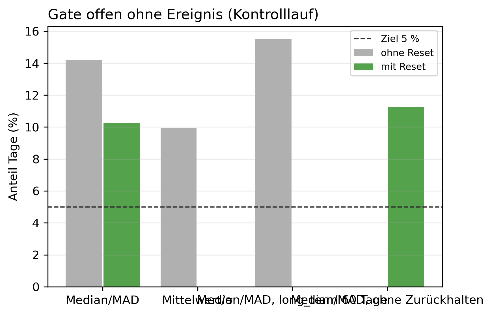

# K2 Referenz und Schwellen der Anomalieerkennung, Lauf k2_004

## Setup

- Cutover: 2013-10-15, 2014-02-12, 2014-06-12, 2014-10-10, 2015-02-07
- Zeitraum je Cutover: Kaltstart, 60 Tage Überwachung vor dem Cutover, 60 Tage danach
- Ereignisse ab Cutover: Dauerlast +30 W, Dauerlast +50 W, Dauerlast +100 W, Dauerlast +200 W, Einzeltag-Spitze +1000 W über 3 h, Einzeltag-Spitze +1000 W über 6 h, jeweils gepaart mit unverändertem Kontrolllauf
- Modi: ohne Reset = nur Detektor, darauf wird kalibriert (nur keine Änderung, Dauerlast +100 W). Mit Reset = Betrieb mit Regel wie SYS2, alle Ereignisse
- Varianten: Referenz Rolling 60 vor dem Beobachtungsfenster, Median/MAD, Mittelwert/σ, Median/MAD, long_term 60 Tage, Median/MAD, ohne Zurückhalten
- Schwellen im Lauf (daily / weekday / Streak weekday / weekly / long_term %): 2,6 / 2,6 / 2,6 / 1,25 / 10
- Produktiv-Variante: Median/MAD
- Commit: 83d6802 (mit lokalen Änderungen)

## Kennzahlen

| Kennzahl | Wert | Bezug |
|---|---|---|
| Kalibrierung: beste Variante bei höchstens 5 % Einzeltag-Alarmen | Median/MAD, long_term 60 Tage | im Leave-one-out 0/3 Durchgänge vorn |
| Median/MAD: kalibrierte Schwellen (daily / weekday / Streak weekday / weekly / long_term %) | 3,2 / 3 / 2,5 / 1 / 15 | im Lauf 2,6 / 2,6 / 2,6 / 1,25 / 10 |
| Median/MAD: Gate offen ohne Ereignis, mit Reset [%] | 10,2 | ohne Reset 14,2 %, Ziel 5 % |
| Median/MAD: Einzeltag-Spitze +1000 W über 3 h erkannt, mit Reset | 1/3 | Skala daily, eigener Reset danach 0/5 |
| Median/MAD: Einzeltag-Spitze +1000 W über 6 h erkannt, mit Reset | 2/3 | Skala daily, eigener Reset danach 2/5 |
| Median/MAD: Dauerlast +100 W erkannt, mit Reset | 3/3 | Skala weekly+long_term |
| Median/MAD: Dauerlast +200 W erkannt, mit Reset | 3/3 | Skala weekly+long_term |
| Median/MAD: Dauerlast +30 W erkannt, mit Reset | 1/3 | Skala weekly+long_term |
| Median/MAD: Dauerlast +50 W erkannt, mit Reset | 2/3 | Skala weekly+long_term |

## Ohne Ereignis: Kontrolllauf über das ganze Fenster, Mittel über Cutover

| Variante | Gate offen ohne Reset [%] | Gate offen mit Reset [%] | davon Einzeltag mit Reset [%] | Resets je Fenster |
|---|---:|---:|---:|---:|
| Median/MAD | 14,2 | 10,2 | 8,9 | 1,6 |
| Mittelwert/σ | 9,9 | - | - | - |
| Median/MAD, long_term 60 Tage | 15,5 | - | - | - |
| Median/MAD, ohne Zurückhalten | - | 11,2 | 10,1 | 1,4 |

## Kalibrierung: Arbeitspunkt je Variante bei gleicher Fehlalarmrate, ohne Reset

| Rang | Variante | Schwelle daily | Schwelle weekday | Streak weekday | Streak weekly | Streak long_term [%] | Einzeltag-Alarme Kontrolle [%] | falsche new_pattern je Fenster | Stufe erkannt | Erkennungstag im Mittel |
|---:|---|---|---|---|---|---|---:|---:|---|---:|
| 3 | Median/MAD | 3,2 | 3 | 2,5 | 1 | 15 | 4,7 | 1,0 | 2/3 | 23,5 |
| 2 | Mittelwert/σ | 2,2 | 3,4 | 2,5 | 1 | 15 | 5,0 | 1,0 | 2/3 | 23,5 |
| 1 | Median/MAD, long_term 60 Tage | 3,2 | 3 | 2,5 | 1 | 5 | 4,7 | 1,0 | 2/3 | 22,5 |

## Kalibrierung: Leave-one-cutover-out, auf den übrigen Cutovern gewählt und auf dem zurückgehaltenen geprüft

| zurückgehaltener Cutover | Variante | Schwelle daily | Schwelle weekday | Streak weekday | Streak weekly | Streak long_term [%] | Einzeltag-Alarme zurückgehalten [%] | falsche new_pattern zurückgehalten | Erkennungstag zurückgehalten |
|---|---|---|---|---|---|---|---:|---:|---:|
| 2014-02-12 | Mittelwert/σ | 2,4 | 3 | 2,5 | 1 | 20 | 4,1 | 0 | - |
| 2014-06-12 | Mittelwert/σ | 2,6 | 3 | 2,5 | 1 | 7,5 | 2,5 | 3 | 34 |
| 2015-02-07 | Mittelwert/σ | 3,2 | 2,4 | 2 | 1 | 30 | 11,6 | 1 | 18 |

## Erkennung je Ereignis im Betrieb mit Reset, Tag seit Cutover je Cutover

| Variante | Ereignis | 2013-10-15 (nicht gezählt) | 2014-02-12 | 2014-06-12 | 2014-10-10 (nicht gezählt) | 2015-02-07 | Mittel erkannter | erkannt | Einzeltag mit eigenem Reset | Skala bei Erkennung |
|---|---|---:|---:|---:|---:|---:|---:|---|---|---|
| Median/MAD | Dauerlast +30 W | 15 | - | 21 | - | - | 21,0 | 1/3 | - | weekly+long_term |
| Median/MAD | Dauerlast +50 W | 14 | - | 21 | - | 11 | 16,0 | 2/3 | - | weekly+long_term |
| Median/MAD | Dauerlast +100 W | 10 | 21 | 20 | - | 11 | 17,3 | 3/3 | - | weekly+long_term |
| Median/MAD | Dauerlast +200 W | 8 | 11 | 18 | - | 11 | 13,3 | 3/3 | - | weekly+long_term |
| Median/MAD | Einzeltag-Spitze +1000 W über 3 h | 1 | 1 | - | 1 | - | 1,0 | 1/3 | 0/5 | daily |
| Median/MAD | Einzeltag-Spitze +1000 W über 6 h | 1 | 1 | - | 1 | 1 | 1,0 | 2/3 | 2/5 | daily |
| Median/MAD, ohne Zurückhalten | Dauerlast +30 W | 13 | - | 46 | - | - | 46,0 | 1/3 | - | weekly+long_term |
| Median/MAD, ohne Zurückhalten | Dauerlast +50 W | 9 | - | 23 | - | - | 23,0 | 1/3 | - | weekly+long_term |
| Median/MAD, ohne Zurückhalten | Dauerlast +100 W | 8 | - | 23 | - | 12 | 17,5 | 2/3 | - | weekly+long_term |
| Median/MAD, ohne Zurückhalten | Dauerlast +200 W | 5 | 11 | 23 | - | 9 | 14,3 | 3/3 | - | weekly+long_term |
| Median/MAD, ohne Zurückhalten | Einzeltag-Spitze +1000 W über 3 h | 1 | - | - | 1 | - | - | 0/3 | 0/5 |  |
| Median/MAD, ohne Zurückhalten | Einzeltag-Spitze +1000 W über 6 h | 1 | 1 | 1 | 1 | 1 | 1,0 | 3/3 | 0/5 | daily, weekday |

## Hinweise

- Tag seit Cutover = Entscheidungstag: an Tag n meldet das System, eingeordnet ist dabei Tag n-1. Ab Cutover zählt deshalb erst ab Tag 1
- Kalibrierung je Variante, getrennt: die Einzeltag-Schwellen (daily, weekday) mit der höchsten Alarmrate bis 5 % im Kontrolllauf, die Streak-Schwellen (weekday, weekly, long_term in %) mit höchstens 1 falschen new_pattern je Fenster und möglichst vielen, frühen Erkennungen. Offline auf den Läufen ohne Reset, im Kreislauf hinge jeder Reset selbst an den Schwellen. Bei gleicher Alarmrate gelten die niedrigeren Schwellen. Die nicht gezählten Cutover gehen nicht in die Kalibrierung ein, im Lauf ohne Reset wirkt außerdem kein Zurückhalten
- Im Kreislauf läuft nur die Produktiv-Variante, mit und ohne Zurückhalten. Die Scores der Varianten haben unterschiedliche Skalen, bei gleichen Schwellen wären sie dort nicht vergleichbar, verglichen wird nur in der Kalibrierung
- mit Reset läuft mit den Schwellen im Lauf (Aufbau). Weichen die kalibrierten Schwellen des Produktivfensters davon ab, Config anpassen und K2 neu laufen lassen, erst dann zeigt der Kreislauf die kalibrierten Schwellen
- erkannt, im Betrieb mit Reset: dauerhafte Änderung = erster eigener Reset (new_pattern) nach dem Cutover, der Kontrolllauf hat 7 Tage davor und danach keinen. Einzeltag-Spitze = Alarm am Ereignistag, den der Kontrolllauf nicht hat. Ohne Reset steht die Erkennung der Stufe in der Kalibrierung
- nicht gezählt: 2013-10-15, 2014-10-10, Beginn der Heizperiode. Die Kontrolle liegt dort knapp unter der Streak-Bedingung, jede Störung löst new_pattern aus. Mittel, erkannt und Skala ohne diese Cutover
- Einzeltag mit eigenem Reset: Cutover, in denen nach der Spitze ein eigener Reset folgt, über alle Cutover. Eine Spitze soll keinen auslösen
- Skala bei Erkennung: bei new_pattern die Skalen mit Streak, bei der Spitze die Gate-Skala mit dem höchsten Score

## Anhang

### Kalibrierung: Arbeitspunkte je Cutover

| Variante | Rang | Schwelle daily | Schwelle weekday | Streak weekday | Streak weekly | Streak long_term [%] | Cutover | Einzeltag-Alarme Kontrolle [%] | falsche new_pattern je Fenster | Erkennungstag |
|---|---:|---|---|---|---|---|---|---:|---:|---:|
| Median/MAD | 3 | 3,2 | 3 | 2,5 | 1 | 15 | 2014-02-12 | 4,1 | 0 | - |
| Median/MAD | 3 | 3,2 | 3 | 2,5 | 1 | 15 | 2014-06-12 | 3,3 | 2 | 34 |
| Median/MAD | 3 | 3,2 | 3 | 2,5 | 1 | 15 | 2015-02-07 | 6,6 | 1 | 13 |
| Mittelwert/σ | 2 | 2,2 | 3,4 | 2,5 | 1 | 15 | 2014-02-12 | 4,1 | 0 | - |
| Mittelwert/σ | 2 | 2,2 | 3,4 | 2,5 | 1 | 15 | 2014-06-12 | 2,5 | 2 | 34 |
| Mittelwert/σ | 2 | 2,2 | 3,4 | 2,5 | 1 | 15 | 2015-02-07 | 8,3 | 1 | 13 |
| Median/MAD, long_term 60 Tage | 1 | 3,2 | 3 | 2,5 | 1 | 5 | 2014-02-12 | 4,1 | 0 | - |
| Median/MAD, long_term 60 Tage | 1 | 3,2 | 3 | 2,5 | 1 | 5 | 2014-06-12 | 3,3 | 2 | 34 |
| Median/MAD, long_term 60 Tage | 1 | 3,2 | 3 | 2,5 | 1 | 5 | 2015-02-07 | 6,6 | 1 | 11 |
