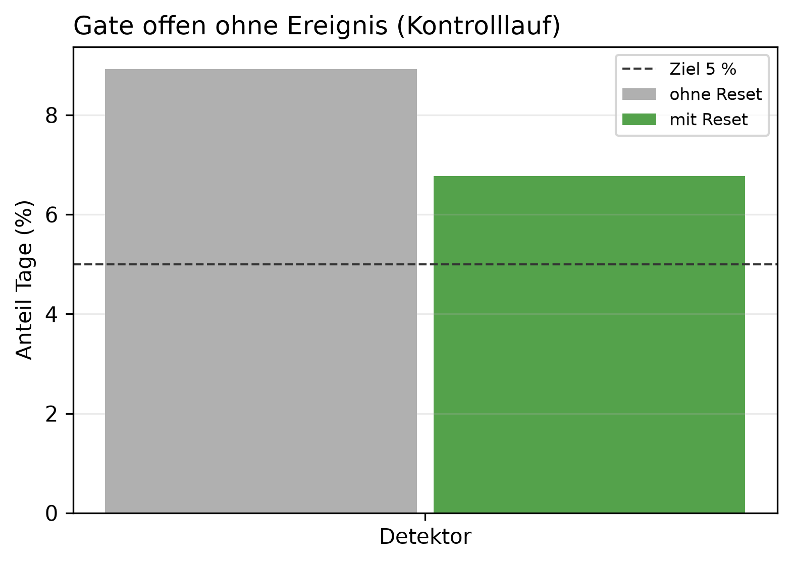

# K2 Schwellen der Anomalieerkennung, Lauf k2_008

## Setup

- Cutover: 2013-10-15, 2014-02-12, 2014-06-12, 2014-10-10, 2015-02-07
- Zeitraum je Cutover: Kaltstart, 60 Tage Überwachung vor dem Cutover, 60 Tage danach
- Ereignisse ab Cutover: Dauerlast +30 W, Dauerlast +50 W, Dauerlast +100 W, Dauerlast +200 W, Einzeltag-Spitze +1000 W über 3 h, Einzeltag-Spitze +1000 W über 6 h, jeweils gepaart mit unverändertem Kontrolllauf
- Modi: ohne Reset = nur Detektor, darauf werden Einzeltag-Schwelle und Streak-Empfindlichkeit bestimmt (nur keine Änderung, Dauerlast +100 W). Mit Reset = Betrieb mit Regel wie SYS2, alle Ereignisse
- Detektor: Referenz Rolling 60 vor dem Beobachtungsfenster, Median/MAD für daily und weekday
- Schwellen im Lauf (Einzeltag / Streak weekday / weekly / long_term %): 3,2 / 2,5 / 0,5 / 20
- Commit: 83d6802 (mit lokalen Änderungen)

## Kennzahlen

| Kennzahl | Wert | Bezug |
|---|---|---|
| Einzeltag-Schwelle für 5 % Alarme in der Kontrolle | 3,2 | im Lauf 3,2 |
| Streak-Schwellen (weekday / weekly / long_term %), Fehlalarm-Budget und früheste Erkennung | 2,5 / 0,75 / 25 | im Lauf 2,5 / 0,5 / 20 |
| Detektor: Gate offen ohne Ereignis, mit Reset [%] | 6,8 | ohne Reset 8,9 %, Resets je Fenster 1,0 |
| Detektor: Einzeltag-Spitze +1000 W über 3 h erkannt, mit Reset | 0/3 | Skala -, falsche Resets 0,0 je Fenster |
| Detektor: Einzeltag-Spitze +1000 W über 6 h erkannt, mit Reset | 1/3 | Skala daily, falsche Resets 0,0 je Fenster |
| Detektor: Dauerlast +100 W erkannt, mit Reset | 1/3 | Skala weekly+long_term, falsche Resets 0,0 je Fenster |
| Detektor: Dauerlast +200 W erkannt, mit Reset | 3/3 | Skala weekly+long_term, falsche Resets 0,0 je Fenster |
| Detektor: Dauerlast +30 W erkannt, mit Reset | 0/3 | Skala -, falsche Resets 0,0 je Fenster |
| Detektor: Dauerlast +50 W erkannt, mit Reset | 1/3 | Skala weekly+long_term, falsche Resets 0,0 je Fenster |

## Ohne Ereignis: Kontrolllauf über das ganze Fenster, Mittel über Cutover

| Variante | Gate offen ohne Reset [%] | Gate offen mit Reset [%] | davon Einzeltag mit Reset [%] | Resets je Fenster |
|---|---:|---:|---:|---:|
| Detektor | 8,9 | 6,8 | 6,0 | 1,0 |

## Einzeltag-Schwelle: ein Wert für daily und weekday, Alarmrate der Kontrolle je Cutover, ohne Reset

| Cutover | Schwelle (Score) | Einzeltag-Alarme Kontrolle [%] |
|---|---:|---:|
| 2013-10-15 | 3,2 | 10,7 |
| 2014-02-12 | 3,2 | 3,3 |
| 2014-06-12 | 3,2 | 0,8 |
| 2014-10-10 | 3,2 | 4,1 |
| 2015-02-07 | 3,2 | 6,6 |

## Streak-Schwellen: Raster und gewählter Punkt, ohne Reset, Mittel über Cutover

| Streak weekday | Streak weekly | Streak long_term [%] | falsche new_pattern je Fenster | Stufe erkannt | Erkennungstag im Mittel | gewählt | Schwellen der Config |
|---:|---:|---:|---:|---|---:|---|---|
| 0,8 | 0,8 | 7,5 | 5,0 | 3/3 | 21,0 |  |  |
| 0,8 | 0,8 | 10,0 | 4,8 | 3/3 | 22,0 |  |  |
| 0,8 | 0,8 | 15,0 | 4,0 | 3/3 | 24,0 |  |  |
| 0,8 | 0,8 | 20,0 | 3,8 | 3/3 | 26,0 |  |  |
| 0,8 | 0,8 | 25,0 | 3,4 | 3/3 | 28,0 |  |  |
| 0,8 | 1,0 | 7,5 | 4,2 | 2/3 | 23,0 |  |  |
| 0,8 | 1,0 | 10,0 | 3,6 | 2/3 | 24,0 |  |  |
| 0,8 | 1,0 | 15,0 | 3,0 | 2/3 | 26,5 |  |  |
| 0,8 | 1,0 | 20,0 | 3,0 | 2/3 | 29,0 |  |  |
| 0,8 | 1,0 | 25,0 | 2,6 | 1/3 | 35,0 |  |  |
| 0,8 | 1,2 | 7,5 | 4,0 | 0/3 | - |  |  |
| 0,8 | 1,2 | 10,0 | 3,4 | 0/3 | - |  |  |
| 0,8 | 1,2 | 15,0 | 2,2 | 0/3 | - |  |  |
| 0,8 | 1,2 | 20,0 | 2,2 | 0/3 | - |  |  |
| 0,8 | 1,2 | 25,0 | 1,6 | 0/3 | - |  |  |
| 0,8 | 1,5 | 7,5 | 3,4 | 0/3 | - |  |  |
| 0,8 | 1,5 | 10,0 | 2,8 | 0/3 | - |  |  |
| 0,8 | 1,5 | 15,0 | 2,0 | 0/3 | - |  |  |
| 0,8 | 1,5 | 20,0 | 2,0 | 0/3 | - |  |  |
| 0,8 | 1,5 | 25,0 | 1,6 | 0/3 | - |  |  |
| 0,8 | 1,8 | 7,5 | 3,2 | 0/3 | - |  |  |
| 0,8 | 1,8 | 10,0 | 2,6 | 0/3 | - |  |  |
| 0,8 | 1,8 | 15,0 | 1,8 | 0/3 | - |  |  |
| 0,8 | 1,8 | 20,0 | 1,4 | 0/3 | - |  |  |
| 0,8 | 1,8 | 25,0 | 1,0 | 0/3 | - |  |  |
| 1,0 | 0,8 | 7,5 | 3,8 | 3/3 | 21,0 |  |  |
| 1,0 | 0,8 | 10,0 | 3,8 | 3/3 | 22,0 |  |  |
| 1,0 | 0,8 | 15,0 | 2,8 | 3/3 | 24,0 |  |  |
| 1,0 | 0,8 | 20,0 | 2,8 | 3/3 | 26,0 |  |  |
| 1,0 | 0,8 | 25,0 | 2,4 | 3/3 | 28,0 |  |  |
| 1,0 | 1,0 | 7,5 | 3,8 | 2/3 | 23,0 |  |  |
| 1,0 | 1,0 | 10,0 | 3,6 | 2/3 | 24,0 |  |  |
| 1,0 | 1,0 | 15,0 | 2,6 | 2/3 | 26,5 |  |  |
| 1,0 | 1,0 | 20,0 | 2,4 | 2/3 | 29,0 |  |  |
| 1,0 | 1,0 | 25,0 | 2,0 | 1/3 | 35,0 |  |  |
| 1,0 | 1,2 | 7,5 | 3,4 | 0/3 | - |  |  |
| 1,0 | 1,2 | 10,0 | 3,0 | 0/3 | - |  |  |
| 1,0 | 1,2 | 15,0 | 2,0 | 0/3 | - |  |  |
| 1,0 | 1,2 | 20,0 | 1,8 | 0/3 | - |  |  |
| 1,0 | 1,2 | 25,0 | 1,2 | 0/3 | - |  |  |
| 1,0 | 1,5 | 7,5 | 3,0 | 0/3 | - |  |  |
| 1,0 | 1,5 | 10,0 | 2,6 | 0/3 | - |  |  |
| 1,0 | 1,5 | 15,0 | 1,6 | 0/3 | - |  |  |
| 1,0 | 1,5 | 20,0 | 1,4 | 0/3 | - |  |  |
| 1,0 | 1,5 | 25,0 | 1,0 | 0/3 | - |  |  |
| 1,0 | 1,8 | 7,5 | 2,8 | 0/3 | - |  |  |
| 1,0 | 1,8 | 10,0 | 2,4 | 0/3 | - |  |  |
| 1,0 | 1,8 | 15,0 | 1,4 | 0/3 | - |  |  |
| 1,0 | 1,8 | 20,0 | 1,0 | 0/3 | - |  |  |
| 1,0 | 1,8 | 25,0 | 0,6 | 0/3 | - |  |  |
| 1,5 | 0,8 | 7,5 | 3,2 | 3/3 | 21,0 |  |  |
| 1,5 | 0,8 | 10,0 | 3,0 | 3/3 | 22,0 |  |  |
| 1,5 | 0,8 | 15,0 | 1,6 | 3/3 | 24,0 |  |  |
| 1,5 | 0,8 | 20,0 | 1,2 | 3/3 | 26,0 |  |  |
| 1,5 | 0,8 | 25,0 | 0,8 | 3/3 | 28,0 |  |  |
| 1,5 | 1,0 | 7,5 | 2,8 | 2/3 | 23,0 |  |  |
| 1,5 | 1,0 | 10,0 | 2,6 | 2/3 | 24,0 |  |  |
| 1,5 | 1,0 | 15,0 | 1,4 | 2/3 | 26,5 |  |  |
| 1,5 | 1,0 | 20,0 | 1,2 | 2/3 | 29,0 |  |  |
| 1,5 | 1,0 | 25,0 | 0,8 | 1/3 | 35,0 |  |  |
| 1,5 | 1,2 | 7,5 | 2,4 | 0/3 | - |  |  |
| 1,5 | 1,2 | 10,0 | 2,0 | 0/3 | - |  |  |
| 1,5 | 1,2 | 15,0 | 1,2 | 0/3 | - |  |  |
| 1,5 | 1,2 | 20,0 | 1,0 | 0/3 | - |  |  |
| 1,5 | 1,2 | 25,0 | 0,4 | 0/3 | - |  |  |
| 1,5 | 1,5 | 7,5 | 1,8 | 0/3 | - |  |  |
| 1,5 | 1,5 | 10,0 | 1,4 | 0/3 | - |  |  |
| 1,5 | 1,5 | 15,0 | 1,0 | 0/3 | - |  |  |
| 1,5 | 1,5 | 20,0 | 0,8 | 0/3 | - |  |  |
| 1,5 | 1,5 | 25,0 | 0,4 | 0/3 | - |  |  |
| 1,5 | 1,8 | 7,5 | 1,8 | 0/3 | - |  |  |
| 1,5 | 1,8 | 10,0 | 1,4 | 0/3 | - |  |  |
| 1,5 | 1,8 | 15,0 | 1,0 | 0/3 | - |  |  |
| 1,5 | 1,8 | 20,0 | 0,8 | 0/3 | - |  |  |
| 1,5 | 1,8 | 25,0 | 0,4 | 0/3 | - |  |  |
| 2,0 | 0,8 | 7,5 | 2,8 | 3/3 | 21,0 |  |  |
| 2,0 | 0,8 | 10,0 | 2,6 | 3/3 | 22,0 |  |  |
| 2,0 | 0,8 | 15,0 | 1,2 | 3/3 | 24,0 |  |  |
| 2,0 | 0,8 | 20,0 | 0,8 | 3/3 | 26,0 |  |  |
| 2,0 | 0,8 | 25,0 | 0,4 | 3/3 | 28,0 |  |  |
| 2,0 | 1,0 | 7,5 | 2,4 | 2/3 | 23,0 |  |  |
| 2,0 | 1,0 | 10,0 | 2,2 | 2/3 | 24,0 |  |  |
| 2,0 | 1,0 | 15,0 | 1,0 | 2/3 | 26,5 |  |  |
| 2,0 | 1,0 | 20,0 | 0,8 | 2/3 | 29,0 |  |  |
| 2,0 | 1,0 | 25,0 | 0,4 | 1/3 | 35,0 |  |  |
| 2,0 | 1,2 | 7,5 | 2,2 | 0/3 | - |  |  |
| 2,0 | 1,2 | 10,0 | 1,8 | 0/3 | - |  |  |
| 2,0 | 1,2 | 15,0 | 1,0 | 0/3 | - |  |  |
| 2,0 | 1,2 | 20,0 | 0,8 | 0/3 | - |  |  |
| 2,0 | 1,2 | 25,0 | 0,2 | 0/3 | - |  |  |
| 2,0 | 1,5 | 7,5 | 1,6 | 0/3 | - |  |  |
| 2,0 | 1,5 | 10,0 | 1,2 | 0/3 | - |  |  |
| 2,0 | 1,5 | 15,0 | 0,8 | 0/3 | - |  |  |
| 2,0 | 1,5 | 20,0 | 0,6 | 0/3 | - |  |  |
| 2,0 | 1,5 | 25,0 | 0,2 | 0/3 | - |  |  |
| 2,0 | 1,8 | 7,5 | 1,6 | 0/3 | - |  |  |
| 2,0 | 1,8 | 10,0 | 1,2 | 0/3 | - |  |  |
| 2,0 | 1,8 | 15,0 | 0,8 | 0/3 | - |  |  |
| 2,0 | 1,8 | 20,0 | 0,6 | 0/3 | - |  |  |
| 2,0 | 1,8 | 25,0 | 0,2 | 0/3 | - |  |  |
| 2,5 | 0,8 | 7,5 | 2,4 | 3/3 | 21,0 |  |  |
| 2,5 | 0,8 | 10,0 | 2,4 | 3/3 | 22,0 |  |  |
| 2,5 | 0,8 | 15,0 | 1,0 | 3/3 | 24,0 |  |  |
| 2,5 | 0,8 | 20,0 | 0,6 | 3/3 | 26,0 |  |  |
| 2,5 | 0,8 | 25,0 | 0,2 | 3/3 | 28,0 | ja |  |
| 2,5 | 1,0 | 7,5 | 2,0 | 2/3 | 23,0 |  |  |
| 2,5 | 1,0 | 10,0 | 2,0 | 2/3 | 24,0 |  |  |
| 2,5 | 1,0 | 15,0 | 0,8 | 2/3 | 26,5 |  |  |
| 2,5 | 1,0 | 20,0 | 0,6 | 2/3 | 29,0 |  |  |
| 2,5 | 1,0 | 25,0 | 0,2 | 1/3 | 35,0 |  |  |
| 2,5 | 1,2 | 7,5 | 1,8 | 0/3 | - |  |  |
| 2,5 | 1,2 | 10,0 | 1,6 | 0/3 | - |  |  |
| 2,5 | 1,2 | 15,0 | 0,8 | 0/3 | - |  |  |
| 2,5 | 1,2 | 20,0 | 0,6 | 0/3 | - |  |  |
| 2,5 | 1,2 | 25,0 | 0,0 | 0/3 | - |  |  |
| 2,5 | 1,5 | 7,5 | 1,2 | 0/3 | - |  |  |
| 2,5 | 1,5 | 10,0 | 1,0 | 0/3 | - |  |  |
| 2,5 | 1,5 | 15,0 | 0,6 | 0/3 | - |  |  |
| 2,5 | 1,5 | 20,0 | 0,4 | 0/3 | - |  |  |
| 2,5 | 1,5 | 25,0 | 0,0 | 0/3 | - |  |  |
| 2,5 | 1,8 | 7,5 | 1,2 | 0/3 | - |  |  |
| 2,5 | 1,8 | 10,0 | 1,0 | 0/3 | - |  |  |
| 2,5 | 1,8 | 15,0 | 0,6 | 0/3 | - |  |  |
| 2,5 | 1,8 | 20,0 | 0,4 | 0/3 | - |  |  |
| 2,5 | 1,8 | 25,0 | 0,0 | 0/3 | - |  |  |
| 2,8 | 0,8 | 7,5 | 2,4 | 3/3 | 21,0 |  |  |
| 2,8 | 0,8 | 10,0 | 2,4 | 3/3 | 22,0 |  |  |
| 2,8 | 0,8 | 15,0 | 1,0 | 3/3 | 24,0 |  |  |
| 2,8 | 0,8 | 20,0 | 0,6 | 3/3 | 26,0 |  |  |
| 2,8 | 0,8 | 25,0 | 0,2 | 3/3 | 28,0 |  |  |
| 2,8 | 1,0 | 7,5 | 2,0 | 2/3 | 23,0 |  |  |
| 2,8 | 1,0 | 10,0 | 2,0 | 2/3 | 24,0 |  |  |
| 2,8 | 1,0 | 15,0 | 0,8 | 2/3 | 26,5 |  |  |
| 2,8 | 1,0 | 20,0 | 0,6 | 2/3 | 29,0 |  |  |
| 2,8 | 1,0 | 25,0 | 0,2 | 1/3 | 35,0 |  |  |
| 2,8 | 1,2 | 7,5 | 1,8 | 0/3 | - |  |  |
| 2,8 | 1,2 | 10,0 | 1,6 | 0/3 | - |  |  |
| 2,8 | 1,2 | 15,0 | 0,8 | 0/3 | - |  |  |
| 2,8 | 1,2 | 20,0 | 0,6 | 0/3 | - |  |  |
| 2,8 | 1,2 | 25,0 | 0,0 | 0/3 | - |  |  |
| 2,8 | 1,5 | 7,5 | 1,2 | 0/3 | - |  |  |
| 2,8 | 1,5 | 10,0 | 1,0 | 0/3 | - |  |  |
| 2,8 | 1,5 | 15,0 | 0,6 | 0/3 | - |  |  |
| 2,8 | 1,5 | 20,0 | 0,4 | 0/3 | - |  |  |
| 2,8 | 1,5 | 25,0 | 0,0 | 0/3 | - |  |  |
| 2,8 | 1,8 | 7,5 | 1,2 | 0/3 | - |  |  |
| 2,8 | 1,8 | 10,0 | 1,0 | 0/3 | - |  |  |
| 2,8 | 1,8 | 15,0 | 0,6 | 0/3 | - |  |  |
| 2,8 | 1,8 | 20,0 | 0,4 | 0/3 | - |  |  |
| 2,8 | 1,8 | 25,0 | 0,0 | 0/3 | - |  |  |

## Erkennung je Ereignis im Betrieb mit Reset, Tag seit Cutover je Cutover

| Variante | Ereignis | 2013-10-15 (nicht gezählt) | 2014-02-12 | 2014-06-12 | 2014-10-10 (nicht gezählt) | 2015-02-07 | Mittel erkannter | erkannt | falsche Resets je Fenster | Skala bei Erkennung |
|---|---|---:|---:|---:|---:|---:|---:|---|---:|---|
| Detektor | Dauerlast +30 W | 52 | - | - | - | - | - | 0/3 | 0,0 |  |
| Detektor | Dauerlast +50 W | 29 | 22 | - | - | - | 22,0 | 1/3 | 0,0 | weekly+long_term |
| Detektor | Dauerlast +100 W | 9 | 21 | - | - | - | 21,0 | 1/3 | 0,0 | weekly+long_term |
| Detektor | Dauerlast +200 W | 5 | 17 | 22 | - | 29 | 22,7 | 3/3 | 0,0 | weekly+long_term |
| Detektor | Einzeltag-Spitze +1000 W über 3 h | 1 | - | - | 1 | - | - | 0/3 | 0,0 |  |
| Detektor | Einzeltag-Spitze +1000 W über 6 h | 1 | 1 | - | 1 | - | 1,0 | 1/3 | 0,0 | daily |

## Hinweise

- Tag seit Cutover = Entscheidungstag: an Tag n meldet das System, eingeordnet ist dabei Tag n-1. Ab Cutover zählt deshalb erst ab Tag 1
- Einzeltag-Schwelle: das 95-%-Quantil des größten Scores von daily und weekday an den Kontrolltagen, ein Wert für beide. Streak-Schwellen: Raster, gewählt wird nach dem Fehlalarm-Budget (max_false_new_pattern) und dann nach früher Erkennung in allen gezählten Fenstern. Beides offline auf den Läufen ohne Reset, Einzeltag-Schwelle und falsche new_pattern über alle Cutover, die Erkennung der Stufe ohne die nicht gezählten
- Stufe erkannt (ohne Reset): erster Tag, ab dem das new_pattern der Stufe 7 Tage in Folge anhält und die Kontrolle es nicht hat
- Der Lauf mit Reset nutzt die Schwellen der Config (Aufbau). Ändert sich die Config, K2 neu laufen lassen
- erkannt, im Betrieb mit Reset: dauerhafte Änderung = erster eigener Reset (new_pattern) nach dem Cutover, der Kontrolllauf hat 7 Tage davor und danach keinen. Einzeltag-Spitze = Alarm am Ereignistag, den der Kontrolllauf nicht hat
- nicht gezählt: 2013-10-15, 2014-10-10, Beginn der Heizperiode. Die Kontrolle liegt dort knapp unter der Streak-Bedingung, jede Störung löst new_pattern aus. Mittel, erkannt und Skala ohne diese Cutover
- falsche Resets: eigene Resets nach dem Cutover, für die die Kontrolle in der Zeit keinen Reset hat (±Toleranz), über alle Cutover. Bei einer Dauerlast ist der erste Reset die Erkennung und zählt nicht, bei einer Spitze zählt jeder
- Skala bei Erkennung: bei new_pattern die Skalen mit Streak, bei der Spitze die Einzeltag-Skala mit dem höchsten Score

