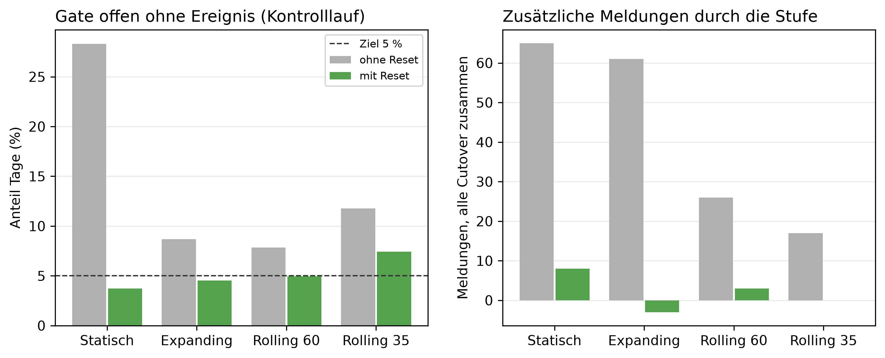

# K3 Referenzfenster der Anomalieerkennung, Lauf k3_001

## Setup

- Cutover: 2013-10-15, 2014-01-15, 2014-04-15, 2014-07-15
- Zeitraum je Cutover: Kaltstart, 60 Tage Überwachung vor dem Cutover, 60 Tage danach
- Ereignis: Dauerlast +100 W ab Cutover, gepaart mit unverändertem Kontrolllauf
- Modi: ohne Reset = nur Detektor, mit Reset = Kreislauf mit Regel wie SYS2
- Produktiv-Referenzfenster: Rolling 60
- Commit: a3ddf39 (mit lokalen Änderungen)

## Kennzahlen

| Kennzahl | Wert | Bezug |
|---|---|---|
| Rolling 60: Gate offen ohne Ereignis, mit Reset [%] | 5,0 | ohne Reset 7,9 %, Ziel 5 % |
| Rolling 60: Stufe erkannt mit Reset | 3/4 | ohne Reset 4/4 |
| Rolling 60: zusätzliche Meldungen durch die Stufe, mit Reset | 3 | ohne Reset 26 |

## Ohne Ereignis: Kontrolllauf über das ganze Fenster, Mittel über Cutover

| Referenzfenster | Gate offen ohne Reset [%] | Gate offen mit Reset [%] | davon Einzeltag mit Reset [%] | Resets je Fenster | MAE ohne Reset [W] | MAE mit Reset [W] |
|---|---:|---:|---:|---:|---:|---:|
| Statisch | 28,3 | 3,7 | 2,7 | 1,2 | 133,9 | 134,5 |
| Expanding | 8,7 | 4,5 | 3,5 | 1,5 | 133,9 | 134,4 |
| Rolling 60 | 7,9 | 5,0 | 3,7 | 1,5 | 133,9 | 134,3 |
| Rolling 35 | 11,8 | 7,4 | 6,4 | 1,5 | 133,9 | 134,5 |

## Erkennung der Stufe, Tag seit Cutover je Cutover

| Referenzfenster | Modus | 2013-10-15 | 2014-01-15 | 2014-04-15 | 2014-07-15 | Mittel erkannter | erkannt | MAE nach Cutover [W] |
|---|---|---:|---:|---:|---:|---:|---|---:|
| Statisch | ohne Reset | 16 | 8 | 12 | 14 | 12,5 | 4/4 | 140,1 |
| Statisch | mit Reset | 0 | - | 12 | 7 | 6,3 | 3/4 | 140,7 |
| Expanding | ohne Reset | 5 | 25 | - | 7 | 12,3 | 3/4 | 140,1 |
| Expanding | mit Reset | 5 | - | - | 7 | 6,0 | 2/4 | 140,6 |
| Rolling 60 | ohne Reset | 5 | 25 | 11 | 2 | 10,8 | 4/4 | 140,1 |
| Rolling 60 | mit Reset | 5 | - | 11 | 7 | 7,7 | 3/4 | 140,7 |
| Rolling 35 | ohne Reset | 5 | 26 | - | 7 | 12,7 | 3/4 | 140,1 |
| Rolling 35 | mit Reset | 5 | 28 | 48 | 7 | 22,0 | 4/4 | 140,7 |

## Meldungen an den Nutzer

| Referenzfenster | Modus | ohne Ereignis je 30 Tage | unknown ohne Ereignis | mit Stufe je 30 Tage | unknown mit Stufe | zusätzlich durch die Stufe, alle Cutover | new_pattern ohne Ereignis je Fenster |
|---|---|---:|---:|---:|---:|---:|---:|
| Statisch | ohne Reset | 8,5 | 0,0 | 12,5 | 0,0 | 65 | 29,8 |
| Statisch | mit Reset | 1,1 | 0,9 | 1,6 | 1,5 | 8 | 1,2 |
| Expanding | ohne Reset | 2,6 | 0,0 | 6,4 | 0,0 | 61 | 6,8 |
| Expanding | mit Reset | 1,4 | 1,1 | 1,2 | 1,2 | -3 | 1,5 |
| Rolling 60 | ohne Reset | 2,4 | 0,0 | 4,0 | 0,0 | 26 | 5,2 |
| Rolling 60 | mit Reset | 1,5 | 1,1 | 1,7 | 1,5 | 3 | 1,5 |
| Rolling 35 | ohne Reset | 3,5 | 0,0 | 4,6 | 0,0 | 17 | 4,2 |
| Rolling 35 | mit Reset | 2,2 | 1,1 | 2,2 | 1,5 | 0 | 1,5 |

## Hinweise

- Tag seit Cutover zählt den ausgewerteten Tag, nicht den prognostizierten (anders als in K5)
- Meldung = Tag mit peak, low, new_pattern, absence, in SYS3 jeweils ein LLM-Aufruf. unknown getrennt, dort reicht die Referenz nicht
- mit Reset: ein Reset am Cutover-Tag kann auch im Kontrolllauf auftreten und ist dann kein Treffer, Kontrolllauf-Resets stehen in der ersten Tabelle

