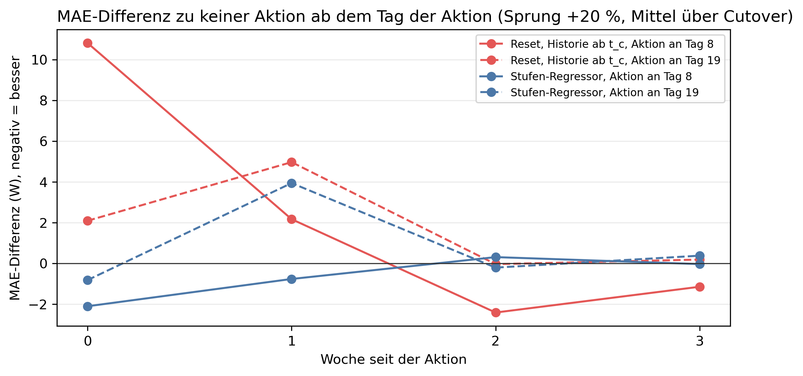

# K3 Adaptionsstrategien, Lauf k3_001

## Setup

- Cutover: CO1 (2014-07-31), CO2 (2015-02-12), CO3 (2015-05-24), CO4 (2015-09-26), CO5 (2016-01-12)
- Ereignis: Sprung, jede Stunde × 1,2
- Aktion: fest an Tag 8 und 19 nach dem Cutover (Orakel), Historie ab t_c wie die Adaptionsregel
- Auswertung: 23 Prognosetage ab dem Tag der Aktion, Differenz zu keiner Aktion am selben Tag
- Commit: af277a8 (mit lokalen Änderungen)

## Kennzahlen MAE

| Kennzahl | Wert | Bezug |
|---|---|---|
| Reset, Historie ab t_c, Aktion an Tag 8: Differenz zu keiner Aktion bei Sprung +20 % [W] | 3,1 | 1,5 % des Fehlers ohne Aktion, bei 2/5 Cutover besser |
| Stufen-Regressor, Aktion an Tag 8: Differenz zu keiner Aktion bei Sprung +20 % [W] | -0,8 | -0,4 % des Fehlers ohne Aktion, bei 4/5 Cutover besser |
| Aktion an Tag 19: beste Differenz bei Sprung +20 % [W] | 0,9 | späte Erkennung |

## Differenz der Aktion zu keiner Aktion (MAE), Mittel über 23 Prognosetage ab der Aktion, je Cutover [W], negativ = besser

| Ereignis | Aktion an Tag nach Cutover | Aktion | 2014-07-31 | 2015-02-12 | 2015-05-24 | 2015-09-26 | 2016-01-12 | Mittel | Cutover besser | Mittel in % des Fehlers ohne Aktion |
|---|---:|---|---:|---:|---:|---:|---:|---:|---|---:|
| Sprung +20 % | 8 | Reset, Historie ab t_c | 6,4 | -1,7 | 4,2 | 9,0 | -2,4 | 3,1 | 2/5 | 1,5 |
| Sprung +20 % | 8 | Stufen-Regressor | 0,7 | -0,1 | -0,8 | -2,7 | -1,0 | -0,8 | 4/5 | -0,4 |
| Sprung +20 % | 19 | Reset, Historie ab t_c | 0,1 | 3,7 | -3,0 | 12,8 | -2,8 | 2,1 | 2/5 | 1,0 |
| Sprung +20 % | 19 | Stufen-Regressor | -1,8 | 2,3 | -2,3 | 5,3 | 0,9 | 0,9 | 2/5 | 0,4 |

## Kennzahlen Tagesfehler

| Kennzahl | Wert | Bezug |
|---|---|---|
| Reset, Historie ab t_c, Aktion an Tag 8: Differenz zu keiner Aktion bei Sprung +20 % [W] | -1,1 | -1,2 % des Fehlers ohne Aktion, bei 2/5 Cutover besser |
| Stufen-Regressor, Aktion an Tag 8: Differenz zu keiner Aktion bei Sprung +20 % [W] | -0,7 | -0,8 % des Fehlers ohne Aktion, bei 3/5 Cutover besser |
| Aktion an Tag 19: beste Differenz bei Sprung +20 % [W] | -0,2 | späte Erkennung |

## Differenz der Aktion zu keiner Aktion (Tagesfehler), Mittel über 23 Prognosetage ab der Aktion, je Cutover [W], negativ = besser

| Ereignis | Aktion an Tag nach Cutover | Aktion | 2014-07-31 | 2015-02-12 | 2015-05-24 | 2015-09-26 | 2016-01-12 | Mittel | Cutover besser | Mittel in % des Fehlers ohne Aktion |
|---|---:|---|---:|---:|---:|---:|---:|---:|---|---:|
| Sprung +20 % | 8 | Reset, Historie ab t_c | -3,4 | 2,4 | -11,0 | 4,3 | 2,3 | -1,1 | 2/5 | -1,2 |
| Sprung +20 % | 8 | Stufen-Regressor | 0,7 | -0,8 | -0,3 | -3,9 | 0,6 | -0,7 | 3/5 | -0,8 |
| Sprung +20 % | 19 | Reset, Historie ab t_c | -8,3 | 6,3 | -1,3 | 12,9 | 2,3 | 2,4 | 2/5 | 2,5 |
| Sprung +20 % | 19 | Stufen-Regressor | -2,7 | 1,0 | -1,1 | 0,0 | 1,8 | -0,2 | 2/5 | -0,2 |

## Prognose minus Messung beim Tagesmittel ohne Aktion, Mittel über die Cutover, je Tag seit Cutover [W], negativ = Prognose zu niedrig

| Ereignis | Tag -3 | Tag -2 | Tag -1 | Tag 0 | Tag 1 | Tag 2 | Tag 3 | Tag 4 | Tag 5 | Tag 6 | Tag 7 | Tag 8 | Tag 9 | Tag 10 |
|---|---:|---:|---:|---:|---:|---:|---:|---:|---:|---:|---:|---:|---:|---:|
| Sprung +20 % | 58,9 | 60,1 | 18,1 | -93,9 | -73,8 | 48,5 | 61,2 | 9,1 | 9,4 | -4,0 | -4,9 | -65,2 | -69,2 | -47,7 |

## Hinweise

- Differenz: Fehler mit Aktion minus Fehler ohne Aktion, tageweise auf denselben Daten, über die Tage ab der Aktion gemittelt
- Cutover besser: Zahl der Cutover, bei denen die Differenz unter null liegt. Die Fenster überlappen, einzelne Cutover sind nicht unabhängig
- Tagesfehler: Betrag der Differenz zwischen prognostiziertem und gemessenem Tagesmittel (Tagesenergie), wie in K4, nur Tage mit lauter bewerteten Stunden. Gegenläufige Stundenfehler gleichen sich dabei aus

