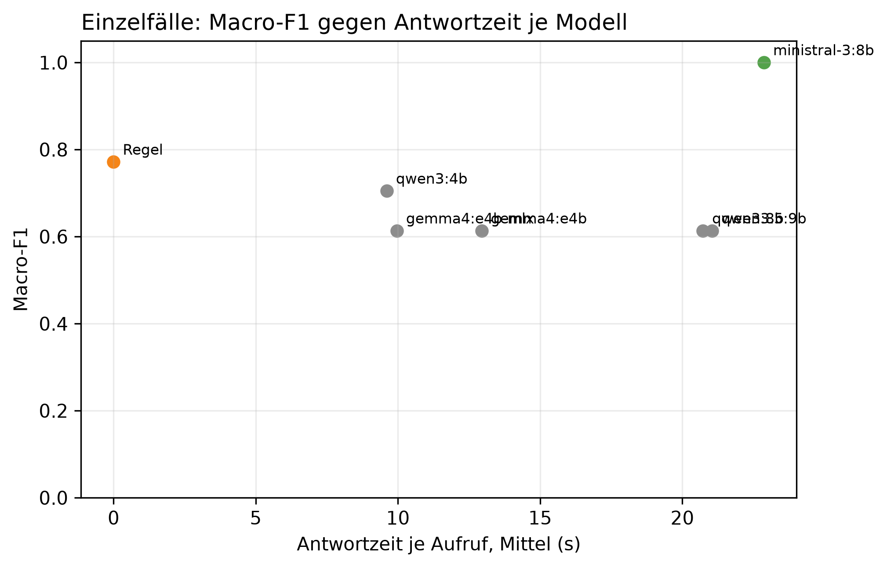

# K3 LLM-Klassifikation und Modellwahl, Läufe k3_006 / k3_seq_006

## Setup

- Läufe (Ebene 1 / Ebene 2): k3_006 / k3_seq_006
- Prompt (Ebene 1 / Ebene 2): v17 / v17
- Modelle: MDL0 qwen3:4b, MDL1 qwen3:8b, MDL2 qwen3.5:9b, MDL3 gemma4:e4b, MDL4 gemma4:e4b-mlx, MDL5 ministral-3:8b
- LLM: temperature 0,0, höchstens 2 Versuche je Aufruf
- Ebene 1: 8 synthetische Fälle, je Modell 1 Aufruf je Fall, Regel (BASELINE) läuft mit
- Ebene 2: Standard-Szenarien, Cutover 2014-04-15, 60 Tage davor, 60 danach, jedes Modell als eigener Kreislauf wie SYS3 mit Adaption
- Ereignisse Ebene 2: control = keine Änderung, step = Dauerlast +100 W, peak_6 = Einzeltag-Spitze +1000 W über 6 h
- Produktivmodell SYS3: ministral-3:8b
- Commit (Ebene 1 / Ebene 2): ae4c3c3 / ae4c3c3 (mit lokalen Änderungen)

## Kennzahlen

| Kennzahl | Wert | Bezug |
|---|---|---|
| Ebene 1: bestes Modell nach Macro-F1 | ministral-3:8b | Macro-F1 1,00, Regel 0,77 |
| ministral-3:8b: Ebene 1 richtig | 8/8 | Regel 7/8 |
| ministral-3:8b: Antwortzeit je Aufruf im Mittel [s] | 22,9 | p95 36,1 s, Regel 0,0 s |
| ministral-3:8b: Ebene 2 Ereignis-Arten erkannt | 1/2 | Regel 1/2 |
| ministral-3:8b: Ebene 2 Tage mit anderer Klasse als die Regel | 0 | - |
| ministral-3:8b: ungültige Antworten Ebene 1 | 0 | Ausfalltage Ebene 2: 0 |

## Ebene 1: Modellvergleich auf den Einzelfällen

| ID | Modell | richtig | Macro-F1 | ungültig | Ø Versuche | Grounding | Ø s je Aufruf | p95 s |
|---|---|---|---:|---:|---:|---:|---:|---:|
| MDL5 | ministral-3:8b | 8/8 | 1,0 | 0 | 1,0 | 0,9 | 22,9 | 36,1 |
| BASELINE | Regel | 7/8 | 0,8 | 0 | 1,0 | - | 0,0 | 0,0 |
| MDL0 | qwen3:4b | 6/8 | 0,7 | 0 | 1,0 | 0,6 | 9,6 | 14,9 |
| MDL1 | qwen3:8b | 5/8 | 0,6 | 0 | 1,0 | 0,8 | 20,7 | 33,7 |
| MDL2 | qwen3.5:9b | 5/8 | 0,6 | 0 | 1,0 | 0,7 | 21,0 | 31,0 |
| MDL3 | gemma4:e4b | 5/8 | 0,6 | 0 | 1,0 | 0,6 | 12,9 | 21,8 |
| MDL4 | gemma4:e4b-mlx | 5/8 | 0,6 | 0 | 1,0 | 0,6 | 10,0 | 14,6 |

## Ebene 1: Antwort je Fall (✓ = richtig, sonst die Antwort, - = ungültig)

| Fall | erwartet | ministral-3:8b | Regel | qwen3:4b | qwen3:8b | qwen3.5:9b | gemma4:e4b | gemma4:e4b-mlx |
|---|---|---|---|---|---|---|---|---|
| absence_drift_down | absence | ✓ | new_pattern | new_pattern | new_pattern | new_pattern | new_pattern | new_pattern |
| low_single_scale | low | ✓ | ✓ | ✓ | ✓ | ✓ | ✓ | ✓ |
| measurement_error_missing_day | measurement_error | ✓ | ✓ | ✓ | ✓ | ✓ | ✓ | ✓ |
| new_pattern | new_pattern | ✓ | ✓ | ✓ | peak | peak | peak | peak |
| new_pattern_at_min_scales_boundary | new_pattern | ✓ | ✓ | ✓ | peak | peak | peak | peak |
| new_pattern_drift_down | new_pattern | ✓ | ✓ | ✓ | ✓ | ✓ | ✓ | ✓ |
| peak | peak | ✓ | ✓ | normal | ✓ | ✓ | ✓ | ✓ |
| peak_single_sustained_scale | peak | ✓ | ✓ | ✓ | ✓ | ✓ | ✓ | ✓ |

## Ebene 2: je Modell über alle Ereignis-Arten

| Modell | Ereignis-Arten erkannt | Tage anders als die Regel | Gate-Tage | Ausfalltage | Meldungen Kontrolle | unknown Kontrolle | Resets Kontrolle |
|---|---|---:|---:|---:|---:|---:|---:|
| ministral-3:8b | 1/2 | 0 | 14 | 0 | 3 | 0 | 0 |
| Regel | 1/2 | 0 | 14 | 0 | 3 | 0 | 0 |
| qwen3:4b | 0/2 | 5 | 14 | 0 | 0 | 0 | 0 |
| qwen3:8b | 1/2 | 0 | 14 | 0 | 3 | 0 | 0 |
| qwen3.5:9b | 1/2 | 0 | 14 | 0 | 3 | 0 | 0 |
| gemma4:e4b | 1/2 | 0 | 14 | 0 | 3 | 0 | 0 |
| gemma4:e4b-mlx | 1/2 | 0 | 14 | 0 | 3 | 0 | 0 |

## Ebene 2: Erkennung je Ereignis, Tag seit Cutover

| config | Ereignis | erwartet | Gate-Tage durch das Ereignis | davon richtig | erster richtiger Tag | Resets |
|---|---|---|---:|---:|---:|---:|
| BASELINE | Einzeltag-Spitze +1000 W über 6 h | peak | 1 | 1 | 1 | 0 |
| BASELINE | Dauerlast +100 W | new_pattern | 1 | 0 | - | 0 |
| MDL0 | Einzeltag-Spitze +1000 W über 6 h | peak | 1 | 0 | - | 0 |
| MDL0 | Dauerlast +100 W | new_pattern | 1 | 0 | - | 0 |
| MDL1 | Einzeltag-Spitze +1000 W über 6 h | peak | 1 | 1 | 1 | 0 |
| MDL1 | Dauerlast +100 W | new_pattern | 1 | 0 | - | 0 |
| MDL2 | Einzeltag-Spitze +1000 W über 6 h | peak | 1 | 1 | 1 | 0 |
| MDL2 | Dauerlast +100 W | new_pattern | 1 | 0 | - | 0 |
| MDL3 | Einzeltag-Spitze +1000 W über 6 h | peak | 1 | 1 | 1 | 0 |
| MDL3 | Dauerlast +100 W | new_pattern | 1 | 0 | - | 0 |
| MDL4 | Einzeltag-Spitze +1000 W über 6 h | peak | 1 | 1 | 1 | 0 |
| MDL4 | Dauerlast +100 W | new_pattern | 1 | 0 | - | 0 |
| MDL5 | Einzeltag-Spitze +1000 W über 6 h | peak | 1 | 1 | 1 | 0 |
| MDL5 | Dauerlast +100 W | new_pattern | 1 | 0 | - | 0 |

## Ebene 2: Tage, an denen ein Modell anders einordnet als die Regel

| Modell | analysierter Tag | Regel | Modell sagt | in Arten |
|---|---|---|---|---|
| qwen3:4b | 2014-03-01 | peak | normal | control, step, peak_6 |
| qwen3:4b | 2014-03-15 | peak | normal | control, step, peak_6 |
| qwen3:4b | 2014-04-12 | low | normal | control, step, peak_6 |
| qwen3:4b | 2014-04-15 | peak | normal | peak_6 |
| qwen3:4b | 2014-04-17 | peak | normal | step |

## Hinweise

- Ebene 1 prüft, ob ein Modell die Regeln aus dem Prompt nachvollzieht. Der Prompt wurde auf denselben Fällen verbessert, die Quoten begründen deshalb nur die Modellwahl und belegen nicht das Ziel von 80 % richtiger Klassen (dafür E5)
- wenige Fälle: ein Fall sind mehrere Prozentpunkte, eine Klasse hängt teils an einem einzigen Fall
- Macro-F1: Mittel der F1-Werte über die Klassen, die als erwartete Klasse vorkommen
- Grounding: Anteil der für den Fall erwarteten Felder, die das Modell als Beleg zitiert. Die Regel zitiert keine
- Tag seit Cutover = Entscheidungstag: an Tag n meldet das System, eingeordnet ist dabei Tag n-1. Ab Cutover zählt deshalb erst ab Tag 1
- Ebene 2, erkannt: erwartete Klasse an einem Tag, an dem nur das Ereignis das Gate öffnet (gepaart mit dem Kontrolllauf desselben Modells)
- Ebene 2, anders als die Regel: gleiche Art und gleicher analysierter Tag, Regel gegen Modell. Nach einem Reset an verschiedenen Tagen laufen die Reihen auseinander, spätere Abweichungen können daraus folgen
- Antwortzeit: gemessen auf dem Rechner des Laufs, nur zum Vergleich der Modelle untereinander

## Anhang

### Ebene 1: Precision, Recall und F1 je Klasse

| Modell | Klasse | Precision | Recall | F1 |
|---|---|---:|---:|---:|
| Regel | absence | 0,0 | 0,0 | 0,0 |
| Regel | low | 1,0 | 1,0 | 1,0 |
| Regel | measurement_error | 1,0 | 1,0 | 1,0 |
| Regel | new_pattern | 0,8 | 1,0 | 0,9 |
| Regel | peak | 1,0 | 1,0 | 1,0 |
| qwen3:4b | absence | 0,0 | 0,0 | 0,0 |
| qwen3:4b | low | 1,0 | 1,0 | 1,0 |
| qwen3:4b | measurement_error | 1,0 | 1,0 | 1,0 |
| qwen3:4b | new_pattern | 0,8 | 1,0 | 0,9 |
| qwen3:4b | peak | 1,0 | 0,5 | 0,7 |
| qwen3:8b | absence | 0,0 | 0,0 | 0,0 |
| qwen3:8b | low | 1,0 | 1,0 | 1,0 |
| qwen3:8b | measurement_error | 1,0 | 1,0 | 1,0 |
| qwen3:8b | new_pattern | 0,5 | 0,3 | 0,4 |
| qwen3:8b | peak | 0,5 | 1,0 | 0,7 |
| qwen3.5:9b | absence | 0,0 | 0,0 | 0,0 |
| qwen3.5:9b | low | 1,0 | 1,0 | 1,0 |
| qwen3.5:9b | measurement_error | 1,0 | 1,0 | 1,0 |
| qwen3.5:9b | new_pattern | 0,5 | 0,3 | 0,4 |
| qwen3.5:9b | peak | 0,5 | 1,0 | 0,7 |
| gemma4:e4b | absence | 0,0 | 0,0 | 0,0 |
| gemma4:e4b | low | 1,0 | 1,0 | 1,0 |
| gemma4:e4b | measurement_error | 1,0 | 1,0 | 1,0 |
| gemma4:e4b | new_pattern | 0,5 | 0,3 | 0,4 |
| gemma4:e4b | peak | 0,5 | 1,0 | 0,7 |
| gemma4:e4b-mlx | absence | 0,0 | 0,0 | 0,0 |
| gemma4:e4b-mlx | low | 1,0 | 1,0 | 1,0 |
| gemma4:e4b-mlx | measurement_error | 1,0 | 1,0 | 1,0 |
| gemma4:e4b-mlx | new_pattern | 0,5 | 0,3 | 0,4 |
| gemma4:e4b-mlx | peak | 0,5 | 1,0 | 0,7 |
| ministral-3:8b | absence | 1,0 | 1,0 | 1,0 |
| ministral-3:8b | low | 1,0 | 1,0 | 1,0 |
| ministral-3:8b | measurement_error | 1,0 | 1,0 | 1,0 |
| ministral-3:8b | new_pattern | 1,0 | 1,0 | 1,0 |
| ministral-3:8b | peak | 1,0 | 1,0 | 1,0 |
