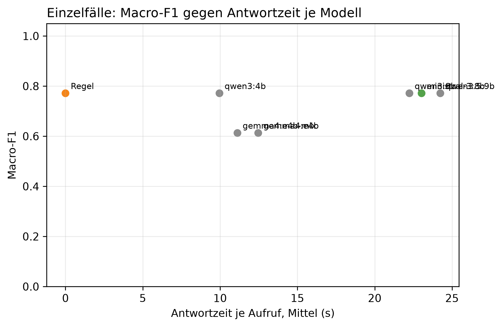

# K3 LLM-Klassifikation und Modellwahl, Läufe k3_007 / k3_seq_007

## Setup

- Läufe (Ebene 1 / Ebene 2): k3_007 / k3_seq_007
- Prompt (Ebene 1 / Ebene 2): v19 / v19
- Modelle: MDL0 qwen3:4b, MDL1 qwen3:8b, MDL2 qwen3.5:9b, MDL3 gemma4:e4b, MDL4 gemma4:e4b-mlx, MDL5 ministral-3:8b
- LLM: temperature 0,0, höchstens 2 Versuche je Aufruf
- Ebene 1: 8 synthetische Fälle, je Modell 1 Aufruf je Fall, Regel (BASELINE) läuft mit
- Ebene 2: Standard-Szenarien, Cutover 2014-04-15, 60 Tage davor, 60 danach, jedes Modell als eigener Kreislauf wie SYS3 mit Adaption
- Ereignisse Ebene 2: control = keine Änderung, step = Dauerlast +100 W, peak_6 = Einzeltag-Spitze +1000 W über 6 h
- Produktivmodell SYS3: ministral-3:8b
- Commit (Ebene 1 / Ebene 2): 0cc78e1 / 0cc78e1 (mit lokalen Änderungen)
- Textprüfung: 17 Gerätewörter, 9 Steuerungswörter, Zahlentoleranz 0,5, Fensterzahlen aus dem Prompt 7, 30

## Kennzahlen

| Kennzahl | Wert | Bezug |
|---|---|---|
| Ebene 1: bestes Modell nach Macro-F1 | qwen3:4b | Macro-F1 0,77, Regel 0,77 |
| ministral-3:8b: Ebene 1 richtig | 7/8 | Regel 7/8 |
| ministral-3:8b: Antwortzeit je Aufruf im Mittel [s] | 23,0 | p95 38,9 s, Regel 0,0 s |
| ministral-3:8b: Ebene 2 Ereignis-Arten erkannt | 1/2 | Regel 1/2 |
| ministral-3:8b: Ebene 2 Tage mit anderer Klasse als die Regel | 0 | - |
| ministral-3:8b: ungültige Antworten Ebene 1 | 0 | Ausfalltage Ebene 2: 0 |
| ministral-3:8b: Antworten mit Textverstoß (Ebene 1 / Ebene 2) | 0/8 / 0/14 | Gerät, Steuerung oder Zahl, Datum, Uhrzeit nicht im State |
| ministral-3:8b: Antworten mit fehlenden Belegen (Ebene 1 / Ebene 2) | 1/8 / 0/14 | zitierte Belege passen nicht zur eigenen Klasse |

## Ebene 1: Modellvergleich auf den Einzelfällen

| ID | Modell | richtig | Macro-F1 | ungültig | Ø Versuche | Grounding | Ø s je Aufruf | p95 s |
|---|---|---|---:|---:|---:|---:|---:|---:|
| BASELINE | Regel | 7/8 | 0,8 | 0 | 1,0 | - | 0,0 | 0,0 |
| MDL0 | qwen3:4b | 7/8 | 0,8 | 0 | 1,0 | 0,4 | 9,9 | 17,0 |
| MDL1 | qwen3:8b | 7/8 | 0,8 | 0 | 1,0 | 0,9 | 22,2 | 37,0 |
| MDL2 | qwen3.5:9b | 7/8 | 0,8 | 0 | 1,0 | 0,9 | 24,2 | 36,1 |
| MDL5 | ministral-3:8b | 7/8 | 0,8 | 0 | 1,0 | 0,9 | 23,0 | 38,9 |
| MDL3 | gemma4:e4b | 5/8 | 0,6 | 0 | 1,0 | 0,8 | 12,5 | 22,8 |
| MDL4 | gemma4:e4b-mlx | 5/8 | 0,6 | 0 | 1,0 | 0,8 | 11,1 | 16,4 |

## Ebene 1: Antwort je Fall (✓ = richtig, sonst die Antwort, - = ungültig)

| Fall | erwartet | Regel | qwen3:4b | qwen3:8b | qwen3.5:9b | ministral-3:8b | gemma4:e4b | gemma4:e4b-mlx |
|---|---|---|---|---|---|---|---|---|
| absence_drift_down | absence | new_pattern | new_pattern | new_pattern | new_pattern | new_pattern | new_pattern | new_pattern |
| low_single_scale | low | ✓ | ✓ | ✓ | ✓ | ✓ | ✓ | ✓ |
| measurement_error_missing_day | measurement_error | ✓ | ✓ | ✓ | ✓ | ✓ | ✓ | ✓ |
| new_pattern | new_pattern | ✓ | ✓ | ✓ | ✓ | ✓ | peak | peak |
| new_pattern_at_min_scales_boundary | new_pattern | ✓ | ✓ | ✓ | ✓ | ✓ | peak | peak |
| new_pattern_drift_down | new_pattern | ✓ | ✓ | ✓ | ✓ | ✓ | ✓ | ✓ |
| peak | peak | ✓ | ✓ | ✓ | ✓ | ✓ | ✓ | ✓ |
| peak_single_sustained_scale | peak | ✓ | ✓ | ✓ | ✓ | ✓ | ✓ | ✓ |

## Automatische Textprüfung je Modell (Antworten mit Verstoß oder fehlenden Belegen)

| Modell | E1 Antworten | E1 mit Verstoß | E1 Belege fehlen | E1 Gerät genannt | E2 Antworten | E2 mit Verstoß | E2 Belege fehlen | E2 Gerät genannt |
|---|---:|---:|---:|---:|---:|---:|---:|---:|
| qwen3:4b | 8 | 0 | 7 | 2 | 14 | 0 | 5 | 3 |
| qwen3:8b | 8 | 0 | 1 | 4 | 14 | 0 | 0 | 2 |
| qwen3.5:9b | 8 | 0 | 2 | 2 | 14 | 0 | 0 | 0 |
| ministral-3:8b | 8 | 0 | 1 | 5 | 14 | 0 | 0 | 4 |
| gemma4:e4b | 8 | 0 | 0 | 2 | 14 | 0 | 0 | 8 |
| gemma4:e4b-mlx | 8 | 0 | 0 | 2 | 14 | 0 | 0 | 2 |

## Auffälligkeiten der Textprüfung

| Ebene | Modell | Fall oder Tag | Verstoß | fehlende Belege | Gerät genannt (Hinweis) |
|---|---|---|---|---|---|
| Ebene 2 | qwen3:4b | 2014-04-12 control |  | anomaly.direction; anomaly.level | heizung |
| Ebene 2 | qwen3:4b | 2014-04-12 peak_6 |  | anomaly.direction; anomaly.level | heizung |
| Ebene 2 | qwen3:4b | 2014-04-12 step |  | anomaly.direction; anomaly.level | heizung |
| Ebene 2 | qwen3:4b | 2014-04-15 peak_6 |  | anomaly.level |  |
| Ebene 2 | qwen3:4b | 2014-04-17 step |  | anomaly.level |  |
| Ebene 2 | qwen3:8b | 2014-04-15 peak_6 |  |  | heizung |
| Ebene 2 | qwen3:8b | 2014-04-17 step |  |  | heizung |
| Ebene 2 | ministral-3:8b | 2014-03-01 control |  |  | waschmaschine; trockner; heizung |
| Ebene 2 | ministral-3:8b | 2014-03-01 peak_6 |  |  | waschmaschine; trockner; heizung |
| Ebene 2 | ministral-3:8b | 2014-03-01 step |  |  | waschmaschine; trockner; heizung |
| Ebene 2 | ministral-3:8b | 2014-04-17 step |  |  | heizung |
| Ebene 2 | gemma4:e4b | 2014-03-01 control |  |  | heizung |
| Ebene 2 | gemma4:e4b | 2014-03-01 peak_6 |  |  | heizung |
| Ebene 2 | gemma4:e4b | 2014-03-01 step |  |  | heizung |
| Ebene 2 | gemma4:e4b | 2014-03-15 control |  |  | heizung |
| Ebene 2 | gemma4:e4b | 2014-03-15 peak_6 |  |  | heizung |
| Ebene 2 | gemma4:e4b | 2014-03-15 step |  |  | heizung |
| Ebene 2 | gemma4:e4b | 2014-04-15 peak_6 |  |  | heizung |
| Ebene 2 | gemma4:e4b | 2014-04-17 step |  |  | heizung |
| Ebene 2 | gemma4:e4b-mlx | 2014-03-15 control |  |  | heizung |
| Ebene 2 | gemma4:e4b-mlx | 2014-04-15 peak_6 |  |  | heizung |
| Ebene 1 | qwen3:4b | absence_drift_down |  | anomaly.level; anomaly.scale_anomaly_streak_days.long_term; anomaly.scale_anomaly_streak_days.weekly; anomaly.sustained_drift | heizung |
| Ebene 1 | qwen3:4b | low_single_scale |  | anomaly.level |  |
| Ebene 1 | qwen3:4b | new_pattern |  | anomaly.scale_anomaly_streak_days.weekly |  |
| Ebene 1 | qwen3:4b | new_pattern_at_min_scales_boundary |  | anomaly.scale_anomaly_streak_days.weekly |  |
| Ebene 1 | qwen3:4b | new_pattern_drift_down |  | anomaly.level; anomaly.scale_anomaly_streak_days.long_term; anomaly.scale_anomaly_streak_days.weekly; anomaly.sustained_drift | heizung |
| Ebene 1 | qwen3:4b | peak |  | anomaly.direction; anomaly.level |  |
| Ebene 1 | qwen3:4b | peak_single_sustained_scale |  | anomaly.level |  |
| Ebene 1 | qwen3:8b | new_pattern |  |  | heizung |
| Ebene 1 | qwen3:8b | new_pattern_at_min_scales_boundary |  | anomaly.scale_anomaly_streak_days.weekly |  |
| Ebene 1 | qwen3:8b | new_pattern_drift_down |  |  | heizung |
| Ebene 1 | qwen3:8b | peak |  |  | heizung |
| Ebene 1 | qwen3:8b | peak_single_sustained_scale |  |  | heizung |
| Ebene 1 | qwen3.5:9b | new_pattern |  | anomaly.scale_anomaly_streak_days.weekly | heizung |
| Ebene 1 | qwen3.5:9b | new_pattern_at_min_scales_boundary |  | anomaly.scale_anomaly_streak_days.weekly | heizung |
| Ebene 1 | ministral-3:8b | low_single_scale |  |  | heizung |
| Ebene 1 | ministral-3:8b | new_pattern |  |  | heizung |
| Ebene 1 | ministral-3:8b | new_pattern_at_min_scales_boundary |  | anomaly.scale_anomaly_streak_days.weekly | heizung |
| Ebene 1 | ministral-3:8b | new_pattern_drift_down |  |  | heizung |
| Ebene 1 | ministral-3:8b | peak_single_sustained_scale |  |  | heizung |
| Ebene 1 | gemma4:e4b | absence_drift_down |  |  | heizung |
| Ebene 1 | gemma4:e4b | new_pattern_drift_down |  |  | heizung |
| Ebene 1 | gemma4:e4b-mlx | new_pattern |  |  | heizung |
| Ebene 1 | gemma4:e4b-mlx | peak |  |  | heizung |

## Ebene 2: je Modell über alle Ereignis-Arten

| Modell | Ereignis-Arten erkannt | Tage anders als die Regel | Gate-Tage | Ausfalltage | Meldungen Kontrolle | unknown Kontrolle | Resets Kontrolle |
|---|---|---:|---:|---:|---:|---:|---:|
| Regel | 1/2 | 0 | 14 | 0 | 3 | 0 | 0 |
| qwen3:4b | 1/2 | 1 | 14 | 0 | 2 | 0 | 0 |
| qwen3:8b | 1/2 | 0 | 14 | 0 | 3 | 0 | 0 |
| qwen3.5:9b | 1/2 | 0 | 14 | 0 | 3 | 0 | 0 |
| ministral-3:8b | 1/2 | 0 | 14 | 0 | 3 | 0 | 0 |
| gemma4:e4b | 1/2 | 0 | 14 | 0 | 3 | 0 | 0 |
| gemma4:e4b-mlx | 1/2 | 0 | 14 | 0 | 3 | 0 | 0 |

## Ebene 2: Erkennung je Ereignis, Tag seit Cutover

| config | Ereignis | erwartet | Gate-Tage durch das Ereignis | davon richtig | erster richtiger Tag | Resets |
|---|---|---|---:|---:|---:|---:|
| BASELINE | Einzeltag-Spitze +1000 W über 6 h | peak | 1 | 1 | 1 | 0 |
| BASELINE | Dauerlast +100 W | new_pattern | 1 | 0 | - | 0 |
| MDL0 | Einzeltag-Spitze +1000 W über 6 h | peak | 1 | 1 | 1 | 0 |
| MDL0 | Dauerlast +100 W | new_pattern | 1 | 0 | - | 0 |
| MDL1 | Einzeltag-Spitze +1000 W über 6 h | peak | 1 | 1 | 1 | 0 |
| MDL1 | Dauerlast +100 W | new_pattern | 1 | 0 | - | 0 |
| MDL2 | Einzeltag-Spitze +1000 W über 6 h | peak | 1 | 1 | 1 | 0 |
| MDL2 | Dauerlast +100 W | new_pattern | 1 | 0 | - | 0 |
| MDL3 | Einzeltag-Spitze +1000 W über 6 h | peak | 1 | 1 | 1 | 0 |
| MDL3 | Dauerlast +100 W | new_pattern | 1 | 0 | - | 0 |
| MDL4 | Einzeltag-Spitze +1000 W über 6 h | peak | 1 | 1 | 1 | 0 |
| MDL4 | Dauerlast +100 W | new_pattern | 1 | 0 | - | 0 |
| MDL5 | Einzeltag-Spitze +1000 W über 6 h | peak | 1 | 1 | 1 | 0 |
| MDL5 | Dauerlast +100 W | new_pattern | 1 | 0 | - | 0 |

## Ebene 2: Tage, an denen ein Modell anders einordnet als die Regel

| Modell | analysierter Tag | Regel | Modell sagt | in Arten |
|---|---|---|---|---|
| qwen3:4b | 2014-03-15 | peak | normal | control, step, peak_6 |

## Hinweise

- Ebene 1 prüft, ob ein Modell die Regeln aus dem Prompt nachvollzieht. Der Prompt wurde auf denselben Fällen verbessert, die Quoten begründen deshalb nur die Modellwahl und belegen nicht das Ziel von 80 % richtiger Klassen (dafür E5)
- wenige Fälle: ein Fall sind mehrere Prozentpunkte, eine Klasse hängt teils an einem einzigen Fall
- Macro-F1: Mittel der F1-Werte über die Klassen, die als erwartete Klasse vorkommen
- Grounding: Anteil der für den Fall erwarteten Felder, die das Modell als Beleg zitiert. Die Regel zitiert keine
- Tag seit Cutover = Entscheidungstag: an Tag n meldet das System, eingeordnet ist dabei Tag n-1. Ab Cutover zählt deshalb erst ab Tag 1
- Ebene 2, erkannt: erwartete Klasse an einem Tag, an dem nur das Ereignis das Gate öffnet (gepaart mit dem Kontrolllauf desselben Modells)
- Ebene 2, anders als die Regel: gleiche Art und gleicher analysierter Tag, Regel gegen Modell. Nach einem Reset an verschiedenen Tagen laufen die Reihen auseinander, spätere Abweichungen können daraus folgen
- Antwortzeit: gemessen auf dem Rechner des Laufs, nur zum Vergleich der Modelle untereinander
- Textprüfung: Verstoß heißt, ein Steuerungswort oder eine Zahl, ein Datum oder eine Uhrzeit steht im Text, aber nicht im State des Falls. Ein genanntes Gerät ist nur ein Hinweis, als Möglichkeit ist es erlaubt, ob es als Ursache behauptet wird, beurteilen die Bewertenden. Zahlwörter („sechs Wochen“) und nicht gelistete Geräte findet sie nicht. Die Fensterlängen 7 und 30 aus der Skalenbeschreibung im Prompt gelten als erlaubt
- Fehlende Belege: der Prompt verlangt je Klasse bestimmte Pfade (new_pattern: sustained_drift, level, Streaks, peak/low: level, direction, absence: level, Kalendereintrag, measurement_error: Flag). Geprüft wird gegen die eigene Klasse des Modells, nicht gegen die erwartete. Ebene 1 wird nur für Läufe geprüft, die den State der Fälle in der Antwortdatei speichern, ältere Läufe haben in der Tabelle 0 Antworten
- Antworttexte im Anhang: Ebene 1 für alle Modelle, Ebene 2 nur für das Produktivmodell. Alle Texte auch als answers_single.csv und answers_sequence.csv

## Anhang

### Ebene 1: Precision, Recall und F1 je Klasse

| Modell | Klasse | Precision | Recall | F1 |
|---|---|---:|---:|---:|
| Regel | absence | 0,0 | 0,0 | 0,0 |
| Regel | low | 1,0 | 1,0 | 1,0 |
| Regel | measurement_error | 1,0 | 1,0 | 1,0 |
| Regel | new_pattern | 0,8 | 1,0 | 0,9 |
| Regel | peak | 1,0 | 1,0 | 1,0 |
| qwen3:4b | absence | 0,0 | 0,0 | 0,0 |
| qwen3:4b | low | 1,0 | 1,0 | 1,0 |
| qwen3:4b | measurement_error | 1,0 | 1,0 | 1,0 |
| qwen3:4b | new_pattern | 0,8 | 1,0 | 0,9 |
| qwen3:4b | peak | 1,0 | 1,0 | 1,0 |
| qwen3:8b | absence | 0,0 | 0,0 | 0,0 |
| qwen3:8b | low | 1,0 | 1,0 | 1,0 |
| qwen3:8b | measurement_error | 1,0 | 1,0 | 1,0 |
| qwen3:8b | new_pattern | 0,8 | 1,0 | 0,9 |
| qwen3:8b | peak | 1,0 | 1,0 | 1,0 |
| qwen3.5:9b | absence | 0,0 | 0,0 | 0,0 |
| qwen3.5:9b | low | 1,0 | 1,0 | 1,0 |
| qwen3.5:9b | measurement_error | 1,0 | 1,0 | 1,0 |
| qwen3.5:9b | new_pattern | 0,8 | 1,0 | 0,9 |
| qwen3.5:9b | peak | 1,0 | 1,0 | 1,0 |
| gemma4:e4b | absence | 0,0 | 0,0 | 0,0 |
| gemma4:e4b | low | 1,0 | 1,0 | 1,0 |
| gemma4:e4b | measurement_error | 1,0 | 1,0 | 1,0 |
| gemma4:e4b | new_pattern | 0,5 | 0,3 | 0,4 |
| gemma4:e4b | peak | 0,5 | 1,0 | 0,7 |
| gemma4:e4b-mlx | absence | 0,0 | 0,0 | 0,0 |
| gemma4:e4b-mlx | low | 1,0 | 1,0 | 1,0 |
| gemma4:e4b-mlx | measurement_error | 1,0 | 1,0 | 1,0 |
| gemma4:e4b-mlx | new_pattern | 0,5 | 0,3 | 0,4 |
| gemma4:e4b-mlx | peak | 0,5 | 1,0 | 0,7 |
| ministral-3:8b | absence | 0,0 | 0,0 | 0,0 |
| ministral-3:8b | low | 1,0 | 1,0 | 1,0 |
| ministral-3:8b | measurement_error | 1,0 | 1,0 | 1,0 |
| ministral-3:8b | new_pattern | 0,8 | 1,0 | 0,9 |
| ministral-3:8b | peak | 1,0 | 1,0 | 1,0 |

### Ebene 1: Antworten der Modelle je Fall

**peak** (erwartet: peak)

- qwen3:4b: peak ✓
  - Erklärung: Gestern war die Stromverbrauch höher als letzte Woche um 12 %, und dieser Anstieg war nur ein Tag lang.
  - Empfehlung: Überprüfen Sie, ob jemand zu Hause war oder ob eine neue Geräte eingeschaltet wurden.
  - Unsicherheit: Keine Kalenderereignisse sind verfügbar für den Zeitraum.
- qwen3:8b: peak ✓
  - Erklärung: Gestern war der Stromverbrauch höher als üblich, insbesondere im Vergleich zur letzten Woche. Der Verbrauch lag um 45 % über dem üblichen Niveau für einen Dienstag.
  - Empfehlung: Überprüfen Sie, ob ein Gerät neu im Haus ist oder ungewöhnlich verwendet wurde. Prüfen Sie auch, ob mehrere Personen zu Hause waren oder die Heizung stärker lief.
  - Unsicherheit: Es ist nicht bekannt, warum der Verbrauch gestiegen ist, aber es könnte mit einer ungewöhnlichen Nutzung oder einem neuen Gerät zusammenhängen.
- qwen3.5:9b: peak ✓
  - Erklärung: Gestern war der Stromverbrauch ungewöhnlich hoch und lag um 45 % über dem für diesen Wochentag üblichen Niveau.
  - Empfehlung: Bitte prüfen Sie, ob gestern jemand länger zu Hause war oder ein Gerät ungewöhnlich stark genutzt wurde.
  - Unsicherheit: Die genaue Ursache für den hohen Verbrauch ist unbekannt.
- ministral-3:8b: peak ✓
  - Erklärung: Gestern war der Stromverbrauch im Vergleich zum üblichen Werktagswert um etwa 45 % höher als erwartet. Dies ist ein ungewöhnlich hoher Wert für einen einzelnen Tag.
  - Empfehlung: Überprüfen Sie, ob gestern ungewöhnliche Aktivitäten stattfanden, wie z. B. längeres Nutzen von Geräten, Gäste oder besondere Wetterbedingungen (z. B. starke Kälte).
  - Unsicherheit: Ob die Ursache im Haushalt liegt oder durch äußere Faktoren bedingt ist, bleibt unklar.
- gemma4:e4b: peak ✓
  - Erklärung: Ihr Stromverbrauch gestern war ungewöhnlich hoch, was besonders im Vergleich zum üblichen Verbrauch an diesem Wochentag der Fall ist. Auch die Vergleiche mit der letzten Woche und dem letzten Monat zeigen einen höheren Verbrauch.
  - Empfehlung: Überprüfen Sie, ob gestern ungewöhnlich viel geheizt oder elektrische Geräte genutzt wurden, oder ob eventuell Gäste zu Hause waren.
  - Unsicherheit: Die genaue Ursache für den erhöhten Verbrauch lässt sich anhand dieser Daten nicht bestimmen.
- gemma4:e4b-mlx: peak ✓
  - Erklärung: Der Verbrauch gestern war höher als erwartet, was sich an einem Anstieg von 45 % im Vergleich zum normalen Wert für diesen Wochentag zeigt.
  - Empfehlung: Überprüfen Sie, ob sich die Nutzung von Heizung, Beleuchtung oder andere Verbraucher verändert haben könnten.
  - Unsicherheit: Die genaue Ursache für diesen erhöhten Verbrauch ist ohne weitere Informationen nicht bestimmbar.

**new_pattern** (erwartet: new_pattern)

- qwen3:4b: new_pattern ✓
  - Erklärung: Gestern war die Stromverbrauch im Vergleich zur letzten Woche um 38 % höher als üblich und diese Abweichung hat sich seit dem 9. Dezember auf 7 Tage hintereinander fortgesetzt.
  - Empfehlung: Prüfen Sie, ob jemand zu Hause war oder ob es neue Geräte oder Besucher gab, die den Stromverbrauch erhöht haben.
  - Unsicherheit: Keine Kalenderereignisse wurden gefunden, um die Erhöhung zu erklären.
- qwen3:8b: new_pattern ✓
  - Erklärung: Die Verbrauchsmenge war gestern höher als in der letzten Woche und im Vergleich zum langen Zeitraum. Der Anstieg beträgt etwa 38 % gegenüber der letzten Woche und 9 % im Vergleich zum Monat.
  - Empfehlung: Überprüfen Sie, ob etwas im Haushalt geändert wurde, wie z. B. neue Geräte oder eine erhöhte Nutzung. Es könnte auch eine höhere Heizungsnutzung im Winter sein.
  - Unsicherheit: Die genaue Ursache bleibt unklar, da keine Kalenderereignisse vorliegen, die den Verbrauch erklären könnten.
- qwen3.5:9b: new_pattern ✓
  - Erklärung: Die Stromverbrauchsdaten zeigen seit dem 9. Dezember eine anhaltende Erhöhung, die gestern auf der Ebene des Wochentags um 38 % und auf der Ebene der letzten Woche um 36 % über dem üblichen Niveau lag.
  - Empfehlung: Bitte prüfen Sie, ob sich im Haushalt etwas geändert hat, wie etwa neue Geräte, längere Anwesenheit oder eine veränderte Heizungsnutzung. Das System berücksichtigt das bei seiner Prognose.
  - Unsicherheit: Die genaue Ursache für die anhaltende Erhöhung bleibt unbekannt.
- ministral-3:8b: new_pattern ✓
  - Erklärung: Gestern war der Stromverbrauch im Vergleich zu einem normalen Wochentag um etwa 38 % höher und liegt seit dem 9. Dezember auf diesem Niveau. Auch die letzten sieben Tage waren insgesamt rund 36 % höher als sonst.
  - Empfehlung: Überprüfen Sie, ob sich etwas am Haushalt geändert hat – etwa neue Geräte, längere Nutzung von Heizung oder Beleuchtung oder ungewöhnlich viele Menschen im Haus. Das System berücksichtigt das bei seiner Prognose.
  - Unsicherheit: Die genaue Ursache für den erhöhten Verbrauch ist unklar.
- gemma4:e4b: peak
  - Erklärung: Ihr Stromverbrauch gestern war ungewöhnlich hoch. Dies zeigt sich sowohl im Vergleich zu normalen Wochentagen (38 % höher) als auch im Vergleich zur letzten Woche (36 % höher).
  - Empfehlung: Überprüfen Sie, ob an diesem Tag ungewöhnlich viel geheizt oder elektrische Geräte genutzt wurden, oder ob mehr Personen zu Hause waren.
  - Unsicherheit: Die genaue Ursache für den erhöhten Verbrauch bleibt unklar.
- gemma4:e4b-mlx: peak
  - Erklärung: Der Stromverbrauch gestern war höher als erwartet, was sich bereits seit dem 9. Dezember zeigt.
  - Empfehlung: Überprüfen Sie, ob ungewöhnliche Ereignisse wie Gäste, neue Geräte oder eine erhöhte Heizung vorliegen könnten.
  - Unsicherheit: Die genaue Ursache des höheren Verbrauchs ist ohne weitere Informationen nicht bestimmbar.

**low_single_scale** (erwartet: low)

- qwen3:4b: low ✓
  - Erklärung: Gestern war die Stromverbrauch weniger als normal, um etwa 30 % im Vergleich zur letzten Woche.
  - Empfehlung: Prüfen Sie, ob jemand zu Hause war oder ob es Gäste gab, da der Verbrauch im Winter oft niedriger ist.
  - Unsicherheit: Keine Kalender-Einträge verfügbar, um eine Erklärung für den geringen Verbrauch zu finden.
- qwen3:8b: low ✓
  - Erklärung: Gestern war der Stromverbrauch niedriger als üblich, um 30 % weniger als im Vergleich zur letzten Woche. Es gab keine besonderen Ereignisse, die den Verbrauch erklären könnten.
  - Empfehlung: Überprüfen Sie, ob jemand zu Hause war oder ob etwas im Haushalt verändert wurde, das den Verbrauch beeinflussen könnte.
  - Unsicherheit: Es ist nicht bekannt, warum der Verbrauch niedriger war, und keine Kalenderinformationen standen zur Verfügung.
- qwen3.5:9b: low ✓
  - Erklärung: Gestern war der Stromverbrauch im Vergleich zum üblichen Wert für diesen Wochentag um etwa 30 % niedriger.
  - Empfehlung: Bitte prüfen Sie, ob jemand länger als sonst nicht zu Hause war oder ob ein Gerät ungewöhnlich wenig genutzt wurde. Wenn dies nicht der Fall ist, passt die Reduktion möglicherweise zur Jahreszeit.
  - Unsicherheit: Es steht kein Kalender zur Verfügung, um eine geplante Abwesenheit auszuschließen.
- ministral-3:8b: low ✓
  - Erklärung: Gestern war der Verbrauch um etwa 30 % niedriger als an einem normalen Wochentag. Das System hat das bereits seit dem 15. Dezember so festgestellt.
  - Empfehlung: Überprüfen Sie, ob jemand länger weg war oder weniger Strom verbraucht hat als sonst. Möglicherweise waren Geräte nicht genutzt oder die Heizung gedrosselt worden.
  - Unsicherheit: Da kein Kalender verfügbar ist, kann nicht geprüft werden, ob ein geplanter Aufenthalt im Ausland oder eine Abwesenheit den Verbrauch erklärt.
- gemma4:e4b: low ✓
  - Erklärung: Ihr Stromverbrauch gestern lag bei etwa 30 % unter dem üblichen Niveau für einen Wochentag. Dies ist ein deutlicher Rückgang im Vergleich zum üblichen Verlauf.
  - Empfehlung: Überprüfen Sie, ob an diesem Tag etwas anders war, wie zum Beispiel ob weniger Personen zu Hause waren oder ob ein Gerät ungewöhnlich wenig genutzt wurde.
  - Unsicherheit: Da keine Kalendereinträge vorliegen, kann nicht ausgeschlossen werden, dass ein geplanter Abwesenheitsgrund der Grund für den niedrigeren Verbrauch ist.
- gemma4:e4b-mlx: low ✓
  - Erklärung: Der Verbrauch gestern war niedriger als erwartet, nämlich um 30 Prozent im Vergleich zum üblichen Niveau für diesen Wochentag.
  - Empfehlung: Überprüfen Sie, ob sich durch Abwesenheit, ungewöhnliche Nutzung von Geräten oder andere Faktoren der Verbrauch verändert haben könnte.
  - Unsicherheit: Es ist unbekannt, welche Ursache für die Abweichung vorliegt, da keine Kalendereinträge zur Verfügung standen.

**peak_single_sustained_scale** (erwartet: peak)

- qwen3:4b: peak ✓
  - Erklärung: Gestern war die Stromverbrauch höher als normal, um etwa 40 % im Vergleich zur letzten Woche.
  - Empfehlung: Überprüfen Sie, ob jemand zu Hause war oder ob eine neue Geräte eingesetzt wurden.
  - Unsicherheit: Keine Kalenderereignisse sind verfügbar für die genaue Ursache.
- qwen3:8b: peak ✓
  - Erklärung: Gestern war der Stromverbrauch höher als üblich, insbesondere im Vergleich zur letzten Woche. Der Verbrauch lag um 40 % über dem üblichen Niveau für einen Dienstag.
  - Empfehlung: Überprüfen Sie, ob ein Gerät neu im Haus ist oder ungewöhnlich verwendet wurde. Prüfen Sie auch, ob mehr Personen zu Hause waren oder die Heizung stärker lief.
  - Unsicherheit: Es ist nicht bekannt, warum der Verbrauch gestiegen ist, aber es könnte mit dem Wetter oder einer Änderung im Haushalt zusammenhängen.
- qwen3.5:9b: peak ✓
  - Erklärung: Die Stromverbrauchsdaten zeigen, dass gestern der Verbrauch um 40 % höher war als üblich für diesen Wochentag.
  - Empfehlung: Bitte prüfen Sie, ob gestern ungewöhnlich viele Personen zu Hause waren oder Geräte länger als sonst in Betrieb waren.
  - Unsicherheit: Die genaue Ursache für den hohen Verbrauch ist unbekannt.
- ministral-3:8b: peak ✓
  - Erklärung: Gestern war der Stromverbrauch im Vergleich zu einem normalen Wochentag um etwa 40 % höher als üblich. Das ist seit dem 10. Dezember so.
  - Empfehlung: Überprüfen Sie, ob Geräte oder Heizung ungewöhnlich stark genutzt wurden oder ob neue Verbraucher im Haushalt sind.
  - Unsicherheit: Ob es sich um eine vorübergehende Ursache handelt, bleibt unklar.
- gemma4:e4b: peak ✓
  - Erklärung: Ihr Stromverbrauch gestern war ungewöhnlich hoch, was besonders im Vergleich zum üblichen Niveau für einen Wochentag der Fall ist. Dies ist ein deutlicher Anstieg von 40 % gegenüber dem Normalwert für diesen Wochentag.
  - Empfehlung: Überprüfen Sie, ob an diesem Tag ungewöhnlich viel geheizt wurde oder ob größere Verbraucher wie Wäschetrockner oder elektrische Geräte länger laufen waren.
  - Unsicherheit: Die genaue Ursache für den erhöhten Verbrauch lässt sich anhand dieser Daten nicht bestimmen.
- gemma4:e4b-mlx: peak ✓
  - Erklärung: Der Stromverbrauch gestern war höher als erwartet, was sich im Vergleich zum üblichen Niveau für diesen Wochentag um 40 Prozent zeigt.
  - Empfehlung: Überprüfen Sie, ob durch ungewöhnliche Nutzung von Geräten, Gäste oder Heizverhalten etwas anders war.
  - Unsicherheit: Die genaue Ursache des erhöhten Verbrauchs ist ohne weitere Informationen nicht bestimmbar.

**new_pattern_at_min_scales_boundary** (erwartet: new_pattern)

- qwen3:4b: new_pattern ✓
  - Erklärung: Gestern war die Stromverbrauch im Vergleich zur letzten Woche um 35 % höher als üblich und diese Abweichung hat sich seit dem 10. Dezember bei der täglichen Verbrauchsweise (Tagesverhalten) und der Wochenverbrauchsmuster (Wochenverhalten) mehrere Tage lang fortgesetzt.
  - Empfehlung: Prüfen Sie, ob jemand im Haus war oder ob eine neue Geräte eingesetzt wurden, da der hohe Verbrauch möglicherweise auf Besuch oder neue Geräte zurückgeht.
  - Unsicherheit: Keine Kalenderereignisse sind verfügbar für die genaue Ursache des hohen Verbrauchs.
- qwen3:8b: new_pattern ✓
  - Erklärung: Die Verbrauchsmenge war gestern höher als in der letzten Woche und im Vergleich zum langen Zeitraum. Der Anstieg beträgt etwa 35 % im Vergleich zur letzten Woche und hat sich seit dem 10. Dezember fortgesetzt.
  - Empfehlung: Überprüfen Sie, ob etwas im Haushalt geändert wurde, wie z. B. neue Geräte oder eine erhöhte Nutzung. Falls nichts verändert wurde, könnte der Anstieg auf die Jahreszeit zurückzuführen sein.
  - Unsicherheit: Die genaue Ursache für den Anstieg bleibt unklar.
- qwen3.5:9b: new_pattern ✓
  - Erklärung: Die Stromverbrauchsdaten zeigen seit dem 10. Dezember eine anhaltende Erhöhung, die gestern auf der Ebene des Wochentags um 35 % und auf der Ebene der letzten Woche um 30 % über dem üblichen Niveau lag.
  - Empfehlung: Bitte prüfen Sie, ob sich im Haushalt etwas geändert hat, wie etwa neue Geräte, längere Anwesenheit oder eine veränderte Heizungsnutzung. Das System berücksichtigt das bei seiner Prognose.
  - Unsicherheit: Die genaue Ursache für die anhaltende Erhöhung bleibt unbekannt.
- ministral-3:8b: new_pattern ✓
  - Erklärung: Gestern war der Stromverbrauch im Vergleich zu einem normalen Wochentag um 35 % höher und liegt seit dem 10. Dezember auf diesem Niveau. Über die letzten sechs Tage hinweg war er auch an jedem Wochentag deutlich erhöht.
  - Empfehlung: Überprüfen Sie, ob sich etwas am Haushalt geändert hat – etwa neue Geräte, häufigere Nutzung von Heizung oder Beleuchtung oder ungewöhnliche Aktivitäten wie Gäste. Da die Erhöhung seit längerem besteht, könnte auch ein technischer Grund vorliegen.
  - Unsicherheit: Ob und warum der Verbrauch gestiegen ist, bleibt unklar.
- gemma4:e4b: peak
  - Erklärung: Ihr Stromverbrauch gestern war ungewöhnlich hoch. Dies zeigt sich sowohl im Vergleich zu normalen Wochentagen (35 % höher) als auch im Vergleich zur letzten Woche (30 % höher).
  - Empfehlung: Überprüfen Sie, ob an diesem Tag ungewöhnlich viel geheizt oder elektrische Geräte genutzt wurden, oder ob beispielsweise Gäste zu Hause waren.
  - Unsicherheit: Die genaue Ursache für den erhöhten Verbrauch lässt sich anhand dieser Daten nicht bestimmen.
- gemma4:e4b-mlx: peak
  - Erklärung: Der Stromverbrauch gestern war höher als erwartet, was sich bereits seit dem 10. Dezember zeigt.
  - Empfehlung: Überprüfen Sie, ob durch ungewöhnliche Nutzung von Geräten, Gäste oder Heizverhalten etwas anders war.
  - Unsicherheit: Die genaue Ursache des erhöhten Verbrauchs ist ohne weitere Informationen nicht bestimmbar.

**measurement_error_missing_day** (erwartet: measurement_error)

- qwen3:4b: measurement_error ✓
  - Erklärung: Die Messung von gestern ist nicht zuverlässig, daher kann keine Aussage über den Verbrauch getroffen werden.
  - Empfehlung: Bitte prüfen Sie, ob die Stromzähleranzeige korrekt ist oder ob es zu einem technischen Fehler gekommen ist.
  - Unsicherheit: Die Messung von gestern war nicht zuverlässig.
- qwen3:8b: measurement_error ✓
  - Erklärung: Die Messung gestern ist nicht zuverlässig, da der Wert implausibel ist.
  - Empfehlung: Überprüfen Sie den Stromzähler und die Verbindung, um sicherzustellen, dass keine technischen Probleme vorliegen.
  - Unsicherheit: Die genaue Ursache der unzuverlässigen Messung ist nicht bekannt.
- qwen3.5:9b: measurement_error ✓
  - Erklärung: Die Messung für gestern ist nicht vertrauenswürdig, da der Wert unplausibel ist.
  - Empfehlung: Bitte prüfen Sie den Zähler oder die Verbindung. Das System berücksichtigt dies bei seiner Prognose.
  - Unsicherheit: Die genaue Höhe des Verbrauchs ist aufgrund der Messung nicht bekannt.
- ministral-3:8b: measurement_error ✓
  - Erklärung: Der gemessene Wert von gestern ist nicht vertrauenswürdig.
  - Empfehlung: Überprüfen Sie, ob der Zähler oder die Verbindung korrekt funktioniert. Das System berücksichtigt das bei seiner Prognose.
  - Unsicherheit: Es liegen keine zuverlässigen Verbrauchsdaten für gestern vor.
- gemma4:e4b: measurement_error ✓
  - Erklärung: Die Messwerte für gestern sind nicht zuverlässig, da die Daten unplausibel erscheinen.
  - Empfehlung: Aufgrund der unzuverlässigen Messung können wir keine Aussage über Ihre Verbrauchsnormalität treffen. Bitte prüfen Sie die Zählerablesung oder warten Sie auf eine verlässlichere Messung.
  - Unsicherheit: Es ist unklar, ob die Ursache für die unplausiblen Daten ein technisches Problem war oder ein tatsächlicher Ausfall.
- gemma4:e4b-mlx: measurement_error ✓
  - Erklärung: Die Messung ist nicht vertrauenswürdig, da der Wert als ungültig eingestuft wurde.
  - Empfehlung: Es ist schwierig, eine Aussage über den Verbrauch zu treffen; prüfen Sie die Zählerverbindung oder die Messung selbst.
  - Unsicherheit: Es sind keine weiteren Informationen verfügbar, um die Ursache der Ungültigkeit festzustellen.

**new_pattern_drift_down** (erwartet: new_pattern)

- qwen3:4b: new_pattern ✓
  - Erklärung: Gestern war die Stromverbrauch im Vergleich zur letzten Woche um 40 % niedriger als üblich, und dieser Trend hat sich seit dem 9. Dezember fortgesetzt.
  - Empfehlung: Prüfen Sie, ob jemand im Haus war oder ob es zu Gastkosten oder Heizungskosten kam, da die niedrigeren Verbrauchswerte seit dem 9. Dezember bestehen.
  - Unsicherheit: Keine fehlende Kalenderinformation
- qwen3:8b: new_pattern ✓
  - Erklärung: Die Verbrauchsdaten zeigen eine deutliche Abnahme im Vergleich zur letzten Woche und dem letzten Monat. Seit dem 9. Dezember ist die durchschnittliche Verbrauchsmenge um 40 % niedriger als üblich.
  - Empfehlung: Überprüfen Sie, ob in der Zeit jemand zu Hause oder fort war, ob Geräte neu sind oder ungewöhnlich verwendet wurden, und ob die Heizung anders läuft. Das System berücksichtigt das bei seiner Prognose.
  - Unsicherheit: Die genaue Ursache für den Verbrauchsschwankung bleibt unklar.
- qwen3.5:9b: new_pattern ✓
  - Erklärung: Der Stromverbrauch ist seit dem 9. Dezember im Vergleich zur letzten Woche um 40 % niedriger und seit dem 10. Dezember im Vergleich zum langfristigen Durchschnitt um 25 % niedriger.
  - Empfehlung: Bitte prüfen Sie, ob sich der Heizbedarf oder die Anwesenheit in den letzten Wochen geändert hat. Das System berücksichtigt das bei seiner Prognose.
  - Unsicherheit: Die genaue Ursache für die anhaltende Senkung des Verbrauchs ist unbekannt.
- ministral-3:8b: new_pattern ✓
  - Erklärung: Gestern war der Stromverbrauch im Vergleich zur letzten Woche um etwa 40 % niedriger und im Vergleich zum gesamten Dezember bisher um etwa 25 % reduziert. Diese Entwicklung hat sich seit dem 9. Dezember gehalten.
  - Empfehlung: Überprüfen Sie, ob sich der Stromverbrauch in Ihrem Haushalt verändert hat – etwa durch weniger Heizung oder Beleuchtung, weniger Zeit zu Hause oder neue Geräte. Das System berücksichtigt das bei seiner Prognose.
  - Unsicherheit: Ob die Ursache im Haushalt liegt oder äußere Faktoren wie die Jahreszeit eine Rolle spielen, bleibt unklar.
- gemma4:e4b: new_pattern ✓
  - Erklärung: Ihr Verbrauch war an diesem Tag etwas höher als gewöhnlich, und dies ist Teil eines längerfristigen Trends, der sich bereits seit dem 9. Dezember bei der Wochen- und langfristigen Betrachtung zeigt.
  - Empfehlung: Überprüfen Sie, ob sich im Haushalt etwas geändert hat, wie zum Beispiel neue Geräte oder ungewöhnlich häufiger Gebrauch von Heizung oder Beleuchtung.
  - Unsicherheit: Die genaue Ursache für diesen anhaltenden Trend bleibt unklar.
- gemma4:e4b-mlx: new_pattern ✓
  - Erklärung: Die Abweichung ist über die letzte Woche um 40% niedriger und über den letzten Monat um 25% niedriger als gewöhnlich, was sich bereits seit dem 9. Dezember zeigt.
  - Empfehlung: Überprüfen Sie, ob sich im Haushalt etwas geändert hat, wie zum Beispiel die Nutzung von Geräten oder die Anwesenheit von Personen.
  - Unsicherheit: Die genaue Ursache dieser anhaltenden Veränderung ist unbekannt.

**absence_drift_down** (erwartet: absence)

- qwen3:4b: new_pattern
  - Erklärung: Gestern war die Stromverbrauch im Vergleich zur letzten Woche um 40 % niedriger, und dieser Trend hat sich seit dem 9. Dezember fortgesetzt.
  - Empfehlung: Prüfen Sie, ob jemand im Haus war oder ob es zu Gastkosten oder Heizungskosten kam.
  - Unsicherheit: Keine zusätzlichen Informationen zur Ursache vorhanden.
- qwen3:8b: new_pattern
  - Erklärung: Die Verbrauchsdaten zeigen eine deutliche Abnahme im Vergleich zur letzten Woche und dem letzten Monat. Die Verbrauchsschwankungen sind seit dem 9. Dezember zu beobachten, und die Tendenz ist weiterhin bestehen geblieben.
  - Empfehlung: Überprüfen Sie, ob sich etwas im Haushalt verändert hat, wie z. B. die Anwesenheit der Bewohner oder eine neue Geräteinstallation. Falls nichts verändert wurde, könnte dies mit der Jahreszeit zusammenhängen.
  - Unsicherheit: Die genaue Ursache der Verbrauchsschwankung bleibt unklar.
- qwen3.5:9b: new_pattern
  - Erklärung: Die Analyse zeigt, dass der Stromverbrauch seit dem 9. Dezember im Vergleich zur letzten Woche um etwa 40 % niedriger ist und diese Entwicklung auch über den gesamten Monat andauert. Da dieser Rückgang mehrere Tage lang auf mehreren Ebenen bestanden hat, handelt es sich um einen neuen Verbrauchsmuster.
  - Empfehlung: Bitte prüfen Sie, ob sich der Heizbedarf oder die Anwesenheit in den letzten Wochen verändert hat. Das System berücksichtigt das bei seiner Prognose.
  - Unsicherheit: Die genaue Ursache für den anhaltenden Rückgang des Verbrauchs bleibt unbekannt.
- ministral-3:8b: new_pattern
  - Erklärung: Gestern war der Stromverbrauch im Vergleich zur letzten Woche um etwa 40 % niedriger und im Vergleich zum gesamten Dezember bisher um etwa 25 %. Seit dem 9. Dezember ist die wöchentliche Nutzung ungewöhnlich gering, seit dem 10. Dezember auch die monatliche.
  - Empfehlung: Da der Verbrauch seit dem Urlaub deutlich niedriger ist, prüfen Sie bitte, ob sich die Anwesenheit im Haushalt oder die Nutzung von Geräten verändert hat. Das System berücksichtigt das bei seiner Prognose.
  - Unsicherheit: Ob und wie lange dieser niedrigere Verbrauch anhält, bleibt unklar.
- gemma4:e4b: new_pattern
  - Erklärung: Ihr Verbrauch lag an diesem Tag höher als gewöhnlich, und dies ist Teil eines länger anhaltenden Musters, das sich bereits seit der letzten Woche und dem letzten Monat zeigt. Besonders auffällig ist, dass der Verbrauch im Vergleich zur letzten Woche um 40 % niedriger und im Vergleich zum letzten Monat um 25 % niedriger war, obwohl dieser Trend über mehrere Tage anhält.
  - Empfehlung: Überprüfen Sie, ob sich die Nutzung von Heizung oder anderen großen Verbrauchern im Vergleich zu den letzten Tagen geändert hat. Das System berücksichtigt dies bei seiner Prognose.
  - Unsicherheit: Die genaue Ursache für diesen anhaltenden Verbrauchstrend bleibt unklar.
- gemma4:e4b-mlx: new_pattern
  - Erklärung: Die Nutzung ist über die letzte Woche um 40 Prozent weniger und über den letzten Monat um 25 Prozent weniger als gewöhnlich, was sich über mehrere Tage zieht.
  - Empfehlung: Überprüfen Sie, ob sich im Haushalt etwas geändert hat, wie zum Beispiel durch neue Geräte, ungewöhnliche Nutzung oder Besuch.
  - Unsicherheit: Die genaue Ursache dieser anhaltenden Veränderung ist unbekannt.

### Ebene 2: Antworten von ministral-3:8b, ein Tag mit allen Arten, in denen derselbe Text kam

- 2014-03-01: peak (Arten: control, peak_6, step)
  - Erklärung: Gestern war der Verlauf des Tages ungewöhnlich mit einem kurzen Spitzenverbrauch, obwohl der Durchschnitt für den Wochentag im Vergleich zur letzten Woche um etwa 20 % höher lag.
  - Empfehlung: Überprüfen Sie, ob ein Gerät ungewöhnlich lange oder gleichzeitig genutzt wurde, etwa eine Waschmaschine, Trockner oder Heizung. Auch Gäste oder längeres Arbeiten im Haus könnten den Verbrauch erhöht haben.
  - Unsicherheit: Ob und warum der Verbrauch gestiegen ist, bleibt unklar.
- 2014-03-03: measurement_error (Arten: control, peak_6, step)
  - Erklärung: Der gemessene Wert von gestern ist nicht vertrauenswürdig und kann daher keine Rückschlüsse auf den Verbrauch zulassen.
  - Empfehlung: Überprüfen Sie, ob der Zähler oder die Verbindung möglicherweise gestört war. Das System berücksichtigt das bei seiner Prognose.
  - Unsicherheit: Ob und wie sich der tatsächliche Verbrauch von gestern darstellte, ist nicht bekannt.
- 2014-03-15: peak (Arten: control, peak_6, step)
  - Erklärung: Gestern war der Verlauf des Tages ungewöhnlich hoch, mit einem kurzen Spitzenverbrauch. Der Verbrauch lag im Vergleich zur letzten Woche um etwa 4 % höher.
  - Empfehlung: Überprüfen Sie, ob gestern ein Gerät ungewöhnlich lange oder gleichzeitig mehrere Geräte genutzt wurden. Vielleicht war es auch besonders kalt oder dunkel.
  - Unsicherheit: Ob jemand zu Hause war oder weggeblieben ist, lässt sich nicht prüfen.
- 2014-04-12: low (Arten: control, peak_6, step)
  - Erklärung: Gestern war der Stromverbrauch um etwa zwei Drittel niedriger als an einem typischen Wochentag.
  - Empfehlung: Überprüfen Sie, ob jemand zu Hause war oder ob ein Gerät ungewöhnlich wenig genutzt wurde. Ein Kalender ist nicht verfügbar, um geplante Abwesenheiten zu prüfen.
  - Unsicherheit: Ob und warum der Verbrauch so stark gesunken ist, bleibt unklar.
- 2014-04-15: peak (Arten: peak_6)
  - Erklärung: Gestern war der Stromverbrauch im Vergleich zu einem normalen Dienstag um etwa 96 % höher als sonst.
  - Empfehlung: Überprüfen Sie, ob gestern ungewöhnlich viele Geräte gleichzeitig liefen oder ob neue Elektrogeräte im Einsatz waren. Auch ein längerer Aufenthalt von Gästen könnte der Grund sein.
  - Unsicherheit: Ob und warum sich der Verbrauch erhöht hat, bleibt unklar.
- 2014-04-17: peak (Arten: step)
  - Erklärung: Gestern war der Stromverbrauch im Vergleich zu einem normalen Donnerstag um etwa 73 % höher als sonst.
  - Empfehlung: Überprüfen Sie, ob gestern ungewöhnlich viel Strom verbraucht wurde – etwa durch längeres Nutzen von Heizung, Beleuchtung oder Geräten. Auch ein neues Gerät oder Gäste könnten der Grund sein.
  - Unsicherheit: Ob und warum sich der Verbrauch erhöht hat, bleibt unklar.
