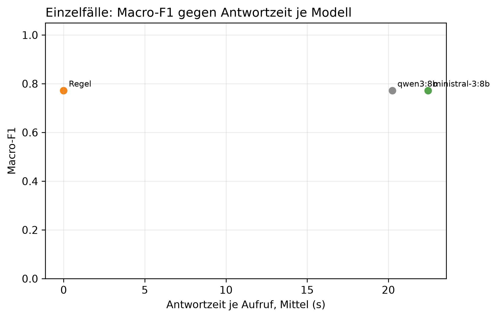

# K3 LLM-Klassifikation und Modellwahl, Läufe k3_008 / k3_seq_008

## Setup

- Läufe (Ebene 1 / Ebene 2): k3_008 / k3_seq_008
- Prompt (Ebene 1 / Ebene 2): v20 / v20
- Modelle: MDL1 qwen3:8b, MDL5 ministral-3:8b
- LLM: temperature 0,0, höchstens 2 Versuche je Aufruf
- Ebene 1: 8 synthetische Fälle, je Modell 1 Aufruf je Fall, Regel (BASELINE) läuft mit
- Ebene 2: Standard-Szenarien, Cutover 2014-04-15, 60 Tage davor, 60 danach, jedes Modell als eigener Kreislauf wie SYS3 mit Adaption
- Ereignisse Ebene 2: control = keine Änderung, step = Dauerlast +100 W, peak_6 = Einzeltag-Spitze +1000 W über 6 h
- Produktivmodell SYS3: ministral-3:8b
- Commit (Ebene 1 / Ebene 2): 67b1e7c (mit lokalen Änderungen) / 67b1e7c (mit lokalen Änderungen)
- Textprüfung: 17 Gerätewörter, 9 Steuerungswörter, Zahlentoleranz 0,5, Fensterzahlen aus dem Prompt 7, 30

## Kennzahlen

| Kennzahl | Wert | Bezug |
|---|---|---|
| Ebene 1: bestes Modell nach Macro-F1 | qwen3:8b | Macro-F1 0,77, Regel 0,77 |
| ministral-3:8b: Ebene 1 richtig | 7/8 | Regel 7/8 |
| ministral-3:8b: Antwortzeit je Aufruf im Mittel [s] | 22,4 | p95 39,5 s, Regel 0,0 s |
| ministral-3:8b: Ebene 2 Ereignis-Arten erkannt | 1/2 | Regel 1/2 |
| ministral-3:8b: Ebene 2 Tage mit anderer Klasse als die Regel | 0 | - |
| ministral-3:8b: ungültige Antworten Ebene 1 | 0 | Ausfalltage Ebene 2: 0 |
| ministral-3:8b: Antworten mit Textverstoß (Ebene 1 / Ebene 2) | 0/8 / 0/14 | Gerät, Steuerung oder Zahl, Datum, Uhrzeit nicht im State |
| ministral-3:8b: Antworten mit fehlenden Belegen (Ebene 1 / Ebene 2) | 1/8 / 0/14 | zitierte Belege passen nicht zur eigenen Klasse |

## Ebene 1: Modellvergleich auf den Einzelfällen

| ID | Modell | richtig | Macro-F1 | ungültig | Ø Versuche | Grounding | Ø s je Aufruf | p95 s |
|---|---|---|---:|---:|---:|---:|---:|---:|
| BASELINE | Regel | 7/8 | 0,8 | 0 | 1,0 | - | 0,0 | 0,0 |
| MDL1 | qwen3:8b | 7/8 | 0,8 | 0 | 1,0 | 0,8 | 20,2 | 34,3 |
| MDL5 | ministral-3:8b | 7/8 | 0,8 | 0 | 1,0 | 0,9 | 22,4 | 39,5 |

## Ebene 1: Antwort je Fall (✓ = richtig, sonst die Antwort, - = ungültig)

| Fall | erwartet | Regel | qwen3:8b | ministral-3:8b |
|---|---|---|---|---|
| absence_drift_down | absence | new_pattern | new_pattern | new_pattern |
| low_single_scale | low | ✓ | ✓ | ✓ |
| measurement_error_missing_day | measurement_error | ✓ | ✓ | ✓ |
| new_pattern | new_pattern | ✓ | ✓ | ✓ |
| new_pattern_at_min_scales_boundary | new_pattern | ✓ | ✓ | ✓ |
| new_pattern_drift_down | new_pattern | ✓ | ✓ | ✓ |
| peak | peak | ✓ | ✓ | ✓ |
| peak_single_sustained_scale | peak | ✓ | ✓ | ✓ |

## Automatische Textprüfung je Modell (Antworten mit Verstoß oder fehlenden Belegen)

| Modell | E1 Antworten | E1 mit Verstoß | E1 Belege fehlen | E1 Gerät genannt | E2 Antworten | E2 mit Verstoß | E2 Belege fehlen | E2 Gerät genannt |
|---|---:|---:|---:|---:|---:|---:|---:|---:|
| qwen3:8b | 8 | 0 | 3 | 3 | 14 | 0 | 0 | 1 |
| ministral-3:8b | 8 | 0 | 1 | 3 | 14 | 0 | 0 | 3 |

## Ebene 2: je Modell über alle Ereignis-Arten

| Modell | Ereignis-Arten erkannt | Tage anders als die Regel | Gate-Tage | Ausfalltage | Meldungen Kontrolle | unknown Kontrolle | Resets Kontrolle |
|---|---|---:|---:|---:|---:|---:|---:|
| Regel | 1/2 | 0 | 14 | 0 | 3 | 0 | 0 |
| qwen3:8b | 1/2 | 0 | 14 | 0 | 3 | 0 | 0 |
| ministral-3:8b | 1/2 | 0 | 14 | 0 | 3 | 0 | 0 |

## Ebene 2: Erkennung je Ereignis, Tag seit Cutover

| config | Ereignis | erwartet | Gate-Tage durch das Ereignis | davon richtig | erster richtiger Tag | Resets |
|---|---|---|---:|---:|---:|---:|
| BASELINE | Einzeltag-Spitze +1000 W über 6 h | peak | 1 | 1 | 1 | 0 |
| BASELINE | Dauerlast +100 W | new_pattern | 1 | 0 | - | 0 |
| MDL1 | Einzeltag-Spitze +1000 W über 6 h | peak | 1 | 1 | 1 | 0 |
| MDL1 | Dauerlast +100 W | new_pattern | 1 | 0 | - | 0 |
| MDL5 | Einzeltag-Spitze +1000 W über 6 h | peak | 1 | 1 | 1 | 0 |
| MDL5 | Dauerlast +100 W | new_pattern | 1 | 0 | - | 0 |

## Ebene 2: Tage, an denen ein Modell anders einordnet als die Regel

| Modell | analysierter Tag | Regel | Modell sagt | in Arten |
|---|---|---|---|---|

## Hinweise

- Ebene 1 prüft, ob ein Modell die Regeln aus dem Prompt nachvollzieht. Der Prompt wurde auf denselben Fällen verbessert, die Quoten begründen deshalb nur die Modellwahl und belegen nicht das Ziel von 80 % richtiger Klassen (dafür E5)
- wenige Fälle: ein Fall sind mehrere Prozentpunkte, eine Klasse hängt teils an einem einzigen Fall
- Macro-F1: Mittel der F1-Werte über die Klassen, die als erwartete Klasse vorkommen
- Grounding: Anteil der für den Fall erwarteten Felder, die das Modell als Beleg zitiert. Die Regel zitiert keine
- Tag seit Cutover = Entscheidungstag: an Tag n meldet das System, eingeordnet ist dabei Tag n-1. Ab Cutover zählt deshalb erst ab Tag 1
- Ebene 2, erkannt: erwartete Klasse an einem Tag, an dem nur das Ereignis das Gate öffnet (gepaart mit dem Kontrolllauf desselben Modells)
- Ebene 2, anders als die Regel: gleiche Art und gleicher analysierter Tag, Regel gegen Modell. Nach einem Reset an verschiedenen Tagen laufen die Reihen auseinander, spätere Abweichungen können daraus folgen
- Antwortzeit: gemessen auf dem Rechner des Laufs, nur zum Vergleich der Modelle untereinander
- Textprüfung: Verstoß heißt, ein Steuerungswort oder eine Zahl, ein Datum oder eine Uhrzeit steht im Text, aber nicht im State des Falls. Ein genanntes Gerät ist nur ein Hinweis, als Möglichkeit ist es erlaubt, ob es als Ursache behauptet wird, beurteilen die Bewertenden. Zahlwörter („sechs Wochen“) und nicht gelistete Geräte findet sie nicht. Die Fensterlängen 7 und 30 aus der Skalenbeschreibung im Prompt gelten als erlaubt
- Fehlende Belege: der Prompt verlangt je Klasse bestimmte Pfade (new_pattern: sustained_drift, level, Streaks, peak/low: level, direction, absence: level, Kalendereintrag, measurement_error: Flag). Geprüft wird gegen die eigene Klasse des Modells, nicht gegen die erwartete. Ebene 1 wird nur für Läufe geprüft, die den State der Fälle in der Antwortdatei speichern, ältere Läufe haben in der Tabelle 0 Antworten
- Antworttexte und Auffälligkeiten der Textprüfung im Anhang, Antworten für alle Modelle in Ebene 1 und Ebene 2. Als CSV: answers_single.csv für Ebene 1, answers_sequence.csv für Ebene 2 nur vom Produktivmodell, result_text_findings.csv für die Auffälligkeiten

## Anhang

### Ebene 1: Precision, Recall und F1 je Klasse

| Modell | Klasse | Precision | Recall | F1 |
|---|---|---:|---:|---:|
| Regel | absence | 0,0 | 0,0 | 0,0 |
| Regel | low | 1,0 | 1,0 | 1,0 |
| Regel | measurement_error | 1,0 | 1,0 | 1,0 |
| Regel | new_pattern | 0,8 | 1,0 | 0,9 |
| Regel | peak | 1,0 | 1,0 | 1,0 |
| qwen3:8b | absence | 0,0 | 0,0 | 0,0 |
| qwen3:8b | low | 1,0 | 1,0 | 1,0 |
| qwen3:8b | measurement_error | 1,0 | 1,0 | 1,0 |
| qwen3:8b | new_pattern | 0,8 | 1,0 | 0,9 |
| qwen3:8b | peak | 1,0 | 1,0 | 1,0 |
| ministral-3:8b | absence | 0,0 | 0,0 | 0,0 |
| ministral-3:8b | low | 1,0 | 1,0 | 1,0 |
| ministral-3:8b | measurement_error | 1,0 | 1,0 | 1,0 |
| ministral-3:8b | new_pattern | 0,8 | 1,0 | 0,9 |
| ministral-3:8b | peak | 1,0 | 1,0 | 1,0 |

### Ebene 1: Antworten der Modelle je Fall

**peak** (erwartet: peak)

- qwen3:8b: peak ✓
  - Erklärung: Gestern war der Stromverbrauch höher als üblich, insbesondere im Vergleich zur letzten Woche um 12 %. Der Tag war im Vergleich zum Durchschnitt für diese Woche um 45 % höher.
  - Empfehlung: Überprüfen Sie, ob ein Gerät neu im Haus ist oder ungewöhnlich verwendet wurde. Prüfen Sie auch, ob die Heizung oder Beleuchtung mehr als gewöhnlich lieferte.
  - Unsicherheit: Es ist nicht bekannt, warum der Verbrauch gestiegen ist, aber es könnte mit einer ungewöhnlichen Nutzung im Haus zusammenhängen.
- ministral-3:8b: peak ✓
  - Erklärung: Gestern war der Stromverbrauch um 45 % höher als an einem normalen Wochentag. Das System hat das bereits seit dem 15. Dezember bemerkt.
  - Empfehlung: Überprüfen Sie, ob gestern ungewöhnlich viel Strom verbraucht wurde – etwa durch längeres Heizen, zusätzliche Geräte oder Gäste. Falls nichts Auffälliges auffällt, könnte ein technischer Grund vorliegen.
  - Unsicherheit: Ob der erhöhte Verbrauch auf eine konkrete Ursache zurückzuführen ist, bleibt unklar.

**new_pattern** (erwartet: new_pattern)

- qwen3:8b: new_pattern ✓
  - Erklärung: Die Stromverbrauchsstufe war gestern höher als in der letzten Woche und im Vergleich zum langen Zeitraum. Der Anstieg beträgt etwa 38 % gegenüber der letzten Woche und hat sich seit dem 9. Dezember fortgesetzt.
  - Empfehlung: Überprüfen Sie, ob etwas im Haushalt geändert wurde, wie neue Geräte oder eine erhöhte Nutzung. Es könnte auch eine Veränderung im Verhalten der Bewohner sein.
  - Unsicherheit: Die genaue Ursache für den erhöhten Verbrauch bleibt unklar.
- ministral-3:8b: new_pattern ✓
  - Erklärung: Gestern war der Stromverbrauch im Vergleich zu einem normalen Wochentag um etwa 38 % höher und hat sich seit dem 9. Dezember auf dieser Ebene gehalten. Auch die letzten sieben Tage waren insgesamt rund 36 % höher als sonst.
  - Empfehlung: Überprüfen Sie, ob sich der Stromverbrauch durch neue Geräte, längeres Heizen oder andere Änderungen erhöht hat. Da dies seit dem 9. Dezember anhält, könnte auch ein neues Mietverhältnis oder eine Umstellung auf einen anderen Tarif eine Rolle spielen.
  - Unsicherheit: Ob die Ursache im Haushalt liegt oder äußere Faktoren wie die Jahreszeit eine Rolle spielen, bleibt unklar.

**low_single_scale** (erwartet: low)

- qwen3:8b: low ✓
  - Erklärung: Gestern war der Stromverbrauch niedriger als üblich, um 30 % weniger als im Vergleich zur letzten Woche.
  - Empfehlung: Überprüfen Sie, ob jemand zu Hause war oder ob etwas im Haushalt verändert wurde. Wenn nichts Neues hinzugekommen ist, könnte es mit der Jahreszeit zusammenhängen.
  - Unsicherheit: Es ist nicht bekannt, warum der Verbrauch niedriger war.
- ministral-3:8b: low ✓
  - Erklärung: Gestern war der Stromverbrauch um etwa 30 % niedriger als an einem typischen Wochentag. Das System berücksichtigt das bei seiner Prognose.
  - Empfehlung: Überprüfen Sie, ob jemand länger als geplant weg war oder ob der Verbrauch durch ungewöhnliche Umstände wie weniger Heizbedarf gesunken ist. Da kein Kalender verfügbar ist, könnte auch ein technischer Grund vorliegen.
  - Unsicherheit: Ob und warum der Verbrauch so niedrig war, bleibt unklar.

**peak_single_sustained_scale** (erwartet: peak)

- qwen3:8b: peak ✓
  - Erklärung: Gestern war der Stromverbrauch höher als üblich, insbesondere im Vergleich zur letzten Woche um 40 %. Der Anstieg hielt sich mehrere Tage lang.
  - Empfehlung: Überprüfen Sie, ob ein Gerät neu im Haus ist oder ungewöhnlich verwendet wurde. Prüfen Sie auch, ob die Heizung oder Beleuchtung anders läuft.
  - Unsicherheit: Die genaue Ursache bleibt unklar, da keine Kalenderinformationen vorliegen.
- ministral-3:8b: peak ✓
  - Erklärung: Gestern war der Stromverbrauch im Vergleich zu einem normalen Wochentag um etwa 40 % höher als sonst. Das ist seit dem 10. Dezember so.
  - Empfehlung: Überprüfen Sie, ob jemand länger zu Hause war oder ein neues Gerät genutzt wurde. Auch die Heizung oder ungewöhnliche Aktivitäten wie Gäste könnten den Verbrauch erhöht haben.
  - Unsicherheit: Ob es sich um eine vorübergehende Ursache handelt, lässt sich erst nach einigen Tagen erkennen.

**new_pattern_at_min_scales_boundary** (erwartet: new_pattern)

- qwen3:8b: new_pattern ✓
  - Erklärung: Die Stromverbrauchsstufe war gestern höher als üblich, insbesondere im Vergleich zur letzten Woche. Der Anstieg beträgt etwa 30 % und hat sich seit dem 10. Dezember fortgesetzt.
  - Empfehlung: Überprüfen Sie, ob etwas im Haushalt geändert wurde, wie neue Geräte oder eine erhöhte Nutzung. Es könnte auch eine höhere Heizungsnutzung im Winter sein.
  - Unsicherheit: Die genaue Ursache bleibt unklar, da keine Kalenderereignisse vorliegen, die den Verbrauch erklären könnten.
- ministral-3:8b: new_pattern ✓
  - Erklärung: Gestern war der Stromverbrauch im Vergleich zu einem normalen Wochentag um 35 % höher und hat sich seit dem 10. Dezember auf dieser Ebene gehalten.
  - Empfehlung: Überprüfen Sie, ob sich der Stromverbrauch durch neue Geräte, längere Nutzung von Heizung oder Beleuchtung oder zusätzliche Personen im Haushalt erhöht hat.
  - Unsicherheit: Ob und warum sich der Verbrauch dauerhaft verändert hat, bleibt unklar.

**measurement_error_missing_day** (erwartet: measurement_error)

- qwen3:8b: measurement_error ✓
  - Erklärung: Die Messung gestern ist nicht zuverlässig, da der Wert implausibel ist.
  - Empfehlung: Überprüfen Sie den Stromzähler und die Verbindung, um sicherzustellen, dass keine technischen Probleme vorliegen.
  - Unsicherheit: Die genaue Ursache der unzuverlässigen Messung ist nicht bekannt.
- ministral-3:8b: measurement_error ✓
  - Erklärung: Der gemessene Wert von gestern ist nicht vertrauenswürdig.
  - Empfehlung: Überprüfen Sie, ob der Zähler oder die Verbindung korrekt funktioniert. Das System berücksichtigt das bei seiner Prognose.
  - Unsicherheit: Es liegen keine zuverlässigen Daten für gestern vor.

**new_pattern_drift_down** (erwartet: new_pattern)

- qwen3:8b: new_pattern ✓
  - Erklärung: Die Verbrauchsdaten zeigen, dass der Stromverbrauch in den letzten Tagen im Vergleich zur letzten Woche um 40 % und im Vergleich zum gesamten Monat um 25 % niedriger war. Dieser Trend setzte sich seit dem 9. Dezember fort.
  - Empfehlung: Überprüfen Sie, ob sich etwas im Haushalt geändert hat, wie z. B. ein neues Gerät oder eine Veränderung im Heizverhalten. Falls nichts verändert wurde, könnte der niedrigere Verbrauch mit dem Winter zusammenhängen.
  - Unsicherheit: Die genaue Ursache für den niedrigen Verbrauch bleibt unklar.
- ministral-3:8b: new_pattern ✓
  - Erklärung: Der Stromverbrauch war gestern im Vergleich zur letzten Woche um etwa 40 % niedriger und liegt seit dem 9. Dezember auf diesem Niveau. Seit Anfang Dezember verbraucht die Wohnung insgesamt auch etwa 25 % weniger als sonst.
  - Empfehlung: Überprüfen Sie, ob sich der Stromverbrauch in den letzten Wochen verändert hat – etwa durch weniger Heizung oder Beleuchtung, weniger Zeit zu Hause oder neue Geräte. Falls nichts auffällt, könnte es ein neues Muster sein.
  - Unsicherheit: Ob und warum sich der Verbrauch dauerhaft geändert hat, bleibt unklar.

**absence_drift_down** (erwartet: absence)

- qwen3:8b: new_pattern
  - Erklärung: Die Verbrauchsdaten zeigen, dass der Durchschnitt der letzten Woche und des letzten Monats niedriger war als üblich. Die Reduzierung beträgt etwa 40 % im Vergleich zur letzten Woche und 25 % im Vergleich zum letzten Monat. Das System erkennt eine anhaltende Abnahme.
  - Empfehlung: Überprüfen Sie, ob sich etwas im Haushalt geändert hat, wie zum Beispiel ein Abwesenheitsurlaub oder eine Veränderung im Heizverhalten. Die Daten deuten auf eine anhaltende Reduzierung hin.
  - Unsicherheit: Die genaue Ursache der Reduzierung bleibt unklar.
- ministral-3:8b: new_pattern
  - Erklärung: Gestern war der Stromverbrauch im Vergleich zur letzten Woche um etwa 40 % niedriger und seit dem 9. Dezember so. Seit Anfang Dezember liegt er auch im Monatsdurchschnitt um rund 25 % unter dem üblichen Wert.
  - Empfehlung: Da der Verbrauch seit dem Urlaub deutlich niedriger ist, prüfen Sie bitte, ob sich etwas am Haushalt geändert hat – etwa wer weniger zu Hause war oder ob Geräte nicht mehr genutzt wurden. Das System berücksichtigt das bei seiner Prognose.
  - Unsicherheit: Ob die Abwesenheit der Ursache für den niedrigeren Verbrauch ist, lässt sich nur mit dem Kalender überprüfen.

### Ebene 2: Antworten von qwen3:8b, ein Tag mit allen Arten, in denen derselbe Text kam

- 2014-03-01: peak (Arten: control, peak_6, step)
  - Erklärung: Gestern war der Stromverbrauch höher als üblich, insbesondere in den frühen Morgenstunden. Der Verbrauch war im Vergleich zur letzten Woche um etwa 10 % erhöht.
  - Empfehlung: Überprüfen Sie, ob ein Gerät gestern ungewöhnlich oft verwendet wurde oder ob jemand zu Hause war, der den Verbrauch erhöht hat.
  - Unsicherheit: Es ist nicht bekannt, ob der Verbrauch aufgrund von Wetter oder anderen Faktoren verändert wurde.
- 2014-03-03: measurement_error (Arten: control, peak_6, step)
  - Erklärung: Die Messung gestern ist nicht zuverlässig, da der Wert implausibel ist. Die Verbrauchsdaten für die letzte Woche und den letzten Monat sind jedoch leicht erhöht.
  - Empfehlung: Überprüfen Sie den Stromzähler und die Verbindung, da die Messung nicht zuverlässig ist. Falls der Verbrauch weiterhin erhöht bleibt, können Sie die Ursache im Haushalt prüfen.
  - Unsicherheit: Die genaue Ursache der erhöhten Verbrauchsdaten ist unsicher, da die Messung nicht zuverlässig ist.
- 2014-03-15: peak (Arten: control, peak_6, step)
  - Erklärung: Gestern war der Stromverbrauch höher als üblich, insbesondere in den frühen Morgenstunden. Der Verbrauch war im Vergleich zur letzten Woche um etwa 4 % erhöht.
  - Empfehlung: Überprüfen Sie, ob ein Gerät gestern ungewöhnlich oft verwendet wurde oder ob jemand zu Hause war. Falls nichts auffällt, könnte es sich um einen zufälligen Spitzenverbrauch handeln.
  - Unsicherheit: Es ist nicht bekannt, warum der Verbrauch gestiegen ist, aber es gab keine Kalenderereignisse, die dies erklären könnten.
- 2014-04-12: low (Arten: control, peak_6, step)
  - Erklärung: Gestern war der Stromverbrauch deutlich niedriger als üblich, insbesondere im Vergleich zur letzten Woche. Der Verbrauch lag um etwa 66 % unter dem erwarteten Wert.
  - Empfehlung: Überprüfen Sie, ob jemand zu Hause war oder ob etwas im Haushalt verändert wurde. Ein niedriger Verbrauch kann auf fehlende Nutzung oder eine Absence hinweisen.
  - Unsicherheit: Es ist nicht bekannt, ob ein Kalenderereignis den Verbrauch beeinflusst hat, da keine Kalenderdaten verfügbar waren.
- 2014-04-15: peak (Arten: peak_6)
  - Erklärung: Gestern war der Stromverbrauch deutlich höher als üblich, insbesondere im Vergleich zur letzten Woche. Der Verbrauch lag um 96 % über dem normalen Niveau für einen Dienstag.
  - Empfehlung: Überprüfen Sie, ob etwas im Haushalt verändert wurde, wie ein neues Gerät oder eine ungewöhnliche Nutzung. Achten Sie auch auf den Heizungsbetrieb oder Besuche.
  - Unsicherheit: Es ist nicht bekannt, warum der Verbrauch gestiegen ist, aber es könnte mit einer ungewöhnlichen Nutzung oder einem Gerät zusammenhängen.
- 2014-04-17: peak (Arten: step)
  - Erklärung: Gestern war der Stromverbrauch deutlich höher als üblich, insbesondere im Vergleich zur letzten Woche. Der Verbrauch lag um 73 % über dem normalen Niveau für einen Dienstag.
  - Empfehlung: Überprüfen Sie, ob etwas im Haushalt verändert wurde, wie ein neues Gerät oder eine erhöhte Nutzung. Achten Sie auch auf mögliche Störungen im Stromnetz.
  - Unsicherheit: Es ist nicht bekannt, ob der hohe Verbrauch auf einen vorübergehenden Effekt zurückgeht oder auf eine dauerhafte Änderung hinweist.

### Ebene 2: Antworten von ministral-3:8b, ein Tag mit allen Arten, in denen derselbe Text kam

- 2014-03-01: peak (Arten: control, peak_6, step)
  - Erklärung: Gestern war der Verlauf des Tages ungewöhnlich, mit einem kurzen hohen Spitzenverbrauch. Der Verbrauch lag im Vergleich zur letzten Woche um etwa 10 % höher.
  - Empfehlung: Überprüfen Sie, ob gestern etwas Ungewöhnliches passiert ist, z. B. ob jemand länger zu Hause war oder ein Gerät ungewöhnlich lange genutzt wurde.
  - Unsicherheit: Ob es sich um einen einmaligen Vorfall handelt oder eine neue Gewohnheit, bleibt unklar.
- 2014-03-03: measurement_error (Arten: control, peak_6, step)
  - Erklärung: Der gemessene Wert von gestern ist nicht vertrauenswürdig und kann daher keine Aussage über den tatsächlichen Verbrauch treffen.
  - Empfehlung: Überprüfen Sie bitte, ob der Zähler oder die Verbindung korrekt funktioniert. Das System berücksichtigt das bei seiner Prognose nicht.
  - Unsicherheit: Ob und wie sich der Verbrauch tatsächlich verändert hat, ist unklar.
- 2014-03-15: peak (Arten: control, peak_6, step)
  - Erklärung: Gestern war der Verlauf des Tages ungewöhnlich, mit einem kurzen hohen Verbrauchsspitzen. Im Vergleich zur letzten Woche lag der Gesamtverbrauch um etwa 4 % höher.
  - Empfehlung: Überprüfen Sie, ob gestern ungewöhnliche Geräte genutzt wurden oder jemand länger zu Hause war. Vielleicht hat sich auch die Heizung oder Beleuchtung verändert.
  - Unsicherheit: Ob ein geplanter Urlaub oder eine Abwesenheit den Verbrauch beeinflusst haben könnte, ist nicht bekannt.
- 2014-04-12: low (Arten: control, peak_6, step)
  - Erklärung: Gestern war der Stromverbrauch um etwa zwei Drittel niedriger als an einem typischen Wochentag.
  - Empfehlung: Überprüfen Sie, ob jemand zu Hause war oder ob ein Gerät ungewöhnlich wenig genutzt wurde. Ein geplanter Urlaub oder eine Abwesenheit könnte den Unterschied erklären.
  - Unsicherheit: Ob es einen Grund für die starke Verringerung gibt, ist unklar.
- 2014-04-15: peak (Arten: peak_6)
  - Erklärung: Gestern war der Stromverbrauch im Vergleich zum üblichen Wert für einen Dienstag um etwa 96 % höher als sonst.
  - Empfehlung: Überprüfen Sie, ob gestern ungewöhnlich viele Geräte gleichzeitig genutzt wurden oder ob neue Elektrogeräte im Einsatz waren. Auch ein ungewöhnliches Wetter (z. B. starke Kälte) könnte den Verbrauch erhöht haben.
  - Unsicherheit: Ob es sich um einen einmaligen Ausreißer handelt, lässt sich erst nach weiteren Tagen beurteilen.
- 2014-04-17: peak (Arten: step)
  - Erklärung: Gestern war der Stromverbrauch im Vergleich zu einem normalen Donnerstag um etwa 73 % höher als sonst.
  - Empfehlung: Überprüfen Sie, ob gestern ungewöhnlich viele Geräte gleichzeitig liefen oder ob jemand länger zu Hause war als sonst. Vielleicht hat auch ein neues Gerät den Verbrauch erhöht.
  - Unsicherheit: Ob es sich um einen einmaligen Ausreißer handelt oder etwas dauerhaft verändert wurde, lässt sich erst nach einigen Tagen erkennen.

### Auffälligkeiten der Textprüfung

| Ebene | Modell | Fall oder Tag | Verstoß | fehlende Belege | Gerät genannt (Hinweis) |
|---|---|---|---|---|---|
| Ebene 2 | qwen3:8b | 2014-04-15 peak_6 |  |  | heizung |
| Ebene 2 | ministral-3:8b | 2014-03-15 control |  |  | heizung |
| Ebene 2 | ministral-3:8b | 2014-03-15 peak_6 |  |  | heizung |
| Ebene 2 | ministral-3:8b | 2014-03-15 step |  |  | heizung |
| Ebene 1 | qwen3:8b | absence_drift_down |  | anomaly.level |  |
| Ebene 1 | qwen3:8b | new_pattern |  | anomaly.scale_anomaly_streak_days.weekly |  |
| Ebene 1 | qwen3:8b | new_pattern_at_min_scales_boundary |  | anomaly.scale_anomaly_streak_days.weekly | heizung |
| Ebene 1 | qwen3:8b | peak |  |  | heizung |
| Ebene 1 | qwen3:8b | peak_single_sustained_scale |  |  | heizung |
| Ebene 1 | ministral-3:8b | new_pattern_at_min_scales_boundary |  | anomaly.scale_anomaly_streak_days.weekly | heizung |
| Ebene 1 | ministral-3:8b | new_pattern_drift_down |  |  | heizung |
| Ebene 1 | ministral-3:8b | peak_single_sustained_scale |  |  | heizung |
