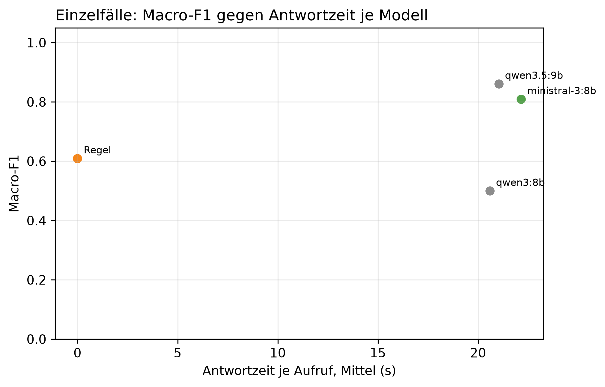

# K3 LLM-Klassifikation und Modellwahl, Läufe k3_009 / k3_seq_009

## Setup

- Läufe (Ebene 1 / Ebene 2): k3_009 / k3_seq_009
- Prompt (Ebene 1 / Ebene 2): v21 / v21
- Modelle: MDL1 qwen3:8b, MDL2 qwen3.5:9b, MDL5 ministral-3:8b
- LLM: temperature 0,0, höchstens 2 Versuche je Aufruf
- Ebene 1: 9 synthetische Fälle, je Modell 1 Aufruf je Fall, Regel (BASELINE) läuft mit
- Ebene 2: Standard-Szenarien, Cutover 2014-04-15, 60 Tage davor, 60 danach, jedes Modell als eigener Kreislauf wie SYS3 mit Adaption
- Ereignisse Ebene 2: control = keine Änderung, step = Dauerlast +100 W, peak_6 = Einzeltag-Spitze +1000 W über 6 h
- Produktivmodell SYS3: ministral-3:8b
- Commit (Ebene 1 / Ebene 2): df21bc9 (mit lokalen Änderungen) / df21bc9 (mit lokalen Änderungen)
- Textprüfung: 17 Gerätewörter, 9 Steuerungswörter, Zahlentoleranz 0,5, Fensterzahlen aus dem Prompt 7, 30

## Kennzahlen

| Kennzahl | Wert | Bezug |
|---|---|---|
| Ebene 1: bestes Modell nach Macro-F1 | qwen3.5:9b | Macro-F1 0,86, Regel 0,61 |
| ministral-3:8b: Ebene 1 richtig | 8/9 | Regel 7/9 |
| ministral-3:8b: Antwortzeit je Aufruf im Mittel [s] | 22,1 | p95 38,7 s, Regel 0,0 s |
| ministral-3:8b: Ebene 2 Ereignis-Arten erkannt | 2/2 | Regel 2/2 |
| ministral-3:8b: Ebene 2 Tage mit anderer Klasse als die Regel | 62 | 2014-03-05 new_pattern statt low; 2014-03-06 unknown statt low; 2014-03-07 normal statt low; 2014-03-08 normal statt peak; 2014-03-09 normal statt peak; 2014-03-10 normal statt low; 2014-03-15 normal statt peak; 2014-03-19 new_pattern statt normal; 2014-04-01 new_pattern statt normal; 2014-04-04 normal statt low; 2014-04-05 normal statt low; 2014-04-06 normal statt low; 2014-04-12 normal statt low; 2014-04-14 new_pattern statt normal; 2014-04-15 normal statt peak; 2014-04-17 normal statt peak; 2014-04-18 normal statt low; 2014-04-18 normal statt peak; 2014-04-19 normal statt peak; 2014-04-20 normal statt low; 2014-04-21 normal statt low; 2014-04-24 normal statt peak; 2014-04-25 normal statt peak; 2014-04-26 normal statt peak; 2014-04-27 new_pattern statt peak; 2014-04-28 new_pattern statt normal; 2014-04-28 normal statt low; 2014-04-29 normal statt peak; 2014-04-30 peak statt normal; 2014-04-30 normal statt peak; 2014-05-01 normal statt peak; 2014-05-02 normal statt peak; 2014-05-03 normal statt peak; 2014-05-04 normal statt peak; 2014-05-05 normal statt peak; 2014-05-06 normal statt low; 2014-05-07 normal statt peak; 2014-05-08 normal statt peak; 2014-05-09 normal statt peak; 2014-05-10 normal statt peak; 2014-05-11 new_pattern statt normal; 2014-05-11 normal statt peak; 2014-05-12 normal statt peak; 2014-05-13 low statt normal; 2014-05-13 normal statt peak; 2014-05-14 peak statt normal; 2014-05-14 normal statt peak; 2014-05-15 normal statt low; 2014-05-16 normal statt new_pattern; 2014-05-17 low statt normal; 2014-05-20 low statt normal; 2014-05-22 new_pattern statt normal; 2014-05-23 normal statt peak; 2014-05-24 new_pattern statt normal; 2014-05-26 normal statt low; 2014-05-27 normal statt low; 2014-05-28 normal statt low; 2014-05-29 normal statt low; 2014-05-30 normal statt low; 2014-05-30 new_pattern statt low; 2014-05-31 normal statt low; 2014-05-31 peak statt low; 2014-06-01 normal statt peak; 2014-06-02 normal statt peak; 2014-06-03 normal statt low; 2014-06-04 normal statt low; 2014-06-04 new_pattern statt low; 2014-06-05 normal statt low; 2014-06-05 normal statt peak; 2014-06-05 normal statt new_pattern; 2014-06-06 normal statt peak; 2014-06-12 new_pattern statt normal; 2014-06-13 low statt normal |
| ministral-3:8b: ungültige Antworten Ebene 1 | 0 | Ausfalltage Ebene 2: 0 |
| ministral-3:8b: Antworten mit Textverstoß (Ebene 1 / Ebene 2) | 1/9 / 0/37 | Gerät, Steuerung oder Zahl, Datum, Uhrzeit nicht im State |
| ministral-3:8b: Antworten mit fehlenden Belegen (Ebene 1 / Ebene 2) | 0/9 / 10/37 | zitierte Belege passen nicht zur eigenen Klasse |

## Ebene 1: Modellvergleich auf den Einzelfällen

| ID | Modell | richtig | Macro-F1 | ungültig | Ø Versuche | Grounding | Ø s je Aufruf | p95 s |
|---|---|---|---:|---:|---:|---:|---:|---:|
| MDL2 | qwen3.5:9b | 7/9 | 0,9 | 0 | 1,0 | 0,8 | 21,0 | 36,2 |
| MDL5 | ministral-3:8b | 8/9 | 0,8 | 0 | 1,0 | 0,9 | 22,1 | 38,7 |
| BASELINE | Regel | 7/9 | 0,6 | 0 | 1,0 | - | 0,0 | 0,0 |
| MDL1 | qwen3:8b | 5/9 | 0,5 | 0 | 1,0 | 0,7 | 20,6 | 34,9 |

## Ebene 1: Antwort je Fall (✓ = richtig, sonst die Antwort, - = ungültig)

| Fall | erwartet | qwen3.5:9b | ministral-3:8b | Regel | qwen3:8b |
|---|---|---|---|---|---|
| absence_drift_down | absence | ✓ | ✓ | new_pattern | new_pattern |
| low_single_scale | low | ✓ | ✓ | ✓ | ✓ |
| measurement_error_missing_day | measurement_error | ✓ | ✓ | ✓ | ✓ |
| new_pattern | new_pattern | peak | ✓ | ✓ | peak |
| new_pattern_at_min_scales_boundary | new_pattern | peak | ✓ | ✓ | peak |
| new_pattern_drift_down | new_pattern | ✓ | ✓ | ✓ | ✓ |
| normal_single_sustained_scale | normal | ✓ | new_pattern | peak | new_pattern |
| peak | peak | ✓ | ✓ | ✓ | ✓ |
| peak_single_sustained_scale | peak | ✓ | ✓ | ✓ | ✓ |

## Automatische Textprüfung je Modell (Antworten mit Verstoß oder fehlenden Belegen)

| Modell | E1 Antworten | E1 mit Verstoß | E1 Belege fehlen | E1 Gerät genannt | E2 Antworten | E2 mit Verstoß | E2 Belege fehlen | E2 Gerät genannt |
|---|---:|---:|---:|---:|---:|---:|---:|---:|
| qwen3.5:9b | 9 | 1 | 0 | 3 | 51 | 0 | 0 | 3 |
| ministral-3:8b | 9 | 1 | 0 | 6 | 37 | 0 | 10 | 16 |
| qwen3:8b | 9 | 1 | 0 | 3 | 65 | 12 | 0 | 15 |

## Ebene 2: je Modell über alle Ereignis-Arten

| Modell | Ereignis-Arten erkannt | Tage anders als die Regel | Gate-Tage | Ausfalltage | Meldungen Kontrolle | unknown Kontrolle | Resets Kontrolle |
|---|---|---:|---:|---:|---:|---:|---:|
| qwen3.5:9b | 0/2 | 60 | 51 | 0 | 13 | 1 | 7 |
| ministral-3:8b | 2/2 | 62 | 37 | 0 | 15 | 1 | 8 |
| Regel | 2/2 | 0 | 101 | 0 | 25 | 0 | 0 |
| qwen3:8b | 1/2 | 54 | 65 | 0 | 13 | 1 | 6 |

## Ebene 2: Erkennung je Ereignis, Tag seit Cutover

| config | Ereignis | erwartet | Gate-Tage durch das Ereignis | davon richtig | erster richtiger Tag | Resets |
|---|---|---|---:|---:|---:|---:|
| BASELINE | Einzeltag-Spitze +1000 W über 6 h | peak | 6 | 2 | 1 | 1 |
| BASELINE | Dauerlast +100 W | new_pattern | 23 | 1 | 32 | 1 |
| MDL1 | Einzeltag-Spitze +1000 W über 6 h | peak | 9 | 0 | - | 3 |
| MDL1 | Dauerlast +100 W | new_pattern | 1 | 1 | 32 | 4 |
| MDL2 | Einzeltag-Spitze +1000 W über 6 h | peak | 0 | 0 | - | 4 |
| MDL2 | Dauerlast +100 W | new_pattern | 0 | 0 | - | 4 |
| MDL5 | Einzeltag-Spitze +1000 W über 6 h | peak | 4 | 3 | 47 | 2 |
| MDL5 | Dauerlast +100 W | new_pattern | 3 | 3 | 13 | 3 |

## Ebene 2: Tage, an denen ein Modell anders einordnet als die Regel

| Modell | analysierter Tag | Regel | Modell sagt | in Arten |
|---|---|---|---|---|
| qwen3:8b | 2014-03-05 | low | new_pattern | control, step, peak_6 |
| qwen3:8b | 2014-03-06 | low | unknown | control, step, peak_6 |
| qwen3:8b | 2014-03-07 | low | normal | control, step, peak_6 |
| qwen3:8b | 2014-03-08 | peak | normal | control, step, peak_6 |
| qwen3:8b | 2014-03-09 | peak | normal | control, step, peak_6 |
| qwen3:8b | 2014-03-10 | low | normal | control, step, peak_6 |
| qwen3:8b | 2014-03-15 | peak | normal | control, step, peak_6 |
| qwen3:8b | 2014-03-27 | normal | peak | control, step, peak_6 |
| qwen3:8b | 2014-04-01 | normal | peak | control, step, peak_6 |
| qwen3:8b | 2014-04-04 | low | new_pattern | control, step, peak_6 |
| qwen3:8b | 2014-04-05 | low | normal | control, step, peak_6 |
| qwen3:8b | 2014-04-06 | low | normal | control, step, peak_6 |
| qwen3:8b | 2014-04-12 | low | normal | control, step, peak_6 |
| qwen3:8b | 2014-04-15 | peak | normal | peak_6 |
| qwen3:8b | 2014-04-17 | peak | new_pattern | control, step |
| qwen3:8b | 2014-04-17 | peak | normal | peak_6 |
| qwen3:8b | 2014-04-18 | low | normal | control |
| qwen3:8b | 2014-04-18 | peak | normal | step |
| qwen3:8b | 2014-04-18 | low | new_pattern | peak_6 |
| qwen3:8b | 2014-04-19 | peak | normal | control, peak_6 |
| qwen3:8b | 2014-04-20 | low | normal | control |
| qwen3:8b | 2014-04-21 | low | normal | control |
| qwen3:8b | 2014-04-24 | peak | normal | step |
| qwen3:8b | 2014-04-25 | peak | normal | step |
| qwen3:8b | 2014-04-26 | peak | normal | step |
| qwen3:8b | 2014-04-27 | peak | normal | step |
| qwen3:8b | 2014-04-28 | low | normal | step |
| qwen3:8b | 2014-04-29 | peak | normal | step |
| qwen3:8b | 2014-04-30 | peak | normal | step |
| qwen3:8b | 2014-05-01 | peak | normal | step |
| qwen3:8b | 2014-05-02 | peak | normal | step |
| qwen3:8b | 2014-05-03 | peak | normal | step |
| qwen3:8b | 2014-05-04 | peak | normal | step |
| qwen3:8b | 2014-05-05 | peak | normal | step |
| qwen3:8b | 2014-05-06 | low | normal | step |
| qwen3:8b | 2014-05-07 | peak | normal | step |
| qwen3:8b | 2014-05-08 | peak | normal | step |
| qwen3:8b | 2014-05-09 | peak | normal | step |
| qwen3:8b | 2014-05-10 | peak | normal | step |
| qwen3:8b | 2014-05-11 | peak | normal | step |
| qwen3:8b | 2014-05-12 | peak | normal | step |
| qwen3:8b | 2014-05-13 | peak | normal | step |
| qwen3:8b | 2014-05-14 | peak | normal | step |
| qwen3:8b | 2014-05-15 | low | normal | step |
| qwen3:8b | 2014-05-17 | normal | new_pattern | control |
| qwen3:8b | 2014-05-22 | normal | low | peak_6 |
| qwen3:8b | 2014-05-23 | peak | normal | peak_6 |
| qwen3:8b | 2014-05-24 | normal | low | peak_6 |
| qwen3:8b | 2014-05-25 | normal | low | peak_6 |
| qwen3:8b | 2014-05-30 | low | new_pattern | control, step, peak_6 |
| qwen3:8b | 2014-05-31 | low | peak | control, step, peak_6 |
| qwen3:8b | 2014-06-03 | low | normal | control, step, peak_6 |
| qwen3:8b | 2014-06-04 | low | normal | control, step, peak_6 |
| qwen3:8b | 2014-06-05 | low | normal | control |
| qwen3:8b | 2014-06-05 | peak | normal | step |
| qwen3:8b | 2014-06-05 | new_pattern | normal | peak_6 |
| qwen3:8b | 2014-06-06 | peak | normal | control, step |
| qwen3:8b | 2014-06-12 | normal | new_pattern | control, step, peak_6 |
| qwen3:8b | 2014-06-13 | normal | low | control, step, peak_6 |
| qwen3.5:9b | 2014-03-05 | low | new_pattern | control, step, peak_6 |
| qwen3.5:9b | 2014-03-06 | low | unknown | control, step, peak_6 |
| qwen3.5:9b | 2014-03-07 | low | normal | control, step, peak_6 |
| qwen3.5:9b | 2014-03-08 | peak | normal | control, step, peak_6 |
| qwen3.5:9b | 2014-03-09 | peak | normal | control, step, peak_6 |
| qwen3.5:9b | 2014-03-10 | low | normal | control, step, peak_6 |
| qwen3.5:9b | 2014-03-15 | peak | normal | control, step, peak_6 |
| qwen3.5:9b | 2014-03-27 | normal | peak | control, step, peak_6 |
| qwen3.5:9b | 2014-03-31 | normal | new_pattern | control, step, peak_6 |
| qwen3.5:9b | 2014-04-04 | low | normal | control, step, peak_6 |
| qwen3.5:9b | 2014-04-05 | low | normal | control, step, peak_6 |
| qwen3.5:9b | 2014-04-06 | low | normal | control, step, peak_6 |
| qwen3.5:9b | 2014-04-12 | low | normal | control, step, peak_6 |
| qwen3.5:9b | 2014-04-13 | normal | new_pattern | control, step, peak_6 |
| qwen3.5:9b | 2014-04-15 | peak | normal | peak_6 |
| qwen3.5:9b | 2014-04-17 | peak | normal | control, step, peak_6 |
| qwen3.5:9b | 2014-04-18 | low | normal | control, peak_6 |
| qwen3.5:9b | 2014-04-18 | peak | normal | step |
| qwen3.5:9b | 2014-04-19 | peak | normal | control, peak_6 |
| qwen3.5:9b | 2014-04-20 | low | normal | control |
| qwen3.5:9b | 2014-04-21 | low | normal | control |
| qwen3.5:9b | 2014-04-24 | peak | normal | step |
| qwen3.5:9b | 2014-04-25 | peak | normal | step |
| qwen3.5:9b | 2014-04-26 | normal | new_pattern | control, peak_6 |
| qwen3.5:9b | 2014-04-26 | peak | new_pattern | step |
| qwen3.5:9b | 2014-04-27 | peak | normal | step |
| qwen3.5:9b | 2014-04-28 | low | normal | step |
| qwen3.5:9b | 2014-04-29 | peak | normal | step |
| qwen3.5:9b | 2014-04-30 | peak | normal | step |
| qwen3.5:9b | 2014-05-01 | peak | normal | step |
| qwen3.5:9b | 2014-05-02 | peak | normal | step |
| qwen3.5:9b | 2014-05-03 | peak | normal | step |
| qwen3.5:9b | 2014-05-04 | peak | normal | step |
| qwen3.5:9b | 2014-05-05 | peak | normal | step |
| qwen3.5:9b | 2014-05-06 | low | normal | step |
| qwen3.5:9b | 2014-05-07 | peak | normal | step |
| qwen3.5:9b | 2014-05-08 | peak | normal | step |
| qwen3.5:9b | 2014-05-09 | peak | normal | step |
| qwen3.5:9b | 2014-05-10 | normal | new_pattern | control, peak_6 |
| qwen3.5:9b | 2014-05-10 | peak | new_pattern | step |
| qwen3.5:9b | 2014-05-11 | peak | normal | step |
| qwen3.5:9b | 2014-05-12 | peak | normal | step |
| qwen3.5:9b | 2014-05-13 | normal | low | control, peak_6 |
| qwen3.5:9b | 2014-05-13 | peak | low | step |
| qwen3.5:9b | 2014-05-14 | normal | peak | control, peak_6 |
| qwen3.5:9b | 2014-05-15 | low | normal | step |
| qwen3.5:9b | 2014-05-16 | new_pattern | normal | step |
| qwen3.5:9b | 2014-05-20 | normal | low | control, step, peak_6 |
| qwen3.5:9b | 2014-05-23 | peak | normal | peak_6 |
| qwen3.5:9b | 2014-05-24 | normal | new_pattern | control, step, peak_6 |
| qwen3.5:9b | 2014-05-26 | low | normal | peak_6 |
| qwen3.5:9b | 2014-05-27 | low | normal | peak_6 |
| qwen3.5:9b | 2014-05-28 | low | normal | peak_6 |
| qwen3.5:9b | 2014-05-29 | low | normal | peak_6 |
| qwen3.5:9b | 2014-05-30 | low | normal | control, step, peak_6 |
| qwen3.5:9b | 2014-05-31 | low | normal | control, step, peak_6 |
| qwen3.5:9b | 2014-06-01 | peak | normal | control, step, peak_6 |
| qwen3.5:9b | 2014-06-02 | peak | normal | control, step, peak_6 |
| qwen3.5:9b | 2014-06-03 | low | normal | control, step, peak_6 |
| qwen3.5:9b | 2014-06-04 | low | normal | control, step, peak_6 |
| qwen3.5:9b | 2014-06-05 | low | normal | control |
| qwen3.5:9b | 2014-06-05 | peak | normal | step |
| qwen3.5:9b | 2014-06-05 | new_pattern | normal | peak_6 |
| qwen3.5:9b | 2014-06-06 | peak | normal | control, step |
| qwen3.5:9b | 2014-06-12 | normal | new_pattern | control, step, peak_6 |
| qwen3.5:9b | 2014-06-13 | normal | low | control, step, peak_6 |
| ministral-3:8b | 2014-03-05 | low | new_pattern | control, step, peak_6 |
| ministral-3:8b | 2014-03-06 | low | unknown | control, step, peak_6 |
| ministral-3:8b | 2014-03-07 | low | normal | control, step, peak_6 |
| ministral-3:8b | 2014-03-08 | peak | normal | control, step, peak_6 |
| ministral-3:8b | 2014-03-09 | peak | normal | control, step, peak_6 |
| ministral-3:8b | 2014-03-10 | low | normal | control, step, peak_6 |
| ministral-3:8b | 2014-03-15 | peak | normal | control, step, peak_6 |
| ministral-3:8b | 2014-03-19 | normal | new_pattern | control, step, peak_6 |
| ministral-3:8b | 2014-04-01 | normal | new_pattern | control, step, peak_6 |
| ministral-3:8b | 2014-04-04 | low | normal | control, step, peak_6 |
| ministral-3:8b | 2014-04-05 | low | normal | control, step, peak_6 |
| ministral-3:8b | 2014-04-06 | low | normal | control, step, peak_6 |
| ministral-3:8b | 2014-04-12 | low | normal | control, step, peak_6 |
| ministral-3:8b | 2014-04-14 | normal | new_pattern | control, step, peak_6 |
| ministral-3:8b | 2014-04-15 | peak | normal | peak_6 |
| ministral-3:8b | 2014-04-17 | peak | normal | control, step, peak_6 |
| ministral-3:8b | 2014-04-18 | low | normal | control, peak_6 |
| ministral-3:8b | 2014-04-18 | peak | normal | step |
| ministral-3:8b | 2014-04-19 | peak | normal | control, peak_6 |
| ministral-3:8b | 2014-04-20 | low | normal | control |
| ministral-3:8b | 2014-04-21 | low | normal | control |
| ministral-3:8b | 2014-04-24 | peak | normal | step |
| ministral-3:8b | 2014-04-25 | peak | normal | step |
| ministral-3:8b | 2014-04-26 | peak | normal | step |
| ministral-3:8b | 2014-04-27 | peak | new_pattern | step |
| ministral-3:8b | 2014-04-28 | normal | new_pattern | control |
| ministral-3:8b | 2014-04-28 | low | normal | step |
| ministral-3:8b | 2014-04-29 | peak | normal | step |
| ministral-3:8b | 2014-04-30 | normal | peak | control |
| ministral-3:8b | 2014-04-30 | peak | normal | step |
| ministral-3:8b | 2014-05-01 | peak | normal | step |
| ministral-3:8b | 2014-05-02 | peak | normal | step |
| ministral-3:8b | 2014-05-03 | peak | normal | step |
| ministral-3:8b | 2014-05-04 | peak | normal | step |
| ministral-3:8b | 2014-05-05 | peak | normal | step |
| ministral-3:8b | 2014-05-06 | low | normal | step |
| ministral-3:8b | 2014-05-07 | peak | normal | step |
| ministral-3:8b | 2014-05-08 | peak | normal | step |
| ministral-3:8b | 2014-05-09 | peak | normal | step |
| ministral-3:8b | 2014-05-10 | peak | normal | step |
| ministral-3:8b | 2014-05-11 | normal | new_pattern | control |
| ministral-3:8b | 2014-05-11 | peak | normal | step |
| ministral-3:8b | 2014-05-12 | peak | normal | step |
| ministral-3:8b | 2014-05-13 | normal | low | control |
| ministral-3:8b | 2014-05-13 | peak | normal | step |
| ministral-3:8b | 2014-05-14 | normal | peak | control |
| ministral-3:8b | 2014-05-14 | peak | normal | step |
| ministral-3:8b | 2014-05-15 | low | normal | step |
| ministral-3:8b | 2014-05-16 | new_pattern | normal | step |
| ministral-3:8b | 2014-05-17 | normal | low | control |
| ministral-3:8b | 2014-05-20 | normal | low | control |
| ministral-3:8b | 2014-05-22 | normal | new_pattern | step |
| ministral-3:8b | 2014-05-23 | peak | normal | peak_6 |
| ministral-3:8b | 2014-05-24 | normal | new_pattern | control |
| ministral-3:8b | 2014-05-26 | low | normal | peak_6 |
| ministral-3:8b | 2014-05-27 | low | normal | peak_6 |
| ministral-3:8b | 2014-05-28 | low | normal | peak_6 |
| ministral-3:8b | 2014-05-29 | low | normal | peak_6 |
| ministral-3:8b | 2014-05-30 | low | normal | control, step |
| ministral-3:8b | 2014-05-30 | low | new_pattern | peak_6 |
| ministral-3:8b | 2014-05-31 | low | normal | control, step |
| ministral-3:8b | 2014-05-31 | low | peak | peak_6 |
| ministral-3:8b | 2014-06-01 | peak | normal | control, step |
| ministral-3:8b | 2014-06-02 | peak | normal | control, step |
| ministral-3:8b | 2014-06-03 | low | normal | control, step, peak_6 |
| ministral-3:8b | 2014-06-04 | low | normal | control, peak_6 |
| ministral-3:8b | 2014-06-04 | low | new_pattern | step |
| ministral-3:8b | 2014-06-05 | low | normal | control |
| ministral-3:8b | 2014-06-05 | peak | normal | step |
| ministral-3:8b | 2014-06-05 | new_pattern | normal | peak_6 |
| ministral-3:8b | 2014-06-06 | peak | normal | control, step |
| ministral-3:8b | 2014-06-12 | normal | new_pattern | control, peak_6 |
| ministral-3:8b | 2014-06-13 | normal | low | control, peak_6 |

## Hinweise

- Ebene 1 prüft, ob ein Modell die Regeln aus dem Prompt nachvollzieht. Der Prompt wurde auf denselben Fällen verbessert, die Quoten begründen deshalb nur die Modellwahl und belegen nicht das Ziel von 80 % richtiger Klassen (dafür E5)
- wenige Fälle: ein Fall sind mehrere Prozentpunkte, eine Klasse hängt teils an einem einzigen Fall
- Macro-F1: Mittel der F1-Werte über die Klassen, die als erwartete Klasse vorkommen
- Grounding: Anteil der für den Fall erwarteten Felder, die das Modell als Beleg zitiert. Die Regel zitiert keine
- Tag seit Cutover = Entscheidungstag: an Tag n meldet das System, eingeordnet ist dabei Tag n-1. Ab Cutover zählt deshalb erst ab Tag 1
- Ebene 2, erkannt: erwartete Klasse an einem Tag, an dem nur das Ereignis das Gate öffnet (gepaart mit dem Kontrolllauf desselben Modells)
- Ebene 2, anders als die Regel: gleiche Art und gleicher analysierter Tag, Regel gegen Modell. Nach einem Reset an verschiedenen Tagen laufen die Reihen auseinander, spätere Abweichungen können daraus folgen
- Antwortzeit: gemessen auf dem Rechner des Laufs, nur zum Vergleich der Modelle untereinander
- Textprüfung: Verstoß heißt, ein Steuerungswort oder eine Zahl, ein Datum oder eine Uhrzeit steht im Text, aber nicht im State des Falls. Ein genanntes Gerät ist nur ein Hinweis, als Möglichkeit ist es erlaubt, ob es als Ursache behauptet wird, beurteilen die Bewertenden. Zahlwörter („sechs Wochen“) und nicht gelistete Geräte findet sie nicht. Die Fensterlängen 7 und 30 aus der Skalenbeschreibung im Prompt gelten als erlaubt
- Fehlende Belege: der Prompt verlangt je Klasse bestimmte Pfade (new_pattern: Streaks, peak/low: level, direction, absence: level, Kalendereintrag, measurement_error: Flag). Geprüft wird gegen die eigene Klasse des Modells, nicht gegen die erwartete. Ebene 1 wird nur für Läufe geprüft, die den State der Fälle in der Antwortdatei speichern, ältere Läufe haben in der Tabelle 0 Antworten
- Antworttexte und Auffälligkeiten der Textprüfung im Anhang, Antworten für alle Modelle in Ebene 1 und Ebene 2. Als CSV: answers_single.csv für Ebene 1, answers_sequence.csv für Ebene 2 nur vom Produktivmodell, result_text_findings.csv für die Auffälligkeiten

## Anhang

### Ebene 1: Precision, Recall und F1 je Klasse

| Modell | Klasse | Precision | Recall | F1 |
|---|---|---:|---:|---:|
| Regel | absence | 0,0 | 0,0 | 0,0 |
| Regel | low | 1,0 | 1,0 | 1,0 |
| Regel | measurement_error | 1,0 | 1,0 | 1,0 |
| Regel | new_pattern | 0,8 | 1,0 | 0,9 |
| Regel | normal | 0,0 | 0,0 | 0,0 |
| Regel | peak | 0,7 | 1,0 | 0,8 |
| qwen3:8b | absence | 0,0 | 0,0 | 0,0 |
| qwen3:8b | low | 1,0 | 1,0 | 1,0 |
| qwen3:8b | measurement_error | 1,0 | 1,0 | 1,0 |
| qwen3:8b | new_pattern | 0,3 | 0,3 | 0,3 |
| qwen3:8b | normal | 0,0 | 0,0 | 0,0 |
| qwen3:8b | peak | 0,5 | 1,0 | 0,7 |
| qwen3.5:9b | absence | 1,0 | 1,0 | 1,0 |
| qwen3.5:9b | low | 1,0 | 1,0 | 1,0 |
| qwen3.5:9b | measurement_error | 1,0 | 1,0 | 1,0 |
| qwen3.5:9b | new_pattern | 1,0 | 0,3 | 0,5 |
| qwen3.5:9b | normal | 1,0 | 1,0 | 1,0 |
| qwen3.5:9b | peak | 0,5 | 1,0 | 0,7 |
| ministral-3:8b | absence | 1,0 | 1,0 | 1,0 |
| ministral-3:8b | low | 1,0 | 1,0 | 1,0 |
| ministral-3:8b | measurement_error | 1,0 | 1,0 | 1,0 |
| ministral-3:8b | new_pattern | 0,8 | 1,0 | 0,9 |
| ministral-3:8b | normal | 0,0 | 0,0 | 0,0 |
| ministral-3:8b | peak | 1,0 | 1,0 | 1,0 |

### Ebene 1: Antworten der Modelle je Fall

**peak** (erwartet: peak)

- qwen3.5:9b: peak ✓
  - Erklärung: Gestern war der Stromverbrauch ungewöhnlich hoch und lag um 45 % über dem für diesen Wochentag üblichen Wert.
  - Empfehlung: Überprüfen Sie, ob Geräte wie die Heizung oder der Wäschetrockner länger als sonst in Betrieb waren.
  - Unsicherheit: Die genaue Ursache für den Anstieg ist unbekannt.
- ministral-3:8b: peak ✓
  - Erklärung: Gestern war der Stromverbrauch um **45 % höher** als an einem normalen Wochentag. Das System berücksichtigt das bei seiner Prognose.
  - Empfehlung: Da der Verbrauch ungewöhnlich hoch war, prüfen Sie bitte, ob gestern ungewöhnliche Geräte oder Aktivitäten (z. B. Heizung, Beleuchtung oder Gäste) den Unterschied erklären könnten.
  - Unsicherheit: Ob die Ursache ein einzelnes Ereignis oder eine längerfristige Veränderung ist, lässt sich ohne weitere Informationen nicht abschätzen.
- qwen3:8b: peak ✓
  - Erklärung: Gestern war der Stromverbrauch höher als üblich, insbesondere im Vergleich zur letzten Woche um 12 %. Der Tag selbst war nicht ungewöhnlich, aber der Verbrauch war deutlich gestiegen.
  - Empfehlung: Überprüfen Sie, ob ein Gerät gestört oder über Nacht eingeschaltet wurde. Falls nichts auffällt, ist der Verbrauch möglicherweise auf einen vorübergehenden Effekt zurückzuführen.
  - Unsicherheit: Es gibt keine Kalenderinformationen, die den Verbrauch erklären könnten.

**new_pattern** (erwartet: new_pattern)

- qwen3.5:9b: peak
  - Erklärung: Die Stromverbrauchsdaten von gestern zeigen einen ungewöhnlich hohen Wert, der um etwa 38 % über dem üblichen Niveau für diesen Wochentag liegt. Diese Erhöhung ist seit dem 9. Dezember andauernd.
  - Empfehlung: Bitte prüfen Sie, ob Geräte länger als üblich laufen oder wenn Heizungen stärker genutzt wurden.
  - Unsicherheit: Die genaue Ursache für die Erhöhung ist unbekannt.
- ministral-3:8b: new_pattern ✓
  - Erklärung: Gestern war der Stromverbrauch im Vergleich zum üblichen Werktagswert um etwa 38 % höher und bleibt seit dem 9. Dezember auf diesem Niveau. Die letzten sieben Tage zeigen eine ähnliche Erhöhung von rund 36 % gegenüber der Woche zuvor.
  - Empfehlung: Überprüfen Sie, ob sich der Stromverbrauch durch neue Geräte, längere Nutzung von Heizung oder Beleuchtung erhöht hat – besonders im Winter sind solche Veränderungen möglich.
  - Unsicherheit: Die genaue Ursache bleibt unklar, da die Daten nur den Gesamtverbrauch zeigen.
- qwen3:8b: peak
  - Erklärung: Gestern war der Stromverbrauch höher als üblich, insbesondere im Vergleich zur letzten Woche. Der Verbrauch war um 38 % höher als normal.
  - Empfehlung: Überprüfen Sie, ob Geräte im Hause gestern besonders stark genutzt wurden oder ob etwas ungewöhnlich war.
  - Unsicherheit: Es gibt keine Kalenderinformationen, die den Verbrauch erklären könnten.

**low_single_scale** (erwartet: low)

- qwen3.5:9b: low ✓
  - Erklärung: Gestern war der Stromverbrauch ungewöhnlich niedrig, etwa 30 % unter dem für diesen Wochentag üblichen Wert. Da keine Kalenderdaten verfügbar sind, kann nicht ausgeschlossen werden, dass eine geplante Abwesenheit vorliegt.
  - Empfehlung: Bitte prüfen Sie, ob jemand das Haus gestern verlassen hat. Wenn dies nicht der Fall ist, könnte die niedrige Nutzung auch auf andere Faktoren wie Wetter oder Urlaub zurückzuführen sein.
  - Unsicherheit: Keine Kalenderdaten waren verfügbar, um eine geplante Abwesenheit zu bestätigen.
- ministral-3:8b: low ✓
  - Erklärung: Gestern war der Stromverbrauch um etwa 30 % niedriger als an einem typischen Wochentag. Da es sich nur um einen Tag handelt und keine geplanten Abwesenheiten vorlagen, könnte dies auf eine zufällige Ausnahme hinweisen.
  - Empfehlung: Überprüfen Sie, ob gestern ungewöhnlich wenig Strom verbraucht wurde – etwa durch weniger Heizung oder Beleuchtung. Ein Blick auf die Geräte im Haushalt könnte helfen.
  - Unsicherheit: Da keine Kalenderdaten verfügbar sind, kann eine geplante Abwesenheit nicht ausgeschlossen werden.
- qwen3:8b: low ✓
  - Erklärung: Gestern war der Stromverbrauch niedriger als üblich, insbesondere im Vergleich zur letzten Woche um 30 %. Der Verbrauch war am gesamten Tag niedriger, aber nicht stark genug, um eine langfristige Veränderung zu zeigen.
  - Empfehlung: Überprüfen Sie, ob in Ihrem Haushalt etwas verändert wurde, wie z. B. die Heizung oder das Licht. Falls nichts verändert wurde, könnte es eine temporäre Veränderung sein.
  - Unsicherheit: Die Kalenderquelle war nicht verfügbar, sodass keine geplanten Abwesenheiten überprüft werden konnten.

**peak_single_sustained_scale** (erwartet: peak)

- qwen3.5:9b: peak ✓
  - Erklärung: Gestern war der Stromverbrauch ungewöhnlich hoch, etwa 40 % mehr als sonst an diesem Wochentag. Dies ist eine einmalige Abweichung und kein neuer dauerhafter Trend.
  - Empfehlung: Bitte prüfen Sie, ob gestern besondere Aktivitäten wie Gäste oder längere Nutzung von Geräten stattgefunden haben.
  - Unsicherheit: Die genaue Ursache für den hohen Verbrauch ist unbekannt.
- ministral-3:8b: peak ✓
  - Erklärung: Gestern war der Stromverbrauch um etwa 40 % höher als an einem typischen Wochentag. Das System berücksichtigt das bei seiner Prognose.
  - Empfehlung: Da der erhöhte Verbrauch seit dem 10. Dezember anhält, prüfen Sie bitte, ob sich die Gewohnheiten im Haushalt geändert haben oder ob neue Geräte genutzt werden.
  - Unsicherheit: Ob es sich um eine dauerhafte Veränderung handelt, lässt sich erst nach weiteren Tagen beurteilen.
- qwen3:8b: peak ✓
  - Erklärung: Gestern war der Stromverbrauch höher als üblich, insbesondere im Vergleich zur letzten Woche um 40 %. Der Tag selbst war nicht ungewöhnlich, aber die Verbrauchssteigerung hielt sich über mehrere Tage hinweg.
  - Empfehlung: Überprüfen Sie, ob eine Geräte oder ein Gerät gestern besonders viel Strom verbraucht hat, zum Beispiel eine Heizung oder ein Elektroherd.
  - Unsicherheit: Es gibt keine Kalenderinformationen, die den Verbrauch erklären könnten.

**normal_single_sustained_scale** (erwartet: normal)

- qwen3.5:9b: normal ✓
  - Erklärung: Gestern war der Stromverbrauch im Vergleich zur letzten Woche leicht erhöht, aber die Analyse zeigt, dass dieser Tag selbst normal ist.
  - Empfehlung: Es ist keine Überprüfung nötig, da die Abweichung nicht als ungewöhnlich eingestuft wird.
  - Unsicherheit: Keine.
- ministral-3:8b: new_pattern
  - Erklärung: Gestern war der Stromverbrauch im Vergleich zur letzten Woche um etwa 9 % höher und bleibt seit dem 10. Dezember auf diesem Niveau. Das System erkennt das als neuen Verbrauchsverlauf.
  - Empfehlung: Überprüfen Sie, ob sich der Stromverbrauch in den letzten Tagen verändert hat, zum Beispiel durch neue Geräte oder längere Nutzung von Heizung oder Beleuchtung.
  - Unsicherheit: Die Ursache ist unbekannt.
- qwen3:8b: new_pattern
  - Erklärung: Gestern war der Stromverbrauch im Vergleich zur letzten Woche um 9 % höher, und seit dem 10. Dezember ist dieser Trend fortwährend. Der Verbrauch war gestern insgesamt höher als üblich.
  - Empfehlung: Überprüfen Sie, ob in der Wohnung etwas verändert wurde, wie Heizung oder Licht. Falls nichts auffällt, ist es möglicherweise ein zufälliger Schwankung.
  - Unsicherheit: Die Ursache für den erhöhten Verbrauch bleibt unklar, da keine Kalenderereignisse vorliegen.

**new_pattern_at_min_scales_boundary** (erwartet: new_pattern)

- qwen3.5:9b: peak
  - Erklärung: Gestern war der Stromverbrauch ungewöhnlich hoch, etwa 35 % mehr als am üblichen Wochentag. Dies ist eine einmalige Abweichung und kein neuer dauerhafter Trend.
  - Empfehlung: Bitte prüfen Sie, ob gestern besondere Aktivitäten wie Gäste oder längere Nutzung von Geräten stattgefunden haben.
  - Unsicherheit: Die genaue Ursache für den hohen Verbrauch ist unbekannt.
- ministral-3:8b: new_pattern ✓
  - Erklärung: Gestern war der Stromverbrauch im Vergleich zum üblichen Tagesverlauf um etwa 35 % höher als an einem normalen Wochentag. Diese Erhöhung hält seit dem 10. Dezember über mehrere Wochen hinweg an und ist damit kein Zufall.
  - Empfehlung: Überprüfen Sie, ob sich der Stromverbrauch in den letzten Wochen durch längere Nutzung von Heizung, Beleuchtung oder Geräten erhöht hat, da dies die wahrscheinlichste Ursache ist.
  - Unsicherheit: Obwohl die Erhöhung seit längerem besteht, kann nur der Gesamtverbrauch analysiert werden, nicht einzelne Verbraucher.
- qwen3:8b: peak
  - Erklärung: Gestern war der Stromverbrauch höher als üblich, insbesondere im Vergleich zur letzten Woche. Der Verbrauch lag um 35 % über dem üblichen Niveau für einen Dienstag.
  - Empfehlung: Überprüfen Sie, ob es im Haushalt eine kurzfristige Nutzungsspitze gab, wie zum Beispiel das Einschalten mehrerer Geräte gleichzeitig.
  - Unsicherheit: Die Ursache für den erhöhten Verbrauch ist nicht bekannt, aber der Verbrauch war gestern höher als üblich.

**measurement_error_missing_day** (erwartet: measurement_error)

- qwen3.5:9b: measurement_error ✓
  - Erklärung: Die Messung für gestern ist nicht vertrauenswürdig, da der Wert unplausibel ist.
  - Empfehlung: Es kann keine Aussage über den Verbrauch getroffen werden.
  - Unsicherheit: Die aktuelle Messung ist unplausibel.
- ministral-3:8b: measurement_error ✓
  - Erklärung: Der gemessene Wert von gestern ist nicht vertrauenswürdig und kann keine Aussage über den Verbrauch treffen.
  - Empfehlung: Überprüfen Sie ggf. die Messgeräte oder kontaktieren Sie Ihren Stromanbieter, falls der Fehler anhält.
  - Unsicherheit: Der gemessene Wert ist nicht auswertbar und gibt keine Hinweise auf den tatsächlichen Verbrauch.
- qwen3:8b: measurement_error ✓
  - Erklärung: Die Messung gestern ist nicht zuverlässig, da der Wert implausibel ist. Es gibt keine Hinweise auf eine ungewöhnliche Nutzung.
  - Empfehlung: Überprüfen Sie die Messung, falls möglich, und stellen Sie sicher, dass der Stromzähler korrekt funktioniert.
  - Unsicherheit: Die Zuverlässigkeit der Messung ist unsicher, da der Wert implausibel ist.

**new_pattern_drift_down** (erwartet: new_pattern)

- qwen3.5:9b: new_pattern ✓
  - Erklärung: Die Stromkosten waren gestern im Vergleich zur letzten Woche ungewöhnlich niedrig, und diese Tendenz hält seit dem 9. Dezember an. Da die Abweichung über mehrere Wochen besteht, handelt es sich um einen neuen Verbrauchsmuster.
  - Empfehlung: Bitte prüfen Sie, ob in der letzten Zeit weniger Personen zu Hause waren oder die Heizung und Beleuchtung sparsamer genutzt wurden.
  - Unsicherheit: Die genaue Ursache für den niedrigen Verbrauch ist unbekannt.
- ministral-3:8b: new_pattern ✓
  - Erklärung: Gestern war der Verbrauch im Vergleich zur letzten Woche um etwa 40 % niedriger und seit dem 9. Dezember so. Seit Anfang Dezember liegt er auch im Monatsdurchschnitt um rund 25 % unter dem üblichen Wert.
  - Empfehlung: Überprüfen Sie, ob sich der Stromverbrauch in den letzten Wochen tatsächlich so stark verändert hat oder ob ein Gerät oder eine Heizung außer Betrieb genommen wurde.
  - Unsicherheit: Ob die Veränderung auf einen konkreten Grund wie Urlaub oder technische Änderungen zurückzuführen ist, kann nicht aus den Daten hervorgehen.
- qwen3:8b: new_pattern ✓
  - Erklärung: Die Stromverbrauchsmenge war gestern im Vergleich zur letzten Woche um 40 % niedriger und im Vergleich zum gesamten Monat um 25 % niedriger. Der Verbrauch war seit dem 9. Dezember niedriger als üblich.
  - Empfehlung: Überprüfen Sie, ob es in der Wohnung eine Änderung gab, die den Verbrauch beeinflusst hat, wie z. B. ein neues Gerät oder eine veränderte Nutzungsgewohnheit.
  - Unsicherheit: Die genaue Ursache für den niedrigeren Verbrauch ist unbekannt, da keine Kalenderereignisse vorhanden sind, die den Verbrauch erklären könnten.

**absence_drift_down** (erwartet: absence)

- qwen3.5:9b: absence ✓
  - Erklärung: Der Stromverbrauch war gestern niedriger als üblich, da eine Abwesenheit vom 8. bis 21. Dezember geplant ist.
  - Empfehlung: Es ist keine Überprüfung nötig, da die Abwesenheit den Verbrauch erklärt.
  - Unsicherheit: Keine Unsicherheiten.
- ministral-3:8b: absence ✓
  - Erklärung: Gestern war der Stromverbrauch im Vergleich zur letzten Woche um etwa 40 % niedriger und seit dem 9. Dezember überdurchschnittlich gering. Das passt zu einer geplanten Abwesenheit vom 8. bis zum 21. Dezember.
  - Empfehlung: Da die Abwesenheit geplant war, ist keine weitere Prüfung nötig. Das System berücksichtigt das bei seiner Prognose.
  - Unsicherheit: Die genauen Gründe für den niedrigen Verbrauch sind nicht bekannt.
- qwen3:8b: new_pattern
  - Erklärung: Die Verbrauchsmenge war gestern höher als üblich, im Vergleich zur letzten Woche um 40 % und im Vergleich zum gesamten Monat um 25 %. Der Verbrauch war seit dem 9. Dezember niedriger als normal.
  - Empfehlung: Überprüfen Sie, ob es in der Wohnung eine ungewöhnliche Nutzung gab oder ob Geräte länger laufen als üblich.
  - Unsicherheit: Die Ursache für den Verbrauchssprung ist nicht bekannt, aber die Daten zeigen einen anhaltenden Trend.

### Ebene 2: Antworten von qwen3.5:9b, ein Tag mit allen Arten, in denen derselbe Text kam

- 2014-03-01: peak (Arten: control, peak_6, step)
  - Erklärung: Die Stromverbrauchsdaten von gestern zeigen einen ungewöhnlich hohen Wert im Vergleich zur letzten Woche und zum Vormonat. Der Verbrauch war am gestrigen Tag höher als sonst.
  - Empfehlung: Bitte prüfen Sie, ob gestern ein besonders energieintensiver Betrieb stattgefunden hat.
  - Unsicherheit: Es liegen keine Kalenderdaten vor, um geplante Abwesenheiten auszuschließen.
- 2014-03-03: measurement_error (Arten: control, peak_6, step)
  - Erklärung: Die aktuelle Messung ist nicht vertrauenswürdig, sodass keine Aussage über den Verbrauch von gestern getroffen werden kann.
  - Empfehlung: Bitte warten Sie auf eine neue Messung.
  - Unsicherheit: Die Messung ist unplausibel, daher liegen keine verlässlichen Werte vor.
- 2014-03-05: new_pattern (Arten: control, peak_6, step)
  - Erklärung: Der Stromverbrauch im Vergleich zum langfristigen Durchschnitt ist seit dem 28. Februar um rund 18 % erhöht. Da sich dieser Anstieg über mehrere Wochen fortsetzt, handelt es sich um einen neuen Verbrauchsmuster.
  - Empfehlung: Bitte prüfen Sie, ob in den letzten Wochen ungewöhnlich viele Personen zu Hause waren oder wenn Geräte länger laufen als sonst.
  - Unsicherheit: Ein Kalender war nicht verfügbar, um geplante Abwesenheiten auszuschließen.
- 2014-03-19: normal (Arten: control, peak_6, step)
  - Erklärung: Die Analyse zeigt, dass der Stromverbrauch gestern im Vergleich zur letzten Woche zwar leicht niedriger war (ca. 7 %), aber dies ist keine ungewöhnliche Situation, da die Abweichung nicht über mehrere Tage anhielt.
  - Empfehlung: Es ist nichts zu prüfen, da die Datenlage keine Abweichung von der Normalität zeigt.
  - Unsicherheit: Keine Kalenderdaten waren verfügbar.
- 2014-03-27: peak (Arten: control, peak_6, step)
  - Erklärung: Gestern war der Stromverbrauch ungewöhnlich hoch, etwa 56 % mehr als sonst an diesem Wochentag. Dies ist eine einmalige Abweichung.
  - Empfehlung: Bitte prüfen Sie, ob gestern besondere Aktivitäten wie Gäste oder ein längeres Arbeiten zu Hause stattgefunden haben.
  - Unsicherheit: Ein Kalender war nicht verfügbar.
- 2014-03-30: normal (Arten: control, peak_6, step)
  - Erklärung: Die Analyse zeigt, dass der Stromverbrauch gestern im Vergleich zur letzten Woche leicht erhöht war (um etwa 15 %), aber die Abweichung ist nicht beständig und gilt daher als normal.
  - Empfehlung: Es ist keine Überprüfung notwendig, da die Erhöhung nur vorübergehend war.
  - Unsicherheit: Keine Unsicherheiten.
- 2014-03-31: new_pattern (Arten: control, peak_6, step)
  - Erklärung: Die gesamte letzte Woche war im Vergleich zur üblichen Höhe für diese Wochentage um etwa 19 % höher als erwartet und dieser Zustand besteht seit dem 25. März an. Da die Kalenderdaten nicht verfügbar sind, kann eine geplante Abwesenheit ausgeschlossen werden.
  - Empfehlung: Bitte prüfen Sie, ob in der letzten Woche ungewöhnlich viele Personen zu Hause waren oder wenn die Heizung länger lief als sonst.
  - Unsicherheit: Der Kalender war nicht verfügbar, sodass eine geplante Abwesenheit nicht überprüft werden konnte.
- 2014-04-13: new_pattern (Arten: control, peak_6, step)
  - Erklärung: Die Stromverbrauchsdaten zeigen seit dem 8. April eine anhaltende Abnahme von etwa 26 % im Vergleich zur üblichen Woche. Da keine Kalenderdaten verfügbar sind, kann nicht ausgeschlossen werden, dass dies durch einen geplanten Urlaub oder eine längere Abwesenheit verursacht wurde.
  - Empfehlung: Bitte prüfen Sie, ob in den letzten Tagen niemand zu Hause war. Wenn dies nicht der Fall ist, beobachten Sie die Entwicklung über die nächsten Tage.
  - Unsicherheit: Keine Kalenderdaten waren verfügbar, um eine geplante Abwesenheit zu bestätigen.
- 2014-04-26: new_pattern (Arten: control)
  - Erklärung: Die Stromverbrauchsdaten zeigen seit dem 21. April eine anhaltende Erhöhung um etwa 18 % im Vergleich zur letzten Woche. Da die Abweichung über mehrere Tage besteht, deutet dies auf ein neues Verbrauchsverhalten hin.
  - Empfehlung: Bitte prüfen Sie, ob Geräte länger laufen oder im Standby bleiben als sonst. Das System berücksichtigt das bei seiner Prognose.
  - Unsicherheit: Ein Kalender war nicht verfügbar, um geplante Abwesenheiten auszuschließen.
- 2014-04-26: new_pattern (Arten: peak_6)
  - Erklärung: Die Stromverbrauchsdaten zeigen seit dem 21. April eine anhaltende Erhöhung im Vergleich zur letzten Woche, die auch gestern fortgesetzt wurde. Da keine Kalenderinformationen verfügbar sind, ist der Grund für diese Zunahme unbekannt.
  - Empfehlung: Bitte prüfen Sie, ob in den letzten Tagen ungewöhnlich viele Personen zu Hause waren oder wenn Geräte länger als sonst genutzt wurden.
  - Unsicherheit: Keine Kalenderdaten verfügbar.
- 2014-04-26: new_pattern (Arten: step)
  - Erklärung: Die Stromverbrauchsdaten zeigen seit dem 21. April eine anhaltende Erhöhung um etwa 39 % im Vergleich zur üblichen Woche. Da die Abweichung über mehrere Tage besteht, deutet dies auf ein neues Verbrauchsverhalten hin.
  - Empfehlung: Bitte prüfen Sie, ob in der letzten Woche ungewöhnliche Aktivitäten wie längere Anwesenheit oder zusätzliche Geräte genutzt wurden.
  - Unsicherheit: Ein Kalender war nicht verfügbar, um geplante Abwesenheiten auszuschließen.
- 2014-05-10: new_pattern (Arten: control, peak_6)
  - Erklärung: Die gesamte letzte Woche war im Durchschnitt etwa 3 % niedriger als üblich, und diese Abweichung dauert seit dem 5. Mai an. Da die Kalenderdaten nicht verfügbar sind, ist unklar, ob dies durch eine geplante Abwesenheit oder andere Gründe verursacht wurde.
  - Empfehlung: Bitte prüfen Sie, ob in den letzten Tagen jemand länger nicht zu Hause war. Wenn dies nicht der Fall ist, beobachten Sie die Entwicklung über die nächsten Tage.
  - Unsicherheit: Keine Kalenderdaten waren verfügbar, um eine geplante Abwesenheit auszuschließen.
- 2014-05-10: new_pattern (Arten: step)
  - Erklärung: Die durchschnittliche Stromverbrauchsrate der letzten Woche ist im Vergleich zur üblichen Rate für diese Zeit leicht erhöht (ca. 2,6 %). Diese Abweichung besteht seit dem 5. Mai.
  - Empfehlung: Da keine Kalenderdaten verfügbar sind, kann nicht ausgeschlossen werden, dass ein geplantes Ereignis den Verbrauch beeinflusst hat. Das System berücksichtigt dies bei seiner Prognose.
  - Unsicherheit: Keine Kalenderdaten waren verfügbar, um geplante Abwesenheiten zu überprüfen.
- 2014-05-13: low (Arten: control, peak_6, step)
  - Erklärung: Die Stromverbrauchsdaten von gestern zeigen eine ungewöhnlich niedrige Gesamtmenge im Vergleich zum üblichen Niveau für diesen Wochentag.
  - Empfehlung: Da keine Kalenderdaten verfügbar sind, kann nicht ausgeschlossen werden, dass eine geplante Abwesenheit vorliegt. Bitte prüfen Sie, ob jemand das Haus verlassen hat.
  - Unsicherheit: Keine Kalenderinformationen waren verfügbar, um die Ursache der niedrigen Werte zu überprüfen.
- 2014-05-14: peak (Arten: control, peak_6, step)
  - Erklärung: Die Stromverbrauchsdaten von gestern zeigen einen ungewöhnlich hohen Wert im Vergleich zum üblichen Verlauf. Dies deutet auf eine kurzfristige Steigerung hin, die nicht durch eine Abwesenheit erklärt wird.
  - Empfehlung: Bitte prüfen Sie, ob gestern Geräte länger als üblich in Betrieb waren oder eine besonders energieintensive Tätigkeit stattfand.
  - Unsicherheit: Da keine Kalenderdaten verfügbar sind, kann nicht ausgeschlossen werden, dass ein geplantes Ereignis den Verbrauch beeinflusst hat.
- 2014-05-20: low (Arten: control, peak_6)
  - Erklärung: Gestern war der Stromverbrauch ungewöhnlich niedrig, etwa 6 % unter dem üblichen Wert für diese Woche. Da keine Kalenderdaten verfügbar sind, kann nicht ausgeschlossen werden, dass eine geplante Abwesenheit dafür verantwortlich ist.
  - Empfehlung: Bitte prüfen Sie, ob jemand das Haus gestern verlassen hat.
  - Unsicherheit: Keine Kalenderdaten waren verfügbar, um eine geplante Abwesenheit zu bestätigen.
- 2014-05-20: low (Arten: step)
  - Erklärung: Gestern war der Stromverbrauch ungewöhnlich niedrig, etwa 5 % unter dem üblichen Wert für diese Woche. Da keine Kalenderdaten verfügbar sind, kann nicht ausgeschlossen werden, dass eine geplante Abwesenheit dafür verantwortlich ist.
  - Empfehlung: Bitte prüfen Sie, ob jemand das Haus gestern verlassen hat.
  - Unsicherheit: Keine Kalenderdaten waren verfügbar, um eine geplante Abwesenheit zu bestätigen.
- 2014-05-23: normal (Arten: control, peak_6)
  - Erklärung: Die Analyse zeigt, dass der Stromverbrauch gestern im Vergleich zur letzten Woche zwar leicht niedriger war (etwa 4 %), aber dies ist keine ungewöhnliche Situation, da die Abweichung nicht über mehrere Tage anhielt.
  - Empfehlung: Es ist nichts zu prüfen, da die Werte im üblichen Rahmen liegen.
  - Unsicherheit: Keine Kalenderdaten waren verfügbar.
- 2014-05-23: normal (Arten: step)
  - Erklärung: Die Analyse zeigt, dass der Stromverbrauch gestern im Vergleich zur letzten Woche zwar leicht niedriger war (etwa 3 %), aber dies ist keine ungewöhnliche Situation, da die Abweichung nicht über mehrere Tage anhielt.
  - Empfehlung: Es ist nichts zu prüfen, da die Werte im üblichen Rahmen liegen.
  - Unsicherheit: Keine Kalenderdaten waren verfügbar.
- 2014-05-24: new_pattern (Arten: control, peak_6)
  - Erklärung: Die Stromverbrauchsdaten zeigen seit dem 18. Mai eine anhaltende, geringfügige Abweichung von etwa 2 % unter dem üblichen Niveau für diese Wochentage. Da die Kalenderdaten nicht verfügbar sind, kann nicht ausgeschlossen werden, dass dies durch einen geplanten Urlaub oder eine andere Änderung im Haushalt verursacht wurde.
  - Empfehlung: Bitte prüfen Sie, ob in den letzten Tagen ungewöhnliche Situationen wie ein längeres Fehlen von Haushaltsmitgliedern vorlagen.
  - Unsicherheit: Die Kalenderdaten sind nicht verfügbar, sodass geplante Abwesenheiten nicht überprüft werden können.
- 2014-05-24: new_pattern (Arten: step)
  - Erklärung: Die Gesamtverbrauchsabweichung der letzten Woche ist leicht negativ (-2 %), was auf eine anhaltende, aber geringfügige Reduktion hindeutet. Da keine Kalenderdaten verfügbar sind, kann nicht ausgeschlossen werden, dass dies durch einen geplanten Urlaub oder eine andere Abwesenheit verursacht wurde.
  - Empfehlung: Bitte prüfen Sie, ob in den letzten Tagen jemand länger nicht zu Hause war. Wenn dies nicht der Fall ist, beobachten Sie die Entwicklung über die nächsten Tage.
  - Unsicherheit: Keine Kalenderdaten waren verfügbar, um eine geplante Abwesenheit zu bestätigen.
- 2014-06-12: new_pattern (Arten: control, peak_6)
  - Erklärung: Die Gesamtverbrauchsabweichung der letzten Woche ist im Vergleich zur üblichen Höhe für diese Wochentage um etwa 20 % niedriger und besteht seit dem 7. Juni an. Da die Kalenderdaten nicht verfügbar sind, kann nicht ausgeschlossen werden, dass dies eine geplante Abwesenheit darstellt.
  - Empfehlung: Bitte prüfen Sie, ob Familienmitglieder oder Haustiere für mehrere Tage nicht zu Hause waren. Das System berücksichtigt das bei seiner Prognose.
  - Unsicherheit: Keine Kalenderdaten verfügbar.
- 2014-06-12: new_pattern (Arten: step)
  - Erklärung: Die Gesamtverbrauchsabweichung der letzten Woche beträgt etwa 14 % weniger als üblich und dauert seit dem 7. Juni an. Da keine Kalenderdaten verfügbar sind, kann nicht ausgeschlossen werden, dass dies durch eine geplante Abwesenheit verursacht wurde.
  - Empfehlung: Bitte prüfen Sie, ob Familienmitglieder oder Haustiere länger nicht zu Hause waren. Das System berücksichtigt dies bei seiner Prognose.
  - Unsicherheit: Keine Kalenderdaten verfügbar.
- 2014-06-13: low (Arten: control, peak_6, step)
  - Erklärung: Die Stromverbrauchsdaten von gestern zeigen eine ungewöhnlich niedrige Gesamtmenge im Vergleich zum üblichen Niveau. Da der Verlauf innerhalb des Tages (daily) als anomalie markiert ist, war die Verbrauchsform am Tag selbst untypisch.
  - Empfehlung: Bitte prüfen Sie, ob gestern ein besonders warmer Tag war oder wenn jemand länger als sonst nicht zu Hause war. Wenn dies nicht der Fall ist, könnte die Verbrauchsformung ungewöhnlich sein.
  - Unsicherheit: Es steht kein Kalender zur Verfügung, um geplante Abwesenheiten zu überprüfen.

### Ebene 2: Antworten von ministral-3:8b, ein Tag mit allen Arten, in denen derselbe Text kam

- 2014-03-01: peak (Arten: control, peak_6, step)
  - Erklärung: Gestern war der Stromverbrauch im Vergleich zum üblichen Tagesverlauf ungewöhnlich hoch, mit einem kurzen Spitzenwert oder einer sehr ungleichmäßigen Verteilung über den Tag. Der Verbrauch lag insgesamt etwa 20 % höher als sonst in dieser Woche und seit Anfang Februar um rund 19 % über dem langfristigen Durchschnitt.
  - Empfehlung: Überprüfen Sie, ob gestern ungewöhnliche Geräte genutzt wurden oder ob es technische Änderungen gab, die den Verbrauch erhöht haben könnten.
  - Unsicherheit: Kein Kalender war verfügbar, um geplante Abwesenheiten zu prüfen.
- 2014-03-03: measurement_error (Arten: control, peak_6, step)
  - Erklärung: Der gemessene Wert von gestern ist nicht vertrauenswürdig und kann daher keine Aussage über den tatsächlichen Verbrauch treffen.
  - Empfehlung: Überprüfen Sie bitte, ob die Messung korrekt funktioniert oder ob ein Fehler vorliegt. Das System berücksichtigt das bei seiner Prognose.
  - Unsicherheit: Der gemessene Wert ist nicht vertrauenswürdig und kann daher keine Rückschlüsse auf den Verbrauch zulassen.
- 2014-03-05: new_pattern (Arten: control, peak_6, step)
  - Erklärung: Der Stromverbrauch war im Vergleich zum letzten Monat um etwa 18 % niedriger und bleibt seit Anfang Februar auf diesem Niveau. Gestern lag er jedoch noch im üblichen Bereich.
  - Empfehlung: Überprüfen Sie, ob sich der Stromverbrauch in den letzten Wochen oder Monaten verändert hat, zum Beispiel durch weniger Heizbedarf im Frühling oder geänderte Gewohnheiten.
  - Unsicherheit: Da keine Kalendereinträge verfügbar sind, kann ein geplanter Urlaub oder eine Abwesenheit nicht ausgeschlossen werden.
- 2014-03-19: new_pattern (Arten: control, peak_6, step)
  - Erklärung: Der Stromverbrauch war im Vergleich zur letzten Woche um etwa 7 % niedriger und blieb seit dem 13. März auf diesem Niveau. Das System berücksichtigt das bei seiner Prognose.
  - Empfehlung: Da der Verbrauch seit über einer Woche niedriger ist, prüfen Sie bitte, ob sich etwas im Haushalt geändert hat – etwa weniger Heizung oder Beleuchtung durch längere Sonneneinstrahlung im März.
  - Unsicherheit: Ein Kalender war nicht verfügbar, um geplante Abwesenheiten zu überprüfen.
- 2014-04-01: new_pattern (Arten: control, peak_6, step)
  - Erklärung: Gestern war der Stromverbrauch im Vergleich zur letzten Woche um etwa 20 % höher, was seit dem 27. März anhält. Da dies über mehrere Tage hinweg ungewöhnlich ist und keine bekannten Gründe vorliegen, könnte sich die Nutzung verändert haben.
  - Empfehlung: Überprüfen Sie, ob sich der Stromverbrauch in den letzten Tagen durch neue Geräte oder längere Nutzung von Elektrogeräten erhöht hat.
  - Unsicherheit: Da keine Kalenderdaten verfügbar sind, kann ein geplanter Aufenthalt im Ausland nicht ausgeschlossen werden.
- 2014-04-14: new_pattern (Arten: control, peak_6, step)
  - Erklärung: Gestern war der Stromverbrauch im Vergleich zur letzten Woche um etwa 34 % niedriger und blieb seit dem 9. April auf diesem Niveau. Da die Ursache unbekannt ist, könnte es sich um ein neues Muster handeln.
  - Empfehlung: Überprüfen Sie, ob jemand länger im Haushalt wohnt oder ob Geräte wie Heizung oder Beleuchtung weniger genutzt werden.
  - Unsicherheit: Da keine Kalenderdaten verfügbar sind, kann ein geplanter Aufenthalt außerhalb des Hauses nicht ausgeschlossen werden.
- 2014-04-27: new_pattern (Arten: step)
  - Erklärung: Gestern war der Stromverbrauch im Vergleich zur letzten Woche um etwa 35 % niedriger und blieb seit dem 22. April auf diesem Niveau. Das System erkennt das als neuen, anhaltenden Verbrauchsverlauf.
  - Empfehlung: Überprüfen Sie, ob jemand länger im Ausland war oder ob Geräte wie Heizung oder Beleuchtung weniger genutzt wurden.
  - Unsicherheit: Da keine Kalenderdaten verfügbar sind, kann nicht geprüft werden, ob ein geplanter Aufenthalt außerhalb des Hauses den Verbrauch beeinflusst hat.
- 2014-04-28: new_pattern (Arten: control)
  - Erklärung: Gestern lag der Stromverbrauch im Vergleich zur letzten Woche um etwa 12 % niedriger und blieb seit dem 23. April auf diesem Niveau. Da die Abweichung länger anhält, könnte sich ein neues Verbrauchsmuster eingestellt haben.
  - Empfehlung: Überprüfen Sie, ob sich der Stromverbrauch in den letzten Tagen verändert hat – etwa durch weniger Heizung oder Beleuchtung im Frühling oder einen kürzeren Aufenthalt zu Hause.
  - Unsicherheit: Da keine Kalendereinträge verfügbar sind, kann ein geplanter Urlaub nicht ausgeschlossen werden.
- 2014-04-30: peak (Arten: control)
  - Erklärung: Gestern war der Verlauf des Tages ungewöhnlich, mit einem kurzen hohen Verbrauchsspitzen. Der Gesamtverbrauch lag aber im Vergleich zu anderen Tagen nicht überdurchschnittlich hoch.
  - Empfehlung: Überprüfen Sie, ob gestern ungewöhnliche Geräte genutzt wurden oder ob ein Gerät länger als sonst in Betrieb war. Ein kurzer Stromausfall oder eine Störung könnte ebenfalls den Verlauf beeinflusst haben.
  - Unsicherheit: Da keine Kalendereinträge verfügbar sind, kann nicht geprüft werden, ob ein geplanter Termin die ungewöhnliche Nutzung erklärt.
- 2014-05-11: new_pattern (Arten: control)
  - Erklärung: Gestern war der Stromverbrauch im Vergleich zur letzten Woche um etwa 3 % niedriger. Das System erkennt eine neue, anhaltende Veränderung seit dem 6. Mai.
  - Empfehlung: Da die Abweichung länger anhält, prüfen Sie bitte, ob sich der Alltag in den letzten Tagen verändert hat – etwa durch weniger Zeit zu Hause oder andere Gewohnheiten.
  - Unsicherheit: Ein Kalender war nicht verfügbar, um geplante Abwesenheiten zu überprüfen.
- 2014-05-13: low (Arten: control)
  - Erklärung: Gestern war der Stromverbrauch insgesamt ungewöhnlich niedrig, da der Tagesverlauf sehr flach verlief. Das könnte an einem längeren Aufenthalt außerhalb des Hauses liegen oder an einer ungewöhnlichen Nutzung von Geräten.
  - Empfehlung: Überprüfen Sie, ob gestern jemand länger als üblich nicht zu Hause war oder ob Geräte wie Heizung oder Beleuchtung ungewöhnlich wenig genutzt wurden.
  - Unsicherheit: Da keine Kalendereinträge verfügbar sind, kann ein geplanter Aufenthalt außerhalb des Hauses nicht überprüft werden.
- 2014-05-14: peak (Arten: control)
  - Erklärung: Gestern war der Verlauf des Tages ungewöhnlich, mit einem kurzen hohen Verbrauchsspitzen. Das System berücksichtigt das bei seiner Prognose.
  - Empfehlung: Überprüfen Sie, ob gestern ein ungewöhnliches Gerät oder eine Aktivität im Haushalt stattfanden, die den Stromverbrauch erhöht haben könnte.
  - Unsicherheit: Es gibt keine Kalendereinträge zur Verfügung, um geplante Abwesenheiten zu prüfen.
- 2014-05-17: low (Arten: control)
  - Erklärung: Gestern war der Stromverbrauch insgesamt ungewöhnlich niedrig, da der Tagesverlauf sehr flach verlief. Das System berücksichtigt das bei seiner Prognose.
  - Empfehlung: Da keine Kalendereinträge vorliegen und die Abweichung nur einen Tag betrifft, ist es unwahrscheinlich, dass ein Gerät oder eine Veränderung im Haushalt dafür verantwortlich ist. Ein Blick auf ungewöhnliche Aktivitäten wie längeres Fehlen von Personen oder besondere Wetterbedingungen könnte jedoch helfen.
  - Unsicherheit: Da keine Kalenderdaten verfügbar sind, kann nicht geprüft werden, ob ein geplanter Ausfall oder eine Abwesenheit den niedrigen Verbrauch erklärt.
- 2014-05-20: low (Arten: control)
  - Erklärung: Gestern war der Stromverbrauch insgesamt niedriger als sonst, vor allem weil der Tagesverlauf ungewöhnlich flach verlief. Die Verbrauchsmengen der letzten Woche lagen um etwa 6 % unter dem üblichen Wert.
  - Empfehlung: Da es sich um einen ungewöhnlich warmen Mai handelt, könnte das Wetter ein Grund für den niedrigeren Verbrauch sein. Prüfen Sie, ob jemand länger als geplant im Urlaub war oder ob Geräte wie Heizung oder Beleuchtung weniger genutzt wurden.
  - Unsicherheit: Ein Kalender war nicht verfügbar, um geplante Abwesenheiten zu prüfen.
- 2014-05-22: new_pattern (Arten: step)
  - Erklärung: Gestern war der Stromverbrauch im Vergleich zur letzten Woche um etwa 6 % niedriger und blieb seit dem 17. Mai auf diesem Niveau. Da die Abweichung länger anhält, könnte sich ein neues Muster ergeben haben.
  - Empfehlung: Überprüfen Sie, ob Geräte oder Gewohnheiten sich verändert haben könnten, zum Beispiel durch längere Abwesenheit oder saisonale Einflüsse wie wärmere Temperaturen im Mai.
  - Unsicherheit: Da keine Kalendereinträge verfügbar sind, kann ein geplanter Urlaub nicht ausgeschlossen werden.
- 2014-05-24: new_pattern (Arten: control)
  - Erklärung: Gestern lag der Verbrauch im Vergleich zur letzten Woche um etwa 2 % niedriger als sonst. Seit dem 19. Mai bleibt dieser Wert unterdurchschnittlich.
  - Empfehlung: Da der Verbrauch seit über einer Woche niedriger ist, prüfen Sie bitte, ob sich etwas im Haushalt geändert hat – etwa weniger Heizung oder Beleuchtung durch längere Sonneneinstrahlung im Mai.
  - Unsicherheit: Ein Kalender war nicht verfügbar, um eine geplante Abwesenheit zu überprüfen.
- 2014-05-30: new_pattern (Arten: peak_6)
  - Erklärung: Gestern lag der Verbrauch um etwa **54 % unter dem üblichen Wert für einen Freitag** und auch die letzte Woche war mit **47 % weniger** ungewöhnlich niedrig. Seit dem **25. Mai** bleibt der Verbrauch auf diesem Niveau, was auf eine dauerhafte Veränderung hindeutet.
  - Empfehlung: Da der Verbrauch seit über einer Woche ungewöhnlich niedrig ist, prüfen Sie bitte, ob jemand länger weg war oder ob Geräte wie Heizung oder Beleuchtung weniger genutzt werden – etwa wegen wärmerem Wetter im Mai.
  - Unsicherheit: Ein Kalenderstand war nicht abrufbar, daher kann eine geplante Abwesenheit nicht ausgeschlossen werden.
- 2014-05-31: peak (Arten: peak_6)
  - Erklärung: Gestern war der Verlauf des Tages ungewöhnlich, mit einem kurzen hohen Verbrauchsspitzen. Der Gesamtverbrauch lag im Vergleich zu anderen Tagen in dieser Woche jedoch nicht überdurchschnittlich hoch.
  - Empfehlung: Überprüfen Sie, ob gestern ungewöhnliche Geräte genutzt wurden oder ob ein Gerät länger als sonst in Betrieb war. Ein kurzer Stromausfall oder eine Störung könnte ebenfalls zu einem solchen Muster führen.
  - Unsicherheit: Da keine Kalendereinträge verfügbar sind, kann nicht geprüft werden, ob ein geplanter Termin den Verbrauch beeinflusst hat.
- 2014-06-01: peak (Arten: peak_6)
  - Erklärung: Gestern war der Verlauf des Tages ungewöhnlich, mit einem kurzen hohen Verbrauchsspitzen. Der Gesamtverbrauch lag im Vergleich zu anderen Tagen in dieser Woche jedoch nicht überdurchschnittlich hoch.
  - Empfehlung: Überprüfen Sie, ob gestern ungewöhnliche Geräte oder Aktivitäten (z. B. längere Nutzung von Klimaanlagen oder Heizungen) aufgetreten sind.
  - Unsicherheit: Da keine Kalendereinträge verfügbar sind, kann ein geplanter Ausflug nicht ausgeschlossen werden.
- 2014-06-02: peak (Arten: peak_6)
  - Erklärung: Gestern war der Verlauf des Tages ungewöhnlich, mit einem kurzen hohen Verbrauchsspitzen. Der Gesamtverbrauch lag aber im Vergleich zu anderen Tagen nicht überdurchschnittlich hoch.
  - Empfehlung: Überprüfen Sie, ob gestern ungewöhnliche Geräte genutzt wurden oder ob jemand länger zu Hause war als sonst.
  - Unsicherheit: Es gibt keine Hinweise auf eine geplante Abwesenheit oder andere bekannte Ursachen.
- 2014-06-04: new_pattern (Arten: step)
  - Erklärung: Gestern lag der Verbrauch im Vergleich zur letzten Woche um etwa 11 % niedriger als sonst. Das System erkennt diese Veränderung seit dem 30. Mai.
  - Empfehlung: Da die Abweichung länger anhält, prüfen Sie bitte, ob sich der Alltag verändert hat – etwa durch Urlaub oder weniger Zeit zu Hause.
  - Unsicherheit: Ein Kalender war nicht verfügbar, um geplante Abwesenheiten zu überprüfen.
- 2014-06-12: new_pattern (Arten: control)
  - Erklärung: Gestern war der Stromverbrauch im Vergleich zur letzten Woche um etwa 20 % niedriger und bleibt seit dem 7. Juni auf diesem Niveau. Das könnte mit den wärmeren Temperaturen zusammenhängen, aber es ist ein neuer Verbrauchsverlauf.
  - Empfehlung: Überprüfen Sie, ob sich der Alltag in den letzten Wochen verändert hat – etwa weniger Heizung oder längere Abwesenheiten.
  - Unsicherheit: Da keine Kalenderdaten verfügbar sind, kann ein geplanter Urlaub nicht ausgeschlossen werden.
- 2014-06-12: new_pattern (Arten: peak_6)
  - Erklärung: Gestern war der Stromverbrauch im Vergleich zur letzten Woche um etwa 36 % niedriger und blieb seit dem 7. Juni auf diesem Niveau. Da es keine Hinweise auf eine geplante Abwesenheit gibt, könnte sich die Nutzung dauerhaft verändert haben.
  - Empfehlung: Überprüfen Sie, ob sich der Haushaltszusammensetzung oder die Gewohnheiten (z. B. weniger Zeit zu Hause) seit Juni verändert haben.
  - Unsicherheit: Da keine Kalenderdaten verfügbar sind, kann eine geplante Abwesenheit nicht ausgeschlossen werden.
- 2014-06-13: low (Arten: control, peak_6)
  - Erklärung: Gestern war der Stromverbrauch insgesamt ungewöhnlich niedrig, da der Tagesverlauf sehr flach verlief. Das könnte an einem längeren Aufenthalt außerhalb des Hauses liegen oder daran, dass weniger Geräte genutzt wurden.
  - Empfehlung: Überprüfen Sie, ob gestern ungewöhnlich wenig Strom verbraucht wurde – etwa durch längeres Fehlen im Haus oder reduzierte Nutzung von Geräten wie Heizung oder Beleuchtung.
  - Unsicherheit: Da keine Kalendereinträge verfügbar sind, kann ein geplanter Aufenthalt außerhalb des Hauses nicht überprüft werden.

### Ebene 2: Antworten von qwen3:8b, ein Tag mit allen Arten, in denen derselbe Text kam

- 2014-03-01: peak (Arten: control, peak_6, step)
  - Erklärung: Gestern war der Stromverbrauch höher als üblich, insbesondere im Verlauf des Tages. Der Verbrauch lag um etwa 19 % über dem Durchschnitt der letzten Woche.
  - Empfehlung: Überprüfen Sie, ob eine Geräte oder ein Gerät gestern besonders stark genutzt wurde.
  - Unsicherheit: Die Kalenderdaten sind nicht verfügbar, sodass keine geplanten Abwesenheiten überprüft werden können.
- 2014-03-03: measurement_error (Arten: control, peak_6, step)
  - Erklärung: Die Messung gestern ist nicht zuverlässig, da der Wert implausibel ist. Es gibt keine Hinweise auf eine ungewöhnliche Nutzung.
  - Empfehlung: Überprüfen Sie die Geräte und Steckdosen, um sicherzustellen, dass nichts falsch geschaltet ist.
  - Unsicherheit: Die Messung war nicht zuverlässig, sodass keine sicheren Schlussfolgerungen gezogen werden können.
- 2014-03-05: new_pattern (Arten: control, peak_6, step)
  - Erklärung: Die Stromverbrauchsstufe ist gestern im Vergleich zum letzten Monat um 18 % niedriger, und dieser Unterschied hat sich seit dem 28. Februar fortgesetzt. Der Verbrauch war gestern im Vergleich zur letzten Woche um 6 % höher, aber der gesamte Tag lag im Normalbereich.
  - Empfehlung: Überprüfen Sie, ob es in der Wohnung eine Veränderung gab, die den Stromverbrauch beeinflussen könnte, wie ein neues Gerät oder eine Änderung im Alltag.
  - Unsicherheit: Die genaue Ursache für den Verbrauchsschwankung ist unbekannt, da keine Kalenderinformationen zur Verfügung standen.
- 2014-03-19: normal (Arten: control, peak_6, step)
  - Erklärung: Gestern war der Verbrauch im Vergleich zur letzten Woche um etwa 7 % niedriger, seit dem 13. März ist dieser Trend zu beobachten. Der Tag selbst war jedoch im Normalbereich.
  - Empfehlung: Da der Verbrauch gestern im Normalbereich lag, ist nichts zu beachten. Überprüfen Sie jedoch, ob sich etwas in Ihrem Haushalt geändert hat, falls Sie den Verbrauch merkwürdig finden.
  - Unsicherheit: Die Kalenderdaten sind nicht verfügbar, sodass keine geplanten Abwesenheiten überprüft werden können.
- 2014-03-27: peak (Arten: control, peak_6, step)
  - Erklärung: Gestern war der Stromverbrauch höher als üblich, insbesondere im Vergleich zur letzten Woche. Der Verbrauch war um 9 % höher als der Durchschnitt der letzten Woche.
  - Empfehlung: Überprüfen Sie, ob Geräte gestern länger laufend waren oder ob etwas im Haushalt anders war.
  - Unsicherheit: Die Kalenderinformationen waren nicht verfügbar, sodass keine geplanten Abwesenheiten überprüft werden konnten.
- 2014-03-30: normal (Arten: control, peak_6, step)
  - Erklärung: Gestern war der Verbrauch im Vergleich zur letzten Woche um 15 % höher, seit dem 25. März ist dieser Trend beständig. Der Tag selbst war jedoch im Normalbereich.
  - Empfehlung: Da der Verbrauch gestern im Normalbereich lag, ist nichts zu beachten. Sie können die Daten weiterhin beobachten.
  - Unsicherheit: Die Ursache für den anhaltenden Trend bleibt unklar, da keine Kalenderinformationen zur Verfügung stehen.
- 2014-03-31: normal (Arten: control, peak_6, step)
  - Erklärung: Gestern war der Verbrauch im Vergleich zur letzten Woche um 19 % höher, seit dem 25. März ist dieser Trend bestehend. Der tägliche Verlauf war normal.
  - Empfehlung: Da der Verbrauch im Vergleich zur letzten Woche höher war, können Sie prüfen, ob eine Geräte oder ein Verhalten verändert wurde.
  - Unsicherheit: Die Kalenderdaten sind nicht verfügbar, sodass keine geplanten Abwesenheiten überprüft werden können.
- 2014-04-01: peak (Arten: control, peak_6, step)
  - Erklärung: Gestern war der Stromverbrauch höher als üblich, insbesondere im Vergleich zur letzten Woche. Der Verbrauch war um 20 % höher als der Durchschnitt der letzten Woche.
  - Empfehlung: Überprüfen Sie, ob es Geräte gab, die besonders viel Strom verbraucht haben, oder ob etwas im Haushalt anders war.
  - Unsicherheit: Die genaue Ursache für den erhöhten Verbrauch ist nicht bekannt.
- 2014-04-02: normal (Arten: control, peak_6, step)
  - Erklärung: Gestern war der Stromverbrauch im Vergleich zur letzten Woche um 23 % höher, und seit dem 25. März ist dieser Trend fortwährend. Der Tag selbst war jedoch im Normalbereich.
  - Empfehlung: Da der Tag selbst im Normalbereich lag, ist nichts zu beachten. Sie können die Daten weiterhin beobachten.
  - Unsicherheit: Die Ursache für den anhaltenden Trend bleibt unklar, da keine Kalenderinformationen zur Verfügung standen.
- 2014-04-03: normal (Arten: control, peak_6, step)
  - Erklärung: Gestern war der Stromverbrauch im Vergleich zur letzten Woche um 20 % höher, und seit dem 25. März ist dieser Trend fortwährend. Der Tag selbst war jedoch im Normalbereich.
  - Empfehlung: Überprüfen Sie, ob eine neue Geräte Nutzung oder ein Verhalten im Haushalt den Verbrauch beeinflusst hat.
  - Unsicherheit: Die Kalenderdaten waren nicht verfügbar, sodass keine geplanten Abwesenheiten überprüft werden konnten.
- 2014-04-04: new_pattern (Arten: control, peak_6, step)
  - Erklärung: Gestern war der Verbrauch im Vergleich zur letzten Woche um 15 % höher, seit dem 25. März bleibt dieser Trend bestehen. Der tägliche Verbrauch war normal, aber die durchschnittliche Nutzung der letzten Woche lag deutlich über dem üblichen Niveau.
  - Empfehlung: Überprüfen Sie, ob in der letzten Woche etwas im Haushalt geändert wurde, wie eine neue Geräte oder ein längerer Aufenthalt zu Hause.
  - Unsicherheit: Die genaue Ursache für den Anstieg ist unbekannt, da keine Kalenderinformationen zur Verfügung standen.
- 2014-04-17: new_pattern (Arten: control)
  - Erklärung: Gestern war der Verbrauch im Vergleich zur letzten Woche um 26 % niedriger, und dieser Trend setzte sich bereits seit dem 12. April fort. Der gesamte Tag lag nicht signifikant über oder unter dem Normalwert.
  - Empfehlung: Überprüfen Sie, ob es in der Wohnung eine Veränderung gab, die den Verbrauch beeinflussen könnte, wie ein neues Gerät oder eine andere Nutzungsmuster.
  - Unsicherheit: Die genaue Ursache für den Verbrauchsschwankung ist nicht bekannt, da keine Kalenderinformationen zur Verfügung standen.
- 2014-04-17: normal (Arten: peak_6)
  - Erklärung: Gestern war der Verbrauch im Vergleich zur letzten Woche um 16 % niedriger, seit dem 12. April ist dieser Trend zu beobachten. Der Tag selbst war im Normalbereich.
  - Empfehlung: Überprüfen Sie, ob ein kalter Tag oder eine andere Ursache den Verbrauch beeinflusst hat.
  - Unsicherheit: Die Kalenderdaten waren nicht verfügbar, um geplante Abwesenheiten zu überprüfen.
- 2014-04-17: new_pattern (Arten: step)
  - Erklärung: Gestern war der Verbrauch im Vergleich zur letzten Woche um etwa 14 % niedriger, und dieser Trend setzte sich bereits seit dem 12. April fort. Der gesamte Tag lag nicht signifikant unter dem üblichen Niveau.
  - Empfehlung: Überprüfen Sie, ob in der Woche um den 12. April etwas im Haushalt geändert wurde, wie z. B. eine geringere Nutzung von elektrischen Geräten oder ein längerer Urlaub.
  - Unsicherheit: Die Kalenderdaten sind nicht verfügbar, sodass keine geplanten Abwesenheiten überprüft werden können.
- 2014-04-18: new_pattern (Arten: peak_6)
  - Erklärung: Gestern war der Stromverbrauch im Vergleich zur letzten Woche um etwa 15 % niedriger. Der Unterschied ist seit dem 12. April bestehen und könnte auf eine veränderte Nutzung hinweisen.
  - Empfehlung: Überprüfen Sie, ob es in der Wohnung eine Veränderung gab, wie ein neues Gerät oder eine andere Nutzung. Falls nichts auffällt, ist der Verbrauch weiterhin im Normalbereich.
  - Unsicherheit: Die genaue Ursache für den niedrigeren Verbrauch ist unbekannt, da keine Kalenderinformationen zur Verfügung standen.
- 2014-05-16: new_pattern (Arten: step)
  - Erklärung: Gestern war der Verbrauch im Vergleich zur letzten Woche um 2 % höher, und seit dem 11. Mai ist der monatliche Durchschnitt um 59 % gestiegen. Der Anstieg ist länger anhaltend und könnte auf eine veränderte Nutzung hinweisen.
  - Empfehlung: Überprüfen Sie, ob es in der Wohnung eine neue Geräte oder eine Veränderung im Nutzungsmuster gegeben hat, die den erhöhten Verbrauch erklären könnte.
  - Unsicherheit: Die genaue Ursache des Anstiegs ist unbekannt, da keine Kalenderinformationen zur Verfügung standen.
- 2014-05-17: new_pattern (Arten: control)
  - Erklärung: Gestern war der Stromverbrauch niedriger als im Durchschnitt der letzten Woche, aber der Verbrauch der letzten Monate ist leicht gestiegen. Der Trend hat sich seit dem 12. Mai fortgesetzt.
  - Empfehlung: Überprüfen Sie, ob in der Wohnung etwas geändert wurde, wie z. B. die Heizung oder Beleuchtung. Falls nichts verändert wurde, könnte es eine allgemeine Verbrauchserhöhung geben.
  - Unsicherheit: Die genaue Ursache ist unbekannt, da keine Kalenderinformationen zur Verfügung standen.
- 2014-05-22: low (Arten: peak_6)
  - Erklärung: Gestern war der Stromverbrauch niedriger als im Durchschnitt für einen Freitag. Der Verbrauch war im Vergleich zur letzten Woche um etwa 8 % niedriger und hat sich seit dem 17. Mai so entwickelt.
  - Empfehlung: Überprüfen Sie, ob es im Haushalt eine Absence gab oder ob etwas anders war. Falls nicht, ist der Verbrauch gestern normal.
  - Unsicherheit: Die Kalenderdaten sind nicht verfügbar, sodass keine geplanten Abwesenheiten überprüft werden können.
- 2014-05-23: normal (Arten: peak_6)
  - Erklärung: Gestern war der Stromverbrauch im Vergleich zur letzten Woche um etwa 4 % niedriger, seit dem 17. Mai ist dieser Trend zu beobachten. Der Tag selbst lag jedoch innerhalb des üblichen Bereichs.
  - Empfehlung: Da der Verbrauch gestern im Normalbereich lag, ist nichts zu beachten. Sie können die Daten weiterhin beobachten.
  - Unsicherheit: Die Kalenderinformationen waren nicht verfügbar, sodass keine externen Ereignisse berücksichtigt werden konnten.
- 2014-05-24: low (Arten: peak_6)
  - Erklärung: Gestern war der Stromverbrauch niedriger als im Durchschnitt der letzten Woche, aber der Tag selbst war normal. Der Verbrauch lag um etwa 3 % unter dem üblichen Niveau der vergangenen Woche.
  - Empfehlung: Überprüfen Sie, ob es im Haushalt eine Absence gab oder ob etwas anders war. Falls nicht, ist der Verbrauch gestern normal.
  - Unsicherheit: Die Kalenderdaten sind nicht verfügbar, sodass keine geplanten Abwesenheiten überprüft werden können.
- 2014-05-25: low (Arten: peak_6)
  - Erklärung: Gestern war der Stromverbrauch niedriger als im Durchschnitt für einen Freitag. Der Verbrauch war im Vergleich zur letzten Woche um etwa 8 % niedriger und hat sich seit dem 17. Mai so entwickelt.
  - Empfehlung: Überprüfen Sie, ob es im Haushalt eine Absence gab oder ob etwas anders war. Falls nicht, ist der Verbrauch gestern niedriger als üblich.
  - Unsicherheit: Die Kalenderdaten sind nicht verfügbar, sodass keine geplanten Abwesenheiten überprüft werden können.
- 2014-05-26: low (Arten: peak_6)
  - Erklärung: Gestern war der Stromverbrauch niedriger als im Durchschnitt für einen Freitag. Der Verbrauch lag um 50 % unter dem üblichen Niveau des vergangenen Wochenendes und war seit dem 26. Mai deutlich reduziert.
  - Empfehlung: Überprüfen Sie, ob es im Haushalt eine Absence gab oder ob etwas anders war. Falls nichts auffällt, ist der Verbrauch gestern normal.
  - Unsicherheit: Die Kalenderdaten sind nicht verfügbar, sodass keine geplanten Abwesenheiten überprüft werden können.
- 2014-05-27: low (Arten: peak_6)
  - Erklärung: Gestern war der Stromverbrauch niedriger als im Durchschnitt der letzten Woche, um etwa 23 %. Der Trend setzte sich bereits am 26. Mai fort und könnte auf eine geringere Nutzung hinweisen.
  - Empfehlung: Überprüfen Sie, ob es im Haushalt eine Veränderung gab, die den Verbrauch beeinflusst hat, wie z. B. weniger Nutzung von elektrischen Geräten.
  - Unsicherheit: Die Kalenderdaten sind nicht verfügbar, sodass keine geplanten Abwesenheiten überprüft werden können.
- 2014-05-28: low (Arten: peak_6)
  - Erklärung: Gestern war der Stromverbrauch niedriger als im Durchschnitt der letzten Woche, um 33 %. Die Abweichung ist seit dem 17. Mai bestehen und betrifft den gesamten Tag.
  - Empfehlung: Überprüfen Sie, ob es im Haushalt eine Absence gab oder ob etwas anders war. Falls nicht, könnte ein technisches Problem vorliegen.
  - Unsicherheit: Die Kalenderquelle war nicht verfügbar, sodass keine geplanten Abwesenheiten überprüft werden konnten.
- 2014-05-29: low (Arten: peak_6)
  - Erklärung: Gestern war der Stromverbrauch niedriger als im Durchschnitt der letzten Woche, um etwa 36 %. Der Trend setzte sich seit dem 17. Mai fort. Es könnte ein Verhalten wie weniger Licht oder Heizung im Haus erklären.
  - Empfehlung: Überprüfen Sie, ob es im Haus weniger Licht oder Heizung gab, oder ob jemand länger außer Haus war.
  - Unsicherheit: Die Kalenderdaten sind nicht verfügbar, sodass wir keine geplanten Abwesenheiten prüfen können.
- 2014-05-30: new_pattern (Arten: control)
  - Erklärung: Gestern war der Verbrauch im Vergleich zur letzten Woche um etwa 45 % niedriger. Der Unterschied ist seit dem 25. Mai bestehen und könnte auf eine veränderte Nutzung hinweisen.
  - Empfehlung: Überprüfen Sie, ob es in der Wohnung eine Veränderung gab, wie ein längerer Urlaub oder eine fehlende Heizung. Falls nichts auffällt, ist der Verbrauch möglicherweise auf einen ungewöhnlichen Tag zurückzuführen.
  - Unsicherheit: Die Kalenderdaten sind nicht verfügbar, sodass keine geplanten Abwesenheiten überprüft werden können.
- 2014-05-30: new_pattern (Arten: peak_6)
  - Erklärung: Gestern war der Stromverbrauch im Vergleich zur letzten Woche um etwa 48 % niedriger, und dieser Trend setzt seit dem 17. Mai ein. Der Verbrauch war gestern selbst normal, aber die niedrige Auslastung hat sich bereits mehrere Tage hintereinander wiederholt.
  - Empfehlung: Überprüfen Sie, ob in der Wohnung jemand länger als üblich zu Hause war oder ob Geräte im Standby-Modus laufen. Falls Sie sich unsicher sind, können Sie die Stromverbrauchsmessung mit einem Zähler überprüfen.
  - Unsicherheit: Die Kalenderdaten waren nicht verfügbar, sodass wir nicht prüfen konnten, ob ein geplanter Abwesenheit der Grund für den niedrigen Verbrauch ist.
- 2014-05-30: new_pattern (Arten: step)
  - Erklärung: Gestern war der Verbrauch im Vergleich zur letzten Woche um 34 % niedriger. Der Unterschied ist seit dem 25. Mai bestehen und könnte auf eine veränderte Nutzung hinweisen.
  - Empfehlung: Überprüfen Sie, ob es in der Wohnung eine Veränderung gab, wie ein längerer Urlaub oder eine fehlende Heizung. Falls nichts auffällt, ist der Verbrauch möglicherweise auf einen vorübergehenden Effekt zurückzuführen.
  - Unsicherheit: Die genaue Ursache für den niedrigeren Verbrauch ist unbekannt, da keine Kalenderinformationen zur Verfügung standen.
- 2014-05-31: peak (Arten: control, peak_6, step)
  - Erklärung: Gestern war der Stromverbrauch höher als üblich, insbesondere in den frühen Morgenstunden. Der Verbrauch war im Vergleich zur letzten Woche um etwa 20 % erhöht.
  - Empfehlung: Überprüfen Sie, ob Geräte wie die Heizung oder das Kühlschranklicht gestern häufiger verwendet wurden.
  - Unsicherheit: Es war keine Kalenderinformation verfügbar, um den Verbrauch zu erklären.
- 2014-06-01: peak (Arten: control, peak_6, step)
  - Erklärung: Gestern war der Stromverbrauch höher als üblich, insbesondere in den frühen Morgenstunden. Der Verbrauch war im Vergleich zur letzten Woche um etwa 20 % erhöht.
  - Empfehlung: Überprüfen Sie, ob Geräte wie die Heizung oder das Kühlschranklicht gestern häufiger verwendet wurden.
  - Unsicherheit: Es war keine Kalenderinformation verfügbar, um den Verbrauch zu erklären.
- 2014-06-02: peak (Arten: control, peak_6, step)
  - Erklärung: Gestern war der Stromverbrauch höher als üblich, insbesondere in den frühen Morgenstunden. Der Verbrauch war im Vergleich zur letzten Woche um etwa 20 % erhöht.
  - Empfehlung: Überprüfen Sie, ob Geräte wie die Heizung oder das Kühlschranklicht gestern häufiger verwendet wurden.
  - Unsicherheit: Es war keine Kalenderinformation verfügbar, um den Verbrauch zu erklären.
- 2014-06-12: new_pattern (Arten: control, peak_6)
  - Erklärung: Gestern war der Stromverbrauch im Vergleich zur letzten Woche um 36 % niedriger. Der Unterschied ist seit dem 7. Juni bestehen und könnte auf eine Veränderung im Haushalt hindeuten.
  - Empfehlung: Überprüfen Sie, ob in der Wohnung etwas geändert wurde, wie z. B. die Heizung oder Beleuchtung. Falls Sie sich an einem Wochenende befinden, könnte dies ebenfalls einen Einfluss haben.
  - Unsicherheit: Die genaue Ursache für den Verbrauchssprung ist unbekannt, da keine Kalenderinformationen zur Verfügung standen.
- 2014-06-12: new_pattern (Arten: step)
  - Erklärung: Gestern war der Stromverbrauch im Vergleich zur letzten Woche um 24 % niedriger. Der Unterschied ist seit dem 7. Juni bestehen und könnte auf eine veränderte Nutzung hinweisen.
  - Empfehlung: Überprüfen Sie, ob es in der Wohnung eine Veränderung gab, wie ein längerer Urlaub oder eine neue Gewohnheit. Falls nichts auffällt, ist der Verbrauch möglicherweise auf einen saisonalen Effekt zurückzuführen.
  - Unsicherheit: Die genaue Ursache des niedrigeren Verbrauchs ist unbekannt, da keine Kalenderinformationen zur Verfügung standen.
- 2014-06-13: low (Arten: control, peak_6, step)
  - Erklärung: Gestern war der Stromverbrauch niedriger als üblich, vor allem in der Mitte des Tages. Der Verbrauch war im Vergleich zur letzten Woche um etwa 15 % niedriger.
  - Empfehlung: Überprüfen Sie, ob Geräte oder Lampen vergessen wurden, oder ob es einen Stromausfall gab. Falls nichts auffällt, ist der Verbrauch möglicherweise auf eine geringere Nutzung zurückzuführen.
  - Unsicherheit: Die Kalenderdaten sind nicht verfügbar, sodass keine geplanten Abwesenheiten überprüft werden können.

### Auffälligkeiten der Textprüfung

| Ebene | Modell | Fall oder Tag | Verstoß | fehlende Belege | Gerät genannt (Hinweis) |
|---|---|---|---|---|---|
| Ebene 2 | qwen3.5:9b | 2014-03-31 control |  |  | heizung |
| Ebene 2 | qwen3.5:9b | 2014-03-31 peak_6 |  |  | heizung |
| Ebene 2 | qwen3.5:9b | 2014-03-31 step |  |  | heizung |
| Ebene 2 | ministral-3:8b | 2014-03-19 control |  |  | heizung |
| Ebene 2 | ministral-3:8b | 2014-03-19 peak_6 |  |  | heizung |
| Ebene 2 | ministral-3:8b | 2014-03-19 step |  |  | heizung |
| Ebene 2 | ministral-3:8b | 2014-04-14 control |  |  | heizung |
| Ebene 2 | ministral-3:8b | 2014-04-14 peak_6 |  |  | heizung |
| Ebene 2 | ministral-3:8b | 2014-04-14 step |  |  | heizung |
| Ebene 2 | ministral-3:8b | 2014-04-27 step |  |  | heizung |
| Ebene 2 | ministral-3:8b | 2014-04-28 control |  |  | heizung |
| Ebene 2 | ministral-3:8b | 2014-04-30 control |  | anomaly.direction |  |
| Ebene 2 | ministral-3:8b | 2014-05-13 control |  | anomaly.direction | heizung |
| Ebene 2 | ministral-3:8b | 2014-05-14 control |  | anomaly.direction |  |
| Ebene 2 | ministral-3:8b | 2014-05-17 control |  | anomaly.direction |  |
| Ebene 2 | ministral-3:8b | 2014-05-20 control |  | anomaly.direction | heizung |
| Ebene 2 | ministral-3:8b | 2014-05-24 control |  |  | heizung |
| Ebene 2 | ministral-3:8b | 2014-05-30 peak_6 |  |  | heizung |
| Ebene 2 | ministral-3:8b | 2014-05-31 peak_6 |  | anomaly.direction |  |
| Ebene 2 | ministral-3:8b | 2014-06-01 peak_6 |  | anomaly.direction | heizung; klimaanlage |
| Ebene 2 | ministral-3:8b | 2014-06-02 peak_6 |  | anomaly.direction |  |
| Ebene 2 | ministral-3:8b | 2014-06-12 control |  |  | heizung |
| Ebene 2 | ministral-3:8b | 2014-06-13 control |  | anomaly.direction | heizung |
| Ebene 2 | ministral-3:8b | 2014-06-13 peak_6 |  | anomaly.direction | heizung |
| Ebene 2 | qwen3:8b | 2014-05-17 control |  |  | heizung |
| Ebene 2 | qwen3:8b | 2014-05-29 peak_6 |  |  | heizung |
| Ebene 2 | qwen3:8b | 2014-05-30 control |  |  | heizung |
| Ebene 2 | qwen3:8b | 2014-05-30 step |  |  | heizung |
| Ebene 2 | qwen3:8b | 2014-05-31 control | number: 20 |  | kühlschrank; heizung |
| Ebene 2 | qwen3:8b | 2014-05-31 peak_6 | number: 20 |  | kühlschrank; heizung |
| Ebene 2 | qwen3:8b | 2014-05-31 step | number: 20 |  | kühlschrank; heizung |
| Ebene 2 | qwen3:8b | 2014-06-01 control | number: 20 |  | kühlschrank; heizung |
| Ebene 2 | qwen3:8b | 2014-06-01 peak_6 | number: 20 |  | kühlschrank; heizung |
| Ebene 2 | qwen3:8b | 2014-06-01 step | number: 20 |  | kühlschrank; heizung |
| Ebene 2 | qwen3:8b | 2014-06-02 control | number: 20 |  | kühlschrank; heizung |
| Ebene 2 | qwen3:8b | 2014-06-02 peak_6 | number: 20 |  | kühlschrank; heizung |
| Ebene 2 | qwen3:8b | 2014-06-02 step | number: 20 |  | kühlschrank; heizung |
| Ebene 2 | qwen3:8b | 2014-06-12 control |  |  | heizung |
| Ebene 2 | qwen3:8b | 2014-06-12 peak_6 |  |  | heizung |
| Ebene 2 | qwen3:8b | 2014-06-13 control | number: 15 |  |  |
| Ebene 2 | qwen3:8b | 2014-06-13 peak_6 | number: 15 |  |  |
| Ebene 2 | qwen3:8b | 2014-06-13 step | number: 15 |  |  |
| Ebene 1 | qwen3.5:9b | absence_drift_down | number: 8. bis 21. Dezember |  |  |
| Ebene 1 | qwen3.5:9b | new_pattern |  |  | heizung |
| Ebene 1 | qwen3.5:9b | new_pattern_drift_down |  |  | heizung |
| Ebene 1 | qwen3.5:9b | peak |  |  | heizung |
| Ebene 1 | ministral-3:8b | absence_drift_down | number: 21. Dezember |  |  |
| Ebene 1 | ministral-3:8b | low_single_scale |  |  | heizung |
| Ebene 1 | ministral-3:8b | new_pattern |  |  | heizung |
| Ebene 1 | ministral-3:8b | new_pattern_at_min_scales_boundary |  |  | heizung |
| Ebene 1 | ministral-3:8b | new_pattern_drift_down |  |  | heizung |
| Ebene 1 | ministral-3:8b | normal_single_sustained_scale |  |  | heizung |
| Ebene 1 | ministral-3:8b | peak |  |  | heizung |
| Ebene 1 | qwen3:8b | low_single_scale |  |  | heizung |
| Ebene 1 | qwen3:8b | new_pattern_at_min_scales_boundary | control: einschalt |  |  |
| Ebene 1 | qwen3:8b | normal_single_sustained_scale |  |  | heizung |
| Ebene 1 | qwen3:8b | peak_single_sustained_scale |  |  | heizung |
