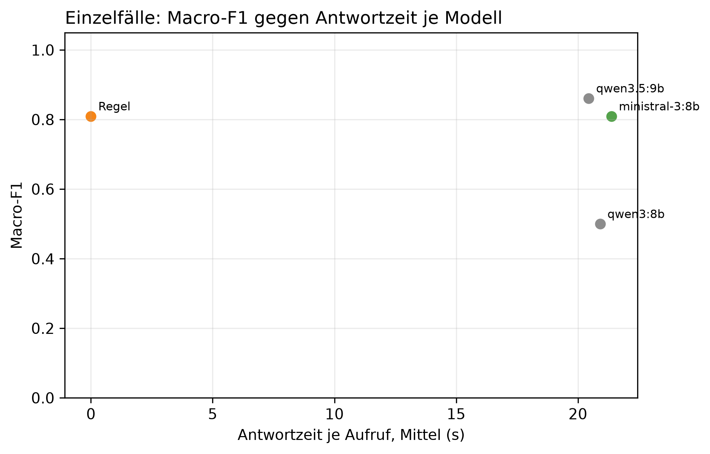

# K3 LLM-Klassifikation und Modellwahl, Läufe k3_011 / k3_seq_011

## Setup

- Läufe (Ebene 1 / Ebene 2): k3_011 / k3_seq_011
- Prompt (Ebene 1 / Ebene 2): v22 / v22
- Modelle: MDL1 qwen3:8b, MDL2 qwen3.5:9b, MDL5 ministral-3:8b
- LLM: temperature 0,0, höchstens 2 Versuche je Aufruf
- Ebene 1: 9 synthetische Fälle, je Modell 1 Aufruf je Fall, Regel (BASELINE) läuft mit
- Ebene 2: Standard-Szenarien, Cutover 2014-04-15, 60 Tage davor, 60 danach, jedes Modell als eigener Kreislauf wie SYS3 mit Adaption
- Ereignisse Ebene 2: control = keine Änderung, step = Dauerlast +100 W, peak_6 = Einzeltag-Spitze +1000 W über 6 h
- Produktivmodell SYS3: ministral-3:8b
- Commit (Ebene 1 / Ebene 2): 3cb5c4c (mit lokalen Änderungen) / 3cb5c4c (mit lokalen Änderungen)
- Textprüfung: 17 Gerätewörter, 9 Steuerungswörter, Zahlentoleranz 0,5, Fensterzahlen aus dem Prompt 7, 30

## Kennzahlen

| Kennzahl | Wert | Bezug |
|---|---|---|
| Ebene 1: bestes Modell nach Macro-F1 | qwen3.5:9b | Macro-F1 0,86, Regel 0,81 |
| ministral-3:8b: Ebene 1 richtig | 8/9 | Regel 8/9 |
| ministral-3:8b: Antwortzeit je Aufruf im Mittel [s] | 21,4 | p95 38,6 s, Regel 0,0 s |
| ministral-3:8b: Ebene 2 Ereignis-Arten erkannt | 2/2 | Regel 2/2 |
| ministral-3:8b: Ebene 2 Tage mit anderer Klasse als die Regel | 27 | 2014-03-05 new_pattern statt normal; 2014-03-06 unknown statt normal; 2014-03-15 normal statt peak; 2014-03-19 new_pattern statt normal; 2014-04-01 new_pattern statt normal; 2014-04-12 normal statt low; 2014-04-14 new_pattern statt normal; 2014-04-15 normal statt peak; 2014-04-17 normal statt peak; 2014-04-27 new_pattern statt normal; 2014-04-28 new_pattern statt normal; 2014-04-30 peak statt normal; 2014-05-11 new_pattern statt normal; 2014-05-13 low statt normal; 2014-05-14 peak statt normal; 2014-05-16 normal statt new_pattern; 2014-05-17 low statt normal; 2014-05-22 new_pattern statt normal; 2014-05-24 new_pattern statt normal; 2014-05-30 new_pattern statt normal; 2014-05-31 peak statt normal; 2014-06-01 peak statt normal; 2014-06-02 peak statt normal; 2014-06-04 new_pattern statt normal; 2014-06-05 normal statt new_pattern; 2014-06-12 new_pattern statt normal; 2014-06-13 low statt normal |
| ministral-3:8b: ungültige Antworten Ebene 1 | 0 | Ausfalltage Ebene 2: 0 |
| ministral-3:8b: Antworten mit Textverstoß (Ebene 1 / Ebene 2) | 1/9 / 0/37 | Gerät, Steuerung oder Zahl, Datum, Uhrzeit nicht im State |
| ministral-3:8b: Antworten mit fehlenden Belegen (Ebene 1 / Ebene 2) | 0/9 / 8/37 | zitierte Belege passen nicht zur eigenen Klasse |

## Ebene 1: Modellvergleich auf den Einzelfällen

| ID | Modell | richtig | Macro-F1 | ungültig | Ø Versuche | Grounding | Ø s je Aufruf | p95 s |
|---|---|---|---:|---:|---:|---:|---:|---:|
| MDL2 | qwen3.5:9b | 7/9 | 0,9 | 0 | 1,0 | 0,8 | 20,4 | 33,5 |
| BASELINE | Regel | 8/9 | 0,8 | 0 | 1,0 | - | 0,0 | 0,0 |
| MDL5 | ministral-3:8b | 8/9 | 0,8 | 0 | 1,0 | 0,9 | 21,4 | 38,6 |
| MDL1 | qwen3:8b | 5/9 | 0,5 | 0 | 1,0 | 0,7 | 20,9 | 33,8 |

## Ebene 1: Antwort je Fall (✓ = richtig, sonst die Antwort, - = ungültig)

| Fall | erwartet | qwen3.5:9b | Regel | ministral-3:8b | qwen3:8b |
|---|---|---|---|---|---|
| absence_drift_down | absence | ✓ | new_pattern | ✓ | new_pattern |
| low_single_scale | low | ✓ | ✓ | ✓ | ✓ |
| measurement_error_missing_day | measurement_error | ✓ | ✓ | ✓ | ✓ |
| new_pattern | new_pattern | peak | ✓ | ✓ | peak |
| new_pattern_at_min_scales_boundary | new_pattern | peak | ✓ | ✓ | peak |
| new_pattern_drift_down | new_pattern | ✓ | ✓ | ✓ | ✓ |
| normal_single_sustained_scale | normal | ✓ | ✓ | new_pattern | new_pattern |
| peak | peak | ✓ | ✓ | ✓ | ✓ |
| peak_single_sustained_scale | peak | ✓ | ✓ | ✓ | ✓ |

## Automatische Textprüfung je Modell (Antworten mit Verstoß oder fehlenden Belegen)

| Modell | E1 Antworten | E1 mit Verstoß | E1 Belege fehlen | E1 Gerät genannt | E2 Antworten | E2 mit Verstoß | E2 Belege fehlen | E2 Gerät genannt |
|---|---:|---:|---:|---:|---:|---:|---:|---:|
| qwen3.5:9b | 9 | 1 | 0 | 3 | 37 | 0 | 0 | 12 |
| ministral-3:8b | 9 | 1 | 0 | 4 | 37 | 0 | 8 | 18 |
| qwen3:8b | 9 | 0 | 0 | 4 | 52 | 8 | 0 | 8 |

## Ebene 2: je Modell über alle Ereignis-Arten

| Modell | Ereignis-Arten erkannt | Tage anders als die Regel | Gate-Tage | Ausfalltage | Meldungen Kontrolle | unknown Kontrolle | Resets Kontrolle |
|---|---|---:|---:|---:|---:|---:|---:|
| qwen3.5:9b | 2/2 | 28 | 37 | 0 | 15 | 1 | 8 |
| Regel | 2/2 | 0 | 101 | 0 | 3 | 0 | 0 |
| ministral-3:8b | 2/2 | 27 | 37 | 0 | 14 | 1 | 8 |
| qwen3:8b | 1/2 | 27 | 52 | 0 | 12 | 1 | 7 |

## Ebene 2: Erkennung je Ereignis, Tag seit Cutover

| config | Ereignis | erwartet | Gate-Tage durch das Ereignis | davon richtig | erster richtiger Tag | Resets |
|---|---|---|---:|---:|---:|---:|
| BASELINE | Einzeltag-Spitze +1000 W über 6 h | peak | 6 | 1 | 1 | 1 |
| BASELINE | Dauerlast +100 W | new_pattern | 23 | 1 | 32 | 1 |
| MDL1 | Einzeltag-Spitze +1000 W über 6 h | peak | 3 | 0 | - | 3 |
| MDL1 | Dauerlast +100 W | new_pattern | 12 | 3 | 14 | 4 |
| MDL2 | Einzeltag-Spitze +1000 W über 6 h | peak | 4 | 3 | 47 | 2 |
| MDL2 | Dauerlast +100 W | new_pattern | 3 | 3 | 13 | 3 |
| MDL5 | Einzeltag-Spitze +1000 W über 6 h | peak | 4 | 3 | 47 | 2 |
| MDL5 | Dauerlast +100 W | new_pattern | 3 | 3 | 13 | 3 |

## Ebene 2: Tage, an denen ein Modell anders einordnet als die Regel

| Modell | analysierter Tag | Regel | Modell sagt | in Arten |
|---|---|---|---|---|
| qwen3:8b | 2014-03-05 | normal | new_pattern | control, step, peak_6 |
| qwen3:8b | 2014-03-06 | normal | unknown | control, step, peak_6 |
| qwen3:8b | 2014-03-15 | peak | normal | control, step, peak_6 |
| qwen3:8b | 2014-03-19 | normal | new_pattern | control, step, peak_6 |
| qwen3:8b | 2014-04-04 | normal | new_pattern | control, step, peak_6 |
| qwen3:8b | 2014-04-12 | low | normal | control, step, peak_6 |
| qwen3:8b | 2014-04-15 | peak | normal | peak_6 |
| qwen3:8b | 2014-04-17 | normal | new_pattern | control |
| qwen3:8b | 2014-04-17 | peak | normal | step |
| qwen3:8b | 2014-04-18 | normal | new_pattern | peak_6 |
| qwen3:8b | 2014-04-28 | normal | new_pattern | step |
| qwen3:8b | 2014-04-30 | normal | peak | step |
| qwen3:8b | 2014-05-11 | normal | new_pattern | step |
| qwen3:8b | 2014-05-13 | normal | low | step |
| qwen3:8b | 2014-05-14 | normal | peak | step |
| qwen3:8b | 2014-05-16 | new_pattern | normal | step |
| qwen3:8b | 2014-05-17 | normal | new_pattern | control |
| qwen3:8b | 2014-05-20 | normal | low | step |
| qwen3:8b | 2014-05-22 | normal | new_pattern | peak_6 |
| qwen3:8b | 2014-05-24 | normal | new_pattern | step |
| qwen3:8b | 2014-05-30 | normal | new_pattern | control |
| qwen3:8b | 2014-05-31 | normal | peak | control |
| qwen3:8b | 2014-06-01 | normal | peak | control |
| qwen3:8b | 2014-06-02 | normal | peak | control |
| qwen3:8b | 2014-06-04 | normal | new_pattern | peak_6 |
| qwen3:8b | 2014-06-05 | new_pattern | normal | peak_6 |
| qwen3:8b | 2014-06-12 | normal | new_pattern | control, step |
| qwen3:8b | 2014-06-13 | normal | low | control, step |
| qwen3.5:9b | 2014-03-05 | normal | new_pattern | control, step, peak_6 |
| qwen3.5:9b | 2014-03-06 | normal | unknown | control, step, peak_6 |
| qwen3.5:9b | 2014-03-15 | peak | normal | control, step, peak_6 |
| qwen3.5:9b | 2014-03-19 | normal | new_pattern | control, step, peak_6 |
| qwen3.5:9b | 2014-04-01 | normal | new_pattern | control, step, peak_6 |
| qwen3.5:9b | 2014-04-12 | low | normal | control, step, peak_6 |
| qwen3.5:9b | 2014-04-14 | normal | new_pattern | control, step, peak_6 |
| qwen3.5:9b | 2014-04-15 | peak | normal | peak_6 |
| qwen3.5:9b | 2014-04-17 | peak | normal | step |
| qwen3.5:9b | 2014-04-27 | normal | new_pattern | step |
| qwen3.5:9b | 2014-04-28 | normal | new_pattern | control |
| qwen3.5:9b | 2014-04-30 | normal | peak | control |
| qwen3.5:9b | 2014-05-11 | normal | new_pattern | control |
| qwen3.5:9b | 2014-05-13 | normal | low | control |
| qwen3.5:9b | 2014-05-14 | normal | peak | control |
| qwen3.5:9b | 2014-05-16 | new_pattern | normal | step |
| qwen3.5:9b | 2014-05-17 | normal | low | control |
| qwen3.5:9b | 2014-05-20 | normal | low | control |
| qwen3.5:9b | 2014-05-22 | normal | new_pattern | step |
| qwen3.5:9b | 2014-05-24 | normal | new_pattern | control |
| qwen3.5:9b | 2014-05-30 | normal | new_pattern | peak_6 |
| qwen3.5:9b | 2014-05-31 | normal | peak | peak_6 |
| qwen3.5:9b | 2014-06-01 | normal | peak | peak_6 |
| qwen3.5:9b | 2014-06-02 | normal | peak | peak_6 |
| qwen3.5:9b | 2014-06-04 | normal | new_pattern | step |
| qwen3.5:9b | 2014-06-05 | new_pattern | normal | peak_6 |
| qwen3.5:9b | 2014-06-12 | normal | new_pattern | control, peak_6 |
| qwen3.5:9b | 2014-06-13 | normal | low | control, peak_6 |
| ministral-3:8b | 2014-03-05 | normal | new_pattern | control, step, peak_6 |
| ministral-3:8b | 2014-03-06 | normal | unknown | control, step, peak_6 |
| ministral-3:8b | 2014-03-15 | peak | normal | control, step, peak_6 |
| ministral-3:8b | 2014-03-19 | normal | new_pattern | control, step, peak_6 |
| ministral-3:8b | 2014-04-01 | normal | new_pattern | control, step, peak_6 |
| ministral-3:8b | 2014-04-12 | low | normal | control, step, peak_6 |
| ministral-3:8b | 2014-04-14 | normal | new_pattern | control, step, peak_6 |
| ministral-3:8b | 2014-04-15 | peak | normal | peak_6 |
| ministral-3:8b | 2014-04-17 | peak | normal | step |
| ministral-3:8b | 2014-04-27 | normal | new_pattern | step |
| ministral-3:8b | 2014-04-28 | normal | new_pattern | control |
| ministral-3:8b | 2014-04-30 | normal | peak | control |
| ministral-3:8b | 2014-05-11 | normal | new_pattern | control |
| ministral-3:8b | 2014-05-13 | normal | low | control |
| ministral-3:8b | 2014-05-14 | normal | peak | control |
| ministral-3:8b | 2014-05-16 | new_pattern | normal | step |
| ministral-3:8b | 2014-05-17 | normal | low | control |
| ministral-3:8b | 2014-05-22 | normal | new_pattern | step |
| ministral-3:8b | 2014-05-24 | normal | new_pattern | control |
| ministral-3:8b | 2014-05-30 | normal | new_pattern | peak_6 |
| ministral-3:8b | 2014-05-31 | normal | peak | peak_6 |
| ministral-3:8b | 2014-06-01 | normal | peak | peak_6 |
| ministral-3:8b | 2014-06-02 | normal | peak | peak_6 |
| ministral-3:8b | 2014-06-04 | normal | new_pattern | step |
| ministral-3:8b | 2014-06-05 | new_pattern | normal | peak_6 |
| ministral-3:8b | 2014-06-12 | normal | new_pattern | control, peak_6 |
| ministral-3:8b | 2014-06-13 | normal | low | control, peak_6 |

## Hinweise

- Ebene 1 prüft, ob ein Modell die Regeln aus dem Prompt nachvollzieht. Der Prompt wurde auf denselben Fällen verbessert, die Quoten begründen deshalb nur die Modellwahl und belegen nicht das Ziel von 80 % richtiger Klassen (dafür E5)
- wenige Fälle: ein Fall sind mehrere Prozentpunkte, eine Klasse hängt teils an einem einzigen Fall
- Macro-F1: Mittel der F1-Werte über die Klassen, die als erwartete Klasse vorkommen
- Grounding: Anteil der für den Fall erwarteten Felder, die das Modell als Beleg zitiert. Die Regel zitiert keine
- Tag seit Cutover = Entscheidungstag: an Tag n meldet das System, eingeordnet ist dabei Tag n-1. Ab Cutover zählt deshalb erst ab Tag 1
- Ebene 2, erkannt: erwartete Klasse an einem Tag, an dem nur das Ereignis das Gate öffnet (gepaart mit dem Kontrolllauf desselben Modells)
- Ebene 2, anders als die Regel: gleiche Art und gleicher analysierter Tag, Regel gegen Modell. Nach einem Reset an verschiedenen Tagen laufen die Reihen auseinander, spätere Abweichungen können daraus folgen
- Antwortzeit: gemessen auf dem Rechner des Laufs, nur zum Vergleich der Modelle untereinander
- Textprüfung: Verstoß heißt, ein Steuerungswort oder eine Zahl, ein Datum oder eine Uhrzeit steht im Text, aber nicht im State des Falls. Ein genanntes Gerät ist nur ein Hinweis, als Möglichkeit ist es erlaubt, ob es als Ursache behauptet wird, beurteilen die Bewertenden. Zahlwörter („sechs Wochen“) und nicht gelistete Geräte findet sie nicht. Die Fensterlängen 7 und 30 aus der Skalenbeschreibung im Prompt gelten als erlaubt
- Fehlende Belege: der Prompt verlangt je Klasse bestimmte Pfade (new_pattern: Streaks, peak/low: level, direction, absence: level, Kalendereintrag, measurement_error: Flag). Geprüft wird gegen die eigene Klasse des Modells, nicht gegen die erwartete. Ebene 1 wird nur für Läufe geprüft, die den State der Fälle in der Antwortdatei speichern, ältere Läufe haben in der Tabelle 0 Antworten
- Antworttexte und Auffälligkeiten der Textprüfung im Anhang, Antworten für alle Modelle in Ebene 1 und Ebene 2. Als CSV: answers_single.csv für Ebene 1, answers_sequence.csv für Ebene 2 nur vom Produktivmodell, result_text_findings.csv für die Auffälligkeiten

## Anhang

### Ebene 1: Precision, Recall und F1 je Klasse

| Modell | Klasse | Precision | Recall | F1 |
|---|---|---:|---:|---:|
| Regel | absence | 0,0 | 0,0 | 0,0 |
| Regel | low | 1,0 | 1,0 | 1,0 |
| Regel | measurement_error | 1,0 | 1,0 | 1,0 |
| Regel | new_pattern | 0,8 | 1,0 | 0,9 |
| Regel | normal | 1,0 | 1,0 | 1,0 |
| Regel | peak | 1,0 | 1,0 | 1,0 |
| qwen3:8b | absence | 0,0 | 0,0 | 0,0 |
| qwen3:8b | low | 1,0 | 1,0 | 1,0 |
| qwen3:8b | measurement_error | 1,0 | 1,0 | 1,0 |
| qwen3:8b | new_pattern | 0,3 | 0,3 | 0,3 |
| qwen3:8b | normal | 0,0 | 0,0 | 0,0 |
| qwen3:8b | peak | 0,5 | 1,0 | 0,7 |
| qwen3.5:9b | absence | 1,0 | 1,0 | 1,0 |
| qwen3.5:9b | low | 1,0 | 1,0 | 1,0 |
| qwen3.5:9b | measurement_error | 1,0 | 1,0 | 1,0 |
| qwen3.5:9b | new_pattern | 1,0 | 0,3 | 0,5 |
| qwen3.5:9b | normal | 1,0 | 1,0 | 1,0 |
| qwen3.5:9b | peak | 0,5 | 1,0 | 0,7 |
| ministral-3:8b | absence | 1,0 | 1,0 | 1,0 |
| ministral-3:8b | low | 1,0 | 1,0 | 1,0 |
| ministral-3:8b | measurement_error | 1,0 | 1,0 | 1,0 |
| ministral-3:8b | new_pattern | 0,8 | 1,0 | 0,9 |
| ministral-3:8b | normal | 0,0 | 0,0 | 0,0 |
| ministral-3:8b | peak | 1,0 | 1,0 | 1,0 |

### Ebene 1: Antworten der Modelle je Fall

**peak** (erwartet: peak)

- qwen3.5:9b: peak ✓
  - Erklärung: Gestern war der Stromverbrauch ungewöhnlich hoch und lag um 45 % über dem für diesen Wochentag üblichen Wert.
  - Empfehlung: Bitte prüfen Sie, ob gestern ein besonders energieintensiver Vorgang stattgefunden hat.
  - Unsicherheit: Die genaue Ursache für den hohen Verbrauch ist unbekannt.
- ministral-3:8b: peak ✓
  - Erklärung: Gestern war der Stromverbrauch um **45 % höher** als an einem normalen Dienstag im Vergleich zur letzten Woche. Der Wert liegt deutlich über dem üblichen Niveau, was auf einen ungewöhnlich hohen Verbrauch hindeutet.
  - Empfehlung: Überprüfen Sie, ob gestern ungewöhnliche Geräte genutzt wurden oder ob es technische Änderungen (z. B. neue Geräte, Heizungsregelung) gab.
  - Unsicherheit: Da der erhöhte Verbrauch nur einen Tag betrifft und keine langfristige Veränderung zeigt, ist eine einmalige Ursache wahrscheinlich.
- qwen3:8b: peak ✓
  - Erklärung: Gestern war der Stromverbrauch höher als üblich, insbesondere im Vergleich zur letzten Woche um 45 %. Der Tag selbst war nicht außergewöhnlich in seiner Form, aber der Gesamtverbrauch lag deutlich über dem Normalwert.
  - Empfehlung: Überprüfen Sie, ob es im Haushalt einen Moment gab, in dem besonders viel Strom verbraucht wurde, wie zum Beispiel eine Heizung oder ein Elektrogerät, das länger lief.
  - Unsicherheit: Es gibt keine Kalenderinformationen, die den Verbrauch erklären könnten.

**new_pattern** (erwartet: new_pattern)

- qwen3.5:9b: peak
  - Erklärung: Die Stromverbrauchsdaten zeigen, dass gestern der Verbrauch im Vergleich zur letzten Woche um etwa 38 % höher war als üblich. Diese hohe Belastung ist seit dem 9. Dezember andauernd.
  - Empfehlung: Bitte prüfen Sie, ob Geräte wie die Heizung oder der Wäschetrockner länger als sonst in Betrieb waren.
  - Unsicherheit: Die genaue Ursache für den hohen Verbrauch ist unbekannt.
- ministral-3:8b: new_pattern ✓
  - Erklärung: Gestern war der Stromverbrauch um etwa 38 % höher als an einem normalen Wochentag. Seit dem 9. Dezember liegt er durchgehend über dem üblichen Niveau, sowohl im Vergleich zur letzten Woche (+36 %) als auch zum Monatsdurchschnitt (+9 %).
  - Empfehlung: Überprüfen Sie, ob sich der Stromverbrauch in den letzten Wochen verändert hat – etwa durch neue Geräte, längere Nutzung von Heizung oder Beleuchtung oder andere Änderungen im Haushalt.
  - Unsicherheit: Ob die Ursache ein saisonaler Effekt (z. B. kürzere Tage) ist, kann nicht sicher gesagt werden.
- qwen3:8b: peak
  - Erklärung: Gestern war der Stromverbrauch höher als üblich, insbesondere im Vergleich zur letzten Woche. Der Verbrauch war um 38 % höher als der Durchschnitt für einen Dienstag.
  - Empfehlung: Überprüfen Sie, ob es im Haushalt Geräte gab, die mehr Strom verbraucht haben, wie zum Beispiel eine Heizung oder ein Elektroherd.
  - Unsicherheit: Es gibt keine Kalenderinformationen, die den Verbrauch erklären könnten.

**low_single_scale** (erwartet: low)

- qwen3.5:9b: low ✓
  - Erklärung: Gestern war der Stromverbrauch ungewöhnlich niedrig, etwa 30 % unter dem für diesen Wochentag üblichen Wert.
  - Empfehlung: Bitte prüfen Sie, ob jemand im Haushalt abwesend war oder wenn die Heizung und andere Geräte weniger genutzt wurden.
  - Unsicherheit: Ein Kalender mit geplanten Abwesenheiten ist nicht verfügbar, sodass eine geplante Abwesenheit nicht ausgeschlossen werden kann.
- ministral-3:8b: low ✓
  - Erklärung: Gestern war der Stromverbrauch um etwa 30 % niedriger als an einem typischen Dienstag im Vergleich zu den letzten Tagen. Da keine geplante Abwesenheit bekannt ist, könnte dies auf ungewöhnliches Verhalten zurückzuführen sein.
  - Empfehlung: Überprüfen Sie, ob gestern ungewöhnliche Umstände vorlagen, wie z. B. längeres Arbeiten im Homeoffice oder ein technisches Problem mit Geräten.
  - Unsicherheit: Kein Kalender war verfügbar, um eine geplante Abwesenheit zu prüfen.
- qwen3:8b: low ✓
  - Erklärung: Gestern war der Stromverbrauch niedriger als üblich, insbesondere im Vergleich zur letzten Woche um 30 %. Der Verbrauch war am gesamten Tag niedriger, aber nicht stark genug, um eine langfristige Veränderung zu zeigen.
  - Empfehlung: Überprüfen Sie, ob es im Haushalt etwas gab, das den Verbrauch reduziert hat, wie z. B. weniger Nutzung von elektrischen Geräten oder eine Absence.
  - Unsicherheit: Die Kalenderquelle war nicht verfügbar, sodass keine geplanten Abwesenheiten überprüft werden konnten.

**peak_single_sustained_scale** (erwartet: peak)

- qwen3.5:9b: peak ✓
  - Erklärung: Gestern war der Stromverbrauch ungewöhnlich hoch, etwa 40 % mehr als sonst an diesem Wochentag. Dies ist eine einmalige Abweichung und kein neuer dauerhafter Trend.
  - Empfehlung: Bitte prüfen Sie, ob gestern besondere Aktivitäten wie Gäste oder ein längeres Arbeiten zu Hause stattgefunden haben.
  - Unsicherheit: Die genaue Ursache für den hohen Verbrauch ist unbekannt.
- ministral-3:8b: peak ✓
  - Erklärung: Gestern war der Stromverbrauch um 40 % höher als an einem normalen Wochentag. Seit dem 10. Dezember liegt er überdurchschnittlich hoch.
  - Empfehlung: Überprüfen Sie, ob Geräte wie Heizung oder Beleuchtung ungewöhnlich lange oder intensiver genutzt wurden.
  - Unsicherheit: Ob es sich um eine dauerhafte Veränderung handelt, lässt sich erst nach weiteren Tagen beurteilen.
- qwen3:8b: peak ✓
  - Erklärung: Gestern war der Stromverbrauch höher als üblich, insbesondere im Vergleich zur letzten Woche um 40 %. Der Tag selbst war nicht ungewöhnlich in seiner Form, aber der Gesamtverbrauch lag deutlich über dem Normalwert.
  - Empfehlung: Überprüfen Sie, ob Geräte im Hause gestern länger laufend waren oder ob etwas ungewöhnlich war. Falls Sie keine Erklärung finden, kontaktieren Sie den Stromversorger.
  - Unsicherheit: Es gibt keine Kalenderinformationen, die den Verbrauch erklären könnten.

**normal_single_sustained_scale** (erwartet: normal)

- qwen3.5:9b: normal ✓
  - Erklärung: Gestern war der Stromverbrauch im Vergleich zur letzten Woche leicht erhöht, aber die aktuelle Messung liegt innerhalb des üblichen Bereichs.
  - Empfehlung: Es ist keine Überprüfung erforderlich, da die Abweichung als normal eingestuft wird.
  - Unsicherheit: Die genaue Ursache für die leichte Erhöhung bleibt unbekannt.
- ministral-3:8b: new_pattern
  - Erklärung: Gestern war der Verbrauch im Vergleich zur letzten Woche um etwa 9 % höher und bleibt seit dem 10. Dezember auf diesem Niveau. Das ist ein neuer, anhaltender Trend.
  - Empfehlung: Überprüfen Sie, ob sich der Stromverbrauch in den letzten Wochen durch neue Geräte oder längere Nutzung von Elektrogeräten erhöht hat.
  - Unsicherheit: Die Ursache des erhöhten Verbrauchs ist unbekannt.
- qwen3:8b: new_pattern
  - Erklärung: Gestern war der Verbrauch im Vergleich zur letzten Woche um 9 % höher, und dieser Unterschied ist seit dem 10. Dezember anhaltend. Der tägliche Verbrauch war ebenfalls leicht erhöht.
  - Empfehlung: Überprüfen Sie, ob in der Wohnung etwas verändert wurde, wie Geräte oder Heizung. Falls nichts auffällt, ist es wahrscheinlich ein zufälliger Schwankung.
  - Unsicherheit: Die genaue Ursache für den erhöhten Verbrauch ist unbekannt, da keine Kalenderereignisse vorliegen, die eine Erklärung bieten.

**new_pattern_at_min_scales_boundary** (erwartet: new_pattern)

- qwen3.5:9b: peak
  - Erklärung: Gestern war der Stromverbrauch ungewöhnlich hoch, etwa 35 % mehr als sonst an diesem Wochentag. Dies ist eine einmalige Abweichung und kein neuer dauerhafter Trend.
  - Empfehlung: Bitte prüfen Sie, ob gestern besondere Aktivitäten wie Gäste oder ein längeres Arbeiten zu Hause stattgefunden haben.
  - Unsicherheit: Die genaue Ursache für den hohen Verbrauch ist unbekannt.
- ministral-3:8b: new_pattern ✓
  - Erklärung: Gestern war der Stromverbrauch um etwa 35 % höher als an einem normalen Wochentag und hat sich seit dem 10. Dezember auf diesem Niveau gehalten. Die letzten sechs Tage waren ebenfalls ungewöhnlich hoch, was auf eine dauerhafte Veränderung hindeutet.
  - Empfehlung: Überprüfen Sie, ob sich der Stromverbrauch in den letzten Tagen durch neue Geräte, längere Nutzung von Heizung oder Beleuchtung erhöht hat.
  - Unsicherheit: Ob die Veränderung auf einen konkreten Grund wie Weihnachtsvorbereitungen zurückzuführen ist, kann nicht sicher gesagt werden.
- qwen3:8b: peak
  - Erklärung: Gestern war der Stromverbrauch höher als üblich, insbesondere im Vergleich zur letzten Woche. Der Verbrauch lag um 35 % über dem üblichen Niveau für einen Dienstag.
  - Empfehlung: Überprüfen Sie, ob es im Haushalt eine Anlage gab, die gestern besonders viel Strom verbraucht hat, wie zum Beispiel ein Heizgerät oder ein Elektroherd.
  - Unsicherheit: Es gibt keine Kalenderinformationen, die den Verbrauch erklären könnten.

**measurement_error_missing_day** (erwartet: measurement_error)

- qwen3.5:9b: measurement_error ✓
  - Erklärung: Die Messung für gestern ist nicht vertrauenswürdig, da der Wert unplausibel ist.
  - Empfehlung: Bitte überprüfen Sie die Stromzähleranzeige oder das Messgerät, um einen Fehler auszuschließen.
  - Unsicherheit: Keine zuverlässigen Verbrauchsdaten für den analysierten Tag vorhanden.
- ministral-3:8b: measurement_error ✓
  - Erklärung: Der gemessene Wert von gestern ist nicht vertrauenswürdig und kann keine Aussage über den Verbrauch erlauben.
  - Empfehlung: Prüfen Sie, ob die Messung oder der Zähler korrekt funktioniert hat. Falls nötig, kontaktieren Sie Ihren Stromanbieter.
  - Unsicherheit: Der gemessene Wert ist nicht auswertbar.
- qwen3:8b: measurement_error ✓
  - Erklärung: Die Messung gestern ist nicht zuverlässig, da der Wert implausibel ist. Es ist keine erkennbare Ursache für einen Verbrauchsspitzen oder -rückgang feststellbar.
  - Empfehlung: Überprüfen Sie die Geräte und Steckdosen, um sicherzustellen, dass keine ungewöhnliche Nutzung stattfindet. Falls das Problem anhält, kontaktieren Sie einen Techniker.
  - Unsicherheit: Die Messung gestern ist nicht zuverlässig, daher können keine sicheren Schlussfolgerungen gezogen werden.

**new_pattern_drift_down** (erwartet: new_pattern)

- qwen3.5:9b: new_pattern ✓
  - Erklärung: Die Stromkosten waren gestern im Vergleich zur letzten Woche ungewöhnlich niedrig, und diese Tendenz hält seit dem 9. Dezember an. Da die Abweichung über mehrere Wochen besteht, deutet dies auf eine neue Gewohnheit oder einen dauerhaften Wechsel hin.
  - Empfehlung: Bitte prüfen Sie, ob in Ihrem Haushalt Geräte länger laufen oder die Heizung anders eingestellt wird als sonst.
  - Unsicherheit: Die genaue Ursache für den Rückgang ist unbekannt.
- ministral-3:8b: new_pattern ✓
  - Erklärung: Gestern war der Verbrauch im Vergleich zur letzten Woche um etwa 40 % niedriger und seit dem 9. Dezember so. Seit Anfang Dezember liegt er auch im Monatsdurchschnitt um rund 25 % unter dem üblichen Wert.
  - Empfehlung: Überprüfen Sie, ob sich der Verbrauch in den letzten Wochen oder Monaten durch äußere Umstände wie eine längere Abwesenheit oder saisonale Faktoren (z. B. kürzere Tage im Winter) verändert hat.
  - Unsicherheit: Die Ursache für die dauerhafte Veränderung ist unbekannt.
- qwen3:8b: new_pattern ✓
  - Erklärung: Gestern war der Verbrauch im Vergleich zur letzten Woche um 40 % niedriger und im Vergleich zum gesamten Monat um 25 % niedriger. Die Abweichung ist seit dem 9. Dezember bestehen geblieben.
  - Empfehlung: Überprüfen Sie, ob in der Wohnung etwas verändert wurde, wie Heizung oder Geräte, die länger laufen könnten.
  - Unsicherheit: Die genaue Ursache der Verbrauchssenkung ist unbekannt, da keine Kalenderereignisse vorliegen, die eine Abwesenheit erklären.

**absence_drift_down** (erwartet: absence)

- qwen3.5:9b: absence ✓
  - Erklärung: Der Stromverbrauch war gestern niedriger als üblich, da eine Abwesenheit vom 8. bis 21. Dezember geplant ist.
  - Empfehlung: Es ist keine Überprüfung nötig, da die niedrige Nutzung durch den geplanten Urlaub erklärt wird.
  - Unsicherheit: Keine Unsicherheiten.
- ministral-3:8b: absence ✓
  - Erklärung: Gestern war der Stromverbrauch im Vergleich zur letzten Woche um etwa 40 % niedriger und seit dem 9. Dezember überdurchschnittlich gering. Das passt zu einer geplanten Abwesenheit vom 8. bis zum 21. Dezember.
  - Empfehlung: Da die Abwesenheit geplant war, ist nichts weiter zu prüfen. Der Verbrauch wird sich nach der Rückkehr wieder normalisieren.
  - Unsicherheit: Die Analyse stützt sich auf den bekannten Urlaubszeitraum.
- qwen3:8b: new_pattern
  - Erklärung: Die Verbrauchsmenge war gestern höher als üblich, aber die Verbrauchsmuster der letzten Woche und des Monats sind deutlich niedriger. Der Verbrauch war seit dem 9. Dezember niedriger als normal.
  - Empfehlung: Überprüfen Sie, ob es in der Wohnung eine Absence gibt oder ob etwas im Haushalt geändert wurde, da der Verbrauch seit dem 9. Dezember niedriger ist.
  - Unsicherheit: Die genaue Ursache für den niedrigen Verbrauch bleibt unklar, da keine weiteren Daten zur Verfügung stehen.

### Ebene 2: Antworten von qwen3.5:9b, ein Tag mit allen Arten, in denen derselbe Text kam

- 2014-03-01: peak (Arten: control, peak_6, step)
  - Erklärung: Die Stromverbrauchsdaten von gestern zeigen einen ungewöhnlich hohen Wert im Vergleich zum üblichen Niveau für diesen Wochentag.
  - Empfehlung: Bitte prüfen Sie, ob gestern Geräte länger als üblich in Betrieb waren oder eine Heizung stärker genutzt wurde.
  - Unsicherheit: Es liegen keine Kalenderdaten vor, um geplante Abwesenheiten auszuschließen.
- 2014-03-03: measurement_error (Arten: control, peak_6, step)
  - Erklärung: Die aktuelle Messung ist nicht vertrauenswürdig, sodass keine Aussage über den Verbrauch von gestern getroffen werden kann.
  - Empfehlung: Bitte warten Sie auf eine neue Messung in den nächsten Stunden.
  - Unsicherheit: Die Messung für den analysierten Tag ist unplausibel und daher nicht verwertbar.
- 2014-03-05: new_pattern (Arten: control, peak_6, step)
  - Erklärung: Der Stromverbrauch im Vergleich zum langfristigen Durchschnitt ist seit dem 28. Februar um rund 18 % niedriger. Da diese Reduktion über mehrere Wochen anhält, deutet dies auf einen neuen Verbrauchsmuster hin.
  - Empfehlung: Bitte prüfen Sie, ob in Ihrem Haushalt Geräte weniger genutzt werden oder wenn die Heizung im Winter weniger läuft.
  - Unsicherheit: Ein Kalender war nicht verfügbar, um geplante Abwesenheiten auszuschließen.
- 2014-03-19: new_pattern (Arten: control, peak_6, step)
  - Erklärung: Die Stromverbrauchsdaten zeigen seit dem 13. März eine anhaltende Abweichung von etwa 7 % unter dem üblichen Niveau für diese Wochentage. Da die Kalenderdaten nicht verfügbar sind, kann nicht ausgeschlossen werden, dass dies durch einen geplanten Urlaub oder eine längere Abwesenheit verursacht wurde.
  - Empfehlung: Bitte prüfen Sie, ob in den letzten Tagen niemand zu Hause war. Wenn dies nicht der Fall ist, beobachten Sie die Werte über die nächsten Tage.
  - Unsicherheit: Keine Kalenderdaten verfügbar, um geplante Abwesenheiten zu bestätigen.
- 2014-04-01: new_pattern (Arten: control, peak_6, step)
  - Erklärung: Die Stromverbrauchswoche war im Vergleich zur letzten Woche um rund 20 % höher und diese Erhöhung dauert seit dem 27. März an.
  - Empfehlung: Bitte prüfen Sie, ob in der letzten Woche ungewöhnlich viele Geräte genutzt wurden oder wenn die Heizung länger lief als sonst.
  - Unsicherheit: Ein Kalender war nicht verfügbar, um geplante Abwesenheiten auszuschließen.
- 2014-04-14: new_pattern (Arten: control, peak_6, step)
  - Erklärung: Die Stromverbrauchsdaten zeigen seit dem 9. April eine anhaltende Abweichung von etwa 34 % unter dem üblichen Niveau für diese Wochentage. Da die Kalenderdaten nicht verfügbar sind, kann nicht ausgeschlossen werden, dass dies durch einen geplanten Urlaub oder eine längere Abwesenheit verursacht wurde.
  - Empfehlung: Bitte prüfen Sie, ob in den letzten Tagen niemand zu Hause war. Wenn dies nicht der Fall ist, könnte es sich um eine neue Verbrauchsstruktur handeln.
  - Unsicherheit: Der Kalender ist nicht verfügbar, sodass geplante Abwesenheiten nicht überprüft werden können.
- 2014-04-27: new_pattern (Arten: step)
  - Erklärung: Die Stromverbrauchsdaten zeigen seit dem 22. April eine anhaltende Abweichung von etwa 35 % im Vergleich zur üblichen Woche, was auf ein neues Verbrauchsverhalten hindeutet.
  - Empfehlung: Bitte prüfen Sie, ob in Ihrem Haushalt ungewöhnliche Aktivitäten stattgefunden haben oder wenn Geräte länger als sonst laufen. Da keine Kalenderdaten verfügbar sind, kann eine geplante Abwesenheit nicht ausgeschlossen werden.
  - Unsicherheit: Keine Kalenderinformationen waren verfügbar, um geplante Abwesenheiten zu überprüfen.
- 2014-04-28: new_pattern (Arten: control)
  - Erklärung: Die Stromverbrauchsdaten zeigen seit dem 23. April eine anhaltende Abweichung auf wöchentlicher Basis, was ungewöhnlich ist.
  - Empfehlung: Bitte prüfen Sie, ob in Ihrem Haushalt Geräte länger laufen oder die Nutzungsgewohnheiten sich geändert haben.
  - Unsicherheit: Ein Kalender war nicht verfügbar, um geplante Abwesenheiten auszuschließen.
- 2014-04-30: peak (Arten: control)
  - Erklärung: Die Stromverbrauchsdaten von gestern zeigen einen ungewöhnlich hohen Wert im Vergleich zum üblichen Verlauf. Dies deutet auf eine kurzfristige Steigerung hin, die nicht durch eine Abwesenheit erklärt wird.
  - Empfehlung: Bitte prüfen Sie, ob gestern Geräte länger als üblich in Betrieb waren oder eine ungewohnte Aktivität stattfand.
  - Unsicherheit: Es liegen keine weiteren Daten vor, um die genaue Ursache der Erhöhung zu bestimmen.
- 2014-05-11: new_pattern (Arten: control)
  - Erklärung: Die Gesamtverbrauchsabweichung der letzten Woche beträgt etwa 2,5 % und dauert seit dem 6. Mai an. Da die Abweichung auf mehreren Zeitskalen beständig ist, handelt es sich um einen neuen Verbrauchsmuster.
  - Empfehlung: Bitte prüfen Sie, ob in der letzten Woche ungewöhnliche Aktivitäten stattgefunden haben oder wenn sich die Nutzungsgewohnheiten geändert haben.
  - Unsicherheit: Ein Kalender war nicht verfügbar, um geplante Abwesenheiten auszuschließen.
- 2014-05-13: low (Arten: control)
  - Erklärung: Die Stromverbrauchsdaten von gestern zeigen eine ungewöhnlich niedrige Gesamtmenge im Vergleich zum üblichen Niveau. Da der Verlauf innerhalb des Tages untypisch war, könnte dies auf einen sehr flachen Verbrauch oder eine vorübergehende Änderung im Nutzerverhalten hindeuten.
  - Empfehlung: Bitte prüfen Sie, ob gestern keine Geräte genutzt wurden oder wenn ein Gerät defekt ist. Wenn der Verbrauch morgen wieder normal wird, handelt es sich um eine vorübergehende Situation.
  - Unsicherheit: Ein Kalender mit geplanten Abwesenheiten steht nicht zur Verfügung, sodass geplante Ausfälle nicht ausgeschlossen werden können.
- 2014-05-14: peak (Arten: control)
  - Erklärung: Die Stromverbrauchsdaten von gestern zeigen einen ungewöhnlich hohen Wert im Vergleich zum üblichen Verlauf. Dies deutet auf eine kurzfristige Steigerung hin, die nicht durch eine Abwesenheit erklärt wird.
  - Empfehlung: Bitte prüfen Sie, ob gestern Geräte länger als üblich in Betrieb waren oder eine besonders energieintensive Tätigkeit stattfand.
  - Unsicherheit: Da kein Kalender verfügbar ist, kann nicht ausgeschlossen werden, dass ein planmäßiger Ausfall der Stromzählung vorliegt.
- 2014-05-17: low (Arten: control)
  - Erklärung: Die Stromverbrauchsdaten von gestern zeigen eine ungewöhnlich niedrige Gesamtmenge im Vergleich zum üblichen Niveau. Da der Verlauf innerhalb des Tages untypisch war, könnte dies auf einen sehr flachen Verbrauch oder eine vorübergehende Änderung im Nutzerverhalten hindeuten.
  - Empfehlung: Bitte prüfen Sie, ob gestern keine Geräte genutzt wurden oder wenn ein Urlaub geplant war. Wenn der Haushalt normalerweise aktiv ist, könnte dies eine vorübergehende Situation sein.
  - Unsicherheit: Es steht kein Kalender zur Verfügung, um geplante Abwesenheiten zu überprüfen.
- 2014-05-20: low (Arten: control)
  - Erklärung: Die Stromverbrauchsdaten von gestern zeigen eine ungewöhnlich niedrige Gesamtmenge im Vergleich zum üblichen Niveau für diesen Wochentag. Da keine Kalenderinformationen verfügbar sind, kann nicht ausgeschlossen werden, dass Sie abwesend waren.
  - Empfehlung: Bitte prüfen Sie, ob Sie gestern nicht zu Hause waren oder die Geräte weniger genutzt haben.
  - Unsicherheit: Keine Kalenderdaten verfügbar, um geplante Abwesenheiten zu bestätigen.
- 2014-05-22: new_pattern (Arten: step)
  - Erklärung: Der Stromverbrauch war gestern ungewöhnlich niedrig und ist seit dem 17. Mai im Vergleich zur letzten Woche um etwa 6 % gesunken.
  - Empfehlung: Bitte prüfen Sie, ob in den letzten Tagen weniger Personen zu Hause waren oder wenn Geräte länger ausgeschaltet blieben.
  - Unsicherheit: Ein Kalender war nicht verfügbar, um geplante Abwesenheiten auszuschließen.
- 2014-05-24: new_pattern (Arten: control)
  - Erklärung: Die Stromverbrauchsdaten zeigen seit dem 19. Mai eine anhaltende, geringfügige Abweichung von etwa 2 % im Vergleich zur üblichen Woche. Da diese Veränderung über mehrere Tage besteht, deutet dies auf ein neues Verbrauchsverhalten hin.
  - Empfehlung: Bitte prüfen Sie, ob in Ihrem Haushalt kürzlich Änderungen im Nutzerverhalten stattgefunden haben, wie z. B. eine längere Abwesenheit oder ein verändertes Heizverhalten.
  - Unsicherheit: Ein Kalender war nicht verfügbar, um geplante Abwesenheiten zu überprüfen.
- 2014-05-30: new_pattern (Arten: peak_6)
  - Erklärung: Der Stromverbrauch war gestern niedriger als üblich und diese Reduktion hält seit dem 25. Mai an, sowohl für den Wochentag als auch für die Woche.
  - Empfehlung: Bitte prüfen Sie, ob in Ihrem Haushalt Geräte weniger genutzt wurden oder ein Urlaub geplant ist.
  - Unsicherheit: Ein Kalender war nicht verfügbar, um geplante Abwesenheiten zu bestätigen.
- 2014-05-31: peak (Arten: peak_6)
  - Erklärung: Die Stromverbrauchsdaten von gestern zeigen einen ungewöhnlich hohen Wert im Vergleich zum üblichen Verlauf. Dies deutet auf eine kurzfristige Steigerung hin, die nicht durch eine Abwesenheit erklärt wird.
  - Empfehlung: Bitte prüfen Sie, ob gestern Geräte länger als üblich in Betrieb waren oder eine hohe Leistungsaufnahme vorlag.
  - Unsicherheit: Es liegen keine weiteren Informationen zu den Ursachen für diesen Anstieg vor.
- 2014-06-01: peak (Arten: peak_6)
  - Erklärung: Die Stromverbrauchsdaten von gestern zeigen einen ungewöhnlich hohen Wert im Vergleich zum üblichen Verlauf. Dies deutet auf eine kurzfristige Steigerung des Verbrauchs hin, die nicht durch eine Abwesenheit erklärt wird.
  - Empfehlung: Bitte prüfen Sie, ob gestern Geräte länger als üblich in Betrieb waren oder wenn ein Gerät mit hohem Verbrauch (z. B. Wärmepumpe, Boiler) ungewohnt stark genutzt wurde.
  - Unsicherheit: Da keine Kalenderdaten verfügbar sind, kann nicht ausgeschlossen werden, dass eine geplante Abwesenheit vorlag.
- 2014-06-02: peak (Arten: peak_6)
  - Erklärung: Die Stromverbrauchsdaten von gestern zeigen einen ungewöhnlich hohen Wert im Vergleich zum üblichen Verlauf. Dies deutet auf eine kurzfristige Steigerung des Verbrauchs hin, die nicht durch eine Abwesenheit erklärt wird.
  - Empfehlung: Bitte prüfen Sie, ob gestern Geräte länger als üblich in Betrieb waren oder wenn ein Gerät mit hohem Verbrauch (z. B. Wärmepumpe, Boiler) ungewohnt stark genutzt wurde.
  - Unsicherheit: Da keine Kalenderdaten verfügbar sind, kann nicht ausgeschlossen werden, dass eine geplante Abwesenheit vorlag.
- 2014-06-04: new_pattern (Arten: step)
  - Erklärung: Die Stromverbrauchsdaten zeigen seit dem 30. Mai eine anhaltende Abnahme der Gesamtbelastung im Vergleich zur üblichen Woche um etwa 11 %. Da keine Kalenderdaten verfügbar sind, ist die genaue Ursache dieser Reduktion unbekannt.
  - Empfehlung: Bitte prüfen Sie, ob in Ihrem Haushalt Geräte weniger genutzt oder ausgeschaltet wurden. Wenn dies nicht der Fall ist, könnte die Reduktion auch auf saisonale Faktoren zurückzuführen sein.
  - Unsicherheit: Keine Kalenderdaten verfügbar, um geplante Abwesenheiten zu überprüfen.
- 2014-06-12: new_pattern (Arten: control)
  - Erklärung: Die Gesamtverbrauchsabweichung der letzten Woche ist im Vergleich zur üblichen Höhe für diese Wochentage um etwa 20 % höher, und dies gilt seit dem 7. Juni anhaltend.
  - Empfehlung: Bitte prüfen Sie, ob in der letzten Woche ungewöhnlich viele Geräte gleichzeitig genutzt wurden oder wenn die Nutzung von Geräten wie dem Wäschetrockner oder der Heizung (falls vorhanden) erhöht war.
  - Unsicherheit: Da keine Kalenderdaten verfügbar sind, kann nicht ausgeschlossen werden, dass ein geplantes Ereignis den Verbrauch beeinflusst hat.
- 2014-06-12: new_pattern (Arten: peak_6)
  - Erklärung: Die Stromverbrauchsdaten zeigen seit dem 7. Juni eine anhaltende Abweichung von etwa 36 % unter dem üblichen Niveau für diese Wochentage. Da die Kalenderdaten nicht verfügbar sind, kann nicht ausgeschlossen werden, dass dies durch einen geplanten Urlaub oder eine längere Abwesenheit verursacht wurde.
  - Empfehlung: Bitte prüfen Sie, ob in den letzten Tagen niemand zu Hause war. Wenn dies nicht der Fall ist, könnte die Ursache eine veränderte Gewohnheit oder ein saisonaler Effekt sein.
  - Unsicherheit: Der Kalender ist nicht verfügbar, sodass geplante Abwesenheiten nicht überprüft werden können.
- 2014-06-13: low (Arten: control, peak_6)
  - Erklärung: Die Stromverbrauchsdaten von gestern zeigen eine ungewöhnlich niedrige Gesamtmenge im Vergleich zum üblichen Verlauf. Da der Alarm nur auf dem Tagesverlauf basiert und keine anhaltende Abweichung vorliegt, deutet dies auf einen untypischen Verlauf innerhalb des Tages hin.
  - Empfehlung: Bitte prüfen Sie, ob gestern Geräte nicht genutzt wurden oder der Stromzähler kurzzeitig gestört war. Wenn alles wie gewohnt abgelaufen ist, kann die Abweichung ohne weitere Maßnahmen verschwinden.
  - Unsicherheit: Ohne Kalenderdaten lässt sich nicht ausschließen, dass eine geplante Abwesenheit den Verbrauch reduziert hat.

### Ebene 2: Antworten von ministral-3:8b, ein Tag mit allen Arten, in denen derselbe Text kam

- 2014-03-01: peak (Arten: control, peak_6, step)
  - Erklärung: Gestern war der Stromverbrauch insgesamt ungewöhnlich hoch, da der Tagesverlauf einen kurzen Spitzenwert zeigte. Der Verbrauch lag im Vergleich zum letzten Monat um etwa 20 % höher.
  - Empfehlung: Überprüfen Sie, ob gestern ungewöhnliche Geräte genutzt wurden oder ob ein neues Gerät angeschlossen wurde.
  - Unsicherheit: Es gibt keine Hinweise auf einen geplanten Urlaub oder besondere Ereignisse, die den erhöhten Verbrauch erklären könnten.
- 2014-03-03: measurement_error (Arten: control, peak_6, step)
  - Erklärung: Der gemessene Wert von gestern ist nicht vertrauenswürdig und kann nicht ausgewertet werden.
  - Empfehlung: Überprüfen Sie, ob die Messung korrekt war oder ob der Zähler defekt sein könnte.
  - Unsicherheit: Der gemessene Wert ist nicht auswertbar.
- 2014-03-05: new_pattern (Arten: control, peak_6, step)
  - Erklärung: Der Stromverbrauch war gestern im Vergleich zum letzten Monat um etwa 18 % niedriger und bleibt seit Anfang Februar auf diesem Niveau. Das ist ein ungewöhnliches Muster, das sich über mehrere Wochen erstreckt.
  - Empfehlung: Überprüfen Sie, ob Geräte oder Heizungsanlagen abgeschaltet oder reduziert wurden, da dies den Verbrauch langfristig senken kann.
  - Unsicherheit: Es gibt keine Kalendereinträge, die diesen Rückgang erklären könnten.
- 2014-03-19: new_pattern (Arten: control, peak_6, step)
  - Erklärung: Gestern war der Stromverbrauch im Vergleich zur letzten Woche um etwa 7 % niedriger. Seit dem 13. März bleibt er auf diesem Niveau, was ungewöhnlich ist.
  - Empfehlung: Überprüfen Sie, ob sich der Stromverbrauch in den letzten Tagen tatsächlich so niedrig gehalten hat oder ob ein Gerät oder eine Heizung kürzer läuft als sonst.
  - Unsicherheit: Da keine Kalenderdaten verfügbar sind, kann nicht ausgeschlossen werden, dass ein geplanter Aufenthalt außerhalb des Hauses die Verbrauchsänderung erklärt.
- 2014-04-01: new_pattern (Arten: control, peak_6, step)
  - Erklärung: Gestern war der Stromverbrauch im Vergleich zur letzten Woche um etwa 20 % höher und bleibt seit dem 27. März auf diesem Niveau. Das ist ungewöhnlich, da es sich über mehrere Tage erstreckt.
  - Empfehlung: Überprüfen Sie, ob Geräte oder Heizung länger laufen als sonst – besonders im Frühling kann der Strombedarf durch längere Nutzung von Lüftungsanlagen oder mehr elektrischen Geräten steigen.
  - Unsicherheit: Ob ein geplanter Urlaub oder andere Gründe den Verbrauch beeinflusst haben, lässt sich ohne Kalender nicht klären.
- 2014-04-14: new_pattern (Arten: control, peak_6, step)
  - Erklärung: Gestern war der Stromverbrauch im Vergleich zur letzten Woche um etwa 34 % niedriger und blieb seit dem 9. April auf diesem Niveau. Da die Abweichung länger anhält, könnte sich das Verhalten des Haushalts verändert haben.
  - Empfehlung: Überprüfen Sie, ob Geräte oder Gewohnheiten seit dem 9. April anders genutzt werden – etwa weniger Heizung oder kürzere Laufzeiten von Elektrogeräten.
  - Unsicherheit: Da kein Kalender verfügbar ist, kann nicht geprüft werden, ob ein geplanter Aufenthalt außerhalb des Hauses die Verbrauchsminderung erklärt.
- 2014-04-27: new_pattern (Arten: step)
  - Erklärung: Der Stromverbrauch war im Vergleich zur letzten Woche um etwa 35 % niedriger und bleibt seit dem 22. April auf diesem Niveau. Das ist ungewöhnlich, da es keine offensichtliche Erklärung gibt.
  - Empfehlung: Überprüfen Sie, ob Geräte oder Beleuchtung länger ausgeschaltet waren oder ob jemand den Haushalt verlassen hat.
  - Unsicherheit: Es gibt keine Kalendereinträge, die diese Veränderung erklären könnten.
- 2014-04-28: new_pattern (Arten: control)
  - Erklärung: Der Stromverbrauch lag im Vergleich zur letzten Woche um etwa 12 % niedriger und blieb seit dem 23. April auf diesem Niveau. Das könnte z. B. an einer längeren Abwesenheit oder saisonalen Veränderungen liegen, da es sich um die Osterzeit handelt.
  - Empfehlung: Überprüfen Sie, ob der Verbrauch in den letzten Tagen tatsächlich niedriger war und ob dies mit Ihrem gewohnten Muster übereinstimmt.
  - Unsicherheit: Da keine Kalenderdaten verfügbar sind, kann eine geplante Abwesenheit nicht ausgeschlossen werden.
- 2014-04-30: peak (Arten: control)
  - Erklärung: Gestern war der Verlauf des Tages ungewöhnlich, mit einem kurzen hohen Verbrauchsspitzen. Der Gesamtverbrauch lag aber im Vergleich zu anderen Tagen nicht überdurchschnittlich hoch.
  - Empfehlung: Überprüfen Sie, ob gestern ungewöhnliche Aktivitäten stattfanden, die den Stromverbrauch kurzfristig erhöht haben könnten, z. B. längeres Nutzen von Geräten wie Heizlüftern oder Staubsauger.
  - Unsicherheit: Es gibt keine Kalendereinträge, um geplante Abwesenheiten zu prüfen.
- 2014-05-11: new_pattern (Arten: control)
  - Erklärung: Der Stromverbrauch war im Vergleich zur letzten Woche um etwa 3 % niedriger und bleibt seit dem 6. Mai auf diesem Niveau. Da es keine Hinweise auf eine geplante Abwesenheit gibt, könnte sich der Verbrauch dauerhaft verändert haben.
  - Empfehlung: Überprüfen Sie, ob sich die Gewohnheiten im Haushalt geändert haben, z. B. weniger Heizung oder kürzere Gerätenutzung.
  - Unsicherheit: Da kein Kalender verfügbar ist, kann eine geplante Abwesenheit nicht ausgeschlossen werden.
- 2014-05-13: low (Arten: control)
  - Erklärung: Gestern war der Stromverbrauch insgesamt ungewöhnlich niedrig, da der Tagesverlauf sehr flach verlief. Das könnte z. B. an einem kurzen Ausfall oder einer vorübergehenden Unterbrechung liegen.
  - Empfehlung: Überprüfen Sie, ob gestern ein Stromausfall oder eine andere Störung aufgetreten ist, die den Verbrauch beeinflusst haben könnte.
  - Unsicherheit: Kein Kalender war verfügbar, um geplante Abwesenheiten zu prüfen.
- 2014-05-14: peak (Arten: control)
  - Erklärung: Gestern war der Verlauf des Tages ungewöhnlich, mit einem kurzen hohen Verbrauchsspitzen. Der Gesamtverbrauch lag aber im Vergleich zu anderen Tagen nicht überdurchschnittlich hoch.
  - Empfehlung: Überprüfen Sie, ob gestern ungewöhnliche Geräte genutzt wurden oder ob ein Gerät länger als sonst in Betrieb war. Ein kurzer Stromausfall oder eine Störung könnte ebenfalls den Verlauf beeinflusst haben.
  - Unsicherheit: Es gibt keine Hinweise auf einen Messfehler oder geplante Abwesenheiten, die den Verbrauch erklären könnten.
- 2014-05-17: low (Arten: control)
  - Erklärung: Gestern war der Stromverbrauch insgesamt ungewöhnlich niedrig, da der Tagesverlauf sehr flach verlief. Das könnte an einem kurzen Ausflug oder einer ungewöhnlichen Nutzung von Geräten liegen.
  - Empfehlung: Überprüfen Sie, ob gestern jemand zu Hause war und ob der Stromverbrauch wie gewohnt verlief. Ein kurzer Ausflug oder ein ungewöhnliches Verhalten könnte den niedrigen Verbrauch erklären.
  - Unsicherheit: Da keine Kalendereinträge verfügbar sind, kann nicht ausgeschlossen werden, dass ein geplanter Aufenthalt im Ausland oder eine andere Abwesenheit die Ursache ist.
- 2014-05-20: normal (Arten: control)
  - Erklärung: Gestern war der Verlauf des Tages ungewöhnlich flach, aber die Gesamtmenge lag im Vergleich zur letzten Woche nur um etwa 6 % niedriger – das ist nicht auffällig.
  - Empfehlung: Da der Unterschied gering ist und keine weiteren Hinweise vorliegen, ist nichts weiter zu prüfen.
  - Unsicherheit: Ob ein geplanter Urlaub oder eine andere Abwesenheit die Verbrauchsminderung erklärt hätte, kann nicht geprüft werden.
- 2014-05-22: new_pattern (Arten: step)
  - Erklärung: Gestern war der Stromverbrauch im Vergleich zur letzten Woche um etwa 6 % niedriger und blieb seit dem 17. Mai auf diesem Niveau. Der Unterschied ist zwar nicht extrem, aber die gleichmäßige Abnahme über mehrere Tage deutet auf eine dauerhafte Veränderung hin.
  - Empfehlung: Da der Verbrauch seit mehreren Tagen niedriger ist, könnten Sie prüfen, ob Geräte oder Heizung kürzer laufen oder weniger genutzt werden – etwa durch längeres Lüften im Mai oder geänderte Gewohnheiten.
  - Unsicherheit: Ob ein geplanter Urlaub oder eine andere Abwesenheit den Verbrauch beeinflusst hat, kann nicht überprüft werden, da keine Kalenderdaten verfügbar sind.
- 2014-05-24: new_pattern (Arten: control)
  - Erklärung: Gestern war der Stromverbrauch im Vergleich zur letzten Woche um etwa 2 % niedriger. Seit dem 19. Mai bleibt dieser Wert unterdurchschnittlich.
  - Empfehlung: Überprüfen Sie, ob sich der Verbrauch in den letzten Tagen stabil niedriger zeigt oder ob ein Gerät weniger genutzt wird.
  - Unsicherheit: Da keine Kalenderdaten verfügbar sind, kann eine geplante Abwesenheit nicht ausgeschlossen werden.
- 2014-05-30: new_pattern (Arten: peak_6)
  - Erklärung: Gestern war der Verbrauch im Vergleich zur letzten Woche um etwa 54 % niedriger und blieb seit dem 25. Mai auf diesem Niveau. Die Abweichung hat sich über mehrere Tage hinweg stabilisiert.
  - Empfehlung: Da der Verbrauch seit längerem ungewöhnlich niedrig ist, prüfen Sie bitte, ob jemand im Haushalt weniger Strom verbraucht als sonst oder ob Geräte nicht mehr genutzt werden.
  - Unsicherheit: Es gibt keine Informationen über geplante Abwesenheiten oder besondere Umstände, die den niedrigen Verbrauch erklären könnten.
- 2014-05-31: peak (Arten: peak_6)
  - Erklärung: Gestern war der Verlauf des Tages ungewöhnlich, mit einem kurzen hohen Verbrauchsspitzen. Der Gesamtverbrauch lag aber im Vergleich zu anderen Tagen nicht überdurchschnittlich hoch.
  - Empfehlung: Überprüfen Sie, ob gestern ungewöhnliche Aktivitäten stattfanden, die den Verbrauch kurzfristig erhöht haben könnten, z. B. längeres Nutzen von Geräten oder Gäste.
  - Unsicherheit: Es gibt keine Hinweise auf einen geplanten Urlaub oder besondere Ereignisse, die den Verbrauch erklären könnten.
- 2014-06-01: peak (Arten: peak_6)
  - Erklärung: Gestern war der Verlauf des Tages ungewöhnlich, mit einem kurzen hohen Verbrauchsspitzen. Der Gesamtverbrauch lag jedoch im Vergleich zu anderen Tagen nicht auffällig höher.
  - Empfehlung: Überprüfen Sie, ob gestern ungewöhnliche Geräte genutzt wurden oder ob ein neues Gerät angeschlossen war. Ein kurzer Stromspitzen kann z.B. durch den Start eines Waschmaschinen- oder Trocknerprogramms entstanden sein.
  - Unsicherheit: Es gibt keine Hinweise auf einen Messfehler, aber die genaue Ursache des ungewöhnlichen Verlaufs ist ohne weitere Informationen nicht klar.
- 2014-06-02: peak (Arten: peak_6)
  - Erklärung: Gestern war der Verlauf des Tages ungewöhnlich, mit einem kurzen hohen Verbrauchsspitzen. Der Gesamtverbrauch lag jedoch im Vergleich zu anderen Tagen nicht auffällig höher.
  - Empfehlung: Überprüfen Sie, ob gestern ungewöhnliche Aktivitäten stattfanden, die den Stromverbrauch kurzfristig erhöht haben könnten, z. B. längeres Nutzen von Geräten wie Heizlüftern oder Staubsauger.
  - Unsicherheit: Es gibt keine Hinweise auf einen geplanten Urlaub oder besondere Ereignisse, die den Verbrauch erklären könnten.
- 2014-06-04: new_pattern (Arten: step)
  - Erklärung: Gestern lag der Verbrauch im Vergleich zur letzten Woche um etwa 11 % niedriger und blieb seit dem 30. Mai so. Da es keine Hinweise auf eine geplante Abwesenheit gibt, könnte sich die Nutzung dauerhaft verändert haben.
  - Empfehlung: Überprüfen Sie, ob sich der Alltag in den letzten Wochen verändert hat – etwa durch Urlaubsvorbereitungen oder andere Gründe, die den Stromverbrauch dauerhaft gesenkt haben könnten.
  - Unsicherheit: Da keine Kalenderdaten verfügbar sind, kann eine geplante Abwesenheit nicht ausgeschlossen werden.
- 2014-06-12: new_pattern (Arten: control)
  - Erklärung: Der Stromverbrauch war im Vergleich zur letzten Woche um etwa 20 % niedriger und bleibt seit dem 7. Juni auf diesem Niveau. Das könnte z. B. an einem längeren Aufenthalt außerhalb des Hauses liegen, aber es ist noch unklar, was genau die Ursache ist.
  - Empfehlung: Überprüfen Sie, ob sich der Verbrauch in den letzten Tagen verändert hat oder ob es Gründe wie einen längeren Aufenthalt außerhalb des Hauses gab.
  - Unsicherheit: Da keine Kalenderdaten verfügbar sind, kann nicht geprüft werden, ob ein geplanter Ausflug die Ursache ist.
- 2014-06-12: new_pattern (Arten: peak_6)
  - Erklärung: Gestern war der Stromverbrauch im Vergleich zur letzten Woche um etwa 36 % niedriger und bleibt seit dem 7. Juni auf diesem Niveau. Das ist ungewöhnlich, da es sich über mehrere Tage hinweg hält.
  - Empfehlung: Überprüfen Sie bitte, ob jemand länger weg war oder ob Geräte wie Heizung oder Warmwasserbereitung weniger genutzt wurden.
  - Unsicherheit: Da keine Kalendereinträge verfügbar sind, kann nicht ausgeschlossen werden, dass ein geplanter Aufenthalt außerhalb des Hauses die Ursache ist.
- 2014-06-13: low (Arten: control, peak_6)
  - Erklärung: Gestern war der Stromverbrauch insgesamt ungewöhnlich niedrig, da der Tagesverlauf sehr flach verlief. Das könnte an einem kurzen Ausfall oder einer vorübergehenden Unterbrechung liegen.
  - Empfehlung: Überprüfen Sie, ob gestern ein Stromausfall oder eine andere Störung aufgetreten ist, die den Verbrauch beeinflusst haben könnte.
  - Unsicherheit: Es gibt keine Kalendereinträge, um einen geplanten Ausfall zu bestätigen.

### Ebene 2: Antworten von qwen3:8b, ein Tag mit allen Arten, in denen derselbe Text kam

- 2014-03-01: peak (Arten: control, peak_6, step)
  - Erklärung: Gestern war der Stromverbrauch höher als üblich, insbesondere im Verlauf des Tages. Der Tag selbst lag um 19 % über dem Durchschnitt der letzten Woche.
  - Empfehlung: Überprüfen Sie, ob Geräte im Hause gestern besonders stark genutzt wurden oder ob etwas ungewöhnlich lief.
  - Unsicherheit: Es war keine Kalenderinformation verfügbar, um den Verbrauch zu erklären.
- 2014-03-03: measurement_error (Arten: control, peak_6, step)
  - Erklärung: Die Messung gestern ist nicht zuverlässig, da der Wert implausibel ist. Es ist keine Anomalie erkennbar.
  - Empfehlung: Überprüfen Sie die Geräte und Steckdosen, um sicherzustellen, dass nichts ungewöhnlich läuft. Falls die Messung weiterhin unsicher ist, kontaktieren Sie den Stromversorger.
  - Unsicherheit: Die Messung gestern war nicht zuverlässig, sodass keine sicheren Schlussfolgerungen gezogen werden können.
- 2014-03-05: new_pattern (Arten: control, peak_6, step)
  - Erklärung: Die Stromverbrauchsstufe der letzten Monate ist um 18 % gestiegen und hat sich seit dem 28. Februar fortgesetzt. Gestern war der Verbrauch im Vergleich zur letzten Woche um 6 % niedriger, aber das ist nicht genug, um den Trend zu erklären.
  - Empfehlung: Überprüfen Sie, ob in der Wohnung etwas geändert wurde, wie Heizung oder Geräte. Falls nichts verändert wurde, könnte es eine allgemeine Steigerung des Verbrauchs geben.
  - Unsicherheit: Die genaue Ursache ist unbekannt, da keine Kalenderinformationen zur Verfügung standen.
- 2014-03-19: new_pattern (Arten: control, peak_6, step)
  - Erklärung: Gestern war der Verbrauch im Vergleich zur letzten Woche um etwa 7 % niedriger, und dieser Unterschied ist seit dem 13. März anhaltend. Der gesamte Tag lag nicht unter dem üblichen Niveau, aber die Entwicklung weist auf eine veränderte Nutzung hin.
  - Empfehlung: Überprüfen Sie, ob es in der Wohnung eine Veränderung gab, wie ein neues Gerät oder eine andere Nutzung. Falls nichts auffällt, ist es möglicherweise eine zufällige Abnahme.
  - Unsicherheit: Die genaue Ursache für den Unterschied ist unbekannt, da keine Kalenderinformationen zur Verfügung standen.
- 2014-04-01: normal (Arten: control, peak_6, step)
  - Erklärung: Gestern war der Verbrauch im Vergleich zur letzten Woche um 20 % höher, und dieser Unterschied ist seit dem 27. März bestehen geblieben. Der Tag selbst war jedoch im Normalbereich.
  - Empfehlung: Da der Verbrauch gestern im Normalbereich lag, ist nichts zu beachten. Sie können die Daten weiterhin beobachten.
  - Unsicherheit: Die Kalenderinformationen waren nicht verfügbar, sodass keine zusätzlichen Gründe für den Verbrauch ausgeschlossen werden können.
- 2014-04-02: normal (Arten: control, peak_6, step)
  - Erklärung: Gestern war der Stromverbrauch im Vergleich zur letzten Woche um 22 % höher. Der Anstieg ist bereits seit dem 27. März anhaltend.
  - Empfehlung: Überprüfen Sie, ob eine neue Geräte Nutzung oder ein vergessenes Gerät den Verbrauch erhöht hat.
  - Unsicherheit: Die Ursache des Anstiegs ist nicht bekannt, da keine Kalenderinformationen zur Verfügung standen.
- 2014-04-03: normal (Arten: control, peak_6, step)
  - Erklärung: Gestern war der Verbrauch im Vergleich zur letzten Woche um 18 % höher, und dieser Unterschied ist seit dem 27. März bestehen geblieben. Der Tag selbst war jedoch im Normalbereich.
  - Empfehlung: Da der Verbrauch gestern im Normalbereich lag, ist nichts zu beachten. Sie können die Daten weiterhin beobachten.
  - Unsicherheit: Die Kalenderinformationen waren nicht verfügbar, sodass keine zusätzlichen Gründe für den Verbrauch ausgeschlossen werden können.
- 2014-04-04: new_pattern (Arten: control, peak_6, step)
  - Erklärung: Gestern war der Verbrauch im Vergleich zur letzten Woche um 13 % niedriger, und dieser Unterschied ist seit dem 27. März bestehen. Der gesamte Tag war nicht besonders hoch oder niedrig, aber die Tendenz bleibt.
  - Empfehlung: Überprüfen Sie, ob in der Wohnung etwas geändert wurde, wie Heizung oder Geräte. Falls nichts verändert wurde, könnte es eine langfristige Veränderung im Verbrauch geben.
  - Unsicherheit: Die genaue Ursache für den niedrigeren Verbrauch ist unbekannt, da keine Kalenderinformationen zur Verfügung standen.
- 2014-04-17: new_pattern (Arten: control)
  - Erklärung: Gestern war der Verbrauch im Vergleich zur letzten Woche um 26 % niedriger, und dieser Unterschied ist seit dem 12. April anhaltend. Der gesamte Tag lag nicht signifikant über oder unter dem Normalwert.
  - Empfehlung: Überprüfen Sie, ob in der Wohnung etwas verändert wurde, wie z. B. die Heizung oder Geräte, die länger laufen könnten.
  - Unsicherheit: Die Kalenderdaten sind nicht verfügbar, sodass wir keine Informationen über geplante Abwesenheiten prüfen können.
- 2014-04-17: normal (Arten: peak_6)
  - Erklärung: Gestern war der Verbrauch im Vergleich zur letzten Woche um 16 % niedriger, seit dem 12. April ist dieser Trend zu beobachten. Der Tag selbst war jedoch im Normalbereich.
  - Empfehlung: Überprüfen Sie, ob in der Woche vor dem 12. April etwas Besonderes passiert ist, das den Verbrauch beeinflusst hat.
  - Unsicherheit: Die Kalenderdaten sind nicht verfügbar, sodass keine geplanten Abwesenheiten überprüft werden können.
- 2014-04-17: normal (Arten: step)
  - Erklärung: Gestern war der Verbrauch im Vergleich zur letzten Woche um etwa 14 % niedriger, und dieser Trend setzte sich seit dem 12. April fort. Der gesamte Tag lag jedoch innerhalb des üblichen Bereichs.
  - Empfehlung: Da der Verbrauch gestern im Normalbereich lag, ist nichts zu beachten. Sie können die Daten weiterhin beobachten.
  - Unsicherheit: Die Kalenderinformationen waren nicht verfügbar, sodass keine Absenz oder besondere Ereignisse überprüft werden konnten.
- 2014-04-18: new_pattern (Arten: peak_6)
  - Erklärung: Gestern war der Stromverbrauch im Vergleich zur letzten Woche um etwa 15 % niedriger. Dieser Unterschied ist länger anhaltend und könnte auf eine Veränderung im Haushalt hindeuten.
  - Empfehlung: Überprüfen Sie, ob etwas im Haushalt geändert wurde, wie z. B. eine neue Geräte oder ein Verhalten, das den Verbrauch beeinflussen könnte.
  - Unsicherheit: Die genaue Ursache für den niedrigeren Verbrauch ist unbekannt, da keine Kalenderinformationen zur Verfügung stehen.
- 2014-04-18: normal (Arten: step)
  - Erklärung: Gestern war der Verbrauch im Vergleich zur letzten Woche um etwa 9 % niedriger, aber das ist normal. Der Unterschied bleibt seit dem 12. April bestehen.
  - Empfehlung: Überprüfen Sie, ob ein kalter Tag oder eine andere kurzfristige Ursache den Verbrauch beeinflusst hat.
  - Unsicherheit: Die Kalenderdaten sind nicht verfügbar, sodass keine geplanten Abwesenheiten überprüft werden können.
- 2014-04-24: normal (Arten: step)
  - Erklärung: Gestern war der Verbrauch im Vergleich zur letzten Woche um 31 % höher. Die Erhöhung ist seit dem 19. April anhaltend.
  - Empfehlung: Überprüfen Sie, ob Geräte im Hause gestern länger laufend waren oder ob es eine ungewöhnliche Nutzung gab.
  - Unsicherheit: Die Ursache der Erhöhung ist nicht bekannt, da keine Kalenderinformationen zur Verfügung standen.
- 2014-04-25: normal (Arten: step)
  - Erklärung: Gestern war der Verbrauch im Vergleich zur letzten Woche um 29 % höher, und dieser Unterschied ist seit dem 19. April anhaltend. Der Tag selbst war jedoch im Normalbereich.
  - Empfehlung: Überprüfen Sie, ob es in der Wohnung gestern zu ungewöhnlichem Verbrauch gekommen ist, etwa durch vergessene Geräte oder eine längere Nutzung.
  - Unsicherheit: Die Kalenderdaten sind nicht verfügbar, sodass keine geplanten Abwesenheiten überprüft werden können.
- 2014-04-26: normal (Arten: step)
  - Erklärung: Gestern war der Verbrauch im Vergleich zur letzten Woche um 26 % höher. Der Anstieg ist seit dem 19. April anhaltend.
  - Empfehlung: Überprüfen Sie, ob eine neue Geräte Nutzung oder ein vergessenes Gerät den Verbrauch erhöht hat.
  - Unsicherheit: Die Ursache des Anstiegs ist unbekannt, da keine Kalenderinformationen zur Verfügung standen.
- 2014-04-27: normal (Arten: step)
  - Erklärung: Gestern war der Verbrauch im Vergleich zur letzten Woche um 28 % höher, und dieser Unterschied ist seit dem 19. April anhaltend. Der Tag selbst war jedoch im Normalbereich.
  - Empfehlung: Da der Verbrauch gestern im Normalbereich lag, ist nichts zu beachten. Sie können die Daten weiterhin beobachten.
  - Unsicherheit: Die Kalenderquelle war nicht verfügbar, sodass keine externen Ereignisse berücksichtigt werden konnten.
- 2014-04-28: new_pattern (Arten: step)
  - Erklärung: Gestern war der Stromverbrauch im Vergleich zur letzten Woche um 22 % höher, seit dem 19. April ist dieser Trend bestehend. Der Verbrauch war aber im Vergleich zum gesamten Monat um 10 % niedriger.
  - Empfehlung: Überprüfen Sie, ob in der Wohnung etwas verändert wurde, das den Verbrauch beeinflussen könnte, wie eine neue Geräte oder eine Änderung im Nutzungsmuster.
  - Unsicherheit: Die Kalenderdaten sind nicht verfügbar, sodass keine geplanten Abwesenheiten überprüft werden können.
- 2014-04-30: peak (Arten: step)
  - Erklärung: Gestern war der Stromverbrauch höher als üblich, insbesondere in der Mitte des Tages. Der Verbrauch war im Vergleich zur letzten Woche um etwa 20 % erhöht.
  - Empfehlung: Überprüfen Sie, ob es zu einem ungewöhnlichen Verbrauch durch Geräte oder eine Störung gekommen ist.
  - Unsicherheit: Es war keine Kalenderinformation verfügbar, um mögliche Ursachen zu überprüfen.
- 2014-05-11: new_pattern (Arten: step)
  - Erklärung: Gestern war der Verbrauch im Vergleich zur letzten Woche um etwa 2 % niedriger. Der Unterschied ist seit dem 6. Mai bestehen und könnte auf eine veränderte Nutzung hinweisen.
  - Empfehlung: Überprüfen Sie, ob es in der Wohnung eine Veränderung gab, die den Verbrauch beeinflussen könnte, wie ein neues Gerät oder eine andere Nutzungsmuster.
  - Unsicherheit: Die genaue Ursache des Verbrauchsspiegels ist unbekannt, da keine Kalenderinformationen zur Verfügung standen.
- 2014-05-13: low (Arten: step)
  - Erklärung: Gestern war der Stromverbrauch niedriger als üblich, vor allem in der Mitte des Tages. Der Verbrauch war im Vergleich zur letzten Woche um etwa 15 % niedriger.
  - Empfehlung: Überprüfen Sie, ob Geräte gestern besonders oft oder weniger oft verwendet wurden. Ein kalter Tag oder eine andere Veränderung im Haushalt könnte den Verbrauch beeinflusst haben.
  - Unsicherheit: Es war keine Kalenderinformation verfügbar, um abschätzen zu können, ob ein geplanter Abwesenheit den Verbrauch beeinflusste.
- 2014-05-14: peak (Arten: step)
  - Erklärung: Gestern war der Stromverbrauch höher als üblich, insbesondere in der Verlauf des Tages. Es gab keine Hinweise auf eine besondere Ursache.
  - Empfehlung: Überprüfen Sie, ob Geräte gestern besonders stark genutzt wurden oder ob etwas im Haushalt anders lief.
  - Unsicherheit: Es gab keine Kalenderinformationen, um mögliche Ursachen zu überprüfen.
- 2014-05-17: new_pattern (Arten: control)
  - Erklärung: Gestern war der Stromverbrauch niedriger als üblich, insbesondere im Vergleich zur letzten Woche und dem langen Zeitraum. Der Trend ist seit dem 12. Mai bestehen.
  - Empfehlung: Überprüfen Sie, ob in der Wohnung etwas verändert wurde oder ob ein Gerät nicht mehr funktioniert. Falls Sie sich unsicher sind, kontaktieren Sie einen Elektriker.
  - Unsicherheit: Die genaue Ursache für den niedrigen Verbrauch ist unbekannt, da keine Kalenderinformationen zur Verfügung standen.
- 2014-05-17: normal (Arten: step)
  - Erklärung: Gestern war der Stromverbrauch im Vergleich zur letzten Woche niedriger, aber der Tag selbst war normal. Der Verbrauch verlief ungewöhnlich im Laufe des Tages, etwa mit einem flacheren Verlauf als üblich.
  - Empfehlung: Überprüfen Sie, ob es im Haushalt etwas gab, das den Verbrauch beeinflusst hat, wie ein abgeschaltetes Gerät oder eine veränderte Nutzung.
  - Unsicherheit: Es war keine Kalenderinformation verfügbar, um abschätzen zu können, ob der niedrigere Verbrauch auf einen geplanten Ausfall zurückgeht.
- 2014-05-20: low (Arten: step)
  - Erklärung: Gestern war der Stromverbrauch niedriger als üblich, insbesondere im Vergleich zur letzten Woche. Der Verbrauch war am Tag unregelmäßig, mit einem kurzen Spitzenwert oder einer flachen Kurve.
  - Empfehlung: Überprüfen Sie, ob Geräte gestern außergewöhnlich oft oder selten verwendet wurden. Es könnte ein kleiner Verbrauchsspitzenwert oder eine flache Kurve im Tagesverlauf gewesen sein.
  - Unsicherheit: Es war keine Kalenderinformation verfügbar, um den Verbrauch zu erklären.
- 2014-05-22: new_pattern (Arten: peak_6)
  - Erklärung: Gestern war der Stromverbrauch im Vergleich zur letzten Woche um etwa 8 % niedriger, und dieser Unterschied ist seit dem 17. Mai anhaltend. Der tägliche Verlauf war normal.
  - Empfehlung: Überprüfen Sie, ob in der Wohnung etwas verändert wurde, wie z. B. eine neue Geräte oder ein längerer Zeitraum ohne Nutzung.
  - Unsicherheit: Die Kalenderdaten sind nicht verfügbar, sodass wir keine Informationen über geplante Abwesenheiten prüfen können.
- 2014-05-24: new_pattern (Arten: step)
  - Erklärung: Gestern war der Verbrauch im Vergleich zur letzten Woche um etwa 2 % niedriger, und dieser Unterschied ist seit dem 19. Mai anhaltend. Der gesamte Tag war nicht deutlich höher oder niedriger als üblich.
  - Empfehlung: Überprüfen Sie, ob in der Woche um den 19. Mai etwas im Haushalt geändert wurde, wie z. B. eine neue Gewohnheit oder ein Gerät, das weniger läuft.
  - Unsicherheit: Die Kalenderinformationen waren nicht verfügbar, sodass wir keine Absenz oder Feiertage berücksichtigen konnten.
- 2014-05-30: new_pattern (Arten: control)
  - Erklärung: Gestern war der Verbrauch im Vergleich zur letzten Woche um etwa 45 % niedriger, und dieser Unterschied ist seit dem 25. Mai anhaltend. Der gesamte Tag war nicht deutlich niedriger, aber die Tendenz der letzten Woche zeigt eine signifikante Abnahme.
  - Empfehlung: Überprüfen Sie, ob in der Wohnung etwas verändert wurde oder ob ein Gerät länger nicht genutzt wurde. Falls Sie sich unsicher sind, können Sie die Verbrauchsmessung für mehrere Tage beobachten.
  - Unsicherheit: Die Kalenderinformationen waren nicht verfügbar, sodass wir keine geplanten Abwesenheiten überprüfen konnten.
- 2014-05-31: peak (Arten: control)
  - Erklärung: Gestern war der Stromverbrauch höher als üblich, insbesondere in der Verlauf des Tages. Es gab keine besonderen Ereignisse oder Gründe dafür, die den Verbrauch erklären könnten.
  - Empfehlung: Überprüfen Sie, ob es im Haushalt etwas Besonderes gab, das den Verbrauch erhöht haben könnte, wie z. B. eine neue Geräte oder ein vergessenes Gerät.
  - Unsicherheit: Es war keine Kalenderinformation verfügbar, um mögliche Ursachen für den erhöhten Verbrauch zu überprüfen.
- 2014-06-01: peak (Arten: control)
  - Erklärung: Gestern war der Stromverbrauch höher als üblich, insbesondere in der Verlauf des Tages. Es gab keine besonderen Ereignisse oder Gründe dafür, die den Verbrauch erklären könnten.
  - Empfehlung: Überprüfen Sie, ob Geräte im Hause gestern besonders stark genutzt wurden oder ob etwas ungewöhnlich lief.
  - Unsicherheit: Es gab keine Kalenderinformationen, um mögliche Ursachen für den Verbrauch zu überprüfen.
- 2014-06-02: peak (Arten: control)
  - Erklärung: Gestern war der Stromverbrauch höher als üblich, insbesondere in der Verlauf des Tages. Es gab keine besonderen Ereignisse oder Gründe dafür, die den Verbrauch erklären könnten.
  - Empfehlung: Überprüfen Sie, ob Geräte im Hause gestern besonders stark genutzt wurden oder ob etwas ungewöhnlich lief.
  - Unsicherheit: Es gab keine Kalenderinformationen, um mögliche Ursachen für den Verbrauch zu überprüfen.
- 2014-06-04: new_pattern (Arten: peak_6)
  - Erklärung: Gestern war der Stromverbrauch im Vergleich zur letzten Woche um etwa 15 % niedriger. Dieser Unterschied ist länger anhaltend und könnte auf einen veränderten Verbrauch hinweisen.
  - Empfehlung: Überprüfen Sie, ob in der Wohnung etwas verändert wurde oder ob Geräte anders genutzt wurden.
  - Unsicherheit: Die genaue Ursache für den niedrigeren Verbrauch ist unbekannt.
- 2014-06-12: new_pattern (Arten: control)
  - Erklärung: Gestern war der Stromverbrauch im Vergleich zur letzten Woche um 36 % niedriger, und dieser Unterschied ist seit dem 7. Juni anhaltend. Der gesamte Tag war nicht deutlich höher oder niedriger, aber die Verbrauchsstruktur hat sich verändert.
  - Empfehlung: Überprüfen Sie, ob in der Wohnung etwas geändert wurde, wie Geräte oder Heizung. Falls Sie sich unsicher sind, kontaktieren Sie einen Elektriker.
  - Unsicherheit: Die genaue Ursache für den Verbrauchssprung ist unbekannt, da keine Kalenderinformationen zur Verfügung standen.
- 2014-06-12: new_pattern (Arten: step)
  - Erklärung: Gestern war der Stromverbrauch im Vergleich zur letzten Woche um 14 % niedriger, und dieser Unterschied ist seit dem 7. Juni anhaltend. Der gesamte Tag war nicht deutlich niedriger, aber die Tendenz der letzten Woche deutet auf eine Veränderung hin.
  - Empfehlung: Überprüfen Sie, ob in der Wohnung etwas verändert wurde, wie Geräte oder Nutzungsgewohnheiten. Falls Sie sich unsicher sind, können Sie die Stromverbrauchsmessung für mehrere Tage beobachten.
  - Unsicherheit: Die genaue Ursache der Veränderung ist unbekannt, da keine Kalenderinformationen zur Verfügung standen.
- 2014-06-13: low (Arten: control, step)
  - Erklärung: Gestern war der Stromverbrauch niedriger als üblich, vor allem in der Mitte des Tages. Der Verbrauch war im Vergleich zur letzten Woche um etwa 15 % niedriger.
  - Empfehlung: Überprüfen Sie, ob Geräte gestern außergewöhnlich lange ausgeschaltet waren oder ob es eine Absence gab, die den Verbrauch beeinflusste.
  - Unsicherheit: Es war keine Kalenderinformation verfügbar, um mögliche Gründe für den niedrigen Verbrauch zu überprüfen.

### Auffälligkeiten der Textprüfung

| Ebene | Modell | Fall oder Tag | Verstoß | fehlende Belege | Gerät genannt (Hinweis) |
|---|---|---|---|---|---|
| Ebene 2 | qwen3.5:9b | 2014-03-01 control |  |  | heizung |
| Ebene 2 | qwen3.5:9b | 2014-03-01 peak_6 |  |  | heizung |
| Ebene 2 | qwen3.5:9b | 2014-03-01 step |  |  | heizung |
| Ebene 2 | qwen3.5:9b | 2014-03-05 control |  |  | heizung |
| Ebene 2 | qwen3.5:9b | 2014-03-05 peak_6 |  |  | heizung |
| Ebene 2 | qwen3.5:9b | 2014-03-05 step |  |  | heizung |
| Ebene 2 | qwen3.5:9b | 2014-04-01 control |  |  | heizung |
| Ebene 2 | qwen3.5:9b | 2014-04-01 peak_6 |  |  | heizung |
| Ebene 2 | qwen3.5:9b | 2014-04-01 step |  |  | heizung |
| Ebene 2 | qwen3.5:9b | 2014-06-01 peak_6 |  |  | wärmepumpe; boiler |
| Ebene 2 | qwen3.5:9b | 2014-06-02 peak_6 |  |  | wärmepumpe; boiler |
| Ebene 2 | qwen3.5:9b | 2014-06-12 control |  |  | heizung |
| Ebene 2 | ministral-3:8b | 2014-03-05 control |  |  | heizung |
| Ebene 2 | ministral-3:8b | 2014-03-05 peak_6 |  |  | heizung |
| Ebene 2 | ministral-3:8b | 2014-03-05 step |  |  | heizung |
| Ebene 2 | ministral-3:8b | 2014-03-19 control |  |  | heizung |
| Ebene 2 | ministral-3:8b | 2014-03-19 peak_6 |  |  | heizung |
| Ebene 2 | ministral-3:8b | 2014-03-19 step |  |  | heizung |
| Ebene 2 | ministral-3:8b | 2014-04-01 control |  |  | heizung |
| Ebene 2 | ministral-3:8b | 2014-04-01 peak_6 |  |  | heizung |
| Ebene 2 | ministral-3:8b | 2014-04-01 step |  |  | heizung |
| Ebene 2 | ministral-3:8b | 2014-04-14 control |  |  | heizung |
| Ebene 2 | ministral-3:8b | 2014-04-14 peak_6 |  |  | heizung |
| Ebene 2 | ministral-3:8b | 2014-04-14 step |  |  | heizung |
| Ebene 2 | ministral-3:8b | 2014-04-30 control |  | anomaly.direction | heizlüfter |
| Ebene 2 | ministral-3:8b | 2014-05-11 control |  |  | heizung |
| Ebene 2 | ministral-3:8b | 2014-05-13 control |  | anomaly.direction |  |
| Ebene 2 | ministral-3:8b | 2014-05-14 control |  | anomaly.direction |  |
| Ebene 2 | ministral-3:8b | 2014-05-17 control |  | anomaly.direction |  |
| Ebene 2 | ministral-3:8b | 2014-05-22 step |  |  | heizung |
| Ebene 2 | ministral-3:8b | 2014-06-01 peak_6 |  | anomaly.direction | waschmaschine; trockner |
| Ebene 2 | ministral-3:8b | 2014-06-02 peak_6 |  | anomaly.direction | heizlüfter |
| Ebene 2 | ministral-3:8b | 2014-06-12 peak_6 |  |  | heizung |
| Ebene 2 | ministral-3:8b | 2014-06-13 control |  | anomaly.direction |  |
| Ebene 2 | ministral-3:8b | 2014-06-13 peak_6 |  | anomaly.direction |  |
| Ebene 2 | qwen3:8b | 2014-03-05 control |  |  | heizung |
| Ebene 2 | qwen3:8b | 2014-03-05 peak_6 |  |  | heizung |
| Ebene 2 | qwen3:8b | 2014-03-05 step |  |  | heizung |
| Ebene 2 | qwen3:8b | 2014-04-03 control | number: 18 |  |  |
| Ebene 2 | qwen3:8b | 2014-04-03 peak_6 | number: 18 |  |  |
| Ebene 2 | qwen3:8b | 2014-04-03 step | number: 18 |  |  |
| Ebene 2 | qwen3:8b | 2014-04-04 control |  |  | heizung |
| Ebene 2 | qwen3:8b | 2014-04-04 peak_6 |  |  | heizung |
| Ebene 2 | qwen3:8b | 2014-04-04 step |  |  | heizung |
| Ebene 2 | qwen3:8b | 2014-04-17 control |  |  | heizung |
| Ebene 2 | qwen3:8b | 2014-04-30 step | number: 20 |  |  |
| Ebene 2 | qwen3:8b | 2014-05-13 step | number: 15 |  |  |
| Ebene 2 | qwen3:8b | 2014-06-04 peak_6 | number: 15 |  |  |
| Ebene 2 | qwen3:8b | 2014-06-12 control |  |  | heizung |
| Ebene 2 | qwen3:8b | 2014-06-13 control | number: 15 |  |  |
| Ebene 2 | qwen3:8b | 2014-06-13 step | number: 15 |  |  |
| Ebene 1 | qwen3.5:9b | absence_drift_down | number: 8. bis 21. Dezember |  |  |
| Ebene 1 | qwen3.5:9b | low_single_scale |  |  | heizung |
| Ebene 1 | qwen3.5:9b | new_pattern |  |  | heizung |
| Ebene 1 | qwen3.5:9b | new_pattern_drift_down |  |  | heizung |
| Ebene 1 | ministral-3:8b | absence_drift_down | number: 21. Dezember |  |  |
| Ebene 1 | ministral-3:8b | new_pattern |  |  | heizung |
| Ebene 1 | ministral-3:8b | new_pattern_at_min_scales_boundary |  |  | heizung |
| Ebene 1 | ministral-3:8b | peak |  |  | heizung |
| Ebene 1 | ministral-3:8b | peak_single_sustained_scale |  |  | heizung |
| Ebene 1 | qwen3:8b | new_pattern |  |  | heizung |
| Ebene 1 | qwen3:8b | new_pattern_drift_down |  |  | heizung |
| Ebene 1 | qwen3:8b | normal_single_sustained_scale |  |  | heizung |
| Ebene 1 | qwen3:8b | peak |  |  | heizung |
