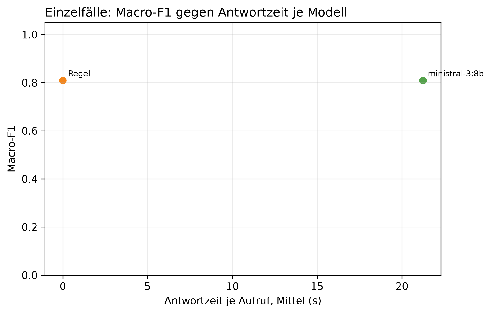

# K3 LLM-Klassifikation und Modellwahl, Läufe k3_013 / k3_seq_013

## Setup

- Läufe (Ebene 1 / Ebene 2): k3_013 / k3_seq_013
- Prompt (Ebene 1 / Ebene 2): v24 / v24
- Modelle: MDL5 ministral-3:8b
- LLM: temperature 0,0, höchstens 2 Versuche je Aufruf
- Ebene 1: 9 synthetische Fälle, je Modell 1 Aufruf je Fall, Regel (BASELINE) läuft mit
- Ebene 2: Standard-Szenarien, Cutover CO3 (2015-03-01), 40 Tage davor, 60 danach, jedes Modell als eigener Kreislauf wie SYS3 mit Adaption
- Ereignisse Ebene 2: control = keine Änderung, step = Dauerlast +100 W, peak_6 = Einzeltag-Spitze +1000 W über 6 h
- Produktivmodell SYS3: ministral-3:8b
- Commit (Ebene 1 / Ebene 2): 1fa4f33 / 1fa4f33 (mit lokalen Änderungen)
- Textprüfung: 17 Gerätewörter, 9 Steuerungswörter, Zahlentoleranz 0,5, Fensterzahlen aus dem Prompt 7, 28

## Kennzahlen

| Kennzahl | Wert | Bezug |
|---|---|---|
| Ebene 1: bestes Modell nach Macro-F1 | ministral-3:8b | Macro-F1 0,81, Regel 0,81 |
| ministral-3:8b: Ebene 1 richtig | 8/9 | Regel 8/9 |
| ministral-3:8b: Antwortzeit je Aufruf im Mittel [s] | 21,2 | p95 35,9 s, Regel 0,0 s |
| ministral-3:8b: Ebene 2 Ereignis-Arten erkannt | 2/2 | Regel 2/2 |
| ministral-3:8b: Ebene 2 Tage mit anderer Klasse als die Regel | 3 | 2015-04-05 new_pattern statt normal; 2015-04-07 new_pattern statt normal; 2015-04-07 peak statt normal; 2015-04-08 peak statt normal |
| ministral-3:8b: ungültige Antworten Ebene 1 | 0 | Ausfalltage Ebene 2: 0 |
| ministral-3:8b: Antworten mit Textverstoß (Ebene 1 / Ebene 2) | 1/9 / 0/103 | Gerät, Steuerung oder Zahl, Datum, Uhrzeit nicht im State |
| ministral-3:8b: Antworten mit fehlenden Belegen (Ebene 1 / Ebene 2) | 0/9 / 0/103 | zitierte Belege passen nicht zur eigenen Klasse |

## Ebene 1: Modellvergleich auf den Einzelfällen

| ID | Modell | richtig | Macro-F1 | ungültig | Ø Versuche | Grounding | Ø s je Aufruf | p95 s |
|---|---|---|---:|---:|---:|---:|---:|---:|
| BASELINE | Regel | 8/9 | 0,8 | 0 | 1,0 | - | 0,0 | 0,0 |
| MDL5 | ministral-3:8b | 8/9 | 0,8 | 0 | 1,0 | 0,9 | 21,2 | 35,9 |

## Ebene 1: Antwort je Fall (✓ = richtig, sonst die Antwort, - = ungültig)

| Fall | erwartet | Regel | ministral-3:8b |
|---|---|---|---|
| absence_drift_down | absence | new_pattern | new_pattern |
| low_single_scale | low | ✓ | ✓ |
| measurement_error_missing_day | measurement_error | ✓ | ✓ |
| new_pattern | new_pattern | ✓ | ✓ |
| new_pattern_at_min_scales_boundary | new_pattern | ✓ | ✓ |
| new_pattern_drift_down | new_pattern | ✓ | ✓ |
| normal_single_sustained_scale | normal | ✓ | ✓ |
| peak | peak | ✓ | ✓ |
| peak_single_sustained_scale | peak | ✓ | ✓ |

## Automatische Textprüfung je Modell (Antworten mit Verstoß oder fehlenden Belegen)

| Modell | E1 Antworten | E1 mit Verstoß | E1 Belege fehlen | E1 Gerät genannt | E2 Antworten | E2 mit Verstoß | E2 Belege fehlen | E2 Gerät genannt |
|---|---:|---:|---:|---:|---:|---:|---:|---:|
| ministral-3:8b | 9 | 1 | 0 | 4 | 103 | 0 | 0 | 22 |

## Ebene 2: je Modell über alle Ereignis-Arten

| Modell | Ereignis-Arten erkannt | Tage anders als die Regel | Gate-Tage | Ausfalltage | Meldungen Kontrolle | unknown Kontrolle | Resets Kontrolle |
|---|---|---:|---:|---:|---:|---:|---:|
| Regel | 2/2 | 0 | 118 | 0 | 6 | 0 | 0 |
| ministral-3:8b | 2/2 | 3 | 103 | 0 | 8 | 0 | 1 |

## Ebene 2: Erkennung je Ereignis, Tag seit Cutover

| config | Ereignis | erwartet | Gate-Tage durch das Ereignis | davon richtig | erster richtiger Tag | Resets |
|---|---|---|---:|---:|---:|---:|
| BASELINE | Einzeltag-Spitze +1000 W über 6 h | peak | 11 | 1 | 1 | 0 |
| BASELINE | Dauerlast +100 W | new_pattern | 13 | 1 | 22 | 1 |
| MDL5 | Einzeltag-Spitze +1000 W über 6 h | peak | 7 | 1 | 1 | 1 |
| MDL5 | Dauerlast +100 W | new_pattern | 16 | 1 | 22 | 2 |

## Ebene 2: Tage, an denen ein Modell anders einordnet als die Regel

| Modell | analysierter Tag | Regel | Modell sagt | in Arten |
|---|---|---|---|---|
| ministral-3:8b | 2015-04-05 | normal | new_pattern | step |
| ministral-3:8b | 2015-04-07 | normal | new_pattern | control, peak_6 |
| ministral-3:8b | 2015-04-07 | normal | peak | step |
| ministral-3:8b | 2015-04-08 | normal | peak | control, peak_6 |

## Hinweise

- Ebene 1 prüft, ob ein Modell die Regeln aus dem Prompt nachvollzieht. Der Prompt wurde auf denselben Fällen verbessert, die Quoten begründen deshalb nur die Modellwahl und belegen nicht das Ziel von 80 % richtiger Klassen (dafür E5)
- wenige Fälle: ein Fall sind mehrere Prozentpunkte, eine Klasse hängt teils an einem einzigen Fall
- Macro-F1: Mittel der F1-Werte über die Klassen, die als erwartete Klasse vorkommen
- Grounding: Anteil der für den Fall erwarteten Felder, die das Modell als Beleg zitiert. Die Regel zitiert keine
- Tag seit Cutover = Entscheidungstag: an Tag n meldet das System, eingeordnet ist dabei Tag n-1. Ab Cutover zählt deshalb erst ab Tag 1
- Ebene 2, erkannt: erwartete Klasse an einem Tag, an dem nur das Ereignis das Gate öffnet (gepaart mit dem Kontrolllauf desselben Modells)
- Ebene 2, anders als die Regel: gleiche Art und gleicher analysierter Tag, Regel gegen Modell. Nach einem Reset an verschiedenen Tagen laufen die Reihen auseinander, spätere Abweichungen können daraus folgen
- Antwortzeit: gemessen auf dem Rechner des Laufs, nur zum Vergleich der Modelle untereinander
- Textprüfung: Verstoß heißt, ein Steuerungswort oder eine Zahl, ein Datum oder eine Uhrzeit steht im Text, aber nicht im State des Falls. Ein genanntes Gerät ist nur ein Hinweis, als Möglichkeit ist es erlaubt, ob es als Ursache behauptet wird, beurteilen die Bewertenden. Zahlwörter („sechs Wochen“) und nicht gelistete Geräte findet sie nicht. Die Fensterlängen 7 und 30 aus der Skalenbeschreibung im Prompt gelten als erlaubt
- Fehlende Belege: der Prompt verlangt je Klasse bestimmte Pfade (new_pattern: sustained_drift, Streaks, peak/low: level, direction, absence: level, Kalendereintrag, measurement_error: Flag). Geprüft wird gegen die eigene Klasse des Modells, nicht gegen die erwartete. Ebene 1 wird nur für Läufe geprüft, die den State der Fälle in der Antwortdatei speichern, ältere Läufe haben in der Tabelle 0 Antworten
- Antworttexte und Auffälligkeiten der Textprüfung im Anhang, Antworten für alle Modelle in Ebene 1 und Ebene 2. Als CSV: answers_single.csv für Ebene 1, answers_sequence.csv für Ebene 2 nur vom Produktivmodell, result_text_findings.csv für die Auffälligkeiten

## Anhang

### Ebene 1: Precision, Recall und F1 je Klasse

| Modell | Klasse | Precision | Recall | F1 |
|---|---|---:|---:|---:|
| Regel | absence | 0,0 | 0,0 | 0,0 |
| Regel | low | 1,0 | 1,0 | 1,0 |
| Regel | measurement_error | 1,0 | 1,0 | 1,0 |
| Regel | new_pattern | 0,8 | 1,0 | 0,9 |
| Regel | normal | 1,0 | 1,0 | 1,0 |
| Regel | peak | 1,0 | 1,0 | 1,0 |
| ministral-3:8b | absence | 0,0 | 0,0 | 0,0 |
| ministral-3:8b | low | 1,0 | 1,0 | 1,0 |
| ministral-3:8b | measurement_error | 1,0 | 1,0 | 1,0 |
| ministral-3:8b | new_pattern | 0,8 | 1,0 | 0,9 |
| ministral-3:8b | normal | 1,0 | 1,0 | 1,0 |
| ministral-3:8b | peak | 1,0 | 1,0 | 1,0 |

### Ebene 1: Antworten der Modelle je Fall

**peak** (erwartet: peak)

- ministral-3:8b: peak ✓
  - Erklärung: Gestern war der Stromverbrauch um **45 % höher** als an einem normalen Wochentag. Das ist ungewöhnlich, da es sich nicht auf einen einzelnen Spitzenwert im Tagesverlauf beschränkt, sondern den gesamten Tag betrifft.
  - Empfehlung: Überprüfen Sie, ob gestern ungewöhnliche Geräte oder Aktivitäten (z. B. Heizungs- oder Beleuchtungsänderungen) aufgetreten sind, die den erhöhten Verbrauch erklären könnten.
  - Unsicherheit: Da keine geplanten Abwesenheiten oder besonderen Ereignisse im Kalender eingetragen sind, kann dies auch ein technischer Grund sein.

**new_pattern** (erwartet: new_pattern)

- ministral-3:8b: new_pattern ✓
  - Erklärung: Der Stromverbrauch war gestern und in den letzten Tagen deutlich höher als sonst – seit dem 9. Dezember um etwa 38 % im Vergleich zu einem normalen Wochentag. Die Abweichung hält seit über einer Woche an.
  - Empfehlung: Überprüfen Sie, ob Geräte wie Heizung oder Beleuchtung länger laufen oder neue Elektrogeräte im Einsatz sind.
  - Unsicherheit: Die genaue Ursache ist unbekannt.

**low_single_scale** (erwartet: low)

- ministral-3:8b: low ✓
  - Erklärung: Gestern war der Stromverbrauch um etwa 30 % niedriger als an einem typischen Freitag in dieser Woche. Da keine geplante Abwesenheit bekannt ist, könnte dies auf ungewöhnlich geringen Verbrauch hindeuten.
  - Empfehlung: Überprüfen Sie, ob gestern jemand zu Hause war oder ob ungewöhnliche Umstände (z. B. Stromausfall oder Geräteprobleme) vorlagen.
  - Unsicherheit: Kein Kalender war verfügbar, um eine geplante Abwesenheit auszuschließen.

**peak_single_sustained_scale** (erwartet: peak)

- ministral-3:8b: peak ✓
  - Erklärung: Gestern war der Stromverbrauch im Vergleich zu einem normalen Wochentag um etwa 40 % höher als üblich. Dies ist seit dem 10. Dezember so und hat sich in den letzten sechs Tagen wiederholt.
  - Empfehlung: Überprüfen Sie, ob Geräte wie Heizung oder Beleuchtung ungewöhnlich lange oder intensiver genutzt wurden.
  - Unsicherheit: Ob es sich um eine geplante Veränderung handelt, kann nicht beurteilt werden.

**normal_single_sustained_scale** (erwartet: normal)

- ministral-3:8b: normal ✓
  - Erklärung: Gestern war der Stromverbrauch im Vergleich zur letzten Woche um etwa 9 % höher, aber das ist nicht ungewöhnlich für diese Zeit des Jahres. Die Abweichung hat sich bereits seit dem 10. Dezember gehalten und betrifft vor allem die durchschnittliche Nutzung über die Woche.
  - Empfehlung: Es ist keine weitere Handlung nötig, da die Abweichung bereits länger besteht und typisch für den Winter sein könnte.
  - Unsicherheit: Die genaue Ursache bleibt unbekannt, da nur der Gesamtverbrauch gemessen wird.

**new_pattern_at_min_scales_boundary** (erwartet: new_pattern)

- ministral-3:8b: new_pattern ✓
  - Erklärung: Gestern war der Stromverbrauch im Vergleich zu einem normalen Wochentag um etwa 35 % höher und hat sich seit dem 10. Dezember auf dieser Ebene gehalten. Die erhöhte Nutzung hält bereits seit über einer Woche an, was darauf hindeutet, dass sich ein neues Muster eingestellt hat.
  - Empfehlung: Überprüfen Sie, ob neue Geräte oder häufigere Nutzung von Elektrogeräten (z. B. Heizungen, Beleuchtung oder Unterhaltungselektronik) die erhöhte Verbrauchsmuster erklären könnten.
  - Unsicherheit: Ob es sich um ein dauerhaftes Muster handelt, lässt sich erst nach weiteren Tagen beurteilen.

**measurement_error_missing_day** (erwartet: measurement_error)

- ministral-3:8b: measurement_error ✓
  - Erklärung: Der gemessene Wert für gestern ist nicht vertrauenswürdig und kann keine Aussage über den Verbrauch treffen.
  - Empfehlung: Überprüfen Sie, ob die Messung oder der Zähler funktioniert. Falls nötig, kontaktieren Sie Ihren Stromanbieter oder Elektriker.
  - Unsicherheit: Der gemessene Wert ist nicht aussagekräftig und kann keine Rückschlüsse auf den tatsächlichen Verbrauch zulassen.

**new_pattern_drift_down** (erwartet: new_pattern)

- ministral-3:8b: new_pattern ✓
  - Erklärung: Der Stromverbrauch war gestern im Vergleich zur letzten Woche um etwa 40 % niedriger und liegt seit dem 9. Dezember auf diesem Niveau. Seit Anfang Dezember verbrauchen Sie insgesamt rund 25 % weniger als sonst.
  - Empfehlung: Überprüfen Sie, ob sich der Verbrauch in den letzten Wochen verändert hat – etwa durch weniger Heizbedarf oder kürzere Nutzung von Geräten.
  - Unsicherheit: Ob es einen konkreten Grund für die Veränderung gibt, können wir nicht sagen.

**absence_drift_down** (erwartet: absence)

- ministral-3:8b: new_pattern
  - Erklärung: Gestern war der Stromverbrauch im Vergleich zur letzten Woche um etwa 40 % niedriger und im Vergleich zum gesamten Dezember bisher um etwa 25 % reduziert. Dies deutet auf ein neues, dauerhaftes Muster hin.
  - Empfehlung: Überprüfen Sie, ob der Stromzähler oder die Messung möglicherweise nicht korrekt funktioniert, da die Werte ungewöhnlich niedrig sind. Alternativ könnte ein geplanter Urlaub (8.–21. Dezember) den Unterschied erklären.
  - Unsicherheit: Die Ursache für das neue Muster ist unbekannt und kann nur durch manuelle Überprüfung der Geräte oder des Kalenders geklärt werden.

### Ebene 2: Antworten von ministral-3:8b, ein Tag mit allen Arten, in denen derselbe Text kam

- 2015-01-24: normal (Arten: control, peak_6, step)
  - Erklärung: Gestern war der Stromverbrauch im Vergleich zum üblichen Tagesverlauf normal, aber die durchschnittliche Nutzung des letzten Monats ist um etwa 25 % niedriger als sonst. Dies könnte auf eine saisonale Veränderung hinweisen, da es sich um den Winter handelt.
  - Empfehlung: Da der aktuelle Verbrauch im Vergleich zur letzten Woche und zum üblichen Tagesverlauf normal ist, ist keine weitere Handlung nötig.
  - Unsicherheit: Es gibt keine Informationen über geplante Abwesenheiten oder besondere Ereignisse, die den niedrigeren Monatsdurchschnitt erklären könnten.
- 2015-01-25: normal (Arten: control, peak_6, step)
  - Erklärung: Gestern lag der Verbrauch im Vergleich zum langfristigen Durchschnitt um etwa 22 % niedriger als sonst, was auf eine mögliche Veränderung hinweist. Allerdings handelt es sich dabei nicht um einen ungewöhnlichen Tag selbst.
  - Empfehlung: Da der Verbrauch seit dem 19. Januar nachhaltig niedriger ist, prüfen Sie bitte, ob sich etwas im Haushalt verändert hat – etwa weniger Heizbedarf durch wärmere Temperaturen oder eine andere Nutzung von Geräten.
  - Unsicherheit: Ob es sich um einen dauerhaften Wandel handelt, kann ohne weitere Informationen nicht sicher beurteilt werden.
- 2015-01-26: normal (Arten: control, peak_6, step)
  - Erklärung: Gestern lag der Verbrauch im Vergleich zum letzten Monat um etwa 18 % niedriger, was seit dem 19. Januar so bleibt. Da es sich aber nur um eine leichte Abweichung handelt und keine ungewöhnlichen Ereignisse vorlagen, ist dies nicht auffällig.
  - Empfehlung: Da der Verbrauch im Rahmen liegt, ist keine weitere Handlung nötig. Überprüfen Sie ggf. ob die Heizung oder Beleuchtung im Januar weniger genutzt wurde.
  - Unsicherheit: Es gab keinen Zugriff auf den Kalender, um geplante Abwesenheiten zu prüfen.
- 2015-01-27: normal (Arten: control, peak_6, step)
  - Erklärung: Gestern lag der Verbrauch im Vergleich zum letzten Monat um etwa 15 % niedriger, was seit dem 19. Januar so bleibt. Da es sich aber nur um eine leichte Abweichung handelt und keine ungewöhnlichen Ereignisse vorlagen, ist dies nicht auffällig.
  - Empfehlung: Da der Verbrauch im Rahmen liegt, ist keine weitere Handlung nötig. Überprüfen Sie ggf. ob die Heizung oder Beleuchtung im Januar weniger genutzt wurde.
  - Unsicherheit: Es gibt keine Hinweise auf einen geplanten Urlaub oder besondere Umstände, da kein Kalender verfügbar war.
- 2015-01-28: normal (Arten: control, peak_6, step)
  - Erklärung: Gestern lag der Verbrauch im Vergleich zum letzten Monat um etwa 10 % niedriger, was seit dem 19. Januar so bleibt. Da es sich aber nur um eine leichte Abweichung handelt und keine ungewöhnlichen Ereignisse vorlagen, ist dies nicht auffällig.
  - Empfehlung: Da keine ungewöhnlichen Umstände vorlagen, ist nichts weiter zu prüfen.
  - Unsicherheit: Es gibt keine Hinweise auf eine geplante Abwesenheit oder andere bekannte Ursachen für die Veränderung.
- 2015-02-19: normal (Arten: control, peak_6, step)
  - Erklärung: Der Stromverbrauch war gestern im Vergleich zum langfristigen Durchschnitt um etwa 25 % höher, was seit dem 14. Februar anhält. Dies könnte auf eine ungewöhnlich kalte Witterung oder erhöhten Heizbedarf hinweisen.
  - Empfehlung: Da der Verbrauch seit längerem erhöht ist, prüfen Sie bitte, ob die Heizung oder andere Geräte wie Warmwasserbereiter ungewöhnlich stark laufen. Ein Blick auf die Außentemperaturen könnte ebenfalls helfen.
  - Unsicherheit: Kein Kalender war verfügbar, um geplante Abwesenheiten zu überprüfen.
- 2015-02-20: normal (Arten: control, peak_6, step)
  - Erklärung: Gestern lag der Verbrauch im Vergleich zum letzten Monat um etwa 24 % niedriger, was auf eine mögliche Veränderung hinweist. Allerdings handelt es sich dabei nicht um einen ungewöhnlichen Tag selbst, sondern um ein langfristiges Muster.
  - Empfehlung: Da der Verbrauch seit dem 14. Februar um etwa ein Viertel niedriger ist, könnten Sie prüfen, ob sich die Nutzung bestimmter Geräte oder Heizgewohnheiten verändert hat.
  - Unsicherheit: Es gibt keine Kalendereinträge zur Verfügung, daher kann nicht ausgeschlossen werden, dass eine geplante Abwesenheit den Verbrauch beeinflusst.
- 2015-02-21: normal (Arten: control, peak_6, step)
  - Erklärung: Gestern lag der Verbrauch im Vergleich zum letzten Monat um etwa 24 % höher als üblich, was auf eine ungewöhnlich hohe Nutzung hindeutet. Allerdings handelt es sich dabei nicht um einen anhaltenden Trend, da die Abweichung nur für den gesamten Februar besteht und keine weiteren Hinweise auf ein neues Muster vorliegen.
  - Empfehlung: Da der Verbrauch im Februar insgesamt höher war, aber keine weiteren ungewöhnlichen Muster erkennbar sind, ist kein Handeln nötig. Sie können prüfen, ob die höheren Werte mit dem Winter oder anderen saisonalen Faktoren zusammenhängen.
  - Unsicherheit: Es gibt keine Hinweise auf ein neues Verbrauchsverhalten, da der erhöhte Wert nur für den Februar und nicht über mehrere Wochen hinweg auftritt.
- 2015-02-22: normal (Arten: control, peak_6, step)
  - Erklärung: Gestern lag der Verbrauch im Vergleich zum letzten Monat um etwa 24 % höher als üblich, was seit dem 14. Februar so bleibt. Da es sich aber nur um eine einzelne Abweichung auf einer Skala handelt und keine ungewöhnliche Tagesform oder Woche vorliegt, ist dies kein neues Muster.
  - Empfehlung: Es gibt nichts Offensichtliches zu überprüfen, da die Abweichung nur auf einer Skala und nicht nachhaltig ist.
  - Unsicherheit: Da kein Kalender verfügbar war, konnte keine geplante Abwesenheit geprüft werden.
- 2015-02-23: normal (Arten: control, peak_6, step)
  - Erklärung: Der Verbrauch gestern war im Vergleich zum üblichen Tagesverlauf normal, aber der Durchschnitt des letzten Monats lag um etwa 24 % höher als sonst. Dies könnte auf eine längere Nutzung von Heizung oder Beleuchtung im Winter zurückzuführen sein.
  - Empfehlung: Da der Verbrauch gestern selbst normal war, ist keine weitere Handlung nötig. Sie können die Entwicklung im nächsten Monat weiter beobachten.
  - Unsicherheit: Es gibt keine Hinweise auf eine geplante Abwesenheit oder technische Probleme.
- 2015-02-24: normal (Arten: control, peak_6, step)
  - Erklärung: Gestern lag der Verbrauch im Vergleich zum letzten Monat um etwa 21 % niedriger, was auf eine mögliche Veränderung hinweist. Da dies aber nur ein einzelner Tag war und keine ungewöhnliche Tagesform vorlag, ist es wahrscheinlich kein dauerhaftes Problem.
  - Empfehlung: Da der Verbrauch gestern ungewöhnlich niedrig war, könnten Sie prüfen, ob alle Geräte wie gewohnt genutzt wurden oder ob möglicherweise jemand länger nicht zu Hause war.
  - Unsicherheit: Es gibt keine Kalendereinträge, die eine geplante Abwesenheit bestätigen würden.
- 2015-02-25: normal (Arten: control, peak_6, step)
  - Erklärung: Gestern war der Stromverbrauch im Vergleich zum letzten Monat um etwa 16 % niedriger, aber die Abweichung beschränkte sich auf den langfristigen Durchschnitt und betraf nicht den gesamten Tag selbst.
  - Empfehlung: Da der Verbrauch gestern im Rahmen lag und sich die Abweichung nur auf den langfristigen Durchschnitt bezieht, ist keine weitere Handlung nötig.
  - Unsicherheit: Es gibt keine Hinweise auf eine geplante Abwesenheit oder andere bekannte Ursachen für den niedrigeren Verbrauch.
- 2015-02-26: normal (Arten: control, peak_6, step)
  - Erklärung: Gestern lag der Verbrauch im Vergleich zum letzten Monat um etwa 15 % höher als üblich, aber es gab keine ungewöhnlichen Schwankungen über den Tag verteilt. Dies könnte auf eine längere Nutzung von Heizung oder Beleuchtung hinweisen, da es sich um die Wintermonate handelt.
  - Empfehlung: Da der Verbrauch im Vergleich zum üblichen Winterverlauf leicht erhöht ist, prüfen Sie bitte, ob die Heizung oder andere Geräte wie Wassererhitzer ungewöhnlich lange laufen. Dies könnte helfen, den Grund für die erhöhte Nutzung zu verstehen.
  - Unsicherheit: Es gibt keine aktuellen Kalendereinträge, die diese Veränderung erklären könnten.
- 2015-02-27: normal (Arten: control, peak_6, step)
  - Erklärung: Gestern lag der Verbrauch im Vergleich zum letzten Monat um etwa 10 % niedriger, aber die Abweichung ist nicht ungewöhnlich für einen einzelnen Tag und betrifft nur den langfristigen Durchschnitt.
  - Empfehlung: Es gibt keine Handlungsbedarf, da die Abweichung nur den langfristigen Durchschnitt betrifft und nicht ungewöhnlich ist.
  - Unsicherheit: Da kein Kalender verfügbar war, kann eine geplante Abwesenheit nicht ausgeschlossen werden.
- 2015-03-01: peak (Arten: peak_6)
  - Erklärung: Gestern war der Stromverbrauch im Vergleich zum üblichen Tagesverlauf und für einen Dienstag um **71 % höher**. Der gesamte Tag verlief ungewöhnlich, mit einem besonders hohen Verbrauch.
  - Empfehlung: Überprüfen Sie, ob gestern ungewöhnliche Geräte oder Aktivitäten (z. B. Heizungs- oder Lüftungsanlagen, Baustellenarbeiten oder längere Nutzung von Elektrogeräten) den Verbrauch erhöht haben könnten.
  - Unsicherheit: Da keine Kalendereinträge verfügbar sind, kann ein geplanter Aufenthalt im Ausland oder eine andere Abwesenheit nicht ausgeschlossen werden.
- 2015-03-06: normal (Arten: peak_6)
  - Erklärung: Gestern war der Stromverbrauch im Vergleich zur letzten Woche um etwa 14 % niedriger, aber die Abweichung beschränkte sich auf einen einzelnen Tag und ist nicht nachhaltig.
  - Empfehlung: Da der Verbrauch gestern nur leicht niedriger war und sich die Abweichung nicht wiederholt hat, ist keine weitere Handlung nötig.
  - Unsicherheit: Es gibt keine Hinweise auf einen geplanten Urlaub oder eine andere bekannte Ursache für den geringeren Verbrauch.
- 2015-03-07: normal (Arten: peak_6)
  - Erklärung: Gestern lag der Verbrauch im Vergleich zur letzten Woche um etwa 22 % niedriger, aber die Abweichung beschränkte sich auf einen Tag und ist nicht nachhaltig.
  - Empfehlung: Da der Verbrauch gestern nur leicht unter dem üblichen Niveau lag und sich die Abweichung nicht wiederholt hat, ist keine weitere Handlung nötig.
  - Unsicherheit: Es gibt keine Hinweise auf einen geplanten Urlaub oder eine andere bekannte Ursache für den niedrigeren Verbrauch.
- 2015-03-08: normal (Arten: peak_6)
  - Erklärung: Der Stromverbrauch lag gestern im Vergleich zur letzten Woche um etwa 21 % niedriger, aber die Abweichung ist nicht nachhaltig und liegt innerhalb der normalen Schwankungen.
  - Empfehlung: Da keine ungewöhnlichen Umstände vorliegen, ist kein Handeln nötig.
  - Unsicherheit: Es gibt keine Hinweise auf eine geplante Abwesenheit oder andere bekannte Ursachen für die Verbrauchsänderung.
- 2015-03-08: normal (Arten: step)
  - Erklärung: Gestern lag der Verbrauch im Vergleich zur letzten Woche um etwa 24 % höher, was auf einen ungewöhnlich aktiven Zeitraum hindeutet. Dies könnte z. B. durch längere Nutzung von Heizung oder Beleuchtung bei kürzeren Tagen im März bedingt sein.
  - Empfehlung: Da der Verbrauch gestern im Rahmen des Erwarteten lag, ist keine weitere Handlung nötig.
  - Unsicherheit: Es gibt keine Hinweise auf eine geplante Abwesenheit oder technische Probleme.
- 2015-03-09: normal (Arten: step)
  - Erklärung: Gestern war der Stromverbrauch im Vergleich zur letzten Woche um etwa 27 % höher, aber die Abweichung ist nur ein Tag und nicht nachhaltig. Die Werte liegen weiterhin im üblichen Bereich.
  - Empfehlung: Da der Verbrauch gestern zwar erhöht war, aber nicht ungewöhnlich für einen einzelnen Tag ist, müssen Sie nichts weiter prüfen.
  - Unsicherheit: Es gibt keine Hinweise auf eine geplante Abwesenheit oder andere bekannte Ursachen.
- 2015-03-10: normal (Arten: step)
  - Erklärung: Gestern war der Stromverbrauch im Vergleich zur letzten Woche um etwa 45 % höher, aber die Abweichung ist nur ein Tag und nicht nachhaltig. Die Werte liegen weiterhin im üblichen Bereich.
  - Empfehlung: Da der Verbrauch gestern zwar erhöht war, aber nicht ungewöhnlich für einen einzelnen Tag ist, müssen Sie nichts weiter prüfen.
  - Unsicherheit: Es gibt keine Hinweise auf eine geplante Abwesenheit oder andere bekannte Ursachen.
- 2015-03-11: normal (Arten: step)
  - Erklärung: Gestern war der Stromverbrauch im Vergleich zur letzten Woche um etwa 21 % höher, aber das ist nicht ungewöhnlich für einen einzelnen Tag.
  - Empfehlung: Da es sich um eine einmalige Abweichung handelt, ist keine weitere Handlung nötig.
  - Unsicherheit: Es gibt keine Hinweise auf einen geplanten Urlaub oder besondere Ereignisse, die den erhöhten Verbrauch erklären könnten.
- 2015-03-12: normal (Arten: step)
  - Erklärung: Gestern war der Stromverbrauch im Vergleich zur letzten Woche um etwa 17 % höher, aber das ist nicht ungewöhnlich für einen einzelnen Tag.
  - Empfehlung: Es gibt keinen Grund zur Sorge, da die erhöhte Nutzung nur eine Woche anhielt und nicht ungewöhnlich ist.
  - Unsicherheit: Kein Kalender war verfügbar, um geplante Abwesenheiten zu prüfen.
- 2015-03-13: normal (Arten: step)
  - Erklärung: Gestern war der Stromverbrauch im Vergleich zur letzten Woche um etwa 20 % höher, aber das ist nicht ungewöhnlich für diese Zeit des Jahres.
  - Empfehlung: Da der Verbrauch im Rahmen liegt, ist keine weitere Handlung nötig.
  - Unsicherheit: Es gibt keine Hinweise auf eine geplante Abwesenheit oder technische Probleme.
- 2015-03-14: normal (Arten: step)
  - Erklärung: Der Stromverbrauch lag gestern im Vergleich zur letzten Woche um etwa 28 % niedriger, obwohl die Werte über den gesamten Monat betrachtet leicht erhöht waren. Dies könnte auf eine kürzliche Veränderung im Haushalt hindeuten, da der Wert seit dem 3. März ungewöhnlich hoch war.
  - Empfehlung: Da der Verbrauch gestern im Vergleich zur letzten Woche ungewöhnlich niedrig war, könnten Sie prüfen, ob sich etwas im Haushalt geändert hat – etwa weniger Heizung oder kürzere Nutzung von Geräten.
  - Unsicherheit: Es gibt keine Kalendereinträge, die eine geplante Abwesenheit bestätigen würden.
- 2015-03-15: low (Arten: control)
  - Erklärung: Gestern war der Stromverbrauch um etwa 63 % niedriger als an einem typischen Wochentag. Dies könnte auf einen längeren Aufenthalt außerhalb des Hauses hinweisen, da die Werte seit dem 14. März nach unten abweichen.
  - Empfehlung: Überprüfen Sie, ob Sie oder Familienmitglieder gestern länger als üblich nicht zu Hause waren.
  - Unsicherheit: Da keine Kalenderdaten verfügbar sind, kann ein geplanter Aufenthalt außerhalb des Hauses nicht ausgeschlossen werden.
- 2015-03-15: low (Arten: peak_6)
  - Erklärung: Gestern war der Stromverbrauch um etwa 64 % niedriger als an einem typischen Freitag. Seit dem 12. März liegt die Verbrauchsmenge der letzten Woche rund 14 % unter dem üblichen Wert.
  - Empfehlung: Da keine Kalenderdaten verfügbar sind, prüfen Sie bitte, ob gestern oder in der letzten Woche jemand länger als geplant weg war oder ob ein geplanter Urlaub stattgefunden hat.
  - Unsicherheit: Ohne Zugriff auf einen Kalender kann eine geplante Abwesenheit nicht bestätigt werden.
- 2015-03-15: normal (Arten: step)
  - Erklärung: Gestern war der Stromverbrauch im Vergleich zur letzten Woche um etwa 42 % niedriger, aber die Abweichung beschränkte sich auf diese Woche und ist nicht nachhaltig. Da keine ungewöhnlichen Ereignisse oder Geräteänderungen bekannt sind, handelt es sich wahrscheinlich um eine zufällige Schwankung.
  - Empfehlung: Es ist nichts Offensichtliches zu überprüfen, da der Verbrauch gestern wieder normal war und die Abweichung nur eine Woche anhielt.
  - Unsicherheit: Da keine Kalenderdaten verfügbar sind, kann ein geplanter Urlaub oder ein Ausfall nicht ausgeschlossen werden.
- 2015-03-16: normal (Arten: step)
  - Erklärung: Gestern war der Stromverbrauch im Vergleich zur letzten Woche um etwa 12 % höher, aber das ist nicht ungewöhnlich für diese Zeit des Jahres.
  - Empfehlung: Es gibt keinen Grund zur Sorge, da der Verbrauch im Rahmen liegt und keine ungewöhnlichen Geräte oder Aktivitäten zu erwarten sind.
  - Unsicherheit: Kein Kalender war verfügbar, um geplante Abwesenheiten zu prüfen.
- 2015-03-17: normal (Arten: step)
  - Erklärung: Gestern war der Stromverbrauch im Vergleich zur letzten Woche um etwa 44 % höher, aber dieser Wert ist nicht ungewöhnlich für einen einzelnen Tag und hat sich heute wieder normalisiert.
  - Empfehlung: Da der erhöhte Verbrauch nur einen Tag betraf und sich wieder normalisiert hat, ist keine weitere Handlung nötig.
  - Unsicherheit: Es gibt keine Hinweise auf eine geplante Abwesenheit oder ungewöhnliche Ereignisse, die den Verbrauch erklären könnten.
- 2015-03-18: normal (Arten: peak_6)
  - Erklärung: Gestern war der Stromverbrauch im Vergleich zum üblichen Wochenwert um etwa 30 % höher, aber dieser Wert liegt innerhalb der normalen Schwankungen und ist nicht nachhaltig erhöht. Die Abweichung beschränkte sich auf einen einzelnen Tag ohne weitere Muster.
  - Empfehlung: Es ist keine Handlung nötig, da der erhöhte Verbrauch gestern nicht ungewöhnlich war und sich nicht wiederholt hat.
  - Unsicherheit: Kein Kalender war verfügbar, um geplante Abwesenheiten zu prüfen.
- 2015-03-18: normal (Arten: step)
  - Erklärung: Gestern war der Stromverbrauch im Vergleich zur letzten Woche um etwa 16 % höher, aber die Abweichung ist nicht groß genug für eine Warnung.
  - Empfehlung: Da der Verbrauch gestern im Rahmen liegt, ist keine weitere Handlung nötig.
  - Unsicherheit: Es gibt keine Hinweise auf eine geplante Abwesenheit oder ungewöhnliche Ereignisse.
- 2015-03-19: normal (Arten: peak_6)
  - Erklärung: Gestern lag der Verbrauch im Vergleich zur letzten Woche um etwa 6 % niedriger, aber es gab keine ungewöhnlichen Schwankungen über den Tag verteilt. Dies könnte auf eine leichte Veränderung im Alltag hinweisen, zum Beispiel weniger Heizbedarf durch frühlingshafte Temperaturen.
  - Empfehlung: Da der Verbrauch im Rahmen liegt, ist keine Handlung nötig. Sie können prüfen, ob sich Ihr Nutzungsverhalten oder die Witterung verändert haben.
  - Unsicherheit: Kein Kalender war verfügbar, um geplante Abwesenheiten zu überprüfen.
- 2015-03-19: normal (Arten: step)
  - Erklärung: Gestern lag der Verbrauch im Vergleich zur letzten Woche um etwa 15 % höher, aber das ist nicht ungewöhnlich für diese Zeit des Jahres. Der Anstieg hat sich seit dem 3. März gehalten und könnte mit längeren Tagen oder mehr Heizbedarf zusammenhängen.
  - Empfehlung: Es ist nichts zu unternehmen, da der Verbrauch im Rahmen liegt und die Veränderung typisch für den Frühling sein kann.
  - Unsicherheit: Kein Kalender war verfügbar, um geplante Abwesenheiten oder besondere Aktivitäten zu prüfen.
- 2015-03-20: normal (Arten: control)
  - Erklärung: Gestern lag der Verbrauch im Vergleich zur letzten Woche um etwa 10 % niedriger, aber die Abweichung ist nicht groß genug für eine Warnung.
  - Empfehlung: Da der Verbrauch gestern im üblichen Rahmen lag, ist keine weitere Handlung nötig.
  - Unsicherheit: Es gibt keine Hinweise auf einen geplanten Urlaub oder eine andere mögliche Ursache für den niedrigeren Verbrauch.
- 2015-03-20: normal (Arten: peak_6)
  - Erklärung: Gestern lag der Verbrauch im Vergleich zur letzten Woche um etwa 26 % niedriger, aber die Abweichung ist nicht groß genug für eine Warnung und hat sich nur auf diese Woche beschränkt.
  - Empfehlung: Da der Verbrauch gestern im üblichen Rahmen lag, ist keine weitere Handlung nötig.
  - Unsicherheit: Es gibt keine Hinweise auf einen geplanten Urlaub oder eine andere bekannte Ursache für den niedrigeren Verbrauch.
- 2015-03-20: normal (Arten: step)
  - Erklärung: Gestern lag der Verbrauch im Vergleich zur letzten Woche um etwa 5 % niedriger, aber die Abweichung ist nicht groß genug für eine Warnung.
  - Empfehlung: Es ist nichts zu unternehmen, da der Verbrauch im Rahmen liegt und keine ungewöhnlichen Umstände vorliegen.
  - Unsicherheit: Da kein Kalender verfügbar war, kann eine geplante Abwesenheit nicht ausgeschlossen werden.
- 2015-03-21: normal (Arten: peak_6)
  - Erklärung: Gestern war der Stromverbrauch im Vergleich zum üblichen Wochenwert um etwa 23 % höher, aber dieser Wert liegt innerhalb der normalen Schwankungen und ist nicht nachhaltig erhöht. Die Abweichung beschränkte sich auf einen einzelnen Wochentag ohne weitere Muster.
  - Empfehlung: Es gibt keine Handlungsbedarf, da der erhöhte Verbrauch gestern nicht ungewöhnlich war und sich nicht wiederholt hat.
  - Unsicherheit: Kein Kalender war verfügbar, um geplante Abwesenheiten zu prüfen.
- 2015-03-21: normal (Arten: step)
  - Erklärung: Gestern lag der Verbrauch im Vergleich zur letzten Woche um etwa 42 % höher als üblich, aber die Abweichung ist nicht nachhaltig und betrifft nur diese Woche. Die Werte für den gesamten März liegen ebenfalls über dem üblichen Niveau.
  - Empfehlung: Es gibt keinen Grund zur Sorge, da der Verbrauch gestern im Rahmen des Üblichen lag und die erhöhte Nutzung nur eine vorübergehende Abweichung war.
  - Unsicherheit: Kein Kalender war verfügbar, um geplante Abwesenheiten zu prüfen.
- 2015-03-22: new_pattern (Arten: step)
  - Erklärung: Gestern war der Stromverbrauch im Vergleich zur letzten Woche um etwa 30 % höher und seit dem 3. März auf diesem Niveau. Seit Anfang März ist auch die monatliche Durchschnittslast um rund 17 % gestiegen.
  - Empfehlung: Da der erhöhte Verbrauch seit mehreren Wochen anhält, prüfen Sie bitte, ob sich etwas im Haushalt verändert hat – etwa neue Geräte oder längere Nutzung von Heizung oder Beleuchtung.
  - Unsicherheit: Ein Kalender war nicht verfügbar, um geplante Abwesenheiten zu überprüfen.
- 2015-04-02: low (Arten: control)
  - Erklärung: Gestern war der Stromverbrauch um etwa 57 % niedriger als an einem typischen Dienstag. Die Verbrauchswerte der letzten Woche und des Monats lagen ebenfalls etwas niedriger, aber nicht so stark.
  - Empfehlung: Da kein Kalender verfügbar ist, prüfen Sie bitte, ob gestern jemand zu Hause war oder ob es einen Grund für den deutlich niedrigeren Verbrauch gab.
  - Unsicherheit: Es gibt keine Informationen über geplante Abwesenheiten oder besondere Umstände.
- 2015-04-02: low (Arten: peak_6)
  - Erklärung: Gestern war der Stromverbrauch um etwa 57 % niedriger als an einem typischen Dienstag. Da keine Kalenderdaten verfügbar sind, kann ein geplanter Ausfall oder eine Abwesenheit nicht ausgeschlossen werden.
  - Empfehlung: Überprüfen Sie, ob gestern ein geplanter Ausfall oder eine Abwesenheit stattgefunden hat, die den niedrigen Verbrauch erklären könnte.
  - Unsicherheit: Da keine Kalenderdaten verfügbar sind, kann eine geplante Abwesenheit nicht sicher ausgeschlossen werden.
- 2015-04-02: low (Arten: step)
  - Erklärung: Gestern war der Stromverbrauch insgesamt ungewöhnlich niedrig, da der Tagesverlauf sehr flach verlief. Im Vergleich zur letzten Woche lag er um etwa 8 % unter dem üblichen Wert.
  - Empfehlung: Überprüfen Sie, ob gestern ungewöhnlich wenig Strom verbraucht wurde – etwa durch weniger Heizung oder Beleuchtung, da es sich um eine ungewöhnliche Tagesverteilung handelte.
  - Unsicherheit: Da keine Kalendereinträge verfügbar sind, kann nicht ausgeschlossen werden, dass ein geplanter Aufenthalt außerhalb des Hauses den Verbrauch beeinflusst hat.
- 2015-04-03: low (Arten: control)
  - Erklärung: Gestern war der Stromverbrauch um etwa 64 % niedriger als an einem typischen Wochentag. Seit dem 2. April bleibt er deutlich unter dem Üblichen, was auf eine mögliche Abwesenheit hindeutet.
  - Empfehlung: Überprüfen Sie bitte, ob gestern oder am Vortag jemand länger abwesend war, da der Verbrauch ungewöhnlich niedrig war.
  - Unsicherheit: Da keine Kalenderdaten verfügbar sind, kann eine geplante Abwesenheit nicht bestätigt werden.
- 2015-04-03: low (Arten: peak_6)
  - Erklärung: Gestern war der Stromverbrauch um etwa 64 % niedriger als an einem typischen Wochentag. Seit dem 2. April bleibt er deutlich unter dem Üblichen.
  - Empfehlung: Überprüfen Sie, ob gestern oder am Vortag jemand länger als üblich nicht zu Hause war – etwa wegen eines geplanten Ausflugs oder Urlaubs.
  - Unsicherheit: Da keine Kalenderdaten verfügbar sind, kann ein geplanter Aufenthalt außerhalb des Hauses nicht ausgeschlossen werden.
- 2015-04-03: low (Arten: step)
  - Erklärung: Gestern war der Stromverbrauch insgesamt ungewöhnlich niedrig, da der Tagesverlauf sehr flach verlief. Im Vergleich zur letzten Woche lag er um etwa 15 % unter dem üblichen Wert.
  - Empfehlung: Überprüfen Sie, ob gestern ungewöhnlich wenig Strom verbraucht wurde – etwa durch längeres Fehlen oder reduzierte Nutzung von Geräten wie Heizung oder Beleuchtung.
  - Unsicherheit: Da kein Kalender verfügbar ist, kann nicht geprüft werden, ob ein geplanter Ausfall oder eine Abwesenheit vorlag.
- 2015-04-04: low (Arten: control, peak_6)
  - Erklärung: Gestern war der Stromverbrauch um etwa zwei Drittel niedriger als an einem typischen Wochentag. Seit dem 2. April bleibt er deutlich unter dem üblichen Niveau, was auf eine mögliche Abwesenheit hindeutet.
  - Empfehlung: Überprüfen Sie bitte, ob gestern oder in den letzten Tagen jemand länger abwesend war, da dies den deutlichen Rückgang erklären könnte.
  - Unsicherheit: Da keine Kalenderdaten verfügbar sind, kann eine geplante Abwesenheit nicht bestätigt werden.
- 2015-04-05: low (Arten: control)
  - Erklärung: Gestern war der Stromverbrauch um etwa zwei Drittel niedriger als an einem typischen Dienstag in dieser Woche. Seit dem 2. April bleibt er deutlich unter dem üblichen Niveau.
  - Empfehlung: Da kein Kalender verfügbar ist, prüfen Sie bitte, ob jemand länger als geplant weg war oder ob der Verbrauch durch ungewöhnliche Umstände wie eine längere Abwesenheit gesunken sein könnte.
  - Unsicherheit: Ohne Zugriff auf einen Kalender kann keine geplante Abwesenheit ausgeschlossen werden.
- 2015-04-05: low (Arten: peak_6)
  - Erklärung: Gestern war der Stromverbrauch um etwa 64 % niedriger als an einem typischen Dienstag in dieser Woche. Seit dem 2. April bleibt er deutlich unter dem üblichen Niveau.
  - Empfehlung: Da kein Kalender verfügbar ist, prüfen Sie bitte, ob jemand länger als geplant weg war oder ob der Verbrauch durch ungewöhnliche Umstände wie eine längere Abwesenheit gesunken sein könnte.
  - Unsicherheit: Ohne Zugriff auf einen Kalender kann keine geplante Abwesenheit ausgeschlossen werden.
- 2015-04-05: new_pattern (Arten: step)
  - Erklärung: Der Stromverbrauch war im Vergleich zur letzten Woche um etwa 33 % niedriger und bleibt seit dem 30. März auf diesem Niveau. Da keine Kalenderdaten verfügbar sind, kann das nicht durch einen geplanten Urlaub oder eine Abwesenheit erklärt werden.
  - Empfehlung: Überprüfen Sie, ob Geräte oder Heizung kürzer laufen oder weniger genutzt werden als sonst – etwa durch wärmere Witterung im Frühling.
  - Unsicherheit: Da keine Kalenderdaten verfügbar sind, kann eine geplante Abwesenheit nicht ausgeschlossen werden.
- 2015-04-06: low (Arten: control)
  - Erklärung: Gestern war der Stromverbrauch um etwa 58 % niedriger als an einem typischen Dienstag in dieser Woche. Seit dem 2. April bleibt er deutlich unter dem üblichen Niveau.
  - Empfehlung: Da kein Kalender verfügbar ist, prüfen Sie bitte, ob jemand länger weg war oder ob der Verbrauch durch ungewöhnliche Umstände wie eine längere Abwesenheit oder technische Änderungen gesunken sein könnte.
  - Unsicherheit: Ohne Zugriff auf einen Kalender kann keine geplante Abwesenheit ausgeschlossen werden.
- 2015-04-07: new_pattern (Arten: control)
  - Erklärung: Der Stromverbrauch war gestern im Vergleich zur letzten Woche um etwa 45 % niedriger und bleibt seit dem 2. April auf diesem Niveau. Dies könnte z.B. durch einen längeren Aufenthalt außerhalb des Hauses oder eine ungewöhnliche Nutzung von Geräten verursacht worden sein.
  - Empfehlung: Überprüfen Sie, ob der Verbrauch in den letzten Tagen ungewöhnlich niedrig war oder ob möglicherweise Geräte nicht genutzt wurden.
  - Unsicherheit: Da keine Kalendereinträge verfügbar sind, kann ein längerer Aufenthalt außerhalb des Hauses nicht ausgeschlossen werden.
- 2015-04-07: new_pattern (Arten: peak_6)
  - Erklärung: Der Stromverbrauch war im Vergleich zur letzten Woche um etwa 45 % niedriger und bleibt seit dem 2. April auf diesem Niveau. Dies könnte z.B. durch einen längeren Aufenthalt außerhalb des Hauses oder eine ungewöhnliche Nutzung von Geräten verursacht worden sein.
  - Empfehlung: Überprüfen Sie, ob der Verbrauch in den letzten Tagen ungewöhnlich niedrig war oder ob möglicherweise Geräte nicht genutzt wurden.
  - Unsicherheit: Da keine Kalendereinträge verfügbar sind, kann ein längerer Aufenthalt außerhalb des Hauses nicht ausgeschlossen werden.
- 2015-04-07: peak (Arten: step)
  - Erklärung: Gestern war der Stromverbrauch ungewöhnlich hoch, weil der Tagesverlauf einen kurzen Spitzenwert hatte.
  - Empfehlung: Überprüfen Sie, ob gestern ungewöhnlich viele Geräte gleichzeitig genutzt wurden oder ob ein neues Gerät in Betrieb genommen wurde.
  - Unsicherheit: Es gibt keine Hinweise auf einen Messfehler oder eine geplante Abwesenheit.
- 2015-04-08: peak (Arten: control, peak_6)
  - Erklärung: Gestern war der Verlauf des Tages ungewöhnlich, mit einem kurzen hohen Verbrauchsspitzen. Das entspricht etwa dem Niveau eines normalen Tages, aber die Verteilung über den Tag war auffällig.
  - Empfehlung: Überprüfen Sie, ob gestern ungewöhnliche Aktivitäten stattfanden, die den Stromverbrauch kurzfristig erhöht haben könnten, wie z. B. längeres Nutzen von Geräten oder Gästebesuch.
  - Unsicherheit: Es gibt keine Kalendereinträge zur Verfügung, um geplante Abwesenheiten zu prüfen.
- 2015-04-18: normal (Arten: step)
  - Erklärung: Gestern war der Stromverbrauch im Vergleich zur letzten Woche um etwa 32 % höher, was ungewöhnlich ist. Da es sich aber nur um einen kurzen Zeitraum handelt und keine weiteren Hinweise auf eine dauerhafte Veränderung vorliegen, bleibt dies vorerst ohne weitere Maßnahmen.
  - Empfehlung: Da der erhöhte Verbrauch nur kurzfristig aufgetreten ist, ist keine weitere Handlung nötig. Sie können prüfen, ob es ungewöhnliche Aktivitäten oder Geräte gab, die den Verbrauch beeinflusst haben könnten.
  - Unsicherheit: Es gibt keine Informationen über geplante Abwesenheiten oder besondere Ereignisse, die diesen Anstieg erklären könnten.
- 2015-04-19: normal (Arten: step)
  - Erklärung: Der Stromverbrauch war gestern im Vergleich zur letzten Woche um etwa 38 % höher, was ungewöhnlich ist. Da es sich aber nur um einen kurzen Zeitraum handelt und keine weiteren Hinweise auf eine dauerhafte Veränderung vorliegen, bleibt der Verbrauch insgesamt normal.
  - Empfehlung: Da keine ungewöhnlichen Aktivitäten oder Geräteänderungen bekannt sind, können Sie den Verbrauch einfach weiter beobachten.
  - Unsicherheit: Es gibt keine Kalenderdaten zur Überprüfung geplanter Abwesenheiten.
- 2015-04-20: normal (Arten: control, peak_6)
  - Erklärung: Gestern war der Stromverbrauch im Vergleich zur letzten Woche um etwa 29 % niedriger, was ungewöhnlich ist. Da es aber nur ein einzelner Tag ohne weitere Hinweise auf eine dauerhafte Veränderung war, bleibt die Situation vorerst normal.
  - Empfehlung: Da keine ungewöhnlichen Aktivitäten oder Geräteänderungen bekannt sind, können Sie prüfen, ob gestern vielleicht weniger Strom verbraucht wurde als sonst – etwa durch kürzere Nutzung von Haushaltsgeräten oder Abwesenheit.
  - Unsicherheit: Es gibt keinen Zugriff auf einen Kalender, um geplante Abwesenheiten zu überprüfen.
- 2015-04-20: normal (Arten: step)
  - Erklärung: Gestern war der Stromverbrauch im Vergleich zur letzten Woche um etwa 25 % niedriger, was ungewöhnlich ist. Da es aber keine Hinweise auf eine geplante Abwesenheit gibt und die Werte sich wieder normalisiert haben könnten, bleibt dies vorerst ohne Handlungsbedarf.
  - Empfehlung: Da keine ungewöhnlichen Umstände vorliegen, ist kein Handeln erforderlich.
  - Unsicherheit: Es gibt keine Informationen über geplante Abwesenheiten oder besondere Ereignisse, die den niedrigeren Verbrauch erklären könnten.
- 2015-04-21: normal (Arten: control, peak_6)
  - Erklärung: Gestern lag der Verbrauch im Vergleich zur letzten Woche um etwa 24 % höher als üblich, was seit dem 15. April so bleibt. Da es sich aber nur um eine Abweichung auf einer Skala handelt und keine ungewöhnliche Tagesform vorliegt, ist dies kein neues Muster.
  - Empfehlung: Da keine ungewöhnliche Tagesform oder andere Auffälligkeiten vorliegen, ist kein Handeln nötig.
  - Unsicherheit: Es gibt keinen Kalender zur Überprüfung geplanter Abwesenheiten.
- 2015-04-21: normal (Arten: step)
  - Erklärung: Gestern lag der Verbrauch im Vergleich zur letzten Woche um etwa 22 % höher als üblich, was seit dem 13. April so bleibt. Da es sich aber nur um eine Abweichung auf einer Skala handelt und keine ungewöhnliche Tagesform vorliegt, ist dies kein neues Muster.
  - Empfehlung: Da keine ungewöhnliche Tagesform oder ein neuer Verbrauchstrend vorliegt, ist nichts weiter zu prüfen.
  - Unsicherheit: Es gibt keinen Zugriff auf einen Kalender, um geplante Abwesenheiten oder besondere Ereignisse zu überprüfen.
- 2015-04-22: normal (Arten: control, peak_6)
  - Erklärung: Gestern lag der Verbrauch im Vergleich zur letzten Woche um etwa 25 % höher als üblich, was seit dem 15. April so bleibt. Da es sich aber nur um eine Abweichung auf einer Skala handelt und keine ungewöhnliche Tagesform vorliegt, ist dies kein neues Muster.
  - Empfehlung: Da keine ungewöhnliche Tagesform oder andere Auffälligkeiten vorliegen, ist kein Handeln nötig.
  - Unsicherheit: Es gibt keinen Kalender zur Verfügung, um geplante Abwesenheiten zu prüfen.
- 2015-04-22: normal (Arten: step)
  - Erklärung: Gestern lag der Verbrauch im Vergleich zur letzten Woche um etwa 22 % höher als üblich, was seit dem 13. April so bleibt. Da es sich aber nur um eine Abweichung auf einer Skala handelt und keine ungewöhnliche Tagesform vorliegt, ist dies kein neues Muster.
  - Empfehlung: Da keine ungewöhnliche Tagesform oder ein neuer Verbrauchstrend vorliegt, ist nichts weiter zu prüfen.
  - Unsicherheit: Es gibt keinen Zugriff auf einen Kalender, um geplante Abwesenheiten oder besondere Ereignisse zu überprüfen.
- 2015-04-23: normal (Arten: control, peak_6)
  - Erklärung: Gestern war der Stromverbrauch im Vergleich zur letzten Woche um etwa 23 % höher, was ungewöhnlich ist. Da es sich aber nur um eine kurze Phase handelt und keine weiteren Hinweise auf ein neues Muster vorliegen, bleibt dies ohne weitere Maßnahmen.
  - Empfehlung: Da der erhöhte Verbrauch nur eine Woche anhielt und keine Geräte oder ungewöhnliche Aktivitäten bekannt sind, ist keine weitere Handlung nötig.
  - Unsicherheit: Es gibt keine Hinweise auf ein neues Muster oder einen konkreten Auslöser für die Erhöhung.
- 2015-04-23: normal (Arten: step)
  - Erklärung: Gestern lag der Verbrauch im Vergleich zur letzten Woche um etwa 21 % höher als üblich, was seit dem 13. April so bleibt. Da es sich aber nur um eine Abweichung handelt und keine ungewöhnliche Tagesform vorliegt, ist dies nicht besorgniserregend.
  - Empfehlung: Es ist keine weitere Handlung nötig, da der erhöhte Verbrauch nur eine vorübergehende Abweichung darstellt.
  - Unsicherheit: Ob ein geplanter Aufenthalt außerhalb des Hauses oder andere Gründe wie die Jahreszeit den Verbrauch beeinflusst haben, kann nicht geprüft werden.
- 2015-04-24: normal (Arten: control, peak_6)
  - Erklärung: Gestern war der Stromverbrauch im Vergleich zur letzten Woche um etwa 13 % höher, aber das ist nicht ungewöhnlich für diese Zeit des Jahres.
  - Empfehlung: Keine Maßnahmen nötig. Der erhöhte Verbrauch liegt im üblichen Bereich und könnte z.B. durch längere Tage oder mehr Nutzung von Beleuchtung bedingt sein.
  - Unsicherheit: Es gibt keine Hinweise auf eine geplante Abwesenheit oder technische Probleme.
- 2015-04-24: normal (Arten: step)
  - Erklärung: Gestern lag der Verbrauch im Vergleich zur letzten Woche um etwa 14 % höher als üblich, was seit dem 13. April so bleibt. Da es sich aber nur um eine leichte Abweichung handelt und keine ungewöhnliche Tagesform vorlag, ist das kein Grund zur Sorge.
  - Empfehlung: Da der Verbrauch im Rahmen liegt, ist nichts zu beachten.
  - Unsicherheit: Es gibt keine Hinweise auf eine geplante Abwesenheit oder ungewöhnliche Ereignisse.
- 2015-04-25: normal (Arten: step)
  - Erklärung: Gestern war der Stromverbrauch im Vergleich zur letzten Woche um etwa 12 % niedriger, aber das ist nicht ungewöhnlich für diese Zeit des Jahres.
  - Empfehlung: Es ist nichts zu überprüfen, da die Verbrauchsmuster weiterhin normal sind.
  - Unsicherheit: Da keine Kalendereinträge verfügbar sind, kann ein geplanter Urlaub oder eine Abwesenheit nicht ausgeschlossen werden.

### Auffälligkeiten der Textprüfung

| Ebene | Modell | Fall oder Tag | Verstoß | fehlende Belege | Gerät genannt (Hinweis) |
|---|---|---|---|---|---|
| Ebene 2 | ministral-3:8b | 2015-01-26 control |  |  | heizung |
| Ebene 2 | ministral-3:8b | 2015-01-26 peak_6 |  |  | heizung |
| Ebene 2 | ministral-3:8b | 2015-01-26 step |  |  | heizung |
| Ebene 2 | ministral-3:8b | 2015-01-27 control |  |  | heizung |
| Ebene 2 | ministral-3:8b | 2015-01-27 peak_6 |  |  | heizung |
| Ebene 2 | ministral-3:8b | 2015-01-27 step |  |  | heizung |
| Ebene 2 | ministral-3:8b | 2015-02-19 control |  |  | heizung |
| Ebene 2 | ministral-3:8b | 2015-02-19 peak_6 |  |  | heizung |
| Ebene 2 | ministral-3:8b | 2015-02-19 step |  |  | heizung |
| Ebene 2 | ministral-3:8b | 2015-02-23 control |  |  | heizung |
| Ebene 2 | ministral-3:8b | 2015-02-23 peak_6 |  |  | heizung |
| Ebene 2 | ministral-3:8b | 2015-02-23 step |  |  | heizung |
| Ebene 2 | ministral-3:8b | 2015-02-26 control |  |  | heizung |
| Ebene 2 | ministral-3:8b | 2015-02-26 peak_6 |  |  | heizung |
| Ebene 2 | ministral-3:8b | 2015-02-26 step |  |  | heizung |
| Ebene 2 | ministral-3:8b | 2015-03-01 peak_6 |  |  | heizung |
| Ebene 2 | ministral-3:8b | 2015-03-08 step |  |  | heizung |
| Ebene 2 | ministral-3:8b | 2015-03-14 step |  |  | heizung |
| Ebene 2 | ministral-3:8b | 2015-03-22 step |  |  | heizung |
| Ebene 2 | ministral-3:8b | 2015-04-02 step |  |  | heizung |
| Ebene 2 | ministral-3:8b | 2015-04-03 step |  |  | heizung |
| Ebene 2 | ministral-3:8b | 2015-04-05 step |  |  | heizung |
| Ebene 1 | ministral-3:8b | absence_drift_down | number: 21. Dezember |  |  |
| Ebene 1 | ministral-3:8b | new_pattern |  |  | heizung |
| Ebene 1 | ministral-3:8b | new_pattern_at_min_scales_boundary |  |  | heizung |
| Ebene 1 | ministral-3:8b | peak |  |  | heizung |
| Ebene 1 | ministral-3:8b | peak_single_sustained_scale |  |  | heizung |
