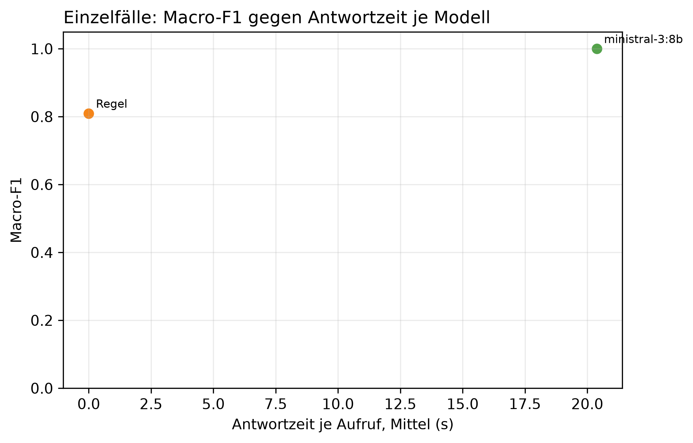

# K3 LLM-Klassifikation und Modellwahl, Läufe k3_014 / k3_seq_014

## Setup

- Läufe (Ebene 1 / Ebene 2): k3_014 / k3_seq_014
- Prompt (Ebene 1 / Ebene 2): v25 / v25
- Modelle: MDL5 ministral-3:8b
- LLM: temperature 0,0, höchstens 2 Versuche je Aufruf
- Ebene 1: 9 synthetische Fälle, je Modell 1 Aufruf je Fall, Regel (BASELINE) läuft mit
- Ebene 2: Standard-Szenarien, Cutover CO3 (2015-03-01), 40 Tage davor, 60 danach, jedes Modell als eigener Kreislauf wie SYS3 mit Adaption
- Ereignisse Ebene 2: control = keine Änderung, scaled_strong = Sprung +30 %, peak_strong = Spitze +1000 W über 6 h
- Produktivmodell SYS3: ministral-3:8b
- Commit (Ebene 1 / Ebene 2): 261041e / 261041e (mit lokalen Änderungen)
- Textprüfung: 17 Gerätewörter, 9 Steuerungswörter, Zahlentoleranz 0,5, Fensterzahlen aus dem Prompt 7, 28

## Kennzahlen

| Kennzahl | Wert | Bezug |
|---|---|---|
| Ebene 1: bestes Modell nach Macro-F1 | ministral-3:8b | Macro-F1 1,00, Regel 0,81 |
| ministral-3:8b: Ebene 1 richtig | 9/9 | Regel 8/9 |
| ministral-3:8b: Antwortzeit je Aufruf im Mittel [s] | 20,4 | p95 35,5 s, Regel 0,0 s |
| ministral-3:8b: Ebene 2 Ereignis-Arten erkannt | 2/2 | Regel 2/2 |
| ministral-3:8b: Ebene 2 Tage mit anderer Klasse als die Regel | 4 | 2015-04-06 new_pattern statt normal; 2015-04-07 peak statt normal; 2015-04-08 peak statt normal; 2015-04-20 new_pattern statt normal |
| ministral-3:8b: ungültige Antworten Ebene 1 | 0 | Ausfalltage Ebene 2: 0 |
| ministral-3:8b: Antworten mit Textverstoß (Ebene 1 / Ebene 2) | 1/9 / 8/115 | Gerät, Steuerung oder Zahl, Datum, Uhrzeit nicht im State |
| ministral-3:8b: Antworten mit fehlenden Belegen (Ebene 1 / Ebene 2) | 0/9 / 0/115 | zitierte Belege passen nicht zur eigenen Klasse |

## Ebene 1: Modellvergleich auf den Einzelfällen

| ID | Modell | richtig | Macro-F1 | ungültig | Ø Versuche | Grounding | Ø s je Aufruf | p95 s |
|---|---|---|---:|---:|---:|---:|---:|---:|
| MDL5 | ministral-3:8b | 9/9 | 1,0 | 0 | 1,0 | 0,9 | 20,4 | 35,5 |
| BASELINE | Regel | 8/9 | 0,8 | 0 | 1,0 | - | 0,0 | 0,0 |

## Ebene 1: Antwort je Fall (✓ = richtig, sonst die Antwort, - = ungültig)

| Fall | erwartet | ministral-3:8b | Regel |
|---|---|---|---|
| absence_drift_down | absence | ✓ | new_pattern |
| low_single_scale | low | ✓ | ✓ |
| measurement_error_missing_day | measurement_error | ✓ | ✓ |
| new_pattern | new_pattern | ✓ | ✓ |
| new_pattern_at_min_scales_boundary | new_pattern | ✓ | ✓ |
| new_pattern_drift_down | new_pattern | ✓ | ✓ |
| normal_single_sustained_scale | normal | ✓ | ✓ |
| peak | peak | ✓ | ✓ |
| peak_single_sustained_scale | peak | ✓ | ✓ |

## Automatische Textprüfung je Modell (Antworten mit Verstoß oder fehlenden Belegen)

| Modell | E1 Antworten | E1 mit Verstoß | E1 Belege fehlen | E1 Gerät genannt | E2 Antworten | E2 mit Verstoß | E2 Belege fehlen | E2 Gerät genannt |
|---|---:|---:|---:|---:|---:|---:|---:|---:|
| ministral-3:8b | 9 | 1 | 0 | 3 | 115 | 8 | 0 | 8 |

## Ebene 2: je Modell über alle Ereignis-Arten

| Modell | Ereignis-Arten erkannt | Tage anders als die Regel | Gate-Tage | Ausfalltage | Meldungen Kontrolle | unknown Kontrolle | Resets Kontrolle |
|---|---|---:|---:|---:|---:|---:|---:|
| ministral-3:8b | 2/2 | 4 | 115 | 0 | 0 | 0 | 0 |
| Regel | 2/2 | 0 | 118 | 0 | 0 | 0 | 0 |

## Ebene 2: Erkennung je Ereignis, Tag seit Cutover

| config | Ereignis | erwartet | Gate-Tage durch das Ereignis | davon richtig | erster richtiger Tag | Resets |
|---|---|---|---:|---:|---:|---:|
| BASELINE | Spitze +1000 W über 6 h | peak | 12 | 1 | 1 | 0 |
| BASELINE | Sprung +30 % | new_pattern | 15 | 1 | 22 | 1 |
| MDL5 | Spitze +1000 W über 6 h | peak | 12 | 1 | 1 | 0 |
| MDL5 | Sprung +30 % | new_pattern | 17 | 2 | 22 | 3 |

## Ebene 2: Tage, an denen ein Modell anders einordnet als die Regel

| Modell | analysierter Tag | Regel | Modell sagt | in Arten |
|---|---|---|---|---|
| ministral-3:8b | 2015-04-06 | normal | new_pattern | scaled_strong |
| ministral-3:8b | 2015-04-07 | normal | peak | scaled_strong |
| ministral-3:8b | 2015-04-08 | normal | peak | scaled_strong |
| ministral-3:8b | 2015-04-20 | normal | new_pattern | scaled_strong |

## Hinweise

- Ebene 1 prüft, ob ein Modell die Regeln aus dem Prompt nachvollzieht. Der Prompt wurde auf denselben Fällen verbessert, die Quoten begründen deshalb nur die Modellwahl und belegen nicht das Ziel von 80 % richtiger Klassen (dafür E5)
- wenige Fälle: ein Fall sind mehrere Prozentpunkte, eine Klasse hängt teils an einem einzigen Fall
- Macro-F1: Mittel der F1-Werte über die Klassen, die als erwartete Klasse vorkommen
- Grounding: Anteil der für den Fall erwarteten Felder, die das Modell als Beleg zitiert. Die Regel zitiert keine
- Tag seit Cutover = Entscheidungstag: an Tag n meldet das System, eingeordnet ist dabei Tag n-1. Ab Cutover zählt deshalb erst ab Tag 1
- Ebene 2, erkannt: erwartete Klasse an einem Tag, an dem nur das Ereignis das Gate öffnet (gepaart mit dem Kontrolllauf desselben Modells)
- Ebene 2, anders als die Regel: gleiche Art und gleicher analysierter Tag, Regel gegen Modell. Nach einem Reset an verschiedenen Tagen laufen die Reihen auseinander, spätere Abweichungen können daraus folgen
- Antwortzeit: gemessen auf dem Rechner des Laufs, nur zum Vergleich der Modelle untereinander
- Textprüfung: Verstoß heißt, ein Steuerungswort oder eine Zahl, ein Datum oder eine Uhrzeit steht im Text, aber nicht im State des Falls. Ein genanntes Gerät ist nur ein Hinweis, als Möglichkeit ist es erlaubt, ob es als Ursache behauptet wird, beurteilen die Bewertenden. Zahlwörter („sechs Wochen“) und nicht gelistete Geräte findet sie nicht. Die Fensterlängen 7 und 30 aus der Skalenbeschreibung im Prompt gelten als erlaubt
- Fehlende Belege: der Prompt verlangt je Klasse bestimmte Pfade (new_pattern: sustained_drift, Streaks, peak/low: level, direction, absence: level, Kalendereintrag, measurement_error: Flag). Geprüft wird gegen die eigene Klasse des Modells, nicht gegen die erwartete. Ebene 1 wird nur für Läufe geprüft, die den State der Fälle in der Antwortdatei speichern, ältere Läufe haben in der Tabelle 0 Antworten
- Antworttexte und Auffälligkeiten der Textprüfung im Anhang, Antworten für alle Modelle in Ebene 1 und Ebene 2. Als CSV: answers_single.csv für Ebene 1, answers_sequence.csv für Ebene 2 nur vom Produktivmodell, result_text_findings.csv für die Auffälligkeiten

## Anhang

### Ebene 1: Precision, Recall und F1 je Klasse

| Modell | Klasse | Precision | Recall | F1 |
|---|---|---:|---:|---:|
| Regel | absence | 0,0 | 0,0 | 0,0 |
| Regel | low | 1,0 | 1,0 | 1,0 |
| Regel | measurement_error | 1,0 | 1,0 | 1,0 |
| Regel | new_pattern | 0,8 | 1,0 | 0,9 |
| Regel | normal | 1,0 | 1,0 | 1,0 |
| Regel | peak | 1,0 | 1,0 | 1,0 |
| ministral-3:8b | absence | 1,0 | 1,0 | 1,0 |
| ministral-3:8b | low | 1,0 | 1,0 | 1,0 |
| ministral-3:8b | measurement_error | 1,0 | 1,0 | 1,0 |
| ministral-3:8b | new_pattern | 1,0 | 1,0 | 1,0 |
| ministral-3:8b | normal | 1,0 | 1,0 | 1,0 |
| ministral-3:8b | peak | 1,0 | 1,0 | 1,0 |

### Ebene 1: Antworten der Modelle je Fall

**peak** (erwartet: peak)

- ministral-3:8b: peak ✓
  - Erklärung: Gestern war der Stromverbrauch um etwa 45 % höher als an einem normalen Wochentag. Das ist ungewöhnlich für diesen Tag.
  - Empfehlung: Überprüfen Sie, ob gestern ungewöhnliche Geräte oder Aktivitäten den Verbrauch erhöht haben könnten, zum Beispiel längeres Heizen oder zusätzliche Beleuchtung.
  - Unsicherheit: Die genaue Ursache des erhöhten Verbrauchs ist ohne weitere Informationen nicht klar.

**new_pattern** (erwartet: new_pattern)

- ministral-3:8b: new_pattern ✓
  - Erklärung: Der Stromverbrauch war gestern deutlich höher als sonst – seit dem 9. Dezember liegt er etwa 36 % über dem üblichen Wochenwert und seit Anfang Dezember auch über dem langfristigen Durchschnitt.
  - Empfehlung: Überprüfen Sie, ob sich der Verbrauch in den letzten Wochen verändert hat – etwa durch neue Geräte oder längere Nutzung von Heizung oder Beleuchtung im Winter.
  - Unsicherheit: Ob die erhöhten Werte auf eine dauerhafte Veränderung hindeuten, hängt davon ab, ob sich der Verbrauch in den nächsten Tagen weiter auf diesem Niveau hält.

**low_single_scale** (erwartet: low)

- ministral-3:8b: low ✓
  - Erklärung: Gestern war der Stromverbrauch um etwa 30 % niedriger als an einem typischen Wochentag im Dezember.
  - Empfehlung: Überprüfen Sie, ob gestern ein geplanter Urlaub oder eine Abwesenheit stattgefunden hat, die den niedrigen Verbrauch erklären könnte.
  - Unsicherheit: Ob es sich um einen geplanten Aufenthalt außerhalb des Hauses handelt, kann nicht geprüft werden.

**peak_single_sustained_scale** (erwartet: peak)

- ministral-3:8b: peak ✓
  - Erklärung: Gestern war der Stromverbrauch um etwa 40 % höher als an einem normalen Dienstag im Dezember. Das ist ungewöhnlich für einen einzelnen Tag.
  - Empfehlung: Überprüfen Sie, ob gestern ungewöhnliche Geräte oder Aktivitäten den Verbrauch erhöht haben könnten, zum Beispiel längeres Heizen oder zusätzliche Beleuchtung.
  - Unsicherheit: Ob der erhöhte Verbrauch auf eine einmalige Ursache zurückzuführen ist oder bereits länger anhält, lässt sich erst nach weiteren Tagen beurteilen.

**normal_single_sustained_scale** (erwartet: normal)

- ministral-3:8b: normal ✓
  - Erklärung: Gestern war der Stromverbrauch im Vergleich zum üblichen Wochenverlauf etwas höher, aber nicht ungewöhnlich für einen einzelnen Tag.
  - Empfehlung: Es gibt keine Handlungsbedarf. Der Verbrauch liegt weiterhin im normalen Bereich und es ist kein Grund zur Sorge vorhanden.
  - Unsicherheit: Die Bewertung hängt davon ab, ob sich der erhöhte Wochenverbrauch über die nächsten Tage fortsetzt oder nur ein kurzfristiger Anstieg war.

**new_pattern_at_min_scales_boundary** (erwartet: new_pattern)

- ministral-3:8b: new_pattern ✓
  - Erklärung: Der Stromverbrauch war gestern ungewöhnlich hoch und bleibt seit über einer Woche auf diesem Niveau. Die letzten vier Wochen zusammen waren um etwa 16 % höher als sonst.
  - Empfehlung: Überprüfen Sie, ob Geräte oder Heizungsanlagen ungewöhnlich stark genutzt wurden, da dies den erhöhten Verbrauch erklären könnte.
  - Unsicherheit: Ob der Winterverbrauch die Ursache ist, hängt davon ab, wie hoch der Verbrauch in den folgenden Wochen bleibt.

**measurement_error_missing_day** (erwartet: measurement_error)

- ministral-3:8b: measurement_error ✓
  - Erklärung: Der gemessene Wert für gestern ist nicht vertrauenswürdig und kann keine Rückschlüsse auf den Verbrauch zulassen.
  - Empfehlung: Es gibt keinen zuverlässigen Wert, den Sie überprüfen könnten. Bitte prüfen Sie die Messgeräte oder kontaktieren Sie Ihren Stromanbieter.
  - Unsicherheit: Ob der gemessene Wert korrigiert werden kann, hängt von der Ursache des Fehlers ab.

**new_pattern_drift_down** (erwartet: new_pattern)

- ministral-3:8b: new_pattern ✓
  - Erklärung: Der Stromverbrauch war in den letzten Wochen und Monaten deutlich niedriger als sonst, seit Anfang Dezember. Gestern lag er zwar im üblichen Bereich, aber die langfristige Entwicklung bleibt ungewöhnlich.
  - Empfehlung: Überprüfen Sie, ob Geräte oder Heizungen kürzer laufen oder weniger genutzt werden als sonst – etwa durch geänderte Gewohnheiten oder Wartungsarbeiten.
  - Unsicherheit: Ob die niedrigere Verbrauchsentwicklung anhaltend ist, hängt davon ab, ob sich der Wert in den nächsten Tagen wieder normalisiert.

**absence_drift_down** (erwartet: absence)

- ministral-3:8b: absence ✓
  - Erklärung: Gestern war der Stromverbrauch ungewöhnlich niedrig, was auf die geplante Abwesenheit vom 8. bis zum 21. Dezember zurückzuführen ist.
  - Empfehlung: Da die Abwesenheit geplant war, ist nichts weiter zu prüfen. Der Verbrauch wird sich nach der Rückkehr wieder normalisieren.
  - Unsicherheit: Ob der Verbrauch während der Abwesenheit tatsächlich so niedrig wie erwartet war, kann erst nach dem Rückkehretag überprüft werden.

### Ebene 2: Antworten von ministral-3:8b, ein Tag mit allen Arten, in denen derselbe Text kam

- 2015-01-24: normal (Arten: control, peak_strong, scaled_strong)
  - Erklärung: Gestern war der Stromverbrauch im Vergleich zum üblichen Januar-Wert um etwa 25 % niedriger, aber die Abweichung ist nicht nachhaltig und liegt innerhalb der normalen Schwankungen.
  - Empfehlung: Es gibt keine Handlungsbedarf. Der Verbrauch war gestern zwar niedriger als sonst, aber das ist nicht ungewöhnlich und erfordert keine weitere Untersuchung.
  - Unsicherheit: Ob der Verbrauch in den nächsten Tagen wieder normal bleibt, hängt davon ab, ob sich die Wetterbedingungen oder andere Faktoren ändern.
- 2015-01-25: normal (Arten: control, peak_strong, scaled_strong)
  - Erklärung: Gestern lag der Verbrauch im Vergleich zum üblichen Winterverlauf etwa 22 % niedriger als erwartet, was auf eine ungewöhnlich geringe Nutzung hindeutet.
  - Empfehlung: Da keine Kalenderdaten verfügbar sind, prüfen Sie bitte, ob gestern oder in der letzten Woche ein längerer Aufenthalt im Ausland oder eine ungewöhnlich kurze Nutzung von Elektrogeräten stattfand.
  - Unsicherheit: Ob die gemessenen Werte korrekt sind, kann ohne weitere Informationen nicht bestätigt werden.
- 2015-01-26: normal (Arten: control, peak_strong, scaled_strong)
  - Erklärung: Gestern war der Stromverbrauch insgesamt niedriger als sonst, aber die Abweichung ist nicht groß genug für eine Warnung.
  - Empfehlung: Es gibt nichts Ungewöhnliches zu beachten. Der Verbrauch liegt im üblichen Bereich, auch wenn er etwas niedriger war als sonst in dieser Zeit.
  - Unsicherheit: Ob ein geplanter Urlaub oder eine andere Abwesenheit den Verbrauch beeinflusst hat, kann nicht geprüft werden.
- 2015-01-27: normal (Arten: control, peak_strong, scaled_strong)
  - Erklärung: Gestern war der Stromverbrauch etwas niedriger als sonst, aber nicht ungewöhnlich für einen einzelnen Tag.
  - Empfehlung: Es gibt nichts Ungewöhnliches zu beachten. Der Verbrauch liegt im üblichen Bereich und es ist keine weitere Handlung nötig.
  - Unsicherheit: Ob ein geplanter Urlaub oder eine Abwesenheit den niedrigeren Verbrauch erklären könnte, lässt sich ohne Kalender nicht prüfen.
- 2015-01-28: normal (Arten: control, peak_strong, scaled_strong)
  - Erklärung: Gestern lag der Verbrauch im Vergleich zum üblichen Winterverlauf etwa 10 % niedriger, aber die Abweichung ist nicht nachhaltig und liegt innerhalb der normalen Schwankungen.
  - Empfehlung: Es gibt keine Handlungsbedarf. Der Verbrauch war gestern im Rahmen des Üblichen, auch wenn er etwas niedriger lag als in den letzten Wochen.
  - Unsicherheit: Ob der Verbrauch tatsächlich niedriger ist oder ob die Messung zuverlässig bleibt, kann erst nach weiteren Tagen überprüft werden.
- 2015-02-18: normal (Arten: control, peak_strong, scaled_strong)
  - Erklärung: Gestern lag der Verbrauch im Vergleich zum langfristigen Durchschnitt um etwa 26 % höher als üblich, aber die Abweichung ist nicht nachhaltig und betrifft nur den Gesamtverbrauch über mehrere Wochen.
  - Empfehlung: Es gibt keine Handlungsbedarf, da der erhöhte Verbrauch nur eine vorübergehende Abweichung darstellt und kein ungewöhnliches Muster zeigt.
  - Unsicherheit: Ob die Abweichung durch äußere Umstände wie Wetter oder besondere Aktivitäten verursacht wurde, kann nicht bestimmt werden.
- 2015-02-19: normal (Arten: control, peak_strong, scaled_strong)
  - Erklärung: Gestern lag der Verbrauch im Vergleich zum langfristigen Durchschnitt um etwa 28 % höher als üblich, aber dies ist nicht ungewöhnlich für diesen Zeitraum.
  - Empfehlung: Keine Maßnahmen nötig. Der erhöhte Verbrauch ist vor allem auf die kürzeren Tage im Februar zurückzuführen.
  - Unsicherheit: Ob der Verbrauch in den nächsten Tagen wieder sinkt, hängt davon ab, ob sich das Wetter oder andere Gewohnheiten ändern.
- 2015-02-20: normal (Arten: control, peak_strong, scaled_strong)
  - Erklärung: Gestern war der Stromverbrauch insgesamt etwas niedriger als sonst, aber nicht ungewöhnlich für einen einzelnen Tag.
  - Empfehlung: Es gibt nichts Ungewöhnliches zu beachten. Der Verbrauch liegt im üblichen Bereich und es ist kein Grund zur Sorge.
  - Unsicherheit: Ob ein geplanter Urlaub oder eine Abwesenheit den niedrigeren Verbrauch erklären könnte, lässt sich ohne Kalender nicht prüfen.
- 2015-02-21: normal (Arten: control, peak_strong, scaled_strong)
  - Erklärung: Gestern lag der Verbrauch um etwa 22 % über dem üblichen Winterwert für diese Tageszeit, aber das ist nicht ungewöhnlich und bleibt im Rahmen.
  - Empfehlung: Es gibt nichts zu beachten. Der erhöhte Verbrauch könnte z.B. durch längere Heizzeiten oder mehr Beleuchtung bei kürzeren Tagen im Februar erklärt werden, aber das ist normal.
  - Unsicherheit: Ob der Verbrauch tatsächlich höher war, hängt davon ab, ob die Messwerte korrekt erfasst wurden.
- 2015-02-22: normal (Arten: control, peak_strong, scaled_strong)
  - Erklärung: Gestern lag der Verbrauch im Vergleich zum langfristigen Durchschnitt um etwa 20 % höher, aber das ist nicht ungewöhnlich für diesen Zeitraum.
  - Empfehlung: Keine Maßnahmen nötig. Der erhöhte Verbrauch ist vor allem auf die kürzeren Tage im Februar zurückzuführen.
  - Unsicherheit: Ob der Verbrauch in den nächsten Tagen wieder sinkt, hängt davon ab, ob sich das Wetter oder andere Gewohnheiten ändern.
- 2015-02-23: normal (Arten: control, peak_strong, scaled_strong)
  - Erklärung: Gestern war der Stromverbrauch etwas höher als sonst, aber nicht ungewöhnlich für die letzten Wochen.
  - Empfehlung: Es gibt nichts Ungewöhnliches zu beachten. Der Verbrauch liegt im üblichen Bereich für diese Zeit des Jahres, auch wenn er etwas höher war als sonst.
  - Unsicherheit: Ob der höhere Verbrauch auf ungewöhnliche Aktivitäten oder äußere Umstände wie Wetter zurückzuführen ist, kann nicht bestimmt werden.
- 2015-02-24: normal (Arten: control, peak_strong, scaled_strong)
  - Erklärung: Gestern war der Stromverbrauch etwas niedriger als sonst, aber nicht ungewöhnlich für einen einzelnen Tag.
  - Empfehlung: Es gibt nichts Ungewöhnliches zu beachten. Der Verbrauch liegt im üblichen Bereich und es ist kein Grund zur Sorge.
  - Unsicherheit: Ob ein geplanter Urlaub oder eine Abwesenheit den niedrigeren Verbrauch erklären könnte, lässt sich ohne Kalender nicht prüfen.
- 2015-02-25: normal (Arten: control, peak_strong, scaled_strong)
  - Erklärung: Gestern war der Stromverbrauch etwas niedriger als sonst, aber nicht ungewöhnlich für einen einzelnen Tag.
  - Empfehlung: Es gibt nichts Ungewöhnliches zu beachten. Der Verbrauch liegt im üblichen Bereich und es ist kein Handeln nötig.
  - Unsicherheit: Ob ein geplanter Urlaub oder eine Abwesenheit den niedrigeren Verbrauch erklären könnte, lässt sich ohne Kalender nicht prüfen.
- 2015-03-01: peak (Arten: peak_strong)
  - Erklärung: Gestern war der Stromverbrauch deutlich höher als sonst, sowohl über den Tag verteilt als auch insgesamt für einen Wochentag. Der Verbrauch lag etwa 70 % über dem üblichen Wert für diesen Wochentag.
  - Empfehlung: Überprüfen Sie, ob gestern ungewöhnlich viele Geräte gleichzeitig genutzt wurden oder ob ein neues Gerät in Betrieb genommen wurde.
  - Unsicherheit: Ob der erhöhte Verbrauch auf einen besonderen Anlass wie Gäste oder eine technische Anlage zurückzuführen ist, kann nicht aus den Daten hervorgehen.
- 2015-03-05: peak (Arten: scaled_strong)
  - Erklärung: Gestern war der Stromverbrauch um etwa 76 % höher als an einem normalen Wochentag. Das ist ungewöhnlich für diese Zeit des Jahres.
  - Empfehlung: Überprüfen Sie, ob gestern ungewöhnliche Geräte oder Aktivitäten den Verbrauch erhöht haben könnten, zum Beispiel längeres Heizen oder zusätzliche Beleuchtung.
  - Unsicherheit: Ob der erhöhte Verbrauch auf eine geplante Abwesenheit zurückzuführen ist, kann nicht geprüft werden, da keine Kalendereinträge verfügbar sind.
- 2015-03-06: normal (Arten: peak_strong)
  - Erklärung: Gestern war der Stromverbrauch etwas niedriger als sonst an einem Dienstag, aber die Abweichung ist nicht ungewöhnlich für einen einzelnen Tag.
  - Empfehlung: Es gibt nichts Ungewöhnliches zu beachten. Der Verbrauch liegt im üblichen Bereich, auch wenn er gestern etwas niedriger war als sonst an einem Dienstag.
  - Unsicherheit: Ob ein geplanter Urlaub oder eine Abwesenheit den Verbrauch beeinflusst hat, kann nicht geprüft werden, da keine Kalenderdaten verfügbar sind.
- 2015-03-07: normal (Arten: peak_strong)
  - Erklärung: Gestern war der Stromverbrauch im Vergleich zur Woche insgesamt um etwa 12 % niedriger als sonst, aber die Abweichung ist nicht groß genug für eine Warnung.
  - Empfehlung: Es gibt nichts Ungewöhnliches zu beachten, da die Abweichung nur kurzfristig und gering ist.
  - Unsicherheit: Ob ein geplanter Urlaub oder eine andere Veränderung im Haushalt den Verbrauch beeinflusst hat, kann nicht geprüft werden.
- 2015-03-07: normal (Arten: scaled_strong)
  - Erklärung: Gestern war der Stromverbrauch etwas höher als sonst, aber nicht ungewöhnlich für die letzten Tage.
  - Empfehlung: Es gibt nichts Ungewöhnliches zu beachten. Der Verbrauch liegt im üblichen Rahmen und es ist kein Handeln nötig.
  - Unsicherheit: Ob ein geplanter Urlaub oder eine andere Abwesenheit den Verbrauch beeinflusst hat, kann nicht geprüft werden.
- 2015-03-08: normal (Arten: peak_strong)
  - Erklärung: Gestern war der Stromverbrauch etwas niedriger als sonst an einem Dienstag, aber die Abweichung ist nicht ungewöhnlich für einen einzelnen Tag und bleibt im Rahmen.
  - Empfehlung: Es gibt nichts Ungewöhnliches zu beachten. Der Verbrauch liegt weiterhin im üblichen Bereich, auch wenn er gestern etwas niedriger war als sonst.
  - Unsicherheit: Ob ein geplanter Urlaub oder eine andere Abwesenheit den Verbrauch beeinflusst hat, kann nicht geprüft werden, da keine Kalenderdaten verfügbar sind.
- 2015-03-08: normal (Arten: scaled_strong)
  - Erklärung: Gestern war der Stromverbrauch etwas höher als sonst, aber nicht ungewöhnlich für die letzten Tage.
  - Empfehlung: Es gibt nichts Ungewöhnliches zu beachten. Der Verbrauch liegt im üblichen Rahmen und es ist kein Handeln nötig.
  - Unsicherheit: Ob ein geplanter Urlaub oder eine andere Abwesenheit den Verbrauch beeinflusst hat, kann nicht geprüft werden.
- 2015-03-09: normal (Arten: scaled_strong)
  - Erklärung: Gestern war der Stromverbrauch im Vergleich zur Woche insgesamt um etwa 25 % höher als üblich, aber das ist nicht ungewöhnlich für einen einzelnen Tag.
  - Empfehlung: Es gibt keine Hinweise auf ungewöhnliche Ursachen, also ist nichts weiter zu prüfen.
  - Unsicherheit: Ob der erhöhte Verbrauch durch besondere Umstände wie Wetter oder Aktivitäten verursacht wurde, kann nicht beurteilt werden.
- 2015-03-10: normal (Arten: scaled_strong)
  - Erklärung: Gestern war der Stromverbrauch im Vergleich zur Woche insgesamt um etwa 28 % höher als üblich, aber das ist nicht ungewöhnlich für einen einzelnen Tag.
  - Empfehlung: Es gibt keine Hinweise auf ungewöhnlichen Verbrauch oder Handlungsbedarf.
  - Unsicherheit: Ob ein geplanter Urlaub oder eine andere Abwesenheit den Vergleich verändern würde, kann nicht geprüft werden.
- 2015-03-11: normal (Arten: scaled_strong)
  - Erklärung: Gestern war der Stromverbrauch etwas höher als sonst, aber die Abweichung ist nicht ungewöhnlich für diese Zeit des Jahres und hält nur seit wenigen Tagen an.
  - Empfehlung: Es gibt nichts Ungewöhnliches zu beachten, da die Abweichung gering ist und keine konkrete Ursache erkennbar ist. Ein Blick auf den Verbrauch der letzten Tage kann helfen, ob sich ein Muster abzeichnet.
  - Unsicherheit: Ob es sich um eine vorübergehende Erhöhung handelt oder ein neues Muster beginnt, hängt davon ab, ob sich die erhöhten Werte in den kommenden Tagen fortsetzen.
- 2015-03-12: normal (Arten: scaled_strong)
  - Erklärung: Gestern war der Stromverbrauch im Vergleich zur Woche insgesamt um etwa 20 % höher als üblich, aber das ist nicht ungewöhnlich für einen einzelnen Tag.
  - Empfehlung: Es gibt keine Hinweise auf ungewöhnliche Aktivitäten oder Geräte, die den Verbrauch erhöht haben könnten. Sie können prüfen, ob der höhere Wert mit dem Wetter oder anderen bekannten Faktoren übereinstimmt.
  - Unsicherheit: Ob der erhöhte Verbrauch auf einen einzelnen Tag beschränkt bleibt oder sich fortsetzt, hängt davon ab, ob sich das Muster wiederholt.
- 2015-03-13: normal (Arten: scaled_strong)
  - Erklärung: Gestern war der Stromverbrauch im Vergleich zur Woche insgesamt um etwa 24 % höher als üblich, aber das ist nicht ungewöhnlich für einen einzelnen Tag.
  - Empfehlung: Es gibt keine Hinweise auf ungewöhnliche Aktivitäten oder Geräte, die den Verbrauch erhöht haben könnten. Sie können prüfen, ob der höhere Wert mit dem Wetter oder anderen bekannten Faktoren übereinstimmt.
  - Unsicherheit: Ob es sich um eine vorübergehende Erhöhung handelt, hängt davon ab, ob sich der Verbrauch in den nächsten Tagen wieder normalisiert.
- 2015-03-14: normal (Arten: scaled_strong)
  - Erklärung: Gestern war der Stromverbrauch im Vergleich zum üblichen Wochenwert um etwa 18 % niedriger, aber die Abweichung ist nicht nachhaltig und liegt innerhalb des normalen Bereichs für einen einzelnen Tag.
  - Empfehlung: Es gibt keine Handlungsbedarf. Der Verbrauch war gestern zwar etwas niedriger, aber nicht ungewöhnlich oder nachhaltig verändert.
  - Unsicherheit: Ob ein geplanter Urlaub oder eine andere Abwesenheit den Verbrauch beeinflusst hat, kann nicht geprüft werden, da kein Kalender verfügbar ist.
- 2015-03-15: low (Arten: control)
  - Erklärung: Gestern war der Stromverbrauch um etwa 63 % niedriger als an einem normalen Wochentag. Das ist ungewöhnlich für diese Zeit des Jahres.
  - Empfehlung: Überprüfen Sie, ob gestern ein geplanter Ausfall oder eine Abwesenheit stattgefunden hat, da der Verbrauch ungewöhnlich niedrig war. Ein Kalender könnte helfen, das zu klären.
  - Unsicherheit: Ob es sich um einen geplanten Ausfall handelt, hängt davon ab, ob Sie gestern nicht zu Hause waren.
- 2015-03-15: low (Arten: peak_strong)
  - Erklärung: Gestern war der Stromverbrauch um etwa zwei Drittel niedriger als an einem normalen Wochentag.
  - Empfehlung: Überprüfen Sie, ob gestern ein geplanter Ausfall oder eine Abwesenheit stattgefunden hat, die den Verbrauch erklären könnte.
  - Unsicherheit: Ob es sich um einen geplanten Ausfall handelt, kann nicht geprüft werden, da keine Kalenderdaten verfügbar sind.
- 2015-03-15: normal (Arten: scaled_strong)
  - Erklärung: Gestern war der Stromverbrauch im Vergleich zur Woche insgesamt um etwa 10 % niedriger als sonst, aber das ist nicht ungewöhnlich und kein Grund zur Sorge.
  - Empfehlung: Es gibt nichts Ungewöhnliches zu überprüfen. Der Verbrauch liegt im üblichen Bereich, auch wenn er in der letzten Woche leicht niedriger war.
  - Unsicherheit: Ob ein geplanter Urlaub oder eine andere Abwesenheit den Verbrauch beeinflusst hat, kann nicht geprüft werden.
- 2015-03-16: normal (Arten: scaled_strong)
  - Erklärung: Gestern war der Stromverbrauch etwas höher als sonst, aber nicht ungewöhnlich für die letzten Tage.
  - Empfehlung: Es gibt nichts Ungewöhnliches zu beachten. Der Verbrauch liegt im üblichen Rahmen der letzten Woche.
  - Unsicherheit: Ob ein geplanter Urlaub oder eine andere Abwesenheit den Vergleichswert beeinflusst hätte, kann nicht geprüft werden.
- 2015-03-17: normal (Arten: scaled_strong)
  - Erklärung: Gestern war der Stromverbrauch etwas höher als sonst, aber nicht ungewöhnlich für die letzten Tage.
  - Empfehlung: Es gibt nichts Ungewöhnliches zu beachten. Der Verbrauch liegt im üblichen Rahmen der letzten Woche.
  - Unsicherheit: Ob ein geplanter Urlaub oder eine andere Abwesenheit den Verbrauch beeinflusst hat, kann nicht geprüft werden.
- 2015-03-18: normal (Arten: peak_strong)
  - Erklärung: Gestern war der Stromverbrauch im Vergleich zum üblichen Wochenverlauf etwas niedriger, aber nicht ungewöhnlich für einen einzelnen Tag.
  - Empfehlung: Es gibt keine Handlungsbedarf. Der Verbrauch liegt im normalen Bereich und es ist nichts Ungewöhnliches zu erwarten.
  - Unsicherheit: Ob ein geplanter Urlaub oder eine Abwesenheit den niedrigeren Verbrauch erklären könnte, lässt sich ohne Kalender nicht prüfen.
- 2015-03-18: normal (Arten: scaled_strong)
  - Erklärung: Gestern war der Stromverbrauch im Vergleich zu den letzten Wochen etwas höher, aber nicht ungewöhnlich für einen einzelnen Tag.
  - Empfehlung: Es gibt keine Anzeichen dafür, dass Sie etwas ändern müssen. Der Verbrauch liegt im üblichen Bereich.
  - Unsicherheit: Ob ein geplanter Urlaub oder eine andere Abwesenheit den Vergleichswert beeinflusst hätte, kann nicht geprüft werden.
- 2015-03-19: normal (Arten: peak_strong)
  - Erklärung: Gestern war der Stromverbrauch etwas niedriger als sonst, aber nicht ungewöhnlich für einen einzelnen Tag.
  - Empfehlung: Es gibt nichts Ungewöhnliches zu beachten. Der Verbrauch liegt im üblichen Bereich und es ist kein Grund zur Sorge.
  - Unsicherheit: Ob ein geplanter Urlaub oder eine Abwesenheit den niedrigeren Verbrauch erklären könnte, lässt sich ohne Kalender nicht prüfen.
- 2015-03-19: normal (Arten: scaled_strong)
  - Erklärung: Gestern war der Stromverbrauch etwas höher als sonst, aber die Abweichung ist nicht ungewöhnlich für diese Zeit des Jahres und bleibt auf einem moderaten Niveau.
  - Empfehlung: Es gibt keinen Grund zur Sorge. Der Verbrauch liegt im üblichen Bereich, auch wenn er leicht erhöht ist.
  - Unsicherheit: Ob ein geplanter Anstieg des Verbrauchs (z.B. durch längere Nutzung von Heizung oder Beleuchtung) vorliegt, kann nicht geprüft werden.
- 2015-03-20: normal (Arten: control)
  - Erklärung: Gestern war der Stromverbrauch im Vergleich zur Woche insgesamt um etwa 10 % niedriger als üblich, aber das reicht nicht für eine ungewöhnliche Abweichung.
  - Empfehlung: Es gibt keine Hinweise auf ein Problem. Sie können prüfen, ob der Verbrauch in den letzten Tagen ähnlich niedrig war oder ob sich etwas im Haushalt geändert hat.
  - Unsicherheit: Ob es einen geplanten Urlaub oder eine andere Abwesenheit gab, kann nicht geprüft werden.
- 2015-03-20: normal (Arten: peak_strong)
  - Erklärung: Gestern war der Stromverbrauch im Vergleich zur Woche insgesamt um etwa 11 % niedriger als üblich, aber das reicht nicht für eine ungewöhnliche Abweichung.
  - Empfehlung: Es gibt keine Hinweise auf ungewöhnlichen Verbrauch oder Handlungsbedarf.
  - Unsicherheit: Ob ein geplanter Urlaub oder eine andere Abwesenheit den niedrigeren Verbrauch erklärt, kann nicht geprüft werden.
- 2015-03-20: normal (Arten: scaled_strong)
  - Erklärung: Gestern war der Stromverbrauch etwas niedriger als sonst, aber nicht ungewöhnlich für einen einzelnen Tag.
  - Empfehlung: Es gibt nichts Ungewöhnliches zu beachten. Der Verbrauch liegt im üblichen Bereich und es ist keine weitere Handlung nötig.
  - Unsicherheit: Ob ein geplanter Urlaub oder eine Abwesenheit den niedrigeren Verbrauch erklären könnte, lässt sich ohne Kalender nicht prüfen.
- 2015-03-21: normal (Arten: peak_strong)
  - Erklärung: Gestern war der Stromverbrauch etwas höher als sonst an einem Dienstag, aber die Abweichung ist nicht ungewöhnlich und hält nur seit wenigen Tagen an.
  - Empfehlung: Es gibt nichts Ungewöhnliches zu beachten. Der Verbrauch liegt im üblichen Bereich, auch wenn er gestern etwas höher war.
  - Unsicherheit: Ob es sich um eine vorübergehende Erhöhung handelt oder ob sich der Verbrauch dauerhaft leicht erhöht hat, lässt sich erst nach weiteren Tagen beobachten.
- 2015-03-21: normal (Arten: scaled_strong)
  - Erklärung: Gestern war der Stromverbrauch insgesamt normal, aber die letzten sieben Tage lagen im Schnitt etwa 23 % höher als sonst.
  - Empfehlung: Es gibt nichts Ungewöhnliches zu beachten, da die Abweichung nur eine Woche anhält und keine konkrete Ursache erkennbar ist.
  - Unsicherheit: Ob der höhere Verbrauch auf einen bestimmten Grund wie längere Nutzung von Geräten oder äußere Umstände zurückzuführen ist, kann nicht bestimmt werden.
- 2015-03-22: new_pattern (Arten: scaled_strong)
  - Erklärung: Gestern war der Stromverbrauch über mehrere Wochen hinweg deutlich höher als sonst, besonders in den letzten Tagen. Seit dem 2. März liegt er um etwa 36 % über dem üblichen Wert für diese Woche.
  - Empfehlung: Überprüfen Sie, ob sich der Stromverbrauch in den letzten Wochen verändert hat, zum Beispiel durch neue Geräte oder längere Nutzung von Heizung oder Beleuchtung. Ein Vergleich mit dem Verbrauch vor März könnte helfen.
  - Unsicherheit: Ob die erhöhte Nutzung auf einen konkreten Grund wie neue Geräte zurückzuführen ist, kann nur durch eine genauere Betrachtung des täglichen Verbrauchs geklärt werden.
- 2015-04-02: low (Arten: control)
  - Erklärung: Gestern war der Stromverbrauch um etwa 57 % niedriger als an einem normalen Dienstag im April. Das ist ungewöhnlich für einen solchen Tag.
  - Empfehlung: Überprüfen Sie, ob gestern ein geplanter Ausfall oder eine längere Abwesenheit stattgefunden hat, da der Verbrauch ungewöhnlich niedrig war. Ein Kalender könnte helfen, das zu klären.
  - Unsicherheit: Ob es sich um einen geplanten Ausfall handelt, kann ohne Zugriff auf den Kalender nicht sicher festgestellt werden.
- 2015-04-02: low (Arten: peak_strong)
  - Erklärung: Gestern war der Stromverbrauch um etwa 57 % niedriger als an einem typischen Dienstag im April. Das ist ungewöhnlich für einen solchen Tag.
  - Empfehlung: Überprüfen Sie, ob gestern ein geplanter Ausfall oder eine längere Abwesenheit stattgefunden hat, da der Verbrauch ungewöhnlich niedrig war. Ein Kalender könnte helfen, das zu klären.
  - Unsicherheit: Ob es sich um einen geplanten Ausfall handelt, ist ohne Zugriff auf den Kalender nicht sicher feststellbar.
- 2015-04-02: low (Arten: scaled_strong)
  - Erklärung: Gestern war der Stromverbrauch insgesamt ungewöhnlich niedrig, und der Verlauf des Tages war sehr flach. Die letzten sieben Tage zusammen verbrauchten Sie etwa 10 % weniger als sonst.
  - Empfehlung: Überprüfen Sie, ob gestern oder in der letzten Woche etwas ungewöhnlich war – etwa ein längerer Aufenthalt außerhalb des Hauses oder weniger Stromverbrauch durch Wetterbedingungen wie kühleres Wetter im März/April.
  - Unsicherheit: Ob es sich um eine geplante Abwesenheit handelt, können wir nicht prüfen, da keine Kalenderdaten verfügbar sind.
- 2015-04-03: low (Arten: control, peak_strong)
  - Erklärung: Gestern war der Stromverbrauch um etwa zwei Drittel niedriger als an einem normalen Wochentag.
  - Empfehlung: Überprüfen Sie, ob gestern ein geplanter Ausfall oder eine Abwesenheit stattgefunden hat, die den Verbrauch erklären könnte.
  - Unsicherheit: Ob es sich um einen geplanten Ausfall handelt, kann nicht geprüft werden, da keine Kalenderdaten verfügbar sind.
- 2015-04-03: low (Arten: scaled_strong)
  - Erklärung: Gestern war der Stromverbrauch ungewöhnlich niedrig, da die Last über den Tag sehr gleichmäßig verteilt war und insgesamt etwa 20 % weniger betrug als sonst an einem Dienstag.
  - Empfehlung: Überprüfen Sie, ob gestern ungewöhnlich wenig Strom verbraucht wurde, z. B. durch weniger Heizung oder Beleuchtung, da es sich um eine ungewöhnliche Verteilung handelt.
  - Unsicherheit: Ob ein geplanter Urlaub oder ein Ausfall von Geräten den Verbrauch beeinflusst hat, kann nicht geprüft werden.
- 2015-04-04: low (Arten: control)
  - Erklärung: Gestern war der Stromverbrauch um etwa zwei Drittel niedriger als an einem normalen Wochentag.
  - Empfehlung: Überprüfen Sie, ob gestern niemand zu Hause war oder ob ein geplanter Urlaub oder eine Abwesenheit vorliegt.
  - Unsicherheit: Ob es sich um eine geplante Abwesenheit handelt, kann nicht geprüft werden, da keine Kalenderdaten verfügbar sind.
- 2015-04-04: low (Arten: peak_strong)
  - Erklärung: Gestern war der Stromverbrauch um etwa zwei Drittel niedriger als an einem normalen Wochentag.
  - Empfehlung: Überprüfen Sie, ob gestern ein geplanter Ausfall oder eine Abwesenheit stattgefunden hat, die den Verbrauch stark reduziert haben könnte.
  - Unsicherheit: Ob es sich um einen geplanten Ausfall handelt, kann nicht geprüft werden, da keine Kalendereinträge verfügbar sind.
- 2015-04-05: low (Arten: control)
  - Erklärung: Gestern war der Stromverbrauch um etwa zwei Drittel niedriger als an einem normalen Dienstag im April. Seit dem 2. April liegt er überdurchschnittlich niedrig.
  - Empfehlung: Da kein Kalender verfügbar ist, prüfen Sie bitte, ob gestern jemand zu Hause war oder ob Geräte wie Heizung oder Warmwasserbereiter abgeschaltet waren.
  - Unsicherheit: Ob es sich um eine geplante Abwesenheit handelt, kann nicht geprüft werden.
- 2015-04-05: low (Arten: peak_strong)
  - Erklärung: Gestern war der Stromverbrauch um etwa zwei Drittel niedriger als an einem normalen Dienstag im April. Seit dem 2. April liegt er insgesamt rund 40 % unter dem üblichen Wert für diese Zeit.
  - Empfehlung: Da kein Kalender verfügbar ist, prüfen Sie bitte, ob gestern oder in den letzten Tagen jemand länger als geplant weg war oder ob der Stromzähler nicht korrekt abgelesen wurde.
  - Unsicherheit: Ob es sich um eine geplante Abwesenheit handelt, kann erst geklärt werden, wenn ein Kalender verfügbar ist.
- 2015-04-05: normal (Arten: scaled_strong)
  - Erklärung: Gestern war der Stromverbrauch ungewöhnlich niedrig, aber die Abweichung ist nur eine Woche alt und nicht nachhaltig.
  - Empfehlung: Da keine Kalenderdaten verfügbar sind, prüfen Sie bitte, ob jemand länger als erwartet weg war oder ob Geräte ausgeschaltet wurden. Ein Vergleich mit der üblichen Verbrauchsmenge hilft.
  - Unsicherheit: Ob die Abweichung durch einen geplanten Aufenthalt außerhalb des Hauses erklärt werden kann, ist ohne Kalenderdaten nicht sicher.
- 2015-04-06: low (Arten: control)
  - Erklärung: Gestern war der Stromverbrauch um etwa 58 % niedriger als an einem normalen Dienstag. Das ist ungewöhnlich für einen solchen Tag.
  - Empfehlung: Überprüfen Sie, ob gestern ein geplanter Ausfall oder eine Abwesenheit stattgefunden hat, die den Verbrauch erklären könnte. Ein Kalender kann helfen.
  - Unsicherheit: Ob es sich um einen geplanten Ausfall handelt, ist ohne Zugriff auf den Kalender nicht sicher zu klären.
- 2015-04-06: new_pattern (Arten: scaled_strong)
  - Erklärung: Der Stromverbrauch war in der letzten Woche um etwa 45 % niedriger als sonst, seit dem 30. März. Das ist ungewöhnlich und könnte auf eine dauerhafte Veränderung hinweisen.
  - Empfehlung: Überprüfen Sie, ob sich der Stromverbrauch in den letzten Tagen tatsächlich so stark verändert hat oder ob ein Gerät oder eine Heizung außer Betrieb genommen wurde.
  - Unsicherheit: Ob es sich um eine geplante Abwesenheit handelt, kann nicht geprüft werden, da keine Kalenderdaten verfügbar sind.
- 2015-04-07: normal (Arten: control)
  - Erklärung: Gestern war der Stromverbrauch im Vergleich zur Woche insgesamt um etwa 45 % niedriger als üblich, aber die Abweichung ist nicht lang genug aufgetreten, um ein neues Muster zu sein.
  - Empfehlung: Da die Abweichung nur eine Woche anhielt und keine geplanten Abwesenheiten vorlagen, ist nichts weiter zu prüfen.
  - Unsicherheit: Ob es sich um ein vorübergehendes Ereignis oder einen technischen Grund handelte, lässt sich ohne weitere Informationen nicht klären.
- 2015-04-07: normal (Arten: peak_strong)
  - Erklärung: Gestern war der Stromverbrauch insgesamt etwas niedriger als sonst, aber die Abweichung ist nicht groß genug für eine Warnung.
  - Empfehlung: Es gibt nichts Ungewöhnliches zu beachten. Der Verbrauch liegt im üblichen Rahmen, auch wenn er etwas niedriger war als sonst.
  - Unsicherheit: Ob ein geplanter Urlaub oder eine andere Abwesenheit den Verbrauch beeinflusst hat, kann nicht geprüft werden.
- 2015-04-07: peak (Arten: scaled_strong)
  - Erklärung: Gestern war der Stromverbrauch über den Tag verteilt ungewöhnlich hoch, besonders in kurzen Spitzen. Das ist nicht typisch für einen normalen Wochentag.
  - Empfehlung: Überprüfen Sie, ob gestern ungewöhnlich viele Geräte gleichzeitig genutzt wurden oder ob ein neues Gerät in Betrieb genommen wurde.
  - Unsicherheit: Ob es sich um einen einmaligen Ausreißer handelt oder um eine neue Gewohnheit, lässt sich erst nach weiteren Tagen beurteilen.
- 2015-04-08: normal (Arten: control)
  - Erklärung: Gestern war der Verbrauch im Vergleich zur Woche insgesamt um etwa 44 % niedriger als sonst, aber das ist nicht ungewöhnlich für einen einzelnen Tag.
  - Empfehlung: Es gibt nichts Ungewöhnliches zu beachten, da die Abweichung nur eine Woche lang anhielt und nicht auf einen dauerhaften Musterwechsel hindeutet.
  - Unsicherheit: Ob es sich um ein vorübergehendes Ereignis oder eine geplante Abwesenheit handelte, kann ohne Kalendereinbindung nicht geklärt werden.
- 2015-04-08: normal (Arten: peak_strong)
  - Erklärung: Gestern war der Stromverbrauch im Vergleich zur Woche insgesamt um etwa 45 % niedriger als sonst, aber das ist nicht ungewöhnlich für einen einzelnen Tag.
  - Empfehlung: Da die Verbrauchswerte über mehrere Tage hinweg stark schwanken, prüfen Sie bitte, ob es ungewöhnliche Aktivitäten oder Änderungen im Haushalt gab, die den niedrigeren Wert erklären könnten.
  - Unsicherheit: Ob der gemessene Wert korrekt ist, kann nicht geprüft werden, da keine Kalenderdaten verfügbar sind.
- 2015-04-08: peak (Arten: scaled_strong)
  - Erklärung: Gestern war der Stromverbrauch über den Tag verteilt ungewöhnlich hoch, besonders in kurzen Spitzen. Das ist nicht typisch für einen normalen Wochentag.
  - Empfehlung: Überprüfen Sie, ob gestern ungewöhnlich viele Geräte gleichzeitig genutzt wurden oder ob ein neues Gerät in Betrieb genommen wurde.
  - Unsicherheit: Ob es sich um einen einmaligen Ausreißer handelt oder um eine neue Gewohnheit, lässt sich erst nach weiteren Tagen beurteilen.
- 2015-04-09: normal (Arten: control)
  - Erklärung: Gestern war der Stromverbrauch um etwa 34 % niedriger als an einem typischen Dienstag, aber die Abweichung ist nicht lang genug für eine neue Regel. Die Werte liegen im üblichen Bereich.
  - Empfehlung: Da die Abweichung nur einen Tag betrifft und keine ungewöhnlichen Ereignisse vorlagen, ist nichts weiter zu prüfen.
  - Unsicherheit: Ob der Verbrauch gestern tatsächlich niedriger war, hängt davon ab, ob ein geplanter Urlaub oder eine andere Abwesenheit stattfand.
- 2015-04-09: normal (Arten: peak_strong)
  - Erklärung: Gestern war der Stromverbrauch ungewöhnlich niedrig, aber die Abweichung ist nur auf den letzten Tag beschränkt und nicht nachhaltig.
  - Empfehlung: Da es sich um eine einmalige Ausnahme handelt, ist keine weitere Handlung nötig. Sie können prüfen, ob gestern ungewöhnlich wenig Strom verbraucht wurde, z.B. durch weniger Heizung oder Beleuchtung.
  - Unsicherheit: Ob die Abweichung auf einen geplanten Ausfall oder eine vorübergehende Situation wie Urlaub zurückzuführen ist, kann nicht geprüft werden.
- 2015-04-10: normal (Arten: control)
  - Erklärung: Gestern war der Verbrauch etwas niedriger als sonst an Wochentagen, aber die Abweichung ist nicht groß genug für eine Warnung.
  - Empfehlung: Es gibt nichts Ungewöhnliches zu beachten. Der Verbrauch liegt im üblichen Bereich, auch wenn er gestern etwas niedriger war als sonst an Wochentagen.
  - Unsicherheit: Ob ein geplanter Urlaub oder eine andere Abwesenheit den Verbrauch beeinflusst hat, kann nicht geprüft werden.
- 2015-04-10: normal (Arten: peak_strong)
  - Erklärung: Gestern war der Verbrauch etwas niedriger als sonst an Wochentagen, aber die Abweichung ist nicht ungewöhnlich für diese Zeit des Jahres und hält nur kurz an.
  - Empfehlung: Es gibt nichts Ungewöhnliches zu beachten. Der Verbrauch liegt im üblichen Bereich, auch wenn er aktuell etwas niedriger ist als sonst an Wochentagen.
  - Unsicherheit: Ob der aktuelle Wert durch eine geplante Abwesenheit oder andere Faktoren wie Wetter beeinflusst wurde, kann nicht geprüft werden.
- 2015-04-11: normal (Arten: control)
  - Erklärung: Gestern war der Verbrauch für einen Dienstag ungewöhnlich hoch, aber die Abweichung ist nur auf den letzten Tag beschränkt und nicht nachhaltig.
  - Empfehlung: Es gibt keine Hinweise darauf, dass etwas Ungewöhnliches zu tun ist. Sie können prüfen, ob gestern ungewöhnliche Aktivitäten stattfanden, die den Verbrauch erhöht haben könnten.
  - Unsicherheit: Die Einschätzung könnte sich ändern, wenn der Verbrauch in den nächsten Tagen weiter überdurchschnittlich bleibt.
- 2015-04-11: normal (Arten: peak_strong)
  - Erklärung: Gestern war der Verbrauch für einen Dienstag ungewöhnlich hoch, aber die Abweichung ist nur kurzfristig und nicht nachhaltig.
  - Empfehlung: Es gibt keine Handlungsbedarf. Der Verbrauch liegt wieder im üblichen Bereich, da die Abweichung nur eine Woche anhielt und nicht fortgesetzt wird.
  - Unsicherheit: Die genaue Ursache für den kurzfristigen Anstieg ist ohne weitere Informationen nicht klar.
- 2015-04-12: normal (Arten: control)
  - Erklärung: Der Stromverbrauch war gestern im Vergleich zur Woche insgesamt um etwa 15 % niedriger als üblich, aber die Abweichung ist nicht groß genug für eine Warnung.
  - Empfehlung: Da die Abweichung nur wenige Tage anhält und keine ungewöhnlichen Ereignisse vorliegen, ist nichts weiter zu tun.
  - Unsicherheit: Ob ein geplanter Urlaub oder eine andere Veränderung im Haushalt den Verbrauch beeinflusst hat, kann nicht geprüft werden.
- 2015-04-12: normal (Arten: peak_strong)
  - Erklärung: Der Stromverbrauch war gestern im Vergleich zur Woche insgesamt um etwa 16 % niedriger als üblich, aber die Abweichung ist nicht groß genug für eine Warnung.
  - Empfehlung: Da die Abweichung nur wenige Tage anhält und keine ungewöhnlichen Ereignisse vorliegen, ist kein Handeln nötig.
  - Unsicherheit: Ob ein geplanter Urlaub oder eine andere Veränderung im Haushalt den Verbrauch beeinflusst hat, kann nicht geprüft werden.
- 2015-04-13: normal (Arten: control)
  - Erklärung: Gestern war der Verbrauch für einen Dienstag ungewöhnlich hoch, aber die Abweichung ist nur kurzfristig und nicht nachhaltig.
  - Empfehlung: Es gibt keine Hinweise auf eine dauerhafte Veränderung. Sie können prüfen, ob gestern ungewöhnlich viele Geräte gleichzeitig genutzt wurden oder ob ein neues Gerät hinzugekommen ist.
  - Unsicherheit: Ob die Abweichung durch einen einmaligen Grund wie Wetter oder besondere Aktivitäten verursacht wurde, kann nicht sicher bestimmt werden.
- 2015-04-13: normal (Arten: peak_strong)
  - Erklärung: Gestern war der Verbrauch für einen Wochentag ungewöhnlich hoch, aber die Abweichung ist nur kurzfristig und nicht nachhaltig.
  - Empfehlung: Es gibt keine Hinweise auf eine dauerhafte Veränderung, aber Sie können prüfen, ob gestern ungewöhnlich viel Strom verbraucht wurde, z.B. durch längeres Nutzen von Geräten oder Gäste.
  - Unsicherheit: Ob der Verbrauch wirklich nur kurzfristig erhöht war, hängt davon ab, ob sich die Werte in den nächsten Tagen wieder normalisieren.
- 2015-04-19: normal (Arten: peak_strong)
  - Erklärung: Gestern war der Stromverbrauch etwas höher als sonst an einem Dienstag, aber nicht ungewöhnlich für die letzten Wochen.
  - Empfehlung: Es gibt nichts Ungewöhnliches zu beachten. Der Verbrauch liegt im üblichen Rahmen.
  - Unsicherheit: Ob ein geplanter Urlaub oder eine andere Abwesenheit den Verbrauch in den letzten Wochen beeinflusst hat, kann nicht geprüft werden.
- 2015-04-19: normal (Arten: scaled_strong)
  - Erklärung: Gestern war der Stromverbrauch im Vergleich zur Woche insgesamt um über 50 % höher als sonst, aber das ist nicht ungewöhnlich für einen einzelnen Tag.
  - Empfehlung: Es gibt nichts zu tun, da ein einzelner Tag mit höherem Verbrauch nicht ungewöhnlich ist und keine weiteren Hinweise auf eine Störung vorliegen.
  - Unsicherheit: Ob der erhöhte Verbrauch durch besondere Umstände wie Wetter oder Aktivitäten verursacht wurde, kann ohne weitere Informationen nicht geklärt werden.
- 2015-04-20: normal (Arten: peak_strong)
  - Erklärung: Gestern war der Stromverbrauch um etwa 14 % niedriger als sonst in dieser Jahreszeit, aber das ist nicht ungewöhnlich für diese Zeit.
  - Empfehlung: Es gibt nichts Ungewöhnliches zu beachten. Der Verbrauch liegt im üblichen Bereich für den Frühling, da die Tage länger werden und weniger Heizbedarf besteht.
  - Unsicherheit: Ob ein geplanter Urlaub oder eine Abwesenheit den Verbrauch beeinflusst hat, kann nicht geprüft werden.
- 2015-04-20: new_pattern (Arten: scaled_strong)
  - Erklärung: Die Stromnutzung war in der letzten Woche um etwa 32 % niedriger als üblich und bleibt seit dem 14. April so. Das könnte auf einen längeren Aufenthalt außerhalb des Hauses hinweisen, zum Beispiel eine Reise oder einen Umzug.
  - Empfehlung: Überprüfen Sie, ob die Stromnutzung in den letzten Tagen tatsächlich niedriger war als sonst – etwa durch einen Blick auf die Zählerstände oder eine Rückmeldung von Personen, die im Haushalt leben.
  - Unsicherheit: Ob es sich um ein neues Muster handelt, hängt davon ab, ob die niedrige Nutzung länger anhält und keine geplante Abwesenheit vorliegt.
- 2015-04-21: normal (Arten: peak_strong)
  - Erklärung: Der Verbrauch lag gestern im üblichen Bereich, aber die letzten vier Wochen waren insgesamt etwa 16 % niedriger als sonst.
  - Empfehlung: Da der Verbrauch gestern normal war, ist nichts zu tun. Die niedrigere Gesamtmenge der letzten vier Wochen könnte aber auf eine längere Abwesenheit oder weniger Stromverbrauch hindeuten – das lässt sich mit einem Blick auf die Kalendereinträge prüfen.
  - Unsicherheit: Ob es einen Grund für den niedrigeren Verbrauch der letzten vier Wochen gibt, hängt davon ab, ob Sie in dieser Zeit länger weg waren.
- 2015-04-22: normal (Arten: peak_strong)
  - Erklärung: Gestern lag der Verbrauch im Vergleich zum üblichen Wochenverlauf etwa 12 % höher, aber das ist nicht ungewöhnlich für diese Zeit des Jahres.
  - Empfehlung: Es gibt nichts Ungewöhnliches zu beachten. Der Verbrauch liegt im üblichen Bereich für den Frühling, wenn die Tage länger werden und mehr Strom für Beleuchtung oder Geräte benötigt wird.
  - Unsicherheit: Ob der höhere Verbrauch auf längere Tageslichtnutzung oder andere Faktoren wie Wetter oder Haushaltsgewohnheiten zurückzuführen ist, kann nicht bestimmt werden.
- 2015-04-23: normal (Arten: peak_strong)
  - Erklärung: Gestern war der Stromverbrauch im Vergleich zum üblichen Winterwert um etwa 15 % niedriger, aber die Abweichung ist nicht nachhaltig und liegt innerhalb der normalen Schwankungen für diesen Tag.
  - Empfehlung: Es gibt keine Handlungsbedarf. Der Verbrauch war zwar etwas niedriger als im Winter, aber das ist nicht ungewöhnlich und erfordert keine weitere Untersuchung.
  - Unsicherheit: Ob ein geplanter Urlaub oder eine andere Abwesenheit den Verbrauch beeinflusst hat, kann nicht geprüft werden, da kein Kalender verfügbar ist.
- 2015-04-24: normal (Arten: control)
  - Erklärung: Gestern war der Stromverbrauch im Vergleich zum üblichen Winterwert um etwa 15 % niedriger, aber die Abweichung ist nicht nachhaltig und liegt innerhalb der normalen Schwankungen für diesen Tag.
  - Empfehlung: Es gibt keine Handlungsbedarf. Der Verbrauch war zwar etwas niedriger als sonst, aber das ist nicht ungewöhnlich und erfordert keine weiteren Maßnahmen.
  - Unsicherheit: Ob ein geplanter Urlaub oder eine andere Abwesenheit den Verbrauch beeinflusst hat, kann nicht geprüft werden, da kein Kalender verfügbar ist.
- 2015-04-24: normal (Arten: peak_strong)
  - Erklärung: Gestern war der Stromverbrauch etwas niedriger als sonst, aber nicht ungewöhnlich für einen einzelnen Tag.
  - Empfehlung: Es gibt nichts Ungewöhnliches zu beachten. Der Verbrauch liegt im üblichen Bereich und es ist keine weitere Handlung nötig.
  - Unsicherheit: Ob ein geplanter Urlaub oder eine Abwesenheit den niedrigeren Verbrauch erklären könnte, lässt sich ohne Kalender nicht prüfen.
- 2015-04-25: normal (Arten: control)
  - Erklärung: Gestern war der Stromverbrauch insgesamt etwas niedriger als sonst, aber nicht ungewöhnlich für einen einzelnen Tag.
  - Empfehlung: Es gibt nichts Ungewöhnliches zu beachten. Der Verbrauch liegt im üblichen Bereich, auch wenn er in den letzten vier Wochen etwas niedriger war.
  - Unsicherheit: Ob ein geplanter Urlaub oder eine andere Abwesenheit die Ursache ist, kann nicht geprüft werden.
- 2015-04-25: normal (Arten: peak_strong)
  - Erklärung: Gestern war der Stromverbrauch um etwa 18 % niedriger als sonst im April, aber das ist nicht ungewöhnlich für diese Jahreszeit.
  - Empfehlung: Es gibt nichts Ungewöhnliches zu beachten. Der Verbrauch liegt im üblichen Frühlingstrend, da die Tage länger werden und weniger Heizenergie benötigt wird.
  - Unsicherheit: Ob ein geplanter Urlaub oder eine Abwesenheit den Verbrauch beeinflusst hat, kann nicht geprüft werden.
- 2015-04-26: normal (Arten: control)
  - Erklärung: Gestern war der Stromverbrauch insgesamt etwas niedriger als sonst, aber nicht ungewöhnlich für einen einzelnen Tag.
  - Empfehlung: Es gibt nichts Ungewöhnliches zu beachten. Der Verbrauch liegt im üblichen Bereich und es ist keine weitere Handlung nötig.
  - Unsicherheit: Ob ein geplanter Urlaub oder eine Abwesenheit den niedrigeren Verbrauch erklären könnte, lässt sich ohne Kalender nicht prüfen.
- 2015-04-26: normal (Arten: peak_strong)
  - Erklärung: Gestern war der Stromverbrauch insgesamt niedriger als sonst, aber die Abweichung ist nicht groß genug für eine Warnung.
  - Empfehlung: Nichts zu tun. Der Verbrauch liegt im üblichen Bereich und es gibt keine Hinweise auf ungewöhnliche Ursachen.
  - Unsicherheit: Ob ein geplanter Urlaub oder eine andere Abwesenheit den niedrigeren Verbrauch erklärt, kann nicht geprüft werden.
- 2015-04-27: normal (Arten: control)
  - Erklärung: Gestern war der Stromverbrauch im Vergleich zum üblichen Tagesverlauf normal, aber die letzten vier Wochen zusammen lagen etwa 16 % unter dem sonstigen Verbrauch.
  - Empfehlung: Da der aktuelle Tag selbst nicht auffällig ist, gibt es nichts zu beachten. Sie können prüfen, ob sich die Gewohnheiten oder Geräte im Haushalt in den letzten Wochen verändert haben.
  - Unsicherheit: Ob die Verbrauchssenkung auf einen konkreten Grund zurückzuführen ist, hängt davon ab, ob sich der Verbrauch in den nächsten Tagen wieder normalisiert.
- 2015-04-27: normal (Arten: peak_strong)
  - Erklärung: Gestern war der Stromverbrauch im Vergleich zum üblichen Tagesverlauf normal, aber die letzten vier Wochen zusammen verbrauchten Sie etwa 16 % weniger als sonst.
  - Empfehlung: Da der Verbrauch gestern selbst im üblichen Rahmen lag, ist keine weitere Handlung nötig. Überprüfen Sie ggf. ob sich die Nutzung von Geräten oder Beleuchtung in den letzten Wochen verändert hat.
  - Unsicherheit: Ob es einen geplanten Urlaub oder eine längere Abwesenheit gab, kann nicht geprüft werden.
- 2015-04-28: normal (Arten: control)
  - Erklärung: Gestern war der Stromverbrauch insgesamt niedriger als sonst, aber die Abweichung ist nicht groß genug für eine Warnung.
  - Empfehlung: Es gibt nichts Ungewöhnliches zu beachten. Der Verbrauch liegt im üblichen Bereich, auch wenn er etwas niedriger war als sonst in dieser Woche.
  - Unsicherheit: Ob ein geplanter Urlaub oder eine andere Abwesenheit den Verbrauch beeinflusst hat, kann nicht geprüft werden.
- 2015-04-28: normal (Arten: peak_strong)
  - Erklärung: Gestern war der Stromverbrauch insgesamt niedriger als sonst, aber die Abweichung ist nicht groß genug für eine Warnung.
  - Empfehlung: Es gibt nichts Ungewöhnliches zu beachten. Der Verbrauch liegt im üblichen Bereich, auch wenn er etwas niedriger war als sonst.
  - Unsicherheit: Ob ein geplanter Urlaub oder eine andere Abwesenheit den Verbrauch beeinflusst hat, kann nicht geprüft werden.
- 2015-04-29: normal (Arten: control)
  - Erklärung: Gestern war der Stromverbrauch im Vergleich zum üblichen Tagesverlauf normal, aber die letzten vier Wochen lagen insgesamt etwa 17 % niedriger als sonst.
  - Empfehlung: Da die Verbrauchswerte der letzten Wochen insgesamt niedriger waren, prüfen Sie bitte, ob sich etwas am Haushalt geändert hat – etwa weniger Heizung oder kürzere Aufenthalte zu Hause.
  - Unsicherheit: Ob es sich um eine dauerhafte Veränderung handelt, hängt davon ab, ob sich der Verbrauch in den nächsten Tagen wieder normalisiert.
- 2015-04-29: normal (Arten: peak_strong)
  - Erklärung: Gestern war der Stromverbrauch im Vergleich zum üblichen Tagesverlauf normal, aber die letzten vier Wochen lagen insgesamt etwa 17 % niedriger als sonst.
  - Empfehlung: Da die Verbrauchswerte der letzten Wochen insgesamt niedriger waren, prüfen Sie bitte, ob sich etwas am Haushalt geändert hat – etwa weniger Heizung oder kürzere Gerätenutzung.
  - Unsicherheit: Ob es sich um eine dauerhafte Veränderung handelt, hängt davon ab, ob sich der Verbrauch in den nächsten Tagen wieder normalisiert.

### Auffälligkeiten der Textprüfung

| Ebene | Modell | Fall oder Tag | Verstoß | fehlende Belege | Gerät genannt (Hinweis) |
|---|---|---|---|---|---|
| Ebene 2 | ministral-3:8b | 2015-01-28 control | number: 10 |  |  |
| Ebene 2 | ministral-3:8b | 2015-01-28 peak_strong | number: 10 |  |  |
| Ebene 2 | ministral-3:8b | 2015-01-28 scaled_strong | number: 10 |  |  |
| Ebene 2 | ministral-3:8b | 2015-03-01 peak_strong | number: 70 |  |  |
| Ebene 2 | ministral-3:8b | 2015-03-12 scaled_strong | number: 20 |  |  |
| Ebene 2 | ministral-3:8b | 2015-03-19 scaled_strong |  |  | heizung |
| Ebene 2 | ministral-3:8b | 2015-03-22 scaled_strong |  |  | heizung |
| Ebene 2 | ministral-3:8b | 2015-04-03 scaled_strong | number: 20 |  | heizung |
| Ebene 2 | ministral-3:8b | 2015-04-05 control |  |  | heizung |
| Ebene 2 | ministral-3:8b | 2015-04-06 scaled_strong |  |  | heizung |
| Ebene 2 | ministral-3:8b | 2015-04-09 peak_strong |  |  | heizung |
| Ebene 2 | ministral-3:8b | 2015-04-19 scaled_strong | number: 50 |  |  |
| Ebene 2 | ministral-3:8b | 2015-04-22 peak_strong | number: 12 |  |  |
| Ebene 2 | ministral-3:8b | 2015-04-29 control |  |  | heizung |
| Ebene 2 | ministral-3:8b | 2015-04-29 peak_strong |  |  | heizung |
| Ebene 1 | ministral-3:8b | absence_drift_down | number: 21. Dezember |  |  |
| Ebene 1 | ministral-3:8b | new_pattern |  |  | heizung |
| Ebene 1 | ministral-3:8b | new_pattern_at_min_scales_boundary |  |  | heizung |
| Ebene 1 | ministral-3:8b | new_pattern_drift_down |  |  | heizung |
