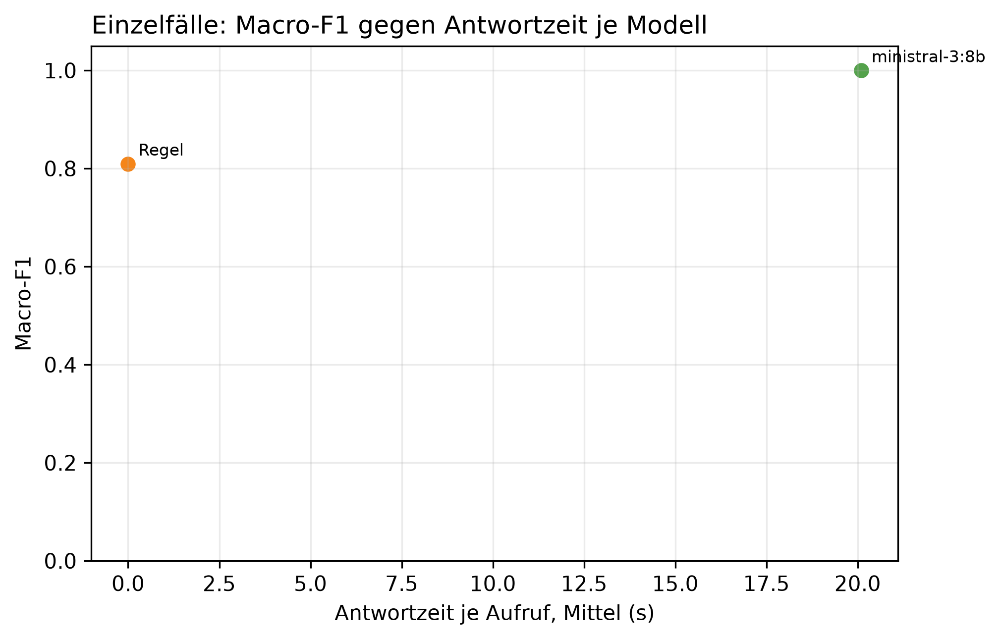

# K3 LLM-Klassifikation und Modellwahl, Läufe k3_015 / k3_seq_015

## Setup

- Läufe (Ebene 1 / Ebene 2): k3_015 / k3_seq_015
- Prompt (Ebene 1 / Ebene 2): v26 / v26
- Modelle: MDL5 ministral-3:8b
- LLM: temperature 0,0, höchstens 2 Versuche je Aufruf
- Ebene 1: 10 synthetische Fälle, je Modell 1 Aufruf je Fall, Regel (BASELINE) läuft mit
- Ebene 2: Standard-Szenarien, Cutover CO3 (2015-03-01), 40 Tage davor, 60 danach, jedes Modell als eigener Kreislauf wie SYS3 mit Adaption
- Ereignisse Ebene 2: control = keine Änderung, scaled_strong = Sprung +30 %, peak_strong = Spitze +1000 W über 6 h
- Produktivmodell SYS3: ministral-3:8b
- Commit (Ebene 1 / Ebene 2): 71433df / 71433df (mit lokalen Änderungen)
- Textprüfung: 9 Steuerungswörter, Zahlentoleranz 0,5, gerundet auf 10 erlaubt, Fensterzahlen aus dem Prompt 7, 28

## Kennzahlen

| Kennzahl | Wert | Bezug |
|---|---|---|
| Ebene 1: bestes Modell nach Macro-F1 | ministral-3:8b | Macro-F1 1,00, Regel 0,81 |
| ministral-3:8b: Ebene 1 richtig | 10/10 | Regel 9/10 |
| ministral-3:8b: Antwortzeit je Aufruf im Mittel [s] | 20,1 | p95 34,0 s, Regel 0,0 s |
| ministral-3:8b: Ebene 2 Ereignis-Arten erkannt | 2/2 | Regel 2/2 |
| ministral-3:8b: Ebene 2 Tage mit anderer Klasse als die Regel | 3 | 2015-04-05 new_pattern statt normal; 2015-04-07 new_pattern statt normal; 2015-04-07 peak statt normal; 2015-04-08 peak statt normal |
| ministral-3:8b: ungültige Antworten Ebene 1 | 0 | Ausfalltage Ebene 2: 0 |
| ministral-3:8b: Antworten mit Textverstoß (Ebene 1 / Ebene 2) | 1/10 / 0/96 | Steuerung oder Zahl, Datum, Uhrzeit nicht im State |
| ministral-3:8b: Antworten mit fehlenden Belegen (Ebene 1 / Ebene 2) | 0/10 / 1/96 | zitierte Belege passen nicht zur eigenen Klasse |

## Ebene 1: Modellvergleich auf den Einzelfällen

| ID | Modell | richtig | Macro-F1 | ungültig | Ø Versuche | Grounding | Ø s je Aufruf | p95 s |
|---|---|---|---:|---:|---:|---:|---:|---:|
| MDL5 | ministral-3:8b | 10/10 | 1,0 | 0 | 1,0 | 1,0 | 20,1 | 34,0 |
| BASELINE | Regel | 9/10 | 0,8 | 0 | 1,0 | - | 0,0 | 0,0 |

## Ebene 1: Antwort je Fall (✓ = richtig, sonst die Antwort, - = ungültig)

| Fall | erwartet | ministral-3:8b | Regel |
|---|---|---|---|
| absence_drift_down | absence | ✓ | new_pattern |
| low_single_scale | low | ✓ | ✓ |
| measurement_error_missing_day | measurement_error | ✓ | ✓ |
| new_pattern | new_pattern | ✓ | ✓ |
| new_pattern_at_min_scales_boundary | new_pattern | ✓ | ✓ |
| new_pattern_drift_down | new_pattern | ✓ | ✓ |
| normal_single_sustained_scale | normal | ✓ | ✓ |
| normal_weekly_after_reset | normal | ✓ | ✓ |
| peak | peak | ✓ | ✓ |
| peak_single_sustained_scale | peak | ✓ | ✓ |

## Automatische Textprüfung je Modell (Antworten mit Verstoß oder fehlenden Belegen)

| Modell | E1 Antworten | E1 mit Verstoß | E1 Belege fehlen | E2 Antworten | E2 mit Verstoß | E2 Belege fehlen |
|---|---:|---:|---:|---:|---:|---:|
| ministral-3:8b | 10 | 1 | 0 | 96 | 0 | 1 |

## Ebene 2: je Modell über alle Ereignis-Arten

| Modell | Ereignis-Arten erkannt | Tage anders als die Regel | Gate-Tage | Ausfalltage | Meldungen Kontrolle | unknown Kontrolle | Resets Kontrolle |
|---|---|---:|---:|---:|---:|---:|---:|
| ministral-3:8b | 2/2 | 3 | 96 | 0 | 2 | 0 | 1 |
| Regel | 2/2 | 0 | 96 | 0 | 0 | 0 | 0 |

## Ebene 2: Erkennung je Ereignis, Tag seit Cutover

| config | Ereignis | erwartet | Gate-Tage durch das Ereignis | davon richtig | erster richtiger Tag | Resets |
|---|---|---|---:|---:|---:|---:|
| BASELINE | Spitze +1000 W über 6 h | peak | 6 | 1 | 1 | 0 |
| BASELINE | Sprung +30 % | new_pattern | 13 | 1 | 22 | 1 |
| MDL5 | Spitze +1000 W über 6 h | peak | 11 | 1 | 1 | 0 |
| MDL5 | Sprung +30 % | new_pattern | 15 | 1 | 22 | 2 |

## Ebene 2: Tage, an denen ein Modell anders einordnet als die Regel

| Modell | analysierter Tag | Regel | Modell sagt | in Arten |
|---|---|---|---|---|
| ministral-3:8b | 2015-04-05 | normal | new_pattern | scaled_strong |
| ministral-3:8b | 2015-04-07 | normal | new_pattern | control |
| ministral-3:8b | 2015-04-07 | normal | peak | scaled_strong |
| ministral-3:8b | 2015-04-08 | normal | peak | control |

## Hinweise

- Ebene 1 prüft, ob ein Modell die Regeln aus dem Prompt nachvollzieht. Der Prompt wurde auf denselben Fällen verbessert, die Quoten begründen deshalb nur die Modellwahl und belegen nicht das Ziel von 80 % richtiger Klassen (dafür E5)
- wenige Fälle: ein Fall sind mehrere Prozentpunkte, eine Klasse hängt teils an einem einzigen Fall
- Macro-F1: Mittel der F1-Werte über die Klassen, die als erwartete Klasse vorkommen
- Grounding: Anteil der für den Fall erwarteten Felder, die das Modell als Beleg zitiert. Die Regel zitiert keine
- Tag seit Cutover = Entscheidungstag: an Tag n meldet das System, eingeordnet ist dabei Tag n-1. Ab Cutover zählt deshalb erst ab Tag 1
- Ebene 2, erkannt: erwartete Klasse an einem Tag, an dem nur das Ereignis das Gate öffnet (gepaart mit dem Kontrolllauf desselben Modells)
- Ebene 2, anders als die Regel: gleiche Art und gleicher analysierter Tag, Regel gegen Modell. Nach einem Reset an verschiedenen Tagen laufen die Reihen auseinander, spätere Abweichungen können daraus folgen
- Antwortzeit: gemessen auf dem Rechner des Laufs, nur zum Vergleich der Modelle untereinander
- Textprüfung: Verstoß heißt, ein Steuerungswort oder eine Zahl, ein Datum oder eine Uhrzeit steht im Text, aber nicht im State des Falls. Zahlwörter („sechs Wochen“) findet sie nicht. Die Fensterlängen 7 und 28 aus der Skalenbeschreibung im Prompt gelten als erlaubt
- Fehlende Belege: der Prompt verlangt je Klasse bestimmte Pfade (new_pattern: sustained_drift, Streaks, peak/low: level, direction, absence: level, Kalendereintrag, measurement_error: Flag). Geprüft wird gegen die eigene Klasse des Modells, nicht gegen die erwartete. Ebene 1 wird nur für Läufe geprüft, die den State der Fälle in der Antwortdatei speichern, ältere Läufe haben in der Tabelle 0 Antworten
- Antworttexte und Auffälligkeiten der Textprüfung im Anhang, Antworten für alle Modelle in Ebene 1 und Ebene 2. Als CSV: answers_single.csv für Ebene 1, answers_sequence.csv für Ebene 2 nur vom Produktivmodell, result_text_findings.csv für die Auffälligkeiten

## Anhang

### Ebene 1: Precision, Recall und F1 je Klasse

| Modell | Klasse | Precision | Recall | F1 |
|---|---|---:|---:|---:|
| Regel | absence | 0,0 | 0,0 | 0,0 |
| Regel | low | 1,0 | 1,0 | 1,0 |
| Regel | measurement_error | 1,0 | 1,0 | 1,0 |
| Regel | new_pattern | 0,8 | 1,0 | 0,9 |
| Regel | normal | 1,0 | 1,0 | 1,0 |
| Regel | peak | 1,0 | 1,0 | 1,0 |
| ministral-3:8b | absence | 1,0 | 1,0 | 1,0 |
| ministral-3:8b | low | 1,0 | 1,0 | 1,0 |
| ministral-3:8b | measurement_error | 1,0 | 1,0 | 1,0 |
| ministral-3:8b | new_pattern | 1,0 | 1,0 | 1,0 |
| ministral-3:8b | normal | 1,0 | 1,0 | 1,0 |
| ministral-3:8b | peak | 1,0 | 1,0 | 1,0 |

### Ebene 1: Antworten der Modelle je Fall

**peak** (erwartet: peak)

- ministral-3:8b: peak ✓
  - Erklärung: Gestern war der Stromverbrauch um etwa 45 % höher als an einem normalen Wochentag. Das ist ungewöhnlich für diesen Tag.
  - Empfehlung: Überprüfen Sie, ob gestern ungewöhnliche Geräte genutzt oder neue Geräte angeschlossen wurden.
  - Unsicherheit: Ob der erhöhte Verbrauch auf eine geplante Aktivität zurückzuführen ist, hängt davon ab, was in Ihrem Haushalt am 15. Dezember stattfand.

**new_pattern** (erwartet: new_pattern)

- ministral-3:8b: new_pattern ✓
  - Erklärung: Der Stromverbrauch war seit dem 9. Dezember um etwa ein Drittel höher als sonst, und dieser erhöhte Verbrauch hat sich in den letzten sieben Tagen gehalten.
  - Empfehlung: Überprüfen Sie, ob sich der Stromverbrauch in den letzten Tagen verändert hat, besonders seit dem 9. Dezember.
  - Unsicherheit: Ob die erhöhte Nutzung auf einen neuen Verbraucher oder eine andere dauerhafte Veränderung zurückzuführen ist, kann nur durch weitere Beobachtung geklärt werden.

**low_single_scale** (erwartet: low)

- ministral-3:8b: low ✓
  - Erklärung: Gestern war der Stromverbrauch um etwa 30 % niedriger als an einem normalen Dienstag im Dezember.
  - Empfehlung: Überprüfen Sie, ob gestern ein geplanter Urlaub oder eine Abwesenheit stattgefunden hat, die den niedrigeren Verbrauch erklären könnte.
  - Unsicherheit: Ob es sich um einen geplanten Urlaub handelt, kann nicht geprüft werden, da keine Kalenderdaten verfügbar sind.

**peak_single_sustained_scale** (erwartet: peak)

- ministral-3:8b: peak ✓
  - Erklärung: Gestern war der Stromverbrauch um etwa 40 % höher als an einem normalen Wochentag. Das ist ungewöhnlich für einen einzelnen Tag.
  - Empfehlung: Überprüfen Sie, ob gestern etwas Ungewöhnliches passiert ist, das den höheren Verbrauch erklären könnte, zum Beispiel längeres Arbeiten im Homeoffice oder ungewöhnliche Nutzung von Geräten.
  - Unsicherheit: Ob der erhöhte Verbrauch auf eine dauerhafte Veränderung hinweist, lässt sich erst nach weiteren Tagen beurteilen.

**normal_single_sustained_scale** (erwartet: normal)

- ministral-3:8b: normal ✓
  - Erklärung: Gestern war der Verbrauch etwas höher als sonst an einem Dienstag, aber die Abweichung ist nicht ungewöhnlich für eine längere Phase seit dem 10. Dezember.
  - Empfehlung: Es gibt nichts zu überprüfen, da die Abweichung nur eine kurze Phase betrifft und nicht ungewöhnlich ist.
  - Unsicherheit: Ob der Verbrauch in den nächsten Tagen wieder normal bleibt, hängt davon ab, ob sich die Ursache für die leichte Erhöhung seit dem 10. Dezember ändert.

**normal_weekly_after_reset** (erwartet: normal)

- ministral-3:8b: normal ✓
  - Erklärung: Die letzten sieben Tage waren insgesamt etwa ein Drittel niedriger als sonst, aber gestern lag der Verbrauch im üblichen Rahmen.
  - Empfehlung: Da die Abweichung schon länger anhält, prüfen Sie bitte, ob sich der Verbrauch in den letzten Tagen verändert hat oder ob etwas Ungewöhnliches im Haushalt passiert ist.
  - Unsicherheit: Ob ein geplanter Urlaub oder eine andere Abwesenheit vorliegt, kann nicht geprüft werden.

**new_pattern_at_min_scales_boundary** (erwartet: new_pattern)

- ministral-3:8b: new_pattern ✓
  - Erklärung: Der Stromverbrauch war seit dem 10. Dezember um etwa 30 % höher als sonst und bleibt auf diesem Niveau. Gestern lag er 35 % über dem üblichen Wert für einen Wochentag.
  - Empfehlung: Überprüfen Sie, ob sich der Stromverbrauch seit dem 10. Dezember verändert hat – etwa durch neue Geräte oder längere Nutzung von Heizung oder Beleuchtung.
  - Unsicherheit: Ob die erhöhte Nutzung auf eine geplante Veränderung zurückzuführen ist, können wir nicht erkennen.

**measurement_error_missing_day** (erwartet: measurement_error)

- ministral-3:8b: measurement_error ✓
  - Erklärung: Der gemessene Wert für gestern ist nicht vertrauenswürdig und kann keine Rückschlüsse auf den Verbrauch zulassen.
  - Empfehlung: Prüfen Sie, ob die Messung gestört war oder der Zähler nicht funktioniert hat. Ein erneuter Blick auf den Zählerstand hilft.
  - Unsicherheit: Ob der Verbrauch tatsächlich ungewöhnlich war, lässt sich ohne vertrauenswürdige Messwerte nicht beurteilen.

**new_pattern_drift_down** (erwartet: new_pattern)

- ministral-3:8b: new_pattern ✓
  - Erklärung: Gestern war der Stromverbrauch ungewöhnlich niedrig, und das seit dem 9. Dezember so geblieben. Die letzten vier Wochen zusammen verbrauchten Sie etwa ein Viertel weniger als sonst.
  - Empfehlung: Überlegen Sie, ob sich etwas am Haushalt geändert hat – etwa weniger Heizung oder Beleuchtung durch kürzere Tage im Dezember.
  - Unsicherheit: Ob die niedrigere Verbrauchsmuster von Dauer ist, hängt davon ab, ob sich der Wert in den nächsten Tagen nicht wieder erhöht.

**absence_drift_down** (erwartet: absence)

- ministral-3:8b: absence ✓
  - Erklärung: Gestern war der Stromverbrauch um etwa 40 % niedriger als sonst an einem Freitag, was auf die geplante Abwesenheit vom 8. bis zum 21. Dezember zurückzuführen ist.
  - Empfehlung: Da die Abwesenheit geplant war, gibt es nichts zu überprüfen. Der Verbrauch hat sich wie erwartet verringert.
  - Unsicherheit: Ob der Verbrauch während der Abwesenheit tatsächlich so niedrig war, hängt davon ab, ob alle Geräte ausgeschaltet oder auf Standby gesetzt wurden.

### Ebene 2: Antworten von ministral-3:8b, ein Tag mit allen Arten, in denen derselbe Text kam

- 2015-01-24: normal (Arten: control, peak_strong, scaled_strong)
  - Erklärung: Gestern war der Stromverbrauch im Vergleich zum üblichen Winterverbrauch um etwa ein Viertel niedriger, aber die Abweichung ist nicht groß genug für eine Warnung.
  - Empfehlung: Es gibt nichts zu beachten, da der Verbrauch im Rahmen liegt und keine ungewöhnlichen Ereignisse vorlagen. Die Abweichung könnte mit kürzeren Tagen oder weniger Heizbedarf zusammenhängen.
  - Unsicherheit: Ob die Abweichung auf einen geplanten Urlaub oder eine andere Veränderung zurückzuführen ist, kann nicht geprüft werden.
- 2015-01-25: normal (Arten: control, peak_strong, scaled_strong)
  - Erklärung: Gestern lag der Verbrauch im Vergleich zum üblichen Winterverlauf etwa 22 % niedriger als erwartet, was auf eine ungewöhnlich geringe Nutzung hindeutet.
  - Empfehlung: Da keine Kalenderdaten verfügbar sind, prüfen Sie bitte, ob gestern oder in der letzten Woche ein geplanter Aufenthalt im Ausland oder eine längere Abwesenheit stattfand.
  - Unsicherheit: Ob die Verbrauchsminderung auf einen geplanten Urlaub zurückzuführen ist, kann nur durch Rücksprache mit Ihrem Kalender geklärt werden.
- 2015-01-26: normal (Arten: control, peak_strong, scaled_strong)
  - Erklärung: Der Verbrauch lag gestern im üblichen Bereich, aber die letzten vier Wochen waren insgesamt etwa 19 % niedriger als sonst.
  - Empfehlung: Da die Verbrauchsmuster sich nicht verändert haben, ist nichts weiter zu prüfen. Die niedrigere Gesamtmenge der letzten vier Wochen könnte mit dem Jahreszeitenwechsel zusammenhängen.
  - Unsicherheit: Ob es einen konkreten Grund für den geringeren Verbrauch gibt, lässt sich ohne Kalender oder weitere Informationen nicht klären.
- 2015-01-27: normal (Arten: control, peak_strong, scaled_strong)
  - Erklärung: Gestern lag der Verbrauch um etwa 15 % unter dem üblichen Winterwert seit dem 19. Januar, aber gestern selbst war er nur leicht niedriger als sonst an einem Dienstag.
  - Empfehlung: Da der Verbrauch seit Anfang Januar insgesamt niedriger ist, prüfen Sie bitte, ob sich etwas am Haushalt geändert hat – etwa weniger Heizung oder Beleuchtung durch kürzere Tage im Winter.
  - Unsicherheit: Ob die Abweichung auf eine geplante Veränderung zurückzuführen ist, kann nicht geprüft werden, da keine Kalendereinträge verfügbar sind.
- 2015-01-28: normal (Arten: control, peak_strong, scaled_strong)
  - Erklärung: Gestern lag der Verbrauch im Vergleich zum langfristigen Durchschnitt etwa 11 % niedriger, aber die Abweichung begann bereits vor über einer Woche und ist nicht neu.
  - Empfehlung: Es gibt nichts zu überprüfen, da die Abweichung bereits länger besteht und sich nicht verschärft hat.
  - Unsicherheit: Ob der Verbrauch in den nächsten Tagen wieder normal bleibt, hängt davon ab, ob sich die Ursache für die niedrigere Nutzung geändert hat.
- 2015-02-18: normal (Arten: control, peak_strong, scaled_strong)
  - Erklärung: Gestern lag der Stromverbrauch im Vergleich zum langfristigen Durchschnitt etwa 26 % höher, aber das ist nicht ungewöhnlich für diesen Zeitraum.
  - Empfehlung: Es gibt keine Handlungsbedarf, da der erhöhte Verbrauch seit dem 13. Februar besteht und sich nicht weiter verschärft hat.
  - Unsicherheit: Ob die höhere Nutzung auf ungewöhnliche Aktivitäten oder äußere Umstände wie Wetter zurückzuführen ist, kann nur durch Rückfrage nach den letzten Tagen ermittelt werden.
- 2015-02-19: normal (Arten: control, peak_strong, scaled_strong)
  - Erklärung: Gestern lag der Verbrauch im Vergleich zum üblichen Winterverlauf etwa 28 % höher als sonst in dieser Zeit, aber es gab keine ungewöhnliche Abweichung am Tag selbst.
  - Empfehlung: Da der Verbrauch im Winter oft höher ist und die Abweichung bereits seit über einer Woche besteht, gibt es nichts Ungewöhnliches zu beachten. Sie können prüfen, ob sich Ihr Konsumverhalten oder äußere Umstände wie kälteres Wetter in dieser Zeit verändert haben.
  - Unsicherheit: Ob der erhöhte Verbrauch auf eine dauerhafte Veränderung oder nur auf die aktuelle Jahreszeit zurückzuführen ist, lässt sich ohne weitere Informationen nicht abschließend klären.
- 2015-02-20: normal (Arten: control, peak_strong, scaled_strong)
  - Erklärung: Gestern war der Stromverbrauch etwas niedriger als sonst, aber das ist nicht ungewöhnlich und bleibt im Rahmen.
  - Empfehlung: Es gibt nichts zu beachten. Der Verbrauch liegt weiterhin im üblichen Bereich, auch wenn er in den letzten Wochen etwas höher war als sonst.
  - Unsicherheit: Ob der aktuelle niedrigere Wert auf einen geplanten Urlaub oder eine andere Veränderung zurückzuführen ist, lässt sich ohne Kalender nicht klären.
- 2015-02-21: normal (Arten: control, peak_strong, scaled_strong)
  - Erklärung: Der Verbrauch lag gestern im üblichen Bereich, aber die letzten vier Wochen waren insgesamt etwa 22 % höher als sonst.
  - Empfehlung: Da der Verbrauch gestern normal war, ist nichts zu tun. Sie können prüfen, ob sich die Nutzung in den letzten Wochen insgesamt erhöht hat.
  - Unsicherheit: Ob es einen Grund für die erhöhte Nutzung über vier Wochen gibt, kann nur durch Rücksprache mit Ihrem Energieversorger oder eine detaillierte Analyse der Gerätenutzung geklärt werden.
- 2015-02-22: normal (Arten: control, peak_strong, scaled_strong)
  - Erklärung: Der Verbrauch lag gestern im üblichen Bereich, aber die letzten vier Wochen waren insgesamt etwa 20 % höher als sonst.
  - Empfehlung: Da der Verbrauch gestern normal war, ist nichts weiter zu tun. Sie können prüfen, ob sich die Nutzung in den letzten Wochen insgesamt erhöht hat.
  - Unsicherheit: Ob es einen konkreten Grund für die erhöhte Nutzung über vier Wochen gibt, kann nur durch Rücksprache mit Ihrem Energieversorger oder eine detaillierte Analyse der Gerätenutzung geklärt werden.
- 2015-02-23: normal (Arten: control, peak_strong, scaled_strong)
  - Erklärung: Der Verbrauch gestern war zwar etwas höher als sonst, aber nicht ungewöhnlich für die letzten Wochen.
  - Empfehlung: Es gibt nichts zu beachten. Der erhöhte Verbrauch ist seit Anfang Februar bekannt und liegt im üblichen Bereich der letzten vier Wochen.
  - Unsicherheit: Ob es sich um eine geplante Veränderung handelt, kann nicht geprüft werden.
- 2015-02-24: normal (Arten: control, peak_strong, scaled_strong)
  - Erklärung: Gestern war der Stromverbrauch etwas niedriger als sonst, aber das ist nicht ungewöhnlich und kein Grund zur Sorge.
  - Empfehlung: Es gibt nichts zu überprüfen. Der Verbrauch liegt im üblichen Bereich für diese Zeit des Jahres, auch wenn er aktuell etwas niedriger ist als sonst.
  - Unsicherheit: Ob der Verbrauch tatsächlich niedriger bleibt oder nur kurzzeitig war, lässt sich erst nach weiteren Tagen beurteilen.
- 2015-02-25: normal (Arten: control, peak_strong, scaled_strong)
  - Erklärung: Gestern war der Stromverbrauch etwas niedriger als sonst, aber nicht ungewöhnlich für einen einzelnen Tag.
  - Empfehlung: Es gibt nichts zu überprüfen, da es sich um eine normale Abweichung handelt. Die Verbrauchswerte liegen im üblichen Rahmen für diese Zeit des Jahres.
  - Unsicherheit: Ob der niedrigere Verbrauch auf einen geplanten Urlaub oder andere Gründe zurückzuführen ist, kann nicht geprüft werden.
- 2015-03-01: peak (Arten: peak_strong)
  - Erklärung: Gestern war der Stromverbrauch ungewöhnlich hoch, sowohl über den Tag verteilt als auch insgesamt für einen Wochentag. Der Verbrauch lag etwa 70 % höher als sonst an einem solchen Tag.
  - Empfehlung: Überprüfen Sie, ob gestern ungewöhnlich viele Geräte gleichzeitig genutzt wurden oder ob ein Gerät länger lief als sonst.
  - Unsicherheit: Ob es sich um einen einmaligen Ausreißer handelt oder der Verbrauch dauerhaft angestiegen ist, lässt sich erst nach weiteren Tagen beurteilen.
- 2015-03-05: peak (Arten: scaled_strong)
  - Erklärung: Gestern war der Stromverbrauch um etwa 76 % höher als an einem normalen Wochentag. Das ist ungewöhnlich für einen einzigen Tag.
  - Empfehlung: Überprüfen Sie, ob gestern etwas Ungewöhnliches passiert ist, das den Stromverbrauch erhöht haben könnte, z. B. längere Nutzung von Geräten oder ungewöhnliche Aktivitäten.
  - Unsicherheit: Ob der erhöhte Verbrauch auf einen einmaligen Grund zurückzuführen ist oder länger anhält, lässt sich erst nach weiteren Tagen beurteilen.
- 2015-03-08: normal (Arten: scaled_strong)
  - Erklärung: Gestern war der Stromverbrauch etwas höher als sonst, aber nicht ungewöhnlich für die letzten Tage.
  - Empfehlung: Es gibt nichts zu beachten. Der Verbrauch liegt im üblichen Rahmen und hat sich nicht nachhaltig verändert.
  - Unsicherheit: Ob ein geplanter Urlaub oder eine andere Abwesenheit den Verbrauch beeinflusst, kann nicht geprüft werden.
- 2015-03-09: normal (Arten: scaled_strong)
  - Erklärung: Gestern war der Stromverbrauch für einen Dienstag ungewöhnlich hoch, aber die Abweichung hat sich nur über eine Woche gehalten und ist jetzt wieder normal.
  - Empfehlung: Da die Abweichung nur kurz anhielt, ist nichts weiter zu tun. Sie können prüfen, ob der Verbrauch gestern ungewöhnlich hoch war, indem Sie ihn mit anderen Dienstagen vergleichen.
  - Unsicherheit: Ob es sich um eine vorübergehende Erhöhung oder einen neuen Muster handelt, lässt sich erst nach weiteren Tagen beurteilen.
- 2015-03-10: normal (Arten: scaled_strong)
  - Erklärung: Der Stromverbrauch war gestern im Vergleich zur üblichen Woche deutlich höher, aber die Abweichung ist nicht groß genug für eine Warnung.
  - Empfehlung: Es gibt nichts Ungewöhnliches zu beachten. Der Verbrauch hat sich seit dem 3. März erhöht, aber das ist noch kein neues Muster.
  - Unsicherheit: Ob der erhöhte Verbrauch auf eine geplante Aktivität oder ein Gerät zurückzuführen ist, kann nicht bestimmt werden.
- 2015-03-11: normal (Arten: scaled_strong)
  - Erklärung: Gestern war der Stromverbrauch im Vergleich zur letzten Woche um etwa 25 % höher, aber die Abweichung ist nicht lang genug, um ein neues Muster zu sein.
  - Empfehlung: Da die Abweichung nur eine Woche anhält und keine ungewöhnlichen Ereignisse vorlagen, ist nichts weiter zu prüfen.
  - Unsicherheit: Ob der erhöhte Verbrauch auf ein neues Gerät oder einen anderen Grund zurückzuführen ist, lässt sich ohne weitere Informationen nicht klären.
- 2015-03-12: normal (Arten: scaled_strong)
  - Erklärung: Der Stromverbrauch war gestern im Vergleich zur üblichen Woche um etwa 20 % höher, aber das System erkennt keine ungewöhnliche Abweichung.
  - Empfehlung: Es gibt keinen Grund zur Sorge. Der Verbrauch liegt im Rahmen der normalen Schwankungen, auch wenn er aktuell etwas höher ist als sonst in dieser Woche.
  - Unsicherheit: Ob es einen konkreten Grund für den erhöhten Verbrauch gab, können Sie selbst prüfen, indem Sie gestern überlegen, ob ungewöhnliche Geräte oder Aktivitäten im Haushalt waren.
- 2015-03-13: normal (Arten: scaled_strong)
  - Erklärung: Der Stromverbrauch war gestern im Vergleich zur Woche zuvor um etwa 24 % höher, aber die Abweichung ist nicht nachhaltig und liegt innerhalb der normalen Schwankungen.
  - Empfehlung: Es gibt keinen Grund zur Sorge, da der erhöhte Verbrauch nur eine vorübergehende Abweichung war.
  - Unsicherheit: Ob es sich um einen einmaligen Anstieg oder ein kurzfristiges Ereignis handelte, lässt sich ohne weitere Informationen nicht abschließend klären.
- 2015-03-14: normal (Arten: scaled_strong)
  - Erklärung: Der Stromverbrauch war gestern im Vergleich zur Woche zuvor ungewöhnlich niedrig, aber die Abweichung ist nur kurzfristig und nicht nachhaltig.
  - Empfehlung: Da der Verbrauch nur für eine Woche niedriger war und sich die Werte wieder normalisiert haben, ist keine weitere Handlung nötig.
  - Unsicherheit: Ob es einen Grund wie z.B. Abwesenheit oder technische Änderungen gab, können Sie selbst prüfen, indem Sie den Zeitraum vom 3. März bis zum 14. März mit Ihrem gewohnten Verbrauch vergleichen.
- 2015-03-15: low (Arten: control)
  - Erklärung: Gestern war der Stromverbrauch um etwa 63 % niedriger als an einem normalen Wochentag. Das ist ungewöhnlich für diese Zeit des Jahres.
  - Empfehlung: Überprüfen Sie, ob gestern ein geplanter Ausfall oder eine Abwesenheit stattgefunden hat, die den Verbrauch erklären könnte.
  - Unsicherheit: Ob es sich um einen geplanten Ausfall handelt, kann nicht geprüft werden, da keine Kalenderdaten verfügbar sind.
- 2015-03-15: low (Arten: peak_strong)
  - Erklärung: Gestern war der Stromverbrauch um etwa zwei Drittel niedriger als an einem normalen Wochentag. Seit dem 12. März liegt er insgesamt rund 14 % unter dem üblichen Wert für eine Woche.
  - Empfehlung: Überprüfen Sie, ob Sie gestern oder in der letzten Woche weniger Strom verbraucht haben als sonst – etwa durch einen längeren Aufenthalt außerhalb des Hauses oder eine geplante Abwesenheit.
  - Unsicherheit: Ob es sich um eine geplante Abwesenheit handelt, kann nicht geprüft werden, da keine Kalenderdaten verfügbar sind.
- 2015-03-15: normal (Arten: scaled_strong)
  - Erklärung: Der Verbrauch war gestern ungewöhnlich niedrig, aber nur für einen Tag und nicht nachhaltig verändert.
  - Empfehlung: Da der Verbrauch heute wieder normal ist, gibt es nichts zu beachten. Prüfen Sie ggf., ob gestern etwas Ungewöhnliches passiert ist, das den niedrigen Wert erklären könnte.
  - Unsicherheit: Ob ein geplanter Urlaub oder eine andere Abwesenheit vorlag, kann nicht geprüft werden.
- 2015-03-16: normal (Arten: scaled_strong)
  - Erklärung: Der Stromverbrauch war gestern im Vergleich zur Woche zuvor um etwa 13 % höher, aber die Abweichung ist nicht groß genug für eine Warnung.
  - Empfehlung: Es gibt nichts Ungewöhnliches zu beachten, da die Abweichung nur kurzfristig und nicht nachhaltig ist.
  - Unsicherheit: Ob der Verbrauch gestern tatsächlich höher war, hängt davon ab, ob es ungewöhnliche Aktivitäten wie längeres Arbeiten im Homeoffice oder besondere Wetterbedingungen gab.
- 2015-03-17: normal (Arten: scaled_strong)
  - Erklärung: Gestern war der Verbrauch für einen Wochentag ungewöhnlich hoch, aber die Abweichung hat sich nicht über mehrere Tage gehalten und ist daher kein neues Muster.
  - Empfehlung: Es gibt nichts zu überprüfen, da der erhöhte Verbrauch nur einen Tag betraf und keine weiteren Hinweise auf ein Problem vorliegen.
  - Unsicherheit: Ob es sich um eine einmalige Ausnahme oder einen kurzfristigen Anstieg durch ungewöhnliche Aktivitäten handelte, kann nicht weiter eingrenzt werden.
- 2015-03-18: normal (Arten: scaled_strong)
  - Erklärung: Gestern war der Verbrauch für einen Wochentag ungewöhnlich hoch, aber die Abweichung ist nur kurzfristig und betrifft nicht den gesamten Zeitraum.
  - Empfehlung: Es gibt keine Handlungsbedarf. Der Verbrauch hat sich bereits wieder normalisiert, da die Abweichung nur auf der Wochentagsbasis und nicht über längere Zeiträume anhält.
  - Unsicherheit: Ob es sich um einen einmaligen Ausreißer oder eine kurzfristige Veränderung handelt, lässt sich ohne weitere Informationen nicht abschließend klären.
- 2015-03-19: normal (Arten: scaled_strong)
  - Erklärung: Gestern war der Stromverbrauch etwas höher als sonst, aber nicht ungewöhnlich für die letzten Tage.
  - Empfehlung: Es gibt nichts zu beachten, da sich der Verbrauch nur leicht erhöht hat und keine ungewöhnlichen Muster vorliegen. Sie können prüfen, ob die höheren Werte mit dem Wetter oder anderen bekannten Faktoren übereinstimmen.
  - Unsicherheit: Ob es sich um eine dauerhafte Erhöhung handelt, lässt sich erst nach weiteren Tagen beobachten.
- 2015-03-22: new_pattern (Arten: scaled_strong)
  - Erklärung: Gestern war der Stromverbrauch um etwa 44 % höher als an einem typischen Wochentag, und dieser Trend hält seit dem 3. März an. Die Werte sind seit Mitte März stabil erhöht.
  - Empfehlung: Überprüfen Sie, ob sich der Stromverbrauch in den letzten Wochen verändert hat – etwa durch neue Geräte oder längere Nutzung von Heizung oder Beleuchtung. Ein Vergleich mit dem Verbrauch vor dem 3. März könnte helfen.
  - Unsicherheit: Ob die erhöhten Werte auf eine geplante Veränderung zurückgehen, lässt sich ohne Kalendereinbindung nicht klären.
- 2015-04-02: low (Arten: control)
  - Erklärung: Gestern war der Stromverbrauch um etwa 57 % niedriger als an einem normalen Dienstag. Das ist ungewöhnlich für einen einzelnen Tag.
  - Empfehlung: Überprüfen Sie, ob gestern ein geplanter Ausfall oder eine Abwesenheit stattgefunden hat, die den Verbrauch erklären könnte.
  - Unsicherheit: Ob es sich um einen geplanten Ausfall handelt, kann nicht geprüft werden, da keine Kalenderdaten verfügbar sind.
- 2015-04-02: low (Arten: peak_strong)
  - Erklärung: Gestern war der Stromverbrauch um etwa 57 % niedriger als an einem normalen Dienstag. Das ist ungewöhnlich für einen einzelnen Tag.
  - Empfehlung: Überprüfen Sie, ob gestern jemand zu Hause war oder ob ein geplanter Urlaub oder eine Abwesenheit stattgefunden hat.
  - Unsicherheit: Ob es sich um eine geplante Abwesenheit handelt, kann nicht geprüft werden, da keine Kalenderdaten verfügbar sind.
- 2015-04-02: low (Arten: scaled_strong)
  - Erklärung: Gestern war der Stromverbrauch ungewöhnlich niedrig, und die Verbrauchskurve über den Tag verlief sehr flach.
  - Empfehlung: Überprüfen Sie, ob gestern jemand zu Hause war oder ob der Stromzähler möglicherweise nicht korrekt abgelesen wurde.
  - Unsicherheit: Ob ein geplanter Urlaub oder eine Abwesenheit den niedrigen Verbrauch erklärt, ist ohne Kalender nicht nachvollziehbar.
- 2015-04-03: low (Arten: control)
  - Erklärung: Gestern war der Stromverbrauch um etwa zwei Drittel niedriger als an einem normalen Wochentag.
  - Empfehlung: Überprüfen Sie, ob Sie gestern zu Hause waren oder ob ein geplanter Ausfall des Stroms stattfand.
  - Unsicherheit: Ob es sich um einen geplanten Urlaub oder eine Abwesenheit handelt, kann nicht geprüft werden.
- 2015-04-03: low (Arten: peak_strong)
  - Erklärung: Gestern war der Stromverbrauch um etwa zwei Drittel niedriger als an einem normalen Wochentag.
  - Empfehlung: Überprüfen Sie, ob Sie gestern zu Hause waren oder ob ein geplanter Ausfall des Stroms stattfand.
  - Unsicherheit: Ob es sich um einen geplanten Ausfall handelt, kann nicht geprüft werden.
- 2015-04-03: low (Arten: scaled_strong)
  - Erklärung: Gestern war der Stromverbrauch ungewöhnlich niedrig, und der Verlauf des Tages war flacher als sonst. Seit dem 30. März liegt die wöchentliche Durchschnittsmenge um etwa 20 % unter dem üblichen Wert.
  - Empfehlung: Überprüfen Sie, ob gestern jemand zu Hause war oder ob es einen Grund für eine ungewöhnlich niedrige Nutzung gab.
  - Unsicherheit: Ob ein geplanter Urlaub oder ein Ausfall die Ursache ist, kann nicht geprüft werden.
- 2015-04-04: low (Arten: control)
  - Erklärung: Gestern war der Stromverbrauch um etwa zwei Drittel niedriger als an einem normalen Wochentag.
  - Empfehlung: Überprüfen Sie, ob gestern jemand zu Hause war oder ob ein geplanter Urlaub oder eine Abwesenheit stattgefunden hat.
  - Unsicherheit: Ob es sich um eine geplante Abwesenheit handelt, kann nicht geprüft werden, da keine Kalenderdaten verfügbar sind.
- 2015-04-04: low (Arten: peak_strong)
  - Erklärung: Gestern war der Stromverbrauch um etwa zwei Drittel niedriger als an einem normalen Wochentag.
  - Empfehlung: Überprüfen Sie, ob gestern ein geplanter Ausfall oder eine Abwesenheit stattgefunden hat, die den Verbrauch erklären könnte.
  - Unsicherheit: Ob es sich um einen geplanten Ausfall handelt, kann nicht geprüft werden, da keine Kalenderdaten verfügbar sind.
- 2015-04-05: low (Arten: control)
  - Erklärung: Gestern war der Stromverbrauch um etwa zwei Drittel niedriger als an einem normalen Wochentag. Seit dem 2. April liegt er im Schnitt um fast 40 % unter dem üblichen Wert.
  - Empfehlung: Überprüfen Sie, ob Sie gestern oder in der letzten Woche weniger Strom verbraucht haben als sonst – etwa durch einen längeren Aufenthalt außerhalb des Hauses oder eine ungewöhnlich warme Witterung.
  - Unsicherheit: Ob ein geplanter Urlaub oder ein längerer Ausfall von Geräten den Verbrauch so stark gesenkt hat, lässt sich ohne Kalender nicht klären.
- 2015-04-05: low (Arten: peak_strong)
  - Erklärung: Gestern war der Stromverbrauch um etwa zwei Drittel niedriger als an einem normalen Wochentag. Seit dem 2. April liegt er dauerhaft unter dem üblichen Niveau.
  - Empfehlung: Überprüfen Sie, ob Sie oder jemand anderes in den letzten Tagen weniger Strom verbraucht haben könnten – etwa durch einen geplanten Aufenthalt außerhalb der Wohnung oder eine längere Abwesenheit.
  - Unsicherheit: Ob es sich um eine geplante Abwesenheit handelt, kann nicht geprüft werden, da keine Kalenderdaten verfügbar sind.
- 2015-04-05: new_pattern (Arten: scaled_strong)
  - Erklärung: Seit dem 30. März verbraucht Ihr Haushalt etwa 40 % weniger Strom als sonst. Gestern lag der Verbrauch weiterhin deutlich unter dem üblichen Niveau.
  - Empfehlung: Überprüfen Sie, ob sich der Stromverbrauch in den letzten Wochen verändert hat – etwa durch weniger Nutzung bestimmter Geräte oder einen längeren Aufenthalt außerhalb des Hauses.
  - Unsicherheit: Da keine Kalenderdaten verfügbar sind, kann nicht ausgeschlossen werden, dass ein geplanter Aufenthalt außerhalb des Hauses die Ursache ist.
- 2015-04-06: low (Arten: control)
  - Erklärung: Gestern war der Stromverbrauch um etwa 58 % niedriger als an einem normalen Wochentag. Seit dem 2. April liegt er insgesamt rund 44 % unter dem üblichen Wert für eine Woche.
  - Empfehlung: Überprüfen Sie, ob gestern oder in der letzten Woche jemand länger als geplant weg war oder ob ein geplanter Urlaub begonnen hat.
  - Unsicherheit: Ob es einen Grund für die niedrigere Verbrauch gibt, können wir nicht feststellen, da keine Kalendereinträge verfügbar sind.
- 2015-04-07: new_pattern (Arten: control)
  - Erklärung: Der Stromverbrauch war in der letzten Woche um etwa 45 % niedriger als sonst, seit dem 2. April. Das ist ungewöhnlich und könnte auf eine dauerhafte Veränderung hinweisen.
  - Empfehlung: Überprüfen Sie, ob sich der Stromverbrauch in den letzten Tagen tatsächlich so stark verändert hat oder ob es einen Grund wie eine längere Abwesenheit gibt.
  - Unsicherheit: Ob die Veränderung auf einer geplanten Abwesenheit beruht, kann nicht geprüft werden, da keine Kalenderdaten verfügbar sind.
- 2015-04-07: normal (Arten: peak_strong)
  - Erklärung: Der Stromverbrauch war gestern im Vergleich zur Woche zuvor um etwa 45 % niedriger, aber die Abweichung ist nicht langfristig und betrifft nur den letzten Zeitraum von einer Woche.
  - Empfehlung: Da die Abweichung nur kurzfristig ist, prüfen Sie bitte, ob gestern oder in der letzten Woche etwas Ungewöhnliches passiert ist, das den Verbrauch beeinflussen könnte.
  - Unsicherheit: Ob es sich um eine dauerhafte Veränderung handelt, lässt sich erst nach weiteren Tagen beurteilen.
- 2015-04-07: peak (Arten: scaled_strong)
  - Erklärung: Gestern war der Stromverbrauch über den Tag verteilt ungewöhnlich hoch, mit einem kurzen starken Anstieg zu einer bestimmten Uhrzeit.
  - Empfehlung: Überprüfen Sie, ob gestern ein ungewöhnliches Gerät oder eine Aktivität den Verbrauch erhöht hat, z. B. durch längeres Nutzen von Heizung, Beleuchtung oder Elektrogeräten.
  - Unsicherheit: Ob der erhöhte Verbrauch auf einen konkreten Vorfall zurückzuführen ist, hängt davon ab, ob Sie ungewöhnliche Aktivitäten gestern hatten.
- 2015-04-08: peak (Arten: control)
  - Erklärung: Gestern war der Stromverbrauch über den Tag verteilt ungewöhnlich hoch, besonders in kurzen Spitzen. Das ist nicht typisch für einen normalen Wochentag.
  - Empfehlung: Überlegen Sie, ob gestern ungewöhnliche Aktivitäten stattfanden, die den Stromverbrauch erhöht haben könnten, wie z. B. längeres Arbeiten mit Geräten oder Gäste im Haushalt.
  - Unsicherheit: Ob der Verbrauch tatsächlich höher war als sonst, hängt davon ab, ob es ungewöhnliche Ereignisse gab.
- 2015-04-08: normal (Arten: peak_strong)
  - Erklärung: Gestern war der Stromverbrauch etwas niedriger als sonst an einem Dienstag, aber die Abweichung ist nicht ungewöhnlich für einen einzelnen Tag und hat sich nicht über mehrere Tage gehalten.
  - Empfehlung: Es gibt nichts Ungewöhnliches zu beachten, da die Abweichung nur kurzfristig war und sich nicht wiederholt hat.
  - Unsicherheit: Ob es einen Grund für den niedrigeren Verbrauch gab, können Sie selbst prüfen, indem Sie gestern mit Ihrem üblichen Verbrauch vergleichen.
- 2015-04-09: normal (Arten: peak_strong)
  - Erklärung: Gestern war der Stromverbrauch um etwa 34 % niedriger als an einem typischen Dienstag, aber die Abweichung ist nicht groß genug für eine Warnung.
  - Empfehlung: Da die Abweichung nur einen Tag betrifft und keine weiteren Hinweise auf ein Problem vorliegen, ist nichts weiter zu tun.
  - Unsicherheit: Ob der Verbrauch gestern tatsächlich ungewöhnlich niedrig war oder ob es sich um eine kurzfristige Ausnahme handelt, lässt sich ohne weitere Informationen nicht abschließend klären.
- 2015-04-10: normal (Arten: peak_strong)
  - Erklärung: Gestern war der Verbrauch etwas niedriger als sonst an Wochentagen, aber die Abweichung ist nicht ungewöhnlich und hält nur kurz an.
  - Empfehlung: Es gibt nichts Ungewöhnliches zu beachten. Der Verbrauch hat sich bereits wieder normalisiert, da die Abweichung nur eine Woche anhielt und nicht nachhaltig war.
  - Unsicherheit: Ob der Verbrauch gestern tatsächlich niedriger war oder ob es ein Messfehler ist, kann ohne weitere Daten nicht sicher beurteilt werden.
- 2015-04-11: normal (Arten: peak_strong)
  - Erklärung: Gestern war der Verbrauch für einen Dienstag ungewöhnlich hoch, aber die Abweichung hat sich nicht über mehrere Tage gehalten.
  - Empfehlung: Es gibt nichts zu tun. Der erhöhte Verbrauch war nur ein kurzes Ereignis und kein neues Muster.
  - Unsicherheit: Ob der Verbrauch gestern tatsächlich ungewöhnlich hoch war, hängt davon ab, ob es einen Grund gab, der den Verbrauch kurzfristig erhöht hat.
- 2015-04-12: normal (Arten: peak_strong)
  - Erklärung: Gestern war der Stromverbrauch um etwa 40 % niedriger als an einem typischen Dienstag, aber die Abweichung hat sich nur über eine Woche gehalten und ist nicht nachhaltig.
  - Empfehlung: Da die Abweichung nur eine Woche anhielt und keine weiteren Hinweise auf ein Problem vorliegen, ist nichts weiter zu tun.
  - Unsicherheit: Ob der Verbrauch gestern tatsächlich niedriger war oder ob es sich um einen Messfehler handelt, kann nicht sicher beurteilt werden.
- 2015-04-13: normal (Arten: peak_strong)
  - Erklärung: Gestern war der Verbrauch für einen Wochentag ungewöhnlich hoch, aber die Abweichung ist nur kurzfristig und nicht nachhaltig.
  - Empfehlung: Es gibt nichts zu tun. Der Verbrauch hat sich bereits wieder normalisiert und es gibt keine Hinweise auf ein neues Muster oder eine Störung.
  - Unsicherheit: Ob der erhöhte Verbrauch durch ungewöhnliche Aktivitäten wie Gäste oder technische Geräte verursacht wurde, können Sie selbst prüfen.
- 2015-04-18: normal (Arten: scaled_strong)
  - Erklärung: Gestern war der Stromverbrauch im Vergleich zur üblichen Woche um etwa 45 % höher, aber das ist nicht ungewöhnlich für diese Zeit des Jahres.
  - Empfehlung: Es gibt nichts Ungewöhnliches zu überprüfen, da der erhöhte Verbrauch seit dem 13. April anhält und mit der Jahreszeit übereinstimmt.
  - Unsicherheit: Ob es sich um eine dauerhafte Veränderung handelt oder nur ein vorübergehender Anstieg ist, lässt sich erst nach einigen Wochen abschließen.
- 2015-04-19: normal (Arten: scaled_strong)
  - Erklärung: Die letzten sieben Tage zusammen waren ungewöhnlich hoch, aber gestern selbst lag der Verbrauch im üblichen Bereich.
  - Empfehlung: Da die Abweichung nur die letzten sieben Tage betrifft, prüfen Sie bitte, ob sich der Verbrauch in dieser Zeit verändert hat – etwa durch längere Nutzung von Geräten oder ungewöhnliche Wetterbedingungen.
  - Unsicherheit: Ob es sich um eine vorübergehende Veränderung handelt, hängt davon ab, ob sich der Verbrauch in den kommenden Tagen wieder normalisiert.
- 2015-04-20: normal (Arten: control)
  - Erklärung: Gestern war der Stromverbrauch im Vergleich zur üblichen Woche um etwa 29 % niedriger, aber das ist nicht ungewöhnlich für einen einzelnen Tag.
  - Empfehlung: Da die Verbrauchssenkung seit dem 15. April anhält, prüfen Sie bitte, ob sich der Alltag in dieser Zeit verändert hat – etwa durch weniger Heizung oder kürzere Aufenthalte zu Hause.
  - Unsicherheit: Ob es sich um eine dauerhafte Veränderung handelt, hängt davon ab, ob die niedrigere Nutzung weiter anhält.
- 2015-04-20: normal (Arten: scaled_strong)
  - Erklärung: Der Stromverbrauch war gestern im Vergleich zur letzten Woche um etwa ein Drittel niedriger, aber die Abweichung ist nicht groß genug für eine Warnung.
  - Empfehlung: Da die Abweichung nur eine Woche anhält und keine ungewöhnlichen Ereignisse vorliegen, ist kein Handeln nötig.
  - Unsicherheit: Ob der Verbrauch in den nächsten Tagen wieder normal wird, hängt davon ab, ob sich die Ursache für die niedrigere Nutzung ändert.
- 2015-04-21: normal (Arten: control)
  - Erklärung: Gestern war der Stromverbrauch im Vergleich zur letzten Woche um etwa 24 % höher, aber das ist nicht ungewöhnlich für diese Zeit des Jahres.
  - Empfehlung: Es gibt nichts Ungewöhnliches zu beachten, da die erhöhte Nutzung auf eine typische Jahreszeit zurückzuführen sein könnte.
  - Unsicherheit: Ob es sich um einen ungewöhnlichen Anstieg handelt, hängt davon ab, ob Sie kürzlich neue Geräte oder Beleuchtung hinzugefügt haben.
- 2015-04-21: normal (Arten: scaled_strong)
  - Erklärung: Der Stromverbrauch war gestern im Vergleich zur letzten Woche um etwa 30 % höher, aber die Abweichung ist nicht ungewöhnlich für einen einzelnen Tag und hat sich nicht über mehrere Tage gehalten.
  - Empfehlung: Es gibt keinen Grund zur Sorge, da der erhöhte Verbrauch nur eine Woche anhielt und keine ungewöhnliche Tagesform hatte.
  - Unsicherheit: Ob es sich um einen vorübergehenden Anstieg oder ein neues Muster handelt, lässt sich erst nach weiteren Tagen beobachten.
- 2015-04-22: normal (Arten: control)
  - Erklärung: Gestern war der Stromverbrauch im Vergleich zur letzten Woche um etwa 25 % höher, aber das ist nicht ungewöhnlich für diese Zeit des Jahres.
  - Empfehlung: Es gibt nichts Ungewöhnliches zu beachten, da der erhöhte Verbrauch auf die längeren Tage im Frühling zurückzuführen sein könnte.
  - Unsicherheit: Ob es sich um eine saisonale Veränderung handelt, lässt sich nur durch einen Vergleich mit den Werten der letzten Wochen bestätigen.
- 2015-04-22: normal (Arten: scaled_strong)
  - Erklärung: Gestern war der Stromverbrauch im Vergleich zur letzten Woche um etwa 30 % höher, aber das ist nicht ungewöhnlich für diese Zeit des Jahres.
  - Empfehlung: Es gibt nichts Ungewöhnliches zu beachten. Der höhere Verbrauch könnte mit längeren Tagen oder mehr Nutzung von Geräten im Frühling zusammenhängen.
  - Unsicherheit: Ob der erhöhte Verbrauch auf eine geplante Veränderung zurückzuführen ist, kann nicht geprüft werden, da keine Kalendereinträge verfügbar sind.
- 2015-04-23: normal (Arten: control)
  - Erklärung: Der Stromverbrauch war gestern im Vergleich zur letzten Woche um etwa 23 % höher, aber die Abweichung ist nicht ungewöhnlich für einen einzelnen Tag und hat sich nicht über mehrere Tage gehalten.
  - Empfehlung: Es gibt keinen Grund zur Sorge, da der erhöhte Verbrauch nur eine Woche anhielt und keine ungewöhnliche Tagesform hatte.
  - Unsicherheit: Ob es sich um einen vorübergehenden Anstieg oder ein neues Muster handelt, lässt sich erst nach weiteren Tagen beobachten.
- 2015-04-23: normal (Arten: scaled_strong)
  - Erklärung: Gestern war der Stromverbrauch im Vergleich zur letzten Woche um etwa 28 % höher, aber das ist nicht ungewöhnlich für diese Zeit des Jahres.
  - Empfehlung: Es gibt nichts Ungewöhnliches zu beachten, da der erhöhte Verbrauch auf die längeren Tage im Frühling zurückzuführen sein könnte.
  - Unsicherheit: Ob es sich um eine saisonale Veränderung handelt, kann nur durch einen Vergleich mit den Werten der letzten Wochen bestätigt werden.
- 2015-04-24: normal (Arten: control)
  - Erklärung: Der Stromverbrauch war gestern im Vergleich zur letzten Woche um etwa 13 % höher, aber die Abweichung ist nicht groß genug für eine Warnung.
  - Empfehlung: Es ist nichts zu tun, da die Abweichung nur kurzfristig und nicht ungewöhnlich hoch war.
  - Unsicherheit: Ob der Verbrauch in den nächsten Tagen wieder sinkt oder sich auf diesem Niveau einpendelt, hängt von Ihrem täglichen Verhalten ab.
- 2015-04-24: normal (Arten: peak_strong)
  - Erklärung: Der Verbrauch lag gestern im üblichen Bereich, aber die letzten vier Wochen waren insgesamt etwa 17 % niedriger als sonst.
  - Empfehlung: Da der Verbrauch gestern normal war, ist nichts zu tun. Die niedrigere Gesamtmenge der letzten vier Wochen könnte mit dem Wetter oder einem kürzeren Aufenthalt im Haushalt zusammenhängen – das können Sie überprüfen, indem Sie die Zeit nach dem 15. April betrachten.
  - Unsicherheit: Ob es sich um eine dauerhafte Veränderung handelt, hängt davon ab, ob der Verbrauch in den nächsten Tagen wieder steigt.
- 2015-04-24: normal (Arten: scaled_strong)
  - Erklärung: Gestern war der Stromverbrauch etwas höher als sonst, aber nicht ungewöhnlich für die letzten Tage.
  - Empfehlung: Es gibt nichts zu beachten, da sich der Verbrauch nur leicht erhöht hat und keine ungewöhnlichen Muster vorliegen.
  - Unsicherheit: Ob es einen Grund für die leichte Erhöhung gibt, kann nicht überprüft werden, da keine Kalendereinträge verfügbar sind.
- 2015-04-25: normal (Arten: peak_strong)
  - Erklärung: Der Stromverbrauch lag gestern im üblichen Bereich, aber die letzten vier Wochen waren insgesamt etwa 18 % niedriger als sonst.
  - Empfehlung: Da der Verbrauch seit Mitte April niedriger ist, prüfen Sie bitte, ob sich etwas im Haushalt geändert hat – etwa weniger Heizung oder kürzere Gerätenutzung.
  - Unsicherheit: Ob die Veränderung auf einen konkreten Grund zurückzuführen ist, hängt davon ab, ob Sie eine Abwesenheit hatten oder andere Gewohnheiten angepasst haben.
- 2015-04-26: normal (Arten: peak_strong)
  - Erklärung: Gestern war der Stromverbrauch im Vergleich zum üblichen Verbrauch in den letzten vier Wochen um etwa 19 % niedriger, aber dies ist nicht ungewöhnlich für einen einzelnen Tag.
  - Empfehlung: Es gibt keine Handlungsbedarf. Der Verbrauch liegt im üblichen Bereich und es sind keine besonderen Maßnahmen nötig.
  - Unsicherheit: Ob ein geplanter Urlaub oder eine andere Abwesenheit den niedrigeren Verbrauch erklärt, kann nicht geprüft werden, da kein Kalender verfügbar ist.
- 2015-04-27: normal (Arten: peak_strong)
  - Erklärung: Gestern lag der Verbrauch im Vergleich zum üblichen Niveau für einen Dienstag um etwa 23 % höher, aber die Abweichung ist nicht ungewöhnlich und hat sich nicht über mehrere Tage gehalten.
  - Empfehlung: Es gibt keine Handlungsbedarf. Der Verbrauch war zwar höher als sonst, aber dies ist kein Grund zur Sorge und nichts zu überprüfen.
  - Unsicherheit: Ob ein geplanter Aufenthalt im Haushalt oder besondere Aktivitäten wie Gäste den höheren Verbrauch erklärt haben, kann nicht geprüft werden.
- 2015-04-28: normal (Arten: peak_strong)
  - Erklärung: Der Verbrauch lag gestern im üblichen Bereich, aber die letzten vier Wochen waren insgesamt etwa 18 % niedriger als sonst.
  - Empfehlung: Da der Verbrauch seit Mitte April insgesamt niedriger ist, prüfen Sie bitte, ob sich etwas im Haushalt geändert hat – etwa weniger Heizung oder Beleuchtung durch längere Tage.
  - Unsicherheit: Ob die Veränderung auf einen konkreten Grund zurückzuführen ist, hängt davon ab, ob der Verbrauch seit Mitte April tatsächlich niedriger bleibt.
- 2015-04-29: normal (Arten: peak_strong)
  - Erklärung: Gestern lag der Verbrauch im Vergleich zum langfristigen Durchschnitt etwa 17 % niedriger, aber die Abweichung begann bereits am 15. April und ist nicht neu.
  - Empfehlung: Da die Abweichung schon länger besteht, gibt es nichts weiter zu prüfen. Sie können sich fragen, ob sich der Verbrauch im Vergleich zum letzten Winter verändert hat.
  - Unsicherheit: Ob ein geplanter Urlaub oder eine andere Veränderung den Verbrauch beeinflusst hat, ist ohne Kalender nicht nachvollziehbar.

### Auffälligkeiten der Textprüfung

| Ebene | Modell | Fall oder Tag | Verstoß | fehlende Belege |
|---|---|---|---|---|
| Ebene 2 | ministral-3:8b | 2015-04-02 scaled_strong |  | anomaly.direction |
| Ebene 1 | ministral-3:8b | absence_drift_down | number: 21. Dezember |  |
