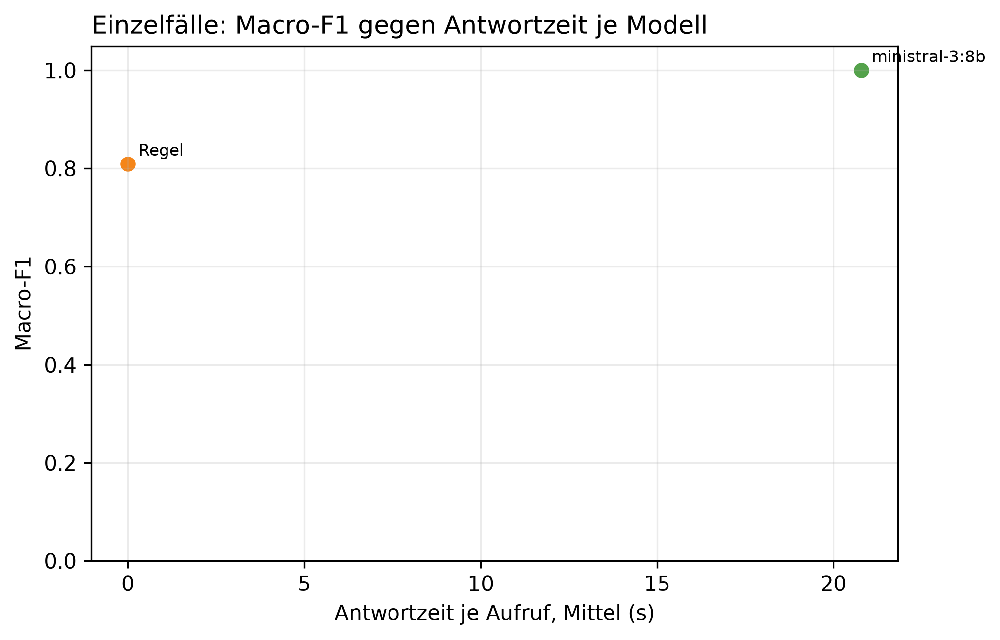

# K3 LLM-Klassifikation und Modellwahl, Läufe k3_016 / k3_seq_016

## Setup

- Läufe (Ebene 1 / Ebene 2): k3_016 / k3_seq_016
- Prompt (Ebene 1 / Ebene 2): v29 / v29
- Modelle: MDL5 ministral-3:8b
- LLM: temperature 0,0, höchstens 2 Versuche je Aufruf
- Ebene 1: 10 synthetische Fälle, je Modell 1 Aufruf je Fall, Regel (BASELINE) läuft mit
- Ebene 2: Standard-Szenarien, Cutover CO3 (2015-03-01), 40 Tage davor, 60 danach, jedes Modell als eigener Kreislauf wie SYS3 mit Adaption
- Ereignisse Ebene 2: control = keine Änderung, scaled_strong = Sprung +30 %, peak_strong = Spitze +1000 W über 6 h
- Produktivmodell SYS3: ministral-3:8b
- Commit (Ebene 1 / Ebene 2): 29d5566 / 29d5566 (mit lokalen Änderungen)
- Textprüfung: 9 Steuerungswörter, Zahlentoleranz 0,5, gerundet auf 10 erlaubt, Fensterzahlen aus dem Prompt 7, 28

## Kennzahlen

| Kennzahl | Wert | Bezug |
|---|---|---|
| Ebene 1: bestes Modell nach Macro-F1 | ministral-3:8b | Macro-F1 1,00, Regel 0,81 |
| ministral-3:8b: Ebene 1 richtig | 10/10 | Regel 9/10 |
| ministral-3:8b: Antwortzeit je Aufruf im Mittel [s] | 20,8 | p95 36,0 s, Regel 0,0 s |
| ministral-3:8b: Ebene 2 Ereignis-Arten erkannt | 2/2 | Regel 2/2 |
| ministral-3:8b: Ebene 2 Tage mit anderer Klasse als die Regel | 4 | 2015-04-05 new_pattern statt normal; 2015-04-07 peak statt normal; 2015-04-09 new_pattern statt normal; 2015-04-10 peak statt normal |
| ministral-3:8b: ungültige Antworten Ebene 1 | 0 | Ausfalltage Ebene 2: 0 |
| ministral-3:8b: Antworten mit Textverstoß (Ebene 1 / Ebene 2) | 0/10 / 0/93 | Steuerung oder Zahl, Datum, Uhrzeit nicht im State |
| ministral-3:8b: Antworten mit fehlenden Belegen (Ebene 1 / Ebene 2) | 1/10 / 2/93 | zitierte Belege passen nicht zur eigenen Klasse |

## Ebene 1: Modellvergleich auf den Einzelfällen

| ID | Modell | richtig | Macro-F1 | ungültig | Ø Versuche | Grounding | Ø s je Aufruf | p95 s |
|---|---|---|---:|---:|---:|---:|---:|---:|
| MDL5 | ministral-3:8b | 10/10 | 1,0 | 0 | 1,0 | 0,9 | 20,8 | 36,0 |
| BASELINE | Regel | 9/10 | 0,8 | 0 | 1,0 | - | 0,0 | 0,0 |

## Ebene 1: Antwort je Fall (✓ = richtig, sonst die Antwort, - = ungültig)

| Fall | erwartet | ministral-3:8b | Regel |
|---|---|---|---|
| absence_drift_down | absence | ✓ | new_pattern |
| low_single_scale | low | ✓ | ✓ |
| measurement_error_missing_day | measurement_error | ✓ | ✓ |
| new_pattern | new_pattern | ✓ | ✓ |
| new_pattern_at_min_scales_boundary | new_pattern | ✓ | ✓ |
| new_pattern_drift_down | new_pattern | ✓ | ✓ |
| normal_single_sustained_scale | normal | ✓ | ✓ |
| normal_weekly_after_reset | normal | ✓ | ✓ |
| peak | peak | ✓ | ✓ |
| peak_single_sustained_scale | peak | ✓ | ✓ |

## Automatische Textprüfung je Modell (Antworten mit Verstoß oder fehlenden Belegen)

| Modell | E1 Antworten | E1 mit Verstoß | E1 Belege fehlen | E2 Antworten | E2 mit Verstoß | E2 Belege fehlen |
|---|---:|---:|---:|---:|---:|---:|
| ministral-3:8b | 10 | 0 | 1 | 93 | 0 | 2 |

## Ebene 2: je Modell über alle Ereignis-Arten

| Modell | Ereignis-Arten erkannt | Tage anders als die Regel | Gate-Tage | Ausfalltage | Meldungen Kontrolle | unknown Kontrolle | Resets Kontrolle |
|---|---|---:|---:|---:|---:|---:|---:|
| ministral-3:8b | 2/2 | 4 | 93 | 0 | 2 | 0 | 1 |
| Regel | 2/2 | 0 | 96 | 0 | 0 | 0 | 0 |

## Ebene 2: Erkennung je Ereignis, Tag seit Cutover

| config | Ereignis | erwartet | Gate-Tage durch das Ereignis | davon richtig | erster richtiger Tag | Resets |
|---|---|---|---:|---:|---:|---:|
| BASELINE | Spitze +1000 W über 6 h | peak | 6 | 1 | 1 | 0 |
| BASELINE | Sprung +30 % | new_pattern | 13 | 1 | 22 | 1 |
| MDL5 | Spitze +1000 W über 6 h | peak | 10 | 1 | 1 | 0 |
| MDL5 | Sprung +30 % | new_pattern | 20 | 1 | 22 | 2 |

## Ebene 2: Tage, an denen ein Modell anders einordnet als die Regel

| Modell | analysierter Tag | Regel | Modell sagt | in Arten |
|---|---|---|---|---|
| ministral-3:8b | 2015-04-05 | normal | new_pattern | scaled_strong |
| ministral-3:8b | 2015-04-07 | normal | peak | scaled_strong |
| ministral-3:8b | 2015-04-09 | normal | new_pattern | control |
| ministral-3:8b | 2015-04-10 | normal | peak | control |

## Hinweise

- Ebene 1 prüft, ob ein Modell die Regeln aus dem Prompt nachvollzieht. Der Prompt wurde auf denselben Fällen verbessert, die Quoten begründen deshalb nur die Modellwahl und belegen nicht das Ziel von 80 % richtiger Klassen (dafür E5)
- wenige Fälle: ein Fall sind mehrere Prozentpunkte, eine Klasse hängt teils an einem einzigen Fall
- Macro-F1: Mittel der F1-Werte über die Klassen, die als erwartete Klasse vorkommen
- Grounding: Anteil der für den Fall erwarteten Felder, die das Modell als Beleg zitiert. Die Regel zitiert keine
- Tag seit Cutover = Entscheidungstag: an Tag n meldet das System, eingeordnet ist dabei Tag n-1. Ab Cutover zählt deshalb erst ab Tag 1
- Ebene 2, erkannt: erwartete Klasse an einem Tag, an dem nur das Ereignis das Gate öffnet (gepaart mit dem Kontrolllauf desselben Modells)
- Ebene 2, anders als die Regel: gleiche Art und gleicher analysierter Tag, Regel gegen Modell. Nach einem Reset an verschiedenen Tagen laufen die Reihen auseinander, spätere Abweichungen können daraus folgen
- Antwortzeit: gemessen auf dem Rechner des Laufs, nur zum Vergleich der Modelle untereinander
- Textprüfung: Verstoß heißt, ein Steuerungswort oder eine Zahl, ein Datum oder eine Uhrzeit steht im Text, aber nicht im State des Falls. Zahlwörter („sechs Wochen“) findet sie nicht. Die Fensterlängen 7 und 28 aus der Skalenbeschreibung im Prompt gelten als erlaubt
- Fehlende Belege: der Prompt verlangt je Klasse bestimmte Pfade (new_pattern: sustained_drift, Streaks, peak/low: level, direction, absence: level, Kalendereintrag, measurement_error: Flag). Geprüft wird gegen die eigene Klasse des Modells, nicht gegen die erwartete. Ebene 1 wird nur für Läufe geprüft, die den State der Fälle in der Antwortdatei speichern, ältere Läufe haben in der Tabelle 0 Antworten
- Antworttexte und Auffälligkeiten der Textprüfung im Anhang, Antworten für alle Modelle in Ebene 1 und Ebene 2. Als CSV: answers_single.csv für Ebene 1, answers_sequence.csv für Ebene 2 nur vom Produktivmodell, result_text_findings.csv für die Auffälligkeiten

## Anhang

### Ebene 1: Precision, Recall und F1 je Klasse

| Modell | Klasse | Precision | Recall | F1 |
|---|---|---:|---:|---:|
| Regel | absence | 0,0 | 0,0 | 0,0 |
| Regel | low | 1,0 | 1,0 | 1,0 |
| Regel | measurement_error | 1,0 | 1,0 | 1,0 |
| Regel | new_pattern | 0,8 | 1,0 | 0,9 |
| Regel | normal | 1,0 | 1,0 | 1,0 |
| Regel | peak | 1,0 | 1,0 | 1,0 |
| ministral-3:8b | absence | 1,0 | 1,0 | 1,0 |
| ministral-3:8b | low | 1,0 | 1,0 | 1,0 |
| ministral-3:8b | measurement_error | 1,0 | 1,0 | 1,0 |
| ministral-3:8b | new_pattern | 1,0 | 1,0 | 1,0 |
| ministral-3:8b | normal | 1,0 | 1,0 | 1,0 |
| ministral-3:8b | peak | 1,0 | 1,0 | 1,0 |

### Ebene 1: Antworten der Modelle je Fall

**peak** (erwartet: peak)

- ministral-3:8b: peak ✓
  - Erklärung: Gestern war der Stromverbrauch um etwa 45 % höher als an einem normalen Wochentag. Das ist ungewöhnlich für diesen Tag.
  - Empfehlung: Überprüfen Sie, ob gestern ungewöhnliche Geräte oder Aktivitäten den Verbrauch erhöht haben könnten.
  - Unsicherheit: Ob der erhöhte Verbrauch auf eine geplante Abwesenheit oder ein technisches Problem zurückzuführen ist, lässt sich ohne Kalendereinträge nicht klären.

**new_pattern** (erwartet: new_pattern)

- ministral-3:8b: new_pattern ✓
  - Erklärung: Gestern war der Stromverbrauch um etwa 38 % höher als an einem typischen Wochentag. Seit dem 9. Dezember liegt die wöchentliche und langfristige Nutzung deutlich über dem üblichen Niveau.
  - Empfehlung: Überprüfen Sie, ob sich der Stromverbrauch in den letzten Wochen erhöht hat oder ob neue Geräte oder Veränderungen im Haushalt aufgetreten sind.
  - Unsicherheit: Ob die erhöhte Nutzung durch eine konkrete Ursache wie Heizungsänderungen oder zusätzliche Geräte verursacht wurde, ist noch unklar.

**low_single_scale** (erwartet: low)

- ministral-3:8b: low ✓
  - Erklärung: Gestern war der Stromverbrauch um etwa 30 % niedriger als an einem typischen Wochentag im Dezember.
  - Empfehlung: Überprüfen Sie, ob gestern ungewöhnlich wenig Strom verbraucht wurde – etwa durch Abwesenheit oder besondere Umstände wie eine längere Reise oder einen Ausfall von Geräten.
  - Unsicherheit: Ob ein geplanter Urlaub oder ein anderer Grund für den niedrigeren Verbrauch verantwortlich ist, kann nicht geprüft werden, da keine Kalendereinträge verfügbar sind.

**peak_single_sustained_scale** (erwartet: peak)

- ministral-3:8b: peak ✓
  - Erklärung: Gestern war der Stromverbrauch für einen Wochentag ungewöhnlich hoch, um etwa 40 % über dem üblichen Niveau. Dies ist ein einzelner Ausreißer ohne anhaltende Veränderung.
  - Empfehlung: Überprüfen Sie, ob gestern ungewöhnlich viele Geräte gleichzeitig genutzt wurden oder ob ein neues Gerät hinzugekommen ist.
  - Unsicherheit: Ob der erhöhte Verbrauch auf eine einmalige Nutzung zurückzuführen ist oder ob sich die Gewohnheiten dauerhaft geändert haben, lässt sich erst nach weiteren Tagen beurteilen.

**normal_single_sustained_scale** (erwartet: normal)

- ministral-3:8b: normal ✓
  - Erklärung: Gestern war der Stromverbrauch etwas höher als sonst an einem Dienstag, aber nicht ungewöhnlich für die letzten Tage.
  - Empfehlung: Es gibt nichts zu überprüfen, da der Verbrauch im Rahmen liegt und sich die Situation nicht verändert hat.
  - Unsicherheit: Ob der höhere Verbrauch auf kürzere Tage oder andere Faktoren wie Heizung zurückzuführen ist, kann nur durch Beobachtung des täglichen Verbrauchs geklärt werden.

**normal_weekly_after_reset** (erwartet: normal)

- ministral-3:8b: normal ✓
  - Erklärung: Gestern war der Stromverbrauch etwas niedriger als sonst an einem Dienstag, aber die Abweichung ist nicht ungewöhnlich für einen einzelnen Tag.
  - Empfehlung: Es gibt keine Handlungsbedarf, da die Abweichung nur kurzfristig und nicht nachhaltig ist.
  - Unsicherheit: Ob der Verbrauch in den nächsten Tagen wieder normal bleibt, hängt davon ab, ob sich die Nutzung im Haushalt verändert hat.

**new_pattern_at_min_scales_boundary** (erwartet: new_pattern)

- ministral-3:8b: new_pattern ✓
  - Erklärung: Gestern war der Stromverbrauch um etwa 35 % höher als an einem normalen Wochentag, und dieser Trend hält seit dem 10. Dezember an.
  - Empfehlung: Überprüfen Sie, ob sich der Stromverbrauch in den letzten Wochen verändert hat, zum Beispiel durch neue Geräte oder längere Nutzung von Heizung oder Beleuchtung.
  - Unsicherheit: Ob die erhöhte Nutzung saisonal bedingt ist (z. B. durch kürzere Tage im Winter), kann nur mit weiteren Informationen über Ihren Haushaltsverbrauch geklärt werden.

**measurement_error_missing_day** (erwartet: measurement_error)

- ministral-3:8b: measurement_error ✓
  - Erklärung: Der gemessene Wert für gestern ist nicht vertrauenswürdig und kann keine Rückschlüsse auf den Verbrauch zulassen.
  - Empfehlung: Es gibt keinen zuverlässigen Wert, den Sie überprüfen können. Bitte prüfen Sie die Messgeräte oder kontaktieren Sie Ihren Stromanbieter.
  - Unsicherheit: Ob der Fehler nur gestern aufgetreten ist oder länger anhält, kann nicht beurteilt werden.

**new_pattern_drift_down** (erwartet: new_pattern)

- ministral-3:8b: new_pattern ✓
  - Erklärung: Der Stromverbrauch ist seit Mitte Dezember deutlich niedriger als sonst, und das schon über mehrere Wochen hinweg. Gestern lag er etwa 40 % unter dem üblichen Wert für einen Dienstag.
  - Empfehlung: Überprüfen Sie, ob der Stromzähler oder ein Gerät wie die Heizung ungewöhnlich wenig verbraucht hat – etwa durch Wartungsarbeiten oder eine Umstellung.
  - Unsicherheit: Ob der Verbrauch wirklich dauerhaft niedriger ist oder nur saisonal bedingt (z. B. kürzere Heizperiode) bleibt, hängt davon ab, ob sich das Muster in den nächsten Wochen fortsetzt.

**absence_drift_down** (erwartet: absence)

- ministral-3:8b: absence ✓
  - Erklärung: Gestern war der Stromverbrauch ungewöhnlich niedrig, da Sie im Urlaub waren.
  - Empfehlung: Da die Abwesenheit geplant war, ist nichts weiter zu prüfen. Der Verbrauch wird sich nach Ihrer Rückkehr wieder normalisieren.
  - Unsicherheit: Ob der Verbrauch während des Urlaubs tatsächlich niedriger war als sonst, hängt davon ab, ob Geräte wie Heizung oder Beleuchtung ausgeschaltet waren.

### Ebene 2: Antworten von ministral-3:8b, ein Tag mit allen Arten, in denen derselbe Text kam

- 2015-01-24: normal (Arten: control, peak_strong, scaled_strong)
  - Erklärung: Gestern war der Stromverbrauch etwas höher als sonst an einem Dienstag, aber die Abweichung ist nicht ungewöhnlich und bleibt im Rahmen des Üblichen.
  - Empfehlung: Es gibt keinen Grund zur Sorge oder Handlung. Der Verbrauch liegt weiterhin im normalen Bereich, auch wenn er gestern etwas höher war.
  - Unsicherheit: Ob der höhere Verbrauch auf ungewöhnliche Aktivitäten zurückzuführen ist, kann nicht beurteilt werden, da keine Kalendereinträge verfügbar sind.
- 2015-01-25: normal (Arten: control, peak_strong, scaled_strong)
  - Erklärung: Gestern lag der Verbrauch im Vergleich zum üblichen Winterverlauf etwa 22 % niedriger, was auf eine ungewöhnlich geringe Nutzung hindeutet.
  - Empfehlung: Da der Verbrauch seit dem 19. Januar ungewöhnlich niedrig bleibt, prüfen Sie bitte, ob Geräte oder Heizung außer Betrieb sind oder ob jemand länger weg war.
  - Unsicherheit: Ob ein geplanter Aufenthalt außerhalb des Hauses den Verbrauch erklärt, kann nicht geprüft werden.
- 2015-01-26: normal (Arten: control, peak_strong, scaled_strong)
  - Erklärung: Gestern war der Stromverbrauch um etwa 30 % niedriger als sonst im Januar, aber das ist nicht ungewöhnlich für diese Jahreszeit.
  - Empfehlung: Da der Verbrauch seit Anfang Januar um etwa 19 % niedriger liegt, prüfen Sie bitte, ob sich etwas am Haushalt geändert hat (z. B. weniger Heizung oder Beleuchtung).
  - Unsicherheit: Ob die kalte Jahreszeit den Verbrauch tatsächlich so stark beeinflusst, lässt sich ohne Kalendereinträge nicht sicher beurteilen.
- 2015-01-27: normal (Arten: control, peak_strong, scaled_strong)
  - Erklärung: Gestern war der Stromverbrauch etwas niedriger als sonst, aber nicht ungewöhnlich für einen einzelnen Tag.
  - Empfehlung: Es gibt nichts Ungewöhnliches zu überprüfen. Der Verbrauch liegt im üblichen Bereich und die Abweichung ist nicht besorgniserregend.
  - Unsicherheit: Ob ein geplanter Urlaub oder eine andere Abwesenheit den Verbrauch beeinflusst hat, kann nicht geprüft werden, da keine Kalendereintragungen verfügbar sind.
- 2015-01-28: normal (Arten: control, peak_strong, scaled_strong)
  - Erklärung: Gestern war der Stromverbrauch etwas höher als sonst an einem Dienstag, aber nicht ungewöhnlich für die letzten Wochen.
  - Empfehlung: Es gibt keinen Grund zur Sorge. Der Verbrauch liegt im üblichen Bereich und es ist nichts zu überprüfen.
  - Unsicherheit: Ob ein geplanter Urlaub oder eine andere Abwesenheit den Verbrauch beeinflusst hat, kann nicht geprüft werden.
- 2015-02-18: normal (Arten: control, peak_strong, scaled_strong)
  - Erklärung: Gestern war der Stromverbrauch etwas höher als sonst, aber nicht ungewöhnlich für die letzten Wochen.
  - Empfehlung: Es gibt nichts Ungewöhnliches zu beachten. Der Verbrauch liegt im üblichen Bereich und es ist keine weitere Handlung nötig.
  - Unsicherheit: Ob der höhere Verbrauch auf ungewöhnliche Aktivitäten oder äußere Umstände wie das Wetter zurückzuführen ist, kann nicht bestimmt werden.
- 2015-02-19: normal (Arten: control, peak_strong, scaled_strong)
  - Erklärung: Gestern war der Stromverbrauch etwas höher als sonst, aber nicht ungewöhnlich für die letzten Wochen.
  - Empfehlung: Es gibt nichts Ungewöhnliches zu beachten. Der Verbrauch liegt im üblichen Bereich und es ist kein Handeln nötig.
  - Unsicherheit: Ob ein geplanter Urlaub oder eine andere Abwesenheit den Verbrauch beeinflusst hat, kann nicht geprüft werden.
- 2015-02-20: normal (Arten: control, peak_strong, scaled_strong)
  - Erklärung: Gestern war der Stromverbrauch etwas niedriger als sonst, aber das ist nicht ungewöhnlich und kein Grund zur Sorge.
  - Empfehlung: Es gibt nichts zu überprüfen, da die Abweichung nur kurzfristig auftritt und keine weiteren Hinweise auf ein Problem vorliegen.
  - Unsicherheit: Ob der Verbrauch in den nächsten Tagen wieder normal bleibt, hängt davon ab, ob sich die Nutzung im Haushalt verändert hat.
- 2015-02-21: normal (Arten: control, peak_strong, scaled_strong)
  - Erklärung: Gestern war der Stromverbrauch etwas höher als sonst, aber nicht ungewöhnlich für die letzten Wochen.
  - Empfehlung: Es gibt nichts Ungewöhnliches zu beachten. Der Verbrauch liegt im üblichen Bereich und es ist keine weitere Handlung nötig.
  - Unsicherheit: Ob ein geplanter Urlaub oder eine andere Abwesenheit den Verbrauch beeinflusst hat, kann nicht geprüft werden.
- 2015-02-22: normal (Arten: control, peak_strong, scaled_strong)
  - Erklärung: Gestern war der Stromverbrauch etwas höher als sonst, aber nicht ungewöhnlich für die letzten Wochen.
  - Empfehlung: Es gibt nichts Ungewöhnliches zu beachten. Der Verbrauch liegt im üblichen Bereich und es ist kein Handeln nötig.
  - Unsicherheit: Ob der höhere Verbrauch auf kürzere Tage oder andere Faktoren wie Heizung zurückzuführen ist, kann nicht genau bestimmt werden.
- 2015-02-23: normal (Arten: control, peak_strong, scaled_strong)
  - Erklärung: Gestern war der Stromverbrauch etwas höher als sonst, aber nicht ungewöhnlich für die letzten Wochen.
  - Empfehlung: Es gibt nichts Ungewöhnliches zu beachten. Der Verbrauch liegt im üblichen Bereich trotz der höheren Werte in den letzten Tagen.
  - Unsicherheit: Ob die erhöhten Werte auf eine dauerhafte Veränderung oder nur auf kurzfristige Faktoren wie das Wetter hindeuten, lässt sich ohne weitere Informationen nicht abschätzen.
- 2015-02-24: normal (Arten: control, peak_strong, scaled_strong)
  - Erklärung: Gestern war der Stromverbrauch etwas niedriger als sonst, aber das ist nicht ungewöhnlich und kein Grund zur Sorge.
  - Empfehlung: Es gibt nichts zu überprüfen, da die Abweichung nur geringfügig ist und keine ungewöhnlichen Umstände vorlagen.
  - Unsicherheit: Ob ein geplanter Urlaub oder eine andere Abwesenheit den Verbrauch beeinflusst hat, kann nicht geprüft werden, da der Kalender nicht verfügbar war.
- 2015-02-25: normal (Arten: control, peak_strong, scaled_strong)
  - Erklärung: Gestern war der Stromverbrauch etwas niedriger als sonst, aber nicht ungewöhnlich für einen einzelnen Tag.
  - Empfehlung: Es gibt nichts Ungewöhnliches zu überprüfen. Der Verbrauch liegt im üblichen Bereich und die Abweichung ist nicht besorgniserregend.
  - Unsicherheit: Ob ein geplanter Urlaub oder eine andere Abwesenheit den niedrigeren Verbrauch erklärt, kann nicht geprüft werden.
- 2015-03-01: peak (Arten: peak_strong)
  - Erklärung: Gestern war der Stromverbrauch ungewöhnlich hoch, sowohl über den Tag verteilt als auch insgesamt für einen Wochentag. Der Verbrauch lag etwa 70 % höher als sonst an einem solchen Tag.
  - Empfehlung: Überprüfen Sie, ob gestern ungewöhnlich viele Geräte gleichzeitig genutzt wurden oder ob ein neues Gerät in Betrieb genommen wurde.
  - Unsicherheit: Ob der Verbrauch durch einen besonderen Anlass wie Gäste oder eine technische Anlage erklärt werden kann, ist ohne weitere Informationen nicht klar.
- 2015-03-05: peak (Arten: scaled_strong)
  - Erklärung: Gestern war der Stromverbrauch um etwa 76 % höher als an einem normalen Dienstag im März. Das ist ungewöhnlich für einen einzigen Tag.
  - Empfehlung: Überprüfen Sie, ob gestern ungewöhnliche Geräte oder Aktivitäten den Verbrauch erhöht haben könnten, z. B. Heizungs- oder Lüftungsanlagen, die länger liefen als sonst.
  - Unsicherheit: Ob der erhöhte Verbrauch auf einen einmaligen Grund zurückzuführen ist oder Teil eines neuen Musters wird, lässt sich erst nach weiteren Tagen beurteilen.
- 2015-03-08: normal (Arten: scaled_strong)
  - Erklärung: Gestern war der Stromverbrauch etwas höher als sonst, aber nicht ungewöhnlich für einen einzelnen Tag.
  - Empfehlung: Es gibt nichts Ungewöhnliches zu beachten. Der Verbrauch liegt im üblichen Bereich und es ist keine weitere Handlung nötig.
  - Unsicherheit: Ob der höhere Verbrauch auf einen konkreten Grund wie längere Nutzung von Geräten oder äußere Umstände zurückzuführen ist, kann nicht bestimmt werden.
- 2015-03-09: normal (Arten: scaled_strong)
  - Erklärung: Gestern war der Stromverbrauch im Vergleich zur letzten Woche um etwa 25 % höher, aber das ist nicht ungewöhnlich für diese Zeit des Jahres.
  - Empfehlung: Es gibt keinen Grund zur Sorge, da der erhöhte Verbrauch auf die längeren Tage im Frühling zurückzuführen sein könnte.
  - Unsicherheit: Ob es sich um eine saisonale Veränderung handelt oder ob ein Gerät länger genutzt wurde, lässt sich ohne weitere Informationen nicht genau bestimmen.
- 2015-03-10: normal (Arten: scaled_strong)
  - Erklärung: Gestern war der Stromverbrauch für einen Dienstag ungewöhnlich hoch, aber die Abweichung hat sich nur über eine Woche gehalten und ist nicht nachhaltig.
  - Empfehlung: Da die Abweichung nur kurzfristig war, ist keine weitere Handlung nötig. Sie können prüfen, ob gestern ungewöhnlich viele Geräte gleichzeitig genutzt wurden oder ob ein Gerät länger lief als sonst.
  - Unsicherheit: Ob der erhöhte Verbrauch auf einen einmaligen Grund wie eine längere Nutzung von Elektrogeräten zurückzuführen war, kann nicht sicher bestimmt werden.
- 2015-03-11: normal (Arten: scaled_strong)
  - Erklärung: Gestern war der Stromverbrauch im Vergleich zur letzten Woche um etwa 25 % höher, aber dieser Anstieg hat sich bereits seit dem 3. März gehalten und ist daher nicht ungewöhnlich.
  - Empfehlung: Es gibt keinen Grund zur Sorge, da der erhöhte Verbrauch bereits länger anhält und sich nicht plötzlich verändert hat.
  - Unsicherheit: Ob ein geplanter Anstieg des Stromverbrauchs vorliegt oder ob es andere Gründe gibt, kann ohne Kalendereinblick nicht geklärt werden.
- 2015-03-12: normal (Arten: scaled_strong)
  - Erklärung: Gestern war der Stromverbrauch im Vergleich zur letzten Woche um etwa 20 % höher, aber das ist nicht ungewöhnlich für diese Zeit des Jahres.
  - Empfehlung: Es gibt keinen Grund zur Sorge, da der erhöhte Verbrauch nur eine Woche anhält und mit der Jahreszeit übereinstimmen könnte.
  - Unsicherheit: Ob die höhere Nutzung auf den Frühling oder andere Faktoren zurückzuführen ist, lässt sich ohne weitere Informationen nicht genau bestimmen.
- 2015-03-13: normal (Arten: scaled_strong)
  - Erklärung: Gestern war der Stromverbrauch etwas höher als sonst an einem Dienstag, aber die Abweichung ist nicht ungewöhnlich für einen einzelnen Tag und bleibt im Rahmen.
  - Empfehlung: Es gibt keinen Grund zur Sorge. Der Verbrauch liegt weiterhin im üblichen Bereich, auch wenn er in der letzten Woche leicht gestiegen ist.
  - Unsicherheit: Ob es sich um eine vorübergehende Erhöhung oder einen neuen Trend handelt, lässt sich erst nach weiteren Tagen beobachten.
- 2015-03-14: normal (Arten: scaled_strong)
  - Erklärung: Gestern war der Stromverbrauch im Vergleich zur Woche zuvor ungewöhnlich niedrig, aber die Abweichung ist nicht nachhaltig und liegt innerhalb des üblichen Bereichs für einen einzelnen Tag.
  - Empfehlung: Es gibt keine Handlungsbedarf, da der Verbrauch gestern im Rahmen lag und sich die Abweichung nicht wiederholt hat.
  - Unsicherheit: Ob ein geplanter Urlaub oder eine andere Ursache für den niedrigeren Verbrauch verantwortlich war, kann ohne Kalenderinformationen nicht geklärt werden.
- 2015-03-15: low (Arten: control)
  - Erklärung: Gestern war der Stromverbrauch um etwa 63 % niedriger als an einem typischen Wochentag im März.
  - Empfehlung: Überprüfen Sie, ob Sie gestern zu Hause waren oder ob der Stromzähler nicht abgelesen wurde.
  - Unsicherheit: Ob ein geplanter Urlaub oder eine Abwesenheit vorliegt, kann nicht geprüft werden.
- 2015-03-15: low (Arten: peak_strong)
  - Erklärung: Gestern war der Stromverbrauch um etwa 64 % niedriger als an einem typischen Wochentag im März.
  - Empfehlung: Überprüfen Sie, ob gestern niemand zu Hause war oder ob ein Gerät nicht wie üblich genutzt wurde.
  - Unsicherheit: Ob es einen geplanten Ausflug oder Urlaub gab, kann nicht geprüft werden.
- 2015-03-15: normal (Arten: scaled_strong)
  - Erklärung: Gestern war der Stromverbrauch ungewöhnlich niedrig, aber nur für einen Tag und ohne erkennbaren Grund. Die Werte haben sich heute wieder normalisiert.
  - Empfehlung: Da der Verbrauch gestern nur kurz niedriger war und sich heute wieder normalisiert hat, ist keine weitere Handlung nötig.
  - Unsicherheit: Ob es einen konkreten Grund für den niedrigen Verbrauch gab, lässt sich ohne Kalender oder weitere Informationen nicht klären.
- 2015-03-16: normal (Arten: scaled_strong)
  - Erklärung: Gestern war der Stromverbrauch etwas höher als sonst an einem Dienstag, aber nicht ungewöhnlich für die letzten Tage.
  - Empfehlung: Es gibt keinen Grund zur Sorge, da der Verbrauch im Rahmen liegt und sich die Situation nicht verändert hat.
  - Unsicherheit: Ob ein geplanter Aufenthalt außerhalb des Hauses den Verbrauch beeinflusst hat, kann nicht geprüft werden.
- 2015-03-17: normal (Arten: scaled_strong)
  - Erklärung: Gestern war der Verbrauch für einen Dienstag ungewöhnlich hoch, aber die Abweichung hat sich nur auf den letzten Tag beschränkt und ist nicht nachhaltig.
  - Empfehlung: Da es sich um eine einmalige Ausnahme handelt, ist keine weitere Handlung nötig. Sie können prüfen, ob gestern ungewöhnlich viele Geräte gleichzeitig genutzt wurden oder ob ein Gerät länger lief als sonst.
  - Unsicherheit: Ob der erhöhte Verbrauch auf einen besonderen Anlass zurückzuführen war, kann nicht weiter eingegrenzt werden.
- 2015-03-18: normal (Arten: scaled_strong)
  - Erklärung: Gestern war der Stromverbrauch etwas höher als sonst an einem Dienstag, aber die Abweichung ist nicht ungewöhnlich für einen einzelnen Tag und bleibt im Rahmen.
  - Empfehlung: Es gibt keinen Grund zur Sorge, da der Verbrauch gestern im üblichen Bereich lag und keine ungewöhnliche Veränderung vorliegt.
  - Unsicherheit: Ob ein geplanter Urlaub oder eine andere Abwesenheit den Verbrauch beeinflusst hat, kann nicht geprüft werden, da kein Kalender verfügbar ist.
- 2015-03-19: normal (Arten: scaled_strong)
  - Erklärung: Gestern war der Stromverbrauch etwas höher als sonst, aber nicht ungewöhnlich für die letzten Tage.
  - Empfehlung: Es gibt nichts Ungewöhnliches zu beachten, da der Verbrauch im Rahmen liegt und sich die Situation seit Tagen nicht stark verändert hat.
  - Unsicherheit: Ob ein geplanter Urlaub oder eine andere Abwesenheit den Verbrauch beeinflusst haben könnte, lässt sich ohne Kalender nicht klären.
- 2015-03-22: new_pattern (Arten: scaled_strong)
  - Erklärung: Gestern war der Stromverbrauch deutlich höher als sonst, und das seit über einer Woche so. Die letzten vier Wochen zusammen lagen Sie etwa 20 % über dem üblichen Wert.
  - Empfehlung: Überprüfen Sie, ob Geräte oder Beleuchtung länger laufen als sonst, besonders im Vergleich zu den letzten Wochen.
  - Unsicherheit: Ob der erhöhte Verbrauch auf eine dauerhafte Veränderung zurückzuführen ist, hängt davon ab, ob sich die Werte in den kommenden Tagen stabilisieren.
- 2015-04-02: low (Arten: control, peak_strong)
  - Erklärung: Gestern war der Stromverbrauch um etwa 57 % niedriger als an einem typischen Dienstag im April. Das ist ungewöhnlich für einen solchen Tag.
  - Empfehlung: Überprüfen Sie, ob gestern niemand zu Hause war oder ob der Stromzähler nicht korrekt abgelesen wurde.
  - Unsicherheit: Ob ein geplanter Urlaub oder eine Abwesenheit vorliegt, kann ohne Kalender nicht geprüft werden.
- 2015-04-02: low (Arten: scaled_strong)
  - Erklärung: Gestern war der Stromverbrauch insgesamt ungewöhnlich niedrig, und der Tagesverlauf war sehr flach.
  - Empfehlung: Überprüfen Sie, ob gestern Geräte oder Beleuchtung ausgeschaltet waren oder weniger genutzt wurden als sonst. Ein geplanter Urlaub oder ein längerer Aufenthalt außerhalb des Hauses ist nicht bekannt.
  - Unsicherheit: Ob es sich um eine dauerhafte Veränderung handelt, lässt sich erst nach weiteren Tagen beurteilen.
- 2015-04-03: low (Arten: control)
  - Erklärung: Gestern war der Stromverbrauch um etwa zwei Drittel niedriger als an einem normalen Dienstag im April.
  - Empfehlung: Da kein Kalender verfügbar ist, prüfen Sie bitte, ob gestern niemand zu Hause war oder ob ein ungewöhnliches Ereignis stattfand, das den Verbrauch stark reduziert haben könnte.
  - Unsicherheit: Ob es sich um einen geplanten Aufenthalt außerhalb des Hauses handelt, kann nicht geprüft werden.
- 2015-04-03: low (Arten: peak_strong)
  - Erklärung: Gestern war der Stromverbrauch um etwa zwei Drittel niedriger als an einem normalen Wochentag.
  - Empfehlung: Da kein Kalender verfügbar ist, prüfen Sie bitte, ob gestern niemand zu Hause war oder ob ein ungewöhnliches Ereignis stattfand, das den Verbrauch stark reduziert haben könnte.
  - Unsicherheit: Ob es sich um einen geplanten Aufenthalt außerhalb des Hauses handelt, kann nicht geprüft werden.
- 2015-04-03: low (Arten: scaled_strong)
  - Erklärung: Gestern war der Stromverbrauch ungewöhnlich niedrig, und der Verlauf des Tages war flacher als sonst.
  - Empfehlung: Da kein Kalender verfügbar ist, prüfen Sie bitte, ob gestern ungewöhnlich wenig Strom verbraucht wurde. Möglicherweise waren weniger Geräte im Einsatz oder es gab einen technischen Grund wie eine längere Abwesenheit ohne Planung.
  - Unsicherheit: Ob der niedrige Verbrauch auf eine geplante Abwesenheit zurückzuführen ist, kann nicht geprüft werden, da keine Kalenderdaten verfügbar sind.
- 2015-04-04: low (Arten: control)
  - Erklärung: Gestern war der Stromverbrauch um etwa zwei Drittel niedriger als an einem normalen Wochentag.
  - Empfehlung: Da kein Kalender verfügbar ist, prüfen Sie bitte, ob gestern niemand zu Hause war oder ob ein ungewöhnliches Ereignis stattfand, das den Verbrauch stark reduziert haben könnte.
  - Unsicherheit: Ob es sich um einen geplanten Aufenthalt außerhalb des Hauses handelt, kann nicht geprüft werden.
- 2015-04-04: low (Arten: peak_strong)
  - Erklärung: Gestern war der Stromverbrauch um etwa zwei Drittel niedriger als an einem normalen Wochentag.
  - Empfehlung: Da keine Kalendereinträge vorliegen, prüfen Sie bitte, ob gestern niemand zu Hause war oder ob ein Gerät nicht wie üblich genutzt wurde.
  - Unsicherheit: Ob es einen Grund für den niedrigen Verbrauch gibt, hängt davon ab, ob jemand im Haushalt an dem Tag tatsächlich abwesend war.
- 2015-04-05: low (Arten: control)
  - Erklärung: Gestern war der Stromverbrauch um etwa zwei Drittel niedriger als an einem normalen Dienstag im April.
  - Empfehlung: Überprüfen Sie, ob gestern niemand zu Hause war oder ob der Stromzähler nicht korrekt abgelesen wurde.
  - Unsicherheit: Ob ein geplanter Urlaub oder eine andere Abwesenheit vorlag, kann nicht geprüft werden.
- 2015-04-05: low (Arten: peak_strong)
  - Erklärung: Gestern war der Stromverbrauch um etwa 64 % niedriger als an einem typischen Dienstag dieser Woche.
  - Empfehlung: Überprüfen Sie, ob gestern niemand zu Hause war oder ob der Stromzähler nicht korrekt abgelesen wurde.
  - Unsicherheit: Ob ein geplanter Urlaub oder eine Abwesenheit vorliegt, kann nicht geprüft werden, da keine Kalendereinträge verfügbar sind.
- 2015-04-05: new_pattern (Arten: scaled_strong)
  - Erklärung: Gestern war der Stromverbrauch um etwa 41 % niedriger als sonst in dieser Woche. Das ist seit dem 30. März so.
  - Empfehlung: Überprüfen Sie, ob der Stromzähler oder ein Gerät wie die Heizung oder Warmwasserbereitung seit dem 30. März nicht mehr genutzt wird.
  - Unsicherheit: Ob es sich um eine geplante Abwesenheit handelt, können wir ohne Kalender nicht beurteilen.
- 2015-04-06: low (Arten: control)
  - Erklärung: Gestern war der Stromverbrauch um etwa 58 % niedriger als an einem typischen Dienstag dieser Woche.
  - Empfehlung: Da kein Kalender verfügbar ist, prüfen Sie bitte, ob gestern ungewöhnlich wenig Strom verbraucht wurde oder ob Geräte nicht wie gewohnt liefen.
  - Unsicherheit: Ob ein geplanter Urlaub oder eine Abwesenheit den Verbrauch erklärt, kann ohne Kalender nicht geprüft werden.
- 2015-04-07: normal (Arten: control)
  - Erklärung: Gestern war der Stromverbrauch im Vergleich zur letzten Woche um etwa 45 % niedriger, aber die Abweichung ist nicht langfristig und kein Muster geworden.
  - Empfehlung: Da keine Abwesenheit geplant war und die Werte sich wieder normalisieren, ist nichts weiter zu tun.
  - Unsicherheit: Ob der Verbrauch gestern tatsächlich niedriger war oder ob es ein Messfehler war, kann nicht sicher beurteilt werden.
- 2015-04-07: normal (Arten: peak_strong)
  - Erklärung: Gestern war der Stromverbrauch etwas niedriger als sonst, aber die Abweichung ist nicht ungewöhnlich und hält nur seit wenigen Tagen an.
  - Empfehlung: Es gibt nichts zu beachten, da die Abweichung nur kurzfristig ist und keine ungewöhnlichen Umstände vorliegen.
  - Unsicherheit: Ob der Verbrauch in den nächsten Tagen wieder normal wird, hängt davon ab, ob sich die Ursache für die aktuelle niedrigere Nutzung ändert.
- 2015-04-07: peak (Arten: scaled_strong)
  - Erklärung: Gestern war der Stromverbrauch über den Tag verteilt ungewöhnlich hoch, besonders in kurzen Spitzen. Das ist nicht typisch für einen normalen Wochentag.
  - Empfehlung: Überprüfen Sie, ob gestern ungewöhnlich viele Geräte gleichzeitig genutzt wurden oder ob ein neues Gerät in Betrieb genommen wurde.
  - Unsicherheit: Ob der Verbrauch durch einen konkreten Vorfall wie eine längere Nutzung von Heizung oder Beleuchtung verursacht wurde, ist ohne weitere Informationen nicht klar.
- 2015-04-08: normal (Arten: control)
  - Erklärung: Gestern war der Verbrauch etwas niedriger als sonst in dieser Woche, aber nicht ungewöhnlich für einen einzelnen Tag.
  - Empfehlung: Es gibt nichts Ungewöhnliches zu überprüfen. Der Verbrauch liegt im üblichen Bereich und die Abweichung ist nicht besorgniserregend.
  - Unsicherheit: Ob ein geplanter Urlaub oder eine andere Abwesenheit den niedrigeren Verbrauch erklärt, kann nicht geprüft werden.
- 2015-04-08: normal (Arten: peak_strong)
  - Erklärung: Gestern war der Verbrauch etwas niedriger als sonst an einem Dienstag, aber die Abweichung ist nicht ungewöhnlich für einen einzelnen Tag und hat sich nicht über mehrere Tage gehalten.
  - Empfehlung: Es gibt nichts Ungewöhnliches zu überprüfen, da der Verbrauch gestern im üblichen Rahmen lag.
  - Unsicherheit: Ob ein geplanter Urlaub oder eine andere Abwesenheit den niedrigeren Verbrauch erklärt hätte, kann nicht geprüft werden, da keine Kalendereinträge verfügbar sind.
- 2015-04-09: new_pattern (Arten: control)
  - Erklärung: Gestern war der Stromverbrauch um etwa 41 % niedriger als sonst an einem Dienstag und hat sich seit dem 2. April so gehalten.
  - Empfehlung: Überprüfen Sie, ob der Stromzähler oder ein Gerät wie ein Heizstab defekt ist, da die Verbrauchssenkung ungewöhnlich stark und länger anhaltend ist.
  - Unsicherheit: Ob es sich um einen technischen Defekt handelt, können Sie nur durch manuelles Prüfen feststellen.
- 2015-04-09: normal (Arten: peak_strong)
  - Erklärung: Gestern war der Stromverbrauch ungewöhnlich niedrig, aber die Abweichung ist nur auf den letzten Tag beschränkt und nicht nachhaltig.
  - Empfehlung: Da der Verbrauch gestern nur kurzzeitig niedriger war und keine nachhaltige Veränderung vorliegt, ist nichts weiter zu tun.
  - Unsicherheit: Ob es sich um eine einmalige Abweichung oder einen Beginn einer neuen Muster handelt, lässt sich erst in den nächsten Tagen klären.
- 2015-04-10: peak (Arten: control)
  - Erklärung: Gestern war der Stromverbrauch über den Tag verteilt ungewöhnlich hoch, besonders in kurzen Spitzen. Das ist nicht typisch für einen normalen Wochentag.
  - Empfehlung: Überprüfen Sie, ob gestern ungewöhnlich viele Geräte gleichzeitig genutzt wurden oder ob ein neues Gerät in Betrieb genommen wurde.
  - Unsicherheit: Ob es sich um einen einmaligen Ausreißer handelt oder um eine neue Gewohnheit, lässt sich erst nach weiteren Tagen beurteilen.
- 2015-04-10: normal (Arten: peak_strong)
  - Erklärung: Gestern war der Verbrauch etwas niedriger als sonst an einem Dienstag, aber die Abweichung ist nicht ungewöhnlich für einen einzelnen Tag und hat sich nicht über mehrere Tage gehalten.
  - Empfehlung: Es gibt nichts Ungewöhnliches zu beachten, da die Abweichung nur kurzfristig war und sich nicht wiederholt hat.
  - Unsicherheit: Ob der Verbrauch in den nächsten Tagen wieder normal bleibt, hängt davon ab, ob sich das Verhalten oder die Nutzung von Geräten geändert hat.
- 2015-04-11: normal (Arten: peak_strong)
  - Erklärung: Gestern war der Verbrauch für einen Dienstag ungewöhnlich hoch, aber die Abweichung ist nur kurzfristig und nicht nachhaltig.
  - Empfehlung: Es gibt keinen Grund zur Sorge, da der erhöhte Verbrauch nur eine Woche anhielt und sich bereits wieder normalisiert hat.
  - Unsicherheit: Ob es einen konkreten Grund für den kurzfristigen Anstieg gab, können Sie selbst prüfen, indem Sie die Nutzung Ihrer Geräte in dieser Zeit überprüfen.
- 2015-04-12: normal (Arten: peak_strong)
  - Erklärung: Gestern war der Stromverbrauch um etwa 40 % niedriger als an einem typischen Dienstag, aber die Abweichung ist nur kurzfristig und nicht nachhaltig.
  - Empfehlung: Da die Abweichung nur eine Woche anhielt und keine nachhaltige Veränderung vorliegt, ist nichts weiter zu tun.
  - Unsicherheit: Ob der Verbrauch gestern tatsächlich ungewöhnlich niedrig war oder ob ein Messfehler vorlag, kann nicht überprüft werden.
- 2015-04-13: normal (Arten: peak_strong)
  - Erklärung: Gestern war der Verbrauch für einen Dienstag ungewöhnlich hoch, aber die Abweichung ist nur kurzfristig und nicht nachhaltig.
  - Empfehlung: Es gibt keinen Grund zur Sorge, da der erhöhte Verbrauch nur auf einen einzelnen Tag beschränkt war und sich nicht wiederholt hat.
  - Unsicherheit: Ob es sich um eine einmalige Ausnahme oder ein kurzfristiges Ereignis handelte, lässt sich ohne weitere Informationen nicht genau bestimmen.
- 2015-04-18: normal (Arten: scaled_strong)
  - Erklärung: Gestern war der Stromverbrauch im Vergleich zur Woche insgesamt um etwa 45 % höher als sonst, aber das ist nicht ungewöhnlich für einen einzelnen Tag.
  - Empfehlung: Es gibt nichts Ungewöhnliches zu beachten, da die erhöhte Nutzung nur eine Woche lang anhielt und nicht auf ein neues Muster hindeutet.
  - Unsicherheit: Ob es sich um einen vorübergehenden Anstieg oder ein neues Verbrauchsverhalten handelt, lässt sich ohne weitere Informationen nicht abschließend klären.
- 2015-04-19: normal (Arten: scaled_strong)
  - Erklärung: Gestern war der Stromverbrauch über die Woche hinweg ungewöhnlich hoch, aber es handelt sich nicht um einen neuen Musterwechsel.
  - Empfehlung: Da der erhöhte Verbrauch nur eine Woche anhält und keine ungewöhnlichen Aktivitäten bekannt sind, ist kein Handeln nötig.
  - Unsicherheit: Ob es sich um einen vorübergehenden Anstieg handelt oder ob ein Gerät länger im Einsatz war, lässt sich ohne weitere Informationen nicht klären.
- 2015-04-20: normal (Arten: scaled_strong)
  - Erklärung: Gestern war der Stromverbrauch im Vergleich zur letzten Woche um etwa ein Drittel niedriger, aber das ist nicht ungewöhnlich für diese Zeit des Jahres.
  - Empfehlung: Es gibt nichts Ungewöhnliches zu überprüfen, da der Verbrauch im Rahmen einer saisonalen Veränderung liegt.
  - Unsicherheit: Ob die niedrigere Nutzung auf geplante Abwesenheiten oder andere Faktoren wie Wetter zurückzuführen ist, kann nicht bestimmt werden.
- 2015-04-21: normal (Arten: scaled_strong)
  - Erklärung: Gestern war der Stromverbrauch im Vergleich zur letzten Woche um etwa 30 % höher, aber dieser Anstieg hat sich seit dem 13. April gehalten und ist daher kein ungewöhnlicher Einzelfall.
  - Empfehlung: Es gibt keinen Grund zur Sorge, da der erhöhte Verbrauch bereits seit über einer Woche anhält und sich nicht plötzlich verändert hat.
  - Unsicherheit: Ob es einen konkreten Grund für den höheren Verbrauch gibt, können Sie nur prüfen, wenn Sie wissen, ob sich die Gewohnheiten oder Geräte im Haushalt geändert haben.
- 2015-04-22: normal (Arten: scaled_strong)
  - Erklärung: Gestern war der Stromverbrauch im Vergleich zur letzten Woche um etwa 30 % höher, aber dieser Anstieg hat sich seit dem 13. April gehalten und ist daher kein ungewöhnlicher Einzelfall.
  - Empfehlung: Da der erhöhte Verbrauch bereits seit über einer Woche anhält, gibt es keinen Grund zur Sorge oder weiteren Maßnahmen.
  - Unsicherheit: Ob die höhere Nutzung auf einen konkreten Grund wie längere Gerätebenutzung oder äußere Faktoren wie wärmere Temperaturen zurückzuführen ist, kann nicht bestimmt werden.
- 2015-04-23: normal (Arten: scaled_strong)
  - Erklärung: Gestern war der Stromverbrauch im Vergleich zur letzten Woche um etwa 28 % höher, aber dieser Anstieg hat sich seit dem 13. April gehalten und ist daher kein ungewöhnlicher Einzelfall.
  - Empfehlung: Da der erhöhte Verbrauch bereits seit über einer Woche anhält, gibt es keinen Grund zur Sorge oder weiteren Maßnahmen.
  - Unsicherheit: Ob ein geplanter Anstieg des Stromverbrauchs (z.B. durch längere Nutzung von Geräten) vorliegt, kann nicht geprüft werden, da keine Kalendereinträge verfügbar sind.
- 2015-04-24: normal (Arten: peak_strong)
  - Erklärung: Gestern war der Stromverbrauch etwas niedriger als sonst, aber nicht ungewöhnlich für einen einzelnen Tag.
  - Empfehlung: Es gibt nichts Ungewöhnliches zu überprüfen, da der Verbrauch im Rahmen liegt. Die niedrigere Nutzung könnte mit dem Wetter oder kürzeren Tagen zusammenhängen.
  - Unsicherheit: Ob ein geplanter Urlaub oder eine Abwesenheit den Verbrauch beeinflusst hat, kann nicht geprüft werden.
- 2015-04-24: normal (Arten: scaled_strong)
  - Erklärung: Gestern war der Stromverbrauch etwas höher als sonst, aber nicht ungewöhnlich für die letzten Tage.
  - Empfehlung: Es gibt nichts Ungewöhnliches zu beachten. Der Verbrauch liegt im üblichen Rahmen der letzten Woche.
  - Unsicherheit: Ob ein geplanter Urlaub oder eine andere Abwesenheit den Verbrauch beeinflusst hat, kann nicht geprüft werden.
- 2015-04-25: normal (Arten: peak_strong)
  - Erklärung: Gestern war der Stromverbrauch um etwa 18 % niedriger als sonst in dieser Zeit des Jahres, aber es gibt keine Hinweise auf ein ungewöhnliches Muster oder eine Störung.
  - Empfehlung: Da der Verbrauch seit Mitte April um etwa 18 % niedriger liegt, prüfen Sie bitte, ob sich etwas im Haushalt geändert hat – zum Beispiel weniger Heizung oder Beleuchtung durch längere Tageslichtstunden im Frühling.
  - Unsicherheit: Ob die aktuelle Verbrauchsentwicklung auf eine geplante Abwesenheit zurückzuführen ist, kann nicht geprüft werden, da keine Kalendereingaben verfügbar sind.
- 2015-04-26: normal (Arten: peak_strong)
  - Erklärung: Gestern war der Stromverbrauch um etwa 19 % niedriger als sonst in dieser Zeit des Jahres, aber das ist nicht ungewöhnlich und bleibt im Rahmen.
  - Empfehlung: Es gibt nichts Ungewöhnliches zu beachten. Der Verbrauch liegt wie erwartet niedrig für diese Jahreszeit, etwa durch kürzere Tage oder weniger Heizbedarf.
  - Unsicherheit: Ob der Verbrauch tatsächlich so niedrig bleibt, hängt davon ab, ob sich die Wetterbedingungen oder Gewohnheiten in den nächsten Tagen ändern.
- 2015-04-27: normal (Arten: peak_strong)
  - Erklärung: Gestern war der Stromverbrauch etwas höher als sonst an einem Dienstag, aber nicht ungewöhnlich für die letzten Wochen.
  - Empfehlung: Es gibt keinen Grund zur Sorge. Der Verbrauch liegt im üblichen Bereich und es ist nichts zu überprüfen.
  - Unsicherheit: Ob ein geplanter Urlaub oder eine andere Abwesenheit den Verbrauch beeinflusst hat, kann nicht geprüft werden.
- 2015-04-28: normal (Arten: peak_strong)
  - Erklärung: Gestern war der Stromverbrauch um etwa 29 % niedriger als an einem typischen Dienstag dieser Woche, aber das ist nicht ungewöhnlich für die letzten Wochen.
  - Empfehlung: Es gibt nichts Ungewöhnliches zu überprüfen, da der Verbrauch im Rahmen der letzten Wochen liegt.
  - Unsicherheit: Ob ein geplanter Urlaub oder eine andere Abwesenheit den niedrigeren Verbrauch erklärt, kann nicht geprüft werden.
- 2015-04-29: normal (Arten: peak_strong)
  - Erklärung: Gestern lag der Verbrauch im Vergleich zum üblichen Winterverlauf etwa 17 % niedriger, was auf die wärmere Jahreszeit hindeutet.
  - Empfehlung: Keine Maßnahmen nötig. Der Verbrauch ist im Frühling typischerweise niedriger als im Winter, da weniger geheizt wird und die Tage länger sind.
  - Unsicherheit: Ob der aktuelle Wert durch ungewöhnliche Umstände wie eine längere Abwesenheit oder technische Änderungen beeinflusst wurde, lässt sich ohne Kalendereinbindung nicht klären.

### Auffälligkeiten der Textprüfung

| Ebene | Modell | Fall oder Tag | Verstoß | fehlende Belege |
|---|---|---|---|---|
| Ebene 2 | ministral-3:8b | 2015-04-02 scaled_strong |  | anomaly.direction |
| Ebene 2 | ministral-3:8b | 2015-04-03 scaled_strong |  | anomaly.direction |
| Ebene 1 | ministral-3:8b | absence_drift_down |  | context.events.<index>.title |
